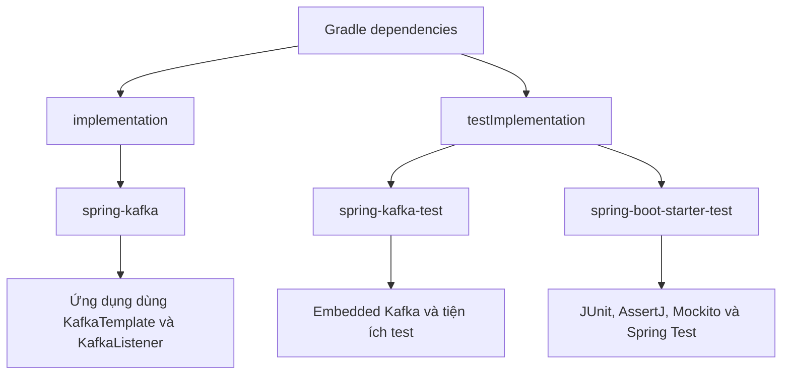

# Khai báo spring-kafka trong Gradle

Để sử dụng `KafkaTemplate`, `@KafkaListener` và các thành phần tích hợp Kafka trong Spring, dự án cần khai báo thư viện **Spring for Apache Kafka**. Artifact chính là `org.springframework.kafka:spring-kafka`. Với ứng dụng Spring Boot, nên để Spring Boot BOM quản lý phiên bản thư viện để Spring Kafka, Spring Framework và các thành phần liên quan tương thích với nhau.

Ngoài dependency chạy ứng dụng, dự án thường cần `spring-kafka-test` trong phạm vi kiểm thử. Hai dependency này có mục đích khác nhau: `spring-kafka` cung cấp API messaging lúc chạy; `spring-kafka-test` cung cấp công cụ kiểm thử như embedded Kafka broker và các tiện ích hỗ trợ test.

## 1. Dependency chính của Spring Kafka

Các thư viện thường gặp khi xây dựng ứng dụng Spring Kafka:

| Dependency | Phạm vi Gradle | Mục đích |
|---|---|---|
| `org.springframework.kafka:spring-kafka` | `implementation` | Cung cấp `KafkaTemplate`, `@KafkaListener`, listener container, message converter và các lớp cấu hình Spring Kafka. |
| `org.springframework.kafka:spring-kafka-test` | `testImplementation` | Cung cấp tiện ích kiểm thử Kafka, chẳng hạn `EmbeddedKafkaBroker` và annotation `@EmbeddedKafka`. |
| `org.springframework.boot:spring-boot-starter-test` | `testImplementation` | Cung cấp nền tảng kiểm thử Spring Boot, JUnit Jupiter, AssertJ và Mockito theo dependency management của Boot. |

`spring-kafka` phụ thuộc vào Kafka client tương ứng. Vì vậy, trong ứng dụng Spring Kafka thông thường, không cần khai báo riêng `org.apache.kafka:kafka-clients` chỉ để sử dụng `KafkaTemplate` hoặc `@KafkaListener`. Chỉ khai báo trực tiếp Kafka client khi mã nguồn chủ động dùng API Kafka cấp thấp và muốn thể hiện rõ dependency trực tiếp đó; vẫn phải giữ phiên bản tương thích với Spring Kafka.

## 2. Khai báo trong dự án Spring Boot dùng Groovy DSL

Nếu dự án đã có Spring Boot Gradle plugin và dependency management plugin, chỉ cần thêm dependency vào `build.gradle`:

```groovy
plugins {
    id 'java'
    id 'org.springframework.boot' version '<spring-boot-version>'
    id 'io.spring.dependency-management' version '<dependency-management-plugin-version>'
}

group = 'com.example'
version = '1.0.0'

repositories {
    mavenCentral()
}

dependencies {
    // Thư viện dùng trong mã nguồn chính.
    implementation 'org.springframework.kafka:spring-kafka'

    // Các thư viện chỉ phục vụ kiểm thử.
    testImplementation 'org.springframework.boot:spring-boot-starter-test'
    testImplementation 'org.springframework.kafka:spring-kafka-test'
}

tasks.named('test') {
    useJUnitPlatform()
}
```

Thay các placeholder trong phần `plugins` bằng phiên bản Spring Boot và dependency management plugin mà dự án đang sử dụng. Ví dụ trên không gắn phiên bản riêng vào `spring-kafka` và `spring-kafka-test`: khi Spring Boot plugin kết hợp với `io.spring.dependency-management`, BOM của Spring Boot được import tự động và quản lý các phiên bản tương ứng.

Nếu dự án đã có khối `plugins`, `repositories` và `dependencies`, không tạo thêm các khối trùng lặp. Chỉ bổ sung ba dòng dependency vào đúng khối hiện có. Dự án đã dùng `spring-boot-starter-web`, `spring-boot-starter-data-jpa` hoặc starter khác cũng không cần thêm `spring-boot-starter` chỉ để sử dụng Spring Kafka.

Ví dụ giả định ứng dụng đã có dependency nền tảng Spring Boot phù hợp, chẳng hạn `spring-boot-starter-web`. Nếu đang tạo một ứng dụng Boot tối giản và chưa có starter nào, hãy thêm `implementation 'org.springframework.boot:spring-boot-starter'` (hoặc starter phù hợp với loại ứng dụng). Spring Boot Gradle plugin hỗ trợ build và đóng gói; bản thân plugin không thay thế dependency runtime của ứng dụng.

## 3. Khai báo trong dự án dùng Kotlin DSL

Nếu tên file build là `build.gradle.kts`, cú pháp dependency sử dụng lời gọi hàm:

```kotlin
plugins {
    java
    id("org.springframework.boot") version "<spring-boot-version>"
    id("io.spring.dependency-management") version "<dependency-management-plugin-version>"
}

group = "com.example"
version = "1.0.0"

repositories {
    mavenCentral()
}

dependencies {
    implementation("org.springframework.kafka:spring-kafka")

    testImplementation("org.springframework.boot:spring-boot-starter-test")
    testImplementation("org.springframework.kafka:spring-kafka-test")
}

tasks.withType<Test> {
    useJUnitPlatform()
}
```

Quy tắc quản lý phiên bản giống Groovy DSL. Khác biệt chủ yếu nằm ở cú pháp Kotlin; tọa độ Maven của dependency không thay đổi.

## 4. Quản lý phiên bản bằng Spring Boot BOM

BOM (Bill of Materials) là danh sách phiên bản đã được kiểm tra tương thích. Khi dùng Spring Boot, BOM giúp dự án chọn một bộ phiên bản đồng bộ cho Spring Kafka, Spring Framework và nhiều thư viện nền tảng khác.

Có hai cách phổ biến để import BOM trong Gradle:

**Cách A — Spring Boot plugin kết hợp dependency management plugin.** Đây là cách thể hiện trong hai ví dụ trên. Spring Boot Gradle plugin tự import BOM khi `io.spring.dependency-management` được áp dụng. Vì vậy, dependency được khai báo không cần version riêng.

**Cách B — Dùng native BOM support của Gradle.** Nếu dự án không dùng dependency management plugin, có thể import BOM trực tiếp bằng `platform`:

```groovy
plugins {
    id 'java'
}

repositories {
    mavenCentral()
}

dependencies {
    implementation platform('org.springframework.boot:spring-boot-dependencies:<spring-boot-version>')

    implementation 'org.springframework.kafka:spring-kafka'

    testImplementation 'org.springframework.kafka:spring-kafka-test'
    testImplementation 'org.springframework.boot:spring-boot-starter-test'
}
```

Trong trường hợp này, thay `<spring-boot-version>` bằng phiên bản BOM muốn dùng. Nếu dùng Spring Boot Gradle plugin nhưng chọn native BOM support, hãy cấu hình rõ cách quản lý dependency theo một cơ chế thống nhất; tránh import BOM nhiều lần hoặc khai báo version riêng mâu thuẫn với BOM.

### Vì sao không nên tự chọn version cho từng thư viện?

Spring Kafka tích hợp với các API của Spring Framework và Kafka client. Nếu nâng riêng `spring-kafka` hoặc `kafka-clients` mà không xét bộ phiên bản Spring Boot đang quản lý, dự án có thể gặp lỗi tương thích lúc biên dịch hoặc lúc khởi động.

Với ứng dụng Spring Boot, hãy chọn phiên bản Boot phù hợp với Java và yêu cầu dự án, sau đó để BOM quản lý Spring Kafka. Chỉ override version khi có lý do kỹ thuật cụ thể, đã kiểm tra compatibility và có kiểm thử xác nhận.

## 5. Phân biệt dependency chạy ứng dụng và dependency kiểm thử

Gradle phân loại dependency theo configuration. Đặt thư viện vào đúng configuration giúp runtime classpath gọn hơn và tránh đóng gói thư viện kiểm thử vào ứng dụng.



- `implementation`: dependency cần có khi biên dịch và chạy mã nguồn chính. `spring-kafka` thuộc nhóm này vì các component producer/consumer cần thư viện khi ứng dụng hoạt động.
- `testImplementation`: dependency chỉ cần khi biên dịch và chạy test. `spring-kafka-test` và `spring-boot-starter-test` thuộc nhóm này.
- `runtimeOnly`: chỉ dùng khi cần thư viện ở runtime nhưng mã nguồn không tham chiếu API của nó lúc compile. Đây không phải configuration thay thế cho `spring-kafka`, vì ứng dụng thường import các lớp Spring Kafka.

Không đặt `spring-kafka` vào `testImplementation` nếu ứng dụng chính có `KafkaTemplate` hoặc `@KafkaListener`; khi chạy ứng dụng, các lớp này sẽ không có trên runtime classpath. Ngược lại, không cần đưa `spring-kafka-test` vào `implementation` vì thư viện test không cần thiết trong artifact chạy production.

## 6. Cấu hình kết nối Kafka sau khi thêm dependency

Khai báo Gradle chỉ đưa thư viện vào classpath. Nó không tự tạo Kafka broker, topic hay thông tin kết nối. Ứng dụng vẫn cần cấu hình địa chỉ broker và các thuộc tính producer/consumer phù hợp với môi trường.

Ví dụ cấu hình tối thiểu trong `src/main/resources/application.yml`:

```yaml
spring:
  kafka:
    bootstrap-servers: localhost:9092
    consumer:
      group-id: order-service
```

`bootstrap-servers` là danh sách địa chỉ broker để client bắt đầu kết nối và khám phá metadata cluster. `group-id` xác định consumer group mặc định. Khi dùng nhiều luồng consumer với mục đích khác nhau, có thể đặt group ID riêng trong cấu hình hoặc trực tiếp trên `@KafkaListener`.

Producer và consumer còn cần serializer/deserializer tương thích với kiểu key và value. Ví dụ, nếu producer gửi object Java dưới dạng JSON, hai phía cần thống nhất JSON serializer/deserializer hoặc message converter. Dependency `spring-kafka` cung cấp các thành phần tích hợp, nhưng không thể tự quyết định schema và hợp đồng dữ liệu của ứng dụng.

Với ứng dụng Spring Boot có các thư viện auto-configuration trên classpath, auto-configuration có thể tạo các factory và `KafkaTemplate` dựa trên `spring.kafka.*` khi dependency và cấu hình phù hợp. Với ứng dụng Spring Framework không dùng Boot, cần tự cấu hình producer factory, consumer factory, `KafkaTemplate`, listener container factory và bật xử lý annotation bằng `@EnableKafka`.

## 7. Kiểm tra dependency đã được Gradle phân giải

Sau khi cập nhật build file, chạy Gradle Wrapper ở thư mục gốc dự án:

Trên Windows:

```powershell
.\gradlew.bat dependencies --configuration runtimeClasspath
.\gradlew.bat dependencies --configuration testRuntimeClasspath
```

Trên Linux hoặc macOS:

```bash
./gradlew dependencies --configuration runtimeClasspath
./gradlew dependencies --configuration testRuntimeClasspath
```

Trong `runtimeClasspath`, kiểm tra có `org.springframework.kafka:spring-kafka` và các dependency Kafka client được phân giải. Trong `testRuntimeClasspath`, kiểm tra có `spring-kafka-test` và các thư viện kiểm thử.

Khi cần tìm lý do một phiên bản được chọn, dùng `dependencyInsight`:

```powershell
.\gradlew.bat dependencyInsight --dependency spring-kafka --configuration runtimeClasspath
.\gradlew.bat dependencyInsight --dependency kafka-clients --configuration runtimeClasspath
```

Lệnh tương đương trên Linux/macOS thay `gradlew.bat` bằng `./gradlew`. Kết quả giúp xác định dependency nào kéo thư viện vào, constraint hoặc BOM nào chọn phiên bản và có dependency nào yêu cầu phiên bản khác hay không.

## 8. Lỗi thường gặp

| Biểu hiện | Nguyên nhân thường gặp | Cách xử lý |
|---|---|---|
| Gradle báo thiếu version cho `spring-kafka` | Chưa import BOM hoặc chưa cấu hình dependency management. | Kiểm tra Spring Boot plugin, dependency management plugin hoặc `platform(...)`. |
| Không tìm thấy `KafkaTemplate` khi biên dịch | Thiếu `spring-kafka`, hoặc khai báo nhầm ở configuration chỉ dành cho test. | Đưa `spring-kafka` vào `implementation`. |
| Chạy ứng dụng bị `ClassNotFoundException` cho lớp Spring Kafka | Dependency không có trong runtime classpath hoặc bị exclude. | Kiểm tra `runtimeClasspath`, exclusion và cấu hình multi-module. |
| Test không tìm thấy `@EmbeddedKafka` | Thiếu `spring-kafka-test` trong test classpath. | Thêm `testImplementation` cho `spring-kafka-test`. |
| Phiên bản Kafka client không tương thích | Override `kafka-clients` độc lập với Spring Kafka/BOM. | Bỏ override không cần thiết hoặc xác minh bộ phiên bản tương thích. |
| Gradle không tải được artifact | Repository hoặc kết nối tới Maven repository có vấn đề. | Kiểm tra `mavenCentral()`, proxy, credentials nếu dùng repository riêng và thông báo lỗi Gradle. |
| Build file có nhiều khai báo dependency management | Import BOM nhiều lần hoặc trộn nhiều cơ chế quản lý version. | Chọn một cách quản lý phiên bản nhất quán và kiểm tra dependency insight. |

## 9. Ghi nhớ

- Dependency chạy chính của Spring Kafka là `org.springframework.kafka:spring-kafka` và thường đặt trong `implementation`.
- Dependency kiểm thử là `org.springframework.kafka:spring-kafka-test` và đặt trong `testImplementation`.
- Với Spring Boot, ưu tiên dùng BOM để quản lý phiên bản Spring Kafka và Kafka client đồng bộ.
- Groovy DSL dùng chuỗi dependency; Kotlin DSL dùng lời gọi hàm. Tọa độ artifact giống nhau.
- Thêm dependency không thay thế việc cấu hình broker, topic, serializer/deserializer hoặc consumer group.
- Dùng `dependencies` và `dependencyInsight` để kiểm tra dependency graph khi gặp xung đột phiên bản.

Khi khai báo Spring Kafka trong một dự án mới, hãy xác định trước dự án có dùng Spring Boot hay Spring Framework thuần, chọn một cơ chế quản lý phiên bản, thêm dependency runtime và test đúng phạm vi, rồi kiểm tra dependency graph bằng Gradle Wrapper. Sau bước này, dự án có nền tảng thư viện cần thiết để bắt đầu cấu hình producer và consumer.
