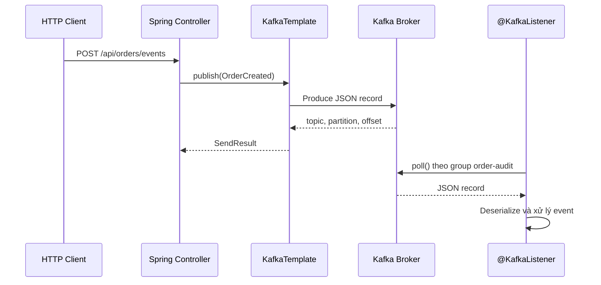

# Tạo ứng dụng mẫu gửi và nhận bản ghi

Một ứng dụng Spring Kafka tối thiểu cần có ba phần: cấu hình kết nối đến Kafka, một thành phần gửi record và một listener nhận record. Khi ba phần này hoạt động, ứng dụng có thể phát sự kiện vào topic và xử lý sự kiện theo consumer group mà không phải tự viết vòng lặp giao tiếp Kafka.

Bài học này xây dựng một ứng dụng mẫu nhận yêu cầu tạo sự kiện đơn hàng qua HTTP, gửi sự kiện bằng `KafkaTemplate` và đọc lại bằng `@KafkaListener`. Ví dụ sử dụng JSON để tuần tự hóa object Java, dùng `orderId` làm key và tạo topic bằng cấu hình Spring. Mục tiêu là có một project nhỏ chạy được để quan sát toàn bộ đường đi của một record.

## 1. Luồng hoạt động của ứng dụng

Ứng dụng mẫu có một producer và một consumer cùng chạy trong Spring Boot:

1. Client gửi HTTP request chứa dữ liệu sự kiện.
2. Controller chuyển dữ liệu thành `OrderCreated` và gọi service gửi Kafka.
3. `KafkaTemplate` serialize object thành JSON rồi gửi record đến topic `orders.events`.
4. Kafka broker lưu record vào một partition và cấp offset.
5. Listener container dùng Kafka consumer poll record theo group `order-audit`.
6. Spring Kafka deserialize JSON thành `OrderCreated` và gọi phương thức `@KafkaListener`.



Producer chỉ cần biết topic và hợp đồng dữ liệu. Consumer đăng ký topic và tự đọc theo offset của group. Kết quả gửi thành công từ Kafka xác nhận record được ghi theo cấu hình producer; nó không có nghĩa listener đã xử lý xong nghiệp vụ.

## 2. Chuẩn bị project Spring Boot

Ví dụ dùng Java 17 trở lên, Maven và Spring Boot 3.x. Hãy dùng phiên bản Spring Boot mà project đang quản lý; Spring Boot dependency management sẽ chọn phiên bản Spring Kafka tương thích. Không cần tự ghim một phiên bản `spring-kafka` khác nếu đã dùng starter và BOM của Spring Boot.

### 2.1. Khai báo dependency

Trong `pom.xml`, thêm các dependency cần thiết:

```xml
<dependencies>
    <dependency>
        <groupId>org.springframework.boot</groupId>
        <artifactId>spring-boot-starter-web</artifactId>
    </dependency>

    <dependency>
        <groupId>org.springframework.kafka</groupId>
        <artifactId>spring-kafka</artifactId>
    </dependency>

    <dependency>
        <groupId>org.springframework.boot</groupId>
        <artifactId>spring-boot-starter-test</artifactId>
        <scope>test</scope>
    </dependency>

    <dependency>
        <groupId>org.springframework.kafka</groupId>
        <artifactId>spring-kafka-test</artifactId>
        <scope>test</scope>
    </dependency>
</dependencies>
```

`spring-kafka` cung cấp `KafkaTemplate`, `@KafkaListener`, listener container và các abstraction tích hợp với Kafka client. `spring-kafka-test` cung cấp công cụ kiểm thử, bao gồm embedded Kafka broker. Nếu project đã có `spring-boot-starter-web` hoặc dependency test thì không khai báo trùng.

### 2.2. Tổ chức package

Một cấu trúc đơn giản có thể như sau:

```text
src/main/java/com/example/messaging
├── MessagingApplication.java
├── config
│   └── KafkaTopicConfig.java
├── event
│   └── OrderCreated.java
├── producer
│   └── OrderEventPublisher.java
├── consumer
│   └── OrderCreatedListener.java
└── web
    └── OrderEventController.java

src/main/resources
└── application.yml

src/test/java/com/example/messaging
└── OrderMessagingIntegrationTest.java
```

Đặt class main ở package gốc `com.example.messaging` để component scanning tìm được các package con. Các class event dùng chung một package ổn định để serializer và deserializer có thể nhận diện đúng kiểu dữ liệu.

## 3. Kết nối Kafka broker

Ứng dụng cần địa chỉ bootstrap server có thể truy cập. Trong môi trường local, ví dụ dưới đây giả định Kafka đang lắng nghe tại `localhost:9092`. Có thể dùng cluster local có sẵn hoặc Docker Compose. Một broker đơn phù hợp để học và thử nghiệm; production cần cấu hình nhiều broker, replication và bảo mật.

Ví dụ Docker Compose cho một broker KRaft đơn giản:

```yaml
services:
  kafka:
    image: apache/kafka:3.9.1
    hostname: kafka
    container_name: kafka-local
    ports:
      - "9092:9092"
    environment:
      KAFKA_CLUSTER_ID: 4L6g3nShT-eMCtK--X86sw
      KAFKA_NODE_ID: 1
      KAFKA_PROCESS_ROLES: broker,controller
      KAFKA_LOG_DIRS: /var/lib/kafka/data
      KAFKA_LISTENERS: PLAINTEXT://:9092,CONTROLLER://:9093
      KAFKA_ADVERTISED_LISTENERS: PLAINTEXT://localhost:9092
      KAFKA_CONTROLLER_LISTENER_NAMES: CONTROLLER
      KAFKA_LISTENER_SECURITY_PROTOCOL_MAP: CONTROLLER:PLAINTEXT,PLAINTEXT:PLAINTEXT
      KAFKA_CONTROLLER_QUORUM_VOTERS: 1@localhost:9093
      KAFKA_OFFSETS_TOPIC_REPLICATION_FACTOR: 1
      KAFKA_TRANSACTION_STATE_LOG_REPLICATION_FACTOR: 1
      KAFKA_TRANSACTION_STATE_LOG_MIN_ISR: 1
      KAFKA_GROUP_INITIAL_REBALANCE_DELAY_MS: 0
      KAFKA_NUM_PARTITIONS: 3
    volumes:
      - kafka-data:/var/lib/kafka/data

volumes:
  kafka-data:
```

Lưu cấu hình vào `compose.yml` ở project local rồi khởi động broker:

```bash
docker compose up -d
docker compose logs -f kafka
```

Nếu chạy ứng dụng bên trong một container cùng Docker network, `localhost` sẽ trỏ vào chính container ứng dụng. Khi đó hãy dùng hostname của service Kafka, đồng thời cấu hình advertised listener phù hợp với mạng container. Địa chỉ bootstrap server và địa chỉ broker được Kafka quảng bá phải truy cập được từ nơi ứng dụng chạy.

## 4. Cấu hình producer, consumer và topic

Tạo `src/main/resources/application.yml`:

```yaml
server:
  port: 8080

spring:
  kafka:
    bootstrap-servers: ${KAFKA_BOOTSTRAP_SERVERS:localhost:9092}
    producer:
      key-serializer: org.apache.kafka.common.serialization.StringSerializer
      value-serializer: org.springframework.kafka.support.serializer.JsonSerializer
      acks: all
    consumer:
      group-id: order-audit
      enable-auto-commit: false
      auto-offset-reset: earliest
      key-deserializer: org.apache.kafka.common.serialization.StringDeserializer
      value-deserializer: org.springframework.kafka.support.serializer.JsonDeserializer
      properties:
        spring.json.trusted.packages: com.example.messaging.event
    listener:
      ack-mode: record

app:
  kafka:
    topic:
      orders: orders.events
```

Ý nghĩa các cấu hình chính:

| Cấu hình | Vai trò |
| --- | --- |
| `bootstrap-servers` | Địa chỉ broker dùng để khởi đầu kết nối và lấy metadata cluster |
| `key-serializer` | Chuyển key Java thành byte; ví dụ dùng `StringSerializer` |
| `value-serializer` | Chuyển object event thành JSON bằng `JsonSerializer` |
| `acks: all` | Producer chờ xác nhận theo tập replica đồng bộ của Kafka |
| `group-id` | Danh tính consumer group của listener mặc định |
| `enable-auto-commit: false` | Để listener container quản lý commit theo acknowledgment mode |
| `auto-offset-reset: earliest` | Chọn vị trí bắt đầu khi group chưa có offset hợp lệ |
| `value-deserializer` | Chuyển JSON nhận được thành object Java bằng `JsonDeserializer` |
| `trusted.packages` | Giới hạn package mà JSON deserializer được phép tạo object |
| `ack-mode: record` | Commit offset sau khi từng record được listener xử lý thành công, theo cơ chế container |

`auto-offset-reset: earliest` không làm group đã có offset hợp lệ tự đọc lại từ đầu. Nó chỉ được dùng khi group chưa có offset hoặc offset không còn hợp lệ. `acks: all` cũng không tự đảm bảo dữ liệu không mất trong mọi tình huống; cần cấu hình replication factor và `min.insync.replicas` phù hợp trên cluster.

### 4.1. Tạo topic bằng Spring Kafka

Khi ứng dụng khởi động, Spring Kafka có thể dùng `KafkaAdmin` để tạo topic được khai báo dưới dạng bean `NewTopic`:

```java
package com.example.messaging.config;

import org.apache.kafka.clients.admin.NewTopic;
import org.springframework.beans.factory.annotation.Value;
import org.springframework.context.annotation.Bean;
import org.springframework.context.annotation.Configuration;
import org.springframework.kafka.config.TopicBuilder;

@Configuration
public class KafkaTopicConfig {

    @Bean
    NewTopic ordersTopic(
            @Value("${app.kafka.topic.orders}") String topicName
    ) {
        return TopicBuilder.name(topicName)
                .partitions(3)
                .replicas(1)
                .build();
    }
}
```

Ba partition cho phép group có tối đa ba consumer được gán partition của topic này tại một thời điểm. Một replica phù hợp cho broker local đơn; với production, replication factor phải phù hợp số broker và yêu cầu sẵn sàng. Tài khoản ứng dụng cần quyền tạo topic nếu để `KafkaAdmin` tự tạo; nếu hạ tầng đã quản lý topic riêng, có thể tạo topic trước và bỏ bean tạo topic khỏi ứng dụng.

## 5. Khai báo hợp đồng sự kiện

Producer và consumer cần thống nhất cấu trúc dữ liệu. Ví dụ này dùng Java record để biểu diễn sự kiện `OrderCreated`:

```java
package com.example.messaging.event;

import java.math.BigDecimal;
import java.time.Instant;

public record OrderCreated(
        String eventId,
        String orderId,
        BigDecimal total,
        Instant occurredAt
) {}
```

Một event nên có định danh riêng `eventId`, định danh thực thể `orderId` và thời điểm xảy ra. `eventId` hỗ trợ log, trace và xử lý idempotent ở consumer. `orderId` được dùng làm Kafka key để các event của cùng đơn hàng thường đi vào cùng partition theo partitioner mặc định.

JSON là định dạng trao đổi trong ví dụ. Khi nhiều service độc lập cùng tiêu thụ event, cần quản lý schema và quy tắc tương thích khi thêm, đổi hoặc bỏ field. Không nên coi tên package Java hay tên class nội bộ là hợp đồng bền vững giữa nhiều hệ thống; có thể dùng schema registry cùng Avro/Protobuf hoặc quy ước JSON có version.

## 6. Gửi record bằng KafkaTemplate

`KafkaTemplate` là abstraction của Spring Kafka để gửi record. Spring Boot tự cấu hình producer factory từ các thuộc tính `spring.kafka.producer` và cung cấp template phù hợp.

Tạo `OrderEventPublisher.java`:

```java
package com.example.messaging.producer;

import com.example.messaging.event.OrderCreated;
import java.util.concurrent.CompletableFuture;
import org.springframework.beans.factory.annotation.Value;
import org.springframework.kafka.core.KafkaTemplate;
import org.springframework.kafka.support.SendResult;
import org.springframework.stereotype.Service;

@Service
public class OrderEventPublisher {

    private final KafkaTemplate<String, OrderCreated> kafkaTemplate;
    private final String topicName;

    public OrderEventPublisher(
            KafkaTemplate<String, OrderCreated> kafkaTemplate,
            @Value("${app.kafka.topic.orders}") String topicName
    ) {
        this.kafkaTemplate = kafkaTemplate;
        this.topicName = topicName;
    }

    public CompletableFuture<SendResult<String, OrderCreated>> publish(
            OrderCreated event
    ) {
        return kafkaTemplate.send(topicName, event.orderId(), event);
    }
}
```

Tham số `send(topic, key, value)` xác định topic, key và payload. Ở đây key là `orderId`, value là object `OrderCreated`. `JsonSerializer` chuyển value thành JSON trước khi gửi. Với Spring Kafka 3.x, `send` trả về `CompletableFuture<SendResult<K,V>>`; ứng dụng có thể quan sát kết quả bất đồng bộ.

Kết quả `SendResult` chứa `RecordMetadata`, gồm topic, partition, offset và timestamp. Metadata cho biết vị trí record được ghi theo xác nhận từ Kafka. Nếu future hoàn tất exceptionally, cần ghi log/metric và áp dụng chính sách xử lý lỗi gửi phù hợp. Không nên nuốt lỗi gửi vì như vậy API có thể báo thành công dù record chưa được ghi.

## 7. Nhận record bằng @KafkaListener

Spring Kafka tạo listener container cho phương thức có `@KafkaListener`. Container quản lý consumer, poll record, chuyển payload qua deserializer và gọi phương thức listener.

Tạo `OrderCreatedListener.java`:

```java
package com.example.messaging.consumer;

import com.example.messaging.event.OrderCreated;
import org.slf4j.Logger;
import org.slf4j.LoggerFactory;
import org.springframework.kafka.annotation.KafkaListener;
import org.springframework.kafka.support.KafkaHeaders;
import org.springframework.messaging.handler.annotation.Header;
import org.springframework.stereotype.Component;

@Component
public class OrderCreatedListener {

    private static final Logger log =
            LoggerFactory.getLogger(OrderCreatedListener.class);

    @KafkaListener(topics = "${app.kafka.topic.orders}")
    public void onOrderCreated(
            OrderCreated event,
            @Header(KafkaHeaders.RECEIVED_KEY) String key,
            @Header(KafkaHeaders.RECEIVED_PARTITION) int partition,
            @Header(KafkaHeaders.OFFSET) long offset
    ) {
        log.info(
                "Received eventId={}, orderId={}, key={}, partition={}, offset={}",
                event.eventId(), event.orderId(), key, partition, offset
        );

        // Thay bằng lời gọi nghiệp vụ, ví dụ cập nhật trạng thái đơn hàng.
    }
}
```

Listener không cần tự gọi `poll()`. Container thực hiện phần việc đó và chuyển record đến method. Vì `groupId` không được khai báo trực tiếp trong annotation, listener sử dụng group ID mặc định `order-audit` trong `application.yml`. Các replica của ứng dụng dùng cùng group ID sẽ chia nhau partition; một group khác có thể đọc topic độc lập.

Trong ví dụ, key luôn là `orderId`, nên header nhận key được kỳ vọng có giá trị. Nếu producer có thể gửi record không có key, hãy khai báo header là nullable hoặc không yêu cầu header đó. Có thể bổ sung `@Header(KafkaHeaders.RECEIVED_TOPIC) String topic` để ghi nhận topic khi một listener subscribe nhiều topic.

## 8. Tạo API để phát sự kiện thử nghiệm

Để kiểm tra nhanh mà không phải viết một producer client riêng, tạo endpoint REST. Controller nhận event JSON và trả về metadata sau khi Kafka xác nhận gửi:

```java
package com.example.messaging.web;

import com.example.messaging.event.OrderCreated;
import com.example.messaging.producer.OrderEventPublisher;
import java.util.Map;
import java.util.concurrent.CompletableFuture;
import org.apache.kafka.clients.producer.RecordMetadata;
import org.springframework.http.ResponseEntity;
import org.springframework.web.bind.annotation.PostMapping;
import org.springframework.web.bind.annotation.RequestBody;
import org.springframework.web.bind.annotation.RequestMapping;
import org.springframework.web.bind.annotation.RestController;

@RestController
@RequestMapping("/api/orders/events")
public class OrderEventController {

    private final OrderEventPublisher publisher;

    public OrderEventController(OrderEventPublisher publisher) {
        this.publisher = publisher;
    }

    @PostMapping
    public CompletableFuture<ResponseEntity<Map<String, Object>>> publish(
            @RequestBody OrderCreated event
    ) {
        return publisher.publish(event).thenApply(result -> {
            RecordMetadata metadata = result.getRecordMetadata();
            return ResponseEntity.accepted().body(Map.<String, Object>of(
                    "eventId", event.eventId(),
                    "topic", metadata.topic(),
                    "partition", metadata.partition(),
                    "offset", metadata.offset()
            ));
        });
    }
}
```

Controller trả về HTTP 202 sau khi future gửi hoàn tất thành công. Nếu gửi thất bại, future sẽ hoàn tất với exception và Spring MVC xử lý lỗi theo cơ chế exception handling của ứng dụng. Trong production, nên bổ sung `@RestControllerAdvice` để ánh xạ lỗi Kafka thành HTTP response rõ ràng, đồng thời tránh trả stack trace hoặc thông tin nội bộ cho client.

Ví dụ request:

```http
POST http://localhost:8080/api/orders/events
Content-Type: application/json

{
  "eventId": "evt-1001",
  "orderId": "ORD-1001",
  "total": 125000.00,
  "occurredAt": "2026-11-17T02:00:00Z"
}
```

Có thể gửi bằng curl:

```bash
curl -X POST http://localhost:8080/api/orders/events \
  -H "Content-Type: application/json" \
  -d '{"eventId":"evt-1001","orderId":"ORD-1001","total":125000.00,"occurredAt":"2026-11-17T02:00:00Z"}'
```

Response thành công có dạng:

```json
{
  "eventId": "evt-1001",
  "topic": "orders.events",
  "partition": 1,
  "offset": 0
}
```

Partition và offset thực tế do Kafka cấp nên có thể khác ví dụ. Trong log ứng dụng, listener sẽ ghi nhận eventId, orderId, key, partition và offset khi record được nhận.

## 9. Chạy và quan sát ứng dụng

Thực hiện theo trình tự:

1. Khởi động Kafka broker và xác nhận broker truy cập được tại địa chỉ cấu hình.
2. Chạy ứng dụng Spring Boot. Kiểm tra log để xác nhận application context khởi động và topic được tạo hoặc đã tồn tại.
3. Gửi HTTP request đến `/api/orders/events`.
4. Kiểm tra response để lấy topic, partition và offset mà Kafka xác nhận.
5. Kiểm tra log consumer để xác nhận listener đã nhận đúng `eventId` và `orderId`.
6. Gửi thêm event với cùng `orderId` để quan sát key và partition; với cùng partitioner và số partition không đổi, key đó được định tuyến ổn định vào cùng partition.

Có thể dùng Kafka command-line tools để xem topic và consumer group. Tên script và cách gọi phụ thuộc cách cài Kafka; ví dụ với bản phân phối có `kafka-topics.sh` và `kafka-consumer-groups.sh`:

```bash
kafka-topics.sh --bootstrap-server localhost:9092 --describe --topic orders.events

kafka-consumer-groups.sh --bootstrap-server localhost:9092 \
  --describe --group order-audit
```

Lệnh đầu cho biết số partition và replication của topic. Lệnh thứ hai hiển thị assignment, offset và lag của group `order-audit`. Nếu group chưa poll hoặc chưa commit, thông tin offset có thể chưa xuất hiện ngay.

## 10. Kiểm thử luồng gửi và nhận

Không nên chỉ kiểm tra controller trả HTTP 202. Một integration test cần xác nhận record thật sự đi qua broker và consumer có thể đọc, deserialize được payload. `spring-kafka-test` cung cấp `@EmbeddedKafka` để chạy broker nhúng trong test mà không cần Kafka bên ngoài.

Ví dụ kiểm thử gửi record và đọc bằng một consumer test độc lập:

```java
package com.example.messaging;

import static org.assertj.core.api.Assertions.assertThat;

import com.example.messaging.event.OrderCreated;
import java.math.BigDecimal;
import java.time.Instant;
import java.util.Map;
import java.util.concurrent.TimeUnit;
import org.apache.kafka.clients.consumer.Consumer;
import org.apache.kafka.clients.consumer.ConsumerConfig;
import org.apache.kafka.clients.consumer.ConsumerRecord;
import org.apache.kafka.common.serialization.StringDeserializer;
import org.junit.jupiter.api.Test;
import org.springframework.beans.factory.annotation.Autowired;
import org.springframework.boot.test.context.SpringBootTest;
import org.springframework.kafka.core.DefaultKafkaConsumerFactory;
import org.springframework.kafka.core.KafkaTemplate;
import org.springframework.kafka.test.EmbeddedKafkaBroker;
import org.springframework.kafka.test.context.EmbeddedKafka;
import org.springframework.kafka.test.utils.KafkaTestUtils;

@SpringBootTest(properties = {
        "spring.kafka.consumer.group-id=application-test-group"
})
@EmbeddedKafka(
        partitions = 3,
        topics = "orders.events",
        bootstrapServersProperty = "spring.kafka.bootstrap-servers"
)
class OrderMessagingIntegrationTest {

    @Autowired
    KafkaTemplate<String, OrderCreated> kafkaTemplate;

    @Autowired
    EmbeddedKafkaBroker embeddedKafka;

    @Test
    void publishesAndReadsOrderCreatedEvent() throws Exception {
        Map<String, Object> properties = KafkaTestUtils.consumerProps(
                "record-verification-group", "false", embeddedKafka
        );
        properties.put(ConsumerConfig.AUTO_OFFSET_RESET_CONFIG, "earliest");
        properties.put(ConsumerConfig.KEY_DESERIALIZER_CLASS_CONFIG,
                StringDeserializer.class);
        properties.put(ConsumerConfig.VALUE_DESERIALIZER_CLASS_CONFIG,
                org.springframework.kafka.support.serializer.JsonDeserializer.class);
        properties.put(
                org.springframework.kafka.support.serializer.JsonDeserializer.VALUE_DEFAULT_TYPE,
                OrderCreated.class.getName()
        );
        properties.put(
                org.springframework.kafka.support.serializer.JsonDeserializer.TRUSTED_PACKAGES,
                "com.example.messaging.event"
        );
        properties.put(
                org.springframework.kafka.support.serializer.JsonDeserializer.USE_TYPE_INFO_HEADERS,
                false
        );

        try (Consumer<String, OrderCreated> consumer =
                     new DefaultKafkaConsumerFactory<String, OrderCreated>(properties)
                             .createConsumer()) {
            embeddedKafka.consumeFromAnEmbeddedTopic(consumer, "orders.events");

            OrderCreated event = new OrderCreated(
                    "evt-test-1",
                    "ORD-TEST-1",
                    new BigDecimal("125000.00"),
                    Instant.parse("2026-11-17T02:00:00Z")
            );

            kafkaTemplate.send("orders.events", event.orderId(), event)
                    .get(10, TimeUnit.SECONDS);

            ConsumerRecord<String, OrderCreated> record =
                    KafkaTestUtils.getSingleRecord(
                            consumer, "orders.events", java.time.Duration.ofSeconds(10)
                    );

            assertThat(record.key()).isEqualTo("ORD-TEST-1");
            assertThat(record.value()).isEqualTo(event);
        }
    }
}
```

Test tạo một consumer group riêng để đọc record, vì vậy không phụ thuộc offset của listener production `order-audit`. Consumer test tắt việc tự commit qua helper `consumerProps`, đặt deserializer và kiểu đích rõ ràng để kiểm tra JSON. `getSingleRecord` chờ record trong khoảng thời gian giới hạn; nếu producer không gửi hoặc consumer không deserialize được, test sẽ thất bại.

Nếu phiên bản Spring Kafka trong project chưa có overload `getSingleRecord` nhận `Duration`, dùng overload tương ứng của phiên bản đang quản lý hoặc poll bằng `KafkaConsumer.poll(Duration)` rồi assert record. Giữ phiên bản `spring-kafka-test` đồng bộ với Spring Kafka được Spring Boot quản lý.

## 11. Các vấn đề cần tính đến trước khi đưa mẫu vào production

Ứng dụng mẫu tập trung vào đường đi cơ bản của một record. Khi đưa vào production, cần bổ sung các chính sách vận hành theo yêu cầu nghiệp vụ:

- **Xác thực và mã hóa kết nối:** cấu hình SASL/SSL, credential và ACL theo môi trường; không dùng plaintext listener mở rộng cho mạng production.
- **Replication và độ bền:** chọn replication factor, `min.insync.replicas` và `acks` phù hợp; ví dụ broker đơn với một replica không chịu được lỗi broker.
- **Serialization và schema:** quản lý tương thích schema giữa producer và consumer; chỉ tin cậy package cần thiết cho JSON deserialization.
- **Xử lý lỗi consumer:** xác định retry, backoff, dead-letter topic và cách ghi nhận record không thể xử lý. Tránh retry vô hạn làm partition bị chặn nếu nghiệp vụ cần cách ly record lỗi.
- **Commit và idempotency:** với `ack-mode: record`, container commit sau khi listener hoàn tất thành công theo cấu hình; nếu tiến trình dừng sau khi xử lý nhưng trước khi commit, record có thể được giao lại. Nghiệp vụ cần chịu được xử lý lặp.
- **Giao dịch và exactly-once:** Kafka transaction có thể phối hợp việc consume-transform-produce trong các ranh giới Kafka hỗ trợ. Nếu listener cập nhật database bên ngoài, cần thiết kế outbox, inbox hoặc idempotency để xử lý tính nguyên tử giữa hai hệ thống.
- **Quan sát:** theo dõi producer send failure, consumer lag, rebalance, retry, dead-letter rate và thời gian xử lý.

Không nên kết luận hệ thống đạt exactly-once chỉ vì producer gửi thành công hoặc listener commit offset. Cần xét toàn bộ đường đi, các transaction boundary và tác động phụ ở hệ thống đích.

## 12. Lỗi thường gặp khi chạy ứng dụng mẫu

| Triệu chứng | Nguyên nhân thường gặp | Cách kiểm tra |
| --- | --- | --- |
| Không kết nối được broker | Sai `bootstrap-servers`, broker chưa chạy hoặc advertised listener không truy cập được | Kiểm tra log broker, địa chỉ listener và mạng từ nơi ứng dụng chạy |
| Topic không được tạo | KafkaAdmin không kết nối được hoặc tài khoản thiếu quyền tạo topic | Kiểm tra log khởi động và quyền quản trị topic |
| Producer gửi lỗi serialization | Serializer không tương thích với kiểu value hoặc event chứa field không serialize được | Kiểm tra generic của `KafkaTemplate` và serializer cấu hình |
| Consumer báo lỗi deserialize | JSON không phù hợp kiểu đích hoặc package chưa được trusted | Kiểm tra payload, type header và `spring.json.trusted.packages` |
| API gửi thành công nhưng không thấy log listener | Listener chưa đăng ký đúng topic, group chưa được gán partition hoặc đang xử lý lỗi | Kiểm tra listener startup, group assignment, lag và log error handler |
| Gửi lại cùng event và nghiệp vụ chạy hai lần | Consumer xử lý lại do chưa commit hoặc producer gửi event trùng | Dùng `eventId` và thiết kế consumer idempotent |
| Nhiều replica đều xử lý toàn bộ event | Các replica đang dùng group ID khác nhau | Kiểm tra `group.id` của mọi replica |

## 13. Tự kiểm tra

1. `KafkaTemplate` chịu trách nhiệm gì và `@KafkaListener` chịu trách nhiệm gì trong ứng dụng mẫu?
2. Vì sao producer dùng `orderId` làm key thay vì gửi record không có key?
3. `JsonSerializer` và `JsonDeserializer` phối hợp như thế nào để chuyển object Java thành JSON và ngược lại?
4. `acks: all` xác nhận điều gì? Vì sao nó không chứng minh consumer đã xử lý event?
5. Nếu listener ném exception trước khi xử lý thành công, cần cấu hình thành phần nào để quyết định retry hoặc dead-letter?
6. Vì sao integration test nên dùng group ID riêng cho consumer kiểm tra record?
7. Khi scale ứng dụng lên nhiều replica, điều gì cần giữ ổn định để các replica chia partition trong cùng một consumer group?

Sau bài này, project đã có một luồng mẫu từ HTTP request đến Kafka broker và quay lại listener Spring Kafka. Có thể dùng cấu trúc này làm điểm xuất phát để học sâu hơn về serialization, retry, dead-letter, transaction, exactly-once, concurrency và kiểm thử các tình huống lỗi.
