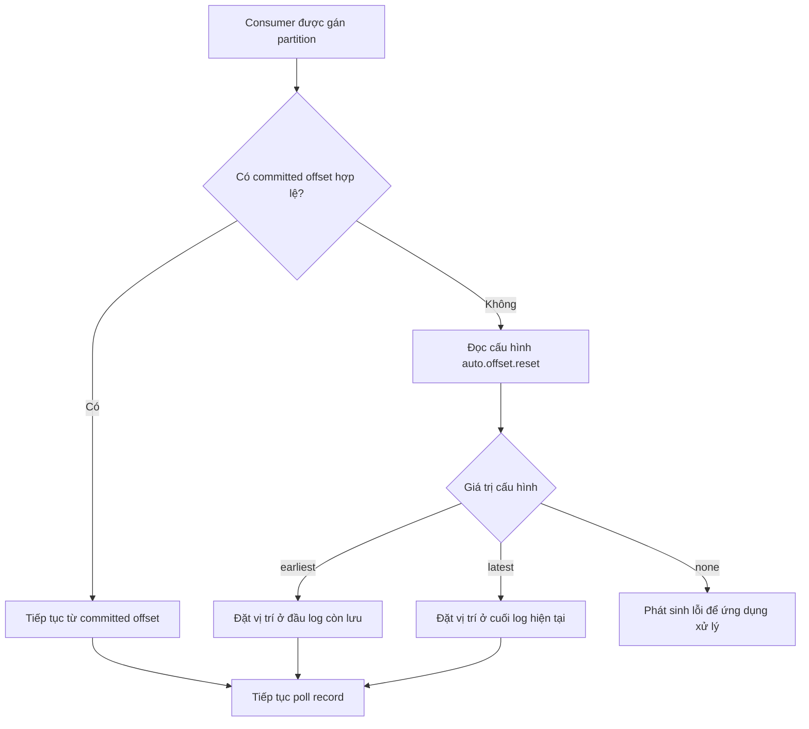

# auto.offset.reset và điểm bắt đầu đọc

Kafka consumer không phải lúc nào cũng bắt đầu đọc từ record đầu tiên của topic. Khi tham gia một consumer group, consumer trước hết tìm **offset đã commit** của group cho từng partition. Nếu offset hợp lệ tồn tại, consumer tiếp tục từ vị trí đó. Chỉ khi không có offset hợp lệ, Kafka mới dùng cấu hình `auto.offset.reset` để quyết định điểm bắt đầu.

Vì vậy, `auto.offset.reset` không phải nút tua lại topic mỗi lần ứng dụng khởi động. Thuộc tính này chủ yếu xử lý hai tình huống: group chưa có offset đã commit, hoặc offset hiện tại không còn hợp lệ trên broker, chẳng hạn dữ liệu ở offset đó đã bị xóa bởi retention. Hiểu đúng quy tắc này giúp tránh bỏ sót dữ liệu hoặc vô tình phát lại một lượng lớn record.

## 1. Consumer chọn điểm bắt đầu đọc như thế nào?

Với mỗi partition được gán, consumer cần xác định vị trí tiếp theo cần đọc. Quá trình khái quát như sau:



Offset đã commit của consumer group đại diện cho **offset kế tiếp cần đọc**, không phải offset của record cuối cùng đã xử lý. Ví dụ, nếu group commit offset `42`, lần đọc tiếp theo bắt đầu từ record có offset 42 trong partition đó (nếu record còn tồn tại và offset hợp lệ).

Kafka lưu committed offset theo cặp consumer group và topic-partition. Do đó, một group có thể có offset khác nhau trên các partition. Consumer group mới thường chưa có committed offset nên `auto.offset.reset` sẽ quyết định vị trí khởi đầu cho từng partition.

## 2. Các giá trị của auto.offset.reset

Ba giá trị phổ biến nhất là `earliest`, `latest` và `none`:

| Giá trị | Điểm bắt đầu khi cần reset | Trường hợp sử dụng |
|---|---|---|
| `earliest` | Offset sớm nhất còn được lưu trong partition. | Consumer group mới cần đọc lại dữ liệu còn tồn tại, dựng projection hoặc khởi tạo trạng thái. |
| `latest` | Cuối log tại thời điểm consumer xác định vị trí bắt đầu. | Chỉ quan tâm record mới được ghi sau khi consumer bắt đầu theo dõi. |
| `none` | Không tự chọn offset; consumer phát sinh lỗi nếu không tìm được offset hợp lệ. | Muốn phát hiện group chưa có offset hoặc offset đã mất để vận hành viên quyết định rõ ràng. |

### earliest — đọc từ đầu dữ liệu còn lưu

`earliest` yêu cầu consumer bắt đầu tại log start offset của partition, tức vị trí sớm nhất broker vẫn còn lưu. Nếu topic có record từ offset 0 và chưa bị xóa, consumer có thể đọc từ offset 0. Nếu retention đã xóa các segment cũ, điểm bắt đầu sẽ lớn hơn 0.

Ví dụ cấu hình:

```yaml
spring:
  kafka:
    consumer:
      group-id: order-projection
      auto-offset-reset: earliest
```

Giá trị này phù hợp khi tạo một projection mới cần xử lý lại dữ liệu hiện có. Tuy nhiên, `earliest` không có nghĩa là khôi phục toàn bộ lịch sử đã từng phát sinh. Topic dùng retention theo thời gian có thể đã xóa record cũ; topic compacted có thể đã loại bỏ các phiên bản cũ của cùng key. Consumer chỉ đọc được những record còn tồn tại trong log.

### latest — chỉ theo dõi dữ liệu mới

`latest` yêu cầu consumer đặt vị trí đọc ở cuối log hiện tại khi cần khởi tạo offset. Các record đã có trước vị trí đó sẽ không được group mới đọc. Consumer tiếp tục nhận record được append sau điểm bắt đầu.

Giá trị này phù hợp với luồng mà dữ liệu cũ không cần xử lý, ví dụ một consumer chỉ gửi thông báo cho sự kiện phát sinh sau khi tính năng được bật. Cần cân nhắc kỹ với nghiệp vụ thanh toán, đơn hàng, tồn kho hoặc đồng bộ dữ liệu: nếu group chưa có offset mà dùng `latest`, các record đang có trong topic có thể bị bỏ qua.

### none — yêu cầu offset phải tồn tại

`none` yêu cầu client báo lỗi khi không tìm được committed offset hợp lệ, thay vì tự động chuyển về đầu hoặc cuối log. Cách này phù hợp với quy trình vận hành muốn phát hiện group mới hoặc tình trạng offset bị mất để quyết định thủ công.

Khi dùng `none`, ứng dụng phải có kế hoạch xử lý lỗi khởi tạo/offset ngoài phạm vi. Nếu không có quy trình đó, consumer có thể không khởi động hoặc không tiếp tục tiêu thụ. Hãy xác định ai sẽ kiểm tra group, chọn offset và khởi động lại consumer.

## 3. Khi nào auto.offset.reset được áp dụng?

Thuộc tính này được áp dụng khi consumer không có vị trí đọc hợp lệ cho partition. Hai trường hợp thường gặp:

1. **Group chưa commit offset:** group mới, group ID thay đổi, hoặc offset chưa từng được commit cho partition đó.
2. **Offset không còn hợp lệ:** committed offset nằm ngoài phạm vi log hiện tại, ví dụ offset cũ hơn log start offset vì retention đã xóa dữ liệu, hoặc log bị thay đổi khiến vị trí đã commit không còn tồn tại.

Nếu committed offset vẫn hợp lệ, Kafka tiếp tục từ offset đó dù cấu hình đang là `earliest` hay `latest`. Ví dụ, consumer đã commit offset 500 rồi khởi động lại với `auto.offset.reset=earliest`, nó vẫn tiếp tục từ 500; cấu hình `earliest` không tự đưa consumer quay về đầu topic.

Đây là điểm dễ gây nhầm lẫn nhất: đổi `auto.offset.reset` trong `application.yml` không đồng nghĩa reset offset của một consumer group đang hoạt động. Muốn replay có chủ đích, cần reset committed offset bằng công cụ quản trị hoặc seek trong ứng dụng.

## 4. Cấu hình trong Spring Boot và Spring Kafka

Spring Boot ánh xạ cấu hình Kafka consumer từ `spring.kafka.consumer.*` sang consumer properties. Ví dụ:

```yaml
spring:
  kafka:
    bootstrap-servers: localhost:9092
    consumer:
      group-id: order-projection
      auto-offset-reset: earliest
      key-deserializer: org.apache.kafka.common.serialization.StringDeserializer
      value-deserializer: org.springframework.kafka.support.serializer.JsonDeserializer
      properties:
        spring.json.trusted.packages: com.example.orders.event
```

Trong ví dụ:

- `group-id` định danh consumer group dùng để lưu và khôi phục committed offset.
- `auto-offset-reset` chọn cách xử lý khi partition chưa có offset hợp lệ.
- `key-deserializer` chuyển byte key thành `String`.
- `value-deserializer` chuyển JSON value thành object; package được tin cậy cần giới hạn theo các kiểu dữ liệu ứng dụng cho phép.

Deserializer JSON còn cần xác định kiểu đích, chẳng hạn bằng type header do producer gửi hoặc cấu hình default type phù hợp với hợp đồng dữ liệu. Đoạn YAML trên tập trung minh họa điểm bắt đầu đọc; hãy bảo đảm cấu hình serializer/deserializer ở producer và consumer tương thích với schema thực tế.

Listener có thể khai báo group ID riêng:

```java
import org.springframework.kafka.annotation.KafkaListener;
import org.springframework.stereotype.Component;

@Component
public class OrderEventListener {

    @KafkaListener(
            topics = "orders.events",
            groupId = "order-projection"
    )
    public void onOrderEvent(OrderEvent event) {
        // Cập nhật projection từ event.
    }
}
```

Nếu `groupId` trên listener được chỉ định, nó xác định group cho listener đó. Khi không chỉ định, listener có thể dùng group ID mặc định từ cấu hình consumer factory. Điều quan trọng là group ID phải ổn định giữa các lần triển khai nếu muốn tiếp tục từ offset đã commit.

Với ứng dụng Spring Framework không dùng Spring Boot, có thể đặt `auto.offset.reset` trong map cấu hình consumer factory:

```java
Map<String, Object> props = new HashMap<>();
props.put(ConsumerConfig.BOOTSTRAP_SERVERS_CONFIG, "localhost:9092");
props.put(ConsumerConfig.GROUP_ID_CONFIG, "order-projection");
props.put(ConsumerConfig.AUTO_OFFSET_RESET_CONFIG, "earliest");
```

Sau đó truyền `props` vào `DefaultKafkaConsumerFactory` khi cấu hình listener container. Tên property Kafka ở mức client là `auto.offset.reset`; Spring Boot dùng tên relaxed-binding `auto-offset-reset` trong YAML.

## 5. Ví dụ lựa chọn điểm bắt đầu theo tình huống

Giả sử topic `orders.events` có dữ liệu ở các offset từ 100 đến 199 trong partition 0 và group `order-projection` chưa có committed offset:

| Cấu hình | Vị trí khởi đầu | Kết quả |
|---|---:|---|
| `earliest` | 100 | Đọc các record còn lưu từ offset 100 trở đi. |
| `latest` | 200 | Bỏ qua dữ liệu hiện có và chờ record mới. |
| `none` | Không chọn | Báo lỗi vì group chưa có offset hợp lệ. |

Nếu group đã commit offset 150, cả ba cấu hình đều không thay đổi điểm bắt đầu trong điều kiện offset 150 còn hợp lệ: consumer tiếp tục từ 150. Nếu retention làm log start offset tăng lên 160, offset 150 đã nằm ngoài phạm vi; khi đó cấu hình reset mới được xét để xác định vị trí hợp lệ tiếp theo (hoặc báo lỗi với `none`).

### Chọn giá trị theo mục tiêu

| Mục tiêu consumer | Gợi ý | Lý do |
|---|---|---|
| Tạo projection mới từ dữ liệu còn lưu | `earliest` | Cần dựng lại trạng thái từ log có sẵn. |
| Consumer mới chỉ xử lý sự kiện phát sinh sau khi triển khai | `latest` | Không cần xử lý dữ liệu trước thời điểm bắt đầu. |
| Quy trình production yêu cầu offset được khởi tạo trước | `none` | Muốn phát hiện thiếu offset để vận hành viên xử lý rõ ràng. |
| Kiểm thử replay với group ID mới | `earliest` | Test có thể đọc dữ liệu fixture đã gửi trước đó. |

Không có một giá trị phù hợp cho mọi topic. Hãy dựa vào yêu cầu nghiệp vụ, retention, cách tạo group và hậu quả khi bỏ qua hoặc phát lại record.

## 6. Reset offset có chủ đích

Khi cần đọc lại dữ liệu với một consumer group đã tồn tại, hãy dùng công cụ quản trị consumer group. Kafka cung cấp lệnh `kafka-consumer-groups` để xem và reset offset. Trước khi reset, dừng tất cả consumer thuộc group đó để tránh chúng tiếp tục commit offset trong lúc thao tác.

Ví dụ xem trạng thái group:

```bash
kafka-consumer-groups.sh \
  --bootstrap-server localhost:9092 \
  --group order-projection \
  --describe
```

Xem trước việc reset toàn bộ topic về offset sớm nhất còn lưu:

```bash
kafka-consumer-groups.sh \
  --bootstrap-server localhost:9092 \
  --group order-projection \
  --topic orders.events \
  --reset-offsets \
  --to-earliest \
  --dry-run
```

Sau khi kiểm tra kết quả, thực hiện bằng `--execute`:

```bash
kafka-consumer-groups.sh \
  --bootstrap-server localhost:9092 \
  --group order-projection \
  --topic orders.events \
  --reset-offsets \
  --to-earliest \
  --execute
```

Có thể thay `--to-earliest` bằng `--to-latest`, `--to-offset <offset>` hoặc các chế độ reset được Kafka CLI phiên bản đang dùng hỗ trợ. Trên Windows, script thường có tên `kafka-consumer-groups.bat`. Sau khi reset, mô tả group lại để xác nhận offset đã thay đổi rồi mới khởi động consumer.

Reset offset có thể làm consumer phát lại nhiều record và lặp side effect nếu ứng dụng không idempotent. Với xử lý tạo thanh toán, gửi email hoặc gọi API bên ngoài, cần có idempotency key hoặc cơ chế chống xử lý trùng trước khi replay.

## 7. Seek trong ứng dụng có gì khác auto.offset.reset?

`auto.offset.reset` là chính sách dự phòng khi consumer không có offset hợp lệ. `seek` là thao tác chủ động đặt vị trí đọc cho partition đã được gán trong phiên consumer hiện tại.

Ví dụ với Kafka Consumer API, sau khi partition được assign, ứng dụng có thể gọi `seekToBeginning(...)`, `seekToEnd(...)` hoặc `seek(topicPartition, offset)` để đặt vị trí cụ thể. Spring Kafka cung cấp các cơ chế như `ConsumerSeekAware` và callback seek của listener container để điều khiển việc này trong vòng đời consumer.

Seek không tự động có nghĩa là committed offset lâu dài đã được thay đổi. Nếu ứng dụng muốn lần khởi động sau tiếp tục từ vị trí mới, cần commit offset phù hợp theo chiến lược acknowledgement/commit đang sử dụng. Nếu không, committed offset cũ vẫn có thể được dùng ở lần khởi động tiếp theo.

Vì vậy, hãy chọn đúng công cụ:

- Cấu hình `auto.offset.reset` khi cần quy định mặc định cho group chưa có offset hợp lệ.
- Reset consumer group khi muốn thay đổi committed offset đã lưu và replay có chủ đích.
- Dùng seek khi cần điều khiển vị trí đọc trong phiên consumer hoặc trong quy trình xử lý cụ thể.

## 8. Những lưu ý vận hành quan trọng

### Giữ group ID ổn định

Nếu vô tình đổi `group-id`, Kafka xem đó là một consumer group khác. Group mới chưa có offset nên `auto.offset.reset` được áp dụng. Với `earliest`, ứng dụng có thể xử lý lại lượng lớn dữ liệu; với `latest`, ứng dụng có thể bỏ qua dữ liệu hiện có.

### Theo dõi retention và tốc độ tiêu thụ

Nếu consumer chậm hơn tốc độ xóa dữ liệu của topic, committed offset có thể rơi ra ngoài log start offset. Khi đó consumer phải reset theo cấu hình hoặc dừng với lỗi nếu đặt `none`. Theo dõi consumer lag, retention và thời gian phục hồi để tránh tình trạng này.

### Earliest không đảm bảo đầy đủ lịch sử

Topic dùng `cleanup.policy=delete` có thể xóa segment cũ theo retention. Topic compacted có thể loại bỏ phiên bản cũ của cùng key và tombstone sau thời gian lưu. Consumer bắt đầu từ `earliest` chỉ nhận dữ liệu còn lại trong log, không thể tái tạo những record Kafka đã dọn.

### Kiểm thử bằng group ID mới

Khi viết integration test, dùng group ID riêng cho từng test hoặc xóa/reset offset có kiểm soát. Nếu tái sử dụng group ID và offset cũ, test có thể không nhận được fixture vì consumer tiếp tục từ vị trí đã commit. Với `earliest`, vẫn cần bảo đảm group test chưa có committed offset hoặc đã reset đúng cách.

## 9. Ghi nhớ

- Consumer ưu tiên committed offset hợp lệ; `auto.offset.reset` chỉ được dùng khi không có offset hợp lệ hoặc offset đã nằm ngoài phạm vi log.
- Committed offset là vị trí kế tiếp cần đọc. Commit offset 42 nghĩa là lần đọc tiếp theo bắt đầu từ 42.
- `earliest` đọc từ log start offset còn lưu; `latest` bắt đầu ở cuối log hiện tại; `none` yêu cầu offset hợp lệ và báo lỗi nếu không có.
- Đổi `auto.offset.reset` không tự tua lại một group đã có committed offset hợp lệ.
- Muốn replay group hiện có, hãy dừng consumer, reset offset có kiểm soát, xác minh kết quả rồi mới khởi động lại.
- Seek điều khiển vị trí đọc trong phiên consumer; muốn duy trì vị trí mới qua lần khởi động sau cần commit phù hợp.
- Retention và compaction có thể làm mất dữ liệu cũ; `earliest` chỉ đọc phần log hiện còn.

Trước khi chọn `auto.offset.reset`, hãy trả lời hai câu hỏi: group mới cần đọc lại dữ liệu đang có hay chỉ theo dõi dữ liệu mới, và nếu committed offset bị mất thì hệ thống nên tự chọn vị trí hay dừng để người vận hành quyết định? Câu trả lời sẽ giúp chọn `earliest`, `latest` hoặc `none` đúng với yêu cầu của consumer.
