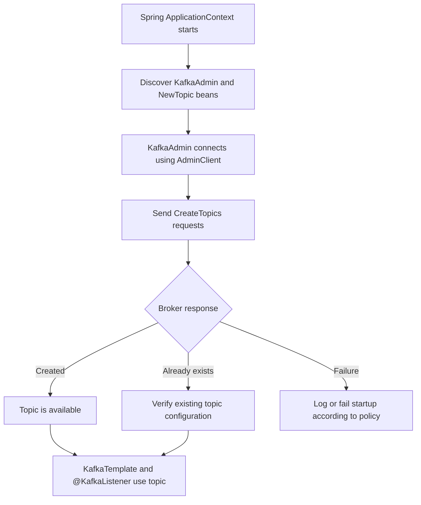

# KafkaAdmin và tự động tạo topic

Kafka topic là nơi broker lưu trữ record để producer ghi và consumer đọc. Khi khởi tạo ứng dụng Spring Kafka, topic cần tồn tại với số partition, replication factor và cấu hình phù hợp với cách hệ thống gửi nhận sự kiện. Spring Kafka cung cấp `KafkaAdmin` để ứng dụng khai báo topic bằng các bean `NewTopic`; khi application context được khởi tạo, `KafkaAdmin` dùng Kafka Admin API để tạo các topic chưa tồn tại.

Trong module `SPRING_KAFKA_MESSAGING`, producer gửi record bằng `KafkaTemplate`, consumer nhận record bằng `@KafkaListener`. Cả hai cần thống nhất tên topic và cấu hình dữ liệu. Hiểu rõ `KafkaAdmin`, `NewTopic` và cơ chế tự tạo topic giúp tránh tình trạng ứng dụng chạy với topic được tạo ngầm bằng cấu hình mặc định ngoài ý muốn.

## 1. Topic được tạo ở đâu và khi nào?

Kafka có hai cơ chế thường bị nhầm lẫn:

1. **Broker tự tạo topic**: broker có thể tự tạo topic khi nhận yêu cầu truy cập đến một topic chưa tồn tại nếu cấu hình `auto.create.topics.enable` cho phép. Topic được tạo theo cấu hình mặc định của broker.
2. **Ứng dụng chủ động tạo topic qua Admin API**: ứng dụng hoặc công cụ quản trị gửi yêu cầu `CreateTopics` đến Kafka. Spring Kafka cung cấp `KafkaAdmin` và các bean `NewTopic` để khai báo việc này.

| Tiêu chí | Broker auto-create | Spring Kafka `KafkaAdmin` |
|---|---|---|
| Nơi quyết định tạo | Cấu hình broker | Cấu hình ứng dụng hoặc môi trường triển khai |
| Thời điểm | Khi broker nhận yêu cầu liên quan đến topic chưa tồn tại | Khi `KafkaAdmin` khởi tạo topic từ các bean `NewTopic` trong application context |
| Số partition/replica | Theo mặc định broker | Khai báo rõ trong `NewTopic` |
| Topic config | Theo mặc định broker | Có thể khai báo cùng `NewTopic` |
| Phù hợp | Môi trường thử nghiệm đơn giản | Ứng dụng cần provisioning topic có chủ đích |

Broker auto-create tiện cho thử nghiệm nhưng có thể tạo topic với số partition hoặc replication factor không phù hợp. Vì thế, ở môi trường cần kiểm soát, thường nên tắt broker auto-create và quản lý topic bằng `KafkaAdmin` hoặc công cụ provisioning của nền tảng. Hai cơ chế độc lập: tắt broker auto-create không ngăn một client có quyền quản trị gọi Admin API để tạo topic.

## 2. `KafkaAdmin` hoạt động như thế nào?

`KafkaAdmin` là thành phần Spring Kafka kết nối đến broker bằng Kafka Admin API. Nó tìm các bean `NewTopic` trong application context và gửi yêu cầu tạo topic khi ứng dụng khởi tạo. Việc tạo topic được thực hiện ở broker; bean `NewTopic` chỉ là khai báo mong muốn của ứng dụng.

Trong ứng dụng Spring Boot, khi có cấu hình `spring.kafka.bootstrap-servers`, Spring Boot thường tự cấu hình `KafkaAdmin`. Bạn chỉ cần khai báo các bean `NewTopic` nếu muốn ứng dụng quản lý topic. Với ứng dụng Spring không dùng auto-configuration của Boot, cần tự khai báo bean `KafkaAdmin`.

Ví dụ cấu hình kết nối cho Spring Boot:

```yaml
spring:
  kafka:
    bootstrap-servers: ${KAFKA_BOOTSTRAP_SERVERS:localhost:9092}
```

Ví dụ khai báo `KafkaAdmin` tường minh trong ứng dụng Spring thuần:

```java
import java.util.HashMap;
import java.util.Map;

import org.apache.kafka.clients.admin.AdminClientConfig;
import org.springframework.context.annotation.Bean;
import org.springframework.context.annotation.Configuration;
import org.springframework.kafka.core.KafkaAdmin;

@Configuration
public class KafkaAdminConfiguration {

    @Bean
    public KafkaAdmin kafkaAdmin() {
        Map<String, Object> configs = new HashMap<>();
        configs.put(
                AdminClientConfig.BOOTSTRAP_SERVERS_CONFIG,
                "localhost:9092"
        );

        KafkaAdmin admin = new KafkaAdmin(configs);
        admin.setFatalIfBrokerNotAvailable(true);
        return admin;
    }
}
```

Trong ví dụ này, `setFatalIfBrokerNotAvailable(true)` yêu cầu lỗi không kết nối được broker trong lúc khởi tạo topic được xem là lỗi nghiêm trọng đối với quá trình khởi động context. Nếu ứng dụng có thể khởi động mà chưa cần Kafka, hãy cân nhắc chính sách phù hợp thay vì bật fail-fast một cách máy móc. Với Spring Boot, không tạo thêm một `KafkaAdmin` bean trùng lặp nếu auto-configuration đã cung cấp bean; hãy tùy biến bean hiện có theo cơ chế cấu hình của phiên bản đang dùng.

## 3. Khai báo topic bằng `NewTopic` và `TopicBuilder`

Spring Kafka nhận diện các bean kiểu `NewTopic` và dùng chúng để yêu cầu broker tạo topic. `TopicBuilder` giúp mô tả cấu hình dễ đọc hơn so với việc tự tạo `NewTopic` bằng constructor.

```java
import org.apache.kafka.clients.admin.NewTopic;
import org.apache.kafka.common.config.TopicConfig;
import org.springframework.context.annotation.Bean;
import org.springframework.context.annotation.Configuration;
import org.springframework.kafka.config.TopicBuilder;

@Configuration
public class KafkaTopicConfiguration {

    @Bean
    public NewTopic ordersTopic() {
        return TopicBuilder.name("orders")
                .partitions(6)
                .replicas(3)
                .config(TopicConfig.RETENTION_MS_CONFIG, "604800000")
                .build();
    }

    @Bean
    public NewTopic customerStateTopic() {
        return TopicBuilder.name("customer-state")
                .partitions(6)
                .replicas(3)
                .config(
                        TopicConfig.CLEANUP_POLICY_CONFIG,
                        TopicConfig.CLEANUP_POLICY_COMPACT
                )
                .build();
    }
}
```

Topic `orders` giữ record theo chính sách retention trong ví dụ là bảy ngày. Topic `customer-state` dùng log compaction để giữ trạng thái mới nhất theo key. Với topic compacted, producer cần cung cấp key ổn định; record có key và value `null` có thể đóng vai trò tombstone để biểu thị việc xóa trạng thái.

Các phương thức quan trọng của `TopicBuilder`:

| Phương thức | Ý nghĩa |
|---|---|
| `name(...)` | Đặt tên topic |
| `partitions(...)` | Số partition ban đầu |
| `replicas(...)` | Replication factor |
| `config(key, value)` | Thiết lập topic-level configuration |
| `build()` | Tạo đối tượng `NewTopic` để Spring Kafka quản lý |

Có thể khai báo một bean `NewTopic` cho mỗi topic. Cách này dễ tìm kiếm, dễ review và cho phép gắn tên bean theo mục đích. Nếu ứng dụng có nhiều topic, hãy nhóm các khai báo trong một hoặc một vài class cấu hình theo bounded context thay vì tạo một class quá lớn.

## 4. Chọn partition, replication factor và topic config

Khai báo topic không chỉ là đặt tên. Các thông số ban đầu ảnh hưởng đến khả năng xử lý song song, độ bền dữ liệu và chi phí lưu trữ.

### 4.1. Số partition

Partition là đơn vị lưu trữ và tiêu thụ song song của topic. Mỗi partition có thứ tự offset riêng; Kafka không bảo đảm thứ tự tổng thể giữa các partition. Số partition ảnh hưởng đến:

- Mức song song tối đa của consumer group đối với topic đó: tại một thời điểm, một partition chỉ được gán cho tối đa một consumer member trong cùng group.
- Phân bố tải ghi và đọc.
- Khả năng giữ thứ tự theo key khi partitioner định tuyến các record của cùng key vào cùng partition.
- Chi phí metadata, file log và quản trị khi số partition quá lớn.

Không có một con số partition đúng cho mọi topic. Hãy ước lượng throughput, kích thước record, số consumer dự kiến và mức tăng trưởng, sau đó đo tải trong môi trường thử nghiệm. Nếu cần giữ thứ tự theo `orderId`, hãy chọn key phù hợp và đánh giá tác động khi thay đổi số partition.

**Tăng số partition có thể thay đổi ánh xạ key sang partition.** Với partitioner dựa trên hash và số partition, key có thể được đưa vào partition mới sau khi tăng số lượng partition; record cũ vẫn nằm ở partition cũ. Điều này có thể làm đứt mạch thứ tự của một thực thể nếu consumer dựa vào một partition duy nhất. Kafka không hỗ trợ giảm số partition của topic đã tạo.

### 4.2. Replication factor

Replication factor xác định số bản sao của mỗi partition trên các broker khác nhau. Ví dụ replication factor bằng 3 nghĩa là mỗi partition có một replica leader và các replica follower theo trạng thái ISR. Khi broker gặp sự cố, replica đủ điều kiện có thể được bầu làm leader mới.

Replication factor không thể lớn hơn số broker có thể lưu replica. Nếu cluster chỉ có một broker, khai báo `replicas(3)` sẽ khiến việc tạo topic thất bại. Môi trường phát triển một broker thường dùng replication factor 1; môi trường nhiều broker có thể chọn mức cao hơn tùy yêu cầu sẵn sàng và chi phí.

Replication factor cần được xem cùng producer `acks` và topic `min.insync.replicas`. Ví dụ, với replication factor 3 và `min.insync.replicas=2`, producer dùng `acks=all` chỉ nhận xác nhận thành công khi số replica trong ISR đáp ứng ngưỡng tối thiểu. Cấu hình này tăng độ bền nhưng có thể khiến việc ghi bị từ chối khi cluster thiếu replica đồng bộ. Hãy lựa chọn theo yêu cầu durability và availability của hệ thống.

### 4.3. Topic configuration

Một số cấu hình thường gặp:

| Cấu hình | Ý nghĩa | Trường hợp sử dụng |
|---|---|---|
| `retention.ms` | Thời gian giữ record theo chính sách delete | Event log cần giữ trong một khoảng thời gian |
| `retention.bytes` | Giới hạn dung lượng log theo partition | Kiểm soát dung lượng lưu trữ |
| `cleanup.policy=delete` | Xóa segment khi hết hạn theo retention | Topic event thông thường |
| `cleanup.policy=compact` | Giữ bản ghi mới nhất theo key sau compaction | Topic lưu trạng thái hiện tại |
| `min.insync.replicas` | Số replica tối thiểu trong ISR để đáp ứng `acks=all` | Topic cần kiểm soát độ bền khi ghi |
| `max.message.bytes` | Giới hạn kích thước record batch theo cấu hình broker/topic | Kiểm soát payload lớn |

Không sao chép mọi cấu hình broker vào từng topic. Chỉ đặt topic-level override khi có yêu cầu cụ thể. Một số thay đổi cấu hình cần quyền quản trị phù hợp và có thể tác động đến hoạt động của topic đang chạy.

## 5. Phân biệt tạo topic với cập nhật topic đã tồn tại

Bean `NewTopic` là khai báo để Spring Kafka yêu cầu tạo topic. Không nên xem nó như một bộ điều phối trạng thái hoàn chỉnh có thể tự động sửa mọi khác biệt giữa cấu hình trong code và topic hiện có.

Khi topic đã tồn tại, hãy xác minh cấu hình thực tế trên broker. Đừng giả định rằng thay đổi `.partitions(6)` thành `.partitions(12)` trong bean sẽ tự động tăng partition của topic hiện hữu ở mọi phiên bản/cấu hình. Tương tự, thay đổi replication factor không đơn giản là sửa một con số trong `NewTopic`; việc thay đổi replica placement cần quy trình reassignment.

Khi cần thay đổi topic hiện hữu:

1. Kiểm tra partition count, replication factor, ISR và topic configs hiện tại.
2. Đánh giá ảnh hưởng đến key ordering, consumer concurrency, retention và dung lượng.
3. Dùng Kafka Admin API hoặc công cụ quản trị hạ tầng để thực hiện thay đổi được hỗ trợ.
4. Xác minh kết quả sau khi thay đổi và theo dõi consumer/producer.

Kafka Admin API có các thao tác riêng như `createTopics`, `describeTopics`, `describeConfigs`, `incrementalAlterConfigs` và `createPartitions`. Spring Kafka `KafkaAdmin` cung cấp tích hợp tạo topic thuận tiện; với các thao tác quản trị động hoặc cần kiểm soát chi tiết, có thể dùng `AdminClient` trực tiếp. Nên thực hiện provisioning trong pipeline hoặc quy trình vận hành có kiểm soát thay vì để từng request nghiệp vụ tự tạo topic.

## 6. Tự động tạo topic khi ứng dụng khởi động

Một ứng dụng có thể khai báo `NewTopic` trong class cấu hình và để `KafkaAdmin` xử lý khi application context được refresh. Trình tự khái quát:



Điều này giúp topic được khai báo cùng source code và thuận tiện cho môi trường local/test. Tuy nhiên, có một số điểm cần lưu ý:

- Broker phải sẵn sàng và ứng dụng phải kết nối được tới bootstrap server.
- Principal mà ứng dụng dùng phải có quyền thực hiện thao tác Admin API cần thiết.
- Replication factor phải phù hợp số broker và chính sách cluster.
- Nếu broker chưa sẵn sàng, `KafkaAdmin` có thể không tạo được topic. Cân nhắc `setFatalIfBrokerNotAvailable(true)` khi ứng dụng không thể hoạt động nếu thiếu topic.
- Topic đã tồn tại cần được kiểm tra riêng; khai báo trong code không thay thế việc quản lý drift của môi trường.

Trong hệ thống production, có hai cách triển khai phổ biến:

| Cách quản lý | Khi phù hợp | Đặc điểm |
|---|---|---|
| Ứng dụng tạo topic qua `KafkaAdmin` | Service nhỏ hoặc môi trường cho phép service tự quản lý topic | Khai báo gần code; ứng dụng cần quyền tạo topic |
| Pipeline/platform tạo topic trước khi deploy | Cluster production có quy trình quản trị tập trung | Tách quyền provisioning khỏi runtime; kiểm soát thay đổi và audit tốt hơn |

Không có lựa chọn duy nhất cho mọi tổ chức. Điều quan trọng là phải có một chủ sở hữu rõ ràng cho topic và tránh nhiều hệ thống cùng quản lý một topic theo các cấu hình mâu thuẫn.

## 7. Tạo topic động bằng `AdminClient` khi thật sự cần

`KafkaAdmin` và bean `NewTopic` phù hợp với topic đã biết trước khi ứng dụng khởi động. Nếu có nhu cầu tạo topic động trong một tác vụ quản trị, Kafka cung cấp `AdminClient` để gọi Admin API trực tiếp.

Ví dụ khái niệm tạo topic trong một tác vụ quản trị:

```java
import java.util.List;
import java.util.Map;
import java.util.Optional;
import java.util.concurrent.ExecutionException;

import org.apache.kafka.clients.admin.AdminClient;
import org.apache.kafka.clients.admin.AdminClientConfig;
import org.apache.kafka.clients.admin.NewTopic;

public class TopicProvisioningTask {

    public void createAuditTopic() throws Exception {
        Map<String, Object> config = Map.of(
                AdminClientConfig.BOOTSTRAP_SERVERS_CONFIG,
                "localhost:9092"
        );

        NewTopic topic = new NewTopic(
                "audit-events",
                Optional.of(3),
                Optional.of((short) 1)
        );

        try (AdminClient admin = AdminClient.create(config)) {
            admin.createTopics(List.of(topic)).all().get();
        } catch (ExecutionException ex) {
            // Kiểm tra nguyên nhân, ví dụ topic đã tồn tại hoặc thiếu quyền.
            throw ex;
        }
    }
}
```

Đây là ví dụ minh họa API; trong ứng dụng thật, bootstrap server, bảo mật và topic parameters phải lấy từ cấu hình môi trường. Cần xử lý riêng `TopicExistsException` nếu thao tác có thể được gọi lặp lại, đặt timeout phù hợp và ghi log kết quả. Không tạo topic theo dữ liệu đầu vào tùy ý từ người dùng vì sẽ làm tăng số lượng topic khó kiểm soát và mở rộng bề mặt cấp quyền.

Với topic tĩnh, ưu tiên bean `NewTopic` và `KafkaAdmin` để cấu hình có thể review cùng source code. Chỉ dùng `AdminClient` trực tiếp khi có yêu cầu quản trị động hoặc cần thao tác mà abstraction hiện tại không đáp ứng.

## 8. Đặt tên topic và quản lý theo môi trường

Tên topic nên thể hiện domain hoặc luồng dữ liệu, nhất quán giữa các service. Ví dụ:

| Topic | Mục đích |
|---|---|
| `orders.created` | Event đơn hàng được tạo |
| `orders.events` | Các event vòng đời đơn hàng |
| `customer-state` | Trạng thái mới nhất của khách hàng, có thể dùng compaction |
| `orders.created.dlt` | Dead-letter topic cho record không xử lý được, theo quy ước của ứng dụng |

Không nhúng thông tin môi trường vào tên topic nếu cluster đã tách biệt theo môi trường. Nếu dev, staging và production dùng chung một cluster, cần quy ước namespace/prefix rõ ràng để tránh va chạm. Tránh tên quá chung như `data`, `events` hoặc `test` vì khó xác định chủ sở hữu và retention policy.

Topic config có thể khác giữa môi trường. Ví dụ local dùng một broker và replication factor 1; production dùng nhiều broker với replication factor cao hơn. Có thể đưa các giá trị vào cấu hình externalized hoặc profile riêng, nhưng phải bảo đảm topic được tạo với thông số hợp lệ cho cluster đích.

## 9. Kiểm thử việc tạo topic

Không nên chỉ kiểm tra rằng Spring context khởi động thành công. Cần xác minh topic thực sự tồn tại và có cấu hình dự kiến.

Một số hướng kiểm thử:

- **Unit test**: kiểm tra phương thức khai báo `NewTopic` có đúng tên, partition, replica và configs mong muốn.
- **Integration test với Embedded Kafka**: kiểm tra Spring context và `KafkaAdmin` có tạo topic trong broker nhúng hay không. Dùng replication factor phù hợp số broker test.
- **Integration test với Testcontainers**: xác minh provisioning và producer/consumer trên Kafka broker gần với môi trường chạy thực tế hơn.
- **Deployment verification**: sau khi provisioning, dùng Admin API hoặc công cụ vận hành để mô tả topic và đối chiếu partition/configs.

Khi test topic compacted, cần xác minh cleanup policy là `compact` và key/value có semantics đúng. Khi test topic có replication factor lớn hơn 1, test cluster phải có đủ broker; nếu không, lỗi tạo topic là kết quả mong đợi chứ không phải lỗi của `KafkaAdmin`.

## 10. Lỗi thường gặp khi tự động tạo topic

- **Nhầm broker auto-create với `KafkaAdmin`:** tắt `auto.create.topics.enable` không ngăn Admin API tạo topic, nhưng producer/consumer không thể dựa vào broker để tự tạo topic thiếu.
- **Replication factor lớn hơn số broker:** yêu cầu tạo topic bị từ chối. Hãy đồng bộ cấu hình theo cluster.
- **Ứng dụng không có quyền Create topic:** kết nối thành công không có nghĩa principal có quyền quản trị. Cần cấp quyền đúng phạm vi hoặc chuyển provisioning cho platform.
- **Không kiểm tra topic tồn tại:** topic cũ có thể có partition count, cleanup policy hoặc retention không giống code.
- **Tự động tăng partition mà không đánh giá key:** có thể thay đổi partition mapping và ảnh hưởng thứ tự theo thực thể.
- **Dùng `KafkaAdmin` fail-fast ở mọi môi trường:** local hoặc ứng dụng có thể chạy ở chế độ không cần Kafka sẽ khởi động thất bại khi broker tạm thời không sẵn sàng.
- **Tạo topic theo từng request:** dễ sinh topic trùng lặp, khó audit và làm tăng gánh nặng vận hành.
- **Không xác minh cấu hình sau deploy:** khai báo mong muốn không chứng minh broker đã nhận đúng cấu hình.

## 11. Checklist trước khi đưa topic vào sử dụng

- [ ] Đã chọn rõ broker auto-create, Spring Kafka `KafkaAdmin` hay pipeline/platform provisioning.
- [ ] Có chủ sở hữu rõ ràng cho từng topic.
- [ ] Tên topic phản ánh domain và tuân theo quy ước chung.
- [ ] Partition count phù hợp throughput, consumer parallelism và yêu cầu ordering.
- [ ] Replication factor không vượt số broker và phù hợp yêu cầu durability.
- [ ] Retention, cleanup policy và các topic config đã được xác định.
- [ ] Producer/consumer dùng đúng topic name và serializer/deserializer tương ứng.
- [ ] Quyền Admin API được cấp theo nguyên tắc least privilege.
- [ ] Chính sách fail-fast khi broker không sẵn sàng phù hợp môi trường.
- [ ] Topic đã được xác minh sau khi tạo hoặc thay đổi.
- [ ] Integration test kiểm tra provisioning trên broker thật hoặc broker nhúng.

Khi dùng `KafkaAdmin` và `NewTopic` đúng cách, việc tạo topic trở thành một phần có thể quản lý và kiểm thử của quá trình khởi tạo ứng dụng. Producer và consumer có thể dựa trên topic đã được provisioning với cấu hình rõ ràng, còn đội vận hành có cơ sở để kiểm soát partition, replication, retention và quyền quản trị trong từng môi trường.
