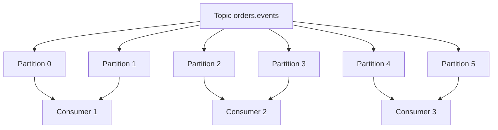

# Số lượng partition khi tạo topic

Khi tạo một Kafka topic, số lượng partition là một quyết định kiến trúc quan trọng. Partition quyết định mức song song mà một consumer group có thể khai thác, ảnh hưởng đến khả năng phân phối tải của producer và chi phối cách Kafka giữ thứ tự theo key. Chọn quá ít partition có thể giới hạn thông lượng; chọn quá nhiều làm tăng tài nguyên broker, chi phí quản lý metadata và độ phức tạp vận hành.

Không có một con số cố định phù hợp cho mọi topic. Cần xác định tải dự kiến, mức song song của consumer, yêu cầu ordering, số broker và giới hạn tài nguyên của cluster trước khi tạo topic.

## 1. Partition ảnh hưởng đến điều gì?

Topic là tên logic của luồng dữ liệu. Mỗi topic được chia thành một hoặc nhiều partition; mỗi partition là một log riêng, được append record theo thứ tự và có offset độc lập.

Số partition ảnh hưởng trực tiếp đến các yếu tố sau:

- **Khả năng xử lý song song:** một consumer group có thể phân phối các partition cho nhiều consumer member. Với một topic, số consumer có thể đồng thời nhận partition không vượt quá số partition đang được gán.
- **Thông lượng producer và consumer:** nhiều partition cho phép nhiều luồng ghi/đọc hoạt động song song trên broker và consumer khác nhau, nếu tài nguyên cluster và ứng dụng đáp ứng.
- **Thứ tự dữ liệu:** Kafka chỉ đảm bảo thứ tự trong từng partition. Dùng key giúp các record liên quan được định tuyến về cùng partition, nhờ đó có thể giữ thứ tự theo thực thể.
- **Phân bố tải và lưu trữ:** partition có leader và các replica trên broker. Nhiều partition làm tăng số log, file, metadata và tác vụ nền mà cluster phải quản lý.
- **Thời gian phục hồi và rebalance:** consumer group phải phân bổ lại partition khi member thay đổi. Nhiều partition có thể làm tăng lượng công việc quản lý và thời gian ổn định sau rebalance.

Ví dụ topic `orders.events` có sáu partition:



Đây là một ví dụ phân bổ của consumer group có ba member. Mỗi partition được gán cho tối đa một member trong group tại một thời điểm. Một consumer có thể nhận nhiều partition; các consumer group khác vẫn có thể đọc độc lập cùng topic.

## 2. Phân biệt partition count và replication factor

Hai cấu hình này thường được khai báo cạnh nhau nhưng giải quyết hai bài toán khác nhau:

| Cấu hình | Ý nghĩa | Tác động chính |
|---|---|---|
| `partitions` | Số partition logic của topic. | Mức song song, phân phối key và số luồng đọc/ghi. |
| `replication-factor` | Số bản sao của mỗi partition trên các broker. | Khả năng chịu lỗi và mức tiêu thụ dung lượng/tài nguyên broker. |

Ví dụ topic có 12 partition và replication factor bằng 3 sẽ có 36 replica partition trên cluster. Mỗi partition có một leader xử lý request ghi/đọc theo cấu hình và các follower replica sao chép dữ liệu. Replication factor không làm consumer group có 36 partition để xử lý; số partition logic vẫn là 12.

Replication factor cần phù hợp với số broker và yêu cầu sẵn sàng. Với cluster ba broker, replication factor 3 thường cho phép mỗi partition có một bản sao trên mỗi broker nếu rack placement và cấu hình cho phép. Môi trường local một broker thường dùng replication factor 1. Không đặt replication factor lớn hơn số broker hiện có nếu không có kế hoạch mở rộng broker tương ứng.

## 3. Các yếu tố để chọn số partition

### Thông lượng dự kiến

Ước lượng lượng dữ liệu producer ghi vào topic và tốc độ consumer cần xử lý. Có thể dùng phép tính ban đầu:

\[
P_{throughput} = \left\lceil\frac{T_{target}}{T_{partition}}\right\rceil
\]

Trong đó:

- `T_target` là thông lượng mục tiêu của topic, ví dụ record/giây hoặc MB/giây.
- `T_partition` là thông lượng bền vững đo được của một partition trong điều kiện benchmark gần với production.
- `P_throughput` là số partition tối thiểu ước lượng theo thông lượng.

Không nên lấy một con số throughput chung trên Internet làm chuẩn tuyệt đối. `T_partition` phụ thuộc kích thước record, compression, batching, replication factor, cấu hình broker, ổ đĩa, network, số producer, số consumer và kiểu xử lý downstream. Hãy benchmark bằng dữ liệu đại diện cho tải thực tế.

Ví dụ, nếu tải mục tiêu là 60.000 record/giây và benchmark cho thấy một partition duy trì ổn định khoảng 10.000 record/giây trong cấu hình tương tự, ước lượng ban đầu là 6 partition. Sau đó cần kiểm thử tải đỉnh, độ trễ, consumer lag và khả năng dự phòng thay vì xem 6 là con số chắc chắn.

### Mức song song của consumer

Trong một consumer group, một partition chỉ được gán cho tối đa một consumer member tại một thời điểm. Vì vậy, số partition là giới hạn trên cho số consumer đang thực sự xử lý topic đó song song trong group.

Ví dụ:

| Partition của topic | Consumer member | Mức song song tối đa cho topic |
|---:|---:|---:|
| 3 | 1 | 1 consumer nhận cả 3 partition |
| 3 | 3 | 3 consumer, mỗi consumer có thể nhận 1 partition |
| 3 | 6 | Tối đa 3 consumer có partition; 3 consumer còn lại nhàn rỗi với topic này |
| 12 | 6 | Tối đa 6 consumer có thể nhận partition, mỗi consumer có thể nhận nhiều partition |

Nếu ứng dụng cần sáu consumer xử lý độc lập một topic, topic cần ít nhất sáu partition có thể được gán. Tuy nhiên, không phải cứ tăng partition là consumer nhanh hơn: downstream database, API hoặc giới hạn thread có thể trở thành nút thắt mới.

Trong Spring Kafka, thuộc tính `concurrency` của listener container tạo các consumer thread. Nếu `concurrency` lớn hơn số partition có thể gán, một số consumer sẽ không nhận partition. Hãy đồng bộ concurrency với partition count và năng lực xử lý của ứng dụng.

### Yêu cầu ordering theo key

Nếu cần giữ thứ tự các thay đổi của cùng một đơn hàng, tài khoản hoặc thiết bị, producer nên dùng ID của thực thể làm key. Với partitioner mặc định, cùng key được serialize nhất quán và số partition không thay đổi sẽ thường được ánh xạ vào cùng partition.

Số partition càng nhiều thì dữ liệu có thể phân tán rộng hơn, nhưng Kafka vẫn chỉ giữ thứ tự trong từng partition. Không tăng partition chỉ để đạt một con số lớn nếu luồng nghiệp vụ yêu cầu mapping key ổn định. Việc tăng partition sau này có thể làm một số key được định tuyến sang partition khác, khiến record cũ và mới của cùng key nằm ở hai partition không có thứ tự chung.

### Số broker và tài nguyên cluster

Partition có leader và replica được đặt trên broker. Khi số partition và replication factor tăng, cluster phải quản lý nhiều replica log hơn, đồng thời tiêu thụ thêm file descriptor, bộ nhớ cho metadata, dung lượng đĩa, network và công việc log segment/replication.

Không chỉ xét tổng partition của một topic. Hãy tính tổng partition replica của toàn cluster trên tất cả topic và đối chiếu với giới hạn, sizing, hướng dẫn vận hành của phiên bản Kafka đang dùng. Một cluster nhỏ không nên nhận số partition khổng lồ chỉ vì một ứng dụng muốn tăng concurrency.

### Kích thước record và tốc độ lưu trữ

Record lớn làm tăng dung lượng và thời gian truyền tải. Một topic có thông lượng MB/giây cao với record lớn có thể cần cách phân vùng khác topic có hàng chục nghìn record nhỏ mỗi giây. Ngoài số partition, cần xem xét `batch.size`, `linger.ms`, compression, `max.message.bytes`, throughput ổ đĩa và network.

## 4. Cách ước lượng partition count ban đầu

Có thể thực hiện theo trình tự sau:

1. **Xác định tải:** ghi nhận record/giây, MB/giây, kích thước record trung bình và tải đỉnh dự kiến.
2. **Xác định consumer:** số consumer member cần chạy đồng thời trong mỗi group và thời gian xử lý một record.
3. **Đo benchmark:** tạo topic thử nghiệm với cấu hình gần production, đo throughput ổn định của mỗi partition và consumer.
4. **Tính số partition theo throughput:** dùng công thức ước lượng ở trên.
5. **Đối chiếu parallelism:** bảo đảm partition count đủ cho mức consumer concurrency cần thiết.
6. **Kiểm tra ordering và key:** xác định các record nào phải ở cùng partition và tác động nếu thay đổi partition count.
7. **Kiểm tra cluster capacity:** tính cả replica theo replication factor, số topic khác và tải của broker.
8. **Load test và quan sát:** kiểm tra consumer lag, p95/p99 latency, CPU, disk, network và thời gian rebalance.

Ví dụ: một dịch vụ cần xử lý 24.000 event/giây, muốn tối đa 8 consumer member trong một group, benchmark cho thấy một partition duy trì 4.000 event/giây. Ước lượng theo throughput là 6 partition, còn yêu cầu song song cần ít nhất 8 partition. Có thể bắt đầu thử nghiệm với 8 partition, sau đó tăng nếu load test cho thấy throughput hoặc độ trễ chưa đạt. Con số cuối cùng phải dựa trên đo đạc và khả năng cluster.

Không nên nhân partition count theo replication factor khi tính consumer concurrency. Với 8 partition và replication factor 3, consumer group vẫn có tối đa 8 partition logic để gán; replication tạo thêm bản sao phục vụ độ bền và sẵn sàng.

## 5. Tạo topic với Spring Kafka

Spring Kafka cung cấp `TopicBuilder` để khai báo topic thông qua bean `NewTopic`. Ví dụ:

```java
import org.apache.kafka.clients.admin.NewTopic;
import org.springframework.context.annotation.Bean;
import org.springframework.context.annotation.Configuration;
import org.springframework.kafka.config.TopicBuilder;

@Configuration
public class KafkaTopicConfiguration {

    @Bean
    NewTopic orderEventsTopic() {
        return TopicBuilder.name("orders.events")
                .partitions(8)
                .replicas(3)
                .build();
    }
}
```

Khi Spring Boot có cấu hình Kafka Admin phù hợp, bean `NewTopic` được dùng để tạo topic nếu topic chưa tồn tại. Nếu topic đã tồn tại, hành vi mặc định của admin integration có thể kiểm tra và điều chỉnh số partition theo khai báo khi số mới lớn hơn số hiện có; không thể giảm partition bằng thao tác này. Hãy kiểm soát cấu hình topic theo môi trường và quyền tạo/sửa topic của ứng dụng.

Với môi trường local chỉ có một broker, thay `.replicas(3)` bằng `.replicas(1)`. Trong production, chọn replication factor theo số broker, yêu cầu chịu lỗi và chính sách cluster. Cấu hình partition count cần được quản lý rõ ràng để tránh mỗi lần khởi động ứng dụng vô tình thay đổi topology ngoài kế hoạch.

## 6. Tạo topic bằng Kafka CLI

Kafka CLI cho phép chỉ định partition count và replication factor khi tạo topic:

```bash
kafka-topics.sh \
  --bootstrap-server localhost:9092 \
  --create \
  --topic orders.events \
  --partitions 8 \
  --replication-factor 3
```

Trên Windows, script thường có tên `kafka-topics.bat`. Lệnh trên yêu cầu cluster có đủ broker để đặt ba replica cho mỗi partition. Với cluster local một broker, dùng `--replication-factor 1`.

Sau khi tạo, kiểm tra cấu hình:

```bash
kafka-topics.sh \
  --bootstrap-server localhost:9092 \
  --describe \
  --topic orders.events
```

Kết quả hiển thị số partition, replication factor và leader/replica của từng partition. Có thể dùng thông tin này để xác minh topic đã được tạo theo dự kiến.

## 7. Có thể thay đổi số partition sau khi tạo không?

Kafka hỗ trợ **tăng** số partition của topic, nhưng không hỗ trợ giảm partition trực tiếp. Tăng partition có thể hữu ích khi tải tăng hoặc cần thêm consumer song song, nhưng đây là thay đổi có ảnh hưởng đến định tuyến key và ordering.

Ví dụ tăng từ 8 lên 12 partition bằng CLI:

```bash
kafka-topics.sh \
  --bootstrap-server localhost:9092 \
  --alter \
  --topic orders.events \
  --partitions 12
```

Sau khi tăng:

- Partition mới bắt đầu nhận record theo cơ chế partitioner và metadata mới.
- Với partitioner mặc định, phép băm key theo số partition mới có thể ánh xạ một số key sang partition khác.
- Record cũ vẫn ở partition cũ; record mới của cùng key có thể vào partition mới, do đó không còn bảo đảm thứ tự giữa hai giai đoạn nếu chúng ở partition khác nhau.
- Consumer group có thể rebalance để phân phối các partition mới cho member.

Nếu cần giảm partition hoặc thay đổi mapping một cách có kiểm soát, thường tạo topic mới với số partition mong muốn, sau đó triển khai quy trình migrate/dual-write/cutover phù hợp với nghiệp vụ. Không xóa topic cũ trước khi xác minh dữ liệu và consumer đã chuyển thành công.

## 8. Những sai lầm thường gặp

| Sai lầm | Hệ quả | Cách xử lý |
|---|---|---|
| Chọn partition count chỉ theo số broker | Không phản ánh throughput và consumer concurrency thực tế. | Benchmark tải và xác định mức song song cần thiết. |
| Nhầm replication factor với partition count | Ước lượng sai số consumer có thể chạy song song. | Tính theo partition logic; replication chỉ tạo bản sao. |
| Tạo quá ít partition | Consumer group không thể mở rộng vượt số partition được gán. | Xác định concurrency mục tiêu từ đầu và load test. |
| Tạo quá nhiều partition | Tăng metadata, file, replica, chi phí rebalance và vận hành. | Tính tổng partition toàn cluster và sizing broker. |
| Tăng partition mà không xem xét key | Một số key có thể chuyển partition, làm mất thứ tự liên tục theo thực thể. | Lập kế hoạch migration hoặc giữ partition count ổn định. |
| Nghĩ có thể giảm partition bằng `--alter` | Kafka không hỗ trợ giảm trực tiếp. | Tạo topic mới và migrate dữ liệu có kiểm soát. |
| Chỉ kiểm tra throughput producer | Consumer hoặc downstream có thể trở thành nút thắt. | Đo end-to-end latency, lag và tốc độ xử lý consumer. |

## 9. Ghi nhớ

- Partition count quyết định mức song song logic của topic và là giới hạn trên cho số consumer member được gán partition trong một group.
- Replication factor là số bản sao của mỗi partition; nó không làm tăng số partition logic.
- Chọn số partition dựa trên throughput benchmark, concurrency, ordering, kích thước record và tài nguyên cluster.
- Dùng key đại diện cho aggregate nếu cần giữ thứ tự các record liên quan trong cùng partition.
- Spring Kafka có thể khai báo topic bằng `NewTopic` và `TopicBuilder`; Kafka CLI cũng cho phép chỉ định `--partitions` khi tạo topic.
- Kafka hỗ trợ tăng partition nhưng không giảm trực tiếp; tăng partition có thể thay đổi mapping key và ảnh hưởng ordering.

Trước khi tạo topic production, hãy ghi rõ partition count, replication factor, key strategy, throughput mục tiêu và consumer concurrency dự kiến. Đây là những thông tin giúp đội phát triển và vận hành hiểu vì sao topic có cấu trúc đó và đánh giá đúng tác động khi cần mở rộng sau này.
