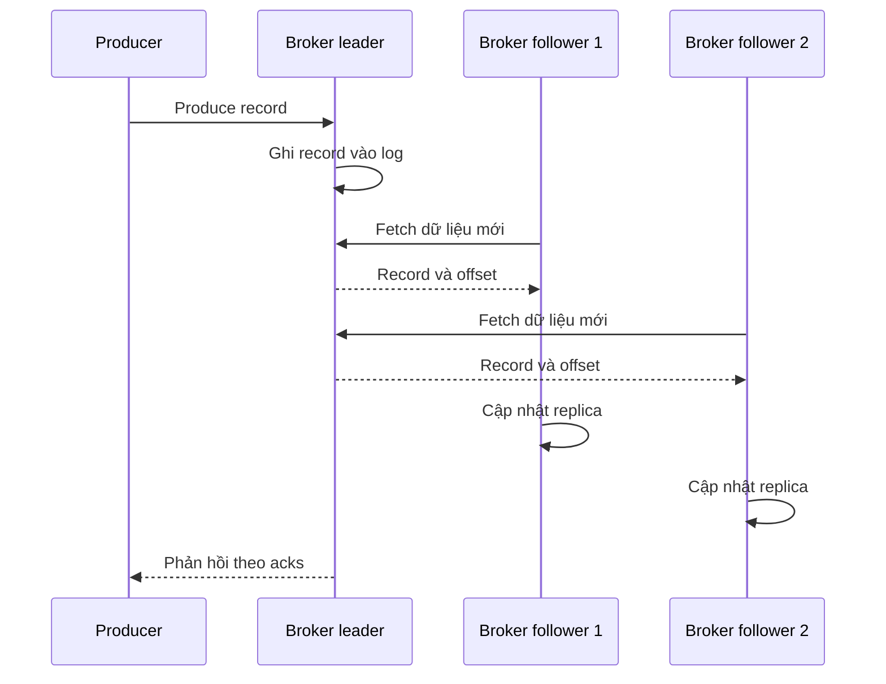

# Replication factor và yêu cầu broker trong Kafka

Replication factor xác định số bản sao của mỗi partition được Kafka duy trì trên các broker. Thiết lập này ảnh hưởng trực tiếp đến khả năng chịu lỗi, độ sẵn sàng khi broker gặp sự cố, dung lượng lưu trữ và lưu lượng mạng của cụm Kafka.

Khi thiết kế topic, cần chọn replication factor cùng với `min.insync.replicas` và producer `acks`. Ba cấu hình này phối hợp để xác định khi nào Kafka chấp nhận một lần ghi và mức độ an toàn của dữ liệu khi một hoặc nhiều broker gặp sự cố.

## 1. Partition replica là gì?

Mỗi partition của topic có một replica trên một broker được chọn làm **leader**. Các replica còn lại là **follower**. Producer gửi record tới leader; consumer thông thường cũng đọc từ leader. Follower chủ động lấy dữ liệu từ leader để giữ bản sao cập nhật.

Ví dụ topic `orders` có ba partition và replication factor bằng ba:

```text
Topic orders (replication factor = 3)

Broker 1              Broker 2              Broker 3
---------             ---------             ---------
P0: Leader            P0: Follower          P0: Follower
P1: Follower          P1: Leader            P1: Follower
P2: Follower          P2: Follower          P2: Leader
```

Sơ đồ minh họa cách phân bố. Trong thực tế, Kafka phân bổ leader và follower dựa trên metadata cụm, số partition, broker còn hoạt động và cấu hình rack awareness.

Replication factor tính cả leader. Vì vậy:

- `replication.factor = 1`: mỗi partition chỉ có một bản sao, không có follower dự phòng.
- `replication.factor = 2`: mỗi partition có leader và một follower trên broker khác.
- `replication.factor = 3`: mỗi partition có leader và hai follower trên các broker khác nhau.

Các replica của cùng một partition được đặt trên những broker khác nhau. Một cụm cần ít nhất số broker bằng replication factor để tạo đủ replica cho một partition. Nếu muốn duy trì hoạt động khi broker bảo trì hoặc hỏng, cụm thường cần có thêm broker và phân bố replica qua các miền lỗi độc lập.

## 2. Leader, follower và đồng bộ dữ liệu

Leader là đầu mối nhận thao tác ghi cho partition. Follower gửi yêu cầu fetch để lấy record mới từ leader và cập nhật bản sao cục bộ. Kafka theo dõi trạng thái đồng bộ của replica để xác định những replica đủ điều kiện tham gia nhóm bản sao đang hoạt động.

Luồng ghi cơ bản:



Follower không nhận bản ghi trực tiếp từ producer trong luồng ghi thông thường; chúng theo dõi leader để sao chép dữ liệu. Vì vậy, replication không phải là cơ chế producer gửi cùng một record tới từng broker.

## 3. ISR và ý nghĩa của replica đồng bộ

ISR là viết tắt của *In-Sync Replicas*: tập hợp replica được Kafka xem là đang theo kịp leader theo các tiêu chí đồng bộ của cụm. ISR bao gồm leader và các follower đủ điều kiện. Một follower chậm quá lâu có thể bị loại khỏi ISR; sau khi bắt kịp, nó có thể được thêm lại.

Ví dụ một partition có replication factor bằng ba:

```text
Ban đầu:
  Leader: Broker 1
  ISR:    Broker 1, Broker 2, Broker 3

Broker 3 bị chậm và rời ISR:
  Leader: Broker 1
  ISR:    Broker 1, Broker 2

Broker 3 bắt kịp dữ liệu:
  Leader: Broker 1
  ISR:    Broker 1, Broker 2, Broker 3
```

ISR có thể thay đổi theo từng partition và theo thời gian. Replication factor là số replica được cấu hình cho partition; ISR là số replica hiện đang đáp ứng điều kiện đồng bộ. Hai con số này không nhất thiết bằng nhau.

Không nên hiểu follower trong ISR là hai bản sao luôn có cùng byte tại cùng một thời điểm với leader. ISR là trạng thái đồng bộ do Kafka quản lý dựa trên tiến độ replication và các ngưỡng thời gian, không phải một phép kiểm tra byte đồng nhất liên tục.

## 4. Phối hợp replication factor, acks và min.insync.replicas

Replication factor, producer `acks` và `min.insync.replicas` có vai trò khác nhau:

| Cấu hình | Nơi đặt | Vai trò |
|---|---|---|
| Replication factor | Khi tạo topic hoặc phân công lại replica | Số bản sao của mỗi partition |
| `acks` | Producer | Mức xác nhận producer yêu cầu sau khi gửi record |
| `min.insync.replicas` | Broker hoặc cấu hình topic | Số ISR tối thiểu để chấp nhận ghi khi producer dùng `acks=all` |

### Producer acks

- `acks=0`: producer không chờ broker xác nhận. Độ trễ có thể thấp nhưng producer không biết broker đã nhận và lưu record hay chưa.
- `acks=1`: leader xác nhận sau khi ghi record vào log cục bộ. Follower có thể chưa sao chép xong khi producer nhận phản hồi.
- `acks=all` (hoặc `-1`): leader chờ các replica hiện thuộc ISR xác nhận theo giao thức replication trước khi trả kết quả. Đây là lựa chọn thường dùng khi ưu tiên độ bền dữ liệu.

`acks=all` không có nghĩa phải chờ mọi replica được cấu hình trong replication factor, kể cả replica đang nằm ngoài ISR. Nếu ISR giảm còn một replica, producer có thể chỉ nhận xác nhận từ leader, trừ khi `min.insync.replicas` yêu cầu nhiều hơn.

### min.insync.replicas

`min.insync.replicas` đặt ngưỡng ISR tối thiểu cho yêu cầu ghi dùng `acks=all`. Nếu số ISR thấp hơn ngưỡng, broker từ chối ghi thay vì chấp nhận một lần ghi có mức bảo vệ thấp hơn chính sách.

Ví dụ cấu hình thường gặp cho topic quan trọng:

```text
replication.factor = 3
min.insync.replicas = 2
producer acks = all
```

Khi cả ba replica đang trong ISR, producer ghi với `acks=all` và nhận xác nhận sau khi các replica trong ISR đáp ứng yêu cầu. Nếu một replica rời ISR, hai replica còn lại vẫn đáp ứng ngưỡng hai nên ghi có thể tiếp tục. Nếu ISR chỉ còn một replica, broker từ chối ghi; producer có thể nhận lỗi như `NotEnoughReplicasException` hoặc `NotEnoughReplicasAfterAppendException` tùy thời điểm lỗi.

Chính sách này đánh đổi khả năng ghi liên tục lấy độ bền dữ liệu. Khi không còn đủ ISR, ứng dụng cần xử lý lỗi tạm thời bằng retry có giới hạn, backoff và quan sát tình trạng cụm. Không nên hạ ngưỡng tự động chỉ để làm lỗi biến mất vì điều đó thay đổi cam kết độ bền dữ liệu.

## 5. Ví dụ mức chịu lỗi với RF=3 và min ISR=2

Giả sử một partition có ba replica trên ba broker khác nhau, cả ba đang trong ISR, producer dùng `acks=all` và topic yêu cầu `min.insync.replicas=2`.

| Trạng thái cụm | Số ISR | Ghi với acks=all? | Giải thích |
|---|---:|---|---|
| Ba broker hoạt động | 3 | Có | Đủ bản sao đồng bộ |
| Một broker hỏng hoặc replica rời ISR | 2 | Có | Vẫn đạt ngưỡng tối thiểu |
| Chỉ còn một replica trong ISR | 1 | Không | Dưới `min.insync.replicas=2` |

Với cấu hình này, một sự cố broker đơn lẻ có thể được chịu đựng mà vẫn duy trì ghi, nếu hai replica còn lại vẫn thuộc ISR và partition có leader hợp lệ. Khi chỉ còn một ISR, Kafka ưu tiên từ chối ghi để tránh xác nhận dữ liệu với mức replication thấp hơn chính sách.

Khả năng đọc cũng phụ thuộc leader election. Nếu leader hỏng nhưng còn follower trong ISR có thể được bầu làm leader, partition có thể tiếp tục hoạt động sau thời gian bầu chọn và cập nhật metadata. Nếu không còn replica đủ điều kiện làm leader, partition sẽ tạm thời không khả dụng.

Không nên diễn giải RF=3 là bảo đảm chịu được mọi ba sự cố. Ba replica chỉ có thể giúp chịu một số kiểu lỗi nhất định tùy vị trí broker, rack, ISR, leader election và cấu hình xác nhận ghi.

## 6. Leader election và unclean leader election

Khi leader của partition ngừng hoạt động, Kafka cần bầu một replica khác làm leader. Việc chọn leader trong ISR giúp duy trì tính nhất quán vì các replica này đã theo kịp leader cũ theo điều kiện Kafka quản lý.

Nếu không còn replica trong ISR có thể làm leader, partition có thể không có leader và tạm ngừng đọc/ghi. Kafka có tùy chọn *unclean leader election* cho phép bầu một replica ngoài ISR trong một số tình huống. Cách này có thể khôi phục tính sẵn sàng nhanh hơn, nhưng replica được bầu có thể thiếu các record mà leader cũ đã xác nhận; các record đó có thể bị mất khỏi lịch sử partition.

Với dữ liệu nghiệp vụ quan trọng, nên giữ `unclean.leader.election.enable=false` trừ khi có quyết định vận hành rõ ràng chấp nhận nguy cơ mất dữ liệu để ưu tiên phục hồi dịch vụ. Đây là cấu hình broker, không phải thuộc tính producer.

Phân biệt hai tình huống:

- **Leader election sạch:** bầu leader từ ISR, ưu tiên giữ dữ liệu đã sao chép đồng bộ.
- **Unclean leader election:** có thể bầu replica ngoài ISR khi không có lựa chọn trong ISR, đổi nguy cơ mất record lấy khả năng phục hồi partition.

## 7. Chọn replication factor theo yêu cầu hệ thống

Không có replication factor tối ưu cho mọi topic. Cần cân nhắc giá trị dữ liệu, mức chịu lỗi, chi phí hạ tầng và khả năng duy trì ISR.

| Replication factor | Trường hợp có thể cân nhắc | Đánh đổi |
|---:|---|---|
| 1 | Môi trường local, thử nghiệm hoặc dữ liệu có thể tái tạo dễ dàng | Không có bản sao dự phòng khi broker hỏng |
| 2 | Hệ thống nhỏ có giới hạn broker và chấp nhận trade-off rõ ràng | Ít dư địa khi một replica lỗi; cần chọn min ISR cẩn thận |
| 3 | Nhiều workload production cần chịu lỗi broker đơn lẻ | Tốn dung lượng và lưu lượng replication cao hơn |
| 4 trở lên | Yêu cầu đặc biệt về miền lỗi hoặc chính sách lưu trữ | Tăng đáng kể chi phí; cần có lý do và đo tải cụ thể |

Với hệ thống production thông thường, RF=3 là điểm bắt đầu phổ biến khi có ít nhất ba broker và khả năng đặt replica qua các miền lỗi khác nhau. Tuy nhiên, phải kết hợp với `min.insync.replicas`, producer `acks=all`, rack awareness và giám sát ISR. Chỉ tăng replication factor mà không điều chỉnh các yếu tố này chưa đủ để đạt chính sách durability mong muốn.

### Ví dụ chọn chính sách

**Topic audit hoặc giao dịch quan trọng:** có thể chọn RF=3, `min.insync.replicas=2`, producer `acks=all`, retry có backoff và idempotence phù hợp. Khi ISR giảm dưới hai, producer phải nhận lỗi để ứng dụng có thể giữ lại hoặc thử lại công việc theo chính sách.

**Topic dữ liệu tạm có thể tái tạo:** có thể chọn RF thấp hơn để giảm chi phí, nhưng cần xác nhận rằng mất dữ liệu không ảnh hưởng nghiệp vụ và có nguồn dữ liệu khác để dựng lại.

**Môi trường phát triển một broker:** RF=1 là phù hợp với broker đơn. Nếu dùng các internal topic như consumer offsets hoặc transaction state, cần điều chỉnh replication factor tương ứng cho môi trường một broker; các giá trị production mặc định có thể yêu cầu nhiều broker hơn.

## 8. Yêu cầu về số lượng và bố trí broker

Replication factor chỉ có ý nghĩa khi cụm có đủ broker độc lập để đặt replica. Nếu topic có RF=3, mỗi partition cần ba broker khác nhau. Tạo topic RF=3 trên cụm chỉ có hai broker sẽ thất bại vì không thể phân bổ đủ replica.

Khi thiết kế cụm, cần xem xét:

1. **Số broker:** tối thiểu phải bằng replication factor; nên có thêm năng lực dự phòng để bảo trì và phân bố tải.
2. **Dung lượng đĩa:** tổng dung lượng log tăng gần theo replication factor, chưa kể headroom cho retention, compaction và tăng trưởng.
3. **Mạng:** follower liên tục fetch dữ liệu từ leader; tăng replication factor làm tăng lưu lượng nội bộ giữa broker.
4. **CPU và I/O:** leader xử lý producer/consumer traffic và replication; follower cũng cần tài nguyên để nhận, ghi và phục vụ khi được bầu làm leader.
5. **Cân bằng leader:** số leader nên được phân bố hợp lý giữa các broker để tránh một broker chịu phần lớn lưu lượng ghi.
6. **Miền lỗi:** replica nên nằm ở các rack, zone hoặc failure domain độc lập nếu hạ tầng hỗ trợ.

Không nên chỉ tính số broker theo tổng dung lượng đĩa. Một broker có thể còn nhiều dung lượng nhưng đã bão hòa network hoặc I/O; khi đó follower chậm, ISR giảm và producer có thể bị chặn bởi `min.insync.replicas`.

### Rack awareness

Nếu cụm trải trên nhiều rack hoặc availability zone, có thể cấu hình thuộc tính broker `broker.rack` để Kafka biết broker thuộc miền lỗi nào. Khi rack awareness được thiết lập đúng, Kafka cố gắng phân bố replica của cùng partition qua các rack khác nhau.

Ví dụ:

```text
Rack A: Broker 1, Broker 2
Rack B: Broker 3, Broker 4
Rack C: Broker 5, Broker 6

Partition orders-0:
  Leader   -> Broker 1 (Rack A)
  Follower -> Broker 3 (Rack B)
  Follower -> Broker 5 (Rack C)
```

Với ba rack, RF=3 có thể đặt một replica trên mỗi rack. Nếu tất cả broker cùng một rack, replication factor ba vẫn không bảo vệ khỏi sự cố làm mất toàn bộ rack. Rack awareness cần được phối hợp với topology thực tế, network latency và chính sách vận hành của nền tảng.

## 9. Cấu hình replication khi tạo topic

Có thể tạo topic bằng Kafka CLI và chỉ định partition cùng replication factor:

```bash
kafka-topics.sh \
  --bootstrap-server broker-1:9092 \
  --create \
  --topic orders \
  --partitions 6 \
  --replication-factor 3
```

Lệnh này yêu cầu cụm có ít nhất ba broker đủ điều kiện để phân bố replica. `--partitions` xác định số partition logic; `--replication-factor` xác định số bản sao của mỗi partition. Hai thuộc tính giải quyết hai nhu cầu khác nhau: mức song song và khả năng chịu lỗi.

Trong Spring Kafka, có thể khai báo `NewTopic` bean để `KafkaAdmin` tạo topic khi ứng dụng khởi động:

```java
@Configuration
public class TopicConfiguration {

    @Bean
    public NewTopic ordersTopic() {
        return TopicBuilder.name("orders")
                .partitions(6)
                .replicas(3)
                .build();
    }
}
```

Đoạn code minh họa việc khai báo topic mới. `KafkaAdmin` cần kết nối được cụm Kafka và có quyền tạo topic. Nếu topic đã tồn tại, việc khai báo bean không phải là cách tổng quát để đổi replication factor; thay đổi replica assignment cần quy trình reassignment riêng.

## 10. Cấu hình min.insync.replicas và producer acks

`min.insync.replicas` có thể được đặt ở cấp broker làm giá trị mặc định hoặc override ở cấp topic. Với topic `orders`, có thể đặt ngưỡng hai:

```bash
kafka-configs.sh \
  --bootstrap-server broker-1:9092 \
  --entity-type topics \
  --entity-name orders \
  --alter \
  --add-config min.insync.replicas=2
```

Phía producer Spring Boot có thể yêu cầu `acks=all`:

```yaml
spring:
  kafka:
    producer:
      acks: all
      properties:
        enable.idempotence: true
```

`enable.idempotence` giúp producer tránh tạo bản ghi trùng do retry trong phạm vi cơ chế idempotent producer của Kafka. Nó không thay thế replication factor hoặc `min.insync.replicas`, và cũng không tự bảo đảm transaction với database bên ngoài Kafka.

Một chính sách ví dụ:

```text
Topic orders:
  replication.factor = 3
  min.insync.replicas = 2

Producer:
  acks = all
  enable.idempotence = true
```

Hãy kiểm tra producer đang thực sự gửi với `acks=all`. Nếu producer dùng `acks=1`, ngưỡng `min.insync.replicas` không cung cấp cùng cam kết ghi như trường hợp `acks=all`.

## 11. Internal topic cũng cần replication

Kafka sử dụng các internal topic cho chức năng của cụm, ví dụ topic lưu offset consumer group và topic lưu trạng thái transaction. Các topic này có replication factor riêng được cấu hình ở broker.

Một số thuộc tính broker quan trọng:

| Thuộc tính | Ý nghĩa |
|---|---|
| `default.replication.factor` | Replication factor mặc định cho topic được tạo tự động khi không chỉ định rõ |
| `min.insync.replicas` | Ngưỡng ISR mặc định để chấp nhận produce với `acks=all`, có thể override ở topic |
| `unclean.leader.election.enable` | Cho phép hoặc cấm bầu leader ngoài ISR |
| `offsets.topic.replication.factor` | Replication factor cho topic nội bộ lưu consumer offsets |
| `transaction.state.log.replication.factor` | Replication factor cho topic nội bộ lưu transaction state |
| `transaction.state.log.min.isr` | Ngưỡng ISR cho transaction state log |
| `broker.rack` | Nhãn rack/failure domain của broker |

Ví dụ cấu hình một số giá trị trong file cấu hình broker:

```properties
default.replication.factor=3
min.insync.replicas=2
unclean.leader.election.enable=false
offsets.topic.replication.factor=3
transaction.state.log.replication.factor=3
transaction.state.log.min.isr=2
broker.rack=zone-a
```

Đây là ví dụ cho cụm production có nhiều broker và rack. Với môi trường local chỉ có một broker, các internal topic replication factor cần phù hợp với số broker khả dụng; nếu không, broker có thể không tạo được internal topic và consumer group hoặc transaction không khởi động đúng.

Không nên sao chép nguyên cấu hình production sang cụm nhỏ. Cần kiểm tra số broker, khả năng tạo internal topic và mục tiêu chịu lỗi của từng môi trường.

## 12. Thay đổi replication factor và reassignment

Tăng replication factor cho topic đã tồn tại là thay đổi vị trí replica, không đơn thuần là thay một giá trị cấu hình. Kafka cần tạo replica mới, sao chép dữ liệu và đưa replica vào trạng thái phù hợp. Việc này có thể tạo tải đáng kể lên network, disk và broker.

Quy trình ở mức khái quát:

1. Kiểm tra replication hiện tại, leader và ISR của các partition.
2. Xác định broker đích và rack cần phân bố replica.
3. Tạo kế hoạch reassignment cho từng partition.
4. Thực thi reassignment theo giới hạn băng thông và tải cụm.
5. Theo dõi tiến độ sao chép, ISR và tình trạng broker.
6. Xác minh replication factor mới và leader distribution sau khi hoàn tất.

Kafka cung cấp `kafka-reassign-partitions.sh` để tạo, thực thi và theo dõi kế hoạch reassignment. Nên thử trên môi trường staging và chia nhỏ thay đổi nếu cụm có nhiều partition. Không chạy reassignment đồng loạt mà không đánh giá network, disk throughput và khả năng phục hồi khi có broker khác gặp sự cố.

Giảm replication factor cũng cần reassignment để loại bỏ replica. Đây là thay đổi giảm mức dự phòng; cần đánh giá chính sách durability và min ISR trước khi thực hiện.

## 13. Theo dõi replication và tình trạng broker

Khi vận hành, cần quan sát trạng thái partition và replica thay vì chỉ nhìn broker process còn chạy hay không.

Mô tả topic:

```bash
kafka-topics.sh \
  --bootstrap-server broker-1:9092 \
  --describe \
  --topic orders
```

Kết quả hiển thị leader, replica assignment và ISR cho từng partition. Ví dụ:

```text
Topic: orders  Partition: 0  Leader: 1  Replicas: 1,2,3  Isr: 1,2,3
Topic: orders  Partition: 1  Leader: 2  Replicas: 2,3,1  Isr: 2,3
```

Partition 1 có ba replica được gán nhưng chỉ hai replica đang trong ISR. Đây là tín hiệu cần kiểm tra follower còn lại: broker có chậm, mất kết nối, thiếu disk I/O hay gặp vấn đề network không?

Các chỉ số nên theo dõi:

- Số lượng under-replicated partitions.
- Số lượng under-min-ISR partitions hoặc partition không đủ ISR theo chính sách.
- Số lượng offline partitions và partition không có leader.
- Replica lag và tốc độ follower fetch.
- Disk usage, disk I/O, network throughput và request latency theo broker.
- Số lần leader election và thời gian phục hồi sau sự cố.
- Phân bố leader giữa các broker để phát hiện broker quá tải.

Một follower rời ISR không nhất thiết đồng nghĩa dữ liệu đã mất, nhưng nó làm giảm số bản sao đang đáp ứng điều kiện đồng bộ. Nếu nhiều follower cùng rời ISR, producer có thể bị từ chối ghi do `min.insync.replicas`.

## 14. Replication không thay thế backup

Replication bảo vệ khả năng tiếp tục phục vụ khi một số broker hoặc replica gặp sự cố. Nó không phải bản backup độc lập cho mọi tình huống.

Nếu producer gửi nhầm sự kiện, ứng dụng phát dữ liệu sai hoặc một record hợp lệ nhưng chứa giá trị nghiệp vụ sai, Kafka sẽ sao chép chính record đó sang các follower. Nếu topic bị xóa hoặc retention làm dữ liệu hết hạn, replication không tự khôi phục dữ liệu đã bị loại khỏi log. Một lỗi vận hành hoặc lỗi phần mềm có thể được phản ánh trên tất cả replica.

Với dữ liệu cần lưu giữ dài hạn hoặc có yêu cầu khôi phục, cần chính sách backup/export, lưu trữ object storage, khả năng tái tạo từ nguồn dữ liệu chuẩn và quy trình disaster recovery riêng. Replication giải quyết tính sẵn sàng và durability trong cụm; backup giải quyết khả năng khôi phục dữ liệu ở phạm vi rộng hơn.

## 15. Các lỗi thiết kế thường gặp

**Chọn RF lớn hơn số broker:** Kafka không thể phân bổ đủ replica cho mỗi partition. Tạo topic thất bại hoặc cấu hình không đạt yêu cầu.

**Đặt mọi replica cùng một miền lỗi:** cụm có thể mất toàn bộ bản sao khi một rack hoặc zone gặp sự cố. Cần cấu hình rack awareness và kiểm tra assignment thực tế.

**Dùng `acks=1` nhưng kỳ vọng min ISR bảo vệ như acks all:** `min.insync.replicas` được áp dụng cho produce với `acks=all`; producer acknowledgment phải phù hợp với chính sách.

**RF=3 nhưng min ISR=1 cho topic quan trọng:** khi follower rời ISR, leader đơn lẻ vẫn có thể chấp nhận ghi với `acks=all`, làm giảm cam kết độ bền dữ liệu.

**Đặt min ISR bằng replication factor mà không tính khả năng chịu lỗi:** chỉ cần một follower rời ISR, producer đã không thể ghi. Đây có thể là chính sách mong muốn cho workload đặc biệt, nhưng làm giảm khả năng ghi khi bảo trì hoặc có sự cố.

**Bật unclean leader election để tránh partition offline:** có thể bầu replica thiếu dữ liệu và làm mất record đã được xác nhận trước đó.

**Nhầm replication factor với partition count:** tăng replica không tạo thêm partition logic và không tăng mức song song của consumer group.

**Xem replication là backup:** thao tác xóa, dữ liệu sai và retention vẫn ảnh hưởng mọi replica.

**Tăng RF không theo dõi tải sao chép:** follower fetch có thể làm network và disk quá tải, khiến ISR giảm thêm.

## 16. Checklist thiết kế replication

Trước khi tạo topic production, hãy xác định:

- Dữ liệu có thể tái tạo hay cần chịu lỗi broker ở mức nào?
- Replication factor có phù hợp với số broker và failure domain không?
- Replica của cùng partition có được phân bố qua các rack/zone độc lập không?
- Producer có dùng `acks=all` khi yêu cầu độ bền dữ liệu cao không?
- `min.insync.replicas` có phản ánh số bản sao tối thiểu mà nghiệp vụ chấp nhận không?
- `unclean.leader.election.enable` có phù hợp với ưu tiên consistency hay availability không?
- Internal topic replication factor có phù hợp với số broker ở từng môi trường không?
- Cụm có đủ disk, network, CPU và I/O cho lưu trữ cùng replication traffic không?
- Có metric cho ISR, under-replicated/offline partitions và leader distribution không?
- Có quy trình reassignment, bảo trì broker và backup/restore được kiểm chứng không?

Replication factor chỉ là số lượng bản sao được phân công. Mức bảo vệ dữ liệu thực tế đến từ cách Kafka duy trì ISR, producer yêu cầu xác nhận, broker đặt ngưỡng ghi tối thiểu và cụm phân bố replica qua các miền lỗi. Thiết kế đúng các yếu tố này giúp topic tiếp tục phục vụ có kiểm soát khi broker gặp sự cố.
