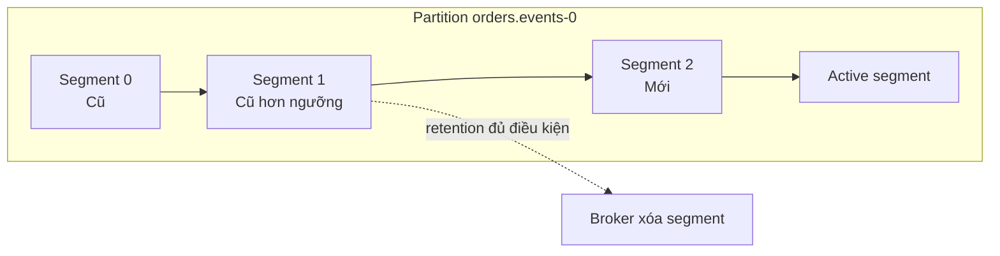

# Cấu hình retention cho topic

Kafka lưu record trong partition log để consumer có thể đọc theo offset và phát lại dữ liệu khi cần. Dữ liệu không bị xóa ngay sau khi consumer đọc xong. Broker giữ record theo chính sách lưu trữ của topic, sau đó xóa các log segment cũ hoặc compact log tùy cấu hình.

**Retention** là chính sách xác định Kafka giữ dữ liệu trong topic trong bao lâu hoặc đến giới hạn dung lượng nào. Cấu hình đúng giúp cân bằng ba nhu cầu: thời gian consumer có thể bị gián đoạn, khả năng replay dữ liệu và dung lượng lưu trữ của cluster. Nếu retention quá ngắn, consumer chậm có thể mất cơ hội đọc record cũ; nếu retention quá dài, dung lượng đĩa và chi phí vận hành tăng.

Trong Spring Kafka, retention thường được cấu hình ở cấp topic bằng Kafka topic config. Có thể đặt cấu hình khi tạo topic bằng `TopicBuilder`, hoặc thay đổi topic đang tồn tại bằng Kafka Admin API hay công cụ `kafka-configs`.

## 1. Retention hoạt động như thế nào?

Một topic gồm nhiều partition; mỗi partition là một log được chia thành các **segment**. Kafka ghi record mới vào segment đang hoạt động. Khi segment đạt ngưỡng kích thước hoặc thời gian, broker đóng segment hiện tại và tạo segment mới. Các segment cũ có thể trở thành ứng viên để xóa khi chính sách retention cho phép.



Retention của Kafka làm việc theo **log segment**, không phải bộ hẹn giờ riêng cho từng record. Khi segment cũ đủ điều kiện, Kafka có thể xóa cả segment. Vì thế, record đã vượt mốc `retention.ms` chưa chắc bị xóa đúng ngay thời điểm đó: segment cần được đóng và broker cần chạy vòng kiểm tra retention. Thời điểm xóa thực tế có thể trễ hơn mốc cấu hình.

Một số hệ quả cần nhớ:

- Consumer đã đọc record không khiến record bị xóa ngay.
- Consumer chưa đọc record cũng không ngăn broker xóa record khi retention đã đạt điều kiện.
- Mỗi consumer group có offset riêng, nhưng các group không phải là cơ chế giữ dữ liệu khỏi retention.
- Retention áp dụng cho log của partition; topic có nhiều partition nên mỗi partition có các segment và thời điểm xóa riêng.

## 2. Hai giới hạn retention thường dùng

Với topic dùng chính sách xóa (`cleanup.policy=delete`), hai cấu hình phổ biến là `retention.ms` và `retention.bytes`.

| Cấu hình | Ý nghĩa | Phạm vi |
| --- | --- | --- |
| `retention.ms` | Thời gian tối đa Kafka giữ log segment trước khi segment cũ đủ điều kiện xóa | Theo thời gian của segment/record |
| `retention.bytes` | Giới hạn dung lượng log trước khi Kafka xóa các segment cũ để giải phóng dung lượng | Tính riêng cho từng partition |

### 2.1. `retention.ms`: giữ dữ liệu theo thời gian

`retention.ms` biểu diễn thời gian tính bằng mili giây. Ví dụ, muốn giữ dữ liệu khoảng ba ngày:

```properties
retention.ms=259200000
```

Giá trị được tính như sau:

\[
3 \times 24 \times 60 \times 60 \times 1000 = 259200000\text{ ms}
\]

Một vài giá trị tham khảo:

| Thời gian mong muốn | `retention.ms` |
| --- | ---: |
| 1 ngày | `86400000` |
| 3 ngày | `259200000` |
| 7 ngày | `604800000` |
| 30 ngày | `2592000000` |

`retention.ms=-1` tắt giới hạn retention theo thời gian. Điều này không có nghĩa topic không bao giờ mất dữ liệu: nếu `retention.bytes` vẫn có giới hạn thì dung lượng vẫn có thể khiến segment cũ bị xóa; topic cũng có thể bị xóa hoặc thay đổi cấu hình bởi quản trị viên.

Kafka có thể gắn timestamp cho record theo `CreateTime` (timestamp do producer gửi) hoặc `LogAppendTime` (broker gắn khi append). Cách tính tuổi record phụ thuộc loại timestamp đang dùng. Nếu dùng `CreateTime`, đồng hồ producer sai lệch hoặc timestamp do ứng dụng đặt không hợp lý có thể làm tuổi record khác với thời gian record thực sự được broker nhận.

### 2.2. `retention.bytes`: giữ dữ liệu theo dung lượng

`retention.bytes` đặt giới hạn kích thước log cho **mỗi partition**, không phải tổng dung lượng toàn topic. Ví dụ:

```properties
retention.bytes=5368709120
```

Giá trị trên tương đương 5 GiB cho một partition (5 × 1024³ byte). Nếu topic có sáu partition, dung lượng log logic theo giới hạn này xấp xỉ:

\[
6 \times 5\text{ GiB} = 30\text{ GiB}
\]

Nếu replication factor bằng 3, tổng dung lượng bản sao trên các broker có thể xấp xỉ 90 GiB, chưa tính index, metadata, segment chưa đủ điều kiện xóa và phần dự phòng vận hành.

`retention.bytes=-1` tắt giới hạn dung lượng theo topic config. Nếu chỉ đặt `retention.ms`, dữ liệu vẫn bị giới hạn theo thời gian; nếu chỉ đặt `retention.bytes`, dữ liệu vẫn bị giới hạn theo dung lượng.

### 2.3. Khi đặt cả hai giới hạn

Nếu topic có cả `retention.ms` và `retention.bytes`, Kafka có thể xóa segment cũ khi một trong hai điều kiện retention được đáp ứng. Có thể hiểu đây là ngưỡng “đến trước”: dữ liệu có thể bị xóa sớm hơn thời gian dự kiến nếu partition tăng dung lượng nhanh.

Ví dụ topic được cấu hình giữ tối đa ba ngày và tối đa 5 GiB cho mỗi partition:

- Nếu lưu lượng thấp, giới hạn thời gian có thể đạt trước; các segment cũ được xóa khi đủ điều kiện.
- Nếu lưu lượng tăng mạnh, partition có thể đạt 5 GiB trước ba ngày; các segment cũ được xóa để đưa log về gần giới hạn dung lượng.

Việc xóa theo segment khiến dung lượng thực tế có thể vượt giới hạn trong một khoảng thời gian, đặc biệt khi segment đang hoạt động chưa đóng. Không nên xem `retention.bytes` là một hard cap chính xác đến từng byte.

## 3. Phân biệt retention với cleanup policy

`cleanup.policy` quyết định cách Kafka dọn dẹp log. Hai giá trị chính là `delete` và `compact`:

| `cleanup.policy` | Cách hoạt động | Trường hợp sử dụng |
| --- | --- | --- |
| `delete` | Xóa các segment cũ theo ngưỡng retention thời gian hoặc dung lượng | Event log, audit event, dữ liệu cần replay trong một khoảng thời gian xác định |
| `compact` | Compact log theo key, giữ lại giá trị mới nhất của mỗi key theo tiến trình compaction | Topic lưu trạng thái mới nhất theo entity, ví dụ trạng thái cấu hình hoặc hồ sơ |
| `compact,delete` | Kết hợp compaction theo key và xóa segment theo retention | Khi vừa cần trạng thái mới nhất theo key vừa muốn giới hạn tuổi/dung lượng log |

Với `delete`, Kafka giữ lịch sử record cho đến khi segment cũ đủ điều kiện xóa. Với `compact`, Kafka chạy log cleaner bất đồng bộ để loại bỏ các phiên bản cũ của cùng key. Compaction không có nghĩa mọi key chỉ còn đúng một record ngay lập tức; log có thể còn các segment chưa compact và dữ liệu mới.

### 3.1. Tombstone và `delete.retention.ms`

Trong topic compacted, một record có key và value `null` được gọi là **tombstone**. Tombstone biểu thị việc xóa giá trị hiện tại của key. Kafka giữ tombstone trong một khoảng thời gian để consumer có cơ hội đọc và áp dụng thao tác xóa trước khi tombstone bị loại bỏ trong quá trình compaction.

`delete.retention.ms` điều khiển thời gian tombstone được giữ trong log compacted. Đây là cấu hình khác với `retention.ms`:

- `retention.ms` là ngưỡng thời gian cho việc xóa segment theo cleanup policy `delete`.
- `delete.retention.ms` là thời gian giữ tombstone trong log compacted để consumer có cơ hội quan sát sự kiện xóa.

Nếu consumer cần dựng lại trạng thái từ compacted topic, phải bảo đảm consumer có thể đọc dữ liệu trong khoảng thời gian tombstone còn tồn tại hoặc có chiến lược snapshot/rebuild phù hợp.

### 3.2. Chọn policy theo loại dữ liệu

Với topic `orders.events` chứa các event như `OrderCreated`, `OrderPaid`, `OrderCancelled`, thường cần giữ lịch sử trong một khoảng thời gian để consumer có thể replay, nên `delete` là lựa chọn dễ hiểu. Với topic `customer.current-state` chỉ cần trạng thái mới nhất theo `customerId`, `compact` có thể phù hợp hơn.

Không nên bật `compact` chỉ để “tiết kiệm dung lượng” cho event log. Compaction có thể loại bỏ các phiên bản trung gian cùng key, trong khi nghiệp vụ audit hoặc replay có thể cần toàn bộ lịch sử. Ngược lại, không nên dùng retention ngắn cho compacted topic nếu consumer cần thời gian đủ dài để nhận tombstone và dựng lại trạng thái.

## 4. Retention ở cấp topic và cấu hình mặc định của broker

Kafka có các cấu hình mặc định ở broker như `log.retention.ms`, `log.retention.bytes`, `log.cleanup.policy`, `log.segment.bytes` và `log.retention.check.interval.ms`. Topic có thể ghi đè một số giá trị bằng topic config. Nếu topic không đặt giá trị riêng, nó thường kế thừa cấu hình mặc định tương ứng của broker.

Điều này có nghĩa hai topic trên cùng cluster có thể có retention khác nhau:

| Topic | Mục đích | Ví dụ retention |
| --- | --- | --- |
| `orders.events` | Event nghiệp vụ cần replay | 7 ngày |
| `payments.audit` | Dữ liệu đối soát cần lưu lâu hơn | 90 ngày |
| `telemetry.raw` | Dữ liệu quan sát có lưu lượng lớn | 24 giờ và giới hạn dung lượng |
| `customer.current-state` | Trạng thái mới nhất theo key | `compact` |

Các giá trị trong bảng là ví dụ thiết kế, không phải mặc định bắt buộc của Kafka. Cần xem cấu hình thực tế của broker và topic trước khi kết luận dữ liệu được giữ bao lâu.

## 5. Xem và thay đổi retention bằng Kafka CLI

`kafka-configs.sh` cho phép xem và thay đổi topic config của một topic đang tồn tại. Ví dụ xem cấu hình topic `orders.events`:

```bash
kafka-configs.sh \
  --bootstrap-server localhost:9092 \
  --entity-type topics \
  --entity-name orders.events \
  --describe
```

Đặt retention ba ngày, giới hạn 5 GiB cho mỗi partition và dùng cleanup policy `delete`:

```bash
kafka-configs.sh \
  --bootstrap-server localhost:9092 \
  --entity-type topics \
  --entity-name orders.events \
  --alter \
  --add-config 'cleanup.policy=delete,retention.ms=259200000,retention.bytes=5368709120'
```

Sau khi thay đổi, chạy lại lệnh `--describe` để kiểm tra cấu hình đã được lưu. Các thay đổi topic config thường được broker áp dụng động; tuy nhiên việc xóa segment thực tế vẫn phụ thuộc segment đã đóng và chu kỳ kiểm tra retention.

Nếu muốn bỏ một override ở topic để quay về giá trị mặc định của broker, có thể xóa cấu hình riêng của topic:

```bash
kafka-configs.sh \
  --bootstrap-server localhost:9092 \
  --entity-type topics \
  --entity-name orders.events \
  --alter \
  --delete-config retention.bytes
```

Xóa override không có nghĩa cấu hình hiệu lực trở thành vô hạn; broker sẽ dùng giá trị mặc định tương ứng. Cần kiểm tra lại cấu hình hiệu lực và quyền `ALTER_CONFIGS` của tài khoản quản trị.

## 6. Khai báo retention khi tạo topic bằng Spring Kafka

Spring Kafka cho phép khai báo topic dưới dạng bean `NewTopic`. Có thể đặt retention ngay khi tạo topic bằng `TopicBuilder.configs(...)`:

```java
package com.example.messaging.config;

import java.time.Duration;
import java.util.Map;
import org.apache.kafka.clients.admin.NewTopic;
import org.apache.kafka.common.config.TopicConfig;
import org.springframework.context.annotation.Bean;
import org.springframework.context.annotation.Configuration;
import org.springframework.kafka.config.TopicBuilder;

@Configuration
public class TopicConfiguration {

    @Bean
    NewTopic ordersTopic() {
        return TopicBuilder.name("orders.events")
                .partitions(6)
                .replicas(3)
                .configs(Map.of(
                        TopicConfig.CLEANUP_POLICY_CONFIG,
                        TopicConfig.CLEANUP_POLICY_DELETE,
                        TopicConfig.RETENTION_MS_CONFIG,
                        Long.toString(Duration.ofDays(3).toMillis()),
                        TopicConfig.RETENTION_BYTES_CONFIG,
                        Long.toString(5L * 1024 * 1024 * 1024)
                ))
                .build();
    }
}
```

Trong ví dụ:

- Topic có sáu partition để tăng khả năng xử lý song song.
- Replication factor bằng ba, do đó cluster phải có đủ broker phù hợp.
- `retention.ms` đặt thời gian ba ngày.
- `retention.bytes` đặt giới hạn 5 GiB cho mỗi partition.
- `cleanup.policy=delete` yêu cầu Kafka xóa segment cũ theo ngưỡng retention.

Bean `NewTopic` chủ yếu mô tả cấu hình khi topic được tạo. Nếu topic đã tồn tại, không nên giả định việc khai báo lại bean sẽ cập nhật mọi topic config hiện tại. Hãy dùng Kafka Admin API hoặc lệnh `kafka-configs --alter` để thay đổi cấu hình topic đang tồn tại, sau đó describe để xác nhận.

Trong production, topic thường được provision bởi quy trình hạ tầng riêng. Khi đó cần thống nhất ai sở hữu việc tạo topic và thay đổi config; tránh để nhiều ứng dụng tự ý thay đổi retention của cùng một topic.

## 7. Tính toán retention theo nhu cầu thực tế

Không nên chọn retention chỉ vì một con số quen thuộc như bảy ngày. Hãy xác định khoảng thời gian hệ thống cần chịu được khi consumer ngừng hoạt động và thời gian cần để replay dữ liệu.

Các câu hỏi cần trả lời:

1. Consumer có thể ngừng hoạt động tối đa bao lâu do deploy, bảo trì hoặc sự cố?
2. Sau khi khởi động lại, consumer cần bao lâu để xử lý hết backlog?
3. Đội vận hành cần replay dữ liệu trong bao nhiêu ngày để điều tra hoặc khôi phục?
4. Có yêu cầu audit hoặc pháp lý về thời gian lưu trữ không?
5. Lưu lượng ghi trung bình và đỉnh của topic là bao nhiêu? Kích thước record trung bình sau compression là bao nhiêu?
6. Topic có bao nhiêu partition và replication factor bằng bao nhiêu?

### 7.1. Ước lượng dung lượng

Ước lượng dung lượng log logic trước khi nhân replication:

\[
\text{Dung lượng logic} \approx
\text{Lưu lượng ghi trung bình} \times \text{Thời gian retention}
\]

Dung lượng lưu trữ trên cluster có thể ước lượng gần đúng:

\[
\text{Dung lượng cluster} \approx
\text{Dung lượng logic} \times \text{Replication factor}
\]

Ví dụ topic ghi trung bình 2 MiB/s và giữ dữ liệu ba ngày:

\[
2 \times 60 \times 60 \times 24 \times 3
= 518400\text{ MiB} \approx 506.25\text{ GiB}
\]

Với replication factor bằng ba, dung lượng bản sao xấp xỉ 1.48 TiB. Đây là ước lượng ban đầu; dung lượng thực tế còn phụ thuộc compression, index, kích thước segment, phân phối dữ liệu giữa partition, thời gian segment chờ xóa và headroom cần dành cho broker.

Nếu dùng `retention.bytes`, hãy nhớ giới hạn áp dụng cho từng partition. Ví dụ sáu partition × 5 GiB mỗi partition cho giới hạn log logic khoảng 30 GiB; với replication factor ba, dung lượng bản sao khoảng 90 GiB. Nếu dữ liệu phân phối không đều, partition nóng có thể chạm giới hạn sớm hơn partition khác.

### 7.2. Chọn thời gian dựa trên khả năng phục hồi

Một cách thực tế là tính:

\[
\text{Retention tối thiểu} \geq
\text{Thời gian gián đoạn tối đa} +
\text{Thời gian xử lý backlog} +
\text{Khoảng dự phòng}
\]

Ví dụ consumer có thể gián đoạn một ngày, cần thêm một ngày để xử lý backlog sau khi khôi phục và cần một ngày dự phòng. Retention ba ngày là mức tối thiểu ban đầu để đánh giá, không phải cam kết đủ cho mọi đợt sự cố. Cần dùng lưu lượng đỉnh và năng lực xử lý thực tế để xác minh.

Nếu tốc độ consumer sau phục hồi chỉ bằng tốc độ producer, consumer sẽ không bao giờ xử lý hết backlog khi producer tiếp tục ghi dữ liệu. Vì vậy, bài toán retention cần đi cùng năng lực xử lý vượt tốc độ ghi trong giai đoạn phục hồi.

## 8. Tác động của retention đến consumer và offset

Kafka không giữ record cho đến khi mọi consumer group đọc xong. Giả sử topic giữ dữ liệu ba ngày, nhưng `billing-service` bị dừng bốn ngày. Khi service khởi động lại, các segment cũ có thể đã bị xóa. Offset đã commit của group có thể nằm trước log start offset hiện tại.

Khi consumer yêu cầu đọc một offset không còn tồn tại, Kafka có thể trả lỗi offset out of range. Client áp dụng `auto.offset.reset` nếu cấu hình cho phép:

- `earliest`: chuyển đến offset sớm nhất còn tồn tại trong partition. Dữ liệu đã bị retention xóa không thể đọc lại bằng cách này.
- `latest`: chuyển đến cuối log và bỏ qua phần dữ liệu không còn đọc được.
- `none`: không tự đặt lại offset; client báo lỗi để ứng dụng/quản trị viên xử lý rõ ràng.

Do đó, `auto.offset.reset=earliest` không phải cơ chế khôi phục record đã bị xóa. Nó chỉ chọn điểm bắt đầu trong dữ liệu còn tồn tại. Nếu cần khôi phục lịch sử dài hơn retention, phải có bản lưu trữ hoặc nguồn dữ liệu khác.

### 8.1. Retention của topic khác retention của consumer offset

Record của topic và offset đã commit của group là hai loại dữ liệu khác nhau:

| Dữ liệu | Được quản lý bởi | Cấu hình liên quan |
| --- | --- | --- |
| Record trong topic partition | Topic log cleanup | `retention.ms`, `retention.bytes`, `cleanup.policy` |
| Offset đã commit của consumer group | Topic nội bộ `__consumer_offsets` và group coordinator | `offsets.retention.minutes` cùng trạng thái hoạt động của group |

Không được nhầm `offsets.retention.minutes` với `retention.ms`. Tăng thời gian giữ offset không làm record trong topic được giữ lâu hơn; tăng retention của topic cũng không đồng nghĩa offset của một group cũ được giữ mãi. Khi group không còn hoạt động, offset metadata có thể hết hạn theo chính sách broker.

## 9. Segment settings và thời điểm xóa thực tế

Một số cấu hình broker/topic ảnh hưởng đến độ hạt của việc retention:

| Cấu hình | Tác dụng |
| --- | --- |
| `segment.bytes` | Dung lượng tối đa trước khi log segment được roll |
| `segment.ms` | Thời gian tối đa trước khi segment được roll theo thời gian |
| `log.retention.check.interval.ms` | Chu kỳ broker kiểm tra các segment đủ điều kiện xóa |

Ví dụ, nếu topic có `retention.ms` một giờ nhưng segment chỉ roll sau một ngày và log ít dữ liệu, record có thể nằm trong active segment lâu hơn một giờ. Khi segment đóng và vòng kiểm tra retention tiếp theo chạy, segment mới có thể được xóa. Vì thế, retention là chính sách dọn dẹp theo segment chứ không phải TTL chính xác cho từng record.

Không nên tùy tiện đặt `segment.ms` quá thấp để ép xóa nhanh. Segment quá nhỏ tạo nhiều file, index và công việc quản lý, có thể làm tăng overhead của broker. Hãy chọn segment size/time theo throughput, kích thước record, yêu cầu retention và khả năng vận hành.

## 10. Kiểm tra retention trong thực tế

Một quy trình kiểm tra an toàn cho topic đang chạy:

1. Describe topic config để biết giá trị override đang có.
2. Xem broker default nếu topic không có override.
3. Xác nhận cleanup policy là `delete`, `compact` hay kết hợp.
4. Tính retention theo cả thời gian và dung lượng; kiểm tra giới hạn bytes theo từng partition.
5. Kiểm tra lag của consumer group quan trọng và thời gian backlog có thể tồn tại.
6. Thay đổi config trong cửa sổ vận hành phù hợp và theo dõi log start offset, dung lượng partition, consumer lag sau thay đổi.
7. Xác nhận hệ thống vẫn đáp ứng yêu cầu replay và audit.

Không nên thử nghiệm retention bằng cách giảm mạnh thời gian trên topic production. Khi segment đủ điều kiện, dữ liệu cũ có thể bị xóa và không thể khôi phục từ Kafka. Hãy dùng topic thử nghiệm riêng với dữ liệu giả lập để quan sát.

## 11. Lỗi thường gặp khi cấu hình retention

| Hiện tượng | Nguyên nhân thường gặp | Cách xử lý |
| --- | --- | --- |
| Dữ liệu biến mất sớm hơn dự kiến | `retention.bytes` thấp khiến partition chạm giới hạn trước `retention.ms` | Kiểm tra cả hai ngưỡng và tốc độ ghi theo partition |
| Record quá hạn vẫn còn trên đĩa | Segment chưa đóng hoặc broker chưa chạy vòng kiểm tra retention tiếp theo | Kiểm tra `segment.ms`, `segment.bytes` và chu kỳ retention check |
| Consumer không đọc được offset cũ | Segment chứa record đã bị xóa theo retention | Kiểm tra log start offset, `auto.offset.reset` và nguồn replay khác |
| Topic compacted vẫn còn nhiều record cùng key | Compaction chạy bất đồng bộ; segment chưa được compact | Kiểm tra `cleanup.policy`, trạng thái log cleaner và thiết kế key |
| Tombstone biến mất trước khi consumer xử lý | `delete.retention.ms` ngắn hơn thời gian consumer có thể bị gián đoạn | Tăng thời gian giữ tombstone hoặc thiết kế snapshot/rebuild |
| Topic mới không có retention như mong muốn | Topic kế thừa broker default hoặc NewTopic bean không thay đổi topic đã tồn tại | Describe config; alter topic config riêng và readback |
| Group offset hết hạn dù record vẫn còn | Chính sách giữ offset group khác với retention của topic | Kiểm tra `offsets.retention.minutes` và quản lý vòng đời group |

## 12. Tự kiểm tra

1. `retention.ms` và `retention.bytes` khác nhau ở điểm nào? `retention.bytes` áp dụng cho từng topic hay từng partition?
2. Nếu cấu hình cả thời gian và dung lượng, điều gì xảy ra khi partition đạt giới hạn bytes trước khi hết thời gian?
3. Vì sao record có thể vẫn tồn tại sau khi đã vượt `retention.ms`?
4. `cleanup.policy=compact` khác `cleanup.policy=delete` như thế nào?
5. `delete.retention.ms` có phải là thời gian lưu trữ chung của mọi record không?
6. Nếu consumer bị dừng lâu hơn retention, `auto.offset.reset=earliest` có thể khôi phục record đã bị xóa không?
7. Vì sao retention của topic và retention của consumer group offset phải được giám sát riêng?

Khi thiết kế retention, hãy xem đây là cam kết về cửa sổ replay và dung lượng lưu trữ của từng topic. Cần phối hợp `retention.ms`, `retention.bytes`, cleanup policy, segment settings, replication factor và khả năng xử lý backlog của consumer để luồng messaging vừa có thể phục hồi vừa vận hành ổn định.
