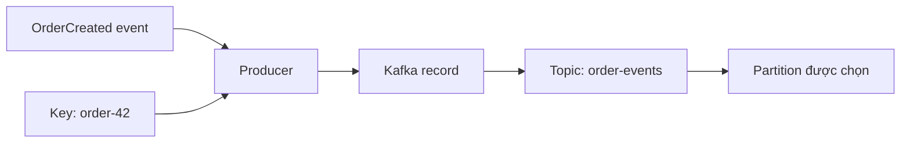
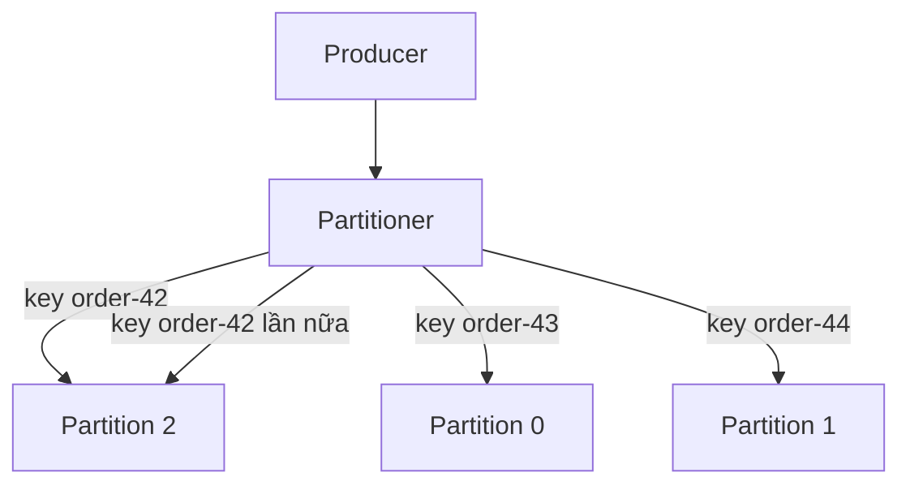

# Gửi record có key

Khi gửi một record vào Kafka, producer có thể truyền cả **key** và **value**. Value chứa sự kiện nghiệp vụ; key giúp Kafka xác định record thuộc về thực thể hoặc luồng dữ liệu nào và thường được dùng để chọn partition. Chọn key đúng giúp các sự kiện liên quan được lưu cùng partition, giữ thứ tự trong phạm vi thực thể đó và hỗ trợ các cách xử lý dữ liệu như log compaction.

Với Spring Kafka, cách gửi record có key rất trực tiếp:

```java
kafkaTemplate.send("order-events", orderId, event);
```

Điều cần thiết kế cẩn thận là `orderId` có thực sự là key phù hợp hay không, key được serialize thế nào và partitioning ảnh hưởng ra sao đến ordering cũng như khả năng mở rộng.

## 1. Key là gì trong Kafka record?

Một Kafka record có các thành phần chính:

- **Topic**: luồng dữ liệu logic mà record được gửi vào.
- **Partition**: log cụ thể chứa record.
- **Key**: giá trị định danh hoặc phân nhóm record, có thể để trống.
- **Value**: payload, thường là event hoặc dữ liệu nghiệp vụ.
- **Timestamp và headers**: metadata bổ sung cho record.

Key không bắt buộc phải xuất hiện trong payload. Ví dụ event `OrderCreated` có thể chứa `orderId`, `customerId`, `amount`, còn key của record cũng là `orderId`. Khi đó Kafka có thể định tuyến tất cả event của cùng một đơn hàng vào cùng partition.



Ví dụ một record:

| Thành phần | Giá trị |
|---|---|
| Topic | `order-events` |
| Key | `order-42` |
| Value | `OrderCreated(orderId=order-42, amount=250000)` |
| Partition | Ví dụ P2 |
| Offset | Vị trí do broker cấp trong P2 |

Key là metadata định tuyến của record, không phải một header tùy ý. Header thường mang thông tin phụ như correlation ID, event type hoặc trace ID; header không tự quyết định partition theo cơ chế mặc định.

## 2. Chọn key theo thực thể nghiệp vụ

Một key tốt thường đại diện cho thực thể mà hệ thống cần xử lý theo thứ tự. Hãy hỏi: *Những sự kiện nào không được xử lý đảo thứ tự? Chúng thuộc về cùng đối tượng nào?*

Ví dụ:

| Luồng sự kiện | Key thường phù hợp | Lý do |
|---|---|---|
| Vòng đời đơn hàng | `orderId` | Các event của cùng đơn hàng đi cùng partition |
| Số dư tài khoản | `accountId` | Các thay đổi của một tài khoản giữ thứ tự |
| Hoạt động người dùng | `userId` | Có thể xử lý tuần tự theo người dùng |
| Trạng thái thiết bị IoT | `deviceId` | Các bản tin của cùng thiết bị được gom lại |
| Nhật ký kiểm toán theo giao dịch | `transactionId` | Các event cùng giao dịch có cùng khóa định tuyến |

Nếu cần giữ thứ tự các thay đổi trạng thái của một đơn hàng, dùng `orderId` thường hợp lý hơn dùng `customerId`. Một khách hàng có thể tạo nhiều đơn hàng độc lập; chọn `customerId` sẽ gom tất cả các đơn đó vào một partition và có thể tạo điểm nóng không cần thiết.

Không nên dùng một giá trị ngẫu nhiên mới cho mỗi event nếu mục tiêu là gom các event của cùng thực thể. Ví dụ, UUID của từng event làm các event cùng đơn hàng có key khác nhau, do đó chúng có thể rơi vào các partition khác nhau.

Key nên có dạng ổn định, nhất quán giữa các phiên bản ứng dụng và có serializer xác định. Các giá trị như `order-42`, `account-1001` hoặc UUID được chuyển thành chuỗi là lựa chọn dễ quan sát. Tránh thay đổi cách chuẩn hóa key giữa các phiên bản producer nếu chưa có kế hoạch tương thích.

## 3. Kafka chọn partition dựa trên key như thế nào?

Khi gửi record, producer có thể chỉ định partition tường minh. Nếu không chỉ định partition, partitioner của producer sẽ chọn partition.

Với partitioner mặc định và key khác `null`, Kafka dùng hash của byte array sau serialization để xác định partition. Có thể mô tả khái quát:

`partition = positiveHash(serializedKey) % partitionCount`

Đây là công thức mô tả ý tưởng; thuật toán cụ thể phụ thuộc partitioner của Kafka client. Điểm quan trọng là **key được serialize trước khi partitioner dùng nó**.

Nếu cùng một topic, cùng key bytes, cùng partitioner và cùng số partition, các record có cùng key sẽ được chọn vào cùng partition.

### Ví dụ một topic có ba partition

Giả sử topic `order-events` có P0, P1 và P2. Các key khác nhau được ánh xạ vào partition theo hash:



Sơ đồ chỉ minh họa kết quả ánh xạ. Partition cụ thể của một key phải được xác định từ partitioner và cấu hình thật của topic; không thể suy ra chỉ từ tên key.

### Khi không có key

Nếu key là `null` và producer không chỉ định partition, partitioner mặc định hiện đại thường dùng chiến lược sticky partitioning để gom record vào một partition trong một khoảng gửi/batch, rồi chuyển sang partition khác. Điều này giúp tận dụng batching và throughput.

Do đó, không nên dựa vào giả định rằng record không có key sẽ luân phiên đều từng record qua tất cả partition.

Cần phân biệt:

- Key `null`: record không có key.
- Key là chuỗi rỗng `""`: vẫn là key khác null; nó được serialize thành byte array và tham gia chọn partition.
- Value `null`: là payload null. Với topic compacted, record có key và value null thường được dùng làm tombstone để đánh dấu xóa key.

## 4. Gửi record có key bằng KafkaTemplate

Spring Kafka cung cấp `KafkaTemplate` để gửi record. Với Spring Kafka 3.x, các phương thức `send(...)` trả về `CompletableFuture<SendResult<K, V>>`, giúp ứng dụng xử lý kết quả bất đồng bộ.

Giả sử event được biểu diễn bằng Java record:

```java
import java.math.BigDecimal;
import java.time.Instant;

public record OrderCreated(
    String orderId,
    String customerId,
    BigDecimal amount,
    Instant occurredAt
) {
}
```

Publisher có thể dùng `orderId` làm key:

```java
@Service
public class OrderEventPublisher {

    private static final String TOPIC = "order-events";

    private final KafkaTemplate<String, OrderCreated> kafkaTemplate;

    public OrderEventPublisher(
            KafkaTemplate<String, OrderCreated> kafkaTemplate) {
        this.kafkaTemplate = kafkaTemplate;
    }

    public CompletableFuture<SendResult<String, OrderCreated>> publish(
            OrderCreated event) {

        return kafkaTemplate.send(
            TOPIC,
            event.orderId(),
            event
        );
    }
}
```

Trong lời gọi trên:

- `TOPIC` là topic đích.
- `event.orderId()` là key.
- `event` là value.
- Kafka client serialize key và value riêng theo serializer đã cấu hình.

Nên kiểm tra key trước khi gửi. Nếu `orderId` null hoặc rỗng do lỗi tạo event, record có thể bị phân phối ngoài dự kiến hoặc không đáp ứng quy tắc nghiệp vụ. Có thể xác thực ngay tại biên publisher:

```java
public CompletableFuture<SendResult<String, OrderCreated>> publish(
        OrderCreated event) {

    if (event.orderId() == null || event.orderId().isBlank()) {
        throw new IllegalArgumentException("orderId must not be blank");
    }

    return kafkaTemplate.send(TOPIC, event.orderId(), event);
}
```

### Theo dõi kết quả gửi

Gửi record là thao tác bất đồng bộ. Future hoàn tất khi Kafka client nhận được kết quả gửi thành công hoặc thất bại theo cấu hình producer:

```java
public CompletableFuture<SendResult<String, OrderCreated>> publish(
        OrderCreated event) {

    return kafkaTemplate
        .send(TOPIC, event.orderId(), event)
        .whenComplete((result, exception) -> {
            if (exception != null) {
                log.error("Cannot publish order event", exception);
                return;
            }

            RecordMetadata metadata = result.getRecordMetadata();
            log.debug(
                "Published order event to partition {}, offset {}",
                metadata.partition(),
                metadata.offset()
            );
        });
}
```

Để ví dụ này biên dịch, class cần logger, ví dụ `@Slf4j` của Lombok, và import `RecordMetadata`, `CompletableFuture`, `SendResult`. Không nên chờ đồng bộ bằng `.get()` trên luồng xử lý request nếu không có lý do rõ ràng; chờ đồng bộ có thể làm tăng latency và chiếm thread.

Khi future thất bại, cần xử lý theo chính sách của ứng dụng: trả lỗi cho caller, retry ở tầng phù hợp hoặc đưa vào quy trình phục hồi. Không bỏ qua exception chỉ vì phương thức `send` đã trả về future.

> **Khác biệt phiên bản:** Spring Kafka 3.x dùng `CompletableFuture`. Ở các phiên bản Spring Kafka cũ hơn, API gửi có thể trả về `ListenableFuture`; hãy dùng kiểu future đúng với version đang quản lý bởi Spring Boot.

## 5. Cấu hình serializer cho key và value

Key và value được serialize độc lập. Nếu key là String, dùng `StringSerializer`; nếu value là event object, có thể dùng `JsonSerializer`.

Ví dụ cấu hình Spring Boot:

```yaml
spring:
  kafka:
    bootstrap-servers: localhost:9092

    producer:
      key-serializer: org.apache.kafka.common.serialization.StringSerializer
      value-serializer: org.springframework.kafka.support.serializer.JsonSerializer
      acks: all
```

Generic type của `KafkaTemplate` cần khớp với kiểu key và value:

```java
KafkaTemplate<String, OrderCreated>
```

Không khai báo `KafkaTemplate<Object, Object>` nếu ứng dụng chỉ gửi String key và event JSON, vì kiểu cụ thể giúp compiler kiểm tra tốt hơn.

Nếu key là UUID, có thể dùng serializer riêng hoặc chuẩn hóa thành chuỗi:

```java
String key = orderId.toString();
kafkaTemplate.send("order-events", key, event);
```

Điều quan trọng là consumer phải giải mã key tương ứng. Nếu producer dùng `StringSerializer`, consumer nên dùng `StringDeserializer`. Nếu producer dùng serializer nhị phân tùy chỉnh, consumer phải dùng deserializer tương thích.

## 6. Dùng ProducerRecord khi cần kiểm soát metadata

Khi cần thêm header, timestamp hoặc chỉ định partition cụ thể, có thể tạo `ProducerRecord` thay vì dùng overload đơn giản của `KafkaTemplate`.

```java
ProducerRecord<String, OrderCreated> record =
    new ProducerRecord<>(
        "order-events",
        event.orderId(),
        event
    );

record.headers().add(
    "event-type",
    "OrderCreated".getBytes(StandardCharsets.UTF_8)
);

kafkaTemplate.send(record);
```

Key vẫn là `event.orderId()`. Header `event-type` bổ sung thông tin về loại event; nó không thay thế key.

Nếu thực sự cần chỉ định partition, có thể dùng constructor nhận partition:

```java
ProducerRecord<String, OrderCreated> record =
    new ProducerRecord<>(
        "order-events",
        2,
        event.orderId(),
        event
    );

kafkaTemplate.send(record);
```

Trong ví dụ này, record được gửi vào partition số 2 nếu partition đó tồn tại. Khi partition được chỉ định tường minh, partitioner không chọn partition thay cho producer. Chỉ nên làm vậy khi ứng dụng có yêu cầu phân vùng cụ thể; nếu hard-code số partition, việc thay đổi topology sẽ khiến mã ứng dụng khó vận hành hơn.

## 7. Key và thứ tự xử lý sự kiện

Kafka bảo đảm thứ tự record trong phạm vi một partition. Vì vậy, khi các event của cùng một thực thể được gửi với cùng key và được định tuyến vào cùng partition, consumer có thể đọc chúng theo thứ tự lưu trong partition.

Ví dụ vòng đời đơn hàng:

| Thứ tự nghiệp vụ | Event | Key | Partition |
|---|---|---|---|
| 1 | `OrderCreated` | `order-42` | P2 |
| 2 | `OrderPaid` | `order-42` | P2 |
| 3 | `OrderPacked` | `order-42` | P2 |
| 4 | `OrderShipped` | `order-42` | P2 |

Các event này có thể được xử lý theo thứ tự partition. Những đơn hàng khác có thể nằm trên P0 hoặc P1 và được xử lý song song.

Key không tạo ra thứ tự toàn cục cho topic. Nếu hai record ở hai partition khác nhau, Kafka không cam kết consumer quan sát chúng theo cùng một thứ tự thời gian.

Cũng cần phân biệt thứ tự được ghi vào Kafka và thứ tự hoàn thành nghiệp vụ:

- Producer có nhiều thread gửi cùng key có thể tạo ra thứ tự theo thời điểm broker nhận request, không nhất thiết theo thời điểm nghiệp vụ phát sinh.
- Consumer xử lý bất đồng bộ hoặc đẩy công việc sang thread pool có thể hoàn thành side effect đảo thứ tự dù record được poll đúng thứ tự.
- Retry hoặc xử lý lỗi ở tầng ứng dụng có thể làm event sau hoàn thành trước event trước.

Nếu cần thứ tự nghiêm ngặt theo aggregate, hãy xác định một nơi chịu trách nhiệm tuần tự hóa các event của aggregate đó, giữ xử lý tuần tự ở consumer và dùng sequence/version nghiệp vụ để phát hiện event đến sai thứ tự. Key là điều kiện hỗ trợ partition affinity; nó không tự tạo exactly-once hoặc idempotency.

## 8. Ảnh hưởng của số partition

Một key được ánh xạ vào partition dựa trên partition count. Nếu tăng số partition của topic, phép ánh xạ key có thể thay đổi. Record cũ của `order-42` vẫn nằm trong partition cũ, trong khi record mới cùng key có thể được gửi sang partition khác.

Điều này có thể khiến hai consumer xử lý song song các event của cùng thực thể và làm mất giả định ordering xuyên suốt lịch sử topic.

Trước khi tăng partition count, hãy đánh giá:

- Có yêu cầu thứ tự theo key trong toàn bộ vòng đời dữ liệu không?
- Consumer có thể xử lý song song cùng một aggregate từ các partition khác nhau không?
- Có thể tạo topic phiên bản mới và chuyển dữ liệu theo kế hoạch không?
- Có cần custom partitioner với quy tắc phân vùng ổn định hay không?

Nếu ordering theo key là yêu cầu cứng, hãy coi partition count và partitioner là một phần của hợp đồng dữ liệu. Không thay đổi chúng tùy tiện trong vận hành.

## 9. Key trong log compaction

Với topic có cleanup policy `compact`, Kafka dùng key để giữ lại trạng thái mới nhất theo key sau các đợt compaction. Vì vậy, key còn có ý nghĩa như định danh của một thực thể trong changelog hoặc state topic.

Ví dụ:

| Key | Value | Ý nghĩa |
|---|---|---|
| `account-7` | `{"balance":100}` | Trạng thái tài khoản |
| `account-7` | `{"balance":80}` | Trạng thái mới hơn |
| `account-7` | `null` | Tombstone, đánh dấu xóa key |

Tombstone là record có key và value null. Nó khác record không có key. Với compacted topic, tombstone được giữ trong khoảng thời gian cấu hình trước khi có thể bị loại bỏ theo quy trình compaction.

Nếu muốn dùng compaction, key phải định danh đúng thực thể và nhất quán qua các lần cập nhật. Không nên dùng key ngẫu nhiên theo từng event vì Kafka không thể gom các phiên bản của cùng một thực thể vào cùng khóa.

## 10. Consumer nhận key như thế nào?

Consumer có thể nhận toàn bộ `ConsumerRecord<K, V>` để đọc key, value, partition, offset, timestamp và headers.

Ví dụ listener:

```java
import java.util.Objects;

@Component
public class OrderEventListener {

    @KafkaListener(
        topics = "order-events",
        groupId = "billing-service"
    )
    public void onOrderEvent(
            ConsumerRecord<String, OrderCreated> record) {

        String orderId = record.key();
        OrderCreated event = record.value();

        if (event == null || !Objects.equals(orderId, event.orderId())) {
            throw new IllegalStateException(
                "Record key does not match event orderId"
            );
        }

        // Xử lý nghiệp vụ cho orderId.
    }
}
```

Cấu hình consumer phải dùng deserializer tương ứng:

```yaml
spring:
  kafka:
    consumer:
      key-deserializer: org.apache.kafka.common.serialization.StringDeserializer
      value-deserializer: org.springframework.kafka.support.serializer.JsonDeserializer
      properties:
        spring.json.trusted.packages: com.example.messaging.event
```

Trong ví dụ, `StringDeserializer` khôi phục key thành String, còn `JsonDeserializer` chuyển payload JSON thành `OrderCreated` theo cấu hình type mapping/default type của ứng dụng. Cần bảo đảm cấu hình JSON phù hợp với event type thật và chỉ tin cậy package cần thiết.

Trong một consumer group, mỗi partition tại một thời điểm được gán cho tối đa một consumer member. Điều này hỗ trợ xử lý tuần tự theo partition. Tuy nhiên, nếu listener tự gửi công việc sang executor bất đồng bộ, ứng dụng phải tự bảo vệ thứ tự side effect.

## 11. Kiểm thử việc gửi record có key

Integration test với Embedded Kafka có thể xác minh key được ghi đúng vào record. Khi đọc record từ test consumer, hãy assert cả key và value:

```java
kafkaTemplate.send("order-events", "order-42", event)
    .get(10, TimeUnit.SECONDS);

ConsumerRecords<String, OrderCreated> records =
    consumer.poll(Duration.ofSeconds(10));

ConsumerRecord<String, OrderCreated> record =
    records.records("order-events").iterator().next();

assertThat(record.key()).isEqualTo("order-42");
assertThat(record.value().orderId()).isEqualTo("order-42");
```

Nếu cần xác minh partitioning, gửi nhiều record với cùng key vào topic nhiều partition rồi kiểm tra chúng có cùng `record.partition()`. Không nên hard-code partition cụ thể của key trong test trừ khi test đang kiểm tra custom partitioner hoặc hợp đồng partition cụ thể.

Một test partition affinity có thể theo logic:

1. Gửi nhiều record với key `order-42`.
2. Đợi các future hoàn tất.
3. Lấy partition từ `SendResult.getRecordMetadata().partition()`.
4. Xác nhận tất cả record có cùng key nhận cùng partition.
5. Gửi key khác và quan sát phân phối, nhưng không khẳng định hai key khác nhau bắt buộc phải nằm ở hai partition khác nhau.

Cách kiểm tra này xác minh hành vi partitioner trong cấu hình test hiện tại. Nếu thay partition count hoặc custom partitioner, kết quả cần được đánh giá lại.

## 12. Các lỗi thường gặp khi gửi record có key

| Hiện tượng | Nguyên nhân có thể | Cách xử lý |
|---|---|---|
| Consumer nhận key là null | Producer không truyền key hoặc serializer/key mapping sai | Kiểm tra overload `send(topic, key, value)` và key serializer |
| Cùng một thực thể xuất hiện ở nhiều partition | Key không ổn định, producer dùng partitioner khác nhau hoặc partition count thay đổi | Chuẩn hóa key và thống nhất partitioner/topology |
| Các event của cùng key xử lý sai thứ tự | Consumer xử lý bất đồng bộ, retry hoặc nhiều nguồn gửi cạnh tranh | Tuần tự hóa xử lý theo aggregate và dùng event version |
| Một partition có tải cao bất thường | Một key quá nóng hoặc phân phối key bị lệch | Đánh giá lại key theo đơn vị nghiệp vụ và phân bố tải |
| Lỗi serialization key | Key serializer không hỗ trợ kiểu dữ liệu thực tế | Cấu hình serializer tương ứng và đồng bộ với consumer |
| Record vào partition không mong muốn | Producer chỉ định partition tường minh hoặc có custom partitioner | Kiểm tra `ProducerRecord`, `partitioner.class` và metadata |

Không dùng key để chứa password, token hoặc thông tin bí mật. Key được lưu trong Kafka log và có thể xuất hiện trong công cụ quản trị, log ứng dụng hoặc hệ thống quan sát. Nếu key chứa dữ liệu cá nhân, hãy cân nhắc dùng định danh kỹ thuật đã được chuẩn hóa hoặc mã hóa theo yêu cầu bảo vệ dữ liệu.

## 13. Checklist trước khi chọn key cho topic

- Key đại diện cho aggregate hoặc thực thể nào?
- Những event nào cần giữ thứ tự với nhau?
- Key có ổn định giữa các event và các phiên bản producer không?
- Producer và consumer có serializer/deserializer tương thích không?
- Có producer nào chỉ định partition tường minh hoặc dùng custom partitioner không?
- Số partition có thể thay đổi trong vòng đời topic không?
- Một key có thể trở thành hot partition không?
- Consumer có xử lý bất đồng bộ làm đảo thứ tự side effect không?
- Nếu topic compacted, key có định danh trạng thái đúng không?
- Key có chứa thông tin nhạy cảm không cần thiết không?

## 14. Ghi nhớ

- `key` và `value` là hai phần riêng của Kafka record.
- Key thường dùng để chọn partition; partitioner sử dụng byte đã serialize của key.
- Cùng key, cùng partitioner và cùng partition count thường được ánh xạ vào cùng partition.
- Kafka chỉ bảo đảm thứ tự trong một partition, không bảo đảm thứ tự toàn topic.
- `KafkaTemplate.send(topic, key, value)` là cách thông dụng để gửi record có key trong Spring Kafka.
- Key phải được serialize và deserialize nhất quán ở producer/consumer.
- Tăng partition count có thể làm thay đổi partition được chọn cho key và ảnh hưởng ordering.
- Key không thay thế idempotency, transaction hoặc cơ chế kiểm soát thứ tự nghiệp vụ.

Khi chọn key theo aggregate cần giữ thứ tự, producer có thể phân phối tải song song giữa các partition mà vẫn giữ các event liên quan trên cùng một log. Đây là nền tảng quan trọng để xây dựng luồng event bằng Spring Kafka có thể mở rộng và dễ kiểm soát.

