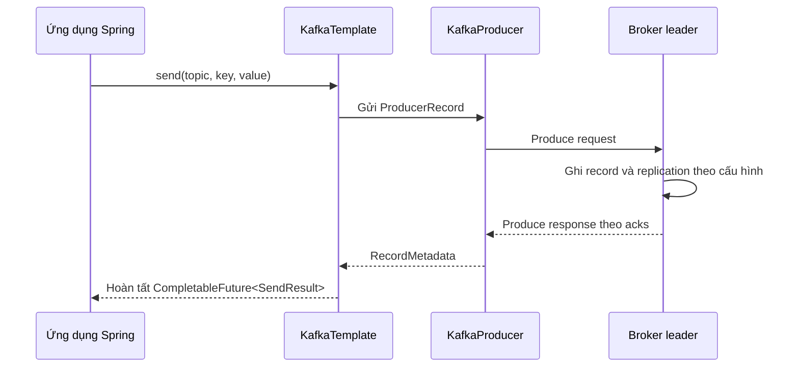

# Xử lý RecordMetadata trong Spring Kafka

Khi gửi một record bằng `KafkaTemplate`, producer có thể nhận kết quả chứa metadata do Kafka broker trả về. Spring Kafka đóng gói kết quả này trong `SendResult<K,V>`, còn `RecordMetadata` của Kafka cung cấp thông tin cụ thể về vị trí và thời điểm record được ghi vào topic.

Metadata giúp ứng dụng xác nhận record đã được broker chấp nhận theo chính sách `acks`, ghi log để truy vết, đo kích thước dữ liệu và hỗ trợ xử lý nghiệp vụ sau khi gửi. Cần hiểu rõ giới hạn của metadata: nó mô tả kết quả gửi ở phía Kafka, không chứng minh consumer đã đọc hoặc xử lý sự kiện.

## 1. SendResult và RecordMetadata nằm ở đâu trong luồng gửi?

`KafkaTemplate.send(...)` gửi dữ liệu bất đồng bộ. Khi producer nhận được kết quả theo cấu hình xác nhận, Spring Kafka hoàn tất future bằng một `SendResult<K,V>`. Kết quả này chứa `ProducerRecord` đã gửi và `RecordMetadata` do Kafka client cung cấp.



Các kiểu dữ liệu chính:

| Kiểu | Thuộc thư viện | Vai trò |
|---|---|---|
| `ProducerRecord<K,V>` | Kafka client | Record producer gửi đi, gồm topic, partition tùy chọn, timestamp, key, value và headers |
| `RecordMetadata` | Kafka client | Metadata về record sau khi gửi thành công, gồm topic, partition, offset, timestamp và kích thước serialize |
| `SendResult<K,V>` | Spring Kafka | Kết quả gửi của `KafkaTemplate`, chứa producer record và record metadata |
| `CompletableFuture<SendResult<K,V>>` | Java | Đại diện cho kết quả gửi sẽ hoàn tất trong tương lai |

Trong Spring Kafka 3.x, các phương thức `KafkaTemplate.send(...)` trả về `CompletableFuture<SendResult<K,V>>`. Với Spring Kafka 2.x, API gửi thường dùng `ListenableFuture`; khi nâng cấp cần cập nhật cách đăng ký callback cho phù hợp phiên bản.

## 2. Các trường quan trọng của RecordMetadata

`RecordMetadata` thuộc package `org.apache.kafka.clients.producer`. Những phương thức thường dùng gồm:

| Phương thức | Ý nghĩa |
|---|---|
| `topic()` | Tên topic chứa record |
| `partition()` | Partition thực tế mà producer đã ghi record vào |
| `offset()` | Offset của chính record trong partition đó |
| `timestamp()` | Timestamp được Kafka ghi nhận cho record |
| `timestampType()` | Loại timestamp, ví dụ thời gian do producer tạo hoặc thời gian broker append |
| `serializedKeySize()` | Kích thước key sau serialization, tính bằng byte |
| `serializedValueSize()` | Kích thước value sau serialization, tính bằng byte |
| `hasOffset()` | Cho biết metadata có offset hợp lệ hay không |
| `hasTimestamp()` | Cho biết metadata có timestamp hợp lệ hay không |

Ví dụ, kết quả gửi có thể cho biết record nằm ở `orders`, partition `2`, offset `1057`. Offset `1057` xác định vị trí của record đó trong partition `2`; nó không phải số thứ tự toàn cục của topic.

### Topic và partition thực tế

`topic()` cho biết topic mà broker ghi record. `partition()` cho biết partition thực tế sau khi producer áp dụng quy tắc định tuyến. Nếu ứng dụng gửi record chỉ với topic và key, partitioner quyết định partition. Nếu chỉ định partition trong `ProducerRecord`, metadata phản ánh partition đó khi gửi thành công.

Đọc partition từ metadata đặc biệt hữu ích khi producer không chỉ định partition tường minh. Ứng dụng có thể dùng kết quả để kiểm tra key routing, phát hiện phân bố dữ liệu bất thường hoặc ghi lại tọa độ record để hỗ trợ điều tra.

### Offset của record

`offset()` là vị trí của record vừa gửi trong một partition. Offset chỉ có ý nghĩa cùng với topic và partition:

```text
topic=orders, partition=2, offset=1057
```

Để xác định một record trong log, hãy lưu cả ba giá trị này. Hai partition khác nhau có thể cùng có offset `1057`, nhưng đó là hai record khác nhau.

Offset từ `RecordMetadata` cũng cần phân biệt với offset consumer group commit. Metadata trả offset của record vừa ghi; khi consumer xử lý record đó thành công, commit thường ghi vị trí kế tiếp cần đọc. Ví dụ record có offset `1057` thì vị trí commit tiếp theo thường là `1058`.

Không dùng offset để sắp thứ tự tuyệt đối giữa các partition. Kafka giữ thứ tự trong từng partition; record ở partition `0` và partition `2` không có quan hệ thứ tự toàn cục chỉ dựa vào offset.

### Timestamp

`timestamp()` trả timestamp Kafka ghi nhận cho record. Giá trị này chịu ảnh hưởng của `message.timestamp.type`:

- `CreateTime`: sử dụng timestamp producer gửi cùng record, nếu có.
- `LogAppendTime`: broker ghi thời điểm append record vào log.

Do đó, timestamp trong metadata không phải lúc nào cũng là thời điểm nghiệp vụ tạo event. Nếu ứng dụng cần thời điểm nghiệp vụ, hãy lưu trường `occurredAt` hoặc `createdAt` trong payload hoặc header theo schema đã thống nhất. Timestamp Kafka hữu ích cho quan sát thời điểm ghi và phân tích độ trễ, nhưng phải hiểu loại timestamp đang dùng.

`hasTimestamp()` giúp kiểm tra timestamp có hợp lệ hay không trước khi sử dụng. Không nên giả định mọi record đều có timestamp theo ý nghĩa nghiệp vụ.

### Kích thước key và value

`serializedKeySize()` và `serializedValueSize()` cho biết kích thước sau khi serializer chuyển dữ liệu thành byte. Các số đo này giúp quan sát kích thước record gần với dữ liệu producer đưa vào giao thức Kafka.

Nếu key hoặc value là `null`, Kafka có thể trả kích thước `-1` cho trường tương ứng. Vì vậy, khi tổng hợp metric, cần xử lý giá trị âm như trường hợp không có payload thay vì cộng trực tiếp vào tổng byte.

Kích thước serialize không phải kích thước object Java trong heap, cũng không nhất thiết bằng dung lượng cuối cùng trên đĩa sau khi Kafka đóng gói record batch hoặc nén. Không dùng hai trường này để thay thế đo lường dung lượng lưu trữ thực tế.

## 3. Lấy metadata từ KafkaTemplate

Ví dụ đơn giản với Spring Kafka 3.x:

```java
import java.util.concurrent.CompletableFuture;

import org.apache.kafka.clients.producer.RecordMetadata;
import org.springframework.kafka.core.KafkaTemplate;
import org.springframework.kafka.support.SendResult;
import org.springframework.stereotype.Service;

@Service
public class OrderPublisher {

    private final KafkaTemplate<String, OrderCreated> kafkaTemplate;

    public OrderPublisher(
            KafkaTemplate<String, OrderCreated> kafkaTemplate) {
        this.kafkaTemplate = kafkaTemplate;
    }

    public CompletableFuture<SendResult<String, OrderCreated>> publish(
            OrderCreated event) {

        return kafkaTemplate.send("orders", event.orderId(), event);
    }

    public void publishAndLog(OrderCreated event) {
        kafkaTemplate.send("orders", event.orderId(), event)
                .whenComplete((result, exception) -> {
                    if (exception != null) {
                        // Ghi nhận lỗi gửi; không có RecordMetadata thành công.
                        return;
                    }

                    RecordMetadata metadata = result.getRecordMetadata();
                    // Có thể log topic, partition, offset và timestamp.
                });
    }
}
```

`SendResult.getRecordMetadata()` trả về metadata Kafka. `SendResult.getProducerRecord()` cho phép xem record mà ứng dụng đã gửi, ví dụ key, value hoặc headers. Khi log, chỉ nên ghi những trường cần thiết; tránh ghi toàn bộ payload nếu chứa dữ liệu nhạy cảm.

Có thể trả future về tầng gọi để tầng đó quyết định cách xử lý kết quả. Cách này hữu ích khi một quy trình cần chờ xác nhận gửi, tổng hợp nhiều kết quả hoặc chuyển lỗi về API gọi. Nếu chỉ cần ghi log và metric, đăng ký callback ngay tại publisher thường đủ.

## 4. Xử lý bất đồng bộ với CompletableFuture

`KafkaTemplate.send(...)` không chờ broker hoàn tất ngay tại dòng gọi. Nó trả future để ứng dụng tiếp tục công việc khác trong khi Kafka producer gửi record.

Một số cách xử lý future:

```java
CompletableFuture<SendResult<String, OrderCreated>> future =
        kafkaTemplate.send("orders", event.orderId(), event);

future.thenAccept(result -> {
    RecordMetadata metadata = result.getRecordMetadata();
    // Xử lý kết quả thành công.
});

future.exceptionally(exception -> {
    // Ghi nhận lỗi gửi.
    return null;
});
```

`thenAccept` chỉ chạy khi future hoàn tất thành công. `exceptionally` xử lý nhánh lỗi và phải trả về giá trị phù hợp với kiểu kết quả của future. Nếu muốn xử lý cả thành công và thất bại tại một nơi, dùng `whenComplete`:

```java
future.whenComplete((result, exception) -> {
    if (exception != null) {
        // Gửi thất bại.
        return;
    }

    RecordMetadata metadata = result.getRecordMetadata();
    // Gửi thành công.
});
```

### Tránh chặn luồng hoàn tất của producer

Callback có thể chạy trên thread hoàn tất thao tác gửi. Không nên thực hiện công việc chậm như gọi HTTP đồng bộ, truy vấn database lâu hoặc chờ một future khác ngay trong callback đó. Việc này có thể làm chậm xử lý callback của producer.

Nếu cần thực hiện công việc tiếp theo tốn thời gian, hãy chuyển sang executor phù hợp bằng `thenAcceptAsync`, `whenCompleteAsync` hoặc một hàng đợi nội bộ:

```java
future.whenCompleteAsync((result, exception) -> {
    if (exception != null) {
        // Đẩy thông tin lỗi sang luồng xử lý riêng.
        return;
    }

    RecordMetadata metadata = result.getRecordMetadata();
    // Ghi metric hoặc cập nhật trạng thái trên executor riêng.
}, publisherExecutor);
```

Executor cần có giới hạn thread và hàng đợi phù hợp. Nếu callback tạo thêm tác vụ nhanh hơn tốc độ xử lý, hàng đợi có thể tăng không giới hạn và làm cạn tài nguyên. Hãy đo độ trễ callback, kích thước queue và tỷ lệ lỗi.

## 5. Gửi đồng bộ khi thật sự cần kết quả ngay

Có thể gọi `get()` trên future để chờ kết quả gửi. Cách này đơn giản trong một số luồng nghiệp vụ hoặc kiểm thử, nhưng làm thread hiện tại bị chặn cho tới khi future hoàn tất hoặc timeout.

```java
import java.util.concurrent.ExecutionException;
import java.util.concurrent.TimeUnit;
import java.util.concurrent.TimeoutException;

import org.apache.kafka.clients.producer.RecordMetadata;
import org.springframework.kafka.support.SendResult;

public RecordMetadata publishSynchronously(OrderCreated event) {
    try {
        SendResult<String, OrderCreated> result = kafkaTemplate
                .send("orders", event.orderId(), event)
                .get(10, TimeUnit.SECONDS);

        return result.getRecordMetadata();
    }
    catch (InterruptedException exception) {
        Thread.currentThread().interrupt();
        throw new IllegalStateException("Interrupted while sending order event", exception);
    }
    catch (ExecutionException | TimeoutException exception) {
        throw new IllegalStateException("Could not confirm order event send", exception);
    }
}
```

Timeout ở `get(10, TimeUnit.SECONDS)` chỉ có nghĩa là luồng gọi đã ngừng chờ sau thời hạn đó. Nó không chứng minh broker chưa ghi record và cũng không tự động hủy thao tác gửi ở producer. Nếu gửi lại ngay sau timeout, ứng dụng có thể tạo một record nghiệp vụ trùng.

Khi timeout hoặc lỗi mạng khiến kết quả không rõ ràng, cần dùng `eventId` ổn định và cơ chế idempotency ở consumer hoặc tầng nghiệp vụ. Không nên coi mọi timeout là bằng chứng chắc chắn rằng record chưa tới broker.

## 6. Metadata phụ thuộc vào acks

Thời điểm future hoàn tất và ý nghĩa xác nhận phụ thuộc producer `acks`:

| `acks` | Ý nghĩa của phản hồi thành công |
|---|---|
| `0` | Producer không chờ broker xác nhận; không thể dựa vào metadata để chứng minh broker đã lưu record |
| `1` | Leader xác nhận sau khi ghi record vào log cục bộ; follower có thể chưa sao chép xong |
| `all` hoặc `-1` | Leader chờ các replica trong ISR đáp ứng điều kiện xác nhận của Kafka trước khi phản hồi |

Với `acks=all`, `min.insync.replicas` quyết định số ISR tối thiểu mà broker yêu cầu cho lần ghi. Nếu ISR thấp hơn ngưỡng, broker từ chối ghi. Vì vậy, một future hoàn tất thành công chỉ có ý nghĩa trong phạm vi cấu hình xác nhận đang dùng.

Metadata không phải biên nhận rằng mọi replica trong replication factor đều đã đồng bộ nếu một số replica nằm ngoài ISR. Cũng không phải bằng chứng consumer đã nhận record, vì producer và consumer là hai luồng xử lý riêng.

Nếu dùng `acks=0`, một số trường metadata như offset có thể không hợp lệ; kiểm tra `hasOffset()` và `hasTimestamp()` trước khi dùng. Với ứng dụng cần xác nhận vị trí record và độ bền dữ liệu, thường chọn `acks=all` cùng replication factor và `min.insync.replicas` phù hợp.

## 7. Xử lý lỗi gửi và retry

Nếu future hoàn tất với exception, ứng dụng không có `SendResult` thành công để đọc `RecordMetadata`. Cần ghi nhận lỗi, phân loại nguyên nhân và quyết định retry theo chính sách.

Các nhóm lỗi thường gặp:

| Nhóm lỗi | Ví dụ | Hướng xử lý |
|---|---|---|
| Kết nối | Broker không truy cập được, timeout mạng | Kiểm tra broker/network; dùng retry có backoff và giới hạn |
| Xác nhận replication | Không đủ ISR theo `min.insync.replicas` | Theo dõi sức khỏe broker và ISR; thử lại khi cụm phục hồi |
| Serialization | Serializer không chuyển được key/value | Sửa schema hoặc dữ liệu; không retry vô hạn với payload không hợp lệ |
| Authorization | Producer không có quyền ghi topic | Kiểm tra ACL và danh tính client |
| Kích thước | Record hoặc request vượt giới hạn | Kiểm tra kích thước payload và giới hạn producer/broker/topic |

Kafka producer có cơ chế retry nội bộ. Nếu idempotence được bật và cấu hình tương thích, producer có thể xử lý retry do lỗi mạng mà tránh tạo duplicate trong phạm vi giao thức idempotent của producer. Tuy nhiên, nếu ứng dụng nhận lỗi cuối cùng rồi gọi `send()` lại như một thao tác mới, đó là một lần gửi mới và vẫn có thể tạo duplicate nghiệp vụ.

Ví dụ callback ghi log lỗi với event ID:

```java
kafkaTemplate.send("orders", event.orderId(), event)
        .whenComplete((result, exception) -> {
            if (exception != null) {
                log.error("Kafka send failed: eventId={}", event.eventId(), exception);
                return;
            }

            RecordMetadata metadata = result.getRecordMetadata();
            log.info(
                    "Kafka send succeeded: eventId={}, topic={}, partition={}, offset={}",
                    event.eventId(),
                    metadata.topic(),
                    metadata.partition(),
                    metadata.offset());
        });
```

Không retry lỗi serialization hoặc authorization như thể chúng là lỗi mạng tạm thời. Với lỗi tạm thời, dùng exponential backoff, giới hạn số lần thử và cơ chế lưu lại công việc chưa gửi nếu yêu cầu nghiệp vụ không cho phép mất event. Outbox pattern là một lựa chọn khi event cần được phát bền vững cùng thay đổi database.

## 8. Metadata khi chỉ định partition hoặc timestamp

Producer có thể chỉ định partition và timestamp trong `ProducerRecord` hoặc overload của `KafkaTemplate`:

```java
kafkaTemplate.send(
        "orders",
        2,
        event.createdAt().toEpochMilli(),
        event.orderId(),
        event);
```

Trong ví dụ, ứng dụng yêu cầu gửi tới partition `2` và cung cấp timestamp. Nếu gửi thành công, `RecordMetadata.partition()` cho biết partition broker đã ghi; `timestamp()` cho biết timestamp Kafka ghi nhận theo cấu hình topic/broker.

Chỉ định partition tường minh làm ứng dụng chịu trách nhiệm về phân bố tải và tính đúng đắn khi topic thay đổi số partition. Với phần lớn trường hợp, nên dùng key và để partitioner chọn partition để giữ các record cùng key trong cùng luồng theo quy tắc producer.

Timestamp được gửi vào record cũng có thể bị broker thay bằng thời điểm append nếu topic/broker dùng `LogAppendTime`. Nếu timestamp phục vụ nghiệp vụ, hãy lưu riêng trong payload để tránh phụ thuộc chính sách timestamp của Kafka.

## 9. Metadata trong Kafka transaction

Khi producer gửi record bên trong Kafka transaction, future gửi record có thể hoàn tất sau khi broker đã nhận record trong transaction. Tuy nhiên, transaction chưa chắc đã commit tại thời điểm đó.

Với consumer đặt `isolation.level=read_committed`, record chỉ được nhìn thấy sau khi transaction commit thành công. Nếu transaction bị abort, record không trở thành dữ liệu đã commit mà consumer `read_committed` có thể tiêu thụ.

Vì vậy:

- `RecordMetadata` cho biết vị trí record được ghi trong quá trình gửi.
- Kết quả `send()` thành công không tự chứng minh transaction đã commit.
- Kết quả commit transaction mới xác định transaction được chấp nhận hay bị abort.
- Nếu commit transaction thất bại hoặc trạng thái không rõ ràng, ứng dụng cần xử lý theo API transaction và thiết kế idempotency.

Không dùng callback send thành công làm tín hiệu duy nhất để phát thông báo rằng một nghiệp vụ transactional đã hoàn tất. Nếu nghiệp vụ phụ thuộc transaction, chỉ công bố trạng thái hoàn tất sau khi transaction commit thành công.

## 10. Ghi log và quan sát producer

Metadata là nguồn thông tin hữu ích để quan sát hoạt động producer. Một log thành công thường nên có:

- `eventId` hoặc correlation ID để liên kết với nghiệp vụ.
- Topic và partition thực tế.
- Offset của record.
- Timestamp Kafka ghi nhận.
- Thời gian từ lúc gọi `send()` tới khi future hoàn tất.
- Kích thước serialized key/value nếu cần phân tích payload.

Ví dụ log có cấu trúc:

```java
private void logSendSuccess(String eventId, RecordMetadata metadata) {
    log.info(
            "Kafka record published: eventId={}, topic={}, partition={}, offset={}, timestamp={}, keyBytes={}, valueBytes={}",
            eventId,
            metadata.topic(),
            metadata.partition(),
            metadata.offset(),
            metadata.timestamp(),
            metadata.serializedKeySize(),
            metadata.serializedValueSize());
}
```

Không nên dùng offset hoặc event ID làm metric label có cardinality cao. Các giá trị này phù hợp với log hoặc trace; metric nên dùng nhãn có giới hạn như topic, producer client và kết quả gửi.

Metric hữu ích gồm số lần gửi thành công/thất bại, send latency, retry rate, request latency, record size và tỷ lệ lỗi theo topic. Nếu một partition nhận phần lớn record, metadata có thể giúp xác định hiện tượng key skew hoặc hot partition khi kết hợp với thống kê theo partition.

## 11. Dùng metadata để truy vết record

Khi điều tra một event, bộ ba `topic`, `partition`, `offset` là tọa độ hữu ích để tìm record. Có thể đối chiếu với log consumer, công cụ quản trị Kafka hoặc chương trình đọc topic theo partition/offset.

Ví dụ producer ghi log:

```text
eventId=evt-8f21
topic=orders
partition=2
offset=1057
timestamp=1760000000000
```

Consumer nhận record có cùng topic, partition và offset có thể liên kết với lần gửi đó. Consumer log nên ghi thêm event ID để truy vết xuyên suốt khi record được chuyển tiếp sang topic khác hoặc được xử lý qua nhiều dịch vụ.

Không nên giả định một event chỉ xuất hiện ở một topic trong toàn hệ thống. Retry nghiệp vụ, outbox relay, retry topic hoặc dead-letter topic có thể tạo record mới ở topic khác với partition/offset mới. `eventId` ổn định giúp nhận diện cùng một sự kiện nghiệp vụ xuyên qua các lần publish.

## 12. Kiểm thử kết quả gửi

Với integration test dùng broker thật, có thể gửi một event và kiểm tra metadata trả về:

```java
@Test
void shouldReturnRecordMetadataAfterPublishing() throws Exception {
    OrderCreated event = new OrderCreated("order-42", "event-1001");

    SendResult<String, OrderCreated> result = kafkaTemplate
            .send("orders", event.orderId(), event)
            .get(10, TimeUnit.SECONDS);

    RecordMetadata metadata = result.getRecordMetadata();

    assertThat(metadata.topic()).isEqualTo("orders");
    assertThat(metadata.partition()).isGreaterThanOrEqualTo(0);
    assertThat(metadata.offset()).isGreaterThanOrEqualTo(0);
    assertThat(metadata.hasOffset()).isTrue();
}
```

Để test ổn định, topic cần được tạo trước hoặc do test broker quản lý; serializer và deserializer phải tương thích. Nếu topic có nhiều partition và producer dùng key, nên kiểm tra các record cùng key đi vào cùng partition thay vì hard-code một partition cụ thể.

Testcontainers Kafka hoặc `@EmbeddedKafka` có thể dùng để kiểm tra tương tác với broker trong integration test, tùy phiên bản Spring Kafka và hạ tầng test của dự án. Không nên dùng mock `KafkaTemplate` để khẳng định offset hoặc partition thực tế, vì những giá trị này do Kafka broker/partitioner quyết định.

Với test unit, có thể mock `SendResult` và `RecordMetadata` để kiểm tra callback xử lý thành công/lỗi. Unit test xác minh logic ứng dụng; integration test xác minh metadata thực do Kafka trả về.

## 13. Những hiểu nhầm thường gặp

**Coi offset là số thứ tự toàn topic:** offset chỉ có ý nghĩa trong một partition. Luôn lưu topic và partition cùng offset.

**Coi future hoàn tất là consumer đã xử lý xong:** future của producer phản ánh kết quả gửi theo `acks`; consumer có thể chưa đọc record.

**Coi metadata là bằng chứng mọi replica đã ghi:** ý nghĩa xác nhận phụ thuộc `acks` và ISR; `acks=all` không đồng nghĩa mọi replica được cấu hình, kể cả replica ngoài ISR, đều đã đồng bộ.

**Coi timestamp là thời điểm nghiệp vụ:** timestamp có thể là CreateTime hoặc LogAppendTime. Lưu thời điểm nghiệp vụ trong payload nếu cần giữ ngữ nghĩa đó.

**Coi timeout là chắc chắn gửi thất bại:** producer có thể đã ghi record nhưng phản hồi bị trễ hoặc thất lạc. Gửi lại ở tầng ứng dụng có thể tạo duplicate.

**Chặn thread bằng `get()` trong luồng xử lý request:** thao tác này làm tăng latency và có thể giữ thread server trong lúc broker chậm. Ưu tiên async nếu luồng nghiệp vụ cho phép.

**Chạy logic nặng trong callback:** callback có thể chiếm thread hoàn tất của producer và làm giảm throughput. Chuyển công việc nặng sang executor riêng.

**Dùng offset làm metric label:** mỗi record tạo một giá trị mới khiến cardinality tăng rất cao. Đưa offset vào log hoặc trace.

**Cho rằng `acks=0` có metadata đáng tin:** không có xác nhận broker nên offset có thể không hợp lệ và không chứng minh record đã được lưu.

## 14. Checklist sử dụng RecordMetadata

Trước khi dùng metadata trong luồng nghiệp vụ, hãy xác định:

- Producer dùng phiên bản Spring Kafka nào và API trả `CompletableFuture` hay `ListenableFuture`?
- Có cần chờ kết quả gửi hay có thể xử lý bất đồng bộ?
- `acks` hiện tại cung cấp mức xác nhận nào?
- Có kiểm tra exception và timeout của future không?
- Khi gửi thành công, ứng dụng có lưu `topic`, `partition`, `offset` để truy vết không?
- Có kiểm tra `hasOffset()` và `hasTimestamp()` trước khi dựa vào các giá trị đó không?
- Timestamp Kafka có đúng ý nghĩa cần dùng, hay cần timestamp nghiệp vụ trong payload?
- Callback có tránh chặn thread producer và có executor giới hạn khi xử lý nặng không?
- Retry ở tầng ứng dụng có thể tạo duplicate không; event có ID ổn định và handler idempotent không?
- Nếu dùng transaction, trạng thái hoàn tất chỉ được công bố sau khi transaction commit chưa?
- Metric có giới hạn cardinality và log có tránh dữ liệu nhạy cảm không?

`RecordMetadata` cho ứng dụng biết Kafka đã đặt record ở đâu và broker ghi nhận những thông tin nào sau lần gửi. Kết hợp metadata với `SendResult`, cách xử lý future và chính sách `acks` giúp producer quan sát được kết quả publish, truy vết sự kiện và phản ứng đúng khi gửi thành công hoặc thất bại.
