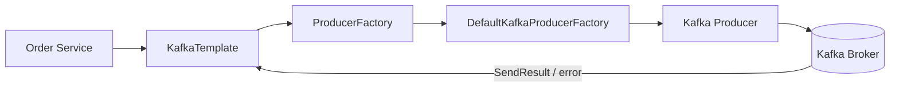

# Cấu hình DefaultKafkaProducerFactory

Trong Spring Kafka, `KafkaTemplate` là API mà tầng nghiệp vụ thường dùng để gửi record. Phía dưới template là một `ProducerFactory`, chịu trách nhiệm tạo và quản lý các Kafka producer. `DefaultKafkaProducerFactory` là implementation phổ biến do Spring Kafka cung cấp: nó nhận cấu hình producer, tạo Kafka `Producer` khi cần và quản lý vòng đời của producer đó.

Hiểu cách cấu hình factory giúp kiểm soát địa chỉ broker, serializer, xác nhận gửi, retry, idempotence, batching, compression và transaction. Đây là phần quan trọng để ứng dụng Spring Kafka gửi sự kiện ổn định khi tải tăng hoặc khi broker gặp lỗi tạm thời.

## 1. Vị trí của DefaultKafkaProducerFactory trong luồng gửi

Một luồng gửi cơ bản có các thành phần:

1. Service nghiệp vụ tạo event, ví dụ `OrderCreated`.
2. Service gọi `KafkaTemplate.send(...)` với topic, key và value.
3. `KafkaTemplate` lấy producer từ `ProducerFactory`.
4. Producer serializer chuyển key/value thành byte và gửi record đến broker.
5. Broker xác nhận theo cấu hình `acks`; kết quả gửi trả về metadata như topic, partition và offset.



`ProducerFactory` là abstraction để `KafkaTemplate` không phụ thuộc vào cách producer được tạo. `DefaultKafkaProducerFactory` triển khai abstraction này và sử dụng Kafka Producer API. Nhờ vậy, ứng dụng có thể cấu hình factory một lần rồi inject `KafkaTemplate` vào nhiều service.

| Thành phần | Trách nhiệm |
| --- | --- |
| `ProducerConfig` | Tập hợp các tên cấu hình và giá trị cấu hình của Kafka producer |
| `DefaultKafkaProducerFactory` | Tạo, tái sử dụng và đóng producer theo vòng đời của factory |
| `ProducerFactory` | Interface Spring Kafka dùng để trừu tượng hóa việc tạo producer |
| `KafkaTemplate` | API gửi record, thực hiện callback và hỗ trợ các thao tác Kafka khác |
| `KafkaProducer` | Client Kafka thực hiện serialization, partitioning, batching và gửi request đến broker |

## 2. Khi nào cần cấu hình factory tường minh?

Nếu dùng Spring Boot cùng `spring-kafka`, Boot có thể tự cấu hình `ProducerFactory` và `KafkaTemplate` dựa trên các thuộc tính `spring.kafka.*`. Trong trường hợp thông thường, chỉ cần khai báo `application.yml` là đủ.

Ta tạo bean `DefaultKafkaProducerFactory` tường minh khi cần:

- Dùng bộ cấu hình riêng cho một luồng gửi, chẳng hạn topic hoặc loại event có serializer khác.
- Tạo nhiều producer factory với `client.id`, security hoặc throughput khác nhau.
- Cấu hình serializer bằng Java hoặc dùng serializer tùy biến.
- Bật Kafka transaction với transaction ID prefix riêng.
- Quản lý cấu hình producer động hoặc cần kiểm soát vòng đời producer rõ ràng.

Khi định nghĩa một bean `ProducerFactory`, hãy nhớ Boot có thể lùi lại khỏi auto-configuration tương ứng. Nếu ứng dụng cần nhiều factory, nên đặt tên bean rõ ràng và dùng `@Qualifier` khi inject để tránh nhầm factory.

## 3. Cấu hình producer bằng application.yml

Trước hết, khai báo các giá trị dùng chung trong `src/main/resources/application.yml`:

```yaml
spring:
  kafka:
    bootstrap-servers: ${KAFKA_BOOTSTRAP_SERVERS:localhost:9092}
    producer:
      acks: all
      key-serializer: org.apache.kafka.common.serialization.StringSerializer
      value-serializer: org.springframework.kafka.support.serializer.JsonSerializer
      properties:
        enable.idempotence: true
        compression.type: lz4
        linger.ms: 5
        batch.size: 32768
        delivery.timeout.ms: 120000

app:
  kafka:
    topic:
      orders: orders.events
```

Các thuộc tính trong `spring.kafka.producer` được Spring Boot bind vào cấu hình Kafka producer. Nếu dùng auto-configuration mặc định, Boot tạo factory và template dựa trên các giá trị này.

| Thuộc tính | Ý nghĩa |
| --- | --- |
| `bootstrap-servers` | Địa chỉ một hoặc nhiều broker để client khởi tạo kết nối và lấy metadata cluster |
| `acks: all` | Producer chờ xác nhận từ các replica đang đồng bộ theo giao thức Kafka |
| `key-serializer` | Chuyển key Java thành byte; ví dụ dùng `StringSerializer` |
| `value-serializer` | Chuyển event object thành JSON bằng `JsonSerializer` |
| `enable.idempotence: true` | Hỗ trợ producer idempotence để chống ghi trùng do retry trong phạm vi Kafka hỗ trợ |
| `compression.type: lz4` | Nén batch record trước khi gửi |
| `linger.ms: 5` | Cho producer thêm tối đa khoảng thời gian chờ để gom record thành batch khi phù hợp |
| `batch.size: 32768` | Kích thước batch mục tiêu theo byte cho mỗi partition |
| `delivery.timeout.ms: 120000` | Giới hạn thời gian tổng thể để broker xác nhận gửi thành công hoặc producer báo lỗi |

Các giá trị trên là ví dụ khởi đầu, cần điều chỉnh bằng đo đạc throughput, latency và kích thước record thực tế. `linger.ms` tăng có thể cải thiện batching nhưng cũng làm tăng độ trễ chờ; compression giảm băng thông và dung lượng truyền nhưng tiêu tốn CPU.

## 4. Tạo DefaultKafkaProducerFactory bằng Java config

Khi muốn chủ động tạo factory, có thể xây dựng map cấu hình Kafka và truyền vào constructor của `DefaultKafkaProducerFactory`.

Lưu ý: ví dụ `application.yml` phía trên mô tả cách cấu hình khi dùng Boot auto-configuration. Một map Java tự tạo không tự động nhận toàn bộ `spring.kafka.producer.*`; trong bean custom, hãy đưa từng property cần dùng vào map hoặc bind `KafkaProperties` rồi chuyển đổi có chủ đích. Ví dụ dưới đây khai báo rõ các giá trị producer quan trọng để thấy factory được dựng như thế nào.

### 4.1. Khai báo factory và KafkaTemplate

Ví dụ dưới đây dùng `String` làm key và `OrderCreated` làm value:

```java
package com.example.messaging.config;

import java.util.HashMap;
import java.util.Map;
import org.apache.kafka.clients.producer.ProducerConfig;
import org.apache.kafka.common.serialization.StringSerializer;
import org.springframework.beans.factory.annotation.Value;
import org.springframework.context.annotation.Bean;
import org.springframework.context.annotation.Configuration;
import org.springframework.kafka.core.DefaultKafkaProducerFactory;
import org.springframework.kafka.core.KafkaTemplate;
import org.springframework.kafka.core.ProducerFactory;
import org.springframework.kafka.support.serializer.JsonSerializer;
import com.example.messaging.event.OrderCreated;

@Configuration
public class KafkaProducerConfiguration {

    @Bean
    public ProducerFactory<String, OrderCreated> orderProducerFactory(
            @Value("${spring.kafka.bootstrap-servers}") String bootstrapServers
    ) {
        Map<String, Object> properties = new HashMap<>();
        properties.put(ProducerConfig.BOOTSTRAP_SERVERS_CONFIG, bootstrapServers);
        properties.put(ProducerConfig.KEY_SERIALIZER_CLASS_CONFIG, StringSerializer.class);
        properties.put(ProducerConfig.VALUE_SERIALIZER_CLASS_CONFIG, JsonSerializer.class);
        properties.put(ProducerConfig.ACKS_CONFIG, "all");
        properties.put(ProducerConfig.ENABLE_IDEMPOTENCE_CONFIG, true);
        properties.put(ProducerConfig.RETRIES_CONFIG, Integer.MAX_VALUE);
        properties.put(ProducerConfig.MAX_IN_FLIGHT_REQUESTS_PER_CONNECTION, 5);
        properties.put(ProducerConfig.COMPRESSION_TYPE_CONFIG, "lz4");
        properties.put(ProducerConfig.LINGER_MS_CONFIG, 5);
        properties.put(ProducerConfig.BATCH_SIZE_CONFIG, 32 * 1024);
        properties.put(ProducerConfig.DELIVERY_TIMEOUT_MS_CONFIG, 120_000);

        return new DefaultKafkaProducerFactory<>(properties);
    }

    @Bean
    public KafkaTemplate<String, OrderCreated> orderKafkaTemplate(
            ProducerFactory<String, OrderCreated> orderProducerFactory
    ) {
        return new KafkaTemplate<>(orderProducerFactory);
    }
}
```

Trong ví dụ, factory được khai báo dưới kiểu interface `ProducerFactory<String, OrderCreated>` để các thành phần khác phụ thuộc vào abstraction. Đối tượng thực tế được tạo là `DefaultKafkaProducerFactory`. `KafkaTemplate` nhận factory đó qua constructor và dùng nó mỗi khi gửi record.

Các hằng số trong `ProducerConfig` giúp tránh gõ sai tên property. Giá trị serializer được khai báo bằng class, vì vậy Kafka producer có thể khởi tạo serializer theo cấu hình. Nếu muốn dùng serializer tùy biến, cần bảo đảm class có constructor phù hợp hoặc cung cấp serializer instance/supplier theo API của phiên bản Spring Kafka đang dùng.

### 4.2. Tránh cấu hình trùng và bean mơ hồ

Có hai cách phổ biến:

- Để Spring Boot tạo factory từ `application.yml` và chỉ inject `KafkaTemplate`.
- Tự tạo `DefaultKafkaProducerFactory` bằng Java config như ví dụ trên.

Không nên đồng thời tạo nhiều bean `ProducerFactory` cùng kiểu mà không đặt tên và qualifier rõ ràng. Khi cần hai factory, có thể đặt tên `orderProducerFactory` và `auditProducerFactory`, sau đó inject đúng bean:

```java
import org.springframework.beans.factory.annotation.Qualifier;

@Bean
KafkaTemplate<String, OrderCreated> orderKafkaTemplate(
        @Qualifier("orderProducerFactory")
        ProducerFactory<String, OrderCreated> producerFactory
) {
    return new KafkaTemplate<>(producerFactory);
}
```

Nếu đã tự khai báo factory, hãy kiểm tra bean `KafkaTemplate` được tạo từ factory nào. Việc chỉ định tường minh `KafkaTemplate` giúp tránh trường hợp service vô tình dùng producer factory mặc định khác với factory đã cấu hình.

## 5. Hiểu các nhóm ProducerConfig quan trọng

`DefaultKafkaProducerFactory` không tự quyết định chính sách gửi. Nó chuyển map cấu hình đến Kafka producer client. Các giá trị trong map vì vậy có cùng ý nghĩa với cấu hình Kafka producer chuẩn.

### 5.1. Broker và định danh client

| Property | Mục đích |
| --- | --- |
| `bootstrap.servers` | Điểm khởi đầu để kết nối và lấy metadata broker/partition |
| `client.id` | Định danh client để quan sát log, metric và request ở broker |
| `security.protocol` | Chọn giao thức kết nối, ví dụ `SASL_SSL` hoặc `SSL` |
| `sasl.mechanism` | Cơ chế SASL nếu cluster yêu cầu xác thực SASL |
| `ssl.truststore.location` | Đường dẫn truststore nếu cấu hình TLS theo truststore |

Không đặt username, password hoặc private key trực tiếp trong source code. Hãy đưa credential vào secret manager hoặc biến môi trường được quản lý an toàn. `bootstrap.servers` cũng không phải địa chỉ duy nhất mà producer sẽ dùng mãi; sau khi nhận metadata, client kết nối đến broker leader của partition đích.

### 5.2. Serializer và hợp đồng dữ liệu

Producer phải serialize key và value thành byte trước khi gửi. Hai property chính:

- `key.serializer`: serializer cho key, ví dụ `StringSerializer`.
- `value.serializer`: serializer cho payload, ví dụ `JsonSerializer`, Avro serializer hoặc Protobuf serializer.

Serializer phải khớp với kiểu dữ liệu mà `KafkaTemplate<K,V>` gửi. Ví dụ `KafkaTemplate<String, OrderCreated>` cần serializer xử lý được `String` key và `OrderCreated` value. Nếu dùng `StringSerializer` cho value object, producer sẽ lỗi serialization khi gửi.

Với `JsonSerializer`, Spring Kafka có thể thêm type information vào Kafka headers. Điều này thuận tiện khi producer và consumer chia sẻ kiểu dữ liệu tương thích. Với các service độc lập, nên thiết kế schema và type mapping rõ ràng; tránh phụ thuộc vào tên class Java nội bộ hoặc cho phép deserialize mọi package không cần thiết.

### 5.3. Acknowledgment, retry và idempotence

| Property | Vai trò | Lưu ý |
| --- | --- | --- |
| `acks` | Mức xác nhận producer yêu cầu | `0`, `1` hoặc `all` |
| `enable.idempotence` | Chống duplicate record do retry của producer trong phạm vi hỗ trợ | Cần tương thích với `acks`, retries và giới hạn in-flight request |
| `retries` | Số lần thử lại khi gặp lỗi có thể retry | Thường kết hợp `delivery.timeout.ms` để giới hạn tổng thời gian gửi |
| `delivery.timeout.ms` | Thời gian tối đa cho một lần gửi hoàn tất hoặc thất bại | Bao gồm thời gian chờ request và retry |
| `max.in.flight.requests.per.connection` | Số request chưa nhận phản hồi trên một kết nối | Khi idempotence bật, Kafka yêu cầu giá trị không vượt giới hạn được client hỗ trợ |

Với cấu hình an toàn phổ biến, đặt `acks=all` và `enable.idempotence=true`. Idempotent producer dùng producer ID và sequence number để broker nhận diện retry của cùng record. Cơ chế này giúp tránh duplicate do retry mạng của producer, nhưng không loại bỏ event trùng do ứng dụng gọi `send()` hai lần hoặc do consumer xử lý lại.

Không nên tùy tiện đặt `retries=0` nếu cần khả năng phục hồi lỗi tạm thời. Cũng không nên đặt `delivery.timeout.ms` quá thấp khiến producer báo lỗi trước khi retry có cơ hội hoàn tất. Với Kafka client hiện đại, một số giá trị mặc định đã hỗ trợ idempotence; việc khai báo rõ trong ứng dụng giúp ý định cấu hình dễ kiểm tra hơn.

### 5.4. Batching, buffer và compression

Producer gom record theo partition thành batch để giảm số request gửi broker. Các property quan trọng:

- `batch.size`: kích thước batch mục tiêu cho mỗi partition.
- `linger.ms`: thời gian chờ thêm để gom record vào batch khi tốc độ gửi thấp.
- `buffer.memory`: dung lượng bộ nhớ producer dành cho record đang chờ gửi.
- `compression.type`: codec nén batch như `none`, `gzip`, `snappy`, `lz4` hoặc `zstd` tùy phiên bản client.

Tăng `batch.size` hoặc `linger.ms` có thể cải thiện throughput khi có nhiều record, nhưng có thể tăng latency và bộ nhớ sử dụng. Nén có thể giảm network I/O và dung lượng lưu trữ, đổi lại cần CPU để nén/giải nén. Hãy benchmark với kích thước payload, số partition và tốc độ gửi gần với production.

## 6. Tạo event và gửi bằng KafkaTemplate

Giả sử ứng dụng có event:

```java
package com.example.messaging.event;

import java.math.BigDecimal;
import java.time.Instant;

public record OrderCreated(
        String eventId,
        String orderId,
        BigDecimal total,
        Instant occurredAt
) {}
```

Service gửi event sử dụng `KafkaTemplate` đã được cấu hình từ factory:

```java
package com.example.messaging.producer;

import com.example.messaging.event.OrderCreated;
import java.util.concurrent.CompletableFuture;
import org.springframework.beans.factory.annotation.Value;
import org.springframework.kafka.core.KafkaTemplate;
import org.springframework.kafka.support.SendResult;
import org.springframework.stereotype.Service;

@Service
public class OrderEventPublisher {

    private final KafkaTemplate<String, OrderCreated> kafkaTemplate;
    private final String topicName;

    public OrderEventPublisher(
            KafkaTemplate<String, OrderCreated> kafkaTemplate,
            @Value("${app.kafka.topic.orders}") String topicName
    ) {
        this.kafkaTemplate = kafkaTemplate;
        this.topicName = topicName;
    }

    public CompletableFuture<SendResult<String, OrderCreated>> publish(
            OrderCreated event
    ) {
        return kafkaTemplate.send(topicName, event.orderId(), event);
    }
}
```

`send(topic, key, value)` trả về `CompletableFuture<SendResult<K,V>>` trong Spring Kafka 3.x. Ứng dụng có thể gắn callback để ghi log kết quả:

```java
publisher.publish(event).whenComplete((result, error) -> {
    if (error != null) {
        log.error("Không gửi được event {}", event.eventId(), error);
        return;
    }

    var metadata = result.getRecordMetadata();
    log.info("Sent topic={}, partition={}, offset={}",
            metadata.topic(), metadata.partition(), metadata.offset());
});
```

Không nên bỏ qua `error` trong callback. Nếu record không được gửi, ứng dụng cần quyết định ghi nhận lỗi, retry ở tầng nghiệp vụ hoặc trả lỗi về caller. Việc gửi bất đồng bộ không có nghĩa là có thể coi record đã thành công ngay sau khi gọi `send()`.

## 7. Vòng đời producer do factory quản lý

Một điểm quan trọng của `DefaultKafkaProducerFactory` là cách nó tái sử dụng producer.

### 7.1. Producer dùng chung mặc định

Với cấu hình non-transactional mặc định, factory thường quản lý một producer dùng chung và tái sử dụng producer đó cho các lần gửi. Kafka `Producer` là thread-safe, vì vậy nhiều luồng có thể dùng chung producer thông qua `KafkaTemplate`.

Khi `KafkaTemplate` hoàn tất thao tác, producer được trả về factory thông qua cơ chế wrapper quản lý vòng đời. Việc đóng wrapper không nhất thiết đóng Kafka producer vật lý ngay lập tức; factory giữ producer để tái sử dụng. Khi Spring context đóng, factory được destroy và producer thực sự được đóng.

Điều này có nghĩa không nên tự tạo `new KafkaProducer` cho từng request hoặc gọi `close()` trên producer mà factory quản lý. Hãy để Spring quản lý bean factory và template theo vòng đời application context.

### 7.2. Transactional producer và cache

Khi bật transaction, factory cần quản lý producer có `transactional.id` riêng. Có thể cấu hình transaction ID prefix:

```java
// Thay bean orderProducerFactory ở mục 4.1 bằng phiên bản transactional này.
@Bean
public ProducerFactory<String, OrderCreated> orderProducerFactory(
        @Value("${spring.kafka.bootstrap-servers}") String bootstrapServers,
        @Value("${app.kafka.transaction-id-prefix}") String transactionIdPrefix
) {
    Map<String, Object> properties = new HashMap<>();
    properties.put(ProducerConfig.BOOTSTRAP_SERVERS_CONFIG, bootstrapServers);
    properties.put(ProducerConfig.KEY_SERIALIZER_CLASS_CONFIG, StringSerializer.class);
    properties.put(ProducerConfig.VALUE_SERIALIZER_CLASS_CONFIG, JsonSerializer.class);
    properties.put(ProducerConfig.ACKS_CONFIG, "all");
    properties.put(ProducerConfig.ENABLE_IDEMPOTENCE_CONFIG, true);

    DefaultKafkaProducerFactory<String, OrderCreated> factory =
            new DefaultKafkaProducerFactory<>(properties);
    factory.setTransactionIdPrefix(transactionIdPrefix);
    return factory;
}
```

Khai báo `app.kafka.transaction-id-prefix` trong cấu hình môi trường, ví dụ `orders-tx-local-` khi chạy một instance local. Trên production, prefix phải tạo ra transactional ID không trùng giữa các ứng dụng instance đang chạy đồng thời; thường thêm mã định danh instance do nền tảng triển khai cấp. Kafka transaction còn cần broker được cấu hình transaction state log phù hợp.

```yaml
app:
  kafka:
    transaction-id-prefix: ${KAFKA_TX_ID_PREFIX:orders-tx-local-}
```

Khi factory được cấu hình transaction ID prefix, producer có thể tham gia transaction thông qua `KafkaTemplate` và transaction manager. Ví dụ dùng `executeInTransaction`:

```java
kafkaTemplate.executeInTransaction(operations -> {
    operations.send("orders.events", event.orderId(), event);
    operations.send("orders.audit", event.orderId(), event);
    return null;
});
```

Hai record trong callback được gửi trong cùng một Kafka transaction. Nếu callback hoàn tất bình thường, transaction được commit; nếu có exception, transaction được abort. Đây là transaction trong Kafka. Nếu callback đồng thời cập nhật database bên ngoài, Kafka transaction không tự làm database và Kafka thành một transaction nguyên tử chung.

### 7.3. Đóng factory và reset producer

Factory quản lý producer vật lý và đóng chúng khi factory bị destroy. Một số API quản trị có thể dùng khi cần:

- `reset()`: đóng producer hiện tại và xóa producer khỏi cache; producer mới sẽ được tạo ở lần sử dụng tiếp theo.
- `updateConfigs(Map<String, Object>)`: cập nhật cấu hình dùng cho producer được tạo sau đó.
- `removeConfig(String)`: loại bỏ một cấu hình khỏi map của factory.

Thay đổi config không nên được xem là sửa cấu hình ngay bên trong producer đang chạy. Nếu cần áp dụng lại toàn bộ cấu hình, cần hiểu thời điểm producer hiện tại được đóng và tạo mới; `reset()` có thể làm gián đoạn gửi đang diễn ra. Chỉ thực hiện thao tác này trong quy trình quản trị có kiểm soát.

## 8. Nhiều ProducerFactory trong một ứng dụng

Một ứng dụng có thể gửi nhiều loại dữ liệu với yêu cầu khác nhau. Ví dụ event nghiệp vụ cần `acks=all` và JSON, trong khi metric telemetry có thể cần serializer riêng hoặc `client.id` khác. Có thể khai báo nhiều factory và template, nhưng phải tách bean rõ ràng.

```java
import java.util.HashMap;
import java.util.Map;
import org.apache.kafka.clients.producer.ProducerConfig;
import org.apache.kafka.common.serialization.StringSerializer;
import org.springframework.beans.factory.annotation.Qualifier;
import org.springframework.beans.factory.annotation.Value;
import org.springframework.context.annotation.Bean;
import org.springframework.context.annotation.Configuration;
import org.springframework.kafka.core.DefaultKafkaProducerFactory;
import org.springframework.kafka.core.KafkaTemplate;
import org.springframework.kafka.core.ProducerFactory;

@Configuration
public class MultipleProducerConfiguration {

    @Bean("auditProducerFactory")
    ProducerFactory<String, String> auditProducerFactory(
            @Value("${spring.kafka.bootstrap-servers}") String bootstrapServers
    ) {
        Map<String, Object> properties = new HashMap<>();
        properties.put(ProducerConfig.BOOTSTRAP_SERVERS_CONFIG, bootstrapServers);
        properties.put(ProducerConfig.KEY_SERIALIZER_CLASS_CONFIG, StringSerializer.class);
        properties.put(ProducerConfig.VALUE_SERIALIZER_CLASS_CONFIG, StringSerializer.class);
        properties.put(ProducerConfig.ACKS_CONFIG, "all");
        properties.put(ProducerConfig.CLIENT_ID_CONFIG, "audit-publisher");
        return new DefaultKafkaProducerFactory<>(properties);
    }

    @Bean("auditKafkaTemplate")
    KafkaTemplate<String, String> auditKafkaTemplate(
            @Qualifier("auditProducerFactory")
            ProducerFactory<String, String> producerFactory
    ) {
        return new KafkaTemplate<>(producerFactory);
    }
}
```

Khi có nhiều factory, không nên dựa vào việc Spring tự chọn theo generic nếu các bean có kiểu tương tự. Dùng bean name và `@Qualifier` để thể hiện rõ template nào gửi bằng factory nào. Mỗi factory có vòng đời và cấu hình producer riêng.

## 9. Bảo mật khi cấu hình producer

Trong môi trường production, producer thường cần xác thực với Kafka. Có thể thêm các property như `security.protocol`, `sasl.mechanism`, `sasl.jaas.config` hoặc cấu hình SSL truststore/key store tùy hạ tầng.

Ví dụ cấu hình SASL/SSL bằng biến môi trường:

```yaml
spring:
  kafka:
    properties:
      security.protocol: SASL_SSL
      sasl.mechanism: PLAIN
      sasl.jaas.config: ${KAFKA_SASL_JAAS_CONFIG}
```

Nếu dùng custom `DefaultKafkaProducerFactory` với map tự tạo, phải đưa các thuộc tính security vào chính map đó. Cấu hình `spring.kafka.properties.*` không tự động chảy vào một map Java do ứng dụng tự dựng nếu code không bind hoặc copy chúng vào. Đây là lỗi phổ biến khiến Boot auto-config chạy được nhưng custom factory lại không xác thực được.

Không ghi credential trực tiếp vào `application.yml` được commit lên source control. Hãy dùng secret injection, giới hạn quyền producer theo topic và xác nhận chứng chỉ/hostname theo chính sách bảo mật của cluster.

## 10. Kiểm thử cấu hình ProducerFactory

Có thể kiểm tra producer factory bằng integration test với embedded Kafka. Mục tiêu là xác nhận bean được tạo, template gửi record và broker nhận đúng key/value. Ví dụ kiểm thử mức gửi:

```java
import static org.assertj.core.api.Assertions.assertThat;

import com.example.messaging.event.OrderCreated;
import java.math.BigDecimal;
import java.time.Instant;
import java.util.concurrent.TimeUnit;
import org.junit.jupiter.api.Test;
import org.springframework.beans.factory.annotation.Autowired;
import org.springframework.boot.test.context.SpringBootTest;
import org.springframework.kafka.core.KafkaTemplate;
import org.springframework.kafka.test.context.EmbeddedKafka;

@SpringBootTest
@EmbeddedKafka(
        partitions = 3,
        topics = "orders.events",
        bootstrapServersProperty = "spring.kafka.bootstrap-servers"
)
class OrderProducerIntegrationTest {

    @Autowired
    KafkaTemplate<String, OrderCreated> kafkaTemplate;

    @Test
    void sendsOrderCreatedRecord() throws Exception {
        OrderCreated event = new OrderCreated(
                "evt-1001",
                "ORD-1001",
                new BigDecimal("125000.00"),
                Instant.parse("2026-11-17T02:00:00Z")
        );

        var result = kafkaTemplate.send("orders.events", event.orderId(), event)
                .get(10, TimeUnit.SECONDS);

        assertThat(result.getRecordMetadata().topic()).isEqualTo("orders.events");
        assertThat(result.getRecordMetadata().partition()).isBetween(0, 2);
    }
}
```

Test này kiểm tra đường gửi và metadata từ broker. Để kiểm tra serializer/deserializer end-to-end, hãy tạo consumer test với `JsonDeserializer` và group ID riêng, sau đó assert key và event value. Nếu project dùng topic được tạo bởi bean `NewTopic`, bảo đảm embedded broker có đủ partition và replication tương thích với cấu hình test; broker nhúng thường chỉ có một broker nên không thể tạo topic replication factor lớn hơn số broker.

Ngoài integration test, nên kiểm tra log startup để xác nhận producer config thực tế, gửi thử record với payload đại diện, quan sát lỗi serialization và theo dõi metric producer như record-send-rate, record-error-rate, request-latency và buffer-available-bytes.

## 11. Lỗi thường gặp khi cấu hình DefaultKafkaProducerFactory

| Triệu chứng | Nguyên nhân có thể | Hướng kiểm tra |
| --- | --- | --- |
| Không tạo được `KafkaTemplate` | Không có `ProducerFactory` phù hợp hoặc có nhiều bean gây mơ hồ | Kiểm tra bean type, tên bean và `@Qualifier` |
| Producer không kết nối broker | `bootstrap.servers` sai hoặc advertised listener không truy cập được | Kiểm tra địa chỉ broker từ môi trường chạy ứng dụng |
| Lỗi serialization | Key/value serializer không khớp generic của template | Kiểm tra `KafkaTemplate<K,V>` và serializer class |
| Gửi record nhưng callback nhận exception | Broker từ chối, timeout, ACL thiếu hoặc lỗi mạng | Kiểm tra exception gốc, broker log, security và delivery timeout |
| Custom factory bỏ qua cấu hình Boot | Map Java tự tạo không chứa các thuộc tính `spring.kafka.*` cần thiết | Bind/copy cấu hình cần dùng vào map custom |
| Tăng số thread nhưng throughput không tăng | Factory dùng producer dùng chung; bottleneck có thể ở broker, partition, network hoặc serializer | Đo metric producer và broker trước khi tạo thêm factory |
| Transaction ID bị fencing | Prefix/transactional ID trùng giữa instance hoặc producer cũ còn hoạt động | Đảm bảo prefix/ID duy nhất và quản lý vòng đời instance |
| Producer buffer cạn | Broker chậm, buffer quá nhỏ hoặc producer gửi nhanh hơn khả năng truyền | Theo dõi buffer available, request latency và backpressure |

## 12. Quy trình cấu hình cho một producer mới

Khi thêm producer vào ứng dụng Spring Kafka, hãy thực hiện theo thứ tự:

1. Xác định kiểu key/value và hợp đồng event cần gửi.
2. Chọn serializer tương ứng; kiểm tra cách consumer deserialize và quản lý schema.
3. Xác định broker, security protocol, credential và quyền ghi topic.
4. Chọn `acks`, idempotence và retry theo yêu cầu độ bền dữ liệu.
5. Chọn batching, compression và buffer theo tải thực tế; không tối ưu chỉ bằng cảm tính.
6. Tạo `DefaultKafkaProducerFactory` khi cần cấu hình riêng; nếu cấu hình tiêu chuẩn, ưu tiên Boot auto-configuration.
7. Tạo `KafkaTemplate` từ đúng factory và inject rõ ràng vào service.
8. Xác nhận kết quả bất đồng bộ, ghi log metadata và xử lý lỗi gửi.
9. Kiểm thử với broker và theo dõi metric trước khi triển khai production.

`DefaultKafkaProducerFactory` là nơi kết nối cấu hình producer với vòng đời Kafka producer. Khi factory được cấu hình đúng và `KafkaTemplate` dùng đúng factory, ứng dụng có một điểm quản lý rõ ràng cho serializer, độ bền gửi, hiệu năng, bảo mật và transaction. Những quyết định này nên dựa trên yêu cầu của luồng sự kiện và số liệu vận hành thực tế.

## 13. Tự kiểm tra

1. `ProducerFactory` và `KafkaTemplate` khác nhau ở trách nhiệm nào?
2. Khi nào Spring Boot có thể tự tạo `DefaultKafkaProducerFactory`, và khi nào nên khai báo factory tường minh?
3. Vì sao serializer trong factory phải khớp với kiểu key/value của `KafkaTemplate`?
4. `acks=all` và `enable.idempotence=true` hỗ trợ độ tin cậy gửi như thế nào? Chúng không giải quyết loại duplicate nào?
5. `linger.ms`, `batch.size` và `compression.type` ảnh hưởng ra sao đến throughput, latency và CPU?
6. Vì sao producer dùng chung mặc định có thể phục vụ nhiều thread?
7. Khi tạo nhiều `ProducerFactory`, vì sao cần bean name và `@Qualifier`?
8. `transactionIdPrefix` có vai trò gì và tại sao cần duy nhất giữa các instance?
9. Nếu thay đổi cấu hình trong lúc ứng dụng đang chạy, vì sao cần xem xét producer hiện tại và thao tác `reset()`?
