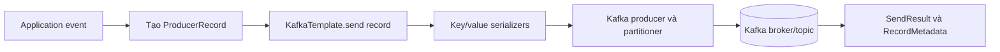

# send ProducerRecord trực tiếp

`KafkaTemplate` cung cấp nhiều overload `send(...)` để gửi dữ liệu lên Kafka. Khi chỉ cần topic, key và value, một overload ngắn là đủ. Khi cần kiểm soát đầy đủ metadata của record như partition, timestamp và headers, có thể tạo `ProducerRecord<K, V>` rồi truyền trực tiếp vào `KafkaTemplate.send(record)`.

Trong module `SPRING_KAFKA_MESSAGING`, producer gửi sự kiện bằng Spring Kafka và consumer nhận sự kiện bằng `@KafkaListener`. `ProducerRecord` là đối tượng mô tả thông điệp ở phía producer: nó gom các thông tin cần thiết trước khi serializer chuyển key/value thành byte và Kafka producer gửi record đến broker.

## 1. `ProducerRecord` là gì?

`ProducerRecord<K, V>` là kiểu dữ liệu của Kafka Java client (`org.apache.kafka.clients.producer.ProducerRecord`). Nó biểu diễn một record mà producer chuẩn bị gửi. `K` là kiểu Java của key và `V` là kiểu Java của value trước khi serialize.

Một record có các thành phần chính:

| Thành phần | Kiểu/giá trị | Ý nghĩa |
|---|---|---|
| `topic` | `String` | Tên topic đích |
| `partition` | `Integer`, có thể `null` | Partition chỉ định; `null` để partitioner lựa chọn |
| `timestamp` | `Long`, có thể `null` | Timestamp tính bằng mili giây từ Unix epoch |
| `key` | `K`, có thể `null` | Khóa định tuyến hoặc nhận diện record |
| `value` | `V`, có thể `null` | Payload của record |
| `headers` | Tập `Header` | Metadata bổ sung dưới dạng tên và byte value |

Có thể hình dung luồng gửi như sau:



`ProducerRecord` chưa phải dữ liệu đã được ghi vào Kafka. Nó là mô tả record ở phía ứng dụng. Việc gửi thực tế diễn ra khi gọi `KafkaTemplate.send(...)`; kết quả thường được trả về bất đồng bộ.

## 2. Tạo `ProducerRecord` bằng constructor

Kafka client cung cấp nhiều constructor để tạo record từ ít đến nhiều thông tin. Một số dạng thường dùng:

```java
new ProducerRecord<>(topic, value);
new ProducerRecord<>(topic, key, value);
new ProducerRecord<>(topic, partition, key, value);
new ProducerRecord<>(topic, partition, timestamp, key, value);
new ProducerRecord<>(topic, partition, timestamp, key, value, headers);
```

Constructor đầy đủ giúp producer chủ động khai báo tất cả metadata cần thiết. Ví dụ:

```java
ProducerRecord<String, OrderCreatedEvent> record =
        new ProducerRecord<>(
                "orders",                       // topic
                null,                            // partition: để partitioner chọn
                event.occurredAt().toEpochMilli(), // timestamp
                event.orderId(),                 // key
                event,                            // value
                headers                           // headers
        );
```

Khi `partition` là `null`, producer dùng partitioner đã cấu hình. Khi truyền partition cụ thể, record được gửi vào partition đó nếu partition tồn tại. Key vẫn được lưu trong record nhưng không dùng để chọn partition trong trường hợp partition đã được chỉ định.

Nếu `timestamp` là `null`, Kafka producer sẽ gán thời gian gửi theo hành vi của client. Nếu truyền timestamp tường minh, timestamp đó được dùng theo cấu hình timestamp của topic/broker. Với `CreateTime`, broker giữ timestamp do producer cung cấp; với `LogAppendTime`, broker thay bằng thời điểm append vào log.

## 3. Gửi trực tiếp bằng `KafkaTemplate.send(record)`

Ví dụ sau tạo event `OrderCreatedEvent`, đóng gói thành `ProducerRecord`, rồi gửi trực tiếp:

```java
import java.math.BigDecimal;
import java.nio.charset.StandardCharsets;
import java.time.Instant;
import java.util.List;
import java.util.concurrent.CompletableFuture;

import org.apache.kafka.clients.producer.ProducerRecord;
import org.apache.kafka.common.header.Header;
import org.apache.kafka.common.header.internals.RecordHeader;
import org.springframework.kafka.core.KafkaTemplate;
import org.springframework.kafka.support.SendResult;
import org.springframework.stereotype.Service;

public record OrderCreatedEvent(
        String eventId,
        String orderId,
        BigDecimal total,
        Instant occurredAt
) {}

@Service
public class OrderEventPublisher {

    private final KafkaTemplate<String, OrderCreatedEvent> kafkaTemplate;

    public OrderEventPublisher(
            KafkaTemplate<String, OrderCreatedEvent> kafkaTemplate) {
        this.kafkaTemplate = kafkaTemplate;
    }

    public CompletableFuture<SendResult<String, OrderCreatedEvent>> publish(
            OrderCreatedEvent event) {

        List<Header> headers = List.of(
                new RecordHeader(
                        "event-type",
                        "OrderCreated".getBytes(StandardCharsets.UTF_8)
                ),
                new RecordHeader(
                        "event-id",
                        event.eventId().getBytes(StandardCharsets.UTF_8)
                )
        );

        ProducerRecord<String, OrderCreatedEvent> record =
                new ProducerRecord<>(
                        "orders",
                        null,
                        event.occurredAt().toEpochMilli(),
                        event.orderId(),
                        event,
                        headers
                );

        return kafkaTemplate.send(record);
    }
}
```

Trong ví dụ:

- `KafkaTemplate<String, OrderCreatedEvent>` xác định kiểu key và value mà template xử lý.
- Topic là `orders`.
- Partition để `null`, vì vậy partitioner quyết định partition dựa trên key và cấu hình producer.
- `orderId` là key để các event của cùng đơn hàng có thể được định tuyến cùng partition khi dùng partitioner mặc định và cấu hình ổn định.
- `occurredAt` được dùng làm timestamp để thể hiện thời điểm nghiệp vụ xảy ra.
- Headers bổ sung loại event và event ID để consumer hoặc công cụ quan sát có thể đọc.

`ProducerRecord` giúp gom metadata vào một đối tượng duy nhất. Phương thức publisher không cần truyền riêng từng tham số vào overload của `KafkaTemplate` và có thể chuyển record qua các lớp trong producer adapter trước khi gửi.

## 4. Key, partition và timestamp trong record

### 4.1. Key và partition

Key thường đại diện cho thực thể nghiệp vụ, chẳng hạn `orderId` hoặc `accountId`. Nếu partition không được chỉ định, partitioner mặc định dùng key đã serialize để chọn partition. Những record có cùng key thường đi vào cùng partition khi số partition, serializer và partitioner không thay đổi.

Nếu cần chỉ định partition tường minh, có thể truyền chỉ số partition vào constructor:

```java
ProducerRecord<String, OrderCreatedEvent> record =
        new ProducerRecord<>(
                "orders",
                2,
                event.orderId(),
                event
        );
```

Chỉ số partition bắt đầu từ `0`. Topic phải có partition `2`; producer không tự mở rộng topic nếu partition không tồn tại. Kafka bảo đảm thứ tự trong từng partition, không bảo đảm thứ tự giữa các partition. Nếu các event của một đơn hàng phải được xử lý theo thứ tự, hãy duy trì routing nhất quán cho mọi event của đơn hàng đó.

### 4.2. Timestamp

Timestamp của record tính bằng mili giây từ Unix epoch. Ứng dụng có thể truyền thời điểm sự kiện xảy ra (`event time`) hoặc để producer tạo timestamp gửi. Broker có thể giữ timestamp producer hoặc thay bằng thời điểm ghi log tùy `message.timestamp.type`.

Nếu nghiệp vụ cần cả event time và ingestion time, hãy giữ một trường như `occurredAt` trong payload hoặc header, đồng thời xác định Kafka timestamp đại diện cho mốc nào. Không dùng timestamp làm thứ tự toàn cục; offset mới là thứ tự record trong một partition.

## 5. Headers: metadata bổ sung cho record

Header của Kafka là cặp tên và byte array. Chúng phù hợp cho metadata phục vụ truyền tải hoặc quan sát, ví dụ:

- `event-type`: loại event, chẳng hạn `OrderCreated`.
- `event-id`: định danh duy nhất của event.
- `correlation-id`: liên kết các bước trong cùng một request hoặc workflow.
- `traceparent`: thông tin trace theo quy ước tracing đang sử dụng.

Ví dụ tạo header:

```java
Header correlationHeader = new RecordHeader(
        "correlation-id",
        correlationId.getBytes(StandardCharsets.UTF_8)
);
```

Header value là byte array, do đó cần thống nhất encoding giữa producer và consumer. Với chuỗi, UTF-8 là lựa chọn phổ biến. Không đưa payload lớn hoặc dữ liệu nghiệp vụ cốt lõi vào header; value nên chứa nội dung event. Cũng không đặt thông tin bí mật vào header vì header có thể được ghi log hoặc quan sát bởi các công cụ vận hành.

Kafka cho phép nhiều header cùng tên. Consumer cần chọn cách đọc phù hợp, ví dụ `lastHeader("correlation-id")` nếu hợp đồng quy định dùng giá trị cuối cùng. Không giả định tên header luôn xuất hiện duy nhất nếu producer hoặc interceptor có thể thêm header trùng.

## 6. Serialization và generic type của `KafkaTemplate`

`ProducerRecord<K, V>` giữ key/value dưới dạng kiểu Java. Trước khi gửi, Kafka producer dùng serializer tương ứng để chuyển chúng thành byte. Vì vậy, generic type của `KafkaTemplate` phải khớp với serializer được cấu hình.

Ví dụ cấu hình key dạng chuỗi và value dạng JSON trong Spring Boot:

```yaml
spring:
  kafka:
    bootstrap-servers: ${KAFKA_BOOTSTRAP_SERVERS:localhost:9092}
    producer:
      key-serializer: org.apache.kafka.common.serialization.StringSerializer
      value-serializer: org.springframework.kafka.support.serializer.JsonSerializer
```

Trong cấu hình trên, key `String` được serialize bằng `StringSerializer`; object `OrderCreatedEvent` được serialize thành JSON bằng `JsonSerializer`. Consumer cần cấu hình deserializer và kiểu đích tương thích với schema event.

Không phải cứ khai báo `KafkaTemplate<String, OrderCreatedEvent>` là Kafka tự hiểu JSON. Generic type giúp compiler và Spring wiring kiểm soát kiểu ở phía Java; serializer mới quyết định cách biểu diễn byte trên wire. Nếu serializer không tương thích với object thực tế, send future có thể hoàn tất với lỗi serialization.

Khi nhiều service độc lập trao đổi event, hãy quản lý schema và chính sách tương thích. Không phụ thuộc vào tên class Java hoặc package nội bộ của producer như một hợp đồng tích hợp duy nhất.

## 7. Nhận kết quả gửi và đọc metadata

Trong Spring Kafka 3.x, `KafkaTemplate.send(record)` trả về `CompletableFuture<SendResult<K, V>>`. Future hoàn tất khi producer nhận kết quả gửi thành công hoặc thất bại. `SendResult` chứa `RecordMetadata` do Kafka trả về.

```java
import java.util.concurrent.CompletableFuture;

import org.slf4j.Logger;
import org.slf4j.LoggerFactory;
import org.springframework.kafka.core.KafkaTemplate;
import org.springframework.kafka.support.SendResult;
import org.springframework.stereotype.Service;

@Service
public class AuditedEventPublisher {

    private static final Logger log =
            LoggerFactory.getLogger(AuditedEventPublisher.class);

    private final KafkaTemplate<String, OrderCreatedEvent> kafkaTemplate;

    public AuditedEventPublisher(
            KafkaTemplate<String, OrderCreatedEvent> kafkaTemplate) {
        this.kafkaTemplate = kafkaTemplate;
    }

    public CompletableFuture<SendResult<String, OrderCreatedEvent>> publish(
            ProducerRecord<String, OrderCreatedEvent> record) {

        return kafkaTemplate.send(record).whenComplete((result, exception) -> {
            if (exception != null) {
                log.error("Kafka send failed for event {}", record.key(), exception);
                return;
            }

            var metadata = result.getRecordMetadata();
            log.info(
                    "Sent topic={} partition={} offset={} timestamp={}",
                    metadata.topic(),
                    metadata.partition(),
                    metadata.offset(),
                    metadata.timestamp()
            );
        });
    }
}
```

Các trường metadata thường dùng:

| Trường | Ý nghĩa |
|---|---|
| `topic()` | Topic mà broker ghi record |
| `partition()` | Partition thực tế |
| `offset()` | Offset được gán trong partition |
| `timestamp()` | Timestamp mà broker ghi nhận |
| `serializedKeySize()` | Kích thước key sau serialize |
| `serializedValueSize()` | Kích thước value sau serialize |

Không nên bỏ qua future nếu nghiệp vụ cần biết gửi thành công hay thất bại. Có thể trả future cho caller, dùng `whenComplete` để ghi log/metric hoặc chuyển kết quả thành kiểu kết quả thuộc application layer. Tránh chặn thread bằng `get()` hoặc `join()` trên luồng request nếu không có lý do rõ ràng.

Ở các phiên bản Spring Kafka cũ hơn, API send có thể trả `ListenableFuture` thay vì `CompletableFuture`. Hãy đối chiếu version dependency của dự án trước khi sao chép ví dụ.

## 8. Khi nào nên dùng `ProducerRecord` trực tiếp?

| Nhu cầu | Cách gửi phù hợp |
|---|---|
| Chỉ có topic, key và value | `kafkaTemplate.send(topic, key, value)` |
| Cần chỉ định partition | `kafkaTemplate.send(topic, partition, key, value)` hoặc `ProducerRecord` |
| Cần timestamp tùy chỉnh | Tạo `ProducerRecord` |
| Cần nhiều headers | Tạo `ProducerRecord` |
| Muốn gom metadata thành một object để chuyển qua các lớp | Tạo `ProducerRecord` |
| Gửi nhiều kiểu event bằng template có generic/serializer tương ứng | Tạo record đúng kiểu và gửi qua template phù hợp |

`ProducerRecord` hữu ích khi record có nhiều metadata hoặc khi producer adapter cần xây dựng record ở một bước rồi gửi ở bước khác. Với trường hợp đơn giản, overload ngắn của `KafkaTemplate` thường dễ đọc hơn.

## 9. Những lỗi thường gặp

- **Generic type không khớp serializer:** `KafkaTemplate<String, OrderCreatedEvent>` nhưng value serializer lại chỉ hỗ trợ kiểu khác. Kiểm tra producer factory và serializer.
- **Nghĩ rằng `ProducerRecord` tự gửi dữ liệu:** phải gọi `kafkaTemplate.send(record)` mới bắt đầu thao tác gửi.
- **Nhầm partition `null` với partition `0`:** `null` để partitioner chọn; `0` chỉ định rõ partition đầu tiên.
- **Đưa timestamp sai đơn vị:** Kafka dùng mili giây từ Unix epoch, không phải giây hoặc `Instant` trực tiếp.
- **Dùng event time nhưng không thống nhất timestamp type:** broker có thể ghi đè timestamp khi dùng `LogAppendTime`.
- **Header dùng encoding khác nhau:** producer và consumer cần thống nhất UTF-8 hoặc encoding được quy định.
- **Đưa payload lớn hoặc dữ liệu nhạy cảm vào header:** header nên chứa metadata nhỏ và không bí mật.
- **Bỏ qua lỗi bất đồng bộ:** send có thể thất bại sau khi phương thức publisher đã trả về; phải quan sát future/callback.
- **Cho rằng key quyết định partition khi partition đã được chỉ định:** partition tường minh được ưu tiên, key chỉ còn là dữ liệu của record.
- **Không xử lý schema evolution:** producer và consumer có thể chạy các phiên bản khác nhau; contract cần chính sách tương thích.

## 10. Checklist trước khi gửi `ProducerRecord`

- [ ] Topic đã tồn tại và producer có quyền ghi.
- [ ] Generic type của `ProducerRecord` khớp với `KafkaTemplate<K, V>`.
- [ ] Key/value serializer tương thích với kiểu Java thực tế.
- [ ] Partition là `null` để partitioner chọn hoặc là chỉ số hợp lệ đã được xác minh.
- [ ] Timestamp dùng mili giây và đúng semantics event time/ingestion time.
- [ ] Header có tên, encoding và quy ước đọc thống nhất.
- [ ] Payload không bị nhồi metadata hoặc dữ liệu nhạy cảm vào headers.
- [ ] Send future được quan sát và lỗi được xử lý theo chính sách ứng dụng.
- [ ] Metadata thực tế như topic, partition và offset được ghi nhận khi cần truy vết.
- [ ] Schema event có quy ước tương thích giữa producer và consumer.

Gửi trực tiếp `ProducerRecord` giúp producer kiểm soát đầy đủ metadata của từng record và giữ cách gửi nhất quán trong adapter Spring Kafka. Khi kết hợp đúng serializer, routing, timestamp, headers và xử lý kết quả bất đồng bộ, `KafkaTemplate` có thể phát các event rõ ràng, dễ truy vết và phù hợp với hợp đồng messaging của ứng dụng.
