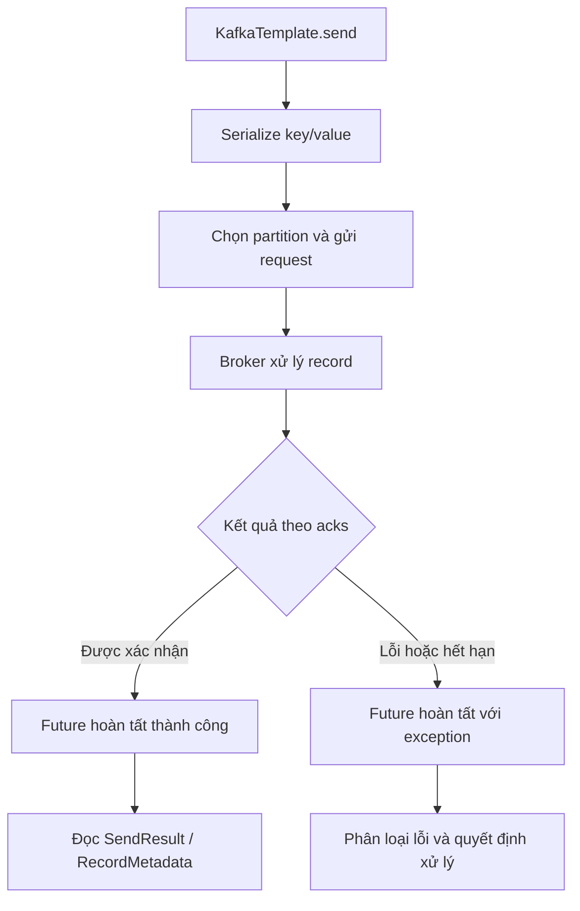

# Xử lý kết quả thành công và thất bại

Khi gọi `KafkaTemplate.send(...)`, ứng dụng chưa biết ngay record đã được Kafka chấp nhận hay chưa. Spring Kafka gửi record theo cơ chế bất đồng bộ và trả về một future để ứng dụng quan sát kết quả. Khi gửi thành công, future cung cấp `SendResult` chứa metadata của record; khi gửi thất bại, future hoàn tất với exception.

Xử lý đúng kết quả gửi giúp ứng dụng ghi nhận được record đã tới Kafka, phát hiện lỗi cấu hình hoặc lỗi broker, phản hồi phù hợp cho caller và tránh tạo bản ghi trùng khi retry. Cần nhớ rằng **gửi thành công tới broker không đồng nghĩa consumer đã xử lý xong nghiệp vụ**.

## 1. Vòng đời của một lần gửi

Với một lời gọi:

```java
CompletableFuture<SendResult<String, OrderCreated>> future =
    kafkaTemplate.send("order-events", orderId, event);
```

Luồng xử lý khái quát:

1. Spring Kafka chuyển record tới Kafka producer.
2. Producer serialize key và value, xác định partition, đưa record vào batch gửi.
3. Kafka client gửi request tới broker leader của partition.
4. Broker xử lý record và phản hồi theo cấu hình `acks`.
5. Future hoàn tất thành công với `SendResult`, hoặc hoàn tất exceptional với lỗi.



Lời gọi `send` là bất đồng bộ đối với việc chờ broker xác nhận, nhưng không có nghĩa nó tuyệt đối không chặn. Kafka client có thể phải chờ metadata hoặc chờ bộ đệm trong giới hạn cấu hình như `max.block.ms`. Vì vậy, vẫn cần cấu hình timeout hợp lý và tránh gọi producer từ các luồng có yêu cầu latency quá nghiêm ngặt mà không đánh giá tác động.

Với Spring Kafka 3.x, `KafkaTemplate.send(...)` trả về `CompletableFuture<SendResult<K, V>>`. Các phiên bản Spring Kafka cũ hơn có thể dùng `ListenableFuture`; hãy đối chiếu API theo version thực tế của dự án.

## 2. Kết quả thành công: SendResult và RecordMetadata

Khi broker xác nhận lần gửi theo cấu hình producer, future trả về `SendResult<K, V>`. Đối tượng này cho phép truy cập record gốc và metadata do Kafka trả về.

Các thông tin thường dùng trong `RecordMetadata`:

| Thuộc tính | Ý nghĩa |
|---|---|
| `topic()` | Topic nhận record |
| `partition()` | Partition chứa record |
| `offset()` | Vị trí record trong partition |
| `timestamp()` | Timestamp của record theo cấu hình topic/broker |
| `serializedKeySize()` | Kích thước key sau serialization |
| `serializedValueSize()` | Kích thước value sau serialization |

Ví dụ xử lý kết quả:

```java
kafkaTemplate.send("order-events", event.orderId(), event)
    .whenComplete((result, exception) -> {
        if (exception != null) {
            log.error("Publish order event failed", exception);
            return;
        }

        RecordMetadata metadata = result.getRecordMetadata();

        log.info(
            "Published event: topic={}, partition={}, offset={}",
            metadata.topic(),
            metadata.partition(),
            metadata.offset()
        );
    });
```

Kết quả thành công cho biết producer đã nhận xác nhận theo `acks` đã cấu hình. Ví dụ:

- `acks=0`: producer không chờ broker xác nhận; không thể xem kết quả này như bằng chứng broker đã lưu record.
- `acks=1`: leader xác nhận sau khi ghi record vào log của nó.
- `acks=all`: leader chờ các replica trong ISR xác nhận theo quy tắc Kafka và `min.insync.replicas`.

Do đó, ý nghĩa vận hành của “send thành công” phụ thuộc vào `acks`. Với dữ liệu nghiệp vụ quan trọng, thường cân nhắc `acks=all`, replication phù hợp và cấu hình `min.insync.replicas`.

Ngay cả khi dùng `acks=all`, kết quả này cũng không chứng minh consumer đã đọc, deserialize hoặc hoàn tất nghiệp vụ. Đó là các giai đoạn riêng cần quan sát và xác nhận ở consumer.

## 3. Xử lý bất đồng bộ với CompletableFuture

### Dùng whenComplete để quan sát cả hai nhánh

`whenComplete` nhận kết quả và exception khi future hoàn tất. Nó phù hợp để ghi log, metric hoặc cập nhật trạng thái quan sát:

```java
CompletableFuture<SendResult<String, OrderCreated>> future =
    kafkaTemplate.send("order-events", event.orderId(), event);

future.whenComplete((result, exception) -> {
    if (exception != null) {
        log.error("Cannot publish order event", exception);
        return;
    }

    RecordMetadata metadata = result.getRecordMetadata();
    log.debug(
        "Kafka accepted order event at {}-{}-{}",
        metadata.topic(),
        metadata.partition(),
        metadata.offset()
    );
});
```

`whenComplete` trả về một future mới. Nếu callback chỉ quan sát và không ném exception, kết quả gốc vẫn được giữ. Nếu callback tự ném exception, future phụ thuộc có thể hoàn tất exceptional; vì vậy callback nên ngắn, ổn định và không chứa logic dễ lỗi.

### Kết hợp bước tiếp theo bằng thenApply

Khi cần biến kết quả gửi thành một giá trị khác, có thể dùng `thenApply`:

```java
CompletableFuture<String> locationFuture =
    kafkaTemplate.send("order-events", event.orderId(), event)
        .thenApply(result -> {
            RecordMetadata metadata = result.getRecordMetadata();

            return metadata.topic()
                + "-" + metadata.partition()
                + "-" + metadata.offset();
        });
```

Nếu bước gửi thất bại, hàm trong `thenApply` không chạy; lỗi được truyền tiếp xuống future kết quả.

### Dùng exceptionally khi có phương án phục hồi

`exceptionally` chuyển một lỗi thành giá trị thay thế:

```java
CompletableFuture<SendResult<String, OrderCreated>> recovered =
    kafkaTemplate.send("order-events", event.orderId(), event)
        .exceptionally(exception -> {
            log.error("Publish failed", exception);
            return null;
        });
```

Ví dụ này chỉ phù hợp nếu hợp đồng của phương thức cho phép trả về `null` và caller biết cách xử lý. Trong luồng nghiệp vụ quan trọng, trả `null` có thể che giấu việc mất event. Thường nên để lỗi tiếp tục lan truyền hoặc chuyển sang một kết quả kiểu dữ liệu thể hiện rõ trạng thái thất bại.

### Dùng handle khi muốn chuẩn hóa hai nhánh

`handle` nhận cả kết quả và exception, rồi tạo một kết quả mới:

```java
CompletableFuture<PublishOutcome> outcomeFuture =
    kafkaTemplate.send("order-events", event.orderId(), event)
        .handle((result, exception) -> {
            if (exception != null) {
                return PublishOutcome.failed(exception);
            }

            RecordMetadata metadata = result.getRecordMetadata();
            return PublishOutcome.sent(
                metadata.topic(),
                metadata.partition(),
                metadata.offset()
            );
        });
```

`PublishOutcome` là kiểu dữ liệu do ứng dụng định nghĩa, chẳng hạn sealed interface hoặc record có trường trạng thái. Cách này hữu ích khi tầng gọi muốn nhận một kết quả nghiệp vụ rõ ràng thay vì xử lý trực tiếp future exceptional.

Không nên dùng `exceptionally` hoặc `handle` để biến mọi lỗi thành “thành công” giả. Nếu hệ thống chấp nhận fallback như ghi vào outbox hoặc hàng đợi nội bộ, trạng thái fallback cần được thể hiện rõ và có quy trình xử lý tiếp theo.

## 4. Đóng gói xử lý kết quả trong publisher

Có thể đặt logic quan sát kết quả tại một publisher dùng chung. Nhờ đó, các service không phải tự viết lại callback và cách ghi metadata.

```java
@Service
@Slf4j
public class OrderEventPublisher {

    private static final String TOPIC = "order-events";

    private final KafkaTemplate<String, OrderCreated> kafkaTemplate;

    public OrderEventPublisher(
            KafkaTemplate<String, OrderCreated> kafkaTemplate) {
        this.kafkaTemplate = kafkaTemplate;
    }

    public CompletableFuture<SendResult<String, OrderCreated>> publish(
            OrderCreated event) {

        try {
            return kafkaTemplate
                .send(TOPIC, event.orderId(), event)
                .whenComplete((result, exception) -> {
                    if (exception != null) {
                        log.error(
                            "Cannot publish order event, orderId={}",
                            event.orderId(),
                            exception
                        );
                        return;
                    }

                    RecordMetadata metadata = result.getRecordMetadata();
                    log.info(
                        "Order event published: orderId={}, partition={}, offset={}",
                        event.orderId(),
                        metadata.partition(),
                        metadata.offset()
                    );
                });
        } catch (RuntimeException exception) {
            // Xử lý lỗi phát sinh ngay trong lúc gọi send.
            log.error(
                "Cannot start publishing order event, orderId={}",
                event.orderId(),
                exception
            );
            throw exception;
        }
    }
}
```

Ví dụ minh họa dùng Lombok `@Slf4j`; nếu dự án không dùng Lombok, khai báo logger theo cơ chế logging hiện có. Phần `try/catch` bao quanh lời gọi để ghi nhận lỗi phát sinh ngay trong lúc khởi tạo thao tác gửi. Các lỗi xảy ra sau đó được xử lý qua callback của future.

Không nên thực hiện công việc nặng trong callback, ví dụ gọi API bên ngoài, truy vấn database chậm hoặc chờ một future khác. Callback có thể chạy trên luồng hoàn tất tác vụ của producer; xử lý nặng có thể làm chậm việc xử lý callback khác. Nếu cần công việc tiếp theo, hãy chuyển sang executor được quản lý hoặc điều phối ở tầng ứng dụng với giới hạn concurrency rõ ràng.

## 5. Chờ kết quả đồng bộ khi thật sự cần

Một số luồng cần biết kết quả gửi trước khi tiếp tục, ví dụ command-line tool, migration hoặc một bước kiểm tra tích hợp. Có thể dùng `get(timeout, unit)`:

```java
try {
    SendResult<String, OrderCreated> result =
        kafkaTemplate
            .send("order-events", event.orderId(), event)
            .get(10, TimeUnit.SECONDS);

    RecordMetadata metadata = result.getRecordMetadata();

    log.info(
        "Published to partition={}, offset={}",
        metadata.partition(),
        metadata.offset()
    );

} catch (InterruptedException exception) {
    Thread.currentThread().interrupt();
    throw new IllegalStateException(
        "Interrupted while waiting for Kafka acknowledgement",
        exception
    );

} catch (ExecutionException exception) {
    throw new IllegalStateException(
        "Kafka send failed",
        exception.getCause()
    );

} catch (TimeoutException exception) {
    throw new IllegalStateException(
        "Timed out while waiting for Kafka send result",
        exception
    );
}
```

Ba tình huống cần phân biệt:

- `InterruptedException`: thread đang chờ bị interrupt. Hãy khôi phục interrupt flag bằng `Thread.currentThread().interrupt()` rồi truyền lỗi lên hoặc kết thúc theo chính sách.
- `ExecutionException`: future hoàn tất với lỗi. Xem `getCause()` để phân loại nguyên nhân gốc.
- `TimeoutException`: thời gian chờ của lời gọi `get` đã hết. Nó không chứng minh record chưa được gửi và cũng không tự động hủy thao tác gửi đang diễn ra.

Có thể dùng `join()` thay cho `get()`, nhưng `join` ném `CompletionException` thay vì các checked exception. Nó không tự cung cấp timeout. Không nên dùng `join()` trong request thread hoặc listener thread chỉ để biến thao tác bất đồng bộ thành đồng bộ mà không đánh giá ảnh hưởng latency và throughput.

### Timeout của future không phải timeout của producer

Cần phân biệt timeout chờ kết quả ở code ứng dụng với timeout của Kafka producer:

- `future.get(10, SECONDS)` giới hạn thời gian caller chờ.
- `request.timeout.ms` giới hạn thời gian chờ phản hồi cho một request broker.
- `delivery.timeout.ms` giới hạn tổng thời gian producer cố gắng gửi record, bao gồm thời gian chờ retry.
- `max.block.ms` giới hạn thời gian các lời gọi producer có thể chờ metadata hoặc bộ đệm trong một số tình huống.

Nếu `get` timeout, future gốc vẫn có thể hoàn tất sau đó. Đừng lập tức gửi lại cùng event như thể lần đầu chắc chắn chưa tới Kafka.

## 6. Phân loại lỗi gửi Kafka

Không phải mọi lỗi đều nên retry giống nhau. Hãy phân loại theo khả năng khắc phục và mức độ chắc chắn của kết quả.

| Nhóm lỗi | Ví dụ | Hướng xử lý |
|---|---|---|
| Serialization | `SerializationException`, sai kiểu dữ liệu | Sửa schema/serializer; không retry nguyên trạng |
| Cấu hình hoặc quyền | `InvalidTopicException`, `TopicAuthorizationException`, `ClusterAuthorizationException` | Sửa topic, ACL hoặc cấu hình bảo mật |
| Kích thước record | `RecordTooLargeException` | Giảm payload hoặc điều chỉnh giới hạn phù hợp ở producer/broker/topic |
| Broker tạm thời | Leader chưa sẵn sàng, replica chưa đủ, lỗi mạng | Để producer retry theo cấu hình; quan sát timeout |
| Hết thời gian | `org.apache.kafka.common.errors.TimeoutException` từ Kafka client hoặc `java.util.concurrent.TimeoutException` từ `future.get(timeout, unit)` | Kiểm tra broker, mạng, metadata và khả năng kết quả đã được ghi |
| Producer state | `ProducerFencedException`, lỗi sequence | Kiểm tra transactional ID, vòng đời producer và cấu hình idempotence |

Các class exception cụ thể có thể được bọc bên trong exception khác. Khi xử lý future, hãy xem nguyên nhân gốc thay vì chỉ dựa vào class ngoài cùng.

Ví dụ hàm gỡ wrapper phổ biến:

```java
private Throwable unwrap(Throwable exception) {
    Throwable current = exception;

    while ((current instanceof CompletionException
            || current instanceof ExecutionException)
            && current.getCause() != null) {
        current = current.getCause();
    }

    return current;
}
```

Hàm này xử lý các wrapper thường gặp của Java future. Với exception đặc thù của Spring Kafka hoặc Kafka client, tiếp tục kiểm tra cause chain và thông tin record lỗi nếu có.

### Lỗi có thể xảy ra ngay hoặc sau khi gửi

Một số lỗi được phát hiện ngay trong lúc tạo/gửi record, chẳng hạn dữ liệu không serialize được hoặc producer không thể lấy metadata trong giới hạn chờ. Những lỗi khác chỉ xuất hiện sau khi request đã gửi, khi broker phản hồi hoặc khi retry hết hạn.

Vì vậy, publisher nên có hai lớp xử lý:

1. `try/catch` quanh lời gọi `KafkaTemplate.send` để xử lý lỗi phát sinh đồng bộ.
2. Callback/future handler để xử lý kết quả bất đồng bộ.

Không nên chỉ bọc callback mà bỏ qua lỗi đồng bộ; cũng không nên cho rằng `send` trả về future là record chắc chắn đã được xếp vào broker.

## 7. Retry: phân biệt retry của Kafka client và retry của ứng dụng

Kafka producer có cơ chế retry nội bộ cho các lỗi được xem là có thể thử lại. Producer có thể gửi lại request trong thời gian cho phép bởi `delivery.timeout.ms`. Với cấu hình idempotence, Kafka có thể nhận diện các lần gửi lại trong cùng producer session để tránh ghi trùng do retry nội bộ.

Ví dụ cấu hình Spring Boot:

```yaml
spring:
  kafka:
    producer:
      acks: all
      retries: 2147483647
      properties:
        enable.idempotence: true
        request.timeout.ms: 30000
        delivery.timeout.ms: 120000
```

Giá trị chỉ là ví dụ để minh họa. Hãy chọn timeout theo SLA, độ trễ mạng, thời gian phục hồi broker và giới hạn request của hệ thống. `delivery.timeout.ms` phải được cấu hình phù hợp với `request.timeout.ms` và `linger.ms`. Idempotence yêu cầu `acks=all`, retries lớn hơn 0 và `max.in.flight.requests.per.connection` không vượt quá 5. Kafka client hiện đại thường tự chọn các giá trị tương thích khi bật idempotence; nếu ghi đè thủ công, hãy kiểm tra cấu hình theo version đang sử dụng.

**Retry nội bộ của producer** khác với **retry do ứng dụng tự gọi lại `send`**:

- Retry nội bộ sử dụng cùng producer state và sequence để hỗ trợ idempotence.
- Ứng dụng gọi lại `send` thường tạo một record mới từ góc nhìn producer. Nếu lần đầu đã được broker ghi nhưng acknowledgment bị mất, lần gửi lại có thể tạo record thứ hai.
- Idempotence không phải cơ chế deduplicate nghiệp vụ xuyên qua nhiều lần khởi động ứng dụng hoặc nhiều producer instance độc lập.

Nếu cần retry ở tầng ứng dụng, hãy dùng event ID ổn định và thiết kế consumer idempotent. Với yêu cầu bảo đảm sự kiện phát sinh cùng thay đổi database, cân nhắc Transactional Outbox: ghi thay đổi nghiệp vụ và outbox event trong cùng transaction database, sau đó publisher chuyển outbox sang Kafka và đánh dấu trạng thái đã phát theo quy trình có thể phục hồi.

Không retry vô hạn ở tầng ứng dụng mà không có backoff, giới hạn, giám sát và chính sách dừng. Một lỗi cấu hình hoặc lỗi serialization sẽ không tự biến mất khi gửi đi gửi lại.

## 8. Timeout và kết quả không chắc chắn

Một trong những tình huống khó nhất là producer hết thời gian chờ nhưng không biết chắc broker đã ghi record hay chưa. Ví dụ:

1. Producer gửi record tới broker.
2. Broker ghi record thành công.
3. Response bị mất trên mạng hoặc producer không nhận được response trước timeout.
4. Future hoàn tất với lỗi timeout.
5. Ứng dụng gửi lại record vì nghĩ lần đầu thất bại.

Trong tình huống này, Kafka có thể đã lưu cả lần đầu lẫn lần gửi lại nếu lần retry do ứng dụng tạo không được deduplicate.

Vì vậy, khi gặp timeout:

- Không kết luận record chắc chắn chưa tồn tại.
- Ghi lại event ID hoặc business key để điều tra.
- Cho producer nội bộ xử lý retry trong `delivery.timeout.ms` trước khi chuyển lỗi lên ứng dụng.
- Nếu phải gửi lại ở tầng ứng dụng, dùng idempotency key và consumer-side deduplication.
- Nếu cần kiểm soát phát sinh event chặt chẽ với database, xem xét Outbox pattern.

Key Kafka giúp định tuyến và ordering theo partition; key không tự ngăn record trùng.

## 9. Ghi log và metric cho kết quả gửi

Log nên giúp trả lời ba câu hỏi: event nào được gửi, gửi tới đâu và nếu thất bại thì nguyên nhân gì?

Thông tin thường hữu ích:

- Event ID hoặc correlation ID.
- Topic và key đã được che/mã hóa nếu nhạy cảm.
- Partition và offset khi gửi thành công.
- Exception class và cause khi gửi thất bại.
- Thời gian từ lúc gọi send đến khi future hoàn tất.

Ví dụ log thành công:

```text
Published eventId=evt-1001 topic=order-events partition=2 offset=815
```

Ví dụ log thất bại:

```text
Publish failed eventId=evt-1001 topic=order-events cause=TimeoutException
```

Không ghi toàn bộ payload hoặc credential ra log nếu chúng chứa thông tin cá nhân, token hoặc dữ liệu bí mật. Dùng log level phù hợp để tránh tạo quá nhiều log khi throughput cao.

Nên theo dõi metric ở mức tổng hợp:

| Metric | Mục đích |
|---|---|
| Số record gửi thành công | Đo lưu lượng producer |
| Số record gửi thất bại | Phát hiện lỗi gửi |
| Send latency | Phát hiện broker/network chậm |
| Retry và error rate | Phát hiện cluster không ổn định |
| Số timeout | Nhận diện kết quả gửi không chắc chắn |
| Buffer exhaustion / waiting | Phát hiện producer không theo kịp tải |

Có thể dùng Kafka client metrics và Micrometer/Actuator tùy cấu hình hệ thống. Tránh dùng event ID hoặc key làm nhãn metric có cardinality cao; những giá trị này phù hợp hơn cho log hoặc trace.

## 10. Kiểm thử nhánh thành công và thất bại

Một publisher cần test cả hai nhánh. Unit test có thể mock `KafkaTemplate` để kiểm tra logic phản hồi mà không cần broker.

### Test nhánh thành công

```java
import java.math.BigDecimal;
import java.time.Instant;
import java.util.concurrent.CompletableFuture;

import org.apache.kafka.clients.producer.RecordMetadata;
import org.apache.kafka.common.KafkaException;
import org.junit.jupiter.api.Test;
import org.junit.jupiter.api.extension.ExtendWith;
import org.mockito.InjectMocks;
import org.mockito.Mock;
import org.mockito.junit.jupiter.MockitoExtension;
import org.springframework.kafka.core.KafkaTemplate;
import org.springframework.kafka.support.SendResult;

import static org.assertj.core.api.Assertions.assertThat;
import static org.assertj.core.api.Assertions.assertThatThrownBy;
import static org.mockito.Mockito.mock;
import static org.mockito.Mockito.when;

@ExtendWith(MockitoExtension.class)
class OrderEventPublisherTest {

    @Mock
    private KafkaTemplate<String, OrderCreated> kafkaTemplate;

    @InjectMocks
    private OrderEventPublisher publisher;

    @Test
    void returnsSuccessfulSendResult() {
        OrderCreated event = new OrderCreated(
            "order-42", "customer-9", new BigDecimal("10.00"), Instant.now()
        );
        SendResult<String, OrderCreated> sendResult =
            mock(SendResult.class);
        RecordMetadata metadata = mock(RecordMetadata.class);
        when(sendResult.getRecordMetadata()).thenReturn(metadata);
        when(metadata.topic()).thenReturn("order-events");
        when(metadata.partition()).thenReturn(0);
        when(metadata.offset()).thenReturn(10L);

        CompletableFuture<SendResult<String, OrderCreated>> completed =
            CompletableFuture.completedFuture(sendResult);

        when(kafkaTemplate.send("order-events", "order-42", event))
            .thenReturn(completed);

        CompletableFuture<SendResult<String, OrderCreated>> result =
            publisher.publish(event);

        assertThat(result.isDone()).isTrue();
        assertThat(result.join()).isSameAs(sendResult);
    }

    @Test
    void exposesSendFailure() {
        OrderCreated event = new OrderCreated(
            "order-42", "customer-9", new BigDecimal("10.00"), Instant.now()
        );

        CompletableFuture<SendResult<String, OrderCreated>> failed =
            new CompletableFuture<>();
        failed.completeExceptionally(
            new KafkaException("Broker is unavailable")
        );

        when(kafkaTemplate.send("order-events", "order-42", event))
            .thenReturn(failed);

        assertThatThrownBy(() -> publisher.publish(event).join())
            .hasCauseInstanceOf(KafkaException.class);
    }
}
```

Trong test thành công, metadata được mock vì publisher đọc partition và offset trong callback. Test thất bại hoàn tất future bằng exception và xác minh lỗi vẫn được truyền tới caller sau callback. Hai test dùng chung fixture `OrderCreated`, `kafkaTemplate` và `publisher`; có thể bổ sung assertion về log/metric bằng công cụ kiểm thử logging nếu đó là hợp đồng cần duy trì.

### Integration test với Embedded Kafka

Unit test không xác minh broker thực sự nhận record. Integration test với Embedded Kafka có thể kiểm tra:

1. Gửi record bằng `KafkaTemplate`.
2. Chờ future hoàn tất với timeout hữu hạn.
3. Kiểm tra topic, partition, offset từ `SendResult`.
4. Đọc record bằng consumer và so sánh key/value.
5. Kiểm tra cấu hình serializer/deserializer và hành vi khi topic hoặc broker không sẵn sàng nếu có thể tái hiện ổn định.

Không dùng `Thread.sleep()` cố định để chờ record. Dùng poll có timeout, Awaitility hoặc cơ chế đồng bộ phù hợp.

## 11. Các lỗi thường gặp

| Hiện tượng | Nguyên nhân có thể | Hướng xử lý |
|---|---|---|
| `send` trả future nhưng log không có success | Future chưa hoàn tất hoặc callback chưa được gắn đúng | Quan sát future, đặt timeout và kiểm tra callback |
| Future exceptional | Broker, ACL, topic, serialization hoặc timeout | Unwrap cause và phân loại lỗi |
| `get` timeout nhưng record vẫn xuất hiện | Broker có thể đã ghi nhưng acknowledgment đến muộn/mất | Coi là kết quả không chắc chắn, tránh gửi lại mù quáng |
| Gửi lại tạo record trùng | Retry tầng ứng dụng sau timeout | Dùng event ID, idempotent consumer hoặc Outbox |
| Producer gửi chậm | Broker chậm, batch/buffer, metadata hoặc mạng | Kiểm tra send latency, buffer và client metrics |
| Log success nhưng consumer chưa thấy event | Success chỉ xác nhận theo `acks`; consumer có thể lag hoặc đọc sai group/topic | Kiểm tra topic, partition, consumer group và offset |
| Callback làm producer chậm | Callback thực hiện I/O hoặc logic nặng | Chuyển công việc sang executor riêng |
| Lỗi serialization | Kiểu object không khớp serializer | Kiểm tra generic type và cấu hình serializer |

## 12. Checklist triển khai

Trước khi đưa publisher vào vận hành, hãy xác nhận:

- Future từ `KafkaTemplate.send` được theo dõi và exception không bị bỏ qua.
- Nhánh thành công ghi nhận topic, partition, offset khi cần truy vết.
- Nhánh lỗi có phân loại nguyên nhân và không retry lỗi vĩnh viễn.
- `acks`, idempotence, retries và timeout phù hợp với yêu cầu độ bền dữ liệu.
- Timeout của caller không bị hiểu nhầm là record chắc chắn chưa được gửi.
- Retry tầng ứng dụng có event ID và cơ chế chống xử lý trùng.
- Callback không thực hiện công việc nặng hoặc chặn luồng producer.
- Log không chứa payload nhạy cảm hoặc thông tin xác thực.
- Metric theo dõi send latency, error rate và timeout.
- Integration test xác minh producer gửi record thật tới broker.

## 13. Ghi nhớ

- `KafkaTemplate.send` trả về future để theo dõi kết quả gửi bất đồng bộ.
- Thành công trả về `SendResult`; `RecordMetadata` cho biết topic, partition, offset và timestamp.
- Ý nghĩa xác nhận thành công phụ thuộc `acks`; nó không chứng minh consumer đã xử lý event.
- `whenComplete`, `thenApply`, `exceptionally` và `handle` phục vụ các nhu cầu xử lý future khác nhau.
- `get(timeout)` có thể ném `TimeoutException`; timeout chờ không chứng minh broker chưa ghi record.
- Retry nội bộ của Kafka producer khác với việc ứng dụng gọi lại `send`.
- Idempotent producer hỗ trợ chống trùng do retry nội bộ; event ID và consumer idempotency xử lý trùng lặp ở cấp nghiệp vụ.
- Phải quan sát cả thành công, thất bại, latency và timeout để vận hành producer đáng tin cậy.

Một publisher tốt không chỉ gửi record mà còn làm rõ kết quả của lần gửi, giữ lỗi có thể quan sát và cho tầng nghiệp vụ đủ thông tin để quyết định tiếp tục, retry hoặc phục hồi an toàn.

