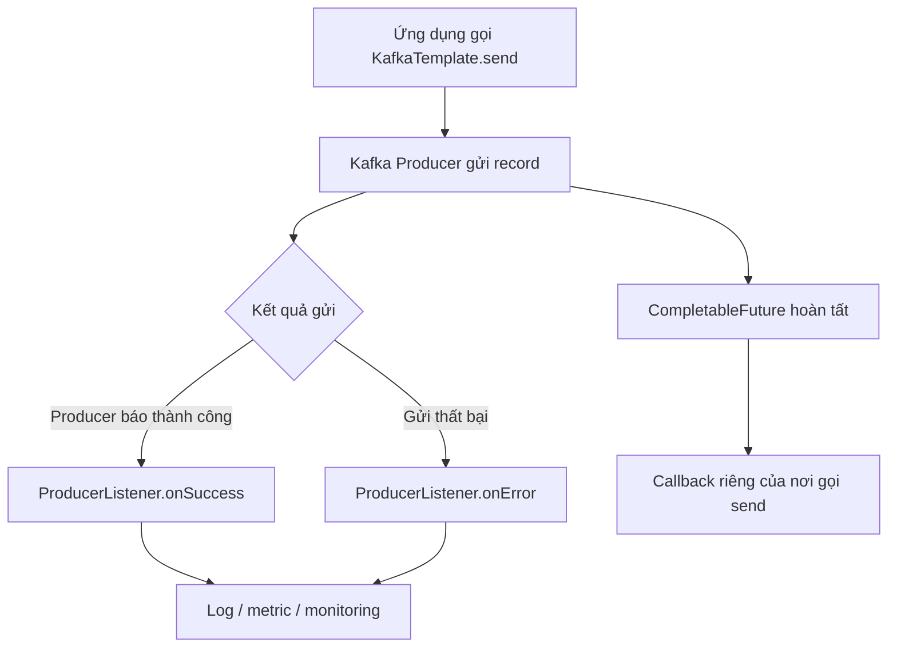

# Tùy biến ProducerListener

`KafkaTemplate.send(...)` trả về một `CompletableFuture<SendResult<K, V>>` để phía gọi theo dõi kết quả của từng lần gửi. Khi cần một điểm quan sát tập trung cho tất cả record được gửi qua một template, Spring Kafka cung cấp **`ProducerListener<K, V>`**.

`ProducerListener` nhận callback khi producer gửi thành công hoặc thất bại. Ứng dụng có thể dùng callback này để ghi log, cập nhật metric, thu thập metadata hoặc phát tín hiệu quan sát cho hệ thống monitoring. Listener được gắn vào `KafkaTemplate`, vì vậy có thể áp dụng cùng một chính sách cho nhiều nơi gọi `send` mà không phải lặp callback ở từng phương thức nghiệp vụ.

## 1. ProducerListener hoạt động như thế nào?

`ProducerListener<K, V>` là interface của Spring Kafka với hai callback chính:

| Callback | Khi được gọi | Dữ liệu nhận được |
|---|---|---|
| `onSuccess(record, metadata)` | Producer hoàn tất lần gửi thành công theo cấu hình acknowledgement (`acks`). | Record thực tế đã gửi và `RecordMetadata` như topic, partition, offset, timestamp. |
| `onError(record, metadata, exception)` | Lần gửi kết thúc với lỗi. | Record thất bại, metadata có thể chưa đầy đủ hoặc `null`, và exception. |

Các phương thức trong interface hiện đại có implementation mặc định rỗng. Bạn chỉ cần override callback mà ứng dụng quan tâm. Spring Kafka mặc định cấu hình `LoggingProducerListener`: listener này ghi log lỗi và không làm gì khi gửi thành công.

Luồng xử lý có thể hình dung như sau:



`ProducerListener` là callback dùng chung của template. `CompletableFuture` là kết quả riêng của lần gọi `send`. Cả hai cùng quan sát một lần gửi nhưng phục vụ những nhu cầu khác nhau.

## 2. Viết một ProducerListener tùy chỉnh

Ví dụ dưới đây ghi nhận topic, key, partition và offset khi gửi thành công; khi gửi thất bại, listener ghi exception và partition nếu metadata có sẵn.

```java
import org.apache.kafka.clients.producer.ProducerRecord;
import org.apache.kafka.clients.producer.RecordMetadata;
import org.slf4j.Logger;
import org.slf4j.LoggerFactory;
import org.springframework.kafka.support.ProducerListener;
import org.springframework.stereotype.Component;

@Component
public class KafkaSendObserver implements ProducerListener<Object, Object> {

    private static final Logger log =
            LoggerFactory.getLogger(KafkaSendObserver.class);

    @Override
    public void onSuccess(
            ProducerRecord<Object, Object> record,
            RecordMetadata metadata) {

        log.debug(
                "Kafka send succeeded: topic={}, partition={}, offset={}, key={}",
                metadata.topic(),
                metadata.partition(),
                metadata.offset(),
                record.key()
        );
    }

    @Override
    public void onError(
            ProducerRecord<Object, Object> record,
            RecordMetadata metadata,
            Exception exception) {

        Integer partition = metadata == null ? null : metadata.partition();

        log.error(
                "Kafka send failed: topic={}, partition={}, key={}",
                record.topic(),
                partition,
                record.key(),
                exception
        );
    }
}
```

Trong ví dụ:

- `onSuccess` được gọi khi producer hoàn tất lần gửi thành công theo cấu hình `acks`. Với `acks=1` hoặc `acks=all`, broker gửi xác nhận theo mức tương ứng; với `acks=0`, producer không chờ broker xác nhận. `RecordMetadata` cho biết metadata mà producer nhận được cho lần gửi.
- `onError` nhận record thất bại cùng exception. Metadata trong trường hợp lỗi có thể là `null` hoặc chỉ chứa một phần thông tin hợp lệ, vì vậy cần kiểm tra null trước khi truy cập.
- Listener dùng generic `Object, Object` để có thể quan sát nhiều kiểu key/value trên KafkaTemplate do Spring Boot auto-configure.
- Log thành công ở mức `debug` để tránh tạo lượng log lớn ở hệ thống có throughput cao. Không log toàn bộ payload nếu payload có thể chứa dữ liệu nhạy cảm hoặc quá lớn.

## 3. Đăng ký listener trong Spring Boot

Khi dùng Spring Boot Kafka auto-configuration, có thể đăng ký một bean `ProducerListener` tùy chỉnh. Auto-configuration dùng bean này cho `KafkaTemplate` được tạo tự động. Nếu không có bean tùy chỉnh, Spring Boot cung cấp `LoggingProducerListener` mặc định.

Ví dụ, lớp `KafkaSendObserver` ở trên đã có `@Component`, nên Spring tự đăng ký nó thành bean. Không cần tự tạo thêm `KafkaTemplate` chỉ để gắn listener. Đảm bảo ứng dụng chỉ có một bean `ProducerListener` phù hợp hoặc chỉ định `@Primary`/`@Qualifier` nếu chủ động cấu hình nhiều listener.

Với một ứng dụng Spring Boot có KafkaTemplate mặc định, có thể dùng trực tiếp:

```java
import org.springframework.kafka.core.KafkaTemplate;
import org.springframework.stereotype.Service;

@Service
public class OrderPublisher {

    private final KafkaTemplate<String, OrderCreatedEvent> kafkaTemplate;

    public OrderPublisher(KafkaTemplate<String, OrderCreatedEvent> kafkaTemplate) {
        this.kafkaTemplate = kafkaTemplate;
    }

    public void publish(String orderId, OrderCreatedEvent event) {
        kafkaTemplate.send("orders.events", orderId, event);
    }
}
```

Trong ứng dụng thực tế, có thể inject template với kiểu generic được thu hẹp theo key/value của producer factory, ví dụ `KafkaTemplate<String, OrderCreatedEvent>`. Generic type không thay đổi cách listener nhận callback; bean listener do Boot auto-config sử dụng có thể khai báo `ProducerListener<Object, Object>` để quan sát các kiểu record khác nhau.

## 4. Gắn listener khi tự tạo KafkaTemplate

Nếu ứng dụng không dùng Spring Boot auto-configuration hoặc tự tạo nhiều KafkaTemplate, có thể gắn listener trực tiếp bằng `setProducerListener(...)`:

```java
import org.springframework.context.annotation.Bean;
import org.springframework.context.annotation.Configuration;
import org.springframework.kafka.core.KafkaTemplate;
import org.springframework.kafka.core.ProducerFactory;
import org.springframework.kafka.support.ProducerListener;

@Configuration
public class OrderKafkaConfiguration {

    @Bean
    KafkaTemplate<String, OrderCreatedEvent> orderKafkaTemplate(
            ProducerFactory<String, OrderCreatedEvent> producerFactory,
            ProducerListener<String, OrderCreatedEvent> orderProducerListener) {

        KafkaTemplate<String, OrderCreatedEvent> template =
                new KafkaTemplate<>(producerFactory);

        template.setProducerListener(orderProducerListener);
        return template;
    }
}
```

Trong trường hợp này, `orderProducerListener` là bean có kiểu `ProducerListener<String, OrderCreatedEvent>`. Template chỉ dùng listener đã được gắn vào nó. Nếu ứng dụng có nhiều template, mỗi template có thể dùng listener riêng hoặc dùng chung một listener phù hợp với generic type.

Không nên vừa thay thế bean `ProducerListener` của Spring Boot vừa tự tạo một `KafkaTemplate` mà không kiểm tra điều kiện auto-configuration. Khi đã tự khai báo bean `KafkaTemplate`, Boot thường không tạo template mặc định nữa; bạn phải tự gắn listener vào template đó.

## 5. ProducerListener và CompletableFuture khác nhau thế nào?

Hai cơ chế đều nhận được kết quả gửi nhưng có phạm vi sử dụng khác nhau:

| Tiêu chí | `ProducerListener` | `CompletableFuture<SendResult<K, V>>` |
|---|---|---|
| Phạm vi | Chung cho các lần gửi qua template được cấu hình. | Riêng từng lần gọi `send`. |
| Đăng ký | Gắn vào `KafkaTemplate` hoặc đăng ký bean cho auto-configuration. | Gọi `whenComplete`, `thenApply`, `exceptionally` trên future trả về. |
| Mục đích phù hợp | Logging, metric, monitoring và quan sát tập trung. | Logic riêng của nghiệp vụ gọi gửi, kết hợp kết quả hoặc trả trạng thái cho tầng gọi. |
| Dữ liệu kết quả | Record, metadata và exception. | `SendResult` hoặc exception hoàn tất future. |

Ví dụ kết hợp future với listener:

```java
kafkaTemplate.send("orders.events", event.orderId(), event)
        .whenComplete((result, exception) -> {
            if (exception != null) {
                // Xử lý kết quả cho luồng nghiệp vụ cụ thể.
                notifyPublishFailure(event.orderId(), exception);
                return;
            }

            // Xử lý kết quả thành công riêng cho lần gửi này.
            notifyPublishAccepted(event.orderId(), result.getRecordMetadata());
        });
```

Khi cả hai cơ chế cùng được cấu hình, một lần gửi có thể kích hoạt `ProducerListener` và hoàn tất future. Tránh đặt cùng một hành động nghiệp vụ ở cả hai nơi vì có thể gửi thông báo hoặc ghi nhận hai lần.

## 6. Những việc nên và không nên làm trong callback

`ProducerListener` được dùng như một delegate stateless cho callback của Kafka producer. Callback thường chạy trên luồng callback/I/O của producer, vì vậy cần giữ xử lý ngắn và không chặn luồng gửi.

Nên thực hiện:

- Ghi log có ngữ cảnh như topic, key, partition, offset và exception.
- Tăng counter hoặc ghi nhận timer bằng thư viện metrics thread-safe.
- Gắn thông tin correlation/trace vào log để tra cứu luồng gửi.
- Chuyển công việc phụ trợ sang executor/queue riêng nếu thực sự cần xử lý lâu hơn, có giới hạn tải và chính sách khi queue đầy.

Tránh thực hiện:

- Gọi HTTP, truy vấn database hoặc chờ I/O lâu ngay trong callback.
- Gọi `get()` để chờ một future khác hoặc thực hiện `flush()`/`close()` đồng bộ trong callback.
- Giữ state mutable không thread-safe trong listener singleton.
- Gửi lại record ngay trong `onError` mà không có chính sách retry, idempotency và giới hạn số lần thử.
- Dùng callback làm nơi duy nhất ghi audit nghiệp vụ quan trọng. Process có thể dừng sau khi broker xác nhận nhưng trước khi callback hoàn tất side effect bên ngoài.

Nếu cần retry, hãy cấu hình retry của Kafka producer và `delivery.timeout.ms` cho lỗi gửi có thể thử lại. `ProducerListener` chỉ quan sát kết quả cuối cùng của lần gửi; nó không thay thế cơ chế retry của producer và không quyết định broker có ghi record hay không.

## 7. Xử lý metadata và lỗi an toàn

Khi gửi thành công, `RecordMetadata` có topic, partition, offset và timestamp. Có thể dùng các giá trị này để liên kết log của producer với log của consumer.

Khi gửi thất bại, metadata có thể chưa đầy đủ. Nếu partition chưa được xác định, metadata có thể chứa `UNKNOWN_PARTITION`; offset không phải vị trí hợp lệ để dùng như một record đã ghi. Không giả định `metadata` luôn khác `null` trong `onError`.

Một số lỗi có thể xảy ra đồng bộ trước khi callback của Kafka producer được thực thi, ví dụ lỗi phát sinh khi chuẩn bị gửi hoặc producer đã đóng. Vì vậy, hãy luôn xử lý future mà `KafkaTemplate.send(...)` trả về hoặc bắt exception đồng bộ tại nơi gọi. Không xem `ProducerListener` là cơ chế duy nhất để bắt mọi lỗi của lời gọi `send`.

Ngoài ra, callback lỗi không tự chứng minh rằng broker chắc chắn chưa ghi record trong mọi tình huống timeout/mất kết nối. Khi producer không nhận được xác nhận, kết quả có thể không rõ ràng ở phía ứng dụng. Thiết kế consumer idempotent và dùng event ID ổn định giúp xử lý an toàn khi phải gửi lại.

### Khác biệt chữ ký giữa các phiên bản

Các ví dụ trong bài dùng API `onError(ProducerRecord, RecordMetadata, Exception)`, có từ Spring Kafka 2.6.2. Những phiên bản cũ hơn có chữ ký callback khác, chẳng hạn `onError(ProducerRecord, Exception)` hoặc các overload nhận từng trường topic/partition/key/value. Một số API cũ còn có `isInterestedInSuccess()`; với interface hiện đại, chỉ cần override `onSuccess(...)` nếu muốn nhận callback thành công. Kiểu trả về của `KafkaTemplate.send` cũng thay đổi theo phiên bản: Spring Kafka 3.x trở lên dùng `CompletableFuture`, trong khi các bản 2.x dùng `ListenableFuture`. Hãy đối chiếu Javadoc đúng phiên bản Spring Kafka mà dự án đang dùng trước khi sao chép chữ ký hoặc kiểu future.

## 8. Kiểm thử ProducerListener

Nên kiểm tra cả callback thành công và callback lỗi. Với integration test dùng broker thật hoặc Embedded Kafka, có thể dùng `CountDownLatch` để chờ callback thay vì `Thread.sleep`:

```java
import java.util.concurrent.CountDownLatch;
import java.util.concurrent.TimeUnit;

import org.apache.kafka.clients.producer.ProducerRecord;
import org.apache.kafka.clients.producer.RecordMetadata;
import org.springframework.kafka.core.KafkaTemplate;
import org.springframework.kafka.support.ProducerListener;

import static org.assertj.core.api.Assertions.assertThat;

CountDownLatch successLatch = new CountDownLatch(1);

ProducerListener<Object, Object> listener = new ProducerListener<>() {
    @Override
    public void onSuccess(
            ProducerRecord<Object, Object> record,
            RecordMetadata metadata) {
        successLatch.countDown();
    }
};

// producerFactory là ProducerFactory được cung cấp trong test fixture.
KafkaTemplate<Object, Object> template = new KafkaTemplate<>(producerFactory);
template.setProducerListener(listener);
template.send("test-topic", "O100", "payload");

// Chờ callback thành công; không dùng Thread.sleep.
assertThat(successLatch.await(10, TimeUnit.SECONDS)).isTrue();
```

Đây là phần minh họa cơ chế chờ callback; trong test hoàn chỉnh, hãy cấu hình listener vào KafkaTemplate trước khi gửi, khởi tạo latch theo từng test và đóng tài nguyên broker sau kiểm thử. Đối với nhánh lỗi, có thể cấu hình broker/topic hoặc producer để tạo lỗi có kiểm soát rồi xác minh exception và record nhận được trong `onError`.

Các điểm nên xác minh:

1. Listener được gắn vào đúng KafkaTemplate mà publisher sử dụng.
2. Gửi thành công kích hoạt `onSuccess` và metadata có topic/partition/offset hợp lệ.
3. Gửi thất bại kích hoạt `onError` với exception phù hợp; test không giả định metadata luôn có đủ trường.
4. Callback không làm chậm luồng producer hoặc gây lỗi do state dùng chung.
5. Future của `send` vẫn được kiểm tra để xác nhận hành vi mà tầng gọi cần biết.

## 9. Ghi nhớ

- `ProducerListener<K, V>` là callback tập trung cho kết quả gửi của `KafkaTemplate`.
- `onSuccess` được gọi khi producer báo gửi thành công theo cấu hình `acks`; mức xác nhận của broker phụ thuộc cấu hình đó. `onError` nhận record thất bại, metadata có thể null và exception.
- Spring Kafka mặc định dùng `LoggingProducerListener`, ghi log lỗi và bỏ qua xử lý thành công.
- Với Spring Boot, có thể đăng ký bean `ProducerListener` để thay listener mặc định; với template tự tạo, dùng `setProducerListener(...)`.
- Dùng listener cho logging/metrics/monitoring; dùng `CompletableFuture` cho xử lý riêng của từng lần gửi.
- Giữ callback ngắn, thread-safe và không thực hiện I/O chặn.
- Luôn xử lý future hoặc exception tại nơi gọi `send`; callback không thay thế retry, idempotence hay xử lý lỗi nghiệp vụ.

Khi tùy biến `ProducerListener`, hãy xem nó như điểm quan sát kết quả gửi dùng chung. Giữ callback nhẹ, ghi đủ metadata để điều tra sự cố và để tầng gọi `send` chịu trách nhiệm cho kết quả nghiệp vụ cụ thể.

## Tài liệu tham khảo

- [Spring for Apache Kafka — Sending Messages](https://docs.spring.io/spring-kafka/reference/kafka/sending-messages.html)
- [Spring Boot — KafkaAutoConfiguration API](https://docs.spring.io/spring-boot/api/java/org/springframework/boot/autoconfigure/kafka/KafkaAutoConfiguration.html)
- [Spring Kafka — ProducerListener API](https://docs.spring.io/spring-kafka/api/org/springframework/kafka/support/ProducerListener.html)
