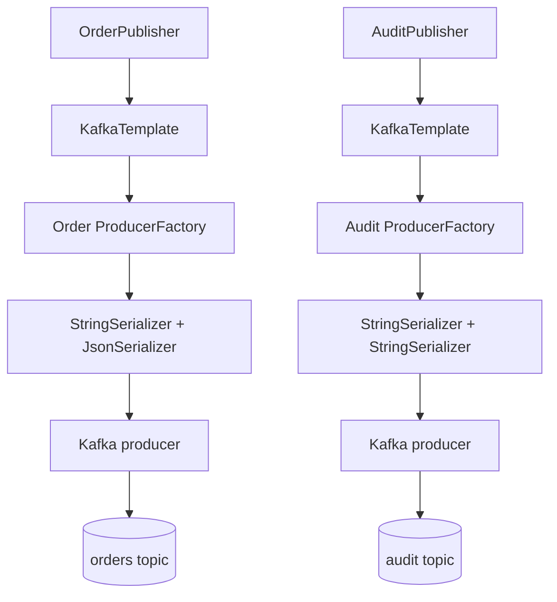

# Tạo nhiều KafkaTemplate theo kiểu dữ liệu

Trong một ứng dụng Spring Kafka, producer có thể gửi nhiều loại payload: event JSON như `OrderCreatedEvent`, chuỗi văn bản như thông báo audit hoặc byte array như dữ liệu đã được mã hóa theo một định dạng riêng. Mỗi loại dữ liệu có thể cần serializer và cấu hình producer khác nhau. Spring Kafka cho phép khai báo nhiều `ProducerFactory` và nhiều `KafkaTemplate<K, V>` để ứng dụng gửi từng loại dữ liệu bằng đúng cấu hình.

Trong module `SPRING_KAFKA_MESSAGING`, `KafkaTemplate` là API gửi record ở phía producer, còn consumer thường nhận record bằng `@KafkaListener`. Khi tạo nhiều template, mục tiêu là làm rõ kiểu key/value và ranh giới serialization, đồng thời giữ cấu hình producer nhất quán và dễ quản lý.

## 1. Vì sao cần nhiều `KafkaTemplate`?

`KafkaTemplate<K, V>` được tham số hóa theo kiểu key `K` và kiểu value `V`. Template sử dụng một `ProducerFactory<K, V>` để tạo Kafka producer; factory cung cấp serializer và cấu hình kết nối tương ứng.

Một ứng dụng có thể có các luồng gửi khác nhau:

| Loại payload | Key | Value | Serializer thường dùng |
|---|---|---|---|
| Order event | `String` | `OrderCreatedEvent` | `StringSerializer` + `JsonSerializer` |
| Audit message | `String` | `String` | `StringSerializer` + `StringSerializer` |
| Binary event | `String` | `byte[]` | `StringSerializer` + `ByteArraySerializer` |
| Avro/Protobuf event | `String` hoặc kiểu key khác | Kiểu generated record | Serializer tương ứng hoặc Schema Registry serializer |

Nếu các loại payload cần serializer khác nhau, khai báo template/factory riêng giúp compiler kiểm tra kiểu dữ liệu ở nơi gọi và tránh cấu hình serializer không phù hợp. Ví dụ, `KafkaTemplate<String, OrderCreatedEvent>` thể hiện rõ rằng template nhận key chuỗi và value là order event.

Không nhất thiết tạo một template cho từng topic hoặc từng DTO. Nếu nhiều topic dùng cùng kiểu key/value, cùng serializer và cùng cấu hình producer, một template có thể gửi đến nhiều topic. Chỉ tách template khi cần khác kiểu dữ liệu, serializer, transaction setting, security identity hoặc các producer configuration quan trọng khác.

## 2. Quan hệ giữa `KafkaTemplate` và `ProducerFactory`

`KafkaTemplate` không tự quyết định cách object được chuyển thành byte. Nó sử dụng `ProducerFactory` để lấy Kafka producer đã được cấu hình serializer, bootstrap server, retry, idempotence, security và các thuộc tính khác.



Mỗi `ProducerFactory` thường quản lý hoặc tạo producer theo cấu hình riêng. Vì vậy, thêm nhiều factory có thể đồng nghĩa với nhiều producer pool, kết nối broker và tài nguyên cần quản lý. Hãy tránh tạo factory không cần thiết chỉ vì muốn đặt tên template theo từng topic.

## 3. Khai báo nhiều `ProducerFactory` và `KafkaTemplate`

Ví dụ dưới đây tạo hai cặp bean:

- `orderProducerFactory` và `orderKafkaTemplate` dùng JSON cho `OrderCreatedEvent`.
- `auditProducerFactory` và `auditKafkaTemplate` dùng chuỗi cho audit message.

```java
import java.util.HashMap;
import java.util.Map;

import org.apache.kafka.clients.producer.ProducerConfig;
import org.apache.kafka.common.serialization.StringSerializer;
import org.springframework.beans.factory.annotation.Qualifier;
import org.springframework.beans.factory.annotation.Value;
import org.springframework.context.annotation.Bean;
import org.springframework.context.annotation.Configuration;
import org.springframework.kafka.core.DefaultKafkaProducerFactory;
import org.springframework.kafka.core.KafkaTemplate;
import org.springframework.kafka.core.ProducerFactory;
import org.springframework.kafka.support.serializer.JsonSerializer;

@Configuration
public class TypedKafkaProducerConfiguration {

    private Map<String, Object> baseProducerProperties(String bootstrapServers) {
        Map<String, Object> properties = new HashMap<>();
        properties.put(
                ProducerConfig.BOOTSTRAP_SERVERS_CONFIG,
                bootstrapServers
        );
        properties.put(ProducerConfig.ACKS_CONFIG, "all");
        properties.put(ProducerConfig.ENABLE_IDEMPOTENCE_CONFIG, true);
        return properties;
    }

    @Bean("orderProducerFactory")
    public ProducerFactory<String, OrderCreatedEvent> orderProducerFactory(
            @Value("${spring.kafka.bootstrap-servers}") String bootstrapServers) {

        return new DefaultKafkaProducerFactory<>(
                baseProducerProperties(bootstrapServers),
                new StringSerializer(),
                new JsonSerializer<>()
        );
    }

    @Bean("orderKafkaTemplate")
    public KafkaTemplate<String, OrderCreatedEvent> orderKafkaTemplate(
            @Qualifier("orderProducerFactory")
            ProducerFactory<String, OrderCreatedEvent> orderProducerFactory) {

        return new KafkaTemplate<>(orderProducerFactory);
    }

    @Bean("auditProducerFactory")
    public ProducerFactory<String, String> auditProducerFactory(
            @Value("${spring.kafka.bootstrap-servers}") String bootstrapServers) {

        return new DefaultKafkaProducerFactory<>(
                baseProducerProperties(bootstrapServers),
                new StringSerializer(),
                new StringSerializer()
        );
    }

    @Bean("auditKafkaTemplate")
    public KafkaTemplate<String, String> auditKafkaTemplate(
            @Qualifier("auditProducerFactory")
            ProducerFactory<String, String> auditProducerFactory) {

        return new KafkaTemplate<>(auditProducerFactory);
    }
}
```

`OrderCreatedEvent` là DTO event của ứng dụng, ví dụ:

```java
import java.math.BigDecimal;
import java.time.Instant;

public record OrderCreatedEvent(
        String eventId,
        String orderId,
        BigDecimal total,
        Instant occurredAt
) {}
```

Đoạn cấu hình minh họa dùng chung bootstrap server, `acks=all` và idempotence, nhưng mỗi factory có value serializer riêng. Trong production, cần đưa các thiết lập dùng chung như SASL/SSL, timeout, compression, retry và metrics vào cấu hình nền phù hợp với môi trường. Không sao chép một cấu hình local đơn giản sang production mà bỏ quên thông tin xác thực hoặc chính sách bảo mật.

Trong ví dụ, hai phương thức `@Bean` nhận `ProducerFactory` bằng `@Qualifier` theo đúng tên bean. Điều này làm rõ factory nào được gắn với từng template, đặc biệt hữu ích khi ứng dụng có nhiều factory cùng interface hoặc generic type phức tạp.

## 4. Inject đúng template bằng `@Qualifier`

Khi Spring context có nhiều bean cùng raw type `KafkaTemplate`, nên dùng `@Qualifier` để chỉ rõ template cần inject. Generic type có thể hỗ trợ Spring phân biệt candidate, nhưng qualifier đặt tên dependency rõ ràng và tránh nhầm lẫn khi cấu hình thay đổi.

```java
import org.springframework.beans.factory.annotation.Qualifier;
import org.springframework.kafka.core.KafkaTemplate;
import org.springframework.stereotype.Service;

@Service
public class OrderPublisher {

    private final KafkaTemplate<String, OrderCreatedEvent> kafkaTemplate;

    public OrderPublisher(
            @Qualifier("orderKafkaTemplate")
            KafkaTemplate<String, OrderCreatedEvent> kafkaTemplate) {
        this.kafkaTemplate = kafkaTemplate;
    }

    public void publish(OrderCreatedEvent event) {
        kafkaTemplate.send("orders.created", event.orderId(), event);
    }
}
```

```java
import org.springframework.beans.factory.annotation.Qualifier;
import org.springframework.kafka.core.KafkaTemplate;
import org.springframework.stereotype.Service;

@Service
public class AuditPublisher {

    private final KafkaTemplate<String, String> kafkaTemplate;

    public AuditPublisher(
            @Qualifier("auditKafkaTemplate")
            KafkaTemplate<String, String> kafkaTemplate) {
        this.kafkaTemplate = kafkaTemplate;
    }

    public void publish(String messageId, String message) {
        kafkaTemplate.send("audit.events", messageId, message);
    }
}
```

`@Qualifier` nhận tên bean đã khai báo trong cấu hình. Nếu bỏ qualifier và có nhiều candidate cùng kiểu, Spring có thể không xác định được bean phù hợp và báo `NoUniqueBeanDefinitionException`. Có thể dùng `@Primary` để chọn một bean mặc định, nhưng với nhiều template có mục đích khác nhau, qualifier thường dễ đọc và an toàn hơn.

## 5. Tạo template cho `byte[]` hoặc định dạng khác

Nếu ứng dụng gửi payload đã được mã hóa thành byte array, có thể tạo thêm factory dùng `ByteArraySerializer`:

```java
import org.apache.kafka.common.serialization.ByteArraySerializer;
import org.apache.kafka.common.serialization.StringSerializer;
import org.springframework.beans.factory.annotation.Qualifier;
import org.springframework.beans.factory.annotation.Value;
import org.springframework.context.annotation.Bean;
import org.springframework.kafka.core.DefaultKafkaProducerFactory;
import org.springframework.kafka.core.KafkaTemplate;
import org.springframework.kafka.core.ProducerFactory;

@Bean("binaryProducerFactory")
public ProducerFactory<String, byte[]> binaryProducerFactory(
        @Value("${spring.kafka.bootstrap-servers}") String bootstrapServers) {

    return new DefaultKafkaProducerFactory<>(
            baseProducerProperties(bootstrapServers),
            new StringSerializer(),
            new ByteArraySerializer()
    );
}

@Bean("binaryKafkaTemplate")
public KafkaTemplate<String, byte[]> binaryKafkaTemplate(
        @Qualifier("binaryProducerFactory")
        ProducerFactory<String, byte[]> producerFactory) {

    return new KafkaTemplate<>(producerFactory);
}
```

Đoạn code này được đặt trong cùng class `@Configuration` với helper `baseProducerProperties(...)` ở ví dụ trước. Trong ứng dụng thật, hãy đặt các bean vào một cấu hình phù hợp và dùng `@Qualifier` cả ở nơi inject producer factory.

Với Avro hoặc Protobuf, value serializer có thể là serializer do Schema Registry hoặc thư viện tương ứng cung cấp. Template vẫn được khai báo theo kiểu Java của generated record, còn serializer chịu trách nhiệm chuyển kiểu đó sang wire format. Consumer cần deserializer và schema compatibility tương ứng.

## 6. Cấu hình Spring Boot và auto-configuration

Spring Boot có thể tự cấu hình `ProducerFactory` và `KafkaTemplate` mặc định từ `spring.kafka.*`. Khi chỉ có một luồng gửi đơn giản, nên tận dụng cấu hình mặc định thay vì tạo thêm bean thủ công.

Ví dụ cấu hình nền:

```yaml
spring:
  kafka:
    bootstrap-servers: ${KAFKA_BOOTSTRAP_SERVERS:localhost:9092}
    producer:
      acks: all
      properties:
        enable.idempotence: true
```

Khi khai báo các `KafkaTemplate` hoặc `ProducerFactory` tùy chỉnh, điều kiện auto-configuration của Spring Boot có thể khiến bean mặc định không được tạo. Cần hiểu bean nào đang được auto-configure và bean nào do ứng dụng tự khai báo; đừng giả định rằng vẫn luôn có một `kafkaTemplate` mặc định bên cạnh các template tùy chỉnh.

Một chiến lược thường dùng:

1. Giữ cấu hình Boot mặc định cho luồng phổ biến nếu chỉ có một serializer chính.
2. Khi cần nhiều kiểu serializer, khai báo các factory/template riêng với tên bean rõ ràng.
3. Tái sử dụng cùng tập cấu hình nền cho bootstrap, security, acks và retry nếu các producer cùng chính sách.
4. Chỉ tạo cấu hình riêng khi một luồng thực sự cần khác biệt như serializer, transaction ID prefix, security principal hoặc producer tuning.

Nếu muốn kế thừa toàn bộ cấu hình `spring.kafka.producer.*` của Boot cho từng factory tùy chỉnh, hãy dùng API `KafkaProperties` tương ứng với phiên bản Spring Boot đang sử dụng để xây dựng map cấu hình. Chữ ký phương thức build properties thay đổi theo một số phiên bản Boot, vì vậy cần đối chiếu dependency thực tế trước khi sao chép mã.

## 7. Nhiều template có cần nhiều producer connection không?

Một `KafkaTemplate` sử dụng `ProducerFactory` được inject. Nếu hai template cùng dùng một factory, chúng chia sẻ chính sách tạo producer và serializer của factory đó. Việc tạo thêm wrapper `KafkaTemplate` không tự tạo ra một bộ serializer hoặc producer pool độc lập.

Ngược lại, hai `ProducerFactory` riêng có thể tạo các producer pool riêng. Điều này cần thiết khi serializer hoặc cấu hình producer khác nhau, nhưng cũng tăng số producer, socket connection, buffer và tài nguyên broker/client. Vì vậy:

- Dùng một template cho nhiều topic nếu key/value và cấu hình giống nhau.
- Dùng nhiều template khi kiểu dữ liệu hoặc serializer khác nhau rõ ràng.
- Chia sẻ factory khi các luồng có thể dùng chung serializer và producer settings.
- Tách factory khi cần isolation về security, transaction, serializer hoặc tuning.
- Không tạo một template mới cho mỗi request hoặc mỗi record.

Nếu nhiều kiểu value đều được serialize JSON và có thể dùng chung một contract strategy, có thể cân nhắc `KafkaTemplate<String, Object>` hoặc `DelegatingByTypeSerializer`. Cách này linh hoạt hơn nhưng giảm độ chặt của kiểu ở nơi gọi và cần quy ước type header/schema rõ ràng. Chỉ dùng khi lợi ích thực tế lớn hơn chi phí về kiểm soát kiểu và tương thích schema.

## 8. Serializer, type header và consumer tương ứng

Mỗi template phải dùng serializer phù hợp với kiểu value:

| Template | Value serializer | Consumer deserializer thường dùng |
|---|---|---|
| `orderKafkaTemplate` | `JsonSerializer<OrderCreatedEvent>` | `JsonDeserializer<OrderCreatedEvent>` |
| `auditKafkaTemplate` | `StringSerializer` | `StringDeserializer` |
| `binaryKafkaTemplate` | `ByteArraySerializer` | `ByteArrayDeserializer` |
| Avro template | Avro serializer | Avro deserializer tương ứng |

Nếu dùng `JsonSerializer`, cần thống nhất cách consumer xác định kiểu payload. Spring Kafka JSON serializer có thể ghi type information vào headers; consumer có thể dùng thông tin đó hoặc cấu hình default type. Khi producer và consumer thuộc các service độc lập, tránh phụ thuộc mù quáng vào tên class Java hoặc package nội bộ. Có thể tắt type headers và cấu hình kiểu đích ở consumer, hoặc dùng schema registry để quản lý schema có version.

Đừng nhầm generic type của `KafkaTemplate` với schema trên wire. Generic type chỉ mô tả kiểu Java trong ứng dụng; serializer mới quyết định byte được ghi vào Kafka. Nếu serializer và deserializer không tương thích, producer có thể gửi thành công nhưng consumer thất bại khi deserialize.

## 9. Transaction và cấu hình riêng cho từng template

Nếu một luồng producer cần Kafka transaction, transaction capability phải được cấu hình ở `ProducerFactory` tương ứng, thường bằng transaction ID prefix trên `DefaultKafkaProducerFactory`. Template dùng factory đó mới tham gia cơ chế transaction của Spring Kafka.

Không nên bật transaction cho mọi template chỉ vì ứng dụng có một luồng cần transaction. Một factory transaction-enabled và một factory không transaction có thể được tách riêng để thể hiện rõ chính sách. Cần bảo đảm transaction ID prefix duy nhất giữa các instance ứng dụng theo quy tắc triển khai và dùng đúng `KafkaTransactionManager`/transaction configuration khi tích hợp với listener hoặc database. Kafka transaction không tự tạo giao dịch nguyên tử với database ngoài Kafka.

## 10. Kiểm thử nhiều KafkaTemplate

Kiểm thử nên xác minh cả wiring bean lẫn hành vi serialization:

- **Context test:** Spring context khởi tạo được tất cả factory/template và qualifier inject đúng bean.
- **Unit test publisher:** mock template tương ứng, xác minh đúng topic, key, payload được gửi.
- **Serialization test:** kiểm tra JSON serializer, string serializer hoặc byte array serializer tạo đúng payload.
- **Integration test:** dùng Embedded Kafka hoặc Testcontainers để gửi/nhận từng loại payload qua đúng topic và deserializer.
- **Configuration test:** xác minh producer settings quan trọng như acks, idempotence, security và transaction prefix theo từng factory.

Khi có nhiều template, lỗi thường gặp là inject nhầm bean hoặc dùng serializer của luồng khác. Test context cùng qualifier giúp phát hiện sớm lỗi wiring; integration test xác minh dữ liệu thực tế trên Kafka.

## 11. Lỗi thường gặp

- **Không dùng qualifier:** nhiều `KafkaTemplate` cùng tồn tại làm Spring không xác định được bean cần inject.
- **Khai báo nhiều template nhưng dùng chung factory không phù hợp:** template JSON lại nhận value cần string serializer hoặc ngược lại.
- **Tạo quá nhiều producer factory:** làm tăng producer pool và kết nối không cần thiết.
- **Giả định Boot vẫn tạo template mặc định:** custom bean có thể làm điều kiện auto-configuration không còn thỏa mãn.
- **Chỉ đổi generic type mà không đổi serializer:** generic không tự chuyển object thành JSON, String hoặc byte array.
- **Producer và consumer không thống nhất type headers/schema:** producer gửi được nhưng consumer không deserialize được.
- **Dùng `@Primary` tùy tiện:** bean mặc định có thể bị inject vào luồng cần serializer khác; dùng qualifier theo mục đích.
- **Tạo template theo topic dù cấu hình giống nhau:** làm tăng cấu hình và tài nguyên mà không đem lại lợi ích rõ ràng.
- **Bỏ qua cấu hình security khi tự tạo factory:** factory thủ công phải nhận đầy đủ SASL/SSL và các thuộc tính cần thiết của môi trường.

## 12. Checklist trước khi khai báo nhiều `KafkaTemplate`

- [ ] Xác định kiểu key/value và serializer của từng luồng gửi.
- [ ] Chỉ tách `ProducerFactory` khi có khác biệt thực sự về serializer hoặc producer configuration.
- [ ] Đặt tên bean có ý nghĩa như `orderKafkaTemplate`, `auditKafkaTemplate`.
- [ ] Dùng `@Qualifier` khi inject template/factory để tránh mơ hồ.
- [ ] Cấu hình serializer và deserializer tương thích giữa producer và consumer.
- [ ] Kiểm tra tác động đến Spring Boot auto-configuration khi khai báo bean tùy chỉnh.
- [ ] Tái sử dụng cấu hình nền về bootstrap, security, acks và retry khi phù hợp.
- [ ] Tách transaction-enabled factory nếu chỉ một luồng cần transaction.
- [ ] Tránh tạo template/factory theo từng topic hoặc từng request nếu không có khác biệt cấu hình.
- [ ] Có context test và integration test cho từng loại payload.

Tạo nhiều `KafkaTemplate` theo kiểu dữ liệu giúp producer thể hiện rõ hợp đồng key/value và dùng serializer phù hợp cho từng luồng. Khi đặt tên bean rõ ràng, inject bằng qualifier và chỉ tách producer factory khi có lý do, ứng dụng Spring Kafka sẽ dễ bảo trì, kiểm thử và mở rộng mà không tạo ra quá nhiều cấu hình hoặc producer pool.
