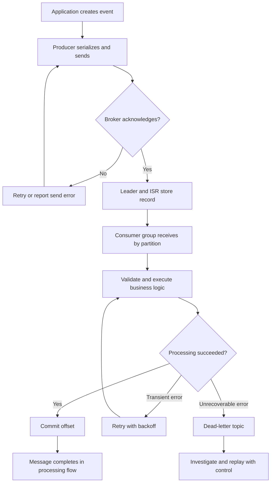

# Checkpoints in the Message Lifecycle

In Spring Kafka, a message passes through multiple components before processing is complete: the application creates an event, the Kafka producer sends the data, the broker persists and replicates the data, the consumer receives the message, the application executes business logic, and then commits the offset. When errors occur, the message may be retried, moved to a dead-letter topic (DLT), or replayed after the incident is resolved.

Reliable operations require control at every stage of this lifecycle. Two commonly confused confirmation milestones must be distinguished:

- **Producer acknowledgement** confirms that the broker received the record according to the configured durability level. It does not mean the consumer has processed the business logic.
- **Consumer offset commit** records how far a consumer has processed within a partition. It does not prove that a side effect external to Kafka, such as a database update, was committed atomically with the offset.

These two milestones are independent. A message may be stored by the broker without yet being processed by the consumer; or business logic may have finished without the offset being committed, causing the message to be redelivered. The checkpoints below help identify and manage those intervals.



## 1. Before Sending: Controlling Message Contracts and Identity

Reliability begins with the data the producer creates. Before sending, the application must clearly define event structure, key semantics, schema versioning, and tracing metadata.

An event should carry a stable identifier such as `eventId`, emission timestamp, event type, and schema version. If a business request may be resent after a timeout, the resend should preserve the same `eventId` so the consumer recognizes it as the same event. Do not use a Kafka offset as a business identifier because an offset is meaningful only within a single partition of a single topic.

Kafka uses the message key to select a partition via the partitioner. Messages with the same key normally go to the same partition and preserve relative ordering within that partition. Therefore:

- Choose the key based on the entity requiring ordering, such as `orderId` for events of a single order.
- Avoid an empty key or one shared key for all messages if that concentrates load onto a single partition.
- Do not assume Kafka guarantees global ordering across multiple partitions.
- When increasing the partition count, the key-to-partition mapping may change; evaluate the impact on the ordering of in-flight events.

Payloads must also be controlled. Validating required fields, size limits, timestamp conventions, and schema compatibility before publishing reduces failing messages on the consumer side. In systems with a schema registry, enforce appropriate compatibility policies so new producers do not break running consumers.

### Producer Configuration

For business flows requiring high durability, a common configuration is `acks=all` with idempotence enabled:

```yaml
spring:
  kafka:
    producer:
      acks: all
      properties:
        "enable.idempotence": true
        "max.in.flight.requests.per.connection": 5
        "delivery.timeout.ms": 120000
        "request.timeout.ms": 30000
```

`acks=all` requires the leader to wait for acknowledgement from replicas currently in the ISR per the Kafka protocol. This configuration must be paired with `min.insync.replicas` on the topic or broker to mandate the minimum number of synchronized replicas required before the broker accepts writes. For example, on a topic with replication factor 3 and `min.insync.replicas=2`: when ISR drops below 2, a producer with `acks=all` receives an error instead of continuing to write with lower redundancy than policy allows.

`enable.idempotence=true` helps Kafka eliminate duplicate records arising from producer retries within the same producer session. It does not replace `eventId`, does not automatically deduplicate when the application explicitly resends the same event after a restart, and does not make database writes exactly-once.

`delivery.timeout.ms` caps the total time the producer spends attempting to finish delivery, including queuing and retries. When the timeout expires, the application must handle the failure result. Do not ignore the future or callback of `KafkaTemplate.send()`: asynchronous sending may return control before the broker acknowledges, so errors surface only later. With Spring Kafka 3.x, the send API returns a `CompletableFuture`; older versions may use a different future type.

If the producer fails to send, log a structured error including topic, key or `eventId`, exception type, and correlation ID. Retry only recoverable errors; schema errors or invalid data should be handled at the application layer rather than retried indefinitely.

## 2. At the Broker: Controlling Acknowledgements, Replication, and Retention

Each partition has one leader handling read/write requests and follower replicas copying data. The set of replicas keeping up with the leader is called the ISR (in-sync replicas). Producer acknowledgement reflects the confirmation policy at write time, so operate the following configurations together:

| Checkpoint | Operational Meaning |
|---|---|
| `replication.factor` | Number of replicas created for the partition. Level 3 is commonly chosen for production workloads requiring single-broker fault tolerance, depending on infrastructure and cost. |
| `min.insync.replicas` | Minimum replicas in the ISR when the producer uses `acks=all`. When unmet, new writes may be rejected to protect data durability. |
| `unclean.leader.election.enable` | When disabled, Kafka avoids electing an out-of-sync replica as leader, reducing the risk of losing acknowledged records though possibly reducing availability in certain failures. |
| Rack awareness | Distribute replicas across different racks or failure zones so a single infrastructure failure does not take out multiple replicas simultaneously. |
| Disk and network | Monitor disk capacity, I/O latency, disk errors, and replication traffic to detect replicas starting to fall behind. |

A high replication factor alone does not guarantee durability if replicas share the same failure domain or brokers lack resources to keep up. Conversely, setting `min.insync.replicas` too high relative to the replication factor can cause writes to be rejected frequently during maintenance or broker failures. Policies must balance fault tolerance against write availability.

### Topic Retention Policies

Retention determines how long a message remains readable. With `cleanup.policy=delete`, Kafka deletes old segments according to `retention.ms` and/or `retention.bytes`. Retention duration must cover consumer outages, backlog drainage, and anticipated replay needs. If retention is shorter than recovery time, consumers may lose the opportunity to read unprocessed messages.

With `cleanup.policy=compact`, Kafka retains the latest value per key after compaction; this suits topics representing current state. Compaction is not a full historical event store. `compact,delete` can be combined when both compaction and age limits are needed.

When designing a topic, predetermine partition count, replication factor, retention, cleanup policy, message size limits, and ACLs. Partition count affects processing parallelism and per-key ordering; changing partition count is an operational decision that can affect key distribution.

### Access Permissions and Data Protection

Producers and consumers should use separate principals with least-privilege permissions: producers write to designated topics, consumers read corresponding topics and groups. Enable TLS to protect connections; use SASL or an authentication mechanism supported by the platform. Never log passwords, tokens, or sensitive payloads. Manage certificate and credential lifecycles so expirations do not cause unexpected outages.

## 3. When the Consumer Receives Messages: Controlling Groups and Partitions

A consumer group is the unit of coordinated consumption. Within the same group, at any given time, each partition is assigned to at most one consumer member. Therefore, the number of consumers actually processing in parallel within a group never exceeds the number of partitions assigned to that group. Increasing `concurrency` beyond the partition count does not yield corresponding throughput gains.

`group.id` must remain stable across deployments if the application wants to resume from committed offsets. Changing the group ID creates a new consumer group whose initial behavior depends on `auto.offset.reset` when the group has no valid offset yet. `earliest` chooses the earliest retained position; `latest` chooses new data written after initialization. This property does not automatically reset committed offsets of an existing group.

When members join or leave a group, Kafka performs a rebalance and reassigns partitions. Rebalancing is a normal mechanism, but continuous rebalancing reduces useful processing time and can introduce latency. Common causes include:

- Consumers stopping, restarting, or disconnecting frequently.
- Processing a single poll for too long, exceeding `max.poll.interval.ms`.
- Heartbeat and session timeout values mismatched with network conditions or load.
- Frequent changes to configuration, member count, or topic subscriptions.

`max.poll.records` limits the number of records returned in a single poll. Choose a value so that total batch processing time retains a safe margin below `max.poll.interval.ms`. If each record calls an external service or runs a slow database query, reducing batch size, optimizing business logic, or designing controlled processing is safer than merely raising timeouts.

In Spring Kafka, listener container `concurrency` spawns consumer workers. The right value depends on partition count, downstream capacity, and processing duration. Increasing concurrency can overload a database or auxiliary service, making the whole system slower.

## 4. During Processing: Controlling Offsets and Confirmation Timing

An offset is a record's position within a partition. A committed offset is the next position the consumer group will read upon restart, not a cluster-wide unique message identifier.

To control commit timing in a Spring Kafka application, disable the Kafka client's auto commit and let the listener container manage acknowledgements:

```yaml
spring:
  kafka:
    consumer:
      enable-auto-commit: false
      auto-offset-reset: earliest
    listener:
      ack-mode: record
```

Common `AckMode` values in Spring Kafka:

| Ack mode | When the Container Records the Offset |
|---|---|
| `RECORD` | After the listener finishes processing each individual record; used with record listeners. |
| `BATCH` | After the listener finishes processing the entire polled batch. |
| `TIME` / `COUNT` / `COUNT_TIME` | Commits based on time, record count, or a combination of both. |
| `MANUAL` | Listener calls `Acknowledgment.acknowledge()`; container commits according to manual mode rules. |
| `MANUAL_IMMEDIATE` | Requests immediate commit when acknowledged on the consumer thread; requires understanding which thread performs acknowledgement. |

`BATCH` can reduce commit frequency, but if the application fails mid-batch, already-processed records in that batch may be redelivered. `RECORD` establishes clearer per-record processing boundaries at the cost of higher commit frequency. With batch listeners, choose a mode aligned with how the listener processes batches and handles partial failures.

### Understanding Delivery Guarantees Accurately

**At-most-once** can occur when offsets are committed before business logic completes. If the application stops after committing but before persisting business results, messages may be skipped upon restart.

**At-least-once** is usually the practical choice for consumers: commit only after successful processing. If the application persists business results and then crashes before committing the offset, Kafka will redeliver the message. This prevents message loss in the processing flow while allowing duplicate processing.

**Exactly-once** must be scoped precisely. Kafka transactions can combine reading from Kafka, writing messages to another Kafka topic, and committing offsets within the same Kafka transaction. This mechanism does not automatically create an atomic transaction between Kafka and a relational database or external API.

Therefore, consumers writing to a database should design idempotent business logic. A common pattern is storing `eventId` in an inbox table with a unique constraint inside the same database transaction as the business update. If `eventId` already exists, the consumer knows the event was already applied and can complete processing without repeating the side effect. Another option is upserting by business key with version or state-transition checks.

The following example illustrates the processing order with manual acknowledgement. `orderService.processIdempotently()` should finish its database transaction before returning:

```java
@KafkaListener(topics = "${app.kafka.orders-topic}")
public void onOrderCreated(
        ConsumerRecord<String, OrderCreated> record,
        Acknowledgment acknowledgment) {

    // Service executes DB transaction and prevents duplicate processing via eventId.
    orderService.processIdempotently(record.value());

    // Acknowledge only after the business transaction has completed.
    acknowledgment.acknowledge();
}
```

The listener above must be configured with `AckMode.MANUAL` or an appropriate manual mode. If the service throws an exception, the listener does not acknowledge; the container's error handler decides whether to retry or route the message to a DLT. Never acknowledge inside a `finally` block, as business errors could then still trigger an offset commit.

## 5. On Errors: Classification, Retries, and DLT

Not all errors should be retried. Classifying errors before selecting a policy avoids generating repeated load and dragging out processing time.

| Error Category | Examples | Handling Strategy |
|---|---|---|
| Transient | Database timeout, downstream service returning 503, brief network glitch | Bounded retry with backoff and jitter. |
| Invalid data | Missing required fields, malformed format, incompatible schema | Mark non-retryable or route to DLT for investigation. |
| Recoverable business errors | Reference state not ready yet, dependency not yet created | Choose time-bounded retries or a separate waiting flow. |
| Persistent config/infra errors | Bad ACLs, expired credentials, missing topic | Alert and fix the root cause; continuous retries usually do not help. |

### Synchronous Retry Within the Same Partition

With blocking retry, the consumer attempts to reprocess the failed record before advancing in that partition. This preserves partition ordering better, though one failing message can block subsequent messages. Set clear attempt limits, wait intervals, and maximum durations.

Example configuring `DefaultErrorHandler` with three retries after the initial attempt and routing to a DLT topic once exhausted:

```java
@Bean
DefaultErrorHandler kafkaErrorHandler(
        KafkaTemplate<Object, Object> kafkaTemplate) {

    DeadLetterPublishingRecoverer recoverer =
            new DeadLetterPublishingRecoverer(
                    kafkaTemplate,
                    (record, exception) -> new TopicPartition(
                            record.topic() + ".DLT",
                            record.partition()));

    DefaultErrorHandler handler = new DefaultErrorHandler(
            recoverer,
            new FixedBackOff(1_000L, 3L));

    handler.addNotRetryableExceptions(
            IllegalArgumentException.class);

    return handler;
}
```

The example requires importing `DefaultErrorHandler`, `DeadLetterPublishingRecoverer`, `FixedBackOff`, and `TopicPartition` from their respective packages. The DLT topic must exist and have enough partitions if the resolver routes records to the exact original partition number. If partition counts do not match, route to a valid partition using an appropriate resolver. Also ensure the producer used to publish to the DLT has serializers compatible with the original payloads and headers.

Fixed backoff is predictable; exponential backoff can ease pressure on a recovering service. Jitter prevents multiple consumers from retrying simultaneously. Total retry duration must align with SLAs and topic retention.

### Non-Blocking Retry Topics

With non-blocking retry, failed messages are moved to a retry topic with its own wait interval; the main topic's consumer can keep reading subsequent messages. This is helpful when errors require longer waits, though later messages may be processed ahead of a message undergoing retry. If business logic strictly requires per-key ordering, evaluate this impact and design coordination accordingly.

Spring Kafka supports the retry topic model via `@RetryableTopic` in compatible versions. When using it, clearly specify attempt counts, backoff, retry topic names, DLT, partition routing, and how failures when publishing to retry topics are handled. Do not combine multiple retry mechanisms without accounting for total attempts and where messages end up.

### A DLT Is for Investigation, Not for Forgetting Messages

A DLT retains messages that cannot be processed under current policies so operations teams can analyze them. When publishing to a DLT, preserve sufficient source metadata such as topic, partition, offset, key, timestamp, `eventId`, exception, and attempt count. Spring Kafka can attach headers describing source details and exceptions via the dead-letter recoverer.

A DLT operational procedure should include:

1. Monitoring the count of messages entering the DLT by topic, exception type, and time.
2. Determining whether the cause is data, code, configuration, or an auxiliary service.
3. Fixing the root cause and verifying whether the message is still valid to process.
4. Replaying in small, rate-limited batches and monitoring results.
5. Using `eventId` or idempotency mechanisms so replay does not duplicate business side effects.
6. Recording an audit trail of operator, timestamp, and replayed message count.

Do not bulk-replay before understanding the root cause. If messages have invalid schemas or corrupt data, replaying only generates more errors. If publishing to the DLT fails, ensure that failure is surfaced and handled; never consider a message safely recovered if the DLT copy has not been durably stored.

## 6. When Groups Change: Controlling Rebalances and Deployments

Rebalances can occur when consumers are added or removed, subscriptions change, members miss heartbeats, or poll processing exceeds limits. During a rebalance, partitions are revoked and reassigned; uncommitted messages may be reprocessed by a new member.

To reduce unnecessary rebalances:

- Keep per-poll processing time below `max.poll.interval.ms` with a safety margin.
- Tune `max.poll.records` according to actual processing duration, not solely desired throughput.
- Use heartbeat/session timeouts appropriate for network latency and cluster configuration.
- Implement graceful shutdown so listener containers stop accepting new work, finish in-flight processing where possible, and commit offsets per configuration.
- Avoid rolling too many instances simultaneously if the workload is sensitive to rebalances.
- Monitor rebalance frequency and group stabilization time after every deployment.

When business processing exceeds poll timeouts, do not arbitrarily offload work to background threads and acknowledge immediately. The consumer might commit offsets while background tasks are unfinished, or process offsets on the same partition out of order. If asynchronous processing is needed, explicitly design offset management, in-flight work caps, completion ordering, and shutdown behavior.

During maintenance, you can pause listener containers or stop consumers per deployment procedures. Pausing stops fetching new data while keeping consumer state according to the container's mechanism; check exact behavior for your Spring Kafka version and control method. Do not use offset resets as a first-line remedy for lag.

## 7. When Kafka Transactions Are Needed: Controlling Transactions and Exactly-Once

Kafka producer transactions allow writing multiple records across multiple partitions/topics and committing or aborting them as a single unit. Spring Kafka supports configuring transactional producers and integrating transactions with listener containers.

In a consume-transform-produce pattern, the container can start a Kafka transaction, the listener reads a record, sends results to destination topics, and commits the input record's offset in the same transaction. Downstream consumers configured with `isolation.level=read_committed` read only records from committed transactions, avoiding visibility of aborted transaction data.

Points to control:

- `transactionIdPrefix` must yield unique transactional IDs per active producer instance to avoid fencing one another.
- Keep transactions short and bounded; long transactions can time out and stall visibility for `read_committed` consumers.
- Monitor fencing errors, transaction timeouts, and abort rates.
- Enable `read_committed` only when the read flow must respect transactional boundaries; understand that uncommitted data remains invisible.
- Kafka transactions do not encompass databases, HTTP APIs, or external systems outside Kafka.

If business logic both updates a database and publishes an event, consider a transactional outbox: persist the business change and an outbox record within the same database transaction, then have a separate publisher read the outbox and send to Kafka. Consuming services still require idempotency. This model bridges the gap between database commit and Kafka publish without assuming automatic distributed transactions.

## 8. Observing the Message Lifecycle with Metrics, Logs, and Traces

A system may exhibit high consumer lag because producers increased load, consumers slowed down, downstream services failed, or partitions became imbalanced. Looking at a single metric is not enough to conclude the cause. Correlate metrics across broker, producer, consumer, and business layers.

| Layer | Metrics to Track | What to Detect |
|---|---|---|
| Producer | Records sent, send rate, request latency, retries, errors, and timeouts | Brokers not keeping up, auth errors, serialization errors, or write failures. |
| Broker | Offline partitions, under-replicated partitions, ISR shrinks, request latency, disk, and network | Lost redundancy, lagging replicas, exhausting resources, or slow brokers. |
| Consumer | Per-partition lag, records consumed rate, commit latency, poll interval, rebalances, and heartbeats | Consumer falling behind, slow commits, or unstable group membership. |
| Listener/application | Processing duration, exceptions by type, retry count, DLT rate, downstream latency | Slow business logic, poison messages, dependency errors, or invalid data. |
| Business | Events emitted, events completed, age of unprocessed events | Messages passing through Kafka without producing timely business outcomes. |

Common Kafka metrics can be collected via JMX or platform-integrated monitoring systems, such as `records-lag-max`, consume rate, commit latency, `UnderReplicatedPartitions`, `OfflinePartitionsCount`, and ISR shrink counts. Exact metric names and exposure depend on client, broker, and metrics system versions. Spring Kafka can also expose listener/container metrics to Micrometer when configured appropriately.

Logs should include structured fields such as `eventId`, topic, partition, offset, group ID, key, listener ID, attempt, and exception class. Do not log full payloads if they contain personal data, secrets, or credentials. Propagate correlation IDs and trace context via headers to link traces from the event-emitting service to the consumer.

Consumer lag should be read alongside processing rate. Continuously growing lag indicates the consumer cannot keep up with the producer; high lag that steadily decreases may mean a backlog is draining. Catch-up time can be estimated as backlog divided by net processing rate (consumer throughput minus producer throughput) when net rate is positive and relatively stable. Alerting on message age or business SLOs is often more useful than one fixed lag threshold across all topics.

## 9. Reference Spring Boot Configuration

The example below illustrates baseline settings for a consumer group requiring controlled commits and a producer requiring write acknowledgements. Real values must be tuned for partition count, message size, downstream latency, SLAs, and Kafka cluster policies.

```yaml
spring:
  kafka:
    bootstrap-servers: ${KAFKA_BOOTSTRAP_SERVERS}
    producer:
      acks: all
      properties:
        "enable.idempotence": true
        "max.in.flight.requests.per.connection": 5
        "delivery.timeout.ms": 120000
    consumer:
      group-id: order-service
      enable-auto-commit: false
      auto-offset-reset: earliest
      max-poll-records: 100
      properties:
        "max.poll.interval.ms": 300000
    listener:
      ack-mode: record
      concurrency: 3
```

In the configuration above, `concurrency: 3` can utilize all three consumer workers only if the group is assigned at least three partitions and downstream handles the corresponding load. `auto-offset-reset: earliest` takes effect only when the group lacks a valid offset; it is not an offset-rewind command. `ack-mode: record` fits record listeners and commits only after the listener finishes processing a record per container semantics.

If the application reads data written with Kafka transactions and should see only committed transactions, add `isolation.level=read_committed` to consumer properties. If transactional producers are not used, do not enable this setting merely thinking it makes the consumer "safer" in all cases.

Authentication credentials, TLS truststores/keystores, and SASL mechanisms should be provided via secret management or appropriate environment variables. Never commit real credentials to configuration files or repositories.

## 10. Symptom-Based Runbooks

### Producer Reports Timeouts or Send Failures

1. Identify topic, `eventId`, key, and send timestamp; inspect errors from the `KafkaTemplate` future/callback.
2. Check broker availability, request latency, network, ACLs, and ISR health.
3. If the error involves `NotEnoughReplicas` or ISR, inspect replicas and `min.insync.replicas` before considering config changes.
4. Determine whether the application retries or resends the same event; keep `eventId` stable so consumers can deduplicate.

### Consumer Lag Increasing

1. Compare lag across partitions to spot hot partitions or skewed consumer members.
2. Compare producer rate, consumer rate, and message age; determine whether backlog growth stems from incoming spike or slow processing.
3. Check listener processing duration, database/API latency, retries, and rebalances.
4. If downstream has spare capacity, increase consumer instances or concurrency within partition limits. If downstream is overloaded, remediate downstream or throttle intake before scaling consumers.
5. Monitor lag drain rate and message age after changes.

### DLT Spike

1. Group failures by exception, source topic, and application version.
2. Sample representative messages; inspect source headers, schema, and payloads in compliance with data protection policies.
3. Determine whether the cause is bad data or a system bug; fix the root cause before replaying.
4. Test-replay a small batch, observe business outcomes and duplicate handling, then scale up.

### Continuous Rebalancing

1. Check logs for group membership, heartbeats, session timeouts, and reasons members leave the group.
2. Measure peak poll processing duration and compare against `max.poll.interval.ms`.
3. Check rollouts, restarts, autoscaling, and subscription changes.
4. Tune batch size, downstream handling, or timeouts based on measurements; then observe group stability.

### Partition Loses Replicas or ISR Shrinks

1. Identify affected partitions, current leader, and which replicas are falling behind.
2. Check broker health, disks, network, broker logs, and rack status.
3. Recover brokers or replicas per platform procedures; monitor ISR returning to the desired state.
4. If producers are rejecting writes due to `min.insync.replicas`, assess data risk before altering policy. Do not lower protection just to clear alerts.

### Need to Rewind or Skip Messages

Changing offsets via consumer group administration tools can cause messages to be reprocessed or skipped. Before acting, identify the group, topic, partition, target offset, and business impact; stop or isolate the consumer group per procedure; record current offsets; obtain approval from an accountable owner per operational policy; and verify results afterward. Never run offset resets on an active group without understanding the command's mechanics and impact.

## 11. Stage-by-Stage Control Checklist

| Lifecycle Stage | Operational Question | Evidence to Retain |
|---|---|---|
| Event creation | Does the event have a valid schema, `eventId`, key, and payload? | Schema version, event ID, correlation ID, and validation results. |
| Producer send | Did the broker acknowledge per policy? Are send errors observed? | Send results, latency, retries, and exceptions. |
| Broker storage | Do ISR and replication meet redundancy targets? Is retention long enough? | Topic config, ISR state, under-replicated/offline partitions, and disk capacity. |
| Consumer receive | Is the group stable and are partitions distributed sensibly? | Group membership, assignment, poll, and rebalance metrics. |
| Business processing | Did the business side effect finish before offset commit? Is deduplication in place? | Event ID, transaction outcome, processing duration, and deduplication result. |
| Retry/DLT | Are errors classified, retries bounded, and traces preserved? | Attempts, backoff, exception, DLT source metadata, and replay history. |
| Completion | Is the offset committed and are business outcomes reconcilable? | Committed offset, consumer lag, and business completion metrics. |

The most important checkpoint is keeping message state explainable at all times: whether the producer sent the message, whether the broker acknowledged it, which consumer owns the partition, whether business logic completed, whether the offset was committed, and if failed, whether the message is retrying or in the DLT. When these states are captured through explicit configuration, metrics, logs, and controlled replay procedures, operations teams can handle incidents while preserving data correctness.
