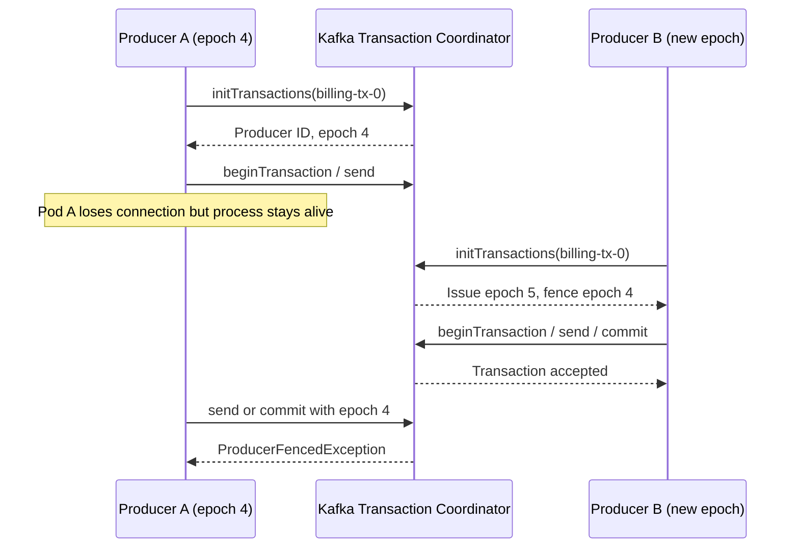

# Producer fencing in Kafka and Spring Kafka

Producer fencing is the Kafka mechanism that prevents an old transactional producer from continuing to write or commit transactions after a new producer has taken over the same `transactional.id`. Brokers identify each producer generation by producer ID and epoch. When a new producer initializes with the same transactional ID, Kafka assigns a new epoch and fences the old producer. Subsequent transactional operations from the old producer can fail with `ProducerFencedException`.

This mechanism protects the system when an old producer continues running after an application restart, failover, or replacement. If both the old and new producers wrote data simultaneously, they could create two competing streams of results. Fencing guarantees that only the latest producer generation is accepted by the broker for that transactional ID.

In Spring Kafka, this issue typically relates to `transactionIdPrefix` configuration, how `DefaultKafkaProducerFactory` creates transactional producers, and deploying multiple instances of the same service. Configuring an identical prefix across concurrently running instances is a common cause of repeated fencing.

## 1. Why does Kafka need producer fencing?

An application can lose connectivity to the broker while the old process keeps running. For example:

- Pod A loses network connectivity while sending a transaction.
- The orchestrator assumes Pod A is no longer healthy and starts replacement Pod B.
- Pod B starts sending data with the same transactional identity.
- Later, Pod A reconnects and tries to continue the old transaction.

If the broker accepted both producers, transactions from the old process could race with the new process. The result could break ordering or produce an unintended application state.

Kafka resolves this situation with producer fencing. The broker stores the transactional ID state and current epoch. A producer carrying an old epoch is rejected once a new epoch has been issued.

Fencing is especially critical for transactional producers because applications expect a transaction to have a single valid owner at any point in time. It eliminates lingering old producers after failover, commonly called *zombie producers*.

## 2. transactional.id, producer ID, and epoch

These three concepts are directly tied to fencing.

| Component | Role |
|---|---|
| `transactional.id` | Logical identifier of a transactional producer; used to recover transactions and fence older generations |
| Producer ID | Internal identifier assigned by Kafka to a producer |
| Producer epoch | Generation number of the producer; a new epoch invalidates transactional requests from older epochs |

A transactional producer initializes via `initTransactions()`. Kafka associates the transactional ID with a producer ID and epoch. When a new producer initializes with the same transactional ID, the transaction coordinator issues a new generation and invalidates the old generation.

Illustrative example:

| Time | Producer | transactional.id | Epoch | Status |
|---|---|---|---:|---|
| T1 | Producer A | `billing-tx-0` | 4 | Active |
| T2 | Producer B | `billing-tx-0` | 5 | Newly initialized |
| T3 | Producer A | `billing-tx-0` | 4 | Fenced |
| T4 | Producer B | `billing-tx-0` | 5 | Current valid generation |

Epoch is a Kafka-managed detail. Applications do not pick or increment epochs manually. Applications configure the transactional ID; Kafka coordinates producer ID and epoch when the producer initializes transactions.

Key point to remember: the same transactional ID can be reused over time so a new producer takes over from an old one. However, two independent instances must never use that transactional ID concurrently as two active parallel producers.

## 3. How does the fencing flow happen?

Suppose the Billing service has a transactional producer with ID `billing-tx-0`.

1. Producer A calls `initTransactions()`, receiving a producer ID and current epoch.
2. Producer A begins a transaction and sends several records.
3. Pod A loses connectivity or is no longer considered the active serving instance.
4. Pod B starts up and creates a new producer with the same `transactional.id`.
5. Producer B calls `initTransactions()`; Kafka issues a new epoch and fences Producer A.
6. Producer A continues sending or committing with the old epoch.
7. The broker rejects A's operation; the client may receive `ProducerFencedException`.
8. Producer B continues working with the new epoch.

Diagram:



The exception may appear when sending a record, committing a transaction, or performing a subsequent transactional operation. Do not assume fencing always occurs right at the old producer's initialization statement.

## 4. What does ProducerFencedException mean?

`ProducerFencedException` indicates that the producer was fenced by the broker, usually because another producer initialized with the same transactional ID and a newer epoch.

This is a fatal error for that producer instance. A fenced producer cannot resume normal transactions. The application must not simply retry `send()` or `commitTransaction()` on the old producer instance itself.

Handling at the Kafka client layer:

- Treat the fenced producer as unusable.
- Close and discard the old producer instance.
- Create a new producer through a properly configured factory.
- Ensure no other independent instance is competing for the same transactional ID.
- Resume processing only after the new producer initializes transactions successfully.

In Spring Kafka, let `ProducerFactory` and `KafkaTemplate` manage the transactional producer lifecycle. When receiving a fencing exception, handle the failed transaction per Spring Kafka configuration and investigate the transactional ID collision. Continuously creating new producers without fixing the collision cause only repeats fencing errors.

Do not catch `ProducerFencedException`, log it, and return normally. Doing so can hide an uncommitted transaction and mislead the business flow into assuming messages were published successfully.

## 5. Distinguishing fencing from idempotence

Idempotent producers and producer fencing both contribute to Kafka producer reliability, yet solve two different problems.

| Mechanism | What does it protect? | Scope |
|---|---|---|
| Idempotent producer | Prevents duplicate records from send retries within the same producer session | Producer ID, sequence number, and partition |
| Transaction | Writes multiple records as a single commit/abort unit | Transactional producer and transaction coordinator |
| Producer fencing | Stops an old producer from operating after a newer generation takes over the same transactional ID | transactional ID and producer epoch |

For example, a producer sends a record without receiving a response due to a timeout. Idempotent producer helps Kafka recognize retries within the same sequence and avoid duplicate writes within idempotence guarantees.

Meanwhile, fencing addresses situations where an old process and a new process both attempt to use the transactional ID. Idempotence does not replace fencing because two separate producer sessions can have different producer IDs/epochs.

For transactional producers, Kafka requires appropriate idempotence properties and the client manages internal sequences. Nevertheless, the application must still configure transactional IDs properly and avoid sharing IDs among active instances.

## 6. Distinguishing transactional.id from client.id and group.id

When diagnosing fencing, inspect the right type of ID.

| ID | Purpose | Directly causes producer fencing? |
|---|---|---|
| `transactional.id` | Identifies a transactional producer | Yes; sharing among active producers can fence the older producer |
| `client.id` | Identifies a client in logs, metrics, and quotas | Does not cause fencing by itself |
| `group.id` | Identifies a consumer group | No; coordinates membership, partition assignment, and offsets |
| `clientIdPrefix` in Spring Kafka | Prefix to generate consumer client IDs | Does not substitute for transactional ID |
| `transactionIdPrefix` in Spring Kafka | Prefix to generate transactional IDs for producers | Directly involved in avoiding collisions |

Changing `client.id` does not fix a duplicate `transactional.id` error. Likewise, changing `group.id` does not solve producer-side fencing.

In Spring Kafka, inspect `transactionIdPrefix` and the suffixes generated by the producer factory. This is usually what needs fixing when deploying multiple instances.

## 7. Configuring transactional producers in Spring Kafka

Spring Kafka uses `ProducerFactory` to create producers. When configuring transactions, the factory needs a transactional ID prefix. `DefaultKafkaProducerFactory` builds transactional IDs from the prefix and factory-managed suffixes.

### 7.1. Configuring with Spring Boot

Example:

```yaml
spring:
  kafka:
    bootstrap-servers: localhost:9092
    producer:
      transaction-id-prefix: ${WORKER_ID:billing-local}-billing-tx-
```

Here, `WORKER_ID` identifies a logical producer instance/worker slot. Concurrently running workers must have distinct IDs. If a new instance replaces an existing worker slot and needs to fence a still-alive old producer, the new instance must inherit the same `WORKER_ID` to reuse that transactional ID namespace. With a replacement pod that gets a brand-new UID, the unique UID creates a new namespace and will not fence a producer using the old UID.

Example:

| Instance | transaction-id-prefix |
|---|---|
| Pod A | `billing-pod-a-billing-tx-` |
| Pod B | `billing-pod-b-billing-tx-` |
| Pod C | `billing-pod-c-billing-tx-` |

If all three pods use the same prefix and generate the same suffix, they can produce colliding transactional IDs and fence one another.

The fallback `billing-local` in the example is only convenient for single-instance local development. Never use the same fallback across multiple instances running in parallel.

### 7.2. Configuring with DefaultKafkaProducerFactory

When creating a producer factory manually, set the prefix explicitly:

```java
@Bean
public ProducerFactory<String, OrderEvent> producerFactory(
        Map<String, Object> producerProperties,
        @Value("${app.instance-id}") String instanceId) {

    DefaultKafkaProducerFactory<String, OrderEvent> factory =
            new DefaultKafkaProducerFactory<>(producerProperties);

    factory.setTransactionIdPrefix(instanceId + "-orders-tx-");

    return factory;
}
```

The `app.instance-id` property must differ across concurrently active logical producers. It can come from a StatefulSet ordinal, worker/shard ID, or managed deployment identifier. If a replacement must take over the same logical producer to fence an old process, preserve that worker slot's ID across restarts.

If Spring Boot already auto-configures `ProducerFactory` from `spring.kafka.producer.transaction-id-prefix`, do not create an extra factory just to set the same property again. Keep a single consistent configuration source to avoid creating multiple factories with ambiguous transactional IDs.

### 7.3. Using KafkaTemplate in a transaction

Once the producer factory is configured as transactional, `KafkaTemplate` can send records within a transaction:

```java
@Service
public class OrderEventPublisher {

    private final KafkaTemplate<String, OrderEvent> kafkaTemplate;

    public OrderEventPublisher(
            KafkaTemplate<String, OrderEvent> kafkaTemplate) {
        this.kafkaTemplate = kafkaTemplate;
    }

    public void publish(OrderEvent event) {
        kafkaTemplate.executeInTransaction(operations -> {
            operations.send(
                "orders.audit",
                event.orderId(),
                event
            );
            operations.send(
                "orders.events",
                event.orderId(),
                event
            );
            return true;
        });
    }
}
```

Both sends in the callback execute inside the same Kafka transaction. If the transaction commits successfully, consumers with `read_committed` isolation level can read the committed records. If the transaction aborts, records from the aborted transaction are not returned to `read_committed` consumers.

Fencing can prevent this transaction from committing. Never catch the exception and return as though the callback succeeded.

## 8. Why must transactionIdPrefix be unique across instances?

In Spring Kafka, transactional IDs are typically constructed by combining the prefix with a suffix managed by the producer factory. Example:

```text
billing-pod-a-billing-tx-0
billing-pod-a-billing-tx-1
billing-pod-b-billing-tx-0
billing-pod-b-billing-tx-1
```

Suffixes distinguish transactional producers created by the same factory. Distinct prefixes prevent two factories on two different instances from generating an identical transactional ID.

Suppose Pod A and Pod B both use prefix `billing-tx-`. If both factories allocate suffix `0`, both can end up using `billing-tx-0`. When Pod B's producer initializes a transaction, it can fence Pod A's producer with the same ID.

Deployment rules:

- Prefixes must be unique across concurrently active independent logical producers.
- Prefixes should be stable for the same logical producer across restarts/failovers if the new producer must fence the old process.
- Child producers within the same factory need distinct suffixes.
- Do not use the same static prefix for independent workers merely because they belong to the same deployment.
- Do not generate a new random prefix per send operation; the prefix belongs to the instance/factory, not individual messages.

### 8.1. Rolling deployment

Rolling deployments typically have an overlap window where old and new versions coexist. If the new version is an independent logical producer running alongside the old version, assign a distinct prefix per instance. If the new version replaces the same logical producer and must fence the old process, reusing the transactional ID namespace is intentional: the new producer fences the old one. Ensure there is only one legitimate owner for that logical producer and configure rollout semantics accordingly.

### 8.2. Failover and zombie producers

If an instance loses communication while its process stays alive, a replacement instance may be started. With a matching transactional ID for the same logical producer, the new producer can fence the old producer.

Fencing is the last line of defense against zombie producers. It does not replace health checks, leader election, or orchestration. Applications still need to determine which instance owns business execution and configure transactional IDs to fit the deployment model.

## 9. How does Spring Kafka manage transactional producers?

`DefaultKafkaProducerFactory` can create and manage transactional producers for `KafkaTemplate` or listener containers. For transactional producers, the factory manages transactional IDs based on prefix and suffix.

Operational points to note:

- `transactionIdPrefix` defines the factory's transactional ID namespace.
- The factory checks out a producer for a transaction and returns it when the transaction finishes.
- A fenced producer must not be reused like a healthy producer.
- With concurrent listener containers, enough transactional producers are needed for the application's concurrent transaction count.
- Recent Spring Kafka versions have suffix/cache management mechanisms for transactional producers; check `maxCache` or `TransactionIdSuffixStrategy` per version when bounding producer counts.
- Running out of available producers in the cache is a resource allocation issue distinct from fencing; do not treat these two errors the same way.

Do not manually share a single transactional `KafkaProducer` across multiple threads. Let `ProducerFactory` and `KafkaTemplate` manage producers per Spring Kafka's supported model.

If an application creates producers directly using the Kafka client, the application must fully manage `initTransactions()`, `beginTransaction()`, `commitTransaction()`, `abortTransaction()`, and closing the producer when no longer used.

## 10. Producer fencing in transactional listeners

Spring Kafka can start a transaction for a listener container. When the listener processes a record or batch and sends additional Kafka records inside the same transaction, the container coordinates output writes and input offsets per transactional configuration.

High-level flow:

1. The container fetches records from Kafka.
2. The container starts a transaction.
3. The listener processes the record.
4. The listener may emit result events via a `KafkaTemplate` participating in the transaction.
5. The container commits the transaction and offsets per configuration.
6. If the listener fails or the transaction is fenced, the transaction is not committed normally.

When using a transaction manager for a listener container, configure the factory per the running Spring Kafka version's API. Example with `KafkaTransactionManager`:

```java
@Bean
public KafkaTransactionManager<String, OrderEvent> kafkaTransactionManager(
        ProducerFactory<String, OrderEvent> producerFactory) {

    return new KafkaTransactionManager<>(producerFactory);
}
```

In current Spring Kafka versions, the transaction manager can be attached to container properties via the API for Kafka-aware transaction managers. Verify the exact version when configuring listener factories.

If a transactional listener hits `ProducerFencedException`, the current transaction cannot complete successfully. Let the error pass through the proper transaction/error handling mechanism so the container rolls back or recovers per defined policy. Then investigate the transactional ID collision before continuing.

## 11. Distinguishing producer fencing from other errors

Not every transaction error is producer fencing. Accurate error classification avoids unnecessary restarts or retries.

| Error | Typical meaning | Resolution |
|---|---|---|
| `ProducerFencedException` | Old producer fenced by a newer generation with the same transactional ID | Discard old producer; find and fix the collision |
| `InvalidProducerEpochException` | Request used a producer epoch that is no longer valid | Check producer lifecycle and transactional ID; old producer cannot continue |
| `OutOfOrderSequenceException` | Record sequence did not match expectations | Investigate retries, producer state, and sequence errors |
| `TimeoutException` in transaction operations | Operation did not finish within timeout; may relate to transaction timeout or broker/network | Check transaction duration, `transaction.timeout.ms`, broker, and network; do not assume fencing |
| `TransactionalIdAuthorizationException` | Principal lacks permission to use the transactional ID | Check ACLs and transactional ID permissions |
| `FencedInstanceIdException` | Consumer with static member ID was fenced in the group | Investigate static membership and member ID; this is a consumer group error, distinct from producer fencing |

A `TimeoutException` can occur in a system experiencing network or broker issues. Do not automatically assume a timeout means duplicate transactional IDs. Likewise, `FencedInstanceIdException` relates to consumer group static membership, not `ProducerFencedException` on a transactional producer.

## 12. Diagnosing ProducerFencedException in production

When encountering fencing, gather information in the following order.

### 12.1. Identify the actual transactional ID

Search producer initialization logs or configuration to find the full transactional ID, including prefix and suffix. Do not look only at `transactionIdPrefix`; you need the final ID used by the producer.

Compare running instances:

| Instance | Prefix | Suffix | transactional.id |
|---|---|---|---|
| Pod A | `billing-pod-a-tx-` | `0` | `billing-pod-a-tx-0` |
| Pod B | `billing-pod-b-tx-` | `0` | `billing-pod-b-tx-0` |

If two instances share the same transactional ID, you have found the likely cause of collision.

### 12.2. Inspect instance lifecycle

Check deployments and logs around the failure timestamp:

- Was there a rolling deployment or autoscaling event?
- Had the old pod completely stopped?
- Do two applications share an environment variable configuration?
- Was an old process hung after a network partition?
- Are multiple `ProducerFactory` beans unexpectedly sharing a prefix?
- Is custom code creating producers outside Spring Kafka factories?

Periodic repeated fencing can indicate instances continually taking turns fencing one another due to a shared prefix.

### 12.3. Correlate broker and transaction coordinator

Check broker logs and transaction coordinator state around producer initialization time. Correlate transactional ID, init timestamp, producer epoch, and deployed instances.

Do not inspect only the application stack trace: the exception may be wrapped in a Spring transaction or listener exception. Locate the root cause and associated transactional ID.

### 12.4. Check transaction timeout and processing duration

A long-running transaction can time out or abort. This must be distinguished from fencing caused by a new producer using the same transactional ID.

Measure duration from `beginTransaction()` to commit/abort, check `transaction.timeout.ms`, and inspect listener processing duration. Never stretch transactions to wrap unbounded network or database operations.

## 13. Remediation procedure

Once producer fencing is confirmed:

1. Identify the full transactional ID of the failing producer.
2. Find the other instance using the same ID.
3. If these are independent logical producers, assign a distinct prefix to each instance; if the new producer replaces the same logical producer and must fence the old one, preserve that worker slot's transactional ID namespace.
4. Verify the producer factory generates distinct suffixes for concurrent producers within the same instance.
5. Stop or remove the old instance per deployment workflow.
6. Let the producer factory create a valid transactional producer and initialize a new transaction.
7. Check whether the previous transaction aborted or was handled by Kafka's recovery mechanism.
8. Monitor logs to confirm fencing errors no longer recur.
9. Verify output records and committed offsets to confirm business state recovered properly.

If the cause is two pods sharing a prefix, restarting only one pod may not permanently solve the issue. When the pod restarts, it can keep colliding with the remaining pod. Fix the ID configuration before rolling out again.

Do not delete or change transactional IDs arbitrarily to hide errors. Transactional IDs play a role in transaction recovery after restarts. Choose IDs based on logical producers and instance lifecycles, and apply that rule consistently.

## 14. Example reproducing fencing with the plain Kafka client

The example below demonstrates two producers created independently with the same transactional ID. This is an intentional test scenario; never run two such producers in production.

```java
Properties properties = new Properties();
properties.put(ProducerConfig.BOOTSTRAP_SERVERS_CONFIG, bootstrapServers);
properties.put(ProducerConfig.KEY_SERIALIZER_CLASS_CONFIG,
               StringSerializer.class);
properties.put(ProducerConfig.VALUE_SERIALIZER_CLASS_CONFIG,
               StringSerializer.class);
properties.put(ProducerConfig.TRANSACTIONAL_ID_CONFIG, "billing-tx-0");

// Producer A initializes the first generation.
KafkaProducer<String, String> producerA =
        new KafkaProducer<>(properties);

producerA.initTransactions();
producerA.beginTransaction();
producerA.send(new ProducerRecord<>(
        "billing.events", "order-1", "created"
));

// Producer B uses the same transactional.id and initializes a new generation.
KafkaProducer<String, String> producerB =
        new KafkaProducer<>(properties);

producerB.initTransactions();

// From this point on, producer A is fenced.
// Any subsequent transactional operation by A can throw ProducerFencedException.
```

In real tests, close both producers in a `finally` or `try-with-resources` block and clean up open transactions. The goal of this example is to prove two concurrent producers cannot share ownership of one transactional ID.

When Producer B calls `initTransactions()`, Kafka coordinates a new transaction ID epoch. Producer A, carrying the old epoch, loses authority to commit transactions.

## 15. Testing fencing in a Spring Kafka application

An integration test can verify that the application behaves properly when a producer is fenced:

1. Start a test Kafka broker.
2. Create two independent producer factories with the same transactional ID prefix and suffix to simulate a collision.
3. Start a transaction from factory A.
4. Initialize a producer from factory B with the duplicate transactional ID.
5. Perform a transactional operation from producer A and verify the fencing error.
6. Verify producer A is not kept in use as a healthy producer.
7. Create a factory with a distinct prefix for the new instance.
8. Verify the new producer sends and commits transactions successfully.
9. Check that a `read_committed` consumer receives only records from committed transactions.
10. Check that logs and metrics record errors, rollbacks, and recovery.

Tests should isolate transactional IDs and topics. Do not use fixed transactional IDs that collide with concurrently running dev or staging environments.

Conditions to verify:

| Scenario | Expected result |
|---|---|
| Two concurrent producers use the same transactional ID | Older-generation producer is fenced |
| Old producer continues committing | Transaction fails with fencing error |
| New producer uses a distinct ID | Can initialize and commit transactions |
| Transaction aborts | `read_committed` consumer does not read aborted outputs |
| Multiple instances have distinct prefixes | Do not fence one another merely by belonging to the same app |
| One instance has multiple child producers | Suffixes assign distinct transactional IDs to each concurrent producer |

Do not merely assert that an exception was thrown. Verify that the new producer can continue, the old transaction did not commit, and outputs did not produce unintended side effects.

## 16. Common mistakes

**Using the same transactionIdPrefix across all pods.** Factories can generate colliding transactional IDs. Each concurrent instance needs its own prefix.

**Using clientIdPrefix to fix producer fencing.** Client ID does not replace transactional ID. Inspect `transactionIdPrefix` and the final transactional ID.

**Retrying forever on a fenced producer.** The old producer is in an invalid state. Discard that producer instance and fix the collision cause.

**Generating a random transactional ID per message.** This breaks the logical producer model and makes post-restart transaction recovery uncontrollable. Prefixes should belong to instances/factories.

**Using the same prefix for independent logical producers in a rolling deployment.** They can fence each other. Assign separate prefixes to parallel producers; reuse the same namespace only when a new instance takes over the exact same old logical producer and fencing is intentional.

**Catching and swallowing ProducerFencedException.** The transaction may have failed while the application reports success. Let the error pass through proper transaction/error handling.

**Confusing fencing with transaction timeout.** Timeouts and fencing have different causes, producer states, and fixes. Read the root cause and transactional ID.

**Manually sharing a single transactional KafkaProducer across multiple threads.** Let Spring Kafka factories manage producers per supported transaction and thread model.

**Failing to verify the producer ID formed from prefix and suffix.** The prefix in YAML alone is not enough to detect collisions; inspect the full transactional ID at runtime.

## 17. Operational principles to remember

Producer fencing is the mechanism protecting transactions from old producers or producers competing for the same transactional ID. Kafka uses producer epochs to identify valid generations; producers with older epochs are rejected.

In Spring Kafka, configure a unique `transactionIdPrefix` per concurrently running instance, let the producer factory manage suffixes and producer lifecycles, and treat `ProducerFencedException` as an error requiring configuration and ownership investigation. Never retry on a fenced producer as a recovery strategy.

Producer fencing supports Kafka transaction correctness, but does not by itself solve all duplicate issues or cross-database transactions. You still need idempotent handlers, outbox/inbox when side effects occur outside Kafka, and restart/failover testing in production-like environments.

## 18. Version-specific references to consult

When implementing, consult documentation matching your exact Kafka and Spring Kafka versions for:

- Apache Kafka Producer API: `transactional.id`, `initTransactions()`, `beginTransaction()`, `commitTransaction()`, `abortTransaction()`, and `ProducerFencedException`.
- Apache Kafka design documentation: transaction coordinator, producer ID, producer epoch, and fencing.
- Spring for Apache Kafka Reference: transactions, `KafkaTransactionManager`, `DefaultKafkaProducerFactory`, and `transactionIdPrefix`.
- Spring Boot Reference: `spring.kafka.producer.transaction-id-prefix` and consumer isolation level.
- Kafka consumer configuration: `isolation.level=read_committed` to read only committed transactions.

Details such as suffix strategies, producer caching, and transaction manager configuration APIs change across Spring Kafka versions. Prefer versions managed by Spring Boot dependency management and check corresponding Javadocs before upgrading.
