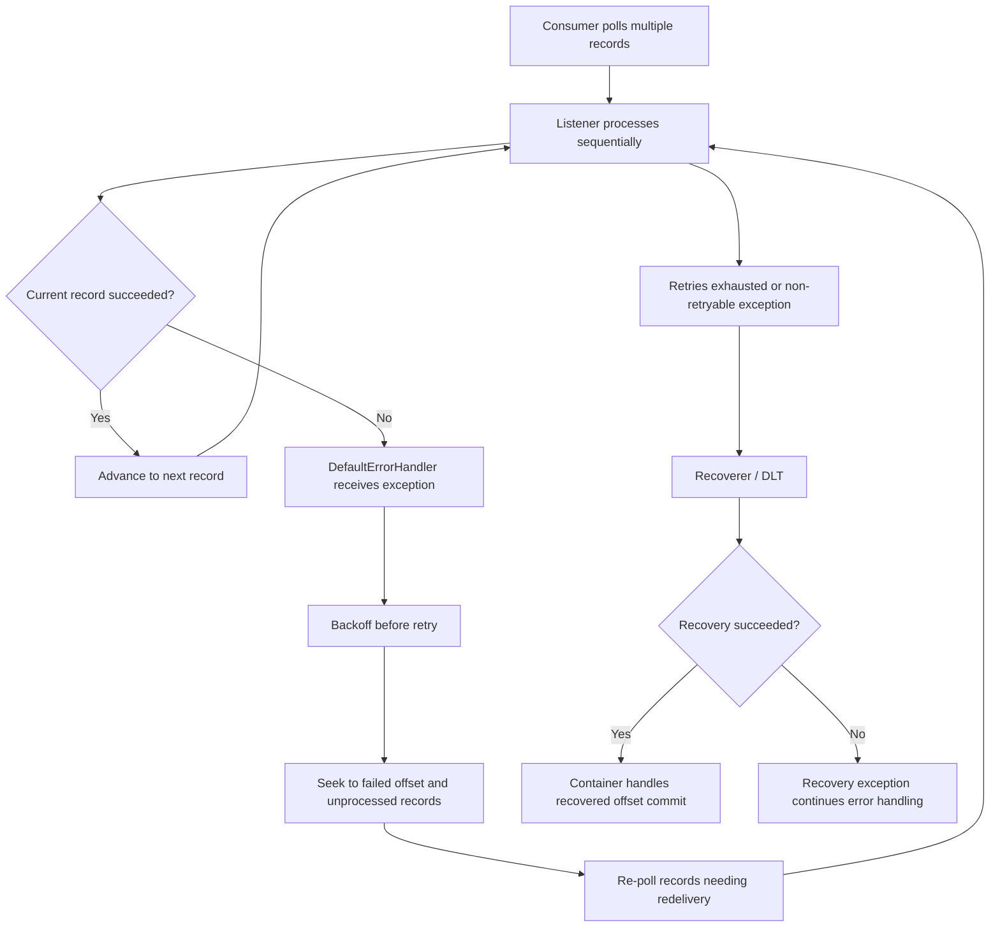

# Per-Partition Record Retry

In Spring Kafka, `DefaultErrorHandler` can retry a failed record by moving the consumer back to the offset that needs reprocessing in the partition. This retry approach relies on each partition's offset position, because Kafka only guarantees record ordering within a single partition. When a listener throws an exception, the error handler decides which records need re-reading, how long to wait between attempts, and what happens when retry attempts are exhausted.

Per-partition retry preserves the processing order of records in the main stream. If the record at offset `25` fails, the consumer should not commit past that offset while business processing is incomplete. With the default seek mechanism, the error handler moves the partition's read position back to the failed record and subsequent unprocessed records so they are redelivered. Only after the failed record succeeds or is recovered per policy does the consumer advance through subsequent offsets.

This does not mean each partition has its own dedicated retry thread. A single Kafka consumer thread may own multiple partitions; when a synchronous listener hits an error and the error handler is backing off/retrying, that thread can be held up, slowing down other partitions assigned to the same consumer. Understand both per-partition offset boundaries and consumer-thread blast radius when choosing a retry policy.

## 1. Why Must Retry Be Tied to Partition and Offset?

Each partition is an independent ordered log. Records are addressed by the combination of topic, partition, and offset. For example:

```text
orders.events, partition 0:
  offset 20 -> OrderCreated(A)
  offset 21 -> OrderUpdated(A)
  offset 22 -> OrderPaid(A)

orders.events, partition 1:
  offset 11 -> OrderCreated(B)
  offset 12 -> OrderCancelled(B)
```

Kafka has no global offset across all partitions. Offset `22` of partition 0 has no ordering relationship with offset `12` of partition 1. Consumer groups commit positions per partition.

Suppose a listener processes offset `20` successfully but offset `21` fails. The consumer cannot simply commit offset `23` for partition 0 because Kafka would treat both offsets `21` and `22` as acknowledged. On process restart, the group would resume after offset `22`, skipping unprocessed records.

Per-partition retry protects this progress: the failed record and incomplete portion in the partition are redelivered by offset. Once the listener processes the failed record successfully, subsequent records can proceed in order. This suits business workflows requiring ordering preservation, such as state transitions on orders, accounts, or aggregates.

## 2. DefaultErrorHandler and the Default Seek Mechanism

For record listeners, Spring Kafka invokes `DefaultErrorHandler` when a listener throws an exception. In default seek mode, the handler instructs the consumer to return to the position of the failed record and remaining unprocessed records in the poll. The next poll redelivers the failed record and the remainder according to the consumer's assignment.

Example consumer poll batch received:

```text
Partition 0: offset 10, 11, 12
Partition 1: offset 30, 31
```

The listener processes offset `10` successfully, then offset `11` throws an exception. The container passes the exception to `DefaultErrorHandler`. The handler can preserve progress for offset `10`, seek partition 0 back to offset `11`, and seek partitions with remaining records back to their corresponding unprocessed positions. When the next poll occurs, the consumer re-reads the incomplete portion.



Seek sets the consumer's read position for a partition. It does not delete records from Kafka and does not create new copies in the topic. Records are redelivered from the original log, preserving source topic, partition, and offset.

### Retrying the Failed Record Before Advancing

With a synchronous listener, the handler executes retries within the consumer's processing flow. Once the failed record is seeked to the re-read position, it is redelivered in the next poll. Subsequent records in the same partition are not considered complete until they are processed successfully.

If the transient error resolves on a retry, the listener finishes the failed record and then proceeds to subsequent records. If the error persists until retries are exhausted, the handler invokes the configured recoverer, such as routing the failed record to a DLT.

### Other Partitions in the Same Poll

A single poll can return records from multiple partitions. When the listener fails on one record, remaining unprocessed records from the poll also need to be reprocessed from their respective positions. This prevents the container from skipping incomplete data.

However, there is no global order across partitions. The handler manages positions independently per partition; a lower-offset record in partition 0 does not necessarily get processed before every record in partition 1. Ordering is guaranteed only within each partition.

## 3. Configuring DefaultErrorHandler with Retry and Backoff

`DefaultErrorHandler` allows configuring a `BackOff` to govern wait intervals and retry attempts. Declare the retry policy explicitly rather than relying on defaults, because attempt counts and wait times must match SLAs and error types.

Example configuring three retries after the initial attempt, a fixed one-second wait between attempts, and routing to a DLT when exhausted:

```java
@Bean
DefaultErrorHandler kafkaErrorHandler(
        KafkaTemplate<Object, Object> kafkaTemplate) {

    DeadLetterPublishingRecoverer recoverer =
            new DeadLetterPublishingRecoverer(
                    kafkaTemplate,
                    (record, exception) -> new TopicPartition(
                            record.topic() + ".DLT",
                            record.partition()));

    DefaultErrorHandler handler = new DefaultErrorHandler(
            recoverer,
            new FixedBackOff(1_000L, 3L));

    return handler;
}
```

Required imports include `DefaultErrorHandler`, `DeadLetterPublishingRecoverer`, `FixedBackOff`, and `TopicPartition`. The example uses a resolver that routes records to a topic with the `.DLT` suffix while preserving the source partition. The DLT topic must exist and have enough corresponding partitions; otherwise, select a valid partition via a custom resolver.

`FixedBackOff(1_000L, 3L)` has a one-second interval and up to three retries after the initial processing attempt. If every retry still fails, the recoverer is invoked. Total time holding the record in retry also depends on listener execution duration, DLT publish latency, and how the container handles polling.

### Exponential Backoff

For errors tied to external service dependencies, exponential backoff can reduce pressure on a recovering database or API. The wait interval grows after each failure and can be capped at a maximum duration.

```java
@Bean
DefaultErrorHandler kafkaErrorHandler(
        KafkaTemplate<Object, Object> kafkaTemplate) {

    DeadLetterPublishingRecoverer recoverer =
            new DeadLetterPublishingRecoverer(kafkaTemplate);

    ExponentialBackOffWithMaxRetries backOff =
            new ExponentialBackOffWithMaxRetries(5);
    backOff.setInitialInterval(500L);
    backOff.setMultiplier(2.0);
    backOff.setMaxInterval(8_000L);

    return new DefaultErrorHandler(recoverer, backOff);
}
```

The example above allows up to five retries starting at a 500 ms wait, doubling each time, and not exceeding 8 seconds. Values are illustrative; choose them based on expected recovery times, SLAs, and how long messages can be delayed.

If multiple consumers retry at the same instant, fixed or uniform backoff can send synchronized waves of requests downstream. Consider adding jitter at an appropriate retry layer or staggering retry schedules to reduce synchronization.

## 4. Classifying Exceptions Before Retrying

Not all exceptions should be retried. `DefaultErrorHandler` supports classifying retryable and non-retryable errors. Non-retryable exceptions go directly to the recoverer per policy instead of holding the partition through futile attempts.

Example where permanent validation errors go straight to the DLT:

```java
handler.addNotRetryableExceptions(
        IllegalArgumentException.class,
        BusinessValidationException.class);
```

In large applications, prefer specific domain exceptions rather than marking `IllegalArgumentException` if that exception is also used for programming errors or recoverable conditions. For example:

| Exception Category | Example | Retry? |
|---|---|---|
| Transient errors | Database timeout, brief network disconnect | Bounded with backoff. |
| Dependency not ready yet | Customer event not yet applied | May retry within deadline and ordering requirements. |
| Permanent validation | Negative quantity, unsupported currency | Do not retry same payload; recovery/quarantine. |
| Schema/deserialization failure | Malformed payload structure | Usually do not retry; preserve evidence and investigate. |
| Auth/config errors | Missing ACL permission, wrong credentials | Fix configuration; rapid retries do not help. |

A business error can be transient if it depends on another event. For example, `OrderCreated` arrives before `CustomerCreated`; the consumer might need to wait for the customer record to sync. If retrying in blocking mode, the order record can block later records in the partition. Check event ordering and choose a retry topic or separate waiting flow if blocking could prevent the very event that resolves the dependency from being processed.

## 5. Recovery After Exhausting Retries and Offset Commit

When retry attempts are exhausted or the exception is non-retryable, `DefaultErrorHandler` invokes the recoverer. The recoverer can publish the record to a DLT, log the failure, or execute another recovery action.

If the recoverer finishes successfully and the error handler returns normally, the listener container can treat the record as handled under the recovery policy and commit the corresponding offset. This means the record has been handed off to the error pipeline per policy; it does not mean the original business operation succeeded.

`CommonErrorHandler`/`DefaultErrorHandler` has an `ackAfterHandle` property, defaulting to `true`. When the error handler finishes and returns normally, the container can commit the offset of the handled/recovered record per container rules. You can set `ackAfterHandle(false)` to alter post-return commit behavior; clearly understand which component is responsible for acknowledging the record in that setup.

`commitRecovered` is a separate mechanism for committing recovered records in eligible setups. When using `commitRecovered=true`, the container requires `AckMode.MANUAL_IMMEDIATE`. Do not toggle this property casually alongside manual acknowledgment; establish clearly where and when recovered record commits occur.

### DLT Publish Failure

If the recoverer cannot publish the record to the DLT due to broker, ACL, serializer, or timeout issues, recovery is incomplete. Ensure recovery errors are surfaced and handled rather than treating the source record as safely persisted in the DLT. If the source offset is committed without a DLT copy existing, the message can vanish from the main stream with no copy for investigation.

With `DeadLetterPublishingRecoverer`, check send outcomes using the API of your Spring Kafka version. Configure the recoverer and error handler so DLT send failures propagate when needed, and alert whenever recovery exceptions occur.

### DLT Metadata

When routing records to a DLT, preserve source metadata for traceability:

- Original topic, partition, and offset.
- Original key, timestamp, and headers.
- `eventId` and correlation ID.
- Exception class, sanitized error message, and retry count.
- Recovery timestamp and application version.

Spring Kafka can attach source and exception headers via `KafkaHeaders`, such as `DLT_ORIGINAL_TOPIC`, `DLT_ORIGINAL_PARTITION`, `DLT_ORIGINAL_OFFSET`, and `DLT_EXCEPTION_FQCN`. Verify exact names and APIs against your version. Do not write sensitive payloads or credentials into DLT headers.

## 6. Blocking Retry Preserves Order but Can Block the Consumer Thread

Seek-based retry is often called blocking retry because the consumer thread handles backoff and retries before resuming the incomplete stream. This preserves per-partition ordering, though the wait time can affect other partitions assigned to the same consumer.

Suppose a consumer is assigned partitions 0, 1, and 2. The listener hits an error on partition 0 with a 30-second backoff. During that interval, the consumer thread can remain tied up in error handling; partitions 1 and 2 may also stall longer than expected. If a consumer owns many partitions, a single failing record can drive lag up across multiple partitions on that consumer.

### Long Backoffs and ContainerPausingBackOffHandler

The default backoff handler may wait on the consumer thread. With long waits, holding the thread can interfere with heartbeats/polling and breach `max.poll.interval.ms` depending on configuration.

Spring Kafka provides `ContainerPausingBackOffHandler` in eligible versions. This handler pauses the listener container during the backoff window and keeps polling to preserve consumer group liveness, then resumes for the retry. Actual pause duration depends on poll cycles and container configuration.

Configuration example:

```java
@Bean
DefaultErrorHandler kafkaErrorHandler(
        KafkaTemplate<Object, Object> kafkaTemplate) {

    DeadLetterPublishingRecoverer recoverer =
            new DeadLetterPublishingRecoverer(kafkaTemplate);

    ExponentialBackOffWithMaxRetries backOff =
            new ExponentialBackOffWithMaxRetries(4);
    backOff.setInitialInterval(10_000L);
    backOff.setMultiplier(2.0);
    backOff.setMaxInterval(60_000L);

    return new DefaultErrorHandler(
            recoverer,
            backOff,
            new ContainerPausingBackOffHandler());
}
```

Verify the constructor and package of `ContainerPausingBackOffHandler` for your Spring Kafka version. Account for the container's `pollTimeout` when assessing wait-time accuracy.

Pausing the container does not create extra consumer threads. It keeps the container polling while waiting, yet the failing record is still waiting for retry and the partition is not handed off to another consumer merely because it is paused.

## 7. SeekAfterError and Retained Records

In default mode, `DefaultErrorHandler` uses seek to reset the consumer's read position. In Spring Kafka versions supporting `seekAfterError=false`, the handler can retain unprocessed records inside container memory instead of seeking the consumer back to an older offset. The container performs a poll to keep group membership alive and then redelivers the retained records.

The two approaches differ operationally:

| Approach | Mechanism | Key Considerations |
|---|---|---|
| Seek (default) | Resets consumer position to failed offset and unprocessed records | Records are re-fetched from Kafka on the next poll; monitor seeks/redeliveries. |
| Retained records (`seekAfterError=false`) | Holds unprocessed records in memory and redelivers after a group-liveness poll | Increases memory demand with count/size of retained records; assess carefully for large batches or large records. |

Example:

```java
DefaultErrorHandler handler = new DefaultErrorHandler(
        recoverer,
        new FixedBackOff(1_000L, 3L));

handler.setSeekAfterError(false);
```

Only use this property when your Spring Kafka version supports it. Retaining records does not turn retries into parallel processing; the consumer thread still coordinates the listener and redeliveries. Monitor heap and batch sizes if choosing to retain records in memory.

## 8. Batch Listeners and Failing Records Within Partitions

With a batch listener, a single invocation can receive records from multiple partitions. If the listener throws a regular exception, the error handler may not know which specific record in the batch failed. In that case, the whole batch may be retried per policy.

If the listener knows the failing record, it can throw `BatchListenerFailedException` with that record or its index. `DefaultErrorHandler` can commit the preceding successful portion and seek/retry the failing record plus the remainder.

```java
@KafkaListener(topics = "orders.events")
public void onBatch(List<ConsumerRecord<String, OrderEvent>> records) {
    for (int index = 0; index < records.size(); index++) {
        ConsumerRecord<String, OrderEvent> record = records.get(index);
        try {
            orderService.processIdempotently(record.value());
        }
        catch (RuntimeException exception) {
            throw new BatchListenerFailedException(
                    "Could not process order event", exception, index);
        }
    }
}
```

`BatchListenerFailedException` constructors can vary by version; use the matching overload. Batch listeners must be configured with the right signature. If processing batch items in parallel, error indices and completion order must be managed carefully; never report a record as failed while earlier records are still unfinished.

### Multiple Partitions in One Batch

A batch may contain records from multiple partitions. The error handler must track offset progress independently per partition. Never add or compare offsets across different partitions. On error, identify the failing record using topic, partition, and offset or batch index per supported APIs.

## 9. How Does Per-Partition Retry Differ from Retry Topics?

Seek-based retry keeps the failing record in the main stream and reprocesses it before the consumer moves past the incomplete portion of the partition. This preserves per-partition ordering, but can block later records and affect the consumer thread.

Non-blocking retry with `@RetryableTopic` moves the record to a retry topic for delayed processing. The main topic's consumer can keep advancing through subsequent records; consequently, newer records may be processed before the retrying record. This is a critical trade-off when business logic depends on ordering.

| Criterion | Per-Partition / Seek Retry | Retry Topic |
|---|---|---|
| Where record waits for retry | Source topic, at the offset needing reprocessing | Separate retry topic |
| Ordering in source partition | Keeps incomplete stream ordered by offset | Subsequent records may be processed ahead of retrying record |
| Consumer impact | Backoff/retry can hold consumer thread | Source-topic consumer can continue; retry topic has its own consumer |
| Long wait durations | Needs appropriate backoff handler, may pause container | Can route through delayed retry topics |
| Operational complexity | Managing seek, retry, and recovery in container | Managing multiple topics, routing, retention, and ordering |

Never combine blocking retry and retry topics haphazardly. Define total attempt counts, deadlines, where messages live, and post-exhaustion behavior.

## 10. Offsets, Idempotency, and Duplicate Handling

Per-partition retry can redeliver the same record multiple times. Even when a listener succeeds, the process can crash before the offset is committed. On restart, Kafka redelivers records from the older committed offset.

Therefore, consumers need idempotency. A common pattern is using a stable `eventId` and inserting into an inbox table with a unique constraint inside the same database transaction as the business update. On retry or replay, an existing event ID prevents duplicate business effects.

Do not use offset as a unique business identifier because an offset is unique only within a topic's partition. A source-identifying key can be topic + partition + offset, though a stable event ID is more useful when the same event is republished or routed to a DLT/retry topic.

If a listener calls external APIs outside Kafka, use an idempotency key supported by the target API or persist the request in an outbox table inside the database transaction. Kafka offset commits cannot roll back an already-succeeded API call.

## 11. Complete Reference Configuration

Spring Boot example for a record listener with auto-commit disabled and container concurrency of two:

```yaml
spring:
  kafka:
    consumer:
      group-id: orders-service
      enable-auto-commit: false
      max-poll-records: 100
      properties:
        "max.poll.interval.ms": 300000
    listener:
      ack-mode: record
      concurrency: 2
```

Error handler configured with bounded retries:

```java
@Bean
DefaultErrorHandler ordersErrorHandler(
        KafkaTemplate<Object, Object> kafkaTemplate) {

    DeadLetterPublishingRecoverer recoverer =
            new DeadLetterPublishingRecoverer(
                    kafkaTemplate,
                    (record, exception) -> new TopicPartition(
                            record.topic() + ".DLT",
                            record.partition()));

    ExponentialBackOffWithMaxRetries backOff =
            new ExponentialBackOffWithMaxRetries(4);
    backOff.setInitialInterval(1_000L);
    backOff.setMultiplier(2.0);
    backOff.setMaxInterval(10_000L);

    DefaultErrorHandler handler =
            new DefaultErrorHandler(recoverer, backOff);

    handler.addNotRetryableExceptions(
            BusinessValidationException.class);

    return handler;
}
```

Timeout, retry, and concurrency values in the example must be tuned for SLAs, partition counts, publish rates, and downstream capacity. Pre-create DLTs with appropriate replication/retention and ACLs for both DLT-writing producers and replay operators.

Do not apply `DefaultErrorHandler` as a generic error handler to transactional listener containers without checking the transaction model. With transactional listeners, failures usually roll back the transaction and are handled by `AfterRollbackProcessor`/`DefaultAfterRollbackProcessor` under dedicated configuration.

## 12. Observability for Per-Partition Retry

Operations teams need visibility into which partitions are retrying, which records failed, how many attempts ran, and whether offsets advance after recovery.

| Scope | Signals to Track | Meaning |
|---|---|---|
| Failed record | Topic, partition, offset, key, `eventId`, exception type | Pinpoints the exact record blocking the stream. |
| Retry | Attempt count, backoff duration, time since first failure | Detects prolonged retries or continuous loops. |
| Partition | Lag, committed offset, current position, assignment | Shows whether the partition is progressing or stuck at one offset. |
| Consumer | Thread name, listener ID, poll interval, processing duration | Reveals a consumer thread tied up by backoff or slow listeners. |
| Recovery | DLT publish result, recovery exception, recovered count | Confirms record durability before the source offset advances. |
| Downstream | Database/API latency, timeouts, pool utilization | Finds the root cause of listener failures. |
| Group | Rebalance count, revoked/assigned partitions, consumer lag | Detects long retries destabilizing the group. |

Logs should include topic, partition, offset, event ID, attempt, backoff, exception class, consumer group, and thread name. Do not log full payloads if they contain sensitive data. Metric labels should have bounded cardinality such as topic, exception type, or error category; keep event IDs and offsets in logs/traces instead of metric labels.

Set alerts when the same partition shows rising lag over time, an offset fails beyond expected attempts, DLT publishes fail, retry age exceeds SLA, or consumers frequently breach `max.poll.interval.ms`.

## 13. Scenario-Based Runbooks

### A Record Keeps Being Redelivered

1. Record topic, partition, offset, event ID, and exception class.
2. Determine whether the error occurs inside the listener or inside the error handler/recoverer.
3. Check BackOff, attempt count, exception classification, and seek state.
4. Determine whether the error is transient or permanent; fix the root cause or move the exception to non-retryable.
5. Verify the source offset advances after recovery and DLT publishing succeeded.

### Lag Rises Across Multiple Partitions on the Same Consumer

1. Identify which partitions are assigned to the consumer/thread handling the failed record.
2. Check current backoff and listener execution duration.
3. Check whether the consumer thread is tied up in blocking retries.
4. If backoff is long, evaluate `ContainerPausingBackOffHandler` or a retry topic consistent with ordering requirements.
5. Monitor per-partition lag after changing policy.

### Subsequent Records Blocked by an Unready Dependency

1. Identify which dependency the failed record is waiting on.
2. Check whether the event that creates the dependency sits further back in the same partition.
3. If blocking retry prevents that event from being processed, consider a retry topic or separate waiting stream.
4. Set a retry deadline and an action upon expiration.
5. Verify business ordering after changing retry strategy.

### Offset Advances After DLT Publish Fails

1. Record source topic/partition/offset and the recovery exception.
2. Inspect DLT producer, serializer, topic, partition resolver, and ACLs.
3. Check whether the error handler detects send failures.
4. Confirm the source offset is not committed as successful recovery when the DLT write failed.
5. Restore publishing, let the record reprocess, and reconcile DLT metadata.

### Retries Push Consumer Past max.poll.interval.ms

1. Compare total backoff, listener processing time, and `max.poll.interval.ms`.
2. Determine whether the backoff handler sleeps on the consumer thread or pauses the container.
3. If delays are long, consider `ContainerPausingBackOffHandler` or retry topics.
4. Only raise `max.poll.interval.ms` after measuring processing durations and assessing failover impact.
5. Monitor rebalances, lag, and duplicate deliveries after tuning.

## 14. Per-Partition Record Retry Control Table

| Control Point | Question to Answer | Operational Evidence |
|---|---|---|
| Partition identity | Which topic, partition, and offset does the failed record belong to? | ConsumerRecord metadata and event ID. |
| Seek | Does the handler seek to the failed offset and unprocessed slice? | Error handler logs, consumer position, and redeliveries. |
| Ordering | Are subsequent records processed ahead of the failed record? | Timeline by partition/offset. |
| Retry policy | Are attempt count, backoff, and exception classification appropriate? | BackOff config, attempt count, and exception type. |
| Consumer thread | Do blocking retries affect other partitions on the same consumer? | Thread name, processing latency, and per-partition lag. |
| Recovery | Was the DLT published successfully before committing the source offset? | DLT send result, recovery exception, and committed offset. |
| Batch | Does the listener pinpoint the failed record in a batch? | `BatchListenerFailedException`, index, and partition metadata. |
| Transaction | Does the listener run inside a Kafka transaction? | Transaction manager and AfterRollbackProcessor config. |
| Idempotency | Do redelivered records duplicate business effects? | Inbox/deduplication, event ID, and business state. |

Per-partition record retry preserves progress and ordering within each partition when listeners fail. `DefaultErrorHandler` combines seek, backoff, exception classification, and a recoverer to decide which records are redelivered and when offsets can advance. In operations, monitor both the retrying partition and the consumer thread owning it, as one backoff can slow down other partitions on the same consumer. Bounded retries, durable recovery, idempotency, and per-partition offset visibility allow pipelines to recover without skipping incomplete messages.
