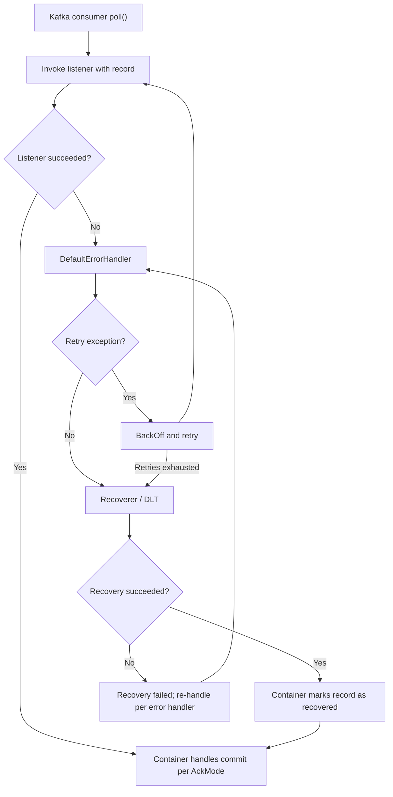

# DefaultErrorHandler and Boot Auto-Configuration

`DefaultErrorHandler` is Spring Kafka's implementation of `CommonErrorHandler`, used to decide how a listener container handles a record when a listener throws an exception. It combines retry, backoff, and recovery policies so an application can retry transient errors, classify errors that should not be retried, and route unprocessable records to a dead-letter topic (DLT).

In Spring Boot, the default listener container factory is auto-configured from `spring.kafka.*` properties. If an application declares a `CommonErrorHandler` bean, Boot can wire that bean into the auto-configured factory. Because `DefaultErrorHandler` implements `CommonErrorHandler`, an application often only needs to declare a `DefaultErrorHandler` bean to apply a shared error policy across default listeners.

Two responsibilities must be distinguished: Boot creates and configures the listener container factory; the application decides the retry/recovery policy suited to its business logic. Having auto-configuration does not mean every exception will be retried according to your business's desired policy.

## 1. Where Does DefaultErrorHandler Sit in the Processing Flow?

The listener container invokes the Kafka consumer to receive records, then dispatches each record to the listener method. If the listener returns normally, the container continues per the configured AckMode and commit policy. If the listener throws an exception, the container delegates the error to `CommonErrorHandler`.

`DefaultErrorHandler` handles a failed record in these general steps:

1. Receives the exception and associated record (or batch).
2. Determines whether the exception is retryable or non-retryable.
3. Applies `BackOff` to decide retry count and wait intervals.
4. If a retry succeeds, the container resumes normal processing.
5. When retries are exhausted, invokes the recoverer to handle the failed record.
6. After successful recovery, the container handles offsets per error handler and listener container settings.

Record listener diagram:



The diagram illustrates the general concept. Exact details of seeking, committing, pausing, and redelivery depend on listener type, AckMode, BackOffHandler, recoverer, and Spring Kafka version.

## 2. DefaultErrorHandler and CommonErrorHandler

Since Spring Kafka 2.8, `DefaultErrorHandler` has been the standard error handler for record and batch listeners. It replaces older error handlers such as `SeekToCurrentErrorHandler` in modern configurations.

`CommonErrorHandler` is the common interface used by listener containers. An application can supply a custom implementation, though in many systems `DefaultErrorHandler` meets standard retry and recovery needs.

| Component | Responsibility |
|---|---|
| `CommonErrorHandler` | Exception-handling contract invoked by the listener container |
| `DefaultErrorHandler` | Retries, backoff, exception classification, and invoking the recoverer |
| `BackOff` | Determines wait times and number of retry attempts |
| `ConsumerRecordRecoverer` | Handles the record once retries no longer continue |
| `DeadLetterPublishingRecoverer` | Sends failed records to a DLT |
| `ConcurrentKafkaListenerContainerFactory` | Attaches the error handler to containers created by the factory |

`DefaultErrorHandler` does not implement business logic on behalf of the listener. The listener remains responsible for throwing an exception when business work is incomplete and must not silently swallow errors if the error handler is expected to retry.

## 3. Default Behavior

When creating `DefaultErrorHandler` with no arguments, the handler uses Spring Kafka's default policy. In modern versions, the default configuration is typically equivalent to `FixedBackOff(0L, 9L)`: the initial listener invocation plus up to nine retries with zero wait between retries. Once retries are exhausted, the default recoverer logs the failed record.

This means a record can be delivered to the listener up to ten times under continuous failure: one initial attempt and nine retries. Verify the Javadoc of your running version before relying on this default in production.

Do not treat the default retry count as a business policy. A timeout error may need backoff; a permanent data error rarely benefits from repeated retries. Applications should configure attempt counts and final actions based on exception type and event criticality.

## 4. Configuring Retries with BackOff

Spring Kafka uses the `BackOff` abstraction to determine wait intervals and retry counts.

### 4.1. FixedBackOff

`FixedBackOff` repeats with a fixed wait interval:

```java
BackOff backOff = new FixedBackOff(
        1_000L, // wait 1 second between retries
        3L      // up to 3 retries after initial invocation
);

DefaultErrorHandler errorHandler =
        new DefaultErrorHandler(backOff);
```

With this configuration, the listener gets one initial processing attempt and up to three retries. If all invocations fail, the handler transitions to recovery.

### 4.2. ExponentialBackOffWithMaxRetries

When dependency failures may require progressively longer recovery time, use exponential backoff:

```java
ExponentialBackOffWithMaxRetries backOff =
        new ExponentialBackOffWithMaxRetries(5);

backOff.setInitialInterval(500L);
backOff.setMultiplier(2.0);
backOff.setMaxInterval(10_000L);

DefaultErrorHandler errorHandler =
        new DefaultErrorHandler(backOff);
```

The wait interval grows from 500 ms, doubles on each retry, and caps at 10 seconds. The maximum retry count is specified when constructing `ExponentialBackOffWithMaxRetries`.

Exponential backoff helps ease pressure on a struggling service. However, total retry time must fit business timeouts, `max.poll.interval.ms`, consumer processing duration, and latency requirements.

### 4.3. Backoff Does Not Equal Business Timeout

Backoff only decides when to try again. It does not set timeouts on databases, HTTP calls, or listener logic. Configure separate dependency timeouts so a single invocation cannot hang indefinitely.

If retry delays exceed allowable poll time, consider `ContainerPausingBackOffHandler`. This mechanism uses container pause/resume to support long backoffs without sleeping the consumer thread for the entire wait. Pausing still must be tested against polling, heartbeats, and real processing times.

## 5. Exception Classification: What to Retry and What to Skip?

Not every exception carries the same meaning. `DefaultErrorHandler` provides exception classification to decide retries.

Several error types are treated as non-retryable by default in Spring Kafka, including conversion/deserialization errors or failures unfixable by redelivering the same record, such as:

- `DeserializationException`
- `MessageConversionException`
- `ConversionException`
- `MethodArgumentResolutionException`
- `NoSuchMethodException`
- `ClassCastException`

The exact list can change across versions. The general idea is that deterministic data or mapping errors move to recovery early, whereas transient errors can be retried.

### 5.1. Marking Exceptions as Non-Retryable

Use `addNotRetryableExceptions()` to add exception types that should not be retried:

```java
DefaultErrorHandler errorHandler =
        new DefaultErrorHandler(
                new FixedBackOff(1_000L, 3L)
        );

errorHandler.addNotRetryableExceptions(
        InvalidOrderException.class,
        UnsupportedEventVersionException.class
);
```

If the listener throws `InvalidOrderException`, the handler goes straight to configured recovery instead of waiting through three retries.

### 5.2. Marking Exceptions as Retryable

Use `addRetryableExceptions()` for exception types that should be retried per BackOff:

```java
errorHandler.addRetryableExceptions(
        TemporaryInventoryUnavailableException.class,
        RemoteServiceTimeoutException.class
);
```

Classification must account for nested exceptions. For example, a listener might throw a `RuntimeException` wrapping a `SocketTimeoutException`. Verify that the handler classifies the cause exception properly within your real error hierarchy.

### 5.3. Configuring a Classification Map

When full policy control is needed, use `setClassifications()` with an exception map and default retry flag:

```java
Map<Class<? extends Throwable>, Boolean> classifications =
        new HashMap<>();

classifications.put(InvalidOrderException.class, false);
classifications.put(RemoteServiceTimeoutException.class, true);

errorHandler.setClassifications(classifications, true);
```

The default flag here determines how exceptions absent from the map are treated. Setting `true` means unclassified exceptions are retried; setting `false` means do not retry. Choose the default explicitly to avoid accidentally retrying unexpected errors.

If using `addNotRetryableExceptions()` or `addRetryableExceptions()`, check the handler's default rule to understand which branch undeclared exceptions take.

## 6. Recoverers and Dead-Letter Topics

When retries are exhausted or an exception is classified as non-retryable, the handler invokes the recoverer. The recoverer is where the application decides what to do with an unprocessable record.

### 6.1. Default Recoverer

If no recoverer is passed, `DefaultErrorHandler` uses a logging recoverer. It logs the record details and exception once retries end.

Logging helps investigation but does not create a durable reprocessing pipeline. For important messages, consider a DLT or a queryable error store.

### 6.2. DeadLetterPublishingRecoverer

`DeadLetterPublishingRecoverer` sends failed records to another topic. Common configuration:

```java
@Bean
DefaultErrorHandler kafkaErrorHandler(
        KafkaTemplate<Object, Object> kafkaTemplate) {

    DeadLetterPublishingRecoverer recoverer =
            new DeadLetterPublishingRecoverer(kafkaTemplate);

    FixedBackOff backOff = new FixedBackOff(1_000L, 3L);

    return new DefaultErrorHandler(recoverer, backOff);
}
```

With the default resolver, records are usually sent to a topic with the `.DLT` suffix, using the same partition number if the destination topic has a corresponding partition. For example, `orders.created` may be routed to `orders.created.DLT`.

In production, verify the DLT topic exists and has enough partitions. You can configure a custom destination resolver if you need different naming conventions, partitioning, or routing by error type.

### 6.3. Customizing the Destination Resolver

You can select a DLT based on topic and partition:

```java
DeadLetterPublishingRecoverer recoverer =
        new DeadLetterPublishingRecoverer(
                kafkaTemplate,
                (record, exception) ->
                        new TopicPartition(
                                record.topic() + ".DLT",
                                record.partition()
                        )
        );
```

This simple example sends to a DLT with the same partition index. If the destination topic lacks that partition, publishing can fail. Across multiple topics with differing partition counts, the resolver must compute a valid destination partition or use a different routing strategy.

### 6.4. Metadata in the DLT

Spring Kafka can add headers describing the original record and exception, such as original topic/partition/offset, exception class, exception message, and stack trace. These headers help operations teams find root causes and decide on replays.

When inspecting a DLT, do not look only at the payload. Check headers to see which topic and offset the record came from, what failed, and what retry path it went through.

### 6.5. A DLT Does Not Fix Errors by Itself

A record published to a DLT still needs operational processes:

- Alerts when DLT counts climb.
- Dashboards tracking DLT volume by topic and exception type.
- Procedures to inspect payloads and related data.
- Ways to fix data or code before replaying.
- Idempotent replay mechanisms to avoid duplicate side effects.
- Appropriate retention and access controls.

Do not infinitely auto-replay a record without fixing the root cause. Doing so creates error loops and adds load to the system.

## 7. Committing Offsets After Retry and Recovery

Retries and recovery tie directly to offsets. Distinguish records processed successfully, records awaiting retry, and records already recovered.

For record listeners, the container and error handler coordinate seeking/committing so failed records can be redelivered. By default, `DefaultErrorHandler` typically seeks back to the failed record's offset and unprocessed records in the poll so the consumer re-reads them afterward.

When the recoverer returns normally, the handler considers recovery successful. `DefaultErrorHandler` has an `ackAfterHandle` setting that decides whether the container commits the offset of a record finished by the handler; it defaults to true. For special acknowledgment modes, also check `commitRecovered` and its corresponding AckMode requirements.

Do not assume DLT publishing and offset commits form an atomic transaction in every setup. If Kafka output and input offsets must coordinate transactionally, explicitly design a transactional listener container and producer transaction.

### 7.1. Recovery Failure

If the recoverer throws an exception, recovery is incomplete. The handler may return the record to the retry flow according to its recovery policy. Thus, the DLT publisher also needs appropriate retries/monitoring; if the DLT broker or topic fails, never treat the record as successfully handled.

### 7.2. Seek After Error and Retaining Records in Memory

By default, the error handler uses seek so the consumer re-reads the failed record and unprocessed records. In supported Spring Kafka versions, you can set `seekAfterError=false` so the container retains unprocessed records in memory and passes them back to the listener after a necessary poll.

Retaining records can reduce some seeks, but changes how the container manages pending records. It does not eliminate retries, backoff, commits, or redelivery possibilities. Test with high record volumes, rebalances, and shutdowns before changing this in production.

## 8. Record Listener and Batch Listener

`DefaultErrorHandler` supports both record listeners and batch listeners, though the container needs to know which record in a batch failed.

### 8.1. Record Listener

With a record listener, each callback invocation receives one record. If the callback throws an exception, the error handler knows the exact failing record and can retry it per policy.

### 8.2. Batch Listener

With a batch listener, each callback receives multiple records. If the listener throws a generic exception without indicating the failing record, the handler cannot tell which element caused the failure. In that case, the batch may be retried as a unit.

If the listener can identify the failed record, it can throw `BatchListenerFailedException` with the corresponding record or index:

```java
@KafkaListener(topics = "orders.created")
public void consume(List<ConsumerRecord<String, OrderCreated>> records) {
    for (int index = 0; index < records.size(); index++) {
        ConsumerRecord<String, OrderCreated> record = records.get(index);

        try {
            orderService.process(record.value());
        }
        catch (Exception ex) {
            throw new BatchListenerFailedException(
                    "Cannot process order",
                    ex,
                    index
            );
        }
    }
}
```

When index information is provided, the handler can handle records preceding the failing element and apply retry/recovery to the failed record and the remainder per batch mechanics.

Never catch an exception and ignore it if the record has not been processed. For batch listeners, clearly distinguish completed elements, the failed element, and unexecuted elements to avoid committing offsets ahead of business progress.

## 9. Integrating with Spring Boot Auto-Configuration

Spring Boot auto-configures Kafka components when dependencies and auto-configuration conditions are met. In a standard listener setup, Boot creates a default `ConcurrentKafkaListenerContainerFactory` (typically named `kafkaListenerContainerFactory`) and applies `spring.kafka.*` properties.

A bean implementing `CommonErrorHandler` can be wired into Boot's auto-configured factory. Because `DefaultErrorHandler` implements this interface, declaring it as a bean provides a shared retry/recovery policy.

### 9.1. Declaring a DefaultErrorHandler Bean

Example:

```java
@Configuration
public class KafkaErrorConfiguration {

    @Bean
    public CommonErrorHandler commonKafkaErrorHandler(
            KafkaTemplate<Object, Object> kafkaTemplate) {

        DeadLetterPublishingRecoverer recoverer =
                new DeadLetterPublishingRecoverer(kafkaTemplate);

        FixedBackOff backOff =
                new FixedBackOff(1_000L, 3L);

        DefaultErrorHandler handler =
                new DefaultErrorHandler(recoverer, backOff);

        handler.addNotRetryableExceptions(
                InvalidOrderException.class
        );

        handler.addRetryableExceptions(
                RemoteServiceTimeoutException.class
        );

        return handler;
    }
}
```

Spring Boot can detect the `CommonErrorHandler` bean and wire it into the default listener container factory. Returning the interface type clearly signals that this bean serves as a common error handler.

You can declare the return type as `DefaultErrorHandler` if you need to inject the concrete implementation elsewhere. What matters is that the bean is Spring-managed and discoverable by the factory configurer under `CommonErrorHandler`.

### 9.2. Configuring Consumer and Listener via YAML

Core properties are still configured in `application.yml`:

```yaml
spring:
  kafka:
    bootstrap-servers: localhost:9092
    consumer:
      group-id: orders-service
      enable-auto-commit: false
      key-deserializer: org.apache.kafka.common.serialization.StringDeserializer
      value-deserializer: org.springframework.kafka.support.serializer.JsonDeserializer
      properties:
        spring.json.trusted.packages: "com.example.events"
    listener:
      ack-mode: record
      concurrency: 3
      poll-timeout: 1s
```

The YAML above configures the Kafka consumer and listener container. Retry policy, exception classification, and the DLT recoverer are declared in the `CommonErrorHandler` bean from the previous example.

Do not confuse `spring.kafka.listener.ack-mode` with retry configuration. AckMode decides when the container commits offsets along the processing flow; the error handler decides retry/recovery when the listener throws an exception.

### 9.3. Boot Auto-Configuration Does Not Know Business Policies

Boot can create factories, consumer factories, Kafka templates, and wire extension beans. However, Boot cannot know on its own which errors are transient for a specific business flow, how many retries make sense, or which DLT a record belongs in.

Declare a `DefaultErrorHandler` bean with suitable BackOff, recoverer, and exception classification. Without a custom bean, error behavior depends on Spring Kafka/container defaults and the running version.

## 10. Customizing the Listener Container Factory in Spring Boot

Sometimes an application needs a dedicated factory—for example, an orders listener with its own DLT and retries, while an audit listener only logs errors or runs with different concurrency.

When declaring a custom factory, there are two common approaches.

### 10.1. Using ConcurrentKafkaListenerContainerFactoryConfigurer

This approach fits when you want to retain Boot's auto-configured settings:

```java
@Bean
public ConcurrentKafkaListenerContainerFactory<String, OrderCreated>
        ordersListenerFactory(
                ConcurrentKafkaListenerContainerFactoryConfigurer configurer,
                ConsumerFactory<String, OrderCreated> consumerFactory,
                CommonErrorHandler commonErrorHandler) {

    var factory =
            new ConcurrentKafkaListenerContainerFactory<String, OrderCreated>();

    configurer.configure(factory, consumerFactory);

    factory.setConcurrency(3);
    factory.setCommonErrorHandler(commonErrorHandler);

    return factory;
}
```

`configurer.configure()` applies Spring Boot properties and supported configuration components to the factory. Calling `setCommonErrorHandler()` explicitly states which error handler the custom factory uses.

Then bind the factory to the listener:

```java
@KafkaListener(
    topics = "orders.created",
    groupId = "orders-service",
    containerFactory = "ordersListenerFactory"
)
public void onOrderCreated(OrderCreated event) {
    orderService.process(event);
}
```

If you merely declare a `CommonErrorHandler` bean yet manually instantiate a factory without using Boot's configurer and without calling `setCommonErrorHandler()`, do not assume the custom factory picks up the handler automatically. Verify the factory's actual wiring.

### 10.2. Multiple Factories with Different Error Policies

An application can define multiple listener factories:

| Factory | Listener | Error Policy |
|---|---|---|
| `ordersListenerFactory` | Orders | Retry timeouts, DLT after retries exhaust |
| `auditListenerFactory` | Audit | Dedicated error-storage policy |
| `notificationsListenerFactory` | Notifications | Longer backoff for external dependencies |

Each listener must specify the right factory. Do not attach the same mutable error handler across multiple factories if handler state is mutated per listener after bean creation. When policies differ, create separate handler beans and wire each factory explicitly.

### 10.3. When Does Boot Auto-Configuration Back Off?

Spring Boot commonly uses `@ConditionalOnMissingBean` so applications can replace default beans. When you declare a listener container factory matching the default bean name or type, auto-configuration may back off.

This means an application can inadvertently lose some auto-configured defaults if it builds a factory entirely by hand. When customizing partially, prefer `ConcurrentKafkaListenerContainerFactoryConfigurer` and layer your specific overrides on top.

When auto-configuration does not behave as expected, inspect the condition evaluation report, bean names, bean types, and which factory the listener actually uses.

## 11. Which Boot Properties Relate to Error Handling?

`spring.kafka.listener.*` properties generally control container behavior, such as:

- `ack-mode`: AckMode.
- `concurrency`: number of child consumers.
- `poll-timeout`: poll wait duration.
- `missing-topics-fatal`: behavior when a topic does not exist.
- `idle-event-interval`: idle event interval.
- Other listener properties depending on Spring Boot version.

These properties do not replace full `DefaultErrorHandler` configuration. In particular, BackOff, recoverers, and exception classification are normally configured via Java beans.

Some Spring Boot releases add new properties or customizers. Always check `KafkaProperties.Listener` and the configuration docs for your exact running Boot version rather than assuming a YAML property exists in every version.

## 12. Important Considerations About Delivery Semantics

### 12.1. Retries Can Produce Duplicates

Suppose a listener writes to the database successfully and then the process stops before committing the offset. When the record is redelivered, the listener may execute the same operation again.

`DefaultErrorHandler` does not make database writes exactly-once by itself. For critical side effects, use event IDs, unique constraints, idempotency keys, or an inbox table so handlers can re-run safely.

### 12.2. Recovery and Offsets Are Not Always One Transaction

If the recoverer publishes to a DLT and the container commits the input offset, understand the transaction boundaries. If DLT publishing succeeds yet offset commit fails, the record may be reprocessed and published twice. If commit occurs too early, recoverability can be lost before publishing is durable.

When coordinating consumption, DLT publishing, and offsets inside a Kafka transaction is required, configure a transactional listener container and recoverer per version documentation. For databases outside Kafka, outbox/inbox or idempotency is still required.

### 12.3. Retries Increase Processing Duration

A record undergoing many retries increases how long it takes a consumer to finish a partition. Overly long backoffs can impact lag and intervals between polls. For long retry delays, consider the retry-topic pattern or an appropriate pausing backoff handler.

### 12.4. Retry Topics and DefaultErrorHandler Are Different Models

`DefaultErrorHandler` typically retries inside the consumer/container by retaining or seeking records for redelivery. The retry-topic pattern routes records to delayed retry topics before returning them to processing.

The two models carry different trade-offs in ordering, latency, topic operations, and scalability. Do not enable both unintentionally, as layering them can multiply attempts and make total execution counts hard to predict.

## 13. Testing DefaultErrorHandler

Tests should verify listener invocation counts, committed offsets, and recovery outcomes.

An integration test scenario:

1. Start a Kafka broker for testing.
2. Create the source topic and DLT topic.
3. Configure a listener with `DefaultErrorHandler` using a short BackOff.
4. Send a record that causes the listener to fail on the first few attempts and then succeed.
5. Verify the listener is called the expected number of times and the record finishes processing.
6. Send a record that always fails.
7. Verify the handler invokes the recoverer once retries are exhausted.
8. Verify the record appears in the DLT with required metadata.
9. Check the consumer group's committed offset.
10. Restart the consumer and verify recovered records are not unexpectedly reprocessed.

Recommended test matrix:

| Scenario | Expected Outcome to Verify |
|---|---|
| Listener succeeds on first try | No retries; offset advances |
| Transient error, retry succeeds | Invocation count matches BackOff; record completes |
| Non-retryable error | Routes to recovery immediately |
| Retries exhausted | Recoverer is invoked |
| DLT publish succeeds | Record appears in DLT with original headers |
| DLT publish fails | Recovery is not treated as successful |
| Batch listener throws BatchListenerFailedException | Handler identifies failed record/index |
| Default Boot factory | CommonErrorHandler bean is wired |
| Custom factory | Handler is wired explicitly or via configurer |
| Restart/rebalance | Offsets and redeliveries match delivery semantics |

Avoid testing solely with fixed sleeps. Use latches, bounded condition polling, or a dedicated test consumer to verify the record landed in the DLT and the offset was committed.

## 14. Production Observability and Operations

Metrics to track:

- Listener exception counts by topic, group, and exception type.
- Retry counts and elapsed time from initial delivery to successful processing.
- Count of recovered records and records published to the DLT.
- Failures when publishing to the DLT or committing offsets.
- Consumer group lag and listener processing duration.
- Error distribution across application versions and dependencies.
- Backlog count of records in the DLT and age of the oldest record.
- Replay rate and duplicate side effects blocked by idempotency.

Logs should include topic, partition, offset, key or event ID, exception class, and attempt number when available. Avoid writing sensitive payloads or full stack traces to unprotected destinations.

When DLT volume spikes suddenly, check schema changes, deployments, dependencies, and input data. When retries rise without DLT growth, check transient dependency issues, backoff, and consumer lag. When DLT publishing fails, check topic write permissions, serializers, partition counts, and broker health.

## 15. Common Configuration Mistakes

**Declaring a bean not typed as CommonErrorHandler.** Boot needs to find the bean under the interface used by the listener factory. Ensure the bean is Spring-managed and not excluded by configuration conditions.

**Creating a custom factory without attaching an error handler.** An existing handler bean does not guarantee every factory uses it. Use Boot's configurer or call `setCommonErrorHandler()` on custom factories.

**Setting too many retries or too short a backoff.** This can overload an already-failing dependency. Tune retries per exception type, cap total duration, and monitor lag.

**Retrying data exceptions that retries cannot fix.** Malformed schemas or invalid events should usually route to recovery/DLT early. Use exception classification.

**Catching an exception and returning normally.** The container may treat the listener as successful and commit the offset. Rethrow exceptions for the error handler to process, or perform explicit recovery.

**Treating the DLT as the end of responsibility.** DLTs require alerts, ownership, retention, investigation, and replay processes.

**Using a DLT with too few partitions.** If the resolver preserves source partition numbers and the DLT has fewer partitions, publishing can fail. Create matching destination topics or use a custom resolver.

**Ignoring retry time in poll intervals.** Long backoffs and slow listeners can disrupt polling/consumer groups. Consider `ContainerPausingBackOffHandler`, retry topics, or workload-appropriate tuning.

**Sharing one handler across listeners with differing policies.** One listener may need short retries while another needs a dedicated DLT. Separate handlers and factories when policies diverge.

**Assuming Boot always builds a custom DefaultErrorHandler.** Boot auto-configures the factory and can wire a `CommonErrorHandler` bean; the application must still declare policies when custom retry/recovery behavior is desired.

## 16. Process for Choosing and Deploying an Error Policy

When creating a new listener, deploy in this order:

1. Identify which exceptions are transient and which represent data or business errors.
2. Choose BackOff and retry counts based on SLAs and dependency recovery times.
3. Choose a recoverer: logging, DLT, or specialized error storage.
4. Define DLT naming, partition mapping, serializers, retention, and ACLs.
5. Declare a `DefaultErrorHandler` bean for Boot to wire into the default factory, or attach explicitly to custom factories.
6. Confirm the listener does not swallow exceptions and the handler receives the right error types.
7. Test retries, recovery, offset commits, restarts, and duplicates.
8. Set up alerts and DLT handling runbooks.

Treat the retry policy as part of the operational contract for each event type. Attempt counts, wait times, and recovery workflows should be clearly documented for on-call engineers and business owners.

## 17. Version-Specific Reference Documentation

When implementing or upgrading, consult the matching version documentation for:

- Spring for Apache Kafka Reference — Handling Exceptions, DefaultErrorHandler, BackOff, and DeadLetterPublishingRecoverer.
- Spring Kafka Javadoc — `DefaultErrorHandler`, `CommonErrorHandler`, `ConsumerRecordRecoverer`, `ContainerPausingBackOffHandler`, and `DeadLetterPublishingRecoverer`.
- Spring Boot Reference — Kafka auto-configuration, `ConcurrentKafkaListenerContainerFactoryConfigurer`, and `spring.kafka.listener.*`.
- Apache Kafka documentation — consumer groups, offset commits, transactions, and topic configuration.

`DefaultErrorHandler` was introduced in Spring Kafka 2.8. Property names, default retries, classification APIs, and recovery behavior can vary between versions. Prefer the Spring Kafka version managed by Spring Boot dependency management; if overriding dependencies, verify compatibility and re-run integration tests for retries, DLTs, and offset commits.
