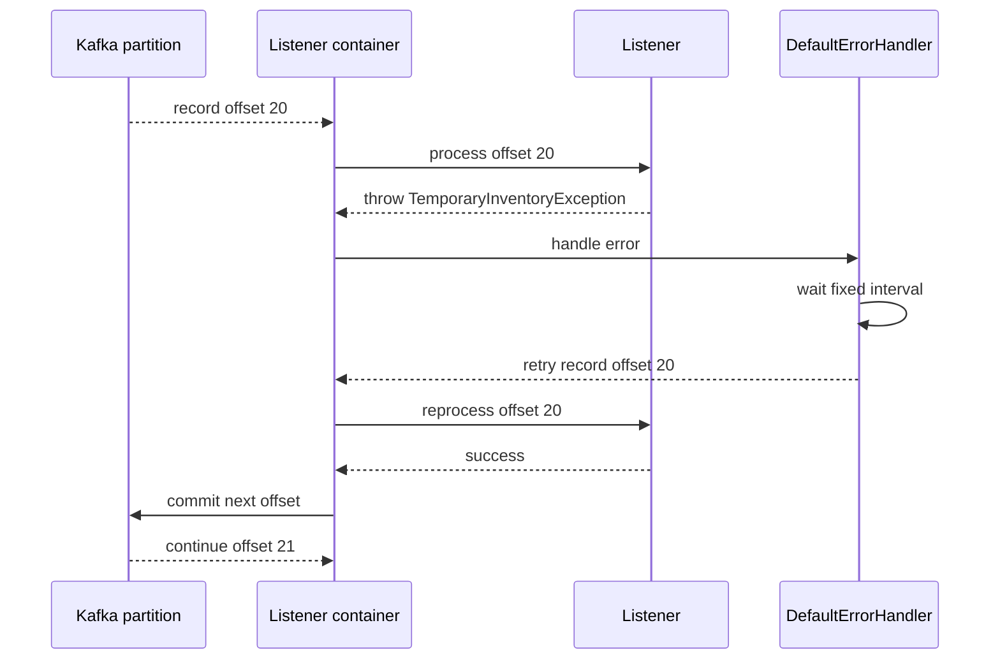

# Fixed Backoff

In Spring Kafka, backoff determines the wait time before a consumer attempts to reprocess a failed record. With **fixed backoff**, every retry uses the exact same wait interval, regardless of how many times the record has failed. This approach is predictable, easy to configure, and well suited when a dependency typically recovers within a short, relatively consistent timeframe.

Spring Kafka commonly pairs Spring Framework's `FixedBackOff` with `DefaultErrorHandler`. When the listener throws an exception, the error handler classifies the exception, waits according to the backoff, and then retries the record. Once retries are exhausted, the handler invokes a recoverer—for example, publishing the record to a Dead Letter Topic (DLT).

Fixed backoff only controls the timing between attempts. It does not by itself decide which errors should be retried, does not guarantee that business side effects are not duplicated, and does not replace a recovery policy. These parts must be designed together.

## 1. How does fixed backoff work?

Suppose a listener processes a record, but a downstream service temporarily returns a timeout. With a one-second fixed backoff and three retries, the processing flow looks like this:

```text
First delivery: processing failed
          |
          | wait 1 second
          v
Retry 1: processing failed
          |
          | wait 1 second
          v
Retry 2: processing failed
          |
          | wait 1 second
          v
Retry 3: processing failed
          |
          v
Retry budget exhausted -> invoke recoverer (e.g., publish DLT)
```

The pause interval does not grow after each failure. This is the key difference compared to exponential backoff, where the wait time increases progressively.

| Listener invocation | Relative time | Hypothetical outcome |
|---|---:|---|
| Initial delivery | 0 seconds | Failed |
| Retry 1 | After 1 second | Failed |
| Retry 2 | After 2 seconds | Failed |
| Retry 3 | After 3 seconds | Failed |
| Recovery | After final attempt | Sent to DLT or other recovery action |

In this example, there are four listener invocations: one initial delivery and three retries. The total backoff wait time is approximately three seconds; the actual processing time of each attempt is added on top of the total duration.

## 2. FixedBackOff in Spring Framework

`FixedBackOff` resides in the `org.springframework.util.backoff` package. Its constructor takes two arguments:

```java
new FixedBackOff(interval, maxAttempts)
```

| Parameter | Meaning |
|---|---|
| `interval` | Fixed wait time between two retry attempts, in milliseconds |
| `maxAttempts` | Maximum number of retries after the initial delivery |

Example:

```java
FixedBackOff backOff = new FixedBackOff(1_000L, 3L);
```

`1_000L` is one second. `3L` is three retries, not the total number of times the listener is invoked. If the initial delivery also fails, the listener can be invoked four times in total before recovery.

Some edge cases:

```java
// No retries; proceed to recovery after the initial delivery fails.
new FixedBackOff(1_000L, 0L);

// Retry continuously without limit; think very carefully before using.
new FixedBackOff(1_000L, FixedBackOff.UNLIMITED_ATTEMPTS);
```

Unlimited retries can allow a poison record to stall a partition for a very long time and prevent subsequent records from being processed. For production consumers, set a finite retry budget with explicit recovery.

## 3. Configuring DefaultErrorHandler with fixed backoff

In modern Spring Kafka, `DefaultErrorHandler` is the common error handler for listener containers that do not use a transaction rollback flow. The handler takes a `BackOff` and can also take a recoverer to handle the record after retries are exhausted.

Example configuring one second between retries, at most three retries, followed by publishing to a DLT:

```java
@Configuration
public class KafkaErrorConfiguration {

    @Bean
    DefaultErrorHandler orderErrorHandler(
            KafkaTemplate<Object, Object> kafkaTemplate) {

        DeadLetterPublishingRecoverer recoverer =
                new DeadLetterPublishingRecoverer(kafkaTemplate);

        FixedBackOff backOff = new FixedBackOff(1_000L, 3L);
        DefaultErrorHandler handler =
                new DefaultErrorHandler(recoverer, backOff);

        handler.addNotRetryableExceptions(
                InvalidOrderPayloadException.class,
                UnsupportedOrderVersionException.class);

        handler.addRetryableExceptions(
                TemporaryInventoryException.class,
                TransientDataAccessException.class);

        return handler;
    }
}
```

Attach the handler to the listener container factory:

```java
@Bean
ConcurrentKafkaListenerContainerFactory<String, OrderEvent>
ordersListenerFactory(
        ConsumerFactory<String, OrderEvent> consumerFactory,
        DefaultErrorHandler orderErrorHandler) {

    var factory = new ConcurrentKafkaListenerContainerFactory<String, OrderEvent>();
    factory.setConsumerFactory(consumerFactory);
    factory.setCommonErrorHandler(orderErrorHandler);
    factory.getContainerProperties()
            .setAckMode(ContainerProperties.AckMode.RECORD);
    return factory;
}
```

Listener using this factory:

```java
@KafkaListener(
        id = "orders-listener",
        topics = "orders",
        groupId = "order-projection",
        containerFactory = "ordersListenerFactory")
public void handle(OrderEvent event) {
    orderProjectionService.apply(event);
}
```

If `apply()` throws an exception, the container delegates the error to `DefaultErrorHandler`. The handler applies the configured exception classification and backoff. When the record succeeds on a retry attempt, the listener finishes normally and the container proceeds to commit the offset according to the ack mode. When the retry budget is exhausted, the recoverer is invoked.

## 4. Understanding the retry count correctly

A common mistake is treating `maxAttempts` as the total number of listener invocations. With `FixedBackOff`, `maxAttempts` represents the number of retries after the initial delivery.

| Configuration | Initial delivery | Retry count | Max total invocations when all fail |
|---|---:|---:|---:|
| `new FixedBackOff(500L, 0L)` | 1 | 0 | 1 |
| `new FixedBackOff(500L, 1L)` | 1 | 1 | 2 |
| `new FixedBackOff(1_000L, 3L)` | 1 | 3 | 4 |
| `new FixedBackOff(2_000L, 5L)` | 1 | 5 | 6 |

With `new FixedBackOff(2_000L, 5L)`, if all invocations fail, the total backoff wait time is roughly ten seconds. Total processing time also includes the time the listener spends running across the six invocations and the recovery time.

When estimating duration, use the formula:

```text
Approximate total time
  = (retry count x interval)
  + total processing time per attempt
  + recovery time
```

This is an estimate, not an exact deadline. Scheduling, pause/resume overhead, network latency, and commits/rebalances can make the actual duration longer.

## 5. Choosing an appropriate fixed wait interval

Fixed backoff fits when dependency recovery time is relatively stable and the wait interval can be determined up front. For example:

- An internal service typically recovers within one to two seconds after a brief connection glitch.
- A database connection pool may temporarily exhaust connections but usually frees them quickly.
- A write operation encounters short-lived contention and is likely to succeed after a brief pause.
- An internal API has a stable rate limit and the application has determined an appropriate retry cadence.

Do not pick a wait interval based on guesswork alone. Measure actual dependency latency and outage durations, while also considering consumer SLOs.

| Dependency characteristic | Guidance for choosing fixed interval |
|---|---|
| Brief connection errors, fast recovery | Short pause, small retry budget |
| System with stable rate limits | Choose a pause long enough to reduce retry pressure; follow service guidelines if provided |
| Dependency frequently suffers multi-decade-second outages | Short fixed intervals can generate many futile calls; consider pause/retry topics or increasing backoff |
| Data errors unchanged by retrying | Do not use fixed retry; classify as non-retryable and recover immediately |
| Unknown cause or recovery time | Finite retries, thorough logging, and move to recovery for investigation |

## 6. Classifying exceptions before retrying

Fixed backoff only specifies how long to wait when the handler decides to retry. The exception classifier decides whether an error is retried at all.

Example of transient vs. permanent errors:

```java
public class TemporaryInventoryException extends RuntimeException {
    public TemporaryInventoryException(String message, Throwable cause) {
        super(message, cause);
    }
}

public class InvalidOrderPayloadException extends RuntimeException {
    public InvalidOrderPayloadException(String message) {
        super(message);
    }
}
```

In the handler from the previous section, `TemporaryInventoryException` is classified as retryable, whereas `InvalidOrderPayloadException` is classified as non-retryable. A record with an invalid payload cannot become valid merely by waiting one second; retrying will slow down the partition without improving the chance of success.

`DefaultErrorHandler` has a set of default exceptions treated as fatal/non-retryable, depending on the Spring Kafka version. When configuring, check the default classifier of the version in use and avoid accidentally overriding those rules. One exception may be wrapped inside another; inspect the actual cause chain to classify accurately.

## 7. Fixed backoff and ordered record processing

With a record listener, when a record fails, the error handler can seek so that the record is re-read after backoff. During blocking retry, subsequent records in the same partition can be delayed. This preserves per-partition processing order, though one failing record can slow down the entire stream.



With `AckMode.RECORD`, a record's offset is committed only after the listener completes successfully or the error handler has recovered the record according to policy. If the record is successfully sent to the DLT, the handler can allow the offset to advance past the failed record. If publishing to the DLT fails, recovery is not considered complete.

With a batch listener, it is necessary to identify which record in the batch caused the error. If the listener throws a generic exception, the handler may have to retry the entire batch. `BatchListenerFailedException` can pinpoint the failing record or index so that `DefaultErrorHandler` handles completed and failed parts more appropriately.

## 8. Fixed backoff and DLT recovery

Once the retry budget is exhausted, the recoverer can publish the record to a DLT. The default configuration of `DeadLetterPublishingRecoverer` typically routes from the original topic to a topic suffixed with `.DLT` and preserves the corresponding partition. The DLT topic must exist and have enough partitions for that routing, or the application must provide a custom destination resolver.

Example creating a DLT recoverer:

```java
DeadLetterPublishingRecoverer recoverer =
        new DeadLetterPublishingRecoverer(kafkaTemplate);

DefaultErrorHandler handler = new DefaultErrorHandler(
        recoverer,
        new FixedBackOff(1_000L, 3L));
```

When DLT publishing succeeds, the record has been saved to the recovery stream and the error handler can treat it as recovered. When publishing fails, the recovery error must be treated as a real failure; never silently commit the offset as if the record were safely stored.

The DLT should retain source metadata such as topic, partition, offset, key, event ID, exception class, and timestamp. Operational procedures must include a way to investigate, fix data or consumers, and then perform controlled replay. During replay, keep the event ID so idempotency can prevent duplicate business side effects.

## 9. Impact of fixed backoff on consumers and partitions

In-place retry with fixed backoff typically holds the processing flow at the failed record during waiting and retrying. If the interval is large or the retry budget is high, the consumer may be unable to process subsequent records in the same partition for an extended period. Consumer lag grows even if the listener only encountered a single failing record.

For example, a record requiring six invocations, each taking two seconds to process with five two-second pauses:

```text
Processing time: 6 x 2 seconds = 12 seconds
Backoff time:    5 x 2 seconds = 10 seconds
Total before recovery: approximately 22 seconds
```

During this period, subsequent records on that partition may have to wait. With multiple partitions, other partitions can still make progress depending on assignment and consumer concurrency.

Consider:

- `max.poll.interval.ms` and the longest expected processing/retry duration.
- Partition count and consumer group concurrency.
- Consumer lag and how long a single record holds a partition.
- Load that retries generate on the struggling dependency.
- Whether delaying subsequent records to preserve order is acceptable.

Spring Kafka provides backoff handler mechanisms for containers. For long wait intervals, compatible versions can use `ContainerPausingBackOffHandler` to pause the container rather than merely holding the consumer thread waiting. When using it, verify the API version and how pause/poll maintains consumer membership. A backoff handler does not change the fixed interval or retry budget; it changes how the container executes the wait period.

## 10. Avoiding synchronized retry bursts and dependency pressure

Fixed backoff causes records that fail at the same time to retry almost simultaneously. If an outage causes thousands of records to fail within a short window, they may all wait one second and then call the dependency almost at once. This creates a retry storm and overloads the recovering service again.

Ways to mitigate this risk:

- Limit the retry count and total retry window.
- Choose the interval based on the dependency's recovery capacity, not just average latency.
- Use a circuit breaker or rate limiter at the dependency call layer when appropriate.
- Use backoff with jitter if many consumers or records frequently retry at the same time.
- Switch to retry topics or delayed workflows when long waits are needed without holding the original partition.
- Monitor retry counts and error rates per dependency to detect retry storms.

Fixed backoff has no jitter. If variable wait times are needed, choose another `BackOff` or implement an appropriate backoff instead of expecting `FixedBackOff` to add randomness automatically.

## 11. When is fixed backoff unsuitable?

Fixed backoff is simple, but it does not fit every scenario.

| Scenario | Limitation of fixed backoff | What to consider |
|---|---|---|
| Long outage or unknown recovery time | Same-cadence retries may hit the dependency too soon | Exponential backoff, circuit breaker, or retry topics |
| Many consumers retrying together after an outage | Synchronized retries can cause a retry storm | Backoff with jitter or coordinated retries |
| Records needing waits of minutes/hours | Blocks the partition for a long time | Non-blocking retry topics or delayed workflows |
| Payload errors that retrying cannot fix | Every attempt fails identically | Non-retryable classification and DLT |
| Each event type needing a different retry budget | A single shared `FixedBackOff` cannot express per-type policies | Separate listeners/containers or customized error handling |

Do not increase the interval indefinitely to turn fixed backoff into a mechanism for handling long outages. Long wait intervals can prevent the consumer from serving other records and make recovery times hard to predict.

## 12. How does fixed backoff differ from retry topics?

Blocking retry with `DefaultErrorHandler` typically retries records within the container's processing flow. Retry topics move records to auxiliary topics to be reprocessed after a delay. The two mechanisms solve different needs.

| Criterion | In-place fixed backoff | Retry topic |
|---|---|---|
| Where record is held while waiting | Original container/partition processing flow | Separate retry topic |
| How waiting works | Backoff handler coordinates the pause interval | Retry topic consumer receives the record per designed schedule/delay |
| Impact on original partition | Can delay subsequent records | Allows the original partition to continue processing |
| Event ordering | Easier to preserve per-partition order with in-place retry | Can alter ordering among records with the same key |
| Operations | Fewer auxiliary topics, simpler configuration | Must manage retry topics, routing, retention, and replay |

For short errors where ordering must be preserved, in-place fixed backoff is usually sufficient. For long errors where subsequent records must proceed, retry topics may be more suitable if the business tolerates ordering changes.

## 13. Fixed backoff in transactional listeners

If the listener container runs inside a Kafka transaction, a listener exception typically causes the transaction to roll back. The retry/recovery flow then differs from a non-transactional consumer. `DefaultErrorHandler` is typically used for non-transactional listeners; for a transaction rollback flow, Spring Kafka uses `DefaultAfterRollbackProcessor` to coordinate post-rollback retries and recovery.

Example initializing an after-rollback processor with fixed backoff:

```java
DefaultAfterRollbackProcessor<String, OrderEvent> processor =
        new DefaultAfterRollbackProcessor<>(
                recoverer,
                new FixedBackOff(1_000L, 3L));

factory.setAfterRollbackProcessor(processor);
```

The code snippet illustrates the general API; how the recoverer, transaction manager, and factory are created must match the Spring Kafka version in use. When recovery needs to publish to a DLT and commit offsets within a transaction, the after-rollback processor and Kafka transactions must be configured appropriately so recovery results are persisted consistently.

Do not attach a non-transactional `DefaultErrorHandler` to a transactional listener expecting it to replace the rollback processor. Determine whether the listener runs inside a Kafka transaction before choosing the retry mechanism.

A Kafka transaction can protect Kafka outputs and input offsets within the same transaction. It does not automatically cover databases or HTTP APIs. If a listener has side effects outside Kafka, idempotency or inbox/outbox is required to handle transaction rollbacks and record redeliveries safely.

## 14. Observing fixed backoff in production

The following indicators help evaluate whether fixed backoff is appropriate:

- Retry count by topic, partition, and exception class.
- Average and percentile duration from initial delivery to success/recovery.
- Consumer lag during retries and after dependency recovery.
- Percentage of records succeeding on retry 1, retry 2, or the final retry.
- Number of records moved to DLT and DLT publish failures.
- Concurrency of simultaneous retries and resulting load on the dependency.
- Rebalance counts or errors related to `max.poll.interval.ms`.

Logs should include topic, partition, offset, key or event ID, exception class, delivery attempt, and retry timestamp. Avoid logging sensitive payloads. Metric tags should have low cardinality; do not use event IDs as metric labels because the number of events can be very large.

A `RetryListener` can be attached to `DefaultErrorHandler` to record retry attempts:

```java
handler.setRetryListeners((record, exception, deliveryAttempt) -> {
    log.warn(
            "Kafka retry topic={} partition={} offset={} attempt={} cause={}",
            record.topic(),
            record.partition(),
            record.offset(),
            deliveryAttempt,
            exception.getClass().getSimpleName());
});
```

Callback signatures and metric APIs may vary by Spring Kafka version. Use the corresponding API in your project and avoid heavy synchronous logging that slows down the consumer thread.

## 15. Runbook when records retry excessively

When a record type retries continuously, handle it in the following order:

1. Identify the record's topic, partition, offset, event ID, and exception class.
2. Determine whether the error is transient or permanent by inspecting the dependency and payload.
3. Calculate the actual retry count and total backoff time from the `FixedBackOff` configuration.
4. Check consumer lag and see whether the failing record is blocking subsequent records on the same partition.
5. If permanent, move to non-retryable classification and appropriate recovery/DLT.
6. If transient, check whether the interval is too short relative to recovery time and whether retries are adding extra pressure.
7. Once the retry budget is exhausted, verify that DLT publishing succeeded and sufficient metadata was saved for investigation.
8. After the dependency recovers or the data is fixed, replay in a controlled manner and verify idempotency prevents duplicate effects.

Do not simply increase `maxAttempts` when DLT counts rise. More retries can prolong backlogs and overload the dependency. First identify the root cause and check whether the fixed wait time reflects realistic recovery time.

## 16. Design principles

- Choose `FixedBackOff` when recovery time is stable enough to use a single pause interval.
- Remember that `maxAttempts` is the number of retries after the initial delivery.
- Set a finite retry budget and include per-attempt processing time.
- Classify exceptions before applying backoff; permanent errors should not be retried pointlessly.
- Use an observable recoverer/DLT when the retry budget is exhausted.
- Check the impact of blocking retry on partition ordering, consumer lag, and `max.poll.interval.ms`.
- Use backoff with jitter or retry topics when fixed intervals cause retry storms or hold partitions too long.
- Choose the right error handler for transactional vs. non-transactional listeners.
- Protect external side effects outside Kafka with idempotency/inbox/outbox.
- Monitor retry attempts, recovery times, DLTs, and dependency load.

Fixed backoff is a straightforward choice when errors usually recover within a relatively predictable timeframe. In Spring Kafka, pair `FixedBackOff` with a clear error handler, exception classification, and recoverer; calculate retry counts, wait times, and partition impact accurately. When errors are prolonged, uneven, or require per-record-type retry policies, choose a more suitable backoff or retry routing mechanism instead of merely increasing attempt counts.
