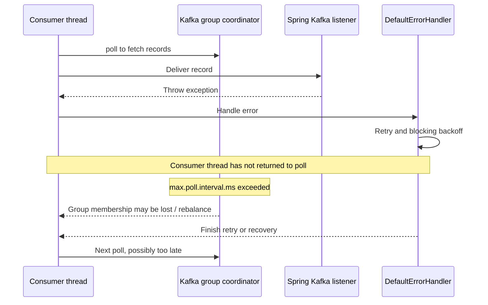
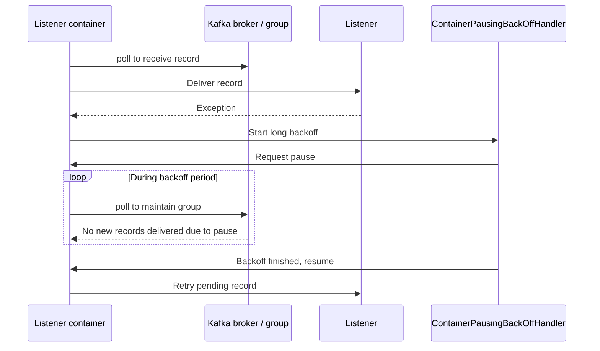

# Retrying Without Exceeding max.poll.interval.ms

In Spring Kafka, retrying lets a consumer reprocess a message when an error is recoverable. However, if a listener takes too long to process or waits through too many retries before the consumer calls `poll()` again, Kafka may consider the consumer no longer making progress. When the time between `poll()` calls exceeds `max.poll.interval.ms`, the consumer risks losing partition ownership, triggering a rebalance, and causing uncommitted records to be redelivered.

Therefore, retry design must consider **the poll loop time budget**, alongside attempt counts and backoff intervals. For short retries, `DefaultErrorHandler` can handle them within the listener thread. For long retries, you can use container pausing while still maintaining polls, or move messages to retry topics so the original topic's consumer continues operating. The goal is keeping the consumer group stable while preserving offsets and business state.

## 1. What does max.poll.interval.ms protect?

`max.poll.interval.ms` is the maximum time allowed between two `KafkaConsumer.poll()` calls in the consumer group model. It signals whether the application is still actively fetching data and making processing progress. A common default in Kafka consumers is `300000` ms (5 minutes), though applications must verify the effective configuration of their running version.

A typical Spring Kafka consumer has a thread responsible for calling `poll()` and then invoking the listener for the received records. When a synchronous listener or error handler is waiting on retries, that thread has not returned to the poll loop. Kafka does not know whether the listener is waiting on a database recovery, sleeping, or deadlocked; it only sees that the elapsed time since the previous poll has grown long.

Easily confused properties:

| Configuration | Meaning | Impact on retries |
|---|---|---|
| `max.poll.interval.ms` | Time limit between `poll()` calls | Listeners or retries blocking polls too long can make the consumer lose membership. |
| `max.poll.records` | Maximum records returned in a single poll | Larger batches can make total processing time before the next poll longer. |
| `session.timeout.ms` | Heartbeat wait window before the coordinator considers a member lost | Governs member-loss detection; does not replace the poll deadline. |
| `heartbeat.interval.ms` | Heartbeat cadence with the group coordinator in applicable protocols | Heartbeats may keep running while a listener is slow, yet this does not clear a max-poll interval violation. |
| Spring Kafka container `pollTimeout` | Wait timeout inside each container poll | Affects responsiveness to pause/resume and certain backoff mechanisms. |
| `auto.offset.reset` | Chooses the starting point if the group lacks a valid offset | Not a tool for fixing retries that exceed the poll interval. |

Heartbeats and polls serve two different purposes. A consumer can send heartbeats while the business thread is processing. However, once `max.poll.interval.ms` is exceeded, the client may proactively leave the group or stop heartbeating depending on membership type. With static members (`group.instance.id`), stopping heartbeats may prevent partitions from being handed to another member until `session.timeout.ms` expires. In either case, overly long processing remains a problem to fix.

## 2. How blocking retry creates a poll-interval breach window

Suppose a consumer polls 50 records. The listener processes each record in 150 ms, but one record fails and `DefaultErrorHandler` retries several times with a 90-second wait interval. If total processing, backoff, recovery, and other overhead exceed `max.poll.interval.ms`, the next poll arrives too late.



Consequences can include:

- Kafka reports errors related to max poll interval or revokes the consumer's partitions.
- The consumer group rebalances, shifting assignments and reducing throughput.
- The old member's offset commits are rejected because it lost ownership or the generation changed.
- Uncommitted records are re-read by another consumer; already-completed business actions may execute again.
- Other partitions on the same consumer thread also accumulate lag because the thread is held in retries.

One long retry does not necessarily cause immediate group loss the exact instant a wall-clock threshold passes; coordinator behavior also depends on the group protocol, membership, and session timeout. Still, an application must never rely on that slack to treat long retries as safe.

## 3. Calculating the time budget for a poll cycle

Estimate the **reasonable worst-case time** from after one `poll()` until before the next `poll()`, including record processing and every operation blocking the consumer thread:

```text
T_poll_cycle = T_process_records
             + T_blocking_backoff
             + T_retry_execution
             + T_recovery_or_DLT
             + T_commit_and_overhead

Operational requirement:
T_poll_cycle < max.poll.interval.ms - safety_margin
```

Do not use average processing time alone. A single batch may contain multiple failing records, each consuming its full retry budget. Database p95/p99 latency, garbage collection, network hiccups, and synchronous callbacks can all extend actual duration.

### Example 1: Short retries within budget

Suppose:

| Component | Expected duration |
|---|---:|
| 50 records, 100 ms processing each | 5 seconds |
| One failing record, two 1-second retry waits | 2 seconds |
| Two retry executions, 200 ms each | 0.4 seconds |
| Commit, logging, and buffer allowance | 3 seconds |
| **Estimated total** | **10.4 seconds** |

With `max.poll.interval.ms=300000` (300 seconds), this scenario has ample headroom. However, if all 50 records fail and each undergoes two retries, total duration changes completely; test mass-failure scenarios as well.

### Example 2: Long retries risking rebalance

Suppose a listener calls an external API with up to a 45-second timeout, then retries three times with 60-second backoff intervals. A single record alone can consume roughly `4 × 45 + 3 × 60 = 360` seconds, not counting other records. If `max.poll.interval.ms=300000`, this design exceeds the budget even with just one failing record in the batch.

The fix is not simply raising `max.poll.interval.ms`. Bound the API call timeout, shorten blocking retries, move long delays off the consumer thread, or use a pause mechanism that keeps polling.

### Determining the safety margin

Reserve margin for scheduling, GC, network, transactions, commits, and recovery. Base the margin on environment measurements; no single percentage fits every application. If normal load already consumes nearly all of `max.poll.interval.ms`, even a minor latency spike can trigger a rebalance.

## 4. Limiting record counts with max.poll.records

`max.poll.records` limits how many records the Kafka client returns in a single poll, counted across partitions assigned to the consumer. With a synchronous listener, more records mean the consumer thread may have more work to complete before the next poll.

Spring Boot example:

```yaml
spring:
  kafka:
    consumer:
      group-id: payment-service
      enable-auto-commit: false
      max-poll-records: 25
      properties:
        "max.poll.interval.ms": 300000
    listener:
      ack-mode: record
      concurrency: 3
```

`max-poll-records: 25` limits the amount of work per poll, but does not bound the processing duration of a single record. If one record hangs on an API call or backoff drags beyond the poll interval, the consumer can still miss the deadline.

Lowering `max.poll.records` can increase poll frequency and per-batch overhead, yet is often an effective step when synchronous listeners handle heavy records. Measure throughput, latency, commit frequency, and lag before and after tuning.

## 5. DefaultErrorHandler with short blocking retries

In Spring Kafka 2.8 and later, `DefaultErrorHandler` is the standard error-handling mechanism. It can retry records with a `BackOff` and then invoke a `ConsumerRecordRecoverer` once attempts are exhausted. With blocking retry, the consumer thread executes the error-handling cycle and may be blocked during backoff intervals.

Configuration for transient errors, retrying at most twice with a 500 ms wait interval:

```java
@Bean
DefaultErrorHandler shortRetryErrorHandler(
        KafkaTemplate<Object, Object> dltTemplate) {

    DeadLetterPublishingRecoverer recoverer =
            new DeadLetterPublishingRecoverer(dltTemplate);

    DefaultErrorHandler handler = new DefaultErrorHandler(
            recoverer,
            new FixedBackOff(500L, 2L));

    handler.addNotRetryableExceptions(
            PermanentBusinessException.class);

    return handler;
}
```

`FixedBackOff(500L, 2L)` specifies two retries after the initial listener invocation, with a 500 ms pause. `PermanentBusinessException` is an illustrative application-defined business exception. The DLT topic used by the recoverer must be provisioned with appropriate serializers, ACLs, and partitions.

In real environments, a single error-handling run may also spend time calling a database or publishing to the DLT. Therefore, a short `FixedBackOff` does not by itself guarantee the entire poll cycle stays within limits. Measure the duration of each attempt as well.

### Classifying errors before retrying

| Error category | Examples | Recommended strategy |
|---|---|---|
| Very brief transient errors | Flaky database connection, fleeting HTTP 503 | Short blocking retry with bounded attempts. |
| Dependencies needing tens of seconds or minutes | Service mid-deployment, reference data not yet ready | Pause while maintaining polls, or retry topics with longer delays. |
| Permanent data errors | Invalid schema, business validation unfixable by waiting | Do not retry repeatedly; recovery/quarantine/DLT. |
| Configuration errors | Wrong ACL, TLS, credentials | Alert and fix configuration; rapid retries do not help. |
| Ambiguous-outcome errors | HTTP timeout where target may have executed side effect | Retry with an idempotency key and query business state. |

Do not increase retry counts merely to reduce messages entering the DLT. Longer retries hold partitions, driving up lag and rebalances.

## 6. Long retries with ContainerPausingBackOffHandler

For long backoff intervals, Spring Kafka provides `ContainerPausingBackOffHandler` in supported versions. Instead of keeping the consumer thread asleep for one long stretch, this mechanism pauses the container during the wait and continues calling `poll()` as needed to maintain membership. Once backoff finishes, the container resumes and performs the retry.

Crucial distinction: **pausing record delivery/processing does not mean stopping `poll()` calls**. The consumer must keep polling frequently enough not to exceed `max.poll.interval.ms`. While the container has paused its assignments, group-maintaining polls do not deliver new records to the listener.



In principle, configuration passes a `BackOffHandler` set up for pausing into `DefaultErrorHandler`, along with a recoverer and `BackOff` policy. The API for constructing `ContainerPausingBackOffHandler` and pause-management dependencies can vary by Spring Kafka version, so use the constructor matching your actual version.

```java
// pausingBackOffHandler is a configured BackOffHandler
// to pause/resume the listener container per your version's API.
DefaultErrorHandler handler = new DefaultErrorHandler(
        recoverer,
        new FixedBackOff(45_000L, 2L),
        pausingBackOffHandler);
```

This snippet shows how components wire together, omitting creation of the `pausingBackOffHandler` bean. In production, configure the full lifecycle, pause service, and scheduler if required by your version.

Several operational points to remember:

- Actual backoff duration can be influenced by the listener container's `pollTimeout`.
- Pausing a container can affect all partitions managed by that child container, even if only one partition has a failing record.
- Pausing preserves membership but does not remove the failing record from the processing stream; lag can still climb.
- If the listener or recoverer already blocked the consumer thread for too long **before** pausing kicked in, pausing cannot recover the lost time.
- Verify your version and behavior on shutdown/rebalance while the container is paused.

`ContainerPausingBackOffHandler` is helpful when you want retries to stay on the original topic with long waits while preserving consumer group membership. If the workload cannot tolerate pausing co-hosted partitions on the same container, consider splitting workloads or using retry topics.

## 7. Non-blocking retry with retry topics

When messages need to wait tens of seconds or minutes, another option is moving messages to retry topics. Spring Kafka supports this model via `@RetryableTopic` in compatible versions. Failed records are published to retry topics on a backoff schedule; the original topic's consumer can continue polling and processing new records.

Example:

```java
@RetryableTopic(
        attempts = "4",
        backoff = @Backoff(delay = 30_000, multiplier = 2.0))
@KafkaListener(topics = "orders.events", groupId = "orders-service")
public void handle(OrderEvent event) {
    orderService.processIdempotently(event);
}
```

The example illustrates four total attempts under a retry-topic policy with increasing delays. Attempt counts, naming, DLT, and timing precision must be checked against your version/framework config. Provision topics, replication, retention, serializers, and ACLs appropriately if the environment does not auto-create topics.

### Benefits and trade-offs

| Criterion | Blocking retry | Pause and keep polling | Retry topic |
|---|---|---|---|
| Waiting record | Held in original topic processing flow | Held waiting at original container/topic | Moved to a retry topic |
| Poll cadence | Risks being blocked by backoff | Maintains polling when pause works properly | Original topic consumer keeps polling |
| Ordering by key/partition | Usually keeps failed record before later records | Holds original topic flow while paused | Later records may be processed before retrying record |
| Impact on other partitions | Can affect partitions on the same consumer | Can pause partitions on the same container | Original topic continues; must operate extra topics/consumers |
| Long delay duration | Risks exceeding `max.poll.interval.ms` | Suitable if pause/poll configured properly | Suitable for long delays, depends on topology |

Non-blocking retry **does not guarantee strict ordering**: trailing records on the original topic may be processed before a record routed to a retry topic. If a state sequence must execute strictly in order per key, design coordination, store pending state, or choose appropriate blocking/pausing retries.

Per documentation for Spring Kafka versions supporting this feature, note limitations with batch listeners and container transactions; do not blindly apply retry-topic configurations to every listener type. When using Kafka consume-transform-produce transactions, evaluate transaction/rollback mechanics and `AfterRollbackProcessor` separately.

## 8. Do not use long Thread.sleep inside listeners

A common anti-pattern is sleeping manually inside a listener after a downstream call fails:

```java
@KafkaListener(topics = "orders.events")
public void handle(OrderEvent event) throws InterruptedException {
    try {
        externalService.call(event);
    }
    catch (TemporaryServiceException exception) {
        Thread.sleep(360_000L); // Holds consumer thread for 6 minutes.
        externalService.call(event);
    }
}
```

If `max.poll.interval.ms` is 5 minutes, `sleep()` alone breaches the threshold. During this time, the consumer does not poll again; co-assigned partitions may stall and offsets remain uncommitted. The code also lacks attempt limits, backoff, interruption handling, and error classification.

Instead, let the listener throw the exception to `DefaultErrorHandler`, configure controlled retry counts and backoff, and use pausing backoff or retry topics if waits are long. Do not catch errors and return normally if business processing has not completed, as the container may commit the offset as a successful record.

### Downstream timeouts are part of the budget too

If each API call attempt has a 2-minute timeout, just two calls consume nearly the entire 5-minute poll budget. Short backoff will not fix the underlying cause. Configure HTTP connect/read timeouts, database query timeouts, and transaction timeouts based on SLAs; classify ambiguous-outcome errors for safe retries using idempotency keys.

## 9. Offset commits and duplicate handling after retries

While retries hold an incomplete record, do not commit offsets past that record. With `enable.auto.commit=false`, the Spring Kafka listener container uses `AckMode` and the error handler to manage commits after processing or recovery.

```yaml
spring:
  kafka:
    consumer:
      enable-auto-commit: false
    listener:
      ack-mode: record
```

With a record listener and `AckMode.RECORD`, the container commits after the listener successfully processes each record. If the listener throws an exception, `DefaultErrorHandler` manages retries/recovery; the failed record's offset should advance only according to that policy. If the recoverer successfully routes the record to the DLT and the handler considers recovery complete, the container can commit the source offset to keep the main stream moving.

Never call `acknowledgment.acknowledge()` before business work is finished just to keep polls fast. Early acknowledgment can make Kafka skip the record after a restart even though work was incomplete. With `MANUAL_IMMEDIATE`, the consequences of premature acknowledgment are even sharper because the commit can execute immediately on the consumer thread.

Even when committing after business logic, a failure can occur between the two steps:

1. The database transaction commits successfully.
2. The consumer process stops before the offset commits.
3. Kafka redelivers the same record from the old committed offset.

This is why consumers need idempotency. You can store `eventId` in an inbox table with a unique constraint inside the same database transaction as business updates, or pass an idempotency key supported by the downstream service. Kafka transactions do not automatically form atomic transactions with databases or HTTP APIs.

### When a record is sent to the DLT

If retries are exhausted and a message moves to the DLT, committing the original topic's offset indicates the record was handed over to the recovery flow—it does **not** mean the business operation succeeded. Verify DLT publish results, preserve source topic/partition/offset metadata, and maintain a replay procedure. If DLT publishing fails, detect the recovery exception instead of silently dropping the record.

## 10. Concurrency and blast radius during retries

Within a consumer group at any given time, a partition is assigned to only one consumer member. A single consumer thread can process multiple partitions. When that thread is held in blocking retries, other partitions assigned to the same thread can also accumulate lag.

Spring Kafka's `ConcurrentMessageListenerContainer` creates multiple child consumers per `concurrency`. For instance, on a six-partition topic, a listener with `concurrency=3` can distribute roughly two partitions per consumer, depending on the assignor and other members.

Increasing concurrency can reduce how many partitions are affected by one slow consumer thread, but does not split a single partition across multiple consumers in the same group. At the same time, raising concurrency can overload databases or APIs, increasing timeouts and making retries heavier.

When a partition has many failing records, check whether it is a data error or a downstream error. For permanent data errors, long retries only build lag. If an external service is disrupted, cap concurrent requests, apply backpressure, and consider an application-level circuit breaker to avoid adding extra load.

## 11. Observing the risk of exceeding max.poll.interval.ms

Do not measure `consumer lag` alone. Track time between polls, listener processing time, and time spent in retries.

| Source | Signals to monitor | Meaning |
|---|---|---|
| Consumer client | Poll interval metrics, `poll-idle-ratio-avg`, `last-poll-seconds-ago` if exposed | Detect consumers not returning to poll on cadence. |
| Listener | Processing duration p95/p99, downstream call durations | Identify slow records or overly long batch processing. |
| Error handler | Retry count, backoff duration, time from first error to recovery | Know how long errors hold consumer threads. |
| Consumer group | Rebalance count, member lost, partitions revoked/assigned | Detect poll deadlines triggering membership changes. |
| Partition | Lag, committed offset, age of oldest record | Detect partitions stalled in retry or pause. |
| Downstream | HTTP/DB timeouts, pool utilization, circuit breaker state | Identify retry sources and auxiliary pressure. |
| DLT/retry topic | Publish failures, pending count, message age | Detect slow recovery or growing retry backlogs. |

Metric names and exposure depend on Kafka client, Spring Kafka, and monitoring system versions. Kafka client metrics via JMX/Micrometer can provide poll metrics; application logs should record timestamps and phase durations for correlation.

Log with `eventId`, group ID, listener ID, topic, partition, offset, consumer thread, exception class, attempt, and backoff. Do not place `eventId` into high-cardinality metric labels; use bounded labels like topic, exception category, and retry stage. Do not log sensitive payloads or tokens.

### Valuable alerts

Alert when time since the last poll approaches `max.poll.interval.ms`, when a record's retries exceed SLA, or when rebalances rise alongside processing latency. If a consumer is paused, also monitor pause status, group-maintaining poll frequency, and backlog age. High lag during pause may be an expected outcome of retrying, yet must still have time bounds and handling procedures.

## 12. Runbook when retries cause consumer rebalances

### Symptom: logs report exceeding max.poll.interval.ms

1. Identify the consumer group, member, listener ID, thread, and topic/partition/offset being processed.
2. Correlate the timestamp of the last poll, listener execution duration, and rebalance timestamp.
3. Inspect `max.poll.records`, `max.poll.interval.ms`, downstream timeouts, attempt counts, and total blocking backoff.
4. If caused by long retries, shorten blocking retries or switch to `ContainerPausingBackOffHandler` / retry topics.
5. Monitor inter-poll duration and rebalances after the change; check whether records were redelivered.

### Symptom: retries block multiple partitions

1. List partition assignments of the consumer holding the failing record.
2. Check whether the retry policy is sleeping on the consumer thread or pausing the container.
3. Measure per-partition lag and retry duration of the failing record.
4. Consider shortening blocking delays, increasing concurrency within partition and downstream limits, or offloading retries to topics.
5. Verify per-key ordering remains acceptable if switching to non-blocking retry.

### Symptom: increased max.poll.interval.ms yet still failing

1. Check the effective value in consumer properties, not just intended YAML.
2. Look for downstream calls lacking timeouts or deadlocks causing listeners to run indefinitely.
3. Check batch size, multiple records retrying together, and waits inside transactions/commits.
4. Set finite deadlines per attempt and decouple long delays from the poll loop.
5. Increase max-poll interval only when long processing is intentional, has safety margin, and failover time has been evaluated.

### Symptom: lost assignment or commit failed after retries

1. Check `CommitFailedException` logs, rebalances, and when membership was lost.
2. Identify which records completed business logic yet failed to commit offsets.
3. Ensure consumer idempotency before re-receiving records.
4. Fix the poll interval or retry policy; do not reset offsets arbitrarily.
5. Monitor committed offsets and business outcomes after the group stabilizes.

### Symptom: pause preserves group yet backlog grows too long

1. Confirm the container is still calling poll while paused and the session remains stable.
2. Identify root cause: dependency unrecovered, data error, or DLT unable to publish.
3. Compare message age against SLAs and retry time limits.
4. If expected wait times are very long, consider retry topics or a dedicated handling workflow.
5. Upon resume, verify throughput, business ordering, offset commits, and DLT outcomes.

## 13. Pre-deployment checklist

| Checkpoint | Operational question | Required evidence |
|---|---|---|
| Poll budget | Are total processing, retries, and recovery short enough vs. max-poll interval? | Per-batch timing, p99 listener duration, and retry policy. |
| Batch size | Does `max.poll.records` fit per-record latency? | Batch duration and records per poll. |
| Downstream | Do all I/O calls have finite timeouts? | HTTP/DB timeout configs and latency metrics. |
| Retry type | Do short delays use blocking and long delays use pause or retry topics as required? | Error handler/`BackOffHandler` or retry-topic configuration. |
| Group health | Does the consumer keep polling while paused? | Poll metrics, pause status, and rebalance events. |
| Ordering | Will retry topics let same-key records overtake each other? | Topic/partition/offset timelines and state transitions. |
| Offsets | Are commits performed only after business work or recovery completes per policy? | AckMode, committed offsets, and DLT send results. |
| Duplicates | Are records redelivered after rebalances handled idempotently? | Event IDs, inbox/unique constraints, or downstream idempotency keys. |
| Operations | Are alerts set when retry duration, lag, or poll interval breaches SLAs? | Dashboards, alerts, and incident runbooks. |

To retry without exceeding `max.poll.interval.ms`, treat every poll cycle as a finite time budget. Shrink batch sizes when needed, bound timeouts on every attempt, keep blocking retries short, and use container pausing with group-maintaining polls or retry topics when long waits are needed. Combining error classification, post-processing offset commits, idempotency, and poll/rebalance observability lets consumers recover from errors without repeatedly losing partition ownership.
