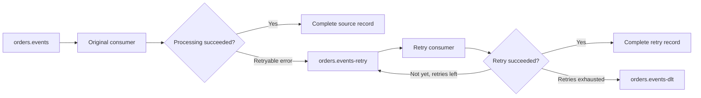
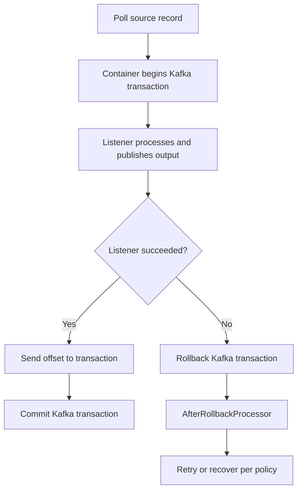
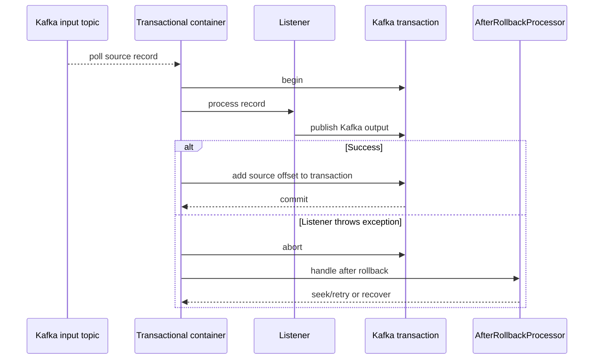

# Non-Blocking Retry Does Not Integrate with Container Transactions

In Spring Kafka, **non-blocking retry** lets you forward a failed record to a retry topic, wait until an eligible time, and reprocess it without blocking the original topic's consumer for a long backoff duration. This mechanism is commonly declared with `@RetryableTopic` or `RetryTopicConfiguration`.

An important architectural limitation of Spring Kafka is that **non-blocking retry is not supported in combination with Kafka container transactions**. This is a limitation of integrating retry topics with a transactional listener container, not a claim that Kafka transactions in general cannot write to multiple topics or that a transactional producer can never send a record to a retry topic. When designing a processing flow, choose the mechanism matching your atomicity, ordering, and recovery requirements.

If an application wants `@RetryableTopic`, use a listener container without Kafka transactions and protect business logic with idempotency, outbox/inbox, or an equivalent consistent design. If Kafka transactions are required to combine consume–process–produce and offset commits into one transaction, keep retries inside the transactional container model—typically rollback and retry via `DefaultAfterRollbackProcessor`—rather than attaching `@RetryableTopic` directly to that container.

## 1. Two Models Solving Two Different Problems

### Non-Blocking Retry: Decoupling Waiting from the Original Topic Consumer

Suppose a consumer reads a record from `orders.events` and calls a business service that hits a transient error. With blocking retry, the consumer can wait out a backoff and retry that record inside the current processing flow. When backoffs are long, other records on the same consumer thread may also be delayed.

Non-blocking retry takes a different route: the failed record is forwarded to a retry topic; the original consumer can keep processing new records. Another listener reads the retry topic and passes the record to business logic only when the retry timestamp arrives. After the configured number of attempts, the record can route to a dead-letter topic (DLT).



Actual topics and retry stages depend on naming strategy, backoff policy, and Spring Kafka configuration. The arrows above depict logical flow, not a single Kafka transaction spanning every step.

### Kafka Container Transaction: Binding Publishes and Offsets into One Boundary

In a consume–transform–produce flow, a Spring Kafka listener container can open a Kafka transaction to link output records with the input record's offset. When the transaction commits successfully, output records and source offsets commit together in the Kafka transaction. When the transaction aborts, writes inside the transaction are not exposed as a committed transaction, and source offsets are not committed as a successful transaction.



A Kafka transaction guarantees atomicity within the scope of Kafka operations included in that transaction. It does not automatically span a database transaction, HTTP request, or non-Kafka side effect. If the listener updates a database, the application still needs separate consistency and idempotency design.

## 2. Why Not Combine @RetryableTopic with a Transactional Listener Container?

With non-blocking retry, a failed record is handed off to another topic, and then the source topic consumer moves on. That is an asynchronous handoff mechanism across distinct listeners/containers and distinct topics. By contrast, a transactional listener container operates on a model where errors roll back the Kafka transaction, followed by after-rollback handling to decide how to re-read or recover.

The two mechanisms have different error-handling boundaries:

| Aspect | Non-blocking retry via retry topics | Container transaction |
|---|---|---|
| When listener throws exception | Retry infrastructure routes record to a retry topic or DLT per policy | Current transaction rolls back/aborts; after-rollback handling decides retry/recovery. |
| Unit of waiting | Separate retry topic and consumer; source topic can advance | Source record remains inside the transactional listener flow. |
| Source offset | Must complete/hand off source record to advance; not implicitly atomic with retry publish | Offset is included in the Kafka transaction upon successful processing. |
| Ordering | Later records can be processed before a waiting retry record | Retrying within the source partition usually helps preserve order before advancing. |
| Key components | `@RetryableTopic`, retry-topic infrastructure, DLT handler | `KafkaTransactionManager`, listener container, and `DefaultAfterRollbackProcessor`. |

Spring Kafka does not provide an integrated configuration mode to directly mix non-blocking retry with container transactions and automatically inherit the full transactional semantics of both. **Do not treat enabling `transaction-id-prefix` and adding `@RetryableTopic` as a way to build exactly-once retries.** Depending on version and wiring, the setup may be unsupported or behave differently than expected; treat this as an upfront design constraint.

An accurate framing is: Spring Kafka supports retry topics for listeners not using Kafka container transactions; Spring Kafka supports Kafka transactions and rollback handling; however, **the standard non-blocking retry feature does not combine with Kafka container transactions**. Building a custom transactional Kafka solution that creates topics and coordinates commits itself is a separate architectural choice and not equivalent to using `@RetryableTopic` out of the box.

## 3. Identifying Containers Actually Using Transactions

An application can define a transactional `KafkaTemplate` without running every listener inside a container transaction. Conversely, a Spring Boot configuration with a producer transaction ID prefix can cause the framework to auto-configure a transaction manager and apply it to listener containers under auto-configuration conditions.

Signs to inspect:

- Whether the producer factory has `transactionIdPrefix` or `spring.kafka.producer.transaction-id-prefix` configured.
- Whether the application defines a `KafkaTransactionManager` bean for that producer factory.
- Whether the listener container factory is configured with a transaction manager.
- Which container factory `@KafkaListener` uses; whether it uses the default factory that received auto-configured transactions.
- Whether listener runtime logs show Kafka transaction begin/commit/abort and transaction manager exceptions.
- Whether retry-topic infrastructure is creating separate listener endpoints/containers, or warning of conflicts with transactions.

Do not judge solely by bean names or annotations. Two listeners in the same application can use two different container factories: one transactional, one non-transactional. What must be verified is **the effective container factory of the exact listener using non-blocking retry**.

### Example Configuration Risking Accidental Pairing

```yaml
spring:
  kafka:
    producer:
      transaction-id-prefix: ${INSTANCE_ID:local}-orders-tx-
    consumer:
      enable-auto-commit: false
```

If an application simultaneously uses `@RetryableTopic` on a listener whose listener container is configured with a Kafka transaction manager, that is an unsupported combination. The prefix above is only an example; in multi-replica environments, each transactional producer instance needs a non-colliding identifier.

Do not assume that merely removing `@Transactional` from a service makes the listener non-transactional. Container transactions may be configured on `ConcurrentKafkaListenerContainerFactory` or by auto-configuration, independently of service-layer transaction annotations.

## 4. Option A: Non-Blocking Retry on a Container Without Kafka Transactions

When long wait times are needed and the source consumer must keep advancing, choose retry topics on a container without Kafka transactions. The illustrative configuration below applies to Spring Kafka supporting `@RetryableTopic`:

```yaml
spring:
  kafka:
    consumer:
      group-id: orders-service
      enable-auto-commit: false
      auto-offset-reset: earliest
    listener:
      ack-mode: record
      concurrency: 3
```

In this design, **the listener container for the retry-topic flow must not have a `KafkaTransactionManager` attached**. If the application also has other transactional flows, use separate container factories and check the exact factory assigned to each listener. Do not disable transactions application-wide if other flows still require them.

Example listener with non-blocking retry:

```java
@RetryableTopic(
        attempts = "4",
        backoff = @Backoff(delay = 2_000L, multiplier = 2.0),
        exclude = PermanentBusinessException.class)
@KafkaListener(
        topics = "orders.events",
        groupId = "orders-service")
public void consume(OrderEvent event) {
    orderService.processIdempotently(event);
}
```

`PermanentBusinessException` is an application-defined exception for errors unrecoverable by retry. `attempts="4"` in retry-topic config represents total processing attempts per the annotation semantics of that Spring Kafka line; consult your actual version's API to set attempts/backoff and DLT policy accurately.

On each transient failure, non-blocking retry infrastructure forwards the message to the appropriate retry topic. When attempts exhaust, the message is handed to the DLT or handled per DLT strategy. Provision topics, replication, retention, ACLs, and serializers according to your environment. Never assume the framework is always permitted to auto-create production topics.

### Do Not Set Up Overlapping Error Handlers

`@RetryableTopic` sets up a retry topology and the error handlers required to forward messages to retry topics. If the same listener is also given a `DefaultErrorHandler` with long blocking retries, a record may be attempted many times on the original topic before moving to a retry topic. Total attempts and duration then exceed expectations.

Decide explicitly whether you want a few brief blocking retries before non-blocking retry and configure the exact mechanism supported by Spring Kafka. Do not combine independent retry setups merely because both are named "retry."

### Not Using Container Transactions Does Not Mean Abandoning Correctness

With retry topics and no Kafka container transactions, design business logic assuming redeliveries can occur. A record can be forwarded to a retry topic and the source record re-read if the system fails before the source offset is acknowledged. Retry publishing and source offset commit should not be treated as a single atomic Kafka transaction unless an explicit mechanism implements it.

Key safeguards include stable `eventId` values, idempotent consumers, producer reliability, checks on retry/DLT publish failures, and backlog monitoring. For database impacts, inbox/outbox patterns can provide an appropriate durable layer.

## 5. Option B: Kafka Container Transactions with Blocking Retry After Rollback

If the problem requires committing source offsets and publishing Kafka outputs in the same transaction, keep container transactions and use Spring Kafka's rollback/retry mechanisms instead of non-blocking retry.

A typical flow:

1. The listener container receives a record and begins a Kafka transaction.
2. The listener performs transformation and publishes output records via a transactional `KafkaTemplate` participating in the transaction.
3. On success, the container adds the source record's offset to the transaction and commits.
4. If the listener throws an exception, the transaction aborts and the offset is not committed as a successful transaction.
5. `DefaultAfterRollbackProcessor` coordinates record redelivery, backoff, or recovery after transaction rollback.



`DefaultAfterRollbackProcessor` is the appropriate mechanism to coordinate retries after rollback on a transactional listener. It can use a `BackOff` to bound attempts and a recoverer to route unprocessable records to an error path. Designing recovery can be more complex than ordinary retries if DLT writes and recovered offsets must occur in a new Kafka transaction; configure a transaction-aware recoverer/procedure per your version's API.

### Listener Code for a Consume–Transform–Produce Flow

```java
@KafkaListener(
        topics = "orders.commands",
        containerFactory = "transactionalListenerFactory")
public void transform(ConsumerRecord<String, OrderCommand> record) {
    OrderResultEvent result = orderTransformer.transform(record.value());
    kafkaTemplate.send("orders.results", record.key(), result);
}
```

In this example, `transactionalListenerFactory` is a container factory **already configured with a Kafka transaction manager matching the producer factory**. `kafkaTemplate` must use the matching producer factory/transaction setup so output records join the same transaction. The snippet only shows the listener; transaction manager, producer transaction ID prefix, timeouts, retries, and recovery must be configured separately. Do not attach `@RetryableTopic` to this listener.

Downstream consumers that must not read records from aborted transactions need `isolation.level=read_committed`. Transactional Kafka exactly-once applies only to properly coordinated Kafka operations; services updating databases or calling external HTTP APIs still have their own failure windows.

### Blocking Retry and max.poll.interval.ms

Rolling back and retrying a transaction does not exempt the consumer from polling on cadence. Prolonged retries, blocking listeners, or oversized backoffs can cause consumers to exceed `max.poll.interval.ms`, rebalance, or lose commit ability. Size processing and retry times within the poll budget; for very long backoffs, evaluate pause mechanisms that keep polling or a separate processing architecture per your transactional container version's supported APIs.

Do not assume every `BackOffHandler` of non-transactional `DefaultErrorHandler` applies verbatim to `DefaultAfterRollbackProcessor`. Check supported constructors, pause capabilities, and recovery behavior in your running Spring Kafka version.

## 6. Option C: Decouple Business Transactions from Retry Topology

Many services need both database transactions and non-blocking retry because a dependency can be down for minutes. That case does not necessarily require **Kafka container transactions**.

You can let the consumer run without Kafka transactions while the service still uses database transactions:

```java
@KafkaListener(topics = "payments.events")
public void onPayment(PaymentEvent event) {
    paymentService.applyIdempotently(event);
}

@Service
public class PaymentService {
    @Transactional
    public void applyIdempotently(PaymentEvent event) {
        inboxRepository.insertEventIfAbsent(event.eventId());
        paymentRepository.apply(event);
    }
}
```

This is illustrative code. `insertEventIfAbsent` must be implemented with an atomic database operation (an appropriate unique constraint/upsert) and must prevent `apply` from executing if the event was already processed; both operations must sit in the same database transaction. The service's `@Transactional` here is a **database transaction**, not a Kafka container transaction. Do not conflate the two transaction types merely because both use the word "transaction."

If a service must both update a database and emit Kafka events, transactional outbox is a fitting pattern:

1. In the same database transaction, write the business change and an outbox record with `eventId`.
2. Commit the database transaction.
3. An outbox publisher sends the event to Kafka using bounded retries and tracks outcomes.
4. Once Kafka send succeeds, mark the outbox entry published; if the outcome is uncertain, resend with the same event ID.
5. Destination consumers apply idempotency to guard against duplicate effects.

Outbox does not by itself guarantee each Kafka record appears only once; it prevents losing events after database commit and enables durable retries. Monitor outbox state, backlog, and replay.

### Offloading Long Tasks to a Separate Workflow

If a record must wait for a long business condition—such as hourly payment reconciliation—you can consume the source record, persist a durable pending state, and use a scheduler/workflow to process later. The consumer can commit once durably handed off; there is no need to hold a Kafka transaction open for hours or force retry topics onto a transactional container.

Clearly define what counts as "complete": completing business processing or completing handoff into the workflow. Changing this definition without clarity can cause systems to report "processed" prematurely while business work remains pending.

## 7. Comparing Architectural Options

| Primary requirement | Approach | What to control |
|---|---|---|
| Long retry delays, source topic must stay unblocked | Non-blocking retry topics, container without Kafka transactions | Idempotency, ordering, retry backlog, publish/commit failure windows. |
| Consume–transform–produce needing atomic Kafka outputs + input offsets | Kafka container transactions with rollback and `DefaultAfterRollbackProcessor` | Transaction IDs, timeouts, after-rollback retry/recovery, read-committed. |
| Database updates needing safety under Kafka redelivery | Non-transactional Kafka listener + database transaction/inbox | Unique event IDs, DB commit before listener returns, deduplication. |
| Database update plus emitting Kafka events | Transactional outbox + publisher | Outbox lag, send results, retries, and consumer idempotency. |
| Some records waiting minutes/hours on conditions | Durable pending workflow or retry topics | Deadlines, state transitions, reprocessing/replay policy. |
| Strict per-partition ordering required | Blocking retry or transactional rollback/retry | Bounded backoff, avoid exceeding max-poll interval, prevent later records overtaking failed ones. |

If requirements ask for both **non-blocking retry via topics** and **atomic consume–produce in the same Kafka transaction**, do not claim both can be satisfied by combining two annotations or two managers. Change the architecture or design a custom solution with proven transaction, recovery, and offset behavior across every failure mode.

## 8. Failure Windows to Understand Without Container Transactions

When omitting Kafka container transactions to use non-blocking retry, failure windows still exist. Design for them as supported scenarios rather than unexpected exceptions.

| Failure timing | What can happen | Risk mitigation |
|---|---|---|
| Business work committed to database, source offset not yet committed | Record is redelivered and reprocessed | Inbox idempotency inside the database transaction. |
| Retry record published, source offset not yet recorded | Both original and retry copies may be read | Preserve `eventId`, deduplicate at business level. |
| Retry/DLT publish fails yet recovery treats it as done | Record may be dropped from main flow without durable recovery | Check futures/results and configure recoverer publish-failure handling. |
| Retries exhausted, DLT exists yet nobody handles it | Messages sit forgotten in the DLT | Dashboards, retention, owners, runbooks, and DLT handling SLAs. |
| Retry topic processes record after newer source-topic records advanced | Business state can go out of order | Check key-order requirements, version guards, or pick blocking retry. |

These windows are a reminder that "non-blocking" refers to source-topic reading progress, **not** exactly-once semantics or zero duplicates.

### Offset Commits After Forwarding to a Retry Topic

In the non-blocking retry model, source record handling can be considered complete once the record has been handed off to a retry topic per policy. The source offset is then allowed to advance so subsequent records are not blocked. However, this is success of the **handoff**, not final business success.

Therefore, maintain two separate sets of metrics: records accepted/retried/dead-lettered versus records actually applied to business state. Measuring only source-topic offset lag can make dashboards show a healthy consumer while retry backlogs and the DLT are climbing.

## 9. Ordering: Risks When Splitting to Retry Topics

Kafka preserves order within a single partition of a single topic. When a failed record moves to a retry topic, it is no longer in the same sequential stream as newer records arriving on the original topic.

Example with the same `orderId`:

```text
Source topic, partition 0:
  offset 41: OrderCreated(order-7)  -> processing failed, forwarded to retry
  offset 42: OrderPaid(order-7)     -> processed successfully first

Retry topic:
  OrderCreated(order-7)            -> runs again after 30 seconds
```

If the state machine requires `OrderCreated` before `OrderPaid`, a non-blocking retry listener can hit ordering bugs. This is the core trade-off: processing speed for other records improves, yet business ordering of retrying records is no longer preserved automatically.

Mitigation approaches:

- Use event versions/sequences and reject or store pending when seeing out-of-sequence versions.
- Persist durable waiting state by aggregate ID and release once dependencies are ready.
- Pick blocking retry if newer records must not overtake failed records.
- Split topics/workflows by ordering requirements instead of forcing one retry policy on every flow.
- Use idempotency so redelivered failed records do not repeat effects after state has moved on.

Do not arbitrarily increase partitions or change keys just to dodge retry congestion; key distribution is a decision about ordering and scaling for the entire flow.

## 10. Transactional Listeners Still Need Time Limits and Idempotency

Choosing Kafka container transactions does not mean a transaction can stay open arbitrarily long. A Kafka transaction has `transaction.timeout.ms`, while the consumer has `max.poll.interval.ms`; these timeouts protect different parts of the system.

If a listener makes slow blocking calls inside a transaction, it can breach transaction timeout or poll interval. The transaction aborts and retries, repeating work, growing lag, and triggering rebalances.

For transactional listeners:

- Keep transform/publish logic inside Kafka transactions short with explicit timeouts.
- Use `DefaultAfterRollbackProcessor`/appropriate retries for recoverable errors.
- Do not let retry counts and backoffs break the consumer's poll cadence.
- Monitor aborts, commits, fencing, and transaction durations.
- Never treat Kafka transactions as a substitute for idempotency in databases or HTTP services.

If calling an external API that takes minutes is unavoidable, consider shifting the processing boundary: persist a pending request or emit a command to an appropriate worker system instead of stretching a Kafka transaction.

## 11. Observability for Both Retry and Transaction Mechanisms

Operations must distinguish a record waiting in a retry topic from a record rolled back in a transactional container.

| Scope | Metrics/logs to monitor | Meaning |
|---|---|---|
| Retry topic | Retry counts, topic backlog, age of waiting records | Shows whether non-blocking retries are piling up. |
| DLT | Record counts, publish failures, error codes, replay outcomes | Ensures messages are not forgotten and remain recoverable. |
| Consumer group | Group lag, assignments, rebalances, poll intervals | Confirms source consumers keep advancing normally. |
| Kafka transaction | Begin/commit/abort, transaction timeouts, producer fencing | Confirms transactional listeners operate within expected bounds. |
| Business | Accepted, pending, applied, rejected, duplicated | Separates retry handoff from business outcome. |
| Database/outbox | Inbox duplicate detections, outbox pending/age, publish results | Exposes failure windows between Kafka and DB. |
| Ordering | Aggregate ID, event version, out-of-order counts | Detects retry topics breaking per-key ordering. |

Structured logs should include `eventId`, source topic/partition/offset, current retry topic, attempt, exception class, group ID, transaction ID (when relevant), and correlation ID. Avoid using event ID as a high-cardinality metric label; keep it in logs/traces and use bounded labels for metrics. Never log sensitive payloads or credentials.

Alert when retry age exceeds SLA, retry backlogs climb persistently, DLT publishes fail, transaction aborts spike, or out-of-order business transitions occur. When flows use container transactions, alert on transaction errors separately from regular publish/retry-topic errors.

## 12. Safe Rollout Procedures When Choosing Between Models

### Migrating from a Transactional Listener to Non-Blocking Retry

1. Determine why the app used Kafka container transactions: was atomic publish + offset required, or was it just default configuration?
2. List all Kafka outputs, database updates, and API calls inside the listener flow.
3. If removing Kafka container transactions, redesign failure windows using inbox/outbox and target-system idempotency.
4. Create a listener container factory without a Kafka transaction manager for the `@RetryableTopic` flow.
5. Configure retry topics, DLT, attempt counts, backoffs, retention, and ACLs.
6. Test duplicates, crashes after retry publish, crashes before offset commit, retry topic lag, and out-of-order delivery.
7. Roll out gradually, monitoring both business success rate and retry/DLT backlogs.

Never drop transactions just to make the framework boot if the system genuinely relied on atomicity between outputs and offsets. Removing transactions changes delivery semantics and must be reflected in business design.

### Migrating from Retry Topics to a Transactional Listener

1. Identify Kafka atomicity requirements and the scope of output records that must commit with source offsets.
2. Configure a transactional producer, `KafkaTransactionManager`, and matching listener container factory.
3. Remove `@RetryableTopic` from the transactional listener; replace with controlled rollback/retry/recovery.
4. Configure `DefaultAfterRollbackProcessor` matching your version and recovery policy.
5. Set `isolation.level=read_committed` for downstreams that must not see aborted-transaction records.
6. Test rollbacks, commit failures, transaction timeouts, fencing, output publish errors, and DLT recovery.
7. Monitor transaction commits/aborts alongside offsets, lag, and duplicate outcomes post-deployment.

If an application has multiple flows, both styles can run in **separate containers**. Boundaries must be explicit: which listeners are transactional and which use retry topics; never mix both mechanisms into the same transactional listener container.

## 13. Runbook for Misconfigurations and Production Incidents

### @RetryableTopic Does Not Behave as Expected When Transactions Are Enabled

1. Identify which container factory `@KafkaListener` uses.
2. Check whether that factory has a Kafka transaction manager.
3. Inspect `transaction-id-prefix`, producer factories, and related auto-configuration.
4. Re-select the architecture: retry topics with a non-transactional container, or transactional rollback/retry.
5. Never just tweak annotations to dodge startup errors; verify atomicity and idempotency before deploying.

### Original Record Redelivered Even Though a Retry Copy Appeared

1. Record the event ID, source topic/partition/offset, and current retry topic.
2. Compare the retry publish timestamp against the source consumer's committed offset.
3. Check restarts, rebalances, commit failures, and retry send results.
4. Confirm consumers handle the same event ID idempotently across all topics.
5. Check the DLT/retry recoverer and monitor handoff windows on the next deploy.

### Business Logic Runs Out of Order After Enabling Retry Topics

1. Reconstruct the timeline of events with the same key, including source records and retries.
2. Determine whether later records were processed before the failed record.
3. Check whether the domain has version guards, state preconditions, and pending states.
4. If ordering is strict, consider blocking retry or per-aggregate serialization.
5. Verify idempotency and replay carefully so older state never overwrites newer state.

### Kafka Transactions Abort Repeatedly or Retries Drag On

1. Identify the root exception, record processing time, and transaction duration.
2. Check `transaction.timeout.ms`, `max.poll.interval.ms`, and downstream timeouts.
3. Inspect `DefaultAfterRollbackProcessor` policy, retry counts, and recovery.
4. Check whether permanent errors are being retried excessively; route them to recovery per policy.
5. Do not swap in `@RetryableTopic` on the transactional container itself; evaluate an architectural change if long waits are needed.

### DLT Publish Failed Yet Source Topic Advanced Its Offset

1. Check whether the error handler/recoverer verifies DLT send results.
2. Check target topic/partition, serializers, ACLs, broker health, and timeouts.
3. Reconcile source records against the DLT by event ID and metadata.
4. Determine whether the existing retry/recovery setup is safe against data loss.
5. Fix the handoff bug and perform controlled replay/restore if needed.

## 14. Pre-Production Verification Checklist

| Checkpoint | Question to answer | Evidence |
|---|---|---|
| Compatibility | Does the `@RetryableTopic` listener run inside a Kafka container transaction? | Effective container factory and transaction manager. |
| Atomicity | Do you need atomic Kafka output + offset, or just delayed retry? | Data flow and transaction boundary documentation. |
| Retry model | Is blocking/after-rollback or retry-topic explicitly chosen? | Retry config, attempts/backoff, and topology. |
| Producer | Are transactional producers scoped properly? | Producer factory, transaction ID prefix, and logs. |
| Offset | When are source records committed after processing or retry handoff? | Committed offsets, send results, and exception logs. |
| Idempotency | Can the same event from source/retry topics create business duplicates? | Event IDs, inbox constraints, integration tests. |
| Ordering | Can records with the same key overtake each other via retry topics? | Version/state guards and test timelines. |
| DLT | Are failed recovery publishes detected? | DLT send results, alerts, retention, and replay runbooks. |
| Transaction failure | Are rollbacks, aborts, fencing, and recovery handled properly? | Transaction metrics and fault-injection tests. |
| Operations | Are retry backlog, DLT backlog, and business success measured separately? | Dashboards, alert thresholds, and owners. |

The limitation that **non-blocking retry does not integrate with Kafka container transactions** should be treated as an architectural choice, not a bug solvable by tweaking a few parameters. If long-wait retries are needed while keeping the source topic moving, use retry topics on a non-transactional container and achieve correctness via idempotency, outbox/inbox, and handoff monitoring. If Kafka transactions are required for consume–transform–produce, use a transactional listener with matching rollback/retry mechanics. Understanding this boundary prevents unsupported setups and protects messages across restarts, rebalances, duplicates, and failed recoveries.
