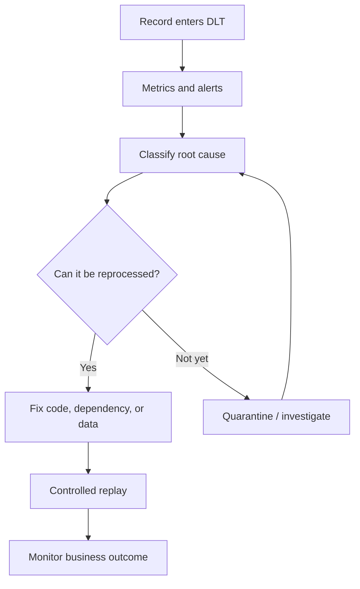

# DeadLetterPublishingRecoverer in Spring Kafka

`DeadLetterPublishingRecoverer` is the Spring Kafka component dedicated to **sending an unprocessable record to a destination topic**, commonly called a dead-letter topic (DLT). It implements `ConsumerRecordRecoverer`: after the listener fails and the retry policy decides not to retry again, the recoverer builds a new record, sends it using `KafkaOperations` (typically `KafkaTemplate`), and attaches metadata to aid error investigation.

In a reliable operations model, the purpose of a DLT is to preserve evidence and input data for analysis, remediation, or controlled replay. Moving a record to the DLT **does not mean the business operation succeeded**. You must track successful records, records recovered to the DLT, and records where the recovery action itself failed separately.

A common setup is:

```text
Source Kafka topic
    |
    v
@KafkaListener
    |
    +-- Processing succeeded --> container acknowledges progress per AckMode
    |
    +-- Throws exception
            |
            v
       DefaultErrorHandler
            |
            +-- Retry per BackOff --> invoke listener again
            |
            +-- Retries exhausted or non-retryable error
                    |
                    v
             DeadLetterPublishingRecoverer
                    |
                    +-- Publish succeeded --> handle offset per policy
                    |
                    +-- Publish failed --> recovery incomplete
```

To use it properly, you need to understand DLT selection, producer configuration, serializers, headers, send-error handling, offset commits, and the data replay process together.

## 1. Where DeadLetterPublishingRecoverer fits

Spring Kafka separates responsibilities into three layers:

| Component | Role |
|---|---|
| `@KafkaListener` | Executes business logic for the received record |
| `DefaultErrorHandler` | Decides how many times to retry, how long to wait, and when to recover |
| `DeadLetterPublishingRecoverer` | Publishes the failed record to the destination topic |
| `KafkaTemplate` or `KafkaOperations` | Sends records to Kafka using the configured producer |
| Listener container | Coordinates polling, acknowledgement, offset commits, and consumer lifecycle |
| DLT consumer/replay process | Investigates or reprocesses records after they enter the DLT |

`DeadLetterPublishingRecoverer` does not activate automatically just because an application uses Kafka or has a topic named `*.DLT`. There must be an error-handling path that invokes the recoverer, such as attaching it to `DefaultErrorHandler`.

Also, do not confuse `DeadLetterPublishingRecoverer` with `@RetryableTopic`. Spring Kafka's retry-topic mechanism can set up its own DLT infrastructure and recoverer. When choosing non-blocking retries via retry topics, inspect that flow's specific configuration rather than assuming a custom `DefaultErrorHandler` bean controls the entire retry schedule.

## 2. When is a record sent to the DLT?

A listener usually just processes the data and lets exceptions propagate to the error handler:

```java
@Component
public class OrderListener {

    private final OrderService orderService;

    public OrderListener(OrderService orderService) {
        this.orderService = orderService;
    }

    @KafkaListener(
        topics = "orders.created",
        groupId = "billing-service"
    )
    public void handle(OrderCreated event) {
        orderService.apply(event);
    }
}
```

If `apply()` throws an exception, `DefaultErrorHandler` may retry. Once attempts are exhausted, or immediately for exceptions classified as `not retryable`, the recoverer is invoked.

Example scenario:

1. An `orders.created` event contains invalid data.
2. The listener throws `InvalidOrderException`.
3. The error handler determines this exception type does not need retries.
4. The recoverer sends the message to `orders.created.DLT`.
5. A consumer or operational workflow monitors the DLT to investigate and handle it later.

If the listener catches the exception and returns normally without performing recovery, the container may consider the record successfully processed and advance the offset. Therefore, you must **rethrow unresolved errors** so the error handler can do its work.

## 3. Basic configuration with DefaultErrorHandler

A straightforward configuration uses `DefaultErrorHandler`, `FixedBackOff`, and `DeadLetterPublishingRecoverer`:

```java
@Configuration
public class KafkaRecoveryConfiguration {

    @Bean
    public CommonErrorHandler commonErrorHandler(
            KafkaTemplate<Object, Object> dltKafkaTemplate) {

        DeadLetterPublishingRecoverer recoverer =
                new DeadLetterPublishingRecoverer(dltKafkaTemplate);

        FixedBackOff backOff =
                new FixedBackOff(1_000L, 2L);

        DefaultErrorHandler handler =
                new DefaultErrorHandler(recoverer, backOff);

        handler.addNotRetryableExceptions(
                InvalidOrderException.class,
                UnsupportedEventVersionException.class
        );

        return handler;
    }
}
```

This configuration assumes the application already has a `KafkaTemplate<Object,Object>` with a producer factory and serializers capable of sending the actual keys/values to the DLT. Appropriate Spring Kafka and Spring Framework imports are required.

`FixedBackOff(1_000L, 2L)` means up to two retry attempts after the initial attempt, with an expected wait of one second. A consistently failing record can invoke the listener a total of three times before recovery.

The two exceptions marked `not retryable` go directly to the recoverer without waiting through the two retry attempts.

In Spring Boot, a `CommonErrorHandler` bean can be detected by Boot's auto-configured default factory and attached to listener containers. If you create your own `ConcurrentKafkaListenerContainerFactory`, verify that it uses Boot's configurer or attach the handler explicitly:

```java
factory.setCommonErrorHandler(commonErrorHandler);
```

Do not assume every custom factory automatically picks up the error handler bean.

## 4. Default topic and partition selection rules

With the simple constructor `new DeadLetterPublishingRecoverer(kafkaTemplate)`, the default resolver uses:

- Destination topic: **source topic name + `.DLT`**.
- Destination partition: **the same partition number** as the original record.

Example:

| Source topic | Source partition | DLT topic | DLT partition |
|---|---:|---|---:|
| `orders.created` | 0 | `orders.created.DLT` | 0 |
| `orders.created` | 3 | `orders.created.DLT` | 3 |
| `payments.accepted` | 1 | `payments.accepted.DLT` | 1 |

This is why a DLT topic usually needs **at least as many partitions as the source topic**. If the resolver requests partition 3 but the DLT only has partitions 0 and 1, publishing can fail.

Keeping the same partition makes it easier to correlate failed records with the source partition, yet the DLT remains a separate topic. A DLT does not automatically guarantee reprocessing order between failed records and normal records in the source topic.

### 4.1. Creating the DLT before consumers start

In production, DLT topics should be provisioned via IaC, Kafka Admin, or an established topic management process. For example, if the source topic has four partitions:

```text
orders.created       -> partitions: 0, 1, 2, 3
orders.created.DLT   -> partitions: 0, 1, 2, 3
```

Beyond partition count, decide replication factor, retention, ACLs, capacity limits, and operational ownership.

If broker auto-create is disabled and the DLT does not exist yet, the recoverer has nowhere to send. If auto-create is enabled but cluster defaults are unsuitable, the DLT may be created with the wrong partition count or replication factor.

## 5. Choosing the DLT with a destination resolver

When you need to route errors according to business logic or your system's naming conventions, pass a function accepting the record and exception and returning a `TopicPartition`:

```java
DeadLetterPublishingRecoverer recoverer =
        new DeadLetterPublishingRecoverer(
                dltKafkaTemplate,
                (record, exception) -> new TopicPartition(
                        record.topic() + ".DLT",
                        record.partition()
                )
        );
```

This resolver matches the default idea: same partition and topic with a `.DLT` suffix.

### 5.1. Routing multiple error types

For example, an application has a shared DLT for schema errors and a separate DLT for dependency errors:

```java
DeadLetterPublishingRecoverer recoverer =
        new DeadLetterPublishingRecoverer(
                dltKafkaTemplate,
                (record, exception) -> {
                    Throwable cause = exception.getCause() != null
                            ? exception.getCause()
                            : exception;

                    if (cause instanceof InvalidOrderException) {
                        return new TopicPartition(
                                "orders.invalid.DLT", -1
                        );
                    }

                    return new TopicPartition(
                            "orders.processing.DLT", -1
                    );
                }
        );
```

When the resolver returns a negative partition (commonly `-1`), the recoverer does not force a specific partition on the `ProducerRecord`; the Kafka producer picks the partition using normal partitioning rules.

This is useful when the DLT has a different partition count from the source topic. However, if keys are used to preserve ordering, you must understand the partitioning algorithm and destination partition count; key ordering on the DLT will not automatically match the source topic.

Exceptions can be wrapped inside other exceptions. The example above only inspects one level of cause for illustration; production code needs classification consistent with the error handler to avoid misrouting across deep cause chains.

### 5.2. Resolver design principles

A resolver should be fast, deterministically compute the destination topic and partition, and avoid high-latency external calls on the recovery path. If routing depends on business data, keep the rules clear and test all error categories thoroughly.

Do not create a new destination topic per event ID or exception message. The system can proliferate too many topics and exceed monitoring capacity.

## 6. KafkaTemplate and serializers for the DLT

The recoverer uses `KafkaOperations` to publish. Therefore, the DLT producer needs serializers compatible with the keys and values forwarded by the recoverer.

Suppose the listener receives JSON already deserialized into `OrderCreated`. When sent to the DLT, the value may be an `OrderCreated` object; a producer using `JsonSerializer` may fit:

```java
Map<String, Object> producerProperties = new HashMap<>();
producerProperties.put(
        ProducerConfig.BOOTSTRAP_SERVERS_CONFIG,
        bootstrapServers
);
producerProperties.put(
        ProducerConfig.KEY_SERIALIZER_CLASS_CONFIG,
        StringSerializer.class
);
producerProperties.put(
        ProducerConfig.VALUE_SERIALIZER_CLASS_CONFIG,
        JsonSerializer.class
);
producerProperties.put(
        ProducerConfig.ACKS_CONFIG,
        "all"
);

ProducerFactory<String, Object> producerFactory =
        new DefaultKafkaProducerFactory<>(producerProperties);

KafkaTemplate<String, Object> dltTemplate =
        new KafkaTemplate<>(producerFactory);
```

This snippet illustrates serializer selection; in a Spring Boot application, producer factory/template beans should be properly configured and managed. If the DLT receives multiple value types, a single serializer may not cover all of them.

### 6.1. Payloads that fail deserialization

Errors can occur **before the listener is called** because the value cannot be deserialized. To route such failed records into Spring Kafka's error-handling pipeline, `ErrorHandlingDeserializer` is commonly used to wrap the actual deserializer.

Example consumer configuration:

```yaml
spring:
  kafka:
    consumer:
      key-deserializer: org.apache.kafka.common.serialization.StringDeserializer
      value-deserializer: org.springframework.kafka.support.serializer.ErrorHandlingDeserializer
      properties:
        spring.deserializer.value.delegate.class: org.springframework.kafka.support.serializer.JsonDeserializer
        spring.json.trusted.packages: "com.example.events"
```

`ErrorHandlingDeserializer` lets the container receive deserialization error info as headers rather than letting a Kafka consumer exception break the poll loop. When routed to the DLT by the recoverer, Spring Kafka can reuse the original raw bytes from the deserialization error info instead of a deserialized object.

In that case, the value sent to the DLT may be **`byte[]`**, while business-error records have a Java object value. If the DLT producer only has a `JsonSerializer` for objects, it may not work for every case. A common setup is using `DelegatingByTypeSerializer` or multiple templates selected by value type to handle both `byte[]` and business objects.

Key takeaway: a producer that can send normal records is not guaranteed to send deserialization-error records. Test malformed JSON payloads, key deserialization failures, and their corresponding error headers explicitly.

### 6.2. Multiple templates for multiple value types

`DeadLetterPublishingRecoverer` supports constructors/mechanisms for selecting `KafkaOperations` based on data type or record, depending on the Spring Kafka version.

This is useful when:

- The DLT topic receives multiple value classes.
- Some records contain raw bytes from deserialization failures.
- Different topics use Avro, JSON, or different serializers.
- Producer transactions/security must be separated by topic group.

Do not force everything into `StringSerializer` via `toString()`. This easily loses the original payload and makes replay difficult or impossible to restore accurately.

## 7. Headers added when publishing to the DLT

One advantage of `DeadLetterPublishingRecoverer` is that it can add metadata describing the record's origin and the exception to the DLT record's headers.

Commonly supported information includes:

| Metadata group | Contents |
|---|---|
| Origin | Original topic, partition, offset |
| Timestamp | Original timestamp and timestamp type |
| Consumer | Associated consumer group |
| Exception | Exception class, cause class, message |
| Diagnostics | Stack trace or equivalent error info |
| Deserialization | Key/value error info when deserialization fails |

Constants in Spring Kafka's `KafkaHeaders` have names like `DLT_ORIGINAL_TOPIC`, `DLT_ORIGINAL_PARTITION`, `DLT_ORIGINAL_OFFSET`, `DLT_EXCEPTION_FQCN`, `DLT_EXCEPTION_MESSAGE`, etc. Check the exact full list and header append/preserve behavior against the Spring Kafka version you run.

Example of information a record may carry:

```text
Destination topic: orders.created.DLT
Original topic:    orders.created
Original partition: 2
Original offset:    1058
Exception type:    com.example.InvalidOrderException
Exception message: Unsupported currency
```

Metadata helps on-call engineers correlate records with logs and traces, and check whether multiple failures originate from the same partition, the same schema, or a specific deployment time.

### 7.1. Headers can contain sensitive data

Exception messages or stack traces may contain input data, file paths, resource names, or system details. Do not assume everyone with read access to the DLT should view all of that metadata.

Control topic ACLs, retention, auditing, and which fields are allowed in logs/dashboards. For exceptions containing sensitive data, you can customize which headers are added to the DLT using APIs supported by your version.

### 7.2. Preserving correlation metadata

If an event carries `eventId`, `correlationId`, `schemaVersion`, or original producer info, preserve them across retries and the DLT if data policy permits.

Do not use unique ID values as metric tags. They are better suited for logs/traces and queried when investigating individual records.

### 7.3. Records going through multiple recovery hops

If a record has already been in a retry topic, a DLT, or replayed and failed again, origin metadata from multiple forwards may appear. When designing a DLT consumer or replay tool, clearly define which field represents the initial origin and which describes the current failure.

Spring Kafka provides options to control header append/replace behavior in certain versions. Never assume every header always has only a single value; Kafka headers can contain multiple entries with the same key. This must be handled intentionally.

## 8. Confirming publish success and handling recovery errors

Calling `KafkaTemplate.send()` is asynchronous; the recoverer initiating the send does not always mean the broker has confirmed durable storage of the record.

`DeadLetterPublishingRecoverer` has settings to check the send result, including `setFailIfSendResultIsError(true)` on supported versions:

```java
DeadLetterPublishingRecoverer recoverer =
        new DeadLetterPublishingRecoverer(dltKafkaTemplate);

recoverer.setFailIfSendResultIsError(true);
recoverer.setWaitForSendResultTimeout(
        Duration.ofSeconds(10)
);
```

When result checking is enabled, a DLT publish failure can be thrown so the error handler knows recovery did not succeed. If you keep the default without waiting for the result, understand the delivery guarantees of the send path and the possibility of asynchronous publish failures in your Spring Kafka version.

In production, decisions to verify include:

1. Does the DLT topic exist and are brokers available?
2. Does the producer have write permission on the DLT topic?
3. Can the serializers handle the actual key/value?
4. Do brokers satisfy `acks`, `min.insync.replicas`, and replication policy?
5. When publishing fails, is the source record's offset committed prematurely?
6. If publishing is retried, could duplicates appear in the DLT?

Waiting for broker publish confirmation can increase error-handler processing latency. If the system requires high durability for the DLT, this cost must be accepted and measured with metrics.

### 8.1. When DLT publishing fails

For example, the recoverer tries to send to `orders.created.DLT` and the producer hits a `TimeoutException`. If the recoverer throws an exception, the record has not reached a successful recovery state. `DefaultErrorHandler` can continue its configured error-handling/retry mechanism.

Do not catch errors from the recoverer and silently treat the record as handled. Doing so can lead to committing the source message's offset even though the data is not in the DLT.

### 8.2. A DLT can contain duplicate records

Even when DLT publishing is confirmed, a failure can occur before the source offset is committed. When the consumer restarts, the source record may be recovered again, creating another DLT record.

DLT consumers and replay processes must tolerate duplicates. Use `eventId` or a stable identifier like original topic/partition/offset to recognize the same source record, combined with idempotent business logic.

## 9. Relationship with offsets and acknowledgement

The recoverer is responsible for publishing failed records. Committing the source offset is still coordinated by the listener container, AckMode, and error handler.

A typical timeline:

```text
Read original record offset=42
  |
Listener throws exception
  |
Retry per policy -> still fails
  |
DeadLetterPublishingRecoverer publishes to DLT successfully
  |
Error handler returns normally
  |
Container handles offset per AckMode/error handler configuration
  |
Next partition position eligible to commit is 43
```

Kafka commits the **offset of the next record to read**. After processing a record at offset 42, the corresponding commit position is 43.

With `DefaultErrorHandler`, the `ackAfterHandle` property controls whether the container can commit the offset after the handler finishes handling an exception without rethrowing. The default in modern versions is `true`.

Additionally, `setCommitRecovered(true)` serves to commit recovered records under certain acknowledgement configurations, notably `MANUAL_IMMEDIATE`. Do not treat it as a blanket toggle for every AckMode without reading the corresponding Javadoc.

You can configure this intentionally:

```java
DefaultErrorHandler handler =
        new DefaultErrorHandler(
                recoverer,
                new FixedBackOff(1_000L, 2L)
        );

handler.setAckAfterHandle(true);
```

Do not treat `ackAfterHandle` as a transaction between the DLT and the offset. If DLT publishing succeeds but the offset commit fails, the source record can still be redelivered.

### 9.1. Duplicate window

Suppose:

1. The recoverer publishes the DLT record successfully.
2. The broker persists the DLT record.
3. The application stops before committing the source offset.
4. The consumer restarts from the old offset.
5. The same record is processed/recovered again and may publish another DLT record.

This is why you must separate Kafka's **delivery semantics** from business idempotency and replay-process idempotency.

### 9.2. Transactions and recovery

With listener containers using Kafka transactions, exception handling, rollback, and offsets have additional rules. In some transactional flows, `DefaultAfterRollbackProcessor` coordinates with the recoverer to handle records after rollback.

Do not assume attaching `DefaultErrorHandler` to a transactional listener container automatically gives an atomic transaction between DLT publishing and offset commit. Use configuration compatible with the transactional listener, transaction manager, and recoverer, and verify with integration tests.

A Kafka transaction only covers Kafka operations that properly participate in the transaction. It does not automatically cover databases or external APIs. For side effects outside Kafka, you need idempotency, inbox/outbox, or other coordination mechanisms.

## 10. Combining retry and DLT by error type

A sound policy must distinguish exception groups:

| Error type | Example | Typically suitable policy |
|---|---|---|
| Transient | HTTP 503, database timeout, brief broker blip | Retry with bounded backoff |
| Fixed data error | Payload missing required field | Early recovery/DLT |
| Schema/deserialization | Invalid JSON, mismatched schema | ErrorHandlingDeserializer and DLT supporting raw bytes |
| Business | Event invalid for current state | Explicitly classify whether to retry or fix data |
| Recovery infrastructure | DLT publish fails | Do not treat recoverer as succeeded |

Example:

```java
@Bean
CommonErrorHandler orderErrorHandler(
        KafkaTemplate<Object, Object> dltKafkaTemplate) {

    DeadLetterPublishingRecoverer recoverer =
            new DeadLetterPublishingRecoverer(
                    dltKafkaTemplate,
                    (record, ex) ->
                            new TopicPartition(
                                    record.topic() + ".DLT",
                                    record.partition()
                            )
            );

    recoverer.setFailIfSendResultIsError(true);

    DefaultErrorHandler errorHandler =
            new DefaultErrorHandler(
                    recoverer,
                    new FixedBackOff(2_000L, 3L)
            );

    errorHandler.addNotRetryableExceptions(
            InvalidOrderException.class,
            UnsupportedEventVersionException.class
    );

    return errorHandler;
}
```

This snippet is an example policy. A two-second wait and three retries are not thresholds for every system. Choose them based on SLOs, exception types, dependency recovery time, and the cost of keeping the consumer busy retrying.

If you want non-blocking retries over many minutes or hours, consider the retry-topic pattern with its own delay schedule, along with monitoring for retry topics and the DLT.

## 11. Operating the DLT as a failed-work queue

Creating a DLT only solves storing failed records. For the system to actually recover, you must define the downstream lifecycle:



When designing a DLT:

- Define the team owning the topic and the alert intake process.
- Choose retention long enough for investigation and reprocessing, compliant with data policy.
- Set write ACLs for the recoverer and read ACLs for operators/replay services.
- Monitor the rate of new records entering the DLT and the age of unresolved records.
- Store cause information, original offset, event ID, and failure timestamp.
- Define criteria for allowing replay versus permanently discarding.
- Rate-limit replay throughput so it does not overwhelm downstream systems.

A DLT consumer should not automatically push every record back to the source topic indefinitely. If the underlying bug is not fixed, this loop only creates more retries, duplicates, and backlog.

## 12. Designing safe replay

Replay can be performed by an operational tool or a dedicated service, depending on requirements. The process usually includes:

1. Querying DLT records by topic, partition, time range, and error type.
2. Reading original topic/partition/offset metadata.
3. Confirming the root cause has been resolved.
4. Checking whether reprocessing is safe.
5. Recording markers/guards against duplicate replay.
6. Publishing in a controlled manner to the chosen topic or processing flow.
7. Monitoring end-to-end results, repeat error counts, and replay rate.

Distinguish two replay modes:

**Replaying to the source topic:** can trigger all subscribed consumer groups, including groups that already processed the event earlier. You must evaluate the system-wide impact.

**Replaying to a dedicated topic/consumer:** isolates the business group that needs reprocessing, though you must design the corresponding schema, transactions, and idempotency.

If the business domain has ordering dependencies, replaying an older event after newer events can produce corrupt state. For events keyed by `orderId`, check version or sequence numbers and design idempotent updates.

## 13. Metrics and logging for the recoverer

A useful production dashboard should separate retries from DLT/recovery:

| Metric | Interpretation |
|---|---|
| Listener failure rate | Error rate in business processing |
| Retry attempts | Number of retry attempts before recovery |
| Recovery success count | Number of records successfully handled by the recoverer |
| Recovery failure count | Number of times the recoverer failed |
| DLT publish latency | Time to send and receive broker confirmation |
| DLT ingress rate | Rate of records entering the DLT |
| DLT backlog/oldest age | Pending backlog in the DLT handling workflow |
| Source topic consumer lag | Read/commit lag on the original consumer |
| Replay success/error | Outcome of reprocessing after fixing the cause |

Spring Kafka provides callbacks/hooks like `RetryListener` to track failed delivery, recovered, and recovery failure in supported versions. You can also instrument `KafkaTemplate`, listeners, and replay services with Micrometer Observation.

Example `RetryListener` used to record metrics by outcome:

```java
DefaultErrorHandler handler =
        new DefaultErrorHandler(
                recoverer,
                new FixedBackOff(1_000L, 2L)
        );

handler.setRetryListeners(new RetryListener() {

    @Override
    public void failedDelivery(
            ConsumerRecord<?, ?> record,
            Exception ex,
            int deliveryAttempt) {
        metrics.incrementRetryFailure(record.topic());
    }

    @Override
    public void recovered(
            ConsumerRecord<?, ?> record,
            Exception ex) {
        metrics.incrementRecovered(record.topic());
    }

    @Override
    public void recoveryFailed(
            ConsumerRecord<?, ?> record,
            Exception original,
            Exception failure) {
        metrics.incrementRecoveryFailure(record.topic());
    }
});
```

Here `metrics` represents a metrics service provided by the application. The callback counts recovery success from the error handler's perspective; understand your DLT publish confirmation configuration before interpreting `recovered` as the record being durably stored by the broker.

### 13.1. Investigation logs

A log entry supporting DLT investigation might look like:

```json
{
  "event": "kafka_record_dead_lettered",
  "sourceTopic": "orders.created",
  "sourcePartition": 2,
  "sourceOffset": 1058,
  "destinationTopic": "orders.created.DLT",
  "exceptionClass": "InvalidOrderException",
  "service": "billing-service",
  "recoveryOutcome": "published"
}
```

This is an illustrative structured log format for the application, not a mandatory auto-generated Spring Kafka log. Avoid writing payloads or exception messages containing sensitive information to logging systems without proper access controls.

### 13.2. Avoiding high-cardinality metrics

Do not put original offset, event ID, record key, or exception message into metric tags. Each distinct value creates a new time series, increasing cost and hurting dashboards. Tag only by service, source topic, destination topic, outcome, and normalized exception class.

## 14. Integration testing the recovery path

A test that only verifies the listener throws an exception is not enough. You must test both the DLT producer and offsets.

### 14.1. Retries exhausted then routed to DLT

Set up a source topic, a DLT, and a dedicated consumer group. Make the listener always throw an exception and configure a short `FixedBackOff`.

Expected results:

1. The listener is invoked once initially plus the configured number of retries.
2. The recoverer sends exactly one DLT record in scenarios without publish errors or restarts.
3. The DLT record preserves the payload and key per the designed serializer mechanism.
4. DLT headers contain the original topic, partition, offset, and required exception metadata.
5. The source offset advances per the error handler/container policy.

### 14.2. Non-retryable exceptions

Make the listener throw an exception listed in `addNotRetryableExceptions()`.

Expect the recoverer to be invoked without waiting through the full backoff. This matters for schema errors or deterministic business failures.

### 14.3. DLT publish failure

Create a scenario where the producer cannot write to the DLT, such as a missing topic or invalid ACL in a test environment. With send-result checking enabled, verify the recoverer reports an error and does not treat the record as successfully recovered.

Also verify that the handler/container does not commit the offset past an unrecovered record under the desired policy.

### 14.4. Deserialization error

Send a malformed payload through a consumer using `ErrorHandlingDeserializer`. Confirm the bad record reaches the DLT and the required raw bytes/headers are preserved. This is an important test if the DLT template uses multiple serializers.

### 14.5. DLT has fewer partitions than source

Have a source topic with partition 3 while the DLT only has two partitions. If the resolver forces partition 3, verify publishing fails. Then test a resolver returning `-1` or creating enough partitions and confirm publishing succeeds.

### 14.6. Restart between DLT publish and offset commit

Simulate a case where DLT publishing succeeded but the consumer has not committed the offset yet. After restart, the same record may appear again in the DLT. Verify the replay process deduplicates by event ID or original topic/partition/offset.

Matrix of scenarios to observe:

| Scenario | What to verify |
|---|---|
| Retry succeeds | No DLT record, business operation completes |
| Retries exhausted | Record arrives in DLT on expected topic/partition |
| Non-retryable error | Moves to recovery early |
| Incompatible DLT serializer | Recovery failure is observable |
| Missing DLT topic / wrong ACL | Publish error is propagated |
| Deserialization error | Appropriate raw data is available for investigation |
| Offset commit fails after publish | Duplicates possible, replay is idempotent |
| DLT consumer/replay fails | Alerts and handling process exist |

## 15. Common misconceptions

**Having a .DLT topic means Spring Kafka sends errors there automatically.** You need an error handler/retry-topic infrastructure actually configured with a recoverer.

**Exhausting retries guarantees DLT publish succeeds.** The DLT producer can fail due to serializers, ACLs, partitions, or brokers. Confirm results according to required durability.

**DLT is treated as business success.** Recovery into a DLT only preserves data for later handling; the business action may still not have occurred.

**DLT topic has fewer partitions than the source topic while using the default resolver.** The resolver can target a non-existent partition. Provision enough DLT partitions or change the resolver.

**Using the same serializer as the source topic for all DLT messages.** Deserialization errors may pass raw `byte[]`, unlike normal record value types. Use suitable serializers/templates.

**Swallowing exceptions in the listener.** The error handler is not invoked when the listener returns normally. Only catch when recovery is intentionally completed or rethrow the exception.

**Automatically replaying every DLT record back to the source topic.** This can cause loops and duplicate side effects. Classify, fix the root cause, and bound replay.

**Assuming DLT publish and offset commit are always atomic.** The two steps can be split by a failure, producing duplicates. Use Kafka transactions in the proper scope when needed and enforce idempotency.

**Measuring only DLT ingress without tracking backlog.** Few new DLT records does not mean older records are resolved. Track age, investigation status, and replay outcomes.

**Logging full payloads/stack traces to public logs.** DLTs can contain sensitive data; apply proper ACLs, retention, and logging policies.

## 16. Implementation workflow for a Spring Boot service

For a new service, you can implement in this order:

1. Identify source topics, consumer group, keys, value schemas, and delivery semantics.
2. Classify transient errors versus errors needing early recovery.
3. Choose `DefaultErrorHandler` and an appropriate backoff.
4. Create `DeadLetterPublishingRecoverer` with a clear destination resolver.
5. Provision the DLT topic with suitable partitions/replication/retention and ACLs.
6. Configure the DLT `KafkaTemplate` and serializers for both business and deserialization errors.
7. Decide whether to wait for DLT publish confirmation and the corresponding timeout.
8. Verify AckMode and the post-recovery commit policy.
9. Configure metrics for retries, DLT publishes, recovery failures, and backlog.
10. Design an investigation runbook, access permissions, and idempotent replay.
11. Test retries, DLT headers, partition routing, restarts, serializers, and commit failures.
12. Re-test whenever upgrading Spring Kafka, schemas, or topic configurations.

A reliable DLT must both preserve failed records and enable safe investigation and recovery. `DeadLetterPublishingRecoverer` provides publishing and metadata capabilities; ensuring records are not lost in failure windows, avoiding duplicates, and completing business state still depend on the overall system design.

## 17. Version-specific references to consult

`DeadLetterPublishingRecoverer` APIs and options evolve across Spring Kafka releases. When implementing or upgrading, consult the exact version of:

- Spring for Apache Kafka Reference — Publishing Dead-letter Records.
- Spring for Apache Kafka Reference — DefaultErrorHandler, exception classification, BackOff, and recovery.
- Spring Kafka Javadoc — `DeadLetterPublishingRecoverer`, `DeadLetterPublishingRecovererFactory`, `ConsumerRecordRecoverer`, and `DefaultErrorHandler`.
- Spring Kafka Reference — ErrorHandlingDeserializer, deserialization failure, and `DelegatingByTypeSerializer`.
- Spring Kafka Reference — Non-blocking retries, `@RetryableTopic`, and DLT processing.
- Spring Boot Reference — Kafka auto-configuration, `CommonErrorHandler`, and listener factory.
- Apache Kafka Documentation — producer acknowledgements, transactions, topic partitions, and consumer offsets.

Prefer the Spring Kafka version managed by Spring Boot and verify methods such as `setFailIfSendResultIsError`, `setWaitForSendResultTimeout`, header customization, or multi-template support in your running version before applying them.
