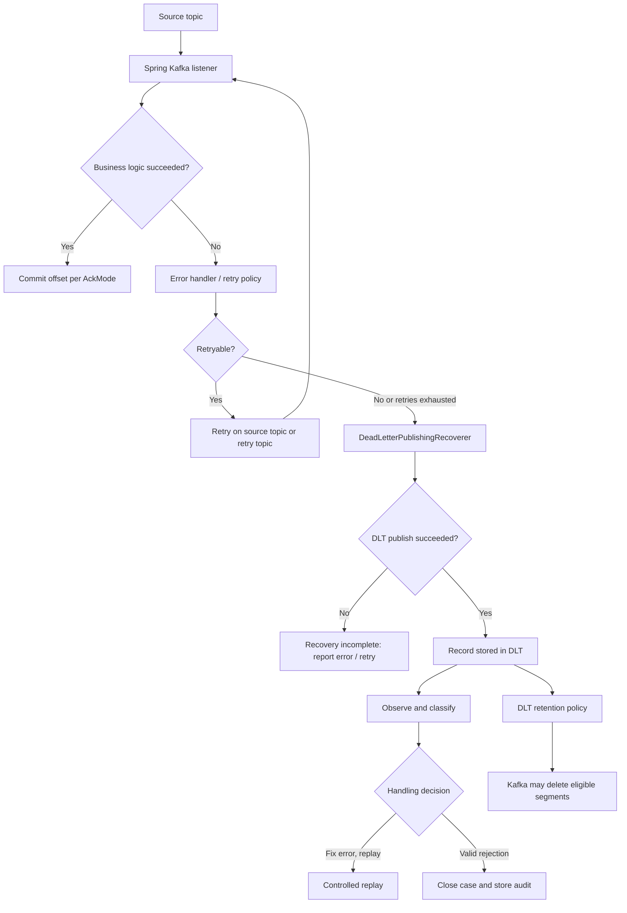

# DLT Retention Policy

In a Spring Kafka system, a **dead-letter topic (DLT)** receives records that a consumer could not process under its retry/recovery policy. The DLT preserves evidence of failed messages so operations can identify root causes, fix data or applications, and decide whether to replay or close out processing per business procedures. However, a DLT is still a **Kafka topic**: data inside it is governed by `retention.ms`, `retention.bytes`, `cleanup.policy`, broker storage capacity, and data protection rules.

If the DLT retention period expires before someone investigates, records may be deleted and no longer have enough data to replay. Conversely, keeping a DLT indefinitely without controls can fill disks, drive up costs, hold sensitive data too long, and let a DLT incident affect the entire Kafka cluster.

A **DLT retention policy** must therefore answer at least four questions: how long to retain failed records, how to bound storage size, who owns handling before expiry, and what happens when an unresolved record is nearing deletion. Do not mechanically copy the source topic's retention settings to the DLT.

## 1. Where does the DLT fit in the message lifecycle?

A typical processing flow:



In the diagram, recovery is considered successful when handing off the record to the DLT is confirmed per the application's mechanism. At that point, the error handler/container **may** allow committing the source offset per configuration. Yet committing the source offset only means the message was handed off to the recovery branch, not that the original business operation completed.

From the moment a record appears in the DLT, the responsible team has a **finite time window** to investigate and remediate before Kafka may delete the data under retention. Thus, a DLT does not automatically substitute for a long-term evidence archive or a ticket-management system.

## 2. Distinguishing retention, retry, replay, and archival

| Concept | Function | What must not be assumed |
|---|---|---|
| Retry | Reprocess a record when the error may be recoverable | Does not mean failed records are stored indefinitely. |
| DLT | Holds failed records after retry/recovery policy decides to divert | Does not guarantee anyone is investigating or replaying. |
| Retention | Kafka policy determining which data is eligible for removal | Not a millisecond-accurate deletion schedule. |
| Replay | Re-emit or reprocess selected records | Does not automatically guarantee ordering or duplicate prevention. |
| Archival | Long-term evidence storage in another store per business rules | Not an automatic built-in behavior of a DLT. |
| Audit | Stores metadata on handling decisions, operators, and outcomes | Does not require keeping sensitive payloads in Kafka forever. |

A message may have exhausted retries, entered the DLT, and never been replayed. Once retention expires, Kafka can still delete it even if an investigation ticket remains open. Topic retention knows nothing about ticket status, error severity, or legal obligations.

## 3. Kafka settings governing DLT record lifespan

### `retention.ms`: time-based retention limit

`retention.ms` defines the log retention duration for topics using deletion (`cleanup.policy=delete`). When a record resides in a log segment eligible for deletion per policy, brokers can remove the entire segment. Setting `retention.ms=-1` means no **time-based** retention limit, though it does not disable size limits or other administrative actions.

For example, configuring 30-day retention on a DLT:

```properties
cleanup.policy=delete
retention.ms=2592000000
```

This is only an illustrative example; the real choice must reflect investigation SLAs, replay needs, storage capacity, and data policies. Do not assume every DLT needs 30 days.

### `retention.bytes`: size-based limit

`retention.bytes` limits log size **per partition**, not total size across the whole topic. If a topic has multiple partitions, total retained data under this limit can reach the configured value multiplied by partition count, before factoring in replication and overhead.

For topics using `delete` policy, Kafka can purge eligible data whenever **either** the time limit or the size limit triggers. Therefore, a DLT configured for 30 days can still lose older segments earlier than 30 days if the `retention.bytes` threshold is reached.

Setting `retention.bytes` to `-1` disables per-partition log size limits via this property. That does not mean cluster capacity is infinite or disk monitoring can be skipped.

### `cleanup.policy`: delete or compact?

| Value | Core behavior | Fit for DLT |
|---|---|---|
| `delete` | Retains log then deletes segments by time/size retention | Usually fits when **every failure** must be kept for investigation/replay. |
| `compact` | Keeps newer records per key, cleans up older versions per compaction algorithm | Usually unsuitable when each failed record is independent evidence. |
| `delete,compact` | Applies both mechanisms per Kafka rules | Use only when key semantics, tombstones, and history needs are clearly understood. |

DLTs often hold multiple failures for the same business key. With log compaction keyed by `orderId`, prior failed records can be compacted away when a newer record with the same key arrives. That erases diagnostic history or data needed for replay. Therefore, the common choice for event DLTs is `cleanup.policy=delete`.

Do not confuse compaction with a way of "keeping messages better." It optimizes for the latest state per key, not full preservation of failure sequences.

### Retention is not a precision deletion clock

Kafka enforces retention at the **log segment** level, not by deleting individual records at exact expiry. A segment is removed only once eligible and processed during the broker's retention check cycle. Settings like `segment.ms`, segment size, retention check interval, and record/segment timestamps affect actual deletion timing.

Therefore:

- Never promise Kafka will delete data down to the exact final minute of a retention day.
- Never rely on retention as a strict per-record personal-data deletion timer.
- Never wait until the very last day to replay or archive.
- When exact deletion policies are required, add supplemental data-governance processes and verify outcomes.

Additionally, the timestamp used for log retention depends on topic/broker settings and how brokers determine timestamps. Records replayed or sent from another system may carry timestamps different from their write time. When designing policies, check `message.timestamp.type`, effective timestamps, and how DLT messages are produced rather than blindly assuming record age equals time since DLT publish.

## 4. Choosing DLT retention based on handling SLAs

Retention should exceed the total time required to detect, investigate, and recover, plus a buffer for holidays, infrastructure incidents, and approvals.

One way to budget it:

```text
Minimum business retention >=
    T_error_detection
  + T_triage_and_owner_assignment
  + T_investigation
  + T_fix_and_deployment
  + T_replay_verification
  + T_safety_margin
```

For example, a system reviews DLTs daily, complex bugs take days to analyze, and fixes ship on a scheduled release cadence. If retention is only a few hours, the risk of losing data before anyone acts is very high.

Conversely, if DLT messages contain personal data, months-long or infinite retention may violate security policies and legal requirements. Agree on durations jointly with business owners, operations, and data governance.

### Tiering DLTs by priority

Not every DLT needs the same duration:

| Data category | Situation | How to set retention |
|---|---|---|
| Critical transactions | Payments, invoices, inventory updates | Align with investigation/reconciliation SLAs and approved durable audit trails. |
| Standard business events | Orders, status updates | Long enough for normal release and replay cycles. |
| Regenerable telemetry | Non-critical metrics or statistical events | Can be shorter if genuinely non-critical and regenerable from source. |
| Sensitive data | Messages with personal info or secrets | Keep to minimum necessary, encrypt/restrict access, and define clear deletion rules. |
| Mass poison pills / schema errors | Undeserializable or malformed payloads | Keep enough samples and metadata to diagnose; consider bounded quarantine rather than infinite retention. |

Retention per tier is a business and data-governance decision, not merely a Spring Kafka technical setting.

## 5. Sizing capacity and preventing premature byte-limit eviction

A time-based retention policy is useless if the DLT constantly hits byte limits or brokers run out of disk. When sizing, estimate normal failure traffic and **mass-incident failure traffic**, not just steady-day averages.

Logical storage estimate:

```text
Data_per_day =
    failed_records_per_day
  × average_serialized_record_bytes

Logical_DLT_storage ≈
    Data_per_day × retention_days

Physical_storage ≈
    Logical_DLT_storage × replication_factor
  + segment/index/metadata/operational_overhead
```

For example, if a DLT receives 2,000 records per day at an average serialized size of 12 KiB, one day's logical data is roughly 23.4 MiB. Over 30 days with a replication factor of 3, replica data is roughly 2.06 GiB before indexes, log segment overhead, and headroom. That is only baseline sizing; a buggy producer emitting millions of bad records in hours can far exceed it.

When sizing, consider:

- Actual serialized key/value size plus Spring Kafka exception header size.
- Peak failure rate during incidents, not only baseline error rates.
- Partition count and key distribution; `retention.bytes` applies per partition.
- Replication factor, disk overhead, log segments, and tiered storage policies if used.
- Retry topics vs. DLT: a single event can appear across multiple retry topics before entering the DLT.
- Recovery duration during prolonged Kafka broker/downstream outages.
- Sufficient headroom so you do not have to slash retention mid-incident.

If you want to guarantee keeping a minimum number of days, do not set `retention.bytes` so low that segments evict early. You can set the byte limit to `-1` and manage space via capacity planning/alerting, or set a threshold large enough for peak scenarios per cluster policy. Every option requires disk alerts and expansion plans.

## 6. Creating a DLT with retention independent of the source topic

Spring Kafka's `DeadLetterPublishingRecoverer` is responsible for **publishing** failed records to the DLT; it does not design retention for you. Retention is a Kafka topic setting managed via Kafka Admin, infrastructure-as-code, or cluster administration tools.

Example using `KafkaAdmin`/Spring Kafka `NewTopic` to declare a DLT for a six-partition `orders.events` topic:

```java
@Bean
NewTopic ordersDeadLetterTopic() {
    return TopicBuilder.name("orders.events.DLT")
            .partitions(6)
            .replicas(3)
            .config(TopicConfig.CLEANUP_POLICY_CONFIG, "delete")
            .config(TopicConfig.RETENTION_MS_CONFIG, "2592000000")
            .config(TopicConfig.RETENTION_BYTES_CONFIG, "-1")
            .build();
}
```

Required classes include `org.apache.kafka.clients.admin.NewTopic`, `org.apache.kafka.common.config.TopicConfig`, and `org.springframework.kafka.config.TopicBuilder`. This configuration illustrates 30-day retention, no topic-level byte limit, and replication factor 3. The cluster needs enough brokers for the replication factor; in production, create/manage topics through controlled pipelines rather than granting every service permission to alter arbitrary topics.

Example configuring `DefaultErrorHandler` to route failed records to the DLT on the same partition:

```java
@Bean
DefaultErrorHandler ordersErrorHandler(
        KafkaTemplate<Object, Object> kafkaTemplate) {

    DeadLetterPublishingRecoverer recoverer =
            new DeadLetterPublishingRecoverer(
                    kafkaTemplate,
                    (record, exception) -> new TopicPartition(
                            record.topic() + ".DLT",
                            record.partition()));

    return new DefaultErrorHandler(
            recoverer,
            new FixedBackOff(1_000L, 3L));
}
```

This illustrates a record listener without Kafka container transactions. If the resolver preserves partitions, the DLT must have matching partitions for the source topic; otherwise, change the resolver to pick valid partitions. The `KafkaTemplate` publishing to the DLT must serialize records properly and hold write permissions on the destination topic.

Do not configure retention under `spring.kafka.consumer` or `spring.kafka.producer`; those apply to Kafka clients. Retention is a **topic/broker setting** and should be verified on brokers after topic creation.

### Changing retention on an existing DLT

Example Kafka CLI command in an environment with admin permissions:

```bash
kafka-configs.sh \
  --bootstrap-server kafka-1.example.internal:9092 \
  --entity-type topics \
  --entity-name orders.events.DLT \
  --alter \
  --add-config retention.ms=2592000000
```

And a describe command to cross-check configuration:

```bash
kafka-configs.sh \
  --bootstrap-server kafka-1.example.internal:9092 \
  --entity-type topics \
  --entity-name orders.events.DLT \
  --describe
```

These are example commands, not commands to run while reading this guide. Actual broker endpoints, permissions, authentication mechanisms, and CLI tools depend on the environment. Lowering retention on a topic holding older data **can cause eligible old segments to be deleted rapidly** once brokers apply the policy. Thus, changing retention is a data-impacting operation requiring an appropriate rollback/backup plan.

## 7. DLT retention is not retry-topic retention

In non-blocking retries, `@RetryableTopic` can create multiple retry topics to hold records during delay intervals. Each retry topic has its own retention. If retention is shorter than expected delays or a retry consumer stays down too long, records in a retry topic can expire before being retried.

Example:

```text
orders.events
  -> orders.events-retry-2000
  -> orders.events-retry-10000
  -> orders.events.DLT
```

Topic names are illustrative; Spring Kafka offers different naming strategies and configurations. For retry topics, ensure retention covers delay intervals plus retry-consumer outage/recovery time. For the DLT, ensure retention covers investigation, fixing, and replay time.

| Topic type | Retention objective | What to measure |
|---|---|---|
| Source topic | Normal consumers and designed business replay | Consumer lag, outage duration, data-rebuild needs. |
| Retry topic | Waiting for scheduled retry and surviving retry-consumer outages | Maximum delay, age of waiting records, retry backlog. |
| DLT | Holding records past retry policy for investigation/remediation | Unresolved record age, investigation SLA, replay deadline. |
| Off-Kafka audit/archive | Keeping evidence per governance policy | Allowed retention period, access control, deletion/verification mechanisms. |

Do not apply the exact same day count to every topic just because they belong to the same business flow. Each topic has a distinct function and recovery window.

## 8. Ensuring durability when records enter the DLT

Retention only matters if records were actually written and remain readable. `DeadLetterPublishingRecoverer`, producer, and DLT topic settings must align with desired durability.

Controls to verify:

1. DLT topic exists with proper partition count and policy-compliant replication factor.
2. Producer uses suitable acknowledgements and retries, such as `acks=all` with idempotence where appropriate.
3. Recoverer detects DLT publish failures, timeouts, serializer errors, or ACL errors instead of silently treating them as recovery success.
4. Source consumer commits processed/recovered offsets only per policy, never prematurely before durable DLT publish.
5. Metrics exist for `DLT publish success/failure`, not solely `listener exception count`.

In Spring Kafka, `DefaultErrorHandler` can treat recovery as successful once the recoverer finishes and returns normally; properties like `ackAfterHandle` and `commitRecovered` affect commits in respective situations. Exact behavior depends on `AckMode`, framework version, and transaction model. Never set `ackAfterHandle` or `commitRecovered` without knowing clearly who commits offsets.

For transactional listeners, review `DefaultAfterRollbackProcessor` and transactional recovery rather than copying a non-transactional model verbatim. DLT topic retention is the same Kafka concept, yet how records reach the DLT and how source offsets commit can differ.

### What makes a DLT record still recoverable?

A record still sitting in the DLT does not guarantee replay will succeed. You still need:

- Payload or a reference to the payload per security policy.
- Compatible schema/version/serializer to decode it.
- Original topic/partition/offset or correlation ID for tracing.
- Event ID for deduplication.
- Exception class, error code, and environment context at failure time.
- Reference data and business rules needed to reprocess.

If reference data can change days later, replaying an old message may trigger a different error or apply under new rules. Retention policies should go hand in hand with versioning and replay semantics.

## 9. Workflow for handling the DLT before expiry

A DLT needs explicit ownership. Even with long retention, without a handling process, failures accumulate and data may expire before anyone notices.

Suggested workflow:

1. **Detect:** monitor new records entering the DLT and alert on arrival or baseline breaches.
2. **Triage:** group by source topic, error code, exception, and timestamp; separate poison pills, business errors, and infrastructure outages.
3. **Assign owner:** file a ticket or case with a deadline ahead of retention expiry.
4. **Remediate:** fix producer, consumer, schema, dependency, configuration, or execute compensation.
5. **Canary replay:** select representative records, verify idempotency and business outcomes.
6. **Batch replay:** rate-limit throughput, watch duplicates and new failures.
7. **Close case:** record counts processed, validly discarded, or moved to an approved archive.
8. **Data cleanup:** let Kafka retention purge per configuration or run approved deletion procedures where governed.

Cases should record topic, partition, offset, event ID, classification, owner, replay/discard decision, action timestamp, and outcome. Store only necessary metadata and avoid copying sensitive payloads into unprotected tickets.

### Replay without losing idempotency

A DLT record may already have executed partial business side effects before the listener threw an exception, or the source record may have retried multiple times. Therefore, replay can produce duplicates.

Consumers should have a stable `eventId` and deduplication, such as an inbox table with a unique constraint written in the same database transaction as the business side effect. If replay emits a corrective message, link it to the original event and clarify whether to keep the same event ID or generate a new one per system semantics.

Do not blindly replay the entire DLT just because a new release shipped. Test, bound batches, watch results, and keep an emergency stop ready if older data is no longer valid.

## 10. Protecting sensitive data and complying with deletion policies

DLTs often retain original failed payloads, which can contain personal details, addresses, identifiers, financial records, or content meant to stay inside business systems. Headers holding stack traces/exception messages can also inadvertently leak sensitive data.

Minimum rules:

- **Minimize:** retain only data required for replay/investigation; consider publishing a reference or masked form.
- **Access control:** apply ACLs strictly for apps publishing to DLT, ops reading, and approved replay tools.
- **Encryption:** use TLS in transit and storage encryption per infrastructure/security requirements.
- **Retention limit:** set explicit bounds; never set `retention.ms=-1` merely to avoid handling the DLT.
- **Audit:** record who read, exported, replayed, or changed topic settings per system capabilities.
- **Deletion policy:** maintain processes for individual data-deletion requests, including backups/archives where required by law or policy.
- **Exception hygiene:** never put secrets, tokens, or verbatim personal payloads into exception messages and DLT headers.

Kafka retention deletes at the segment level and offers no API to delete an arbitrary single record by business key. If you have obligations to erase personal data before retention expires, design storage accordingly—such as storing references to an object-deletable store or using approved topic/segment administration procedures. Never promise that normal compaction or retention satisfies immediate per-person erasure requests.

### DLT and backup/archive

If the business must retain evidence longer than Kafka allows, export approved metadata/payloads to object storage or an audit store with a lifecycle policy. That store needs explicit access controls, encryption, retention, and deletion workflows. Never consider archival complete merely because an export job started; verify objects were persisted and remain retrievable when needed.

## 11. Monitoring effective retention and DLT loss risks

Operations must watch more than consumer lag, because a DLT may **have no permanent consumer group**. Without a group reading the DLT, group lag does not reflect stored record counts or data age.

| Metric / signal | Meaning | Action when abnormal |
|---|---|---|
| DLT arrival rate | Rate of failed records entering DLT | Triage bulk failures; check releases/dependencies. |
| DLT stored data size | Log size by topic/partition | Check disk, `retention.bytes`, and capacity plan. |
| Oldest unresolved record age | Age of oldest unhandled record | Alert before retention deadline. |
| Resolved/unresolved count | Cases handled/pending in ops tracker | Prevent unowned DLT growth. |
| Replay success/failure rate | Quality of error remediation | Stop replay if duplicates or new errors climb. |
| DLT publish failure | Inability to hand off failed records | Fix urgently before advancing source offsets. |
| Topic config drift | Retention or `cleanup.policy` differs from design | Audit approved config changes. |
| Disk utilization / broker log size | Risk of cluster running out of space | Scale or curb source errors; never delete hastily. |
| Partition earliest/latest offsets | Window of records currently retained in log | Estimate how much data retention has purged. |

You can approximate logical record counts by comparing earliest and latest offsets per partition, though cautiously: offsets can have gaps from retention, compaction, or other Kafka behavior. Never equate offset difference with pending actionable messages in every case. Track **unresolved** record counts in a dedicated status/ticket table if you run a replay workflow.

In particular, alert **before** unresolved records hit the deadline. For instance, with 30-day retention, configure tiered alerts by unresolved age so owners still have time to fix and replay. Specific thresholds come from SLAs; never wait until day 30 to fire an alert.

### Timestamp caveat when measuring age

`record.timestamp` does not always equal the time the record entered the DLT. If the record keeps the producer's original timestamp, age computed from that timestamp can exceed actual time stored in the DLT. Conversely, a record published with an anomalous timestamp can skew dashboards.

When monitoring DLT SLAs, record an operational `dltReceivedAt` (or equivalent) timestamp alongside the source timestamp and broker append time. Do not mutate the source payload just to add a timestamp if that breaks contracts; use controlled headers or an external tracking system.

## 12. Runbook: DLT nearing retention yet unhandled

1. Identify the topic, partition, affected record count, and age of the unresolved records.
2. Read effective `retention.ms`, `retention.bytes`, and `cleanup.policy`, and compare against disk/log sizes.
3. Determine whether records contain sensitive data or fall under erasure rules.
4. Prioritize fixing records closest to expiry; assign explicit owners and deadlines.
5. If retention must be extended, assess disk capacity, security, and request approval per infrastructure process.
6. Where permitted, archive required data to a suitable store and verify readability; never treat a scheduled export as done.
7. Run small-batch replays or close valid rejections; record outcomes.
8. Re-check unresolved age and verify no critical records remain near unexpected deletion.

**Never** set `retention.ms=-1` as a default emergency reflex. It can hide backlogs and push the cluster toward full disks.

## 13. Runbook: DLT evicted earlier than expected

1. Check whether anyone recently changed `retention.ms`, `retention.bytes`, or `cleanup.policy`.
2. Check topic-level overrides and broker defaults; check for config drift in admin tools.
3. Compare individual partition sizes against `retention.bytes`; remember this limit is per partition.
4. Inspect timestamps and log segments, especially if DLT messages carry old or unusual timestamps.
5. Check broker logs, disk health, and administrative operations like topic delete/recreate or log truncation.
6. Check whether records can be restored from archives/backups or from source topics still within retention.
7. If replaying from source, use offsets and event IDs to avoid duplicating business effects.
8. Update policies after verifying the root cause; log the incident and add unresolved-age alerts.

Do not assume raising retention back up recovers already-deleted segments. Purged data must be restored from backups or other retained sources if available.

## 14. Runbook: DLT ballooning due to mass failures

1. Group records by exception class, error code, source topic, and producer/consumer version.
2. Check whether a deployment, schema change, ACL change, or dependency outage triggered the spike.
3. Stop the error source from generating bad data if possible, or throttle publishing/quarantine per procedure.
4. Watch broker disk, DLT log size, growth rate, and `retention.bytes` thresholds.
5. Never reduce retention or delete the DLT topic without assessing data recovery needs.
6. Fix the root cause, canary-replay representative records, and then run bounded batch replays.
7. If more capacity is needed, coordinate with Kafka ops to scale or move to an approved archive.
8. Post-incident, adjust capacity plans for peak failure rates and add alerts.

During rapid DLT growth, do not merely raise retention: the system must both preserve needed evidence and throttle the root error rate.

## 15. Runbook: Changing retention policy on a live DLT

1. Snapshot current effective settings and partition/log sizes.
2. Document why retention is changing, replay SLAs, security requirements, and available disk space.
3. Estimate the impact of the new retention, especially if shortening time or lowering byte limits.
4. Check if any unresolved records are already older than the new threshold.
5. Archive/close records requiring preservation per approved procedures.
6. Roll out the change during an appropriate maintenance window with an audit trail.
7. Re-read topic configuration afterward to confirm effective values.
8. Monitor disk, earliest offsets, record age, and DLT counts across subsequent retention cycles.

Changing retention can trigger segment deletion during broker cleanup; it is not safely reversible simply by editing the day count back.

## 16. DLT retention policy control matrix

| Control point | Question to answer | Operational evidence |
|---|---|---|
| Purpose | Is this DLT for replay, investigation, or audit? | Topic owner, data classification, and SLA docs. |
| Time | Does `retention.ms` cover detection, fixes, and replay? | Recovery SLA, unresolved age, and topic config. |
| Capacity | Will `retention.bytes` evict before the time limit? | Partition size, peak error rate, and capacity estimate. |
| Cleanup policy | Does it preserve every needed failed record? | `cleanup.policy`, key semantics, and replay tests. |
| DLT publish | Does the recoverer confirm writes before source offsets advance? | Send results, error handler config, and DLT publish alerts. |
| Replay | Are there owners, approvals, and idempotency checks? | Tickets, batch replay IDs, results, and audit logs. |
| Data security | Does the DLT hold sensitive payloads and is it properly protected? | ACLs, encryption, masking, and data retention policy. |
| Expiry | Do alerts fire before unresolved records expire? | Oldest unresolved age, alert thresholds, and response logs. |
| Recovery | Is there a verified archive/backup if retention exceeds Kafka? | Archive status, restore tests, and lifecycle policy. |
| Change control | Are retention changes approved and impact-checked? | Config diffs, approvals, and post-change monitoring. |

A DLT retention policy is not just a `retention.ms` number. It is an operational commitment balancing message recoverability, Kafka cost, investigation windows, and data-protection obligations. A useful DLT must have retention long enough for handling SLAs, storage sufficient for mass failures, controlled replay capability, and accountable owners acting before records expire. When Spring Kafka moves a record to a DLT, the system has only completed the **error handoff step**; resolving the business case still depends on clear retention and recovery policies.
