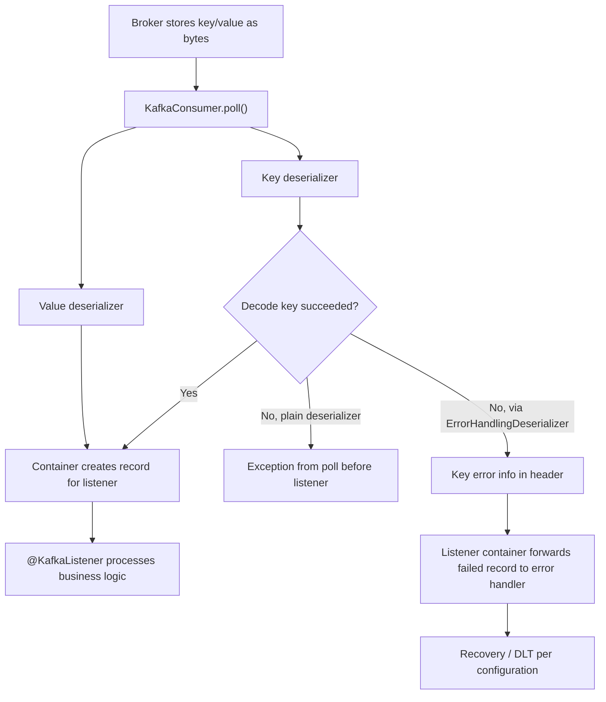

# Key Deserialization Errors in Spring Kafka

In Kafka, a record contains a **key** and a **value** as bytes. Producers serialize them before sending; consumers must deserialize them to restore the data types the application expects. If the **key deserializer** cannot read the byte sequence received from Kafka, an error can occur right inside `KafkaConsumer.poll()`, **before** the `@KafkaListener` method is invoked.

This is a critical operational scenario in the *Spring Kafka Reliability Operations* module: if not handled properly, a "poison record" with a broken key can cause the consumer to repeatedly fail at the same offset, stall commit progress, and cause consumer group lag to keep rising. Simply placing a `try/catch` inside the listener will not work, because the listener has never received the record.

Spring Kafka provides `ErrorHandlingDeserializer` to bring deserialization errors into the listener container's error-handling flow. When configured **for keys**, this class enables `DefaultErrorHandler` to handle the error, classify retries, execute recovery, and forward the record to a dead-letter topic (DLT) if the application configures `DeadLetterPublishingRecoverer`.

This lesson specifically analyzes **key deserialization errors**: how to detect them, configure properly, preserve failing key bytes in the DLT, adjust the DLT producer's serializers, protect offsets, and run operational tests.

## 1. Where are keys deserialized?

A producer might send a record containing:

```text
Topic: orders.created
Partition: 2
Offset: 105
Key bytes:   7B 22 6F 72 64 65 72 49 64 22 3A 31 32 33 7D
Value bytes: ...
```

For example, the key bytes above could be the JSON `{"orderId":123}`. When the consumer configures `JsonDeserializer<OrderKey>`, the key is converted into `OrderKey`.

Typical processing flow:



Note: the diagram simplifies the record creation order to highlight where the error occurs. In practice, keys and values are deserialized by the Kafka consumer inside the `poll()` cycle.

### Keys are not just display fields

Keys often play a role in business decisions:

- Identifying aggregates, such as `orderId` or `customerId`.
- Ensuring events with the same key typically land in the same partition when the producer uses an appropriate partitioner.
- Supporting idempotency, correlation, state storage, or duplicate detection.
- Serving as the key for compacted topics and tombstone operations.

An undeserializable key can prevent the application from identifying the corresponding aggregate. Therefore, **never replace a broken key with a guessed value** and proceed with processing unless that is an explicitly designed and tested business policy.

Kafka brokers do not need to understand the key's schema; brokers only store bytes and metadata. Key deserialization errors usually appear at the consumer because the client reads with the wrong type/schema or receives invalid input bytes.

## 2. Common symptoms when the key deserializer fails

When a consumer directly uses a deserializer that can throw exceptions, logs may show `SerializationException` or `RecordDeserializationException` during `poll()`.

In Spring Kafka configurations, you may see a message similar to:

```text
This error handler cannot process SerializationException directly;
please consider configuring an ErrorHandlingDeserializer
in the value and/or key deserializer.
```

This message reflects a core issue: the exception happened before the container could deliver a valid record to the listener, so a standard error handler lacks the context needed to recover record by record.

Symptoms to correlate:

| Symptom | Likely cause |
|---|---|
| No logs from the listener method | Error occurred before the listener, at the key deserializer |
| Consumer repeats error on same topic/partition/offset | Poison record keeps getting re-read |
| Committed offset does not advance | Failing record has not been processed or recovered |
| Lag rises while consumer remains connected | Consumer is blocked by an undeserializable record |
| Some partitions keep moving while one partition stalls | Error occurs only in one partition or consumer instance |
| Errors start right after a schema upgrade | Reader schema/deserializer incompatible with older data |
| Consumer succeeds in environment A but fails in B | Different version, schema registry config, classpath, or deserializer |

Not every key error throws an exception. For instance, `StringDeserializer` may decode certain invalid UTF-8 bytes using replacement characters rather than always failing. Therefore, to test JSON/Avro/Protobuf key errors, use the real deserializer and schema or a test deserializer configured to throw an error.

## 3. Distinguishing key deserialization errors from similar errors

| Error type | Where does it happen? | Affected data | Handling path |
|---|---|---|---|
| Key deserialization failure | Consumer during `poll()` | Key bytes | `ErrorHandlingDeserializer` for key + error handler |
| Value deserialization failure | Consumer during `poll()` | Value bytes | `ErrorHandlingDeserializer` for value + error handler |
| Message conversion failure | Spring message converter / listener adapter | Payload converted to listener parameter | Listener container error handling |
| Business validation failure | Listener or business service | Already-deserialized data | Retry or DLT per business policy |
| Producer key serialization failure | Producer before send succeeds | Object key -> bytes | Producer-side error handling; not consumer recovery |
| Valid tombstone | Kafka record with `null` value | Intentionally empty value | Handle per topic contract, do not assume error |
| Valid `null` key | Record without a key | Intentionally empty key | Listener can receive null key per contract |

**A `null` key does not by itself prove a deserialization error.** Some producers legitimately send null keys. When `ErrorHandlingDeserializer` encounters an error, Spring Kafka attaches error metadata to headers to distinguish it from a valid null key.

Rely on exception/header metadata and context rather than writing logic that says "if key is null, always send to DLT".

## 4. Common root causes

### 4.1. Consumer uses the wrong deserializer

The producer serializes keys as JSON while the consumer uses `LongDeserializer`, or the producer uses Avro binary while the consumer uses `JsonDeserializer`.

In Kafka, serializer/deserializer configurations must match on wire format. Matching Java class names alone is not enough; bytes on Kafka are the actual interface between producer and consumer.

### 4.2. Incompatible key schema

The key changed from one structure to another that older consumers cannot read. For example, the key used to be a JSON object, and later a producer sends a plain string or adds a field requiring different type handling.

Schema evolution of the **key** must be managed as seriously as the value. With compacted topics, changing key representation can also affect compaction logic and record identity.

### 4.3. Schema Registry or authentication error

For Avro/Protobuf/JSON Schema using Schema Registry, the deserializer may need to fetch schemas by ID or payload info. Connection errors, credentials, permissions, or nonexistent schema IDs can cause key deserialization failures.

Distinguish permanent data errors from transient dependency errors: both show up as "deserialization failed", yet their retry policies should differ.

### 4.4. Old data still exists in the topic

After changing producers, the topic may still contain records in the old format due to retention or replay history. A consumer that only understands the new format may work on recent offsets while failing when reading older data.

### 4.5. Custom deserializer bug

A custom key deserializer may throw exceptions due to parsing bugs, charset handling, misconfigured ObjectMapper, or edge cases on valid but uncommon inputs.

### 4.6. Corrupted or incomplete key payload

The key contains bytes invalid under the agreed format, such as truncated JSON, wrong encoding, or data mistakenly sent by an incompatible producer.

## 5. Why try/catch inside @KafkaListener is not enough

The following example cannot catch all key deserialization errors:

```java
@KafkaListener(topics = "orders.created", groupId = "billing-service")
public void listen(ConsumerRecord<OrderKey, String> record) {
    try {
        orderService.process(record.key(), record.value());
    }
    catch (Exception ex) {
        // Only catches errors occurring after the listener has been invoked.
        log.error("Failed to process order", ex);
    }
}
```

If `JsonDeserializer<OrderKey>` throws an exception right inside `poll()`, the `listen()` method never runs. Furthermore, catching an exception and only logging before returning can make the container treat the record as succeeded and commit the offset, losing the chance to reprocess it.

Two core principles:

1. To handle **deserialization errors before the listener**, configure `ErrorHandlingDeserializer` on the consumer.
2. To handle **business errors inside the listener**, throw the exception to the error handler or complete recovery explicitly; do not swallow unresolved errors.

## 6. How does ErrorHandlingDeserializer for keys work?

`ErrorHandlingDeserializer` is a wrapper around the actual deserializer, also known as the delegate.

When the delegate deserializes successfully, the wrapper returns the converted key. When the delegate fails, the wrapper can return `null` or a configured fallback value and attach `DeserializationException` details in headers for Spring Kafka to handle.

Crucial point: the listener container can detect the error header and forward the failed record to the error handler as an error needing recovery. Under typical configurations, the failed record is not passed to the business listener as a successfully deserialized record.

```text
Kafka key bytes
      |
      v
ErrorHandlingDeserializer (key)
      |
      +-- delegate succeeded --> OrderKey --> listener
      |
      +-- delegate failed --> error metadata in headers
                                      |
                                      v
                            listener container
                                      |
                                      v
                             DefaultErrorHandler
                                      |
                                      v
                          DLT / recovery per policy
```

The wrapper must be placed in the **right position**: the consumer's `key-deserializer`. If only the value deserializer is wrapped, errors in the key delegate can still cause `poll()` to throw an exception before the container has a record to recover.

## 7. Spring Boot configuration for key deserialization

Suppose topic `orders.created` has a JSON key matching model `com.example.events.OrderKey` and a UTF-8 string value.

```yaml
spring:
  kafka:
    bootstrap-servers: localhost:9092
    consumer:
      group-id: billing-service
      enable-auto-commit: false
      auto-offset-reset: earliest

      key-deserializer: org.springframework.kafka.support.serializer.ErrorHandlingDeserializer
      value-deserializer: org.apache.kafka.common.serialization.StringDeserializer

      properties:
        spring.deserializer.key.delegate.class: org.springframework.kafka.support.serializer.JsonDeserializer
        spring.json.key.default.type: com.example.events.OrderKey
        spring.json.trusted.packages: com.example.events
        spring.json.use.type.headers: false

    listener:
      ack-mode: record
```

Meaning:

- `key-deserializer`: Kafka consumer invokes `ErrorHandlingDeserializer` when reading the key.
- `spring.deserializer.key.delegate.class`: wrapper uses `JsonDeserializer` to read the key's JSON bytes.
- `spring.json.key.default.type`: key type to instantiate when not using type headers.
- `spring.json.trusted.packages`: restricts packages trusted by the application when the deserializer performs type resolution.
- `spring.json.use.type.headers: false`: illustrates a key contract specifying a fixed type without relying on type headers.
- `enable-auto-commit: false`: lets the listener container manage offsets according to processing/recovery progress.

`OrderKey` is only an illustrative model. Ensure the ObjectMapper and constructor/record definitions match the actual JSON data sent.

Example expected JSON key:

```json
{"orderId":"ORD-1001","tenantId":"TENANT-A"}
```

If the consumer receives bytes `not-a-json-object` here, the `JsonDeserializer` delegate will throw an error. The wrapper routes the error into the error-handling flow, allowing the system to handle that record instead of failing infinitely in `poll()`.

### 7.1. When both key and value can fail

An application can wrap both:

```yaml
spring:
  kafka:
    consumer:
      key-deserializer: org.springframework.kafka.support.serializer.ErrorHandlingDeserializer
      value-deserializer: org.springframework.kafka.support.serializer.ErrorHandlingDeserializer
      properties:
        spring.deserializer.key.delegate.class: org.springframework.kafka.support.serializer.JsonDeserializer
        spring.deserializer.value.delegate.class: org.springframework.kafka.support.serializer.JsonDeserializer
        spring.json.key.default.type: com.example.events.OrderKey
        spring.json.value.default.type: com.example.events.OrderCreated
        spring.json.trusted.packages: com.example.events
        spring.json.use.type.headers: false
```

This illustrates configuring two fixed JSON types. If producers send string/Avro/Protobuf instead of JSON, substitute the corresponding delegates.

If both key and value fail deserialization together, the record may carry metadata for both errors. When designing DLTs and dashboards, determine which failure is primary and preserve raw data appropriately so both can be investigated.

### 7.2. With Avro or Protobuf

When using Schema Registry serializers, the delegate must be the corresponding ecosystem deserializer with the required schema registry/security properties. `ErrorHandlingDeserializer` only wraps the delegate call; it does not infer or fix schemas on its own.

Do not copy the previous JsonDeserializer configuration and arbitrarily swap class names; check the API and properties of the serializer library in use.

## 8. Java configuration when not using application.yml

For pure Java configuration, the wrapper and delegate can be set via consumer properties:

```java
Map<String, Object> properties = new HashMap<>();

properties.put(
        ConsumerConfig.BOOTSTRAP_SERVERS_CONFIG,
        "localhost:9092"
);
properties.put(
        ConsumerConfig.GROUP_ID_CONFIG,
        "billing-service"
);
properties.put(
        ConsumerConfig.ENABLE_AUTO_COMMIT_CONFIG,
        false
);

properties.put(
        ConsumerConfig.KEY_DESERIALIZER_CLASS_CONFIG,
        ErrorHandlingDeserializer.class
);
properties.put(
        ErrorHandlingDeserializer.KEY_DESERIALIZER_CLASS,
        JsonDeserializer.class
);
properties.put(
        JsonDeserializer.KEY_DEFAULT_TYPE,
        "com.example.events.OrderKey"
);
properties.put(
        JsonDeserializer.TRUSTED_PACKAGES,
        "com.example.events"
);
properties.put(
        JsonDeserializer.USE_TYPE_INFO_HEADERS,
        false
);

properties.put(
        ConsumerConfig.VALUE_DESERIALIZER_CLASS_CONFIG,
        StringDeserializer.class
);

ConsumerFactory<OrderKey, String> consumerFactory =
        new DefaultKafkaConsumerFactory<>(properties);
```

This snippet illustrates declaring a consumer factory. In a real application, this configuration should accompany a listener container factory, error handler, and cluster security properties.

Constant names and some serializer APIs must be verified against the dependency version. If using Spring Boot, prefer Boot-managed properties or `KafkaProperties` to avoid duplicating configuration across multiple places.

## 9. How does DefaultErrorHandler handle key errors?

Once `ErrorHandlingDeserializer` supplies error info to the container, `DefaultErrorHandler` can receive the failed record and apply backoff/recovery.

With key bytes incompatible with the current schema, retrying the same bytes with the same deserializer usually fails again. Therefore, `DeserializationException` belongs to the group of errors commonly treated as **non-retryable** by default in `DefaultErrorHandler` in modern versions.

A common policy is routing key-failed records to a DLT for investigation:

```java
@Configuration
public class KafkaErrorConfiguration {

    @Bean
    public CommonErrorHandler commonErrorHandler(
            KafkaTemplate<Object, String> dltKafkaTemplate) {

        DeadLetterPublishingRecoverer recoverer =
                new DeadLetterPublishingRecoverer(dltKafkaTemplate);

        DefaultErrorHandler handler =
                new DefaultErrorHandler(
                        recoverer,
                        new FixedBackOff(1_000L, 2L)
                );

        return handler;
    }
}
```

The non-retryable default for `DeserializationException` should be verified for your Spring Kafka version. The example backoff mainly serves other retryable exceptions; there is no reason to try decoding a broken JSON key repeatedly when the bytes do not change.

A `CommonErrorHandler` bean can be attached by Spring Boot to the default auto-configured listener container factory. With custom factories, confirm `setCommonErrorHandler()` or `ConcurrentKafkaListenerContainerFactoryConfigurer` is applied appropriately.

### 9.1. Do not retry permanent schema errors infinitely

If key bytes are corrupted, retrying in the same consumer will not repair the payload. Infinite retries can stall the partition and drive up lag.

If the cause is Schema Registry being temporarily unavailable, handling may differ. In that case, separate dependency schema-lookup failures from permanent data errors, and design bounded retries, appropriate backoff, and explicit recovery. Do not treat all errors wrapped into a deserialization exception as operationally identical.

### 9.2. Do not skip offsets silently

Manual consumer `seek()` can be used to skip a failing offset in certain emergencies, but it risks **losing records** without a saved copy for later processing. This is not the default strategy for a reliable system.

Prefer configuring `ErrorHandlingDeserializer` with a DLT to preserve raw bytes and root causes. If skipping is mandatory during an incident, require approval, audit logging, preservation of the raw record, and a replay plan.

## 10. Pay special attention to keys when publishing to DLT

This is easily overlooked.

On a deserialization error, a Java key object may not have been constructed. However, the system still needs to retain the **original key bytes** for investigation and possible replay. Spring Kafka versions supporting `DeadLetterPublishingRecoverer` can recover raw key/value bytes from error metadata when publishing to the DLT.

Consequence: the same DLT producer can encounter **two types of keys**:

1. Successfully deserialized key: e.g., `OrderKey`.
2. Key that failed deserialization: raw bytes of type `byte[]`.

If the DLT `KafkaTemplate` uses only `JsonSerializer<OrderKey>`, it may fail to handle a `byte[]` key properly. If it uses only `ByteArraySerializer`, it may fail to write `OrderKey` from ordinary business errors.

`DelegatingByTypeSerializer` can select a serializer based on the key's runtime type:

```java
@Bean
public KafkaTemplate<Object, String> dltKafkaTemplate(
        @Value("${spring.kafka.bootstrap-servers}")
        String bootstrapServers) {

    Map<String, Object> config = new HashMap<>();
    config.put(
            ProducerConfig.BOOTSTRAP_SERVERS_CONFIG,
            bootstrapServers
    );
    config.put(ProducerConfig.ACKS_CONFIG, "all");

    Map<Class<?>, Serializer<?>> keySerializers =
            new LinkedHashMap<>();

    keySerializers.put(
            byte[].class,
            new ByteArraySerializer()
    );
    keySerializers.put(
            OrderKey.class,
            new JsonSerializer<OrderKey>()
    );

    Serializer<Object> keySerializer =
            new DelegatingByTypeSerializer(keySerializers, true);

    ProducerFactory<Object, String> producerFactory =
            new DefaultKafkaProducerFactory<>(
                    config,
                    keySerializer,
                    new StringSerializer()
            );

    return new KafkaTemplate<>(producerFactory);
}
```

This example is **for a topic with a `String` value**. If the value can also be `byte[]` or a domain object, configure the value serializer accordingly, possibly with a similar delegating mechanism.

`DelegatingByTypeSerializer` does not decode invalid schemas. It enables the DLT producer to emit data matching whatever Java type the recoverer holds. Exact raw key-byte recovery behavior depends on the Spring Kafka version, so verify it in an integration test before deploying.

### 10.1. If you do not want to preserve the same partition

`DeadLetterPublishingRecoverer`'s default resolver typically sends to `<source-topic>.DLT` with the same partition index. The DLT must have that partition, otherwise publishing can fail.

You can customize the destination resolver:

```java
DeadLetterPublishingRecoverer recoverer =
        new DeadLetterPublishingRecoverer(
                dltKafkaTemplate,
                (record, exception) ->
                        new TopicPartition(
                                record.topic() + ".DLT",
                                -1
                        )
        );
```

When returning a negative partition, the producer picks the destination partition instead of forcing the original record's partition. However, preserve `original topic`, `original partition`, and `original offset` in headers so the original position remains traceable.

Do not confuse the partition a broker assigned to the source record with the key deserialization outcome. The original record already lived on a partition before the consumer read it, even when the consumer cannot decode the key.

## 11. Key error metadata in the DLT

`ErrorHandlingDeserializer` provides exception metadata in headers. `DeadLetterPublishingRecoverer` also adds record origin and exception metadata so operators can investigate.

Data worth preserving:

| Data | Purpose |
|---|---|
| Original topic | Identify record source |
| Original partition | Locate affected partition |
| Original offset | Cross-reference committed offsets and logs |
| Original timestamp | Check when producer wrote the record |
| Original key bytes | Allows re-attempting deserialization with the right schema on replay |
| Exception class/cause | Classify schema, classpath, connection, or payload errors |
| Schema/format version | Know which reader to use |
| Consumer group/listener ID | Identify the application that detected the error |
| Correlation/event ID if available | Link record to business context |

Spring Kafka provides `KafkaHeaders` for DLT such as original topic/partition/offset and exception metadata. Some deserialization headers use a framework-managed format; do not arbitrarily deserialize header bytes with Java serialization in untrusted tools.

When reading the DLT, use the APIs and constants of your exact version rather than hardcoding internal header names if APIs may change.

### 11.1. If the key fails, can you still get the event ID?

It depends on the message contract. If the event ID lives only in the key and the key cannot be deserialized, the application cannot assume it has a valid event ID. You can inspect raw bytes or other metadata during investigation, but do not assign a guessed ID for business logic.

If the value or headers also contain a stable, reliable correlation ID, it can help correlate logs without decoding the broken key.

### 11.2. Protecting data and headers

Raw key bytes may contain customer identifiers or sensitive data. The DLT requires appropriate ACLs, retention, encryption, and logging policies. Do not print full raw bytes or stack traces onto public dashboards.

## 12. When the key fails and the value is valid, should processing continue?

Usually **no**, if the key is an essential part of the business contract. For example, a handler relies on `OrderKey.orderId` to update the right order. Setting the key to null and processing the value could write wrong data or break idempotency.

However, some pipelines can process independently of the key. Spring Kafka offers advanced options such as `failedDeserializationFunction` to build a fallback value from error info. If the application uses a fallback, clearly establish:

- Is a fallback allowed under the schema contract?
- Does business logic recognize that this is a substitute key?
- Will the fallback value cause distinct records to collapse onto one key?
- Are original raw bytes still preserved for investigation?
- During replay, could this create duplicates or break ordering?

Do not enable a fallback merely to avoid container errors. Implement it only when business owners confirm the desired behavior and thorough tests exist.

## 13. Offsets, commits, and avoiding poison-pill loops

Kafka's committed offset is the **next** position the consumer group will read. Suppose a record at offset 105 has a key error; after successful recovery per policy, the committed position can advance to 106.

Timeline:

```text
poll() receives record at offset 105
    |
Key delegate fails
    |
ErrorHandlingDeserializer attaches error metadata
    |
Listener container invokes error handler
    |
DeadLetterPublishingRecoverer saves to DLT
    |
Recovery confirmed per configuration
    |
Container commits corresponding offset progress
    |
Consumer continues to next record
```

Distinguish:

- **Source offset commit:** confirms the consumer group no longer needs to re-read from the processed/recovered position.
- **DLT publish:** writes a copy of the failed record to a separate topic.
- **Business completion:** business work is done; this does *not* happen merely because a record entered the DLT.

DLT publishing and offset committing are not an atomic transaction by default. If the record reaches the DLT successfully but the offset commit fails, it can be recovered again after a restart and produce a duplicate in the DLT.

Therefore, investigation/replay workflows must tolerate duplicates, such as deduplicating by original topic, partition, offset, or a suitable event ID.

### 13.1. Ensure the DLT producer reports send failures

For high durability requirements, consider configuring the recoverer to fail if the broker does not confirm a successful send:

```java
recoverer.setFailIfSendResultIsError(true);
recoverer.setWaitForSendResultTimeout(
        Duration.ofSeconds(10)
);
```

Methods and timeout semantics depend on the Spring Kafka version. When configured properly, a DLT publish failure causes recovery to fail instead of silently treating the record as handled.

Also verify producer `acks`, retries, serializers, topic/partition, and ACLs. Do not use "called `send()`" as the sole proof that the record was durably persisted.

### 13.2. When a partition has been stuck for a long time

If a service previously did not use `ErrorHandlingDeserializer`, a consumer may be stuck at an offset. After deploying the wrapper + recoverer, the consumer can re-read that record and route it to the DLT to move on.

If someone already changed committed offsets manually, reconcile audit records and raw topic retention to avoid accidentally skipping records beyond recovery. Do not reset an entire consumer group just to resolve one failed record without assessing the impact on other partitions.

## 14. Do not equate key errors with partition assignment

A key deserialization error **does not cause Kafka to change the assignment of an already-stored record**.

A record's partition is determined when the producer sends the record or by an explicitly specified partition. When the consumer reads the record, it receives topic/partition/offset from the broker. A failing key deserializer does not alter that metadata.

However, a key error can affect:

- Grouping logic or state stores at the business layer.
- Ability to deduplicate by business key.
- Re-publishing fixed records to another topic if the new partitioner relies on the deserialized key.
- Replay workflows preserving event ordering per aggregate.

For example, a replay tool setting a failed record's key to null could cause the record to be routed to a different partition when republished. For workloads needing per-key ordering, this change can have major consequences.

When replaying, decide explicitly whether to preserve raw key bytes, repair the key to match the new schema, or keep the intended target partition. Each choice has trade-offs for idempotency and ordering.

## 15. Observing key deserialization errors in production

For early detection and diagnostics, monitor these signals:

| Signal | How to interpret |
|---|---|
| Key deserialization failure count | Measures prevalence of failing data |
| Key errors by topic/partition | Identifies affected scope |
| Exception class and cause category | Separates schema, serializer, registry, and data errors |
| Consumer lag by partition | Detects stalled partitions |
| DLT record ingress | Rate at which failed records are recovered |
| DLT publish failures | Recovery failed to persist the record |
| Time from error to recovery | Evaluates latency of poison-record handling |
| Kafka consumer rebalances | Checks if prolonged errors impact the group |
| Age of unprocessed DLT records | Assesses investigation backlog |
| Replay success/error | Tracks remediation and data re-ingestion |

Use low-cardinality metric tags: service, topic, consumer group, error category, outcome. Do not use raw keys, original offsets, event IDs, or exception messages as tags because they can generate huge numbers of time series.

Detailed identifiers belong in structured logs or traces with access controls.

### 15.1. Structured log example

```json
{
  "event": "kafka_key_deserialization_failure",
  "service": "billing-service",
  "topic": "orders.created",
  "partition": 2,
  "offset": 105,
  "consumerGroup": "billing-service",
  "errorCategory": "invalid_key_json",
  "recoveryOutcome": "dead_lettered",
  "destinationTopic": "orders.created.DLT"
}
```

This is an example log produced by application/observability infrastructure, not a mandatory Spring Kafka format. Avoid logging raw key bytes or sensitive message contents unnecessarily.

### 15.2. When lag rises with no listener errors

Check the container and Kafka consumer logs, because the key deserializer may be failing before the listener. If `ErrorHandlingDeserializer` is not configured, listener metrics may not reflect how often the consumer actually fails inside `poll()`.

## 16. Integration testing for key deserialization errors

Testing should run against a test Kafka broker or equivalent environment. The goal is not just getting an exception, but proving the failed record is preserved and the consumer can continue processing subsequent records.

### 16.1. Preparation

1. Create topic `orders.created` with known partitions.
2. Create topic `orders.created.DLT` with sufficient partitions.
3. Consumer uses `ErrorHandlingDeserializer` for the key and `JsonDeserializer<OrderKey>` as delegate.
4. Configure `DefaultErrorHandler` with `DeadLetterPublishingRecoverer`.
5. DLT producer has serializers supporting `byte[]` keys and `OrderKey` keys if both cases can happen.
6. Use a dedicated consumer group for the test and clean topics to verify offsets.

### 16.2. Sending a record with broken key bytes

To deliberately create a key that is not valid JSON, use a test producer with `ByteArraySerializer` for key and value:

```java
byte[] invalidKey =
        new byte[] { 0x01, 0x02, 0x03 };

byte[] validValue =
        "valid-order".getBytes(StandardCharsets.UTF_8);

ProducerRecord<byte[], byte[]> poisonRecord =
        new ProducerRecord<>(
                "orders.created",
                0,
                invalidKey,
                validValue
        );

rawKafkaProducer.send(poisonRecord).get();
```

`rawKafkaProducer` is a `KafkaProducer<byte[], byte[]>` or `KafkaTemplate<byte[], byte[]>` properly configured with `ByteArraySerializer`. Selecting partition 0 is solely to make position predictable in the test.

To verify the consumer keeps advancing, send another record with a valid JSON key to the same partition.

### 16.3. Conditions to verify

| Scenario | Expected result |
|---|---|
| Valid JSON key | Listener receives `OrderKey` normally |
| Invalid JSON key | Business listener does not process the failed record as success |
| Key deserialization failure header | Error handler receives the exact error and record details |
| Retry policy | Permanent data errors go to recovery per configuration |
| DLT routing | Record appears in the expected destination topic/partition |
| Raw key bytes | DLT retains bytes needed for investigation/replay per version |
| Source offset | Advances per policy after recovery completes |
| Subsequent valid record | Consumer continues and processes it |
| Misconfigured DLT producer serializer | Recovery failure is observable |
| Restart after DLT publish before commit | Duplicates possible; replay/handler deduplicates |
| Valid null key | Not misclassified as a deserialization failure |

### 16.4. Testing without ErrorHandlingDeserializer

A separate test can configure `JsonDeserializer<OrderKey>` directly without the wrapper, send a poison record, and observe the exception from `poll()`.

The purpose is to demonstrate why `try/catch` in the listener has no effect and why a wrapper is needed for the key. Do not let this scenario run infinitely in CI; bound the duration and stop the container cleanly.

### 16.5. Testing DLT with different value types

If the system also handles value deserialization errors, add tests sending invalid raw values. Ensure the DLT serializer can accept the exact data types produced by the recoverer. Key-error and value-error branches usually need independent tests because keys and values use separate serializers.

## 17. Key deserialization incident runbook

When errors appear in production, follow this sequence:

1. Identify topic, partition, offset, consumer group, and error timestamp.
2. Check whether the exception occurs before or inside the listener.
3. Verify whether the consumer's actual `key-deserializer` is `ErrorHandlingDeserializer`.
4. Identify the specific key delegate: String, JSON, Avro, Protobuf, or custom.
5. Compare the key format the producer is writing with what the consumer expects.
6. If using Schema Registry, verify schema ID, registry connectivity, ACLs, and reader/writer compatibility.
7. Check whether failed records are reaching the DLT or recovery is also failing.
8. Verify whether the DLT producer serializer supports raw key bytes.
9. Confirm committed offsets and whether subsequent records are being processed.
10. After fixing the root cause, perform controlled replay and verify idempotency.

If schema changes are the cause, plan compatibility between producers and consumers; do not resolve by deleting failed records or bulk-resetting offsets.

## 18. Misconceptions that cause data loss

**Wrapping only the value deserializer.** Key errors still occur in `poll()` if `key-deserializer` is not properly wrapped.

**Believing try/catch in the listener catches all Kafka errors.** Key deserialization usually happens before the listener is invoked.

**Treating a null key as always an error.** Kafka allows valid null keys; rely on error metadata, not just null checks.

**Retrying a malformed JSON key infinitely.** Bytes do not change, so the error repeats; route to appropriate recovery.

**Assuming the DLT template only needs JsonSerializer.** Failing keys may need raw `byte[]` written. The DLT serializer must support all actual key/value types.

**Skipping records with seek without saving them.** Risks losing business data and leaving no raw record for later processing.

**Using StringDeserializer to test malformed UTF-8 and expecting it to always throw.** Some decoders substitute invalid characters; use a deserializer/format that actually validates input.

**Thinking DLT completes the business workflow.** DLT is a holding place for failed records awaiting follow-up; it requires alerts, ownership, retention, and replay.

**Confusing partition with the deserialized key.** A source record's topic/partition/offset exists before the consumer decodes the key; do not infer partition from a failing key.

**Replaying with a null key instead of the raw key or a schema-repaired key.** Records may land on different partitions and break ordering/idempotency logic.

**Not monitoring DLT producer failures.** If a record was not durably written to the DLT while the source offset advanced, recovery capability may be lost.

## 19. Policy design by error type

Not every key deserialization error warrants the same handling.

| Cause | Retry? | Handling direction |
|---|---|---|
| Permanently malformed JSON/schema key bytes | Usually unhelpful | DLT; fix producer/contract; controlled replay |
| Producer and consumer use different wire formats | No, until config changes | Fix deserializer or compatibility; keep raw record |
| Schema Registry temporarily unavailable | Possibly, with bounded backoff | Check dependency; handle infra error; avoid retry storm |
| Schema ID does not exist | Usually needs intervention | Check schema governance and DLT |
| Wrong classpath/type mapping | Needs deployment fix | Update configuration and test compatibility |
| Bug in custom deserializer | Not until fixed | Fix code, deploy, replay |
| Valid null key | Not an error | Listener handles per topic contract |

For transient dependency errors, exception classification should inspect the specific cause instead of classifying purely on the wrapper exception. For permanent data errors, a DLT typically lets the consumer keep moving while preserving records for investigation.

## 20. Pre-production checklist

Before promoting the consumer to production, verify:

- Key contract is clearly defined for bytes, schema, encoding, and version.
- Key deserializer matches the serializer used by producers.
- `ErrorHandlingDeserializer` is configured on **key-deserializer**, not just value.
- Delegate is properly configured and trusted.
- Listener does not swallow unhandled business errors.
- `DefaultErrorHandler` has explicit retry/recovery policies.
- DLT topic exists with sufficient partitions, ACLs, and retention.
- DLT producer supports raw key bytes and key objects when needed.
- DLT publish failures are observable and not treated as success.
- Raw bytes/source headers are preserved per Spring Kafka version.
- Source offsets advance only per policy after recovery.
- Dashboards track key deserialization failures, consumer lag, DLT ingress, and recovery failures.
- Replay does not create duplicate side effects or alter keys/partitions unexpectedly.
- Integration tests include at least one broken key, one subsequent valid key, and one DLT publish failure scenario.

## 21. Version-specific references

When implementing or upgrading, verify against official documentation for your exact component versions:

- Spring for Apache Kafka Reference — *Handling Exceptions / ErrorHandlingDeserializer*.
- Spring Kafka Javadoc — `ErrorHandlingDeserializer`, `DeserializationException`, `SerializationUtils`, `DefaultErrorHandler`.
- Spring Kafka Javadoc — `DeadLetterPublishingRecoverer` and serializer options for DLT.
- Spring for Apache Kafka Reference — *Publishing Dead-letter Records*.
- Spring Boot Reference — `spring.kafka.consumer.key-deserializer`, `spring.kafka.consumer.properties`, listener factory auto-configuration.
- Apache Kafka Documentation — consumer `poll()`, deserializers, committed offsets, and partitioning.
- Specific serializer/schema registry docs if using Avro, Protobuf, or JSON Schema.

Header names, APIs for extracting exception details, the recoverer's ability to restore raw key bytes, and handling of records with both key and value errors can differ across Spring Kafka versions. Always verify with integration tests on your actual dependencies.

The core reliability takeaway here is: **key deserialization errors occur before the listener, yet should not stall the partition or lose records**. Use `ErrorHandlingDeserializer` for the key, an error handler with explicit recovery, a DLT producer supporting raw bytes, and offset traceability to turn corrupted records into failed tasks that can be safely investigated and reprocessed.
