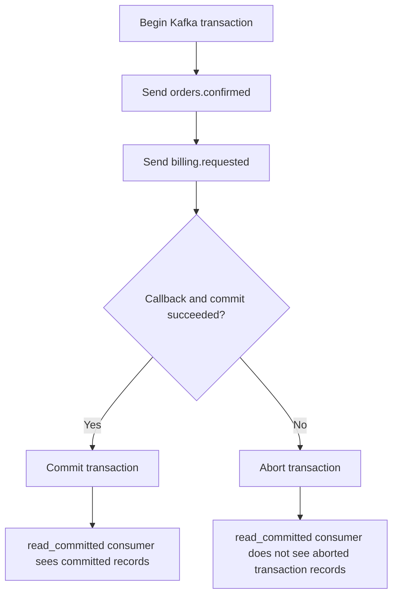

# executeInTransaction in Spring Kafka

`KafkaTemplate.executeInTransaction(...)` is the Spring Kafka API that executes a group of message-sending operations inside a **local Kafka transaction**. Instead of each `send()` call acting as an independent operation from a transaction perspective, the application can perform multiple publishes within the same Kafka transaction: either all records are committed and become visible to consumers configured with `read_committed`, or the transaction is aborted on error.

This API is useful for tasks **involving only Kafka writes**, such as a service that needs to emit `orders.confirmed` and `billing.requested` together, or a scheduled job that emits a batch of records without letting readers see results from an aborted transaction.

However, `executeInTransaction` is **not** a distributed transaction across databases, HTTP APIs, or other storage systems; and it does **not automatically** include consumed message offsets in the same Kafka transaction. In systems using `@KafkaListener`, this distinction is especially important: separate transactions opened by `KafkaTemplate` itself from transactions managed by a listener container or Spring transaction manager.

## 1. What Problem Do Kafka Transactions Solve?

Suppose a business operation needs to emit the following two records:

```text
orders.confirmed       key=ORDER-42
billing.requested      key=ORDER-42
```

If sent with two independent publish calls, the following can happen:

1. Record `orders.confirmed` is successfully written by the broker.
2. The producer loses connectivity or hits a serializer error while sending `billing.requested`.
3. Downstream sees only the first record, even though business logic required both records to be accepted together or canceled together.

Kafka transactions place multiple sends belonging to a transaction under the same commit/abort boundary. A consumer configured with `isolation.level=read_committed` does not return records from aborted transactions.



This capability is **distinct** from `acks=all` or idempotent producers:

| Mechanism | Purpose |
|---|---|
| `acks=all` | Waits for broker write acknowledgment per replication policy |
| Idempotent producer | Reduces duplicates caused by producer retries within supported semantics |
| Kafka transaction | Groups multiple Kafka sends into a single commit/abort unit |
| `read_committed` consumer | Does not return records belonging to aborted transactions |
| Business idempotency | Prevents duplicate side effects when events, requests, or jobs rerun |

Kafka transactions do not guarantee that two records are received by a listener in the same `poll()`. They guarantee that records from aborted transactions are not returned to `read_committed` consumers and that commit markers determine transaction state.

## 2. Where Does executeInTransaction Sit?

`executeInTransaction` is a method on `KafkaTemplate<K, V>`, using a `ProducerFactory` capable of creating **transactional Kafka producers**.

Typical invocation pattern:

```java
T result = kafkaTemplate.executeInTransaction(operations -> {
    operations.send("topic-a", key, valueA);
    operations.send("topic-b", key, valueB);
    return someResult;
});
```

The `operations` object in the callback exposes `KafkaOperations` methods for the active transaction. Inside the callback, use this object to send records so operational boundaries remain clear and consistent.

Conceptually, Spring Kafka executes the following flow:

```text
KafkaTemplate.executeInTransaction(callback)
  |
  |-- Obtain transactional Producer from ProducerFactory
  |-- beginTransaction()
  |-- Execute callback(operations)
  |     |-- send(record A)
  |     |-- send(record B)
  |
  |-- Callback succeeds --> commitTransaction()
  |
  +-- Callback throws exception --> abortTransaction()
  |
  +-- Close/return Producer to factory per management policy
```

If commit or abort itself fails, the call can end with an exception; the application must distinguish an uncertain outcome from a confirmed successful transaction.

`executeInTransaction` **opens its own local Kafka transaction**. You do not need `@Transactional` on the calling method to create this boundary.

## 3. Prerequisite: Transactional ProducerFactory

To use `executeInTransaction`, `ProducerFactory` must be configured to support transactions. In Spring Kafka, the common way is setting a **transaction ID prefix**, so the factory creates producers with an appropriate `transactional.id`.

Example `application.yml` for Spring Boot:

```yaml
spring:
  kafka:
    bootstrap-servers: localhost:9092

    producer:
      transaction-id-prefix: orders-publisher-node-a-
      key-serializer: org.apache.kafka.common.serialization.StringSerializer
      value-serializer: org.springframework.kafka.support.serializer.StringSerializer
      acks: all

    consumer:
      isolation-level: read_committed
```

In this example:

- `transaction-id-prefix` enables transactional producer configuration through Spring Boot when auto-configuration applies.
- The prefix `orders-publisher-node-a-` is illustrative only. Across multiple instances, **each instance must have a non-conflicting prefix**.
- `acks=all` is a producer setting supporting higher durability when broker/ISR conditions are met.
- `isolation-level: read_committed` applies to the **consumer**. This setting does not change the producer's ability to commit transactions.

With a `KafkaTemplate<String, String>` created by Spring Boot from the right producer factory, the application can call `executeInTransaction` directly.

### 3.1. Configuring ProducerFactory in Java

When not using Boot properties or configuring independently:

```java
@Configuration
public class TransactionalKafkaConfiguration {

    @Bean
    public ProducerFactory<String, String> producerFactory() {
        Map<String, Object> props = new HashMap<>();

        props.put(
                ProducerConfig.BOOTSTRAP_SERVERS_CONFIG,
                "localhost:9092"
        );
        props.put(
                ProducerConfig.KEY_SERIALIZER_CLASS_CONFIG,
                StringSerializer.class
        );
        props.put(
                ProducerConfig.VALUE_SERIALIZER_CLASS_CONFIG,
                StringSerializer.class
        );
        props.put(ProducerConfig.ACKS_CONFIG, "all");

        DefaultKafkaProducerFactory<String, String> factory =
                new DefaultKafkaProducerFactory<>(props);

        factory.setTransactionIdPrefix("orders-publisher-instance-1-");

        return factory;
    }

    @Bean
    public KafkaTemplate<String, String> kafkaTemplate(
            ProducerFactory<String, String> producerFactory) {
        return new KafkaTemplate<>(producerFactory);
    }
}
```

This snippet requires the corresponding imports from Spring Kafka, Kafka clients, `Map`, and `HashMap`. It is a standalone example to clarify the principle; in Spring Boot apps, avoid creating multiple producer factory beans simultaneously without distinguishing them by name or `@Qualifier`.

Transactional Kafka producers require brokers that support the transaction protocol. On single-broker test clusters, also verify broker properties for the transaction state log and appropriate replication; if broker prerequisites are not met, transactions may fail to initialize.

### 3.2. Why Must transactional.id Be Managed?

Kafka uses `transactional.id` to identify producer transactions and prevent an older producer session from continuing to write after a new instance replaces it (*producer fencing*).

If two application instances intentionally or accidentally share a transactional ID, one producer can be fenced. Therefore:

- Each running instance's prefix should uniquely identify that instance.
- Within the same factory, Spring Kafka can append suffixes to distinguish concurrently used producers.
- Account for restarts, failovers, scale-out, and concurrent transaction counts.
- Do not generate a random prefix on **every send**; this must be a manageable and observable naming strategy.

With container orchestration, you can include the pod ID, instance ID, or a deployment-specific value in the prefix. Avoid using one fixed string across every replica of a service.

## 4. Simple Example: Publishing Two Events in One Transaction

A service wants to emit two Kafka events together, each represented as a JSON string:

```java
@Service
public class OrderEventPublisher {

    private final KafkaTemplate<String, String> kafkaTemplate;

    public OrderEventPublisher(
            KafkaTemplate<String, String> kafkaTemplate) {
        this.kafkaTemplate = kafkaTemplate;
    }

    public void publishOrderConfirmed(
            String orderId,
            String confirmedJson,
            String billingRequestedJson) {

        kafkaTemplate.executeInTransaction(operations -> {
            operations.send(
                    "orders.confirmed",
                    orderId,
                    confirmedJson
            );

            operations.send(
                    "billing.requested",
                    orderId,
                    billingRequestedJson
            );

            return null;
        });
    }
}
```

If both sends and the commit succeed, the transaction is committed. If the callback throws an exception, Spring Kafka aborts the transaction. If the producer reports an error during send or commit, the call can fail; never treat it as published successfully when an exception is thrown.

**Note on `send()` calls:** in modern Spring Kafka versions, it returns `CompletableFuture<SendResult<K,V>>`. Receiving a future immediately does not mean the broker has acknowledged the write. Transaction commit must finalize pending sends, and errors may surface after the callback returns, at commit time.

For applications needing early send-error detection inside the callback, you can await the futures before returning from the callback, as shown next.

## 5. Awaiting Send Results Inside the Callback

Starting with Spring Kafka 3.x, many `KafkaTemplate.send()` overloads return `CompletableFuture`. You can wait for sends with `CompletableFuture.allOf()` and throw if any send fails.

```java
public void publishAtomically(
        String orderId,
        String firstEvent,
        String secondEvent) {

    kafkaTemplate.executeInTransaction(operations -> {

        CompletableFuture<SendResult<String, String>> first =
                operations.send(
                        "orders.confirmed",
                        orderId,
                        firstEvent
                );

        CompletableFuture<SendResult<String, String>> second =
                operations.send(
                        "billing.requested",
                        orderId,
                        secondEvent
                );

        CompletableFuture.allOf(first, second)
                .orTimeout(10, TimeUnit.SECONDS)
                .join();

        return null;
    });
}
```

`join()` throws an unchecked `CompletionException` if any future fails, and `orTimeout()` fails the combined future when the timeout expires. An exception escaping the callback sends the transaction down the abort path.

This example involves a trade-off: awaiting sends inside the callback increases the duration the transaction stays open. Choose timeouts based on broker latency, system load, and transaction timeout; avoid unbounded waits in production workloads requiring stability.

If using Spring Kafka 2.x, the `send()` future type may be `ListenableFuture` instead of `CompletableFuture`. Adapt the code to your actual dependency version rather than copying 3.x examples verbatim.

### 5.1. Where Should Exceptions Be Caught?

An easily observable pattern is wrapping outside the transaction call:

```java
try {
    kafkaTemplate.executeInTransaction(operations -> {
        operations.send("orders.confirmed", orderId, eventJson);
        return null;
    });

    log.info("Kafka transaction committed for order {}", orderId);
}
catch (RuntimeException ex) {
    log.error("Kafka transaction failed for order {}", orderId, ex);
    throw ex;
}
```

The success log runs only after `executeInTransaction` returns normally. Never log "committed" right after `send()` inside the callback, because commit has not happened yet.

Avoid swallowing exceptions or returning HTTP success before having evidence that the transaction committed, unless the business contract accepts asynchronous processing with a subsequent status-checking mechanism.

## 6. Return Values from executeInTransaction

`executeInTransaction` is a generic-returning API, so the callback can return business data related to the operations performed:

```java
String publishedOrderId =
        kafkaTemplate.executeInTransaction(operations -> {
            operations.send(
                    "orders.confirmed",
                    "ORDER-42",
                    "{\"orderId\":\"ORDER-42\"}"
            );

            return "ORDER-42";
        });
```

`publishedOrderId` is the value returned from the callback, **not** a Kafka transaction ID, an offset commit, or a guarantee that downstream executed business logic. The call simply returns normally when no exception prevents transaction completion.

If you need Kafka metadata such as partition, offset, or timestamp, collect it from `SendResult` after a successful send. Do not use callback return values as a substitute for producer send acknowledgments.

## 7. How Local Transactions Differ from Spring-Managed Transactions

This is the most critical distinction when using `executeInTransaction`.

Spring Kafka supports multiple ways of managing transactions:

| Usage | Transaction boundary | Characteristics |
|---|---|---|
| `KafkaTemplate.executeInTransaction(callback)` | Local Kafka transaction opened by the template | Does not require `@Transactional`; commits/aborts around callback |
| `@Transactional` with `KafkaTransactionManager` | Spring-managed Kafka transaction | Spring manages transaction and binds resources |
| `@KafkaListener` with transactional listener container | Transaction initiated by listener container | Can coordinate Kafka outputs and consumer offsets |
| `@Transactional` with `DataSourceTransactionManager` | Database transaction | Does not automatically make Kafka and DB commits atomic |
| Kafka transaction + database/outbox | Multiple durable boundaries | Requires coordination/idempotency design; no automatic XA |

When a Spring-managed transaction already exists on the thread, `executeInTransaction` **still creates its own separate local Kafka transaction**, rather than joining the active Spring transaction. Spring Kafka uses an appropriate producer for that local transaction; commit/abort happens independently.

### 7.1. Example: @Transactional Database Does Not Protect Kafka Sends

Suppose a method is managed by a JDBC transaction:

```java
@Transactional
public void createOrder(Order order) {
    orderRepository.save(order);

    kafkaTemplate.executeInTransaction(operations -> {
        operations.send(
                "orders.created",
                order.getId(),
                toJson(order)
        );
        return null;
    });

    // An exception occurs here:
    verifyAnotherConstraint(order);
}
```

If the local Kafka transaction already committed and then `verifyAnotherConstraint()` throws an exception causing the database transaction to roll back, the event can still exist in Kafka. `executeInTransaction` cannot roll back an already committed Kafka transaction just because the outer JDBC transaction rolled back.

Conversely, the database may commit while publishing to Kafka fails if operation ordering and transaction design allow it. Achieving consistency between a database and Kafka usually requires a transactional outbox, inbox/idempotency, or a proven coordination pattern.

### 7.2. Example: @Transactional Kafka and Local Transactions

If a method is already inside a `KafkaTransactionManager` transaction, calling `executeInTransaction` does not place those sends inside the Spring-managed transaction.

It is nested only in terms of code execution, **not** a nested transaction sharing the same outcome. The two transactions can commit/abort independently. Do not use this API to try to "join" an active transaction; it can produce unexpected results.

If you want sends to participate in a Spring-managed transaction, normally just call `kafkaTemplate.send(...)` within that transaction's scope.

## 8. Does executeInTransaction Automatically Commit Consumer Offsets?

**No.** Calling `executeInTransaction` to publish records does not automatically include the offset of a consumed record in the transaction.

Suppose a listener processes:

```java
@KafkaListener(
    topics = "orders.created",
    groupId = "billing-service"
)
public void onOrderCreated(ConsumerRecord<String, String> record) {
    kafkaTemplate.executeInTransaction(operations -> {
        operations.send(
                "billing.requested",
                record.key(),
                record.value()
        );
        return null;
    });
}
```

Explanation:

1. The consumer reads `orders.created`.
2. `executeInTransaction` opens and commits a local Kafka producer transaction for `billing.requested`.
3. The listener returns normally.
4. The listener container handles acknowledgment/offset commit of `orders.created` according to its configuration.

Steps 2 and 4 **do not form a single transaction by default**. If the instance dies after publishing `billing.requested` but before committing the consumer offset, the source record may be read again and emit a duplicate `billing.requested`.

When you need **Kafka-scoped** consume-process-produce exactly-once semantics, use a listener container properly configured for Kafka transactions. The container can initiate the transaction, let `KafkaTemplate.send(...)` participate, and include consumer offsets in the same transaction before committing. Never replace that model with a plain local `executeInTransaction`.

### 8.1. What Is Sending Consumer Offsets to a Transaction?

Kafka supports sending consumer group offsets into a producer transaction via `sendOffsetsToTransaction` with matching consumer group metadata. That is the core mechanism tying Kafka outputs to the consumed position.

Knowing offset 42 and sending an output event in a local transaction is not enough. The application must also ensure offsets are sent into the same transaction for the right consumer group and committed/aborted together with output records.

In Spring Kafka, the container-managed transaction model is recommended for listeners because the framework manages associating consumer, producer, and offsets with the container lifecycle. Exact configuration depends on the Spring Kafka version.

## 9. Practical Kafka-Only Transactional Publisher Example

An application receives a request from an API or scheduled task and publishes a pair of Kafka events. There is no input consumer offset to manage:

```java
@Service
public class OrderEventPublisher {

    private final KafkaTemplate<String, String> template;

    public OrderEventPublisher(KafkaTemplate<String, String> template) {
        this.template = template;
    }

    public void publishPair(
            String orderId,
            String confirmedJson,
            String invoicingJson) {

        template.executeInTransaction(operations -> {
            var first = operations.send(
                    "orders.confirmed",
                    orderId,
                    confirmedJson
            );

            var second = operations.send(
                    "invoicing.requested",
                    orderId,
                    invoicingJson
            );

            CompletableFuture.allOf(first, second)
                    .orTimeout(10, TimeUnit.SECONDS)
                    .join();

            return null;
        });
    }
}
```

This is a good fit for a local transaction when all side effects needing atomicity are solely the Kafka records sent in the callback.

If `invoicing.requested` triggers a system outside Kafka, the transaction only guarantees publishing to Kafka. It cannot guarantee downstream sends an invoice only once; downstream still needs idempotency keyed by `orderId` or event ID.

## 10. Transaction Success, Abort, and Uncertain States

A transaction can conclude with three practical outcome categories:

### 10.1. Successful commit

The callback sends records, the broker accepts them, and the producer commits the transaction successfully. `read_committed` consumers can observe the records once committed, depending on poll state and consumer position.

### 10.2. Transaction abort

The callback throws an exception or the producer hits an error causing the transaction to abort. Physically written records from that transaction are not returned to `read_committed` consumers.

`read_uncommitted` consumers can see records from aborted transactions. Therefore, if downstream must never observe canceled results, check the `isolation.level` configuration of every relevant consumer.

### 10.3. Uncertain outcome

The producer may encounter a timeout, network error, or connection loss during commit. The client may receive an exception without knowing for sure whether the broker committed, depending on error type and timing. Never conclude that every error means the transaction definitely aborted.

When callers must retry the entire business operation, account for potential event duplicates. Use event IDs, stable keys, deduplication mechanisms, or business state checks. Avoid unbounded retry loops when the previous attempt's outcome is undetermined.

## 11. Producer Fencing and transactional.id

Kafka uses producer epochs and `transactional.id` to prevent an older producer from writing once a new producer owns the same transactional identity.

Scenario:

```text
Instance A uses transactional.id = orders-service-1
A has an open transaction

Instance B starts with the same transactional.id
Broker determines new producer replaces old producer
Instance A may be fenced
```

Certain exceptions or fatal errors related to producer fencing prevent the current transaction from continuing safely. When that occurs, never catch the error and try to keep using the fenced producer.

With `DefaultKafkaProducerFactory`, configure a transaction ID prefix suited to the number of running instances and concurrent transactions. If a prefix is shared across all replicas, unintended fencing risk becomes very high.

Spring Kafka's producer factory manages producer caching/reuse and builds transactional IDs from the prefix according to its API/version. Never attach a random transactional ID to every `send()` as a workaround for managing the producer pool.

## 12. Transaction Timeout and Callback Duration Limits

Kafka transactions are not allowed to run indefinitely. Brokers and producers enforce related limits:

- `transaction.timeout.ms`: Kafka producer timeout configuration.
- `transaction.max.timeout.ms`: maximum transaction timeout accepted by the broker.
- Wait times from send futures, metadata, and broker ACKs.
- Time spent executing business logic inside the callback.
- Transaction coordinator availability and cluster load.

For example, a callback containing an HTTP call taking three minutes can keep the Kafka transaction open for a very long time:

```java
kafkaTemplate.executeInTransaction(operations -> {
    // Do not keep a Kafka transaction open while waiting
    // for an HTTP call without a timeout.
    String result = remoteService.call();
    operations.send("events", "key", result);
    return null;
});
```

A better design is separating data preparation outside the Kafka transaction if doing so does not break business consistency boundaries:

```java
String eventJson = remoteService.prepareEventWithTimeout();

kafkaTemplate.executeInTransaction(operations -> {
    operations.send("events", "key", eventJson);
    return null;
});
```

If you must read a database or interact with dependencies inside the transaction, understand retries, timeouts, and consistency if that dependency changes while the Kafka transaction is open.

### 12.1. How Do Overly Long Transactions Affect Consumers?

For `read_committed` consumers, Kafka uses the **last stable offset** to withhold records belonging to open or aborted transactions. A long-running open transaction on a partition can prevent subsequent records behind it from being returned as operators expect.

Thus, transaction duration is a real reliability metric, not just a producer HTTP response-time concern.

## 13. Differences Between Local Transactions and Multi-Record Batching

If you only want to optimize throughput, transactions are not always needed.

| Case | Consideration |
|---|---|
| Two events must commit or abort together in Kafka | `executeInTransaction` fits |
| Sending many independent events, each retried individually | A non-transactional producer can be used |
| Downstream should exclude aborted records | Combine transactional producer with `read_committed` consumer |
| Grouping network requests to improve throughput | Producer batching/compression, not transactions |
| Atomic writes to database and Kafka | Transactional outbox or another consistency strategy |
| Consume one Kafka record and publish outputs with consumer offset | Transactional listener container, not plain local `executeInTransaction` |

Transactions add overhead for `begin`, commit/abort, coordinator coordination, and producer management. For workloads with many tiny transactions, measure latency and throughput before deciding to batch or restructure publishing.

## 14. Interaction with Spring Boot Auto-Configuration

Spring Boot can create `ProducerFactory`, `KafkaTemplate`, and transaction-related beans when auto-configuration conditions are satisfied. Configuring `spring.kafka.producer.transaction-id-prefix` is the standard way to prepare producers for transactions.

Centralized configuration example:

```yaml
spring:
  kafka:
    bootstrap-servers: kafka.internal:9092

    producer:
      transaction-id-prefix: payment-publisher-instance-a-
      key-serializer: org.apache.kafka.common.serialization.StringSerializer
      value-serializer: org.springframework.kafka.support.serializer.StringSerializer
      acks: all
      properties:
        transaction.timeout.ms: 30000

    consumer:
      isolation-level: read_committed
```

This value is only an example; when running multiple pods, generate a distinct prefix per pod or instance. Depending on the Boot version, setting a transaction prefix can cause Boot to provide a `KafkaTransactionManager` when corresponding conditions are met.

**However, having a `KafkaTransactionManager` bean does not alter `executeInTransaction` semantics:** the method still creates a local transaction independent of any active Spring-managed transaction.

If the application declares custom `ProducerFactory` or `KafkaTemplate` beans, Boot may back off from creating the default beans. In that case, verify the bean injected into your service actually uses a producer factory with a transaction ID prefix.

### 14.1. Verifying the Right KafkaTemplate

When multiple Kafka clusters or multiple producer factories exist, do not confuse a non-transactional template with a transactional template:

```java
@Service
public class NotificationPublisher {

    private final KafkaTemplate<String, String> transactionalTemplate;

    public NotificationPublisher(
            @Qualifier("transactionalKafkaTemplate")
            KafkaTemplate<String, String> transactionalTemplate) {
        this.transactionalTemplate = transactionalTemplate;
    }
}
```

The name `transactionalKafkaTemplate` must be a bean declared by your application, not a name Boot always creates by default. `@Qualifier` makes explicit which template owns local transactions.

Calling `executeInTransaction` with a producer factory that does not support transactions will fail. Catch this in integration tests or startup validation before deploying to production.

## 15. KafkaTemplate.execute vs executeInTransaction

`KafkaTemplate` also has an `execute(...)` API to run a callback directly against a producer.

| API | Meaning |
|---|---|
| `execute(ProducerCallback)` | Runs operations with a producer; does not open a local Kafka transaction |
| `executeInTransaction(OperationsCallback)` | Opens/commits/aborts a local Kafka transaction around the callback |
| `send(...)` inside a Spring-managed transaction | Joins the Spring/container-managed transaction when properly configured |
| `send(...)` outside a transaction | Regular publish, depending on template/factory settings |

The two methods `execute` and `executeInTransaction` have similar names but **are not interchangeable** simply because both accept a callback.

When transactions are required, pick the API matching your desired boundary and verify the underlying producer is actually configured as transactional.

## 16. Reading Transactions from the Consumer Side

A producer transaction test is incomplete if it only checks whether a record physically exists on the broker without distinguishing committed vs aborted records.

Example consumer using the Java Kafka client:

```java
Map<String, Object> consumerProps = new HashMap<>();
consumerProps.put(
        ConsumerConfig.BOOTSTRAP_SERVERS_CONFIG,
        "localhost:9092"
);
consumerProps.put(
        ConsumerConfig.GROUP_ID_CONFIG,
        "audit-committed-events"
);
consumerProps.put(
        ConsumerConfig.KEY_DESERIALIZER_CLASS_CONFIG,
        StringDeserializer.class
);
consumerProps.put(
        ConsumerConfig.VALUE_DESERIALIZER_CLASS_CONFIG,
        StringDeserializer.class
);
consumerProps.put(
        ConsumerConfig.ISOLATION_LEVEL_CONFIG,
        "read_committed"
);
```

With Spring Boot, the equivalent configuration is:

```yaml
spring:
  kafka:
    consumer:
      isolation-level: read_committed
```

If a consumer uses `read_uncommitted`, it may see records belonging to aborted transactions. Therefore, transactional publisher design must align with consumers that rely on transactional visibility.

A `read_committed` consumer can still process duplicates at the business layer upon retries, replays, or duplicate upstream sources; `read_committed` does not replace idempotency.

## 17. Integration Tests: Commit and Abort

You can use `@EmbeddedKafka` or Testcontainers Kafka to test real transaction boundaries against a broker. Tests must configure a transaction-supporting broker and create topics explicitly.

### 17.1. Happy-path commit

Scenario:

1. Create topics `orders.confirmed` and `billing.requested`.
2. Create a transactional producer factory with a test-dedicated prefix.
3. Call `executeInTransaction` and send one record to each topic.
4. Wait for `executeInTransaction` to return normally.
5. Use a `read_committed` consumer with a fresh group ID to read each topic.
6. Verify both committed records are readable.

If using `CompletableFuture`, you can await futures inside the callback to detect send failures early instead of relying solely on the callback executing.

### 17.2. Abort path when callback throws

An intentional test:

```java
assertThrows(IllegalStateException.class, () ->
    kafkaTemplate.executeInTransaction(operations -> {
        operations.send(
                "orders.confirmed",
                "ORDER-42",
                "must-not-be-visible"
        );

        throw new IllegalStateException("simulate failure");
    })
);
```

Then read the topic with a `read_committed` consumer and verify the record from the aborted transaction **is not returned**. Avoid testing by inspecting raw logs or checking only a `read_uncommitted` consumer, because aborted records can still exist in the physical log.

Isolate group IDs and topics per test so results do not depend on committed offsets from prior runs. Use timeout-bounded wait conditions rather than long fixed `Thread.sleep()` calls that make tests flaky.

### 17.3. Asynchronous send failure path

Intentionally induce a send failure via a controlled test scenario such as a serializer throwing an exception or a broker rejecting a topic. Verify `executeInTransaction` is not treated as successful by the caller.

When simulating timeouts/commit errors, never assume an exception proves the broker definitely did not commit. Uncertain states must be recorded and handled idempotently in business logic.

### 17.4. Multi-instance and fencing tests

Create two publishers attempting to use the same transactional ID to observe fencing behavior, then assign separate prefixes for the two instances to verify no unintended conflicts occur.

This test requires a real broker and explicit transaction timing; do not turn it into a simple mocked unit test and conclude broker fencing works.

## 18. Monitoring and Operating Transactions

To detect failures early, collect the following signal groups:

| Signal | Operational value |
|---|---|
| Transaction begin/commit/abort count | Rate of succeeded vs canceled transactions |
| Transaction duration p50/p95/p99 | Detect slow callbacks or commits |
| Producer send error rate | Separate serializer, authorization, and network errors |
| Commit/abort exceptions | Identify transactions not completing cleanly |
| Producer fencing failures | Detect transactional ID conflicts or failovers |
| Producer request latency | Investigate broker/network slowdowns |
| Transaction coordinator errors | Detect broker or metadata incidents |
| Downstream `read_committed` lag | Detect long-open transactions or slow consumers |
| Business retry/duplicate count | Track idempotency and replays |

Spring Kafka and the Kafka client expose producer metrics; Micrometer Observation can help trace publish and caller latency per framework configuration. However, do not claim a standard timer accurately measures `beginTransaction` to `commitTransaction` across every version.

If you need **transaction duration** at the API boundary, the application can instrument around `executeInTransaction`:

```java
long startedNanos = System.nanoTime();
String outcome = "committed";

try {
    kafkaTemplate.executeInTransaction(operations -> {
        operations.send("orders.confirmed", orderId, json);
        return null;
    });
}
catch (RuntimeException ex) {
    outcome = "failed";
    throw ex;
}
finally {
    long elapsed = System.nanoTime() - startedNanos;
    meterRegistry.timer(
            "app.kafka.local_transaction.duration",
            "outcome", outcome
    ).record(elapsed, TimeUnit.NANOSECONDS);
}
```

`meterRegistry`, `orderId`, and `json` are dependencies/variables in the service. This metric measures total duration of the local transaction call on the caller side, not downstream business processing time.

Do not use `orderId`, event ID, specific transactional ID, or exception message as metric tags: high cardinality makes dashboards expensive and hard to operate. Put those IDs in structured logs or traces instead.

### 18.1. Safe transaction logging

A log entry may include service, instance ID, logical workflow, intended message count, outcome, latency, and error category. Avoid logging full payloads or Kafka credentials.

Example:

```json
{
  "event": "kafka_local_transaction",
  "service": "order-service",
  "workflow": "order-confirmed-publish",
  "recordCount": 2,
  "outcome": "committed",
  "durationMs": 72
}
```

This is an illustrative application log, not a format auto-generated by Spring Kafka.

## 19. Common Usage Mistakes

**Forgetting to configure transaction ID prefix.** A producer factory without transaction support cannot satisfy `executeInTransaction` calls. Configure `spring.kafka.producer.transaction-id-prefix` or `DefaultKafkaProducerFactory.setTransactionIdPrefix`.

**Using the same transactional prefix for all replicas.** Easily triggers fencing across instances' producers. Design prefixes per instance and concurrent transaction count.

**Assuming `send()` returning a future means committed.** The callback still has to finish and the transaction must commit successfully.

**Swallowing exceptions inside the callback.** If an operation fails yet the callback returns normally, the transaction may take the commit path. Let errors propagate and catch only when intentionally handled.

**Putting unbounded HTTP calls inside the callback.** Transactions stay open too long, increasing latency, hitting transaction timeouts, and stalling `read_committed` consumers.

**Confusing `execute()` with `executeInTransaction()`.** `execute()` does not open a transaction automatically; choose the right API.

**Confusing local transactions with `@Transactional` transactions.** `executeInTransaction` opens its own transaction and does not merge with a Spring-managed transaction.

**Using `executeInTransaction` inside `@KafkaListener` and claiming exactly-once.** Consumer offsets do not automatically join the template's transaction. A duplicate window still exists between publish and offset commit.

**Configuring a transactional producer while leaving consumers on `read_uncommitted`.** Consumers can see records from aborted transactions, causing confusion about atomic visibility.

**Assuming Kafka transactions cover databases.** A database rollback does not automatically roll back an already committed local Kafka transaction. Use outbox/inbox or an appropriate consistency pattern.

**Retrying the whole transaction infinitely on timeout.** Transaction outcome may be uncertain and re-invoking can emit duplicate events. Bound retries, observe outcomes, and design for idempotency.

**Not testing against a real broker.** Mocking `KafkaTemplate` proves the callback was invoked, not that broker transactions committed/aborted or fencing works properly.

## 20. When Should You Choose executeInTransaction?

`executeInTransaction` is a strong choice when:

- A method or job needs to publish **multiple Kafka records** under an all-or-nothing boundary.
- There is no input Kafka consumer offset to co-commit, or the application clearly understands and accepts offsets being managed separately.
- Atomic coordination with databases or external APIs is not required.
- The producer factory has a safe, instance-unique transaction ID prefix.
- Consumers needing transactional visibility use `read_committed`.
- Operations teams have instrumentation for commits/aborts, timeouts, and fencing.

Consider another pattern when:

- A `@KafkaListener` consume-transform-produce flow must bind **input offsets** and **Kafka outputs** into one transaction: use a container-managed Kafka transaction.
- Business logic writes a database and emits events without allowing one side to commit while the other rolls back: use a transactional outbox or equivalent architecture.
- Records are independent and do not need an atomic group: a non-transactional producer may be simpler.
- A workflow spans multiple services/HTTP calls: do not keep a Kafka transaction open across the entire distributed process.

## 21. Production Rollout Procedure

A controlled implementation sequence:

1. Identify exactly which Kafka records require atomic commit/abort.
2. Check whether any consumer offsets or database transactions must be coordinated.
3. Choose local `executeInTransaction` only when a local boundary fits.
4. Configure a transactional producer factory and non-colliding prefixes across instances.
5. Configure serializers, topic ACLs, broker acknowledgments, and producer timeouts.
6. Set `read_committed` on consumers depending on commit/abort state.
7. Keep callbacks short; avoid long or untimed HTTP/database calls.
8. Handle callback, send, and commit exceptions; never log success prematurely.
9. Add event IDs/idempotency for operations that may retry after uncertain outcomes.
10. Test commit, abort, send failures, timeouts, restarts, and fencing against a real broker.
11. Monitor transaction duration, abort rate, producer failures, and consumer lag.
12. Verify compatibility when upgrading Spring Boot, Spring Kafka, or Kafka clients.

### 21.1. Questions for On-Call Engineers

When a transaction alert fires, distinguish: can the producer create transactions? Does the prefix collide with another replica? Did the error happen during send or commit? Is the broker transaction coordinator healthy? Did the callback run too long? Is downstream configured with `read_committed`? Could an event have committed while the caller retried due to an uncertain outcome?

These questions guide targeted remediation instead of arbitrarily raising retries or timeouts.

## 22. Version-Specific Reference Materials

When applying to a project, check against your exact dependency versions:

- Spring for Apache Kafka Reference — *Transactions*, especially local transactions and `KafkaTemplate.executeInTransaction`.
- Spring Kafka Javadoc — `KafkaTemplate`, `KafkaOperations.OperationsCallback`, `DefaultKafkaProducerFactory`, `KafkaTransactionManager`.
- Spring Kafka Reference — transactional listener containers and consume-process-produce exactly-once semantics.
- Spring Boot Reference — `spring.kafka.producer.transaction-id-prefix`, Kafka auto-configuration, and consumer isolation level.
- Apache Kafka documentation — *Producer Configs* (`transactional.id`, `transaction.timeout.ms`, idempotence), consumer `isolation.level`, and transaction coordinator.
- Micrometer documentation — `Timer`, metric tags, distributions, and tracing.

The future API of `KafkaTemplate.send()` and certain setters or configuration classes vary across Spring Kafka versions. For Spring Kafka 3.x, `CompletableFuture` examples match the standard API; for 2.x releases, check `ListenableFuture` and the transaction configuration of that version.

**Technical conclusion:** `executeInTransaction` is a very useful local commit/abort boundary when publishing multiple Kafka records. Its greatest value is ensuring Kafka writes inside the callback share a single transaction; its greatest limitation is that it does not automatically bind databases, HTTP side effects, or consumer offsets into that transaction. Sound reliability design starts by clearly defining this boundary, testing with `read_committed` consumers, and preparing for retries, fencing, timeouts, and potential duplicates.
