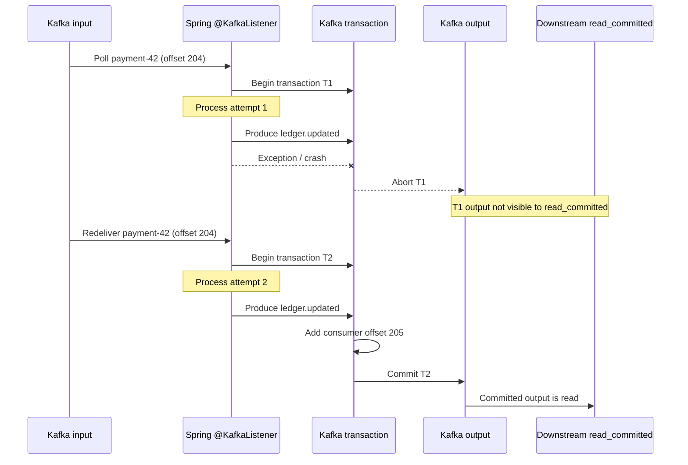
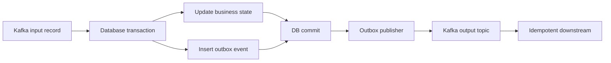

# Read and process remain at-least-once in Spring Kafka Exactly Once

When implementing **Exactly Once Semantics (EOS)** in Spring Kafka, a very easy point to misunderstand is: **a Kafka transaction can guarantee that the Kafka outcome of a read–process–write flow is committed once, yet reading the record and executing processing logic can still happen multiple times**.

In other words, "exactly once" does not mean `@KafkaListener` is called only once per record. When a transaction aborts, the consumer can re-read the same record and run the code again. If the code has side effects outside Kafka—such as writing to a database, calling an HTTP API, sending emails, or charging money—those side effects can be executed repeatedly. This is the most important limitation to understand when operating a transactional Spring Kafka system.

Within a **Kafka-to-Kafka consume–process–produce** scope, a transaction can link *output records* with *consumer offsets* in a single atomic commit. Downstream consumers using `isolation.level=read_committed` will not see output from aborted transactions. Meanwhile, on the source application side, the listener may have executed one or more times before a transaction finally commits successfully.

## 1. Three concepts to distinguish

The words "read", "process", and "write" refer to three stages with different boundaries:

| Stage | What actually happens | Delivery/processing semantics |
|---|---|---|
| **Read** | Kafka consumer polls and receives records from a partition | A record may be redelivered if the offset is uncommitted |
| **Process** | Listener runs Java code, computes, or calls dependencies | Code may run multiple times on retry/rebalance/restart |
| **Write** | Producer publishes new records to Kafka | Can be bound into a Kafka transaction |
| **Offset commit** | Consumer group stores the next read position | Can be bound into the same transaction as Kafka output |
| **External side effect** | Writing to a database, calling HTTP, sending notifications | Not automatically included in the Kafka transaction |

In Kafka EOS terminology, *read and process* still remain **at-least-once**; **exactly-once** applies to the outcome of **read–process–write** when outputs and consumer offsets are committed in the same transaction and readers use appropriate isolation.

There is no contradiction here: the system may **attempt processing multiple times** while **publishing only one committed Kafka result**.

### 1.1. What is at-least-once?

At-least-once means a record can be delivered and reprocessed; under system recovery and continued progress, the application does not intentionally drop unacknowledged records. In return, duplicate delivery is possible.

For example, a consumer processes a record at offset 84 but crashes before offset 85 is committed. Upon restart, it can still read offset 84.

At-least-once **does not guarantee** business processing succeeds under all conditions; for instance, a poison record may keep failing, or data may exceed retention before processing. The term describes delivery/ack semantics, not a zero-failure promise.

### 1.2. What is an exactly-once effect in Kafka?

In a valid Kafka transaction, output records and consumer offsets can be committed atomically. If the transaction aborts, its outputs are hidden from `read_committed` consumers, and the source record's offset is not committed in that transaction.

If the record is re-read and a later attempt commits successfully, downstream may see only the output from that successful attempt, even though the listener ran twice.

### 1.3. "Process exactly once" is a stronger requirement

If a listener calls a payment REST API three times, a Kafka transaction cannot erase the two extra calls. To ensure a business effect occurs only once, you need idempotency keys, unique constraints, inbox/outbox, or a deduplicating business protocol. A Kafka transaction alone is not enough.

## 2. Diagram: listener runs twice, Kafka output commits once

Suppose source topic `payments.accepted` has record `payment-42` on partition 1, offset 204. The listener computes a new event and sends it to `ledger.updated`.



The diagram uses conceptual steps: in practice, the container starts the transaction before invoking the listener, then manages sending offsets/committing or rolling back per lifecycle. The key takeaway is that **business computation runs again**, while **Kafka output and offset commit together only in T2**.

With a `read_uncommitted` consumer, records from an aborted transaction may still be visible; you cannot claim downstream sees only one result if you omit the `read_committed` requirement.

## 3. Why can the same offset still be read again?

A Kafka consumer stores progress via the **consumer group's** committed offset. The committed offset normally represents **the position of the next record**, not the last record read.

Example:

```text
Topic: payments.accepted
Partition: 1
Record being processed: offset 204

Attempt T1:
  Consumer reads offset 204
  Listener runs
  Transaction aborts
  Offset 205 was not committed in T1

Attempt T2:
  Consumer reads offset 204 again
  Listener runs again
  Output + offset 205 commit together successfully

Next time:
  Consumer group resumes from committed offset 205
```

Common sources of redelivery:

- Listener throws an exception, causing transaction rollback.
- Service or pod crashes before the transaction commits.
- Producer commit fails, causing the transaction to abort.
- Consumer group rebalances before processing progress is committed.
- Consumer exceeds `max.poll.interval.ms` and loses partition assignment.
- Process stops or redeploys while processing is in flight.
- Operator intentionally resets offsets or replays data.

These scenarios do not by themselves prove EOS is broken. **Redelivery is an expected part of the recovery mechanism.** The critical question is whether Kafka output and offset are managed in the same transaction, and whether external side effects are idempotent.

## 4. Guarantee scope of a Kafka transaction

Kafka transactions provide several closely related properties:

1. Producer has a `transactional.id` so the broker can manage transaction sessions and fencing.
2. Records sent in the same transaction share the same commit or abort outcome in terms of transactional visibility.
3. Input consumer offsets can be included in the same transaction as output records via `sendOffsetsToTransaction`.
4. `read_committed` consumers avoid returning records from aborted transactions.
5. Producer idempotence helps limit duplicates from producer retries within supported protocol bounds.

Missing just the step of adding consumer offsets to the transaction means the consume–process–produce path **no longer shares the same atomic boundary**: output may commit while input offset remains uncommitted, leading to duplicate publishing on reprocessing.

### 4.1. Critical boundary

```text
                 Kafka transaction T
         +--------------------------------+
         | Publish ledger.updated         |
         | Publish audit.event            |
         | Commit input offset 205        |
         +--------------------------------+
                         |
                         v
               Shared Commit / Abort

OUTSIDE TRANSACTION T:
- INSERT/UPDATE to PostgreSQL, MySQL...
- HTTP request to payment provider
- Email/SMS/webhook
- File writes or cloud API calls
- Metrics, logs, and certain cache updates
```

A Kafka transaction is not an XA transaction spanning all dependencies. A database commit can succeed while the Kafka transaction aborts, and vice versa.

### 4.2. read_committed does not stop the listener from re-running

`isolation.level=read_committed` controls **which records from upstream producer transactions a consumer is allowed to see**. It does not impose a limit of "invoke the listener once per record."

Even a listener using `read_committed` can reprocess **an already-committed upstream record** if the current consumer group's own offset has not been committed yet.

## 5. Spring Boot configuration for a transactional listener container

A Kafka-to-Kafka EOS configuration typically needs:

- A transaction-capable producer factory with `transaction-id-prefix`.
- `KafkaTransactionManager` or a Kafka-aware transaction manager used by the listener container.
- A listener container that starts transactions and adds consumed offsets upon commit.
- A Kafka producer in the listener participating in the container-managed transaction.
- `enable.auto.commit=false` for the consumer.
- Downstream consumers using `read_committed`.
- Non-colliding transactional ID prefixes across running instances.

Example `application.yml` for a Kafka-to-Kafka service:

```yaml
spring:
  kafka:
    bootstrap-servers: localhost:9092
    producer:
      transaction-id-prefix: ledger-service-instance-a-
      key-serializer: org.apache.kafka.common.serialization.StringSerializer
      value-serializer: org.apache.kafka.common.serialization.StringSerializer
      acks: all
    consumer:
      group-id: ledger-service
      enable-auto-commit: false
      isolation-level: read_committed
      key-deserializer: org.apache.kafka.common.serialization.StringDeserializer
      value-deserializer: org.apache.kafka.common.serialization.StringDeserializer
    listener:
      concurrency: 3
```

In Spring Boot, when appropriate auto-configuration conditions apply, a transaction ID prefix helps create Kafka transaction components for the default factory. **Do not infer from YAML alone that every listener is now transactional**: if the application creates custom listener factories, check whether the transaction manager is actually attached to the container.

Keep in mind:

- The prefix `ledger-service-instance-a-` is an example for **one instance**. If running multiple pods/replicas, each instance must have a prefix managed so it does not cause transactional ID collisions.
- `concurrency: 3` controls the number of child consumers; it does not mean a record is processed three times.
- `read_committed` on this service helps it avoid aborted records from upstream. Downstream services reading `ledger.updated` also need the corresponding isolation level.
- A Kafka transaction does not replace error handlers, retry policies, or idempotency of external side effects.
- Across different Spring Kafka versions, APIs for attaching a transaction manager and related options may vary. Check against the actual Spring Boot and Spring Kafka versions in use.

## 6. Correct example: Kafka-to-Kafka listener and container-managed transaction

Suppose business processing is purely an in-memory data transformation followed by publishing a Kafka event:

```java
@Component
public class LedgerListener {

    private final KafkaTemplate<String, String> kafkaTemplate;

    public LedgerListener(KafkaTemplate<String, String> kafkaTemplate) {
        this.kafkaTemplate = kafkaTemplate;
    }

    @KafkaListener(
        topics = "payments.accepted",
        groupId = "ledger-service"
    )
    public void onPayment(
            ConsumerRecord<String, String> record) {

        String paymentId = record.key();
        String output = transform(record.value());

        kafkaTemplate.send(
            "ledger.updated",
            paymentId,
            output
        );
    }

    private String transform(String payload) {
        // Pure transformation function, mutates no external state.
        return payload;
    }
}
```

**Important condition:** the listener above must run in a container with a **Kafka transaction manager** and `KafkaTemplate` must participate in that same transaction. When the listener finishes successfully, the container coordinates sending processed offsets into the transaction and commits. If the listener throws an error, the container rolls back/aborts and redelivers according to the error-handling mechanism.

If the factory is not configured as transactional, the exact same Java code can publish output successfully and then fail before committing the input offset, causing duplicate outputs.

### 6.1. Why not open executeInTransaction manually inside the listener?

The following is **not** an automatic substitute for consume–process–produce EOS:

```java
@KafkaListener(
    topics = "payments.accepted",
    groupId = "ledger-service"
)
public void onPayment(ConsumerRecord<String, String> record) {

    kafkaTemplate.executeInTransaction(operations -> {
        operations.send(
            "ledger.updated",
            record.key(),
            record.value()
        );
        return null;
    });
}
```

`executeInTransaction` opens a **separate local Kafka transaction** for publishing. It does not automatically add the input offset to that transaction. If the source record has not had its offset committed when the local transaction completes, output can be republished after a crash or rebalance.

For listener-level EOS, prefer transactions managed by the listener container and send via `KafkaTemplate.send()` participating in the active transaction.

## 7. Failure simulation: two process runs, one Kafka output

Consider a consumer with a transactional listener container enabled and downstream using `read_committed`.

```java
@Component
public class PaymentProjectionListener {

    private final KafkaTemplate<String, String> template;
    private final AtomicBoolean failOnce = new AtomicBoolean(true);

    public PaymentProjectionListener(KafkaTemplate<String, String> template) {
        this.template = template;
    }

    @KafkaListener(
        topics = "payments.accepted",
        groupId = "ledger-service"
    )
    public void consume(ConsumerRecord<String, String> record) {

        String eventId = record.key();

        // Runs on every delivery.
        System.out.println("Processing event " + eventId);

        template.send(
            "ledger.updated",
            eventId,
            record.value()
        );

        if (failOnce.compareAndSet(true, false)) {
            throw new IllegalStateException(
                "Simulated failure before transaction commit"
            );
        }
    }
}
```

In a single-process test environment, `AtomicBoolean` simulates a single failure before the listener returns successfully. This is **fault injection for learning and testing**, not a retry or state recovery strategy for production.

Expected results when transactions work properly:

| Observation | Result |
|---|---|
| Number of listener invocations | 2 times in this scenario |
| Number of `System.out.println()` executions | 2 |
| Output in the first transaction | Aborted, invisible to `read_committed` |
| Output in the second transaction | Committed |
| Output seen by `read_committed` downstream | 1 committed record |
| Input committed offset | Advances after the successful transaction |

Do not use listener invocation count as a metric for "unique events processed." Listener invocation counts reflect **attempts**, whereas unique events and successfully committed transactions are different quantities.

### 7.1. What if the service dies instead of throwing an exception?

When the process crashes before commit, the old producer's transaction is not treated as a committed transaction. The broker transaction coordinator and producer fencing/timeouts handle the open state. The input record can still be picked up again by a new consumer because the offset was not committed.

A crash does not guarantee immediate redelivery; delay depends on group reassignment, restarts, timeouts, and cluster state.

## 8. Failure windows to understand

| Failure timing | Can read/process repeat? | Kafka output with `read_committed` | External side effect |
|---|---|---|---|
| Before listener receives record | Can be received after recovery | No output yet | None yet |
| After listener starts but before send | Yes | No committed output yet | May already have occurred |
| After send but before transaction commit | Yes | Output from aborted transaction is invisible | May already have occurred |
| During commit; caller gets a timeout | Outcome at caller may be uncertain | Kafka state is decided by the broker | May already have occurred |
| After commit succeeds | Normally offset is committed | Committed output is readable | May have occurred once or multiple times |
| Operator intentionally replays/resets offset | Yes | Can produce a new valid transaction | Must prevent duplicates |

When commit yields an uncertain result at the caller, do not assume "exception = broker definitely did not commit." Recovery behavior must rely on Kafka state, logs, and idempotency rather than inferring solely from an exception.

Kafka transactions link produced records and offsets within protocol boundaries; they do not guarantee external side effects happen only once.

## 9. Database side effects: an easy way to corrupt data

Suppose a service receives `payments.accepted`, writes an audit row to PostgreSQL, and then publishes a `ledger.updated` event.

```java
@KafkaListener(
    topics = "payments.accepted",
    groupId = "ledger-service"
)
public void handle(ConsumerRecord<String, String> record) {

    auditRepository.insertAuditRow(record.key());

    kafkaTemplate.send(
        "ledger.updated",
        record.key(),
        record.value()
    );
}
```

If the database insert succeeds while the Kafka transaction aborts due to a later failure:

1. The audit row has already been committed in the database.
2. The old transaction's Kafka output is aborted.
3. The consumer re-reads the input record.
4. The listener calls `insertAuditRow()` again.
5. The audit row may appear twice, even though Kafka downstream only receives one committed output.

That is direct proof of the statement **read and process remain at-least-once**. Part of the processing code produced a real side effect outside Kafka before the Kafka transaction completed.

### 9.1. Do not rely on @Transactional to assume atomicity

Putting `@Transactional` on a method calling both a database and Kafka does not automatically create an atomic XA transaction. Commit ordering can cause the database to commit before Kafka or vice versa, depending on the transaction manager and configuration.

Determine specifically:

- Is the transaction manager in use a database manager or a Kafka manager?
- Are Kafka outputs and consumed offsets in the same Kafka transaction?
- At what point did the database transaction commit?
- If the second transaction fails, how is the already-committed side handled?
- Can recovery run again without creating duplicate side effects?

For critical business flows, prefer outbox/inbox patterns and idempotency rather than assuming an annotation creates atomicity across two systems.

## 10. Idempotency is the bridge for at-least-once processing

An **idempotent** operation is one that can be repeated without altering the business outcome after the first successful execution.

Example:

```text
Non-idempotent:
  balance = balance + 100
  If run twice --> increases by 200

Idempotent by eventId:
  If eventId has already been applied:
      do not apply again
  Otherwise:
      apply +100 and record eventId
```

However, "check then write" must be executed **atomically** in the database itself. If two consumers run concurrently and both see the event as unprocessed, merely issuing a `SELECT` before an `INSERT` can cause a race condition.

### 10.1. Inbox / processed-event table

A common pattern is a unique constraint on consumer identity and event identity:

```sql
CREATE TABLE processed_event (
    consumer_name TEXT NOT NULL,
    event_id      TEXT NOT NULL,
    processed_at  TIMESTAMPTZ NOT NULL DEFAULT CURRENT_TIMESTAMP,
    PRIMARY KEY (consumer_name, event_id)
);
```

Within the same database transaction as the business update:

```sql
BEGIN;

INSERT INTO processed_event (consumer_name, event_id)
VALUES ('ledger-service', 'payment-42')
ON CONFLICT DO NOTHING;

-- Only execute the business UPDATE if the INSERT above
-- actually created a new processed_event row.
-- The application must read the affected-row count and keep
-- all operations in the same DB transaction.

COMMIT;
```

This is the idempotent consumer principle. Critical detail: **never commit the "processed" marker before the business side effect completes**; the marker and business update must share the same DB transaction.

### 10.2. Trap: deduplicating the database while losing Kafka output

Suppose the first Kafka transaction aborts **after the database has already committed successfully**. When the input is reprocessed, the database sees `eventId` is already processed and skips every step, including emitting `ledger.updated`.

At that point the database is right, yet **the Kafka output is missing**, because the previous attempt's output belonged to an aborted transaction.

Therefore, you cannot mechanically apply "if `eventId` is processed, return immediately" when the listener must also produce a mandatory Kafka output.

Design one of these approaches:

- Persist the intended state/output durably so a retry can **re-emit the required output** into a new Kafka transaction.
- Use a **transactional outbox** to write both the business update and the outgoing event in **one database transaction**, and have a dedicated publisher relay the outbox to Kafka.
- For pure Kafka-only problems, keep transformations free of external side effects and let the container transaction manage input offsets + outputs.

This is a key distinction between "avoiding duplicate DB writes" and "guaranteeing an accurate end-to-end event pipeline."

## 11. Transactional outbox when both database and Kafka are needed

Outbox is a common approach for combining database updates and event-publishing intent in a single database transaction:



Pattern flow:

1. Consumer receives an event with `eventId`.
2. DB transaction writes the inbox marker, updates business state, and inserts an outbox event with an appropriate unique key.
3. DB transaction atomically commits the related changes.
4. Outbox publisher reads pending events and sends them to Kafka.
5. After confirming publication, the publisher updates outbox status.

Outbox closes the window of "DB committed, but no record remains of what event to publish." However, the outbox publisher can also succeed in sending to Kafka and crash before marking the event sent, causing a **duplicate publish**. Thus downstream still needs idempotent handling or deduplication.

Outbox does not make an event appear strictly once at every layer in an absolute sense. It provides a durable foundation so **publishing intent is never lost** and retries are safe.

## 12. With HTTP, email, and payments: Kafka transactions do not undo side effects

In a listener, you might encounter:

```java
@KafkaListener(topics = "invoices.created")
public void onInvoice(InvoiceEvent event) {

    emailGateway.sendInvoiceEmail(event);

    kafkaTemplate.send(
        "invoice.email.sent",
        event.id(),
        event.asJson()
    );
}
```

If the email is sent and then the Kafka transaction aborts, the record may be re-read and the email sent a second time.

Appropriate measures:

- For payment APIs, pass an **idempotency key** supported by the provider.
- For emails/notifications, store a stable business operation ID and delivery status in a database; do not rely on when the listener executes.
- For webhooks/HTTP APIs, design receivers to handle retries safely.
- When side effects cannot be undone, record outcomes durably before allowing retries to re-execute.
- If a dependency lacks idempotency support, define a reconciliation policy and investigate uncertain outcomes.

Do not build a claim of "emails sent exactly once" solely on Spring Kafka EOS.

## 13. Comparing EOS with other processing strategies

| Model | Can a record be re-read by the listener? | Can Kafka output duplicate? | External DB/API side effect |
|---|---|---|---|
| At-least-once consumer, regular producer | Yes | Possible | May duplicate |
| Kafka transactional consume–process–produce | Yes | Aborted tx output is hidden; committed output tied to committed offsets | May still duplicate |
| Standalone Kafka transactional producer | Does not manage consumed offsets itself | Writes inside commit/abort transaction | May still duplicate |
| Inbox / idempotent consumer | Yes | Depends on how publishing is done | Can prevent DB duplicates if designed properly |
| Transactional outbox + idempotent downstream | Yes | May publish duplicates, handled more safely | Requires per-domain idempotency |

This table describes behavior under normal conditions. No model lets you ignore infrastructure failures, retention, access loss, partitioning, and operational incidents.

### 13.1. At-most-once and choosing to skip records

If you commit offsets **before** processing finishes, a crash can leave a record unprocessed while marked complete. That is the message-loss risk of at-most-once. It is not a solution for avoiding duplicates in a reliable system.

### 13.2. EOS does not replace input data validation

A producer can explicitly send **two identical business events**, where each event is a valid Kafka record at a different offset. A Kafka transaction does not automatically conclude those two records represent one single business operation.

Use `eventId`, aggregate version, or a business idempotency key to detect duplicates at the domain layer. Kafka EOS handles transaction semantics, not inferring business meaning from payloads.

## 14. Errors, retries, and rollbacks in transactional listeners

With a listener container managing Kafka transactions, when the listener throws an exception, the transaction is normally rolled back/aborted. Spring Kafka provides after-rollback processing, such as `DefaultAfterRollbackProcessor`, to control how the consumer returns to unprocessed records and handles retries/recovery.

On the transactional path, do not assume every `DefaultErrorHandler` or DLT setup you know from non-transactional containers works identically. Exception, retry, and recovery policies must fit the **transactional listener container**, Kafka transaction manager, and Spring Kafka version.

### 14.1. A poison record can be invoked many times

For example, a single record contains malformed schema data for which the listener always throws an exception:

```text
Poll record at offset 204
  -> listener fails
  -> transaction aborts
  -> rollback/reposition
  -> poll record at offset 204
  -> listener fails again
  -> ...
```

At-least-once processing in this case can generate many attempts with no transaction ever committing. Therefore, you must have a retry limit or recovery/DLT strategy to prevent the consumer from getting stuck indefinitely on one offset.

### 14.2. DLT is a recovery outcome, not business success

When a policy routes a failing record to a DLT, the record has not succeeded from a business perspective. Track `recovered` or `dead_lettered` outcomes separately from `success`.

With Kafka transactions, publishing to a DLT and bringing the recovered offset into a transaction must follow the rollback/recovery mechanism meant for transactional containers. Do not assume regular DLT publishing and regular offset commits form one atomic operation.

### 14.3. Retry topics and processing order

If using non-blocking retries via `@RetryableTopic`, failing records can move through retry topics and be processed later by another consumer. This model has different characteristics regarding ordering, transaction boundaries, and version-dependent support conditions.

Check compatibility between non-blocking retries and transactional listener containers rather than combining every retry feature and EOS in the same configuration by default.

## 15. Concurrency, partitions, and rebalances

EOS does not mean a record stays pinned to one listener instance from start to finish. The Kafka group coordinator can reassign partitions.

Suppose consumer A is processing partition 2:

```text
Consumer A:
  poll partition 2 / offset 204
  process 204
  transaction uncommitted
  rebalance / loses assignment

Consumer B:
  receives partition 2
  re-reads from committed offset
  processes offset 204
```

Transactions and fencing protect Kafka writes/commits according to the protocol. However, database/API calls made by A may already exist while B executes them again.

Conditions to monitor:

- `max.poll.interval.ms` relative to the processing time of a poll/batch.
- Concurrency not needlessly exceeding partition counts.
- Producer transactional ID prefixes and fencing configured properly.
- Rebalance rate and partition processing durations.
- Non-Kafka side effects being idempotent even across closely spaced attempts.

Never derive an idempotency key from processing order or listener invocation count. Use a stable event ID or domain key + version.

## 16. Transactional ID, EOS V2, and producer fencing

Kafka transactions rely on `transactional.id`, producer epochs, and the transaction coordinator. An older producer can be **fenced** when a newer producer claims the same identity and a new epoch.

In modern Spring Kafka releases, EOS V2 is the transaction mechanism aligned with supported Kafka brokers/clients. The transaction ID prefix configuration must fit the number of concurrently active producers and instances in the cluster.

Distinguish among:

- **Transactional producer identity**: helps the broker coordinate and fence stale producers.
- **Consumer group identity**: helps Kafka coordinate partition assignments and committed offsets.
- **Business event identity**: helps the application prevent duplicate side effects.

These three IDs serve three distinct purposes. A transactional ID is not a key to deduplicate a payment operation; a consumer group ID does not prove an event was processed only once.

If two pods unintentionally use the same transactional ID, fencing can spike, causing more transaction aborts and redeliveries. In that situation, rising listener invocation counts are a symptom to investigate, not proof that Kafka EOS automatically stopped working.

## 17. Consumer isolation and invisible records

To properly observe Kafka EOS, downstream consumers should use:

```yaml
spring:
  kafka:
    consumer:
      isolation-level: read_committed
```

If an upstream producer aborts a transaction, records written to the broker in that transaction can still exist in the physical log alongside transaction markers, yet a `read_committed` consumer will not return them as business records.

Consequences:

- Do not expect business record offsets to always be contiguous when reading with `read_committed`.
- Offset "gaps" can appear due to aborted transactional records or control records.
- A `read_committed` consumer should not be evaluated solely by counting consecutive offsets observed.
- Last stable offset can prevent data behind an open transaction from being available to a `read_committed` consumer until the transaction finishes.

`read_committed` only governs visibility of transactional writes. It does not protect against two events with the same business ID successfully published by a producer in **two different transactions**.

## 18. Designing the right metrics: attempts vs. unique events

If you only increment a metric each time a listener runs, a record retried three times is counted as three processed items even though the Kafka result committed only once.

Track separately:

| Metric | What it measures |
|---|---|
| Listener invocation count | Total attempts |
| Listener failure count | Number of times the listener threw exceptions |
| Kafka transaction commit count | Successfully committed transactions |
| Kafka transaction abort count | Aborted transactions |
| Duplicate delivery count | Times the same event was redelivered by identifier |
| Unique business events completed | Non-duplicate completed business events |
| External idempotency hit count | Attempts guarded against repeated side effects |
| DLT recovery count | Records routed to recovery |
| Consumer group lag | Commit progress per partition |
| Commit/abort duration | Transaction latency and stability |
| Producer fencing errors | Transactional ID conflicts or producer lifecycle issues |

Do not put `eventId`, raw keys, offsets, or specific transactional IDs into metric labels, as this creates massive cardinality. They belong in structured logs or traces instead.

### 18.1. Logging an attempt

An illustrative log entry:

```json
{
  "event": "kafka_listener_attempt",
  "service": "ledger-service",
  "topic": "payments.accepted",
  "partition": 1,
  "offset": 204,
  "eventId": "payment-42",
  "attempt": 2,
  "outcome": "success"
}
```

This is an illustrative application log. The `attempt` field must come from an attempt-tracking mechanism or policy-compliant header/metadata; do not infer it from the Kafka offset.

A log showing `outcome=success` when the listener returns does not prove the Kafka transaction committed. To observe transaction outcomes, instrument at the transaction manager/producer boundary or use corresponding Kafka metrics.

### 18.2. Note on latency

Processing time per attempt may be small while end-to-end event latency is large due to repeated aborts/retries and rebalances. When defining SLOs, distinguish attempt latency, retry delay, transaction duration, and time to business completion.

## 19. Integration test proving "read/process at-least-once"

This test helps engineering teams understand semantics better than any diagram. Use a **real Kafka broker** via Testcontainers or EmbeddedKafka, because mocking `KafkaTemplate` cannot prove commit/abort visibility.

### 19.1. Setup

1. Create input topic `payments.accepted` and output topic `ledger.updated`.
2. Create a transactional producer factory with a dedicated test transaction ID prefix.
3. Configure the listener container to actually use the Kafka transaction manager.
4. Use a dedicated input consumer group with `enable.auto.commit=false`.
5. Create an output consumer with `isolation.level=read_committed`.
6. Maintain a counter recording how many times the listener executes.
7. Make the listener fail on the first attempt and succeed on the next via fault injection.

### 19.2. Expected outcomes

| Condition | Evidence |
|---|---|
| Listener fails on first attempt | Listener invocation counter increments once |
| First Kafka transaction aborts | Output from the failed transaction does not appear under `read_committed` |
| Input offset uncommitted | Record is re-read per recovery policy |
| Listener runs a second time | Invocation counter is greater than 1 |
| Subsequent Kafka transaction commits | Output becomes readable |
| Consumer offset and output commit together | Input progress reflects the successful transaction |
| Committed output result | One valid output exists for this single-input scenario |
| Simulated non-idempotent DB side effect | Duplicates can be observed when the listener re-runs |

Do not verify merely by counting all records from a `read_uncommitted` consumer: that consumer can see records from aborted transactions.

### 19.3. Testing the pre-commit crash window

In a test environment, induce a controlled failure after the listener finishes its work but before the transaction commits, then let another consumer take over the partition.

Verify:

- The record can be reprocessed.
- Aborted Kafka output is not returned to `read_committed`.
- Source offset advances only when the final transaction commits successfully.
- If database side effects exist, idempotency protects state.
- Abort/rebalance/retry metrics reflect what occurred.

Use timeout-based polling assertions instead of long, flaky `Thread.sleep()` calls. Avoid fault injection that crashes the test broker itself unless that is the specific test goal.

### 19.4. Testing the dedup-drops-output case

Run this scenario:

1. Listener writes the database marker and business state.
2. First attempt's Kafka transaction aborts.
3. Record is re-read.
4. Listener sees the marker and `return`s without sending output.
5. Verify Kafka output is missing.

Then apply an outbox or durable output replay and re-run. This validates that database-only idempotency is insufficient when the pipeline must also emit a Kafka event.

## 20. Common misconceptions

**"Enabling transactions means the listener runs only once."** False. The listener can run again after aborts, crashes, or rebalances.

**"`read_committed` stops inputs from being redelivered."** False. It filters outputs of aborted producer transactions; consumers still rely on committed offsets for recovery.

**"`KafkaTemplate.send()` inside a listener is automatically EOS."** Only true within intended bounds if container transactions and offset handling are configured properly; sending alone is not enough.

**"`executeInTransaction` inside a listener covers the input offset."** False. The template's local transaction does not automatically add consumed offsets to the transaction.

**"Kafka EOS guarantees the database is written once."** False. Databases live outside the Kafka transaction.

**"Once deduplicated in DB, you can always just return."** Can drop Kafka output if a prior Kafka transaction aborted after DB commit. An outbox or output recovery mechanism is needed.

**"Transaction abort means all side effects vanish."** Only Kafka writes participating in that transaction are aborted/hidden under Kafka semantics. HTTP/DB/email calls may already have completed.

**"Two listener invocations mean EOS is broken."** Not necessarily. Check committed Kafka outputs, offsets, and the retry model.

**"Producers using the same key will never emit duplicate business events."** A Kafka partition key does not replace an event idempotency key. Two valid sends can produce two records at two offsets.

**"Every downstream consumer sees the right transaction visibility by default."** No. Verify `isolation.level=read_committed` on consumers depending on those semantics.

**"DLT is business success."** A DLT preserves failing records for investigation/recovery; it does not prove business completion.

## 21. Checklist for taking EOS to production

Before concluding a Spring Kafka service has proper read–process–write EOS, verify:

1. Both input and output are Kafka within the transaction boundary you intend to guarantee.
2. Listener factory actually runs with a Kafka transaction manager, not merely having a transaction manager bean present in context.
3. `KafkaTemplate` in the listener participates in the container-managed transaction.
4. Consumer offsets are placed into the **same transaction** as Kafka outputs.
5. Consumer auto-commit is disabled.
6. Critical downstream consumers use `read_committed`.
7. Transaction ID prefixes are allocated appropriately for the instance count and producer concurrency.
8. Timeouts, rebalances, and producer fencing are monitored.
9. Retries and after-rollback policies are bounded, with DLT/recovery mechanisms as needed.
10. All database/HTTP side effects have idempotency or an appropriate outbox/inbox.
11. Business event identity is separated from offsets and transactional IDs.
12. Dashboards distinguish listener attempts, committed transactions, duplicates, and DLTs.
13. Integration tests prove records are re-run by the listener while aborted Kafka outputs remain invisible.
14. Crashes and restarts have been tested at critical failure windows.
15. Runbooks specify how to replay, handle duplicates, and verify business state when transaction outcomes are uncertain.

### 21.1. An important design question

Ask: **"If the listener runs twice for the same record, which parts of the system will be mutated twice?"**

If the answer is only pure computations and Kafka outputs managed in the same transaction as input offsets, Kafka EOS can provide the right guarantee.

If the answer includes DB rows, payments, emails, HTTP requests, files, or external service state, add idempotency, outbox/inbox, reconciliation, or an equivalent business mechanism.

## 22. Version-specific references

Cross-check documentation matching your Spring Kafka, Spring Boot, and Kafka client versions when implementing:

- **Spring for Apache Kafka Reference — Transactions**: transactional listener containers, container transaction managers, and Kafka EOS.
- **Spring for Apache Kafka Reference — Exactly Once Semantics**: read–process–write boundaries and the fact that read/process still carry at-least-once semantics.
- **Spring Kafka Javadoc**: `KafkaTemplate`, `KafkaTransactionManager`, `DefaultKafkaProducerFactory`, `ContainerProperties`, `DefaultAfterRollbackProcessor`.
- **Spring Boot Reference — Kafka**: `spring.kafka.producer.transaction-id-prefix`, consumer isolation, and listener container factories.
- **Apache Kafka Documentation — Transactions**: transactional ID, producer fencing, send offsets to transaction, committed/aborted visibility, and isolation levels.
- **Apache Kafka Documentation — Consumer Configs**: `isolation.level`, `enable.auto.commit`, `max.poll.interval.ms`.
- **Resources on Transactional Outbox and Idempotent Consumer**: used to design non-Kafka side effects, not a built-in feature granted by Kafka transactions.

Especially when upgrading Spring Kafka, confirm how container transaction managers are configured, supported EOS modes, producer factory caching, retry/after-rollback behavior, transaction ID prefixes, and offset commit rules.

The value of exactly-once in Spring Kafka lies at the **committed Kafka outcome boundary**: allowing records to be re-read and reprocessed for recovery while preventing outputs of aborted runs from appearing to `read_committed` consumers. A reliable system does not try to eliminate every repeated process execution; rather, it builds **Kafka transactions at the right boundary and idempotent business logic** so re-execution never corrupts data.
