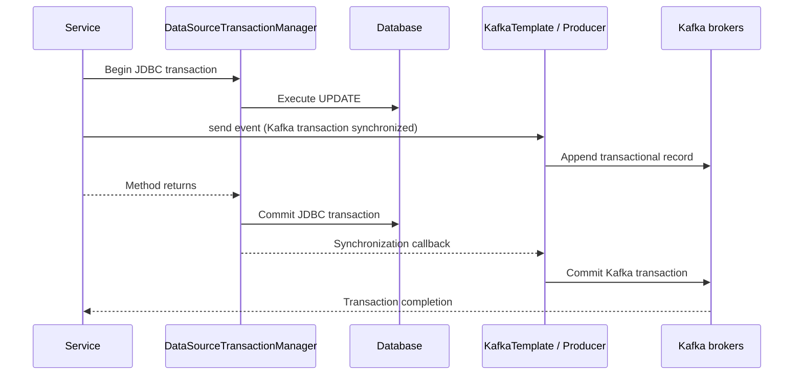
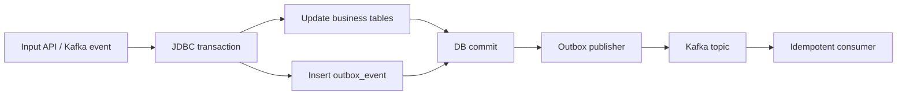

# DataSourceTransactionManager in Spring Kafka: Database and Kafka Transactions

`DataSourceTransactionManager` is Spring Framework's transaction manager for **a single JDBC `DataSource`**. It manages the commit/rollback boundary of a database transaction, whereas `KafkaTransactionManager` manages a Kafka producer transaction. When a Spring Kafka service both writes to a database and consumes or produces Kafka events, understanding the roles of these two transaction managers is mandatory to avoid losing events, publishing duplicates, or updating data inconsistently.

**Key takeaway:** `DataSourceTransactionManager` only ensures that JDBC operations use the right connection participating in a DB transaction. The fact that Spring Kafka can **synchronize commit timing** with the database **does not turn the two resources into an atomic distributed transaction**. The database can commit successfully while the Kafka commit fails; or Kafka can commit first while the database rolls back. System correctness also requires idempotency, a transactional outbox, or an explicitly designed recovery mechanism.

This lesson explains in detail how `DataSourceTransactionManager` works, how it binds to `@Transactional`, how Spring Kafka synchronizes transactions, failure windows, the outbox pattern, and the tests required for production.

## 1. What does DataSourceTransactionManager manage?

Spring provides the `PlatformTransactionManager` abstraction. `DataSourceTransactionManager` is the implementation that manages transactions on a JDBC connection obtained from a `DataSource`. When code runs inside a transaction, Spring typically:

1. Obtains a JDBC `Connection` from the `DataSource`.
2. Configures the transaction on the connection, including auto-commit and relevant attributes.
3. Binds the connection to the current thread via transaction synchronization.
4. Lets JDBC operations inside the same transaction reuse that connection.
5. Calls `commit()` when the flow succeeds, or `rollback()` if a rollback condition is triggered.
6. Restores connection state and releases/returns the connection to the pool.

Tools such as `JdbcTemplate` and `DataSourceUtils` are transaction-synchronization-aware, so they can use the exact managed connection.

```text
@Service method
     |
     | @Transactional("databaseTransactionManager")
     v
DataSourceTransactionManager
     |
     | bind Connection to thread
     v
JDBC DataSource / connection pool
     |
     +-- INSERT business table
     +-- UPDATE aggregate table
     +-- INSERT outbox table
     |
     +-- commit or roll back all JDBC changes
```

Within this transaction, `DataSourceTransactionManager` **does not manage** HTTP requests, Kafka producer transactions, Redis commands, emails, or another database simply because they execute inside the same Java method.

### 1.1. Distinguishing transaction managers

| Component | Managed resource | Behavior |
|---|---|---|
| `DataSourceTransactionManager` | One JDBC DataSource | Local JDBC transaction |
| `JdbcTransactionManager` | JDBC DataSource | Subclass of `DataSourceTransactionManager`, adds exception translation on commit/rollback |
| `JpaTransactionManager` | JPA EntityManager and persistence context | Suited for JPA; can coordinate JDBC when properly configured |
| `KafkaTransactionManager` | Transactional Kafka producer | Kafka begin/commit/abort |
| `@Transactional` | Does not specify a resource by itself | Depends on whichever transaction manager Spring selects |
| Transactional outbox | One DB transaction writing both business state and publish intent | Durable bridge between DB commit and async publisher |

`JdbcTransactionManager` was introduced in Spring Framework 5.3. In modern Spring Boot releases using JDBC, Boot may provide `JdbcTransactionManager` instead of `DataSourceTransactionManager` directly; it belongs to the same JDBC transaction manager family. There is no need to replace a Boot-created bean just to get the exact class name `DataSourceTransactionManager` if its behavior already meets requirements.

## 2. How does @Transactional bind to DataSourceTransactionManager?

The `@Transactional` annotation declares the transaction boundary; **the selected transaction manager** determines which resource commits or rolls back.

Suppose a service references a bean named `databaseTransactionManager`:

```java
@Service
public class AccountService {

    private final JdbcTemplate jdbc;

    public AccountService(JdbcTemplate jdbc) {
        this.jdbc = jdbc;
    }

    @Transactional(transactionManager = "databaseTransactionManager")
    public void credit(String accountId, long amount) {
        jdbc.update(
            "UPDATE account SET balance = balance + ? WHERE id = ?",
            amount,
            accountId
        );

        jdbc.update(
            "INSERT INTO account_audit(account_id, amount) VALUES (?, ?)",
            accountId,
            amount
        );
    }
}
```

If the second operation throws an unchecked exception before commit, both JDBC changes can roll back together. This is a **database transaction** guarantee and has nothing to do with whether a Kafka event was published.

By default, Spring's declarative transaction mechanism rolls back on `RuntimeException` and `Error`. For checked exceptions, check your version/configuration rollback rules and specify `rollbackFor` if business logic requires it:

```java
@Transactional(
    transactionManager = "databaseTransactionManager",
    rollbackFor = Exception.class
)
public void updateAndValidate(...) throws Exception {
    // JDBC operations must participate in the same transaction.
}
```

Do not catch the exception and return normally if a rollback is expected. Otherwise, the transaction proxy may see the method complete normally and proceed to commit.

## 3. Which transaction manager does Spring Boot create?

In a Spring Boot application with a JDBC DataSource, Boot normally auto-configures the DataSource and a JDBC transaction manager if bean/classpath conditions are met.

With a sample database configuration:

```yaml
spring:
  datasource:
    url: jdbc:postgresql://localhost:5432/orders
    username: orders_app
    password: ${DB_PASSWORD}
    hikari:
      maximum-pool-size: 15
```

Boot uses the JDBC properties to create the `DataSource`; an appropriate transaction manager can be auto-configured. This is **not** a configuration for Kafka transactions.

If you add Kafka producer transactions:

```yaml
spring:
  kafka:
    bootstrap-servers: localhost:9092
    producer:
      transaction-id-prefix: orders-service-pod-a-
      key-serializer: org.apache.kafka.common.serialization.StringSerializer
      value-serializer: org.springframework.kafka.support.serializer.StringSerializer
      acks: all
    consumer:
      enable-auto-commit: false
      isolation-level: read_committed
```

Spring Boot can auto-configure Kafka transaction components when the corresponding conditions are satisfied. When an application has multiple `PlatformTransactionManager` beans (e.g., a JDBC manager and a Kafka manager), **never guess** which manager an unqualified `@Transactional` selects.

Prefer one of the following approaches:

- Explicitly specify `@Transactional(transactionManager = "databaseTransactionManager")` for DB operations.
- Designate `@Primary` or a default manager intentionally by design when truly appropriate.
- Use `@Qualifier` or pass the manager directly to `TransactionTemplate`.
- Inspect bean names, types, and the condition evaluation report whenever auto-configuration changes due to added dependencies or custom beans.

Do not place an unqualified `@Transactional` and assume both JDBC and Kafka transactions are managed atomically together.

### 3.1. Declaring an explicit JDBC transaction manager bean

If the application wants explicit control over the bean name:

```java
@Configuration
public class DatabaseTransactionConfiguration {

    @Bean("databaseTransactionManager")
    public DataSourceTransactionManager databaseTransactionManager(
            DataSource dataSource) {
        return new DataSourceTransactionManager(dataSource);
    }
}
```

Main imports:

```java
import javax.sql.DataSource;
import org.springframework.context.annotation.Bean;
import org.springframework.context.annotation.Configuration;
import org.springframework.jdbc.datasource.DataSourceTransactionManager;
```

Some projects use `JdbcTransactionManager` instead:

```java
@Bean("databaseTransactionManager")
public JdbcTransactionManager databaseTransactionManager(
        DataSource dataSource) {
    return new JdbcTransactionManager(dataSource);
}
```

These are **two alternatives**; do not define both beans simultaneously just to manage the same `DataSource`. If a transaction manager is already auto-configured, declaring a new bean may cause Boot to back off or create ambiguity in dependency injection.

## 4. JDBC connections must join the right transaction

A Spring JDBC transaction only protects JDBC operations that actually use the bound connection.

`JdbcTemplate` handles connection acquisition automatically according to Spring's model:

```java
@Transactional("databaseTransactionManager")
public void register(String id) {
    jdbcTemplate.update(
        "INSERT INTO customer(id) VALUES (?)", id
    );
    jdbcTemplate.update(
        "INSERT INTO customer_audit(customer_id) VALUES (?)", id
    );
}
```

If you manually obtain a connection via `dataSource.getConnection()` outside the transaction-aware mechanism, that operation will very likely bypass the connection bound by the transaction manager. When raw JDBC is needed, use `DataSourceUtils.getConnection(dataSource)` with its corresponding release helper, or prefer `JdbcTemplate`.

Another important point: Spring transactions are normally bound to the **current thread**. Calling `@Async`, spawning a `CompletableFuture` on another thread, or creating threads inside a method does not propagate the JDBC transaction to the new thread.

```java
@Transactional("databaseTransactionManager")
public void process(String id) {
    jdbcTemplate.update("UPDATE job SET status='RUNNING' WHERE id=?", id);

    CompletableFuture.runAsync(() -> {
        // This is a different thread; does not automatically use the same JDBC transaction.
        invokeAnotherDatabaseOperation(id);
    });
}
```

If you need database updates in a background worker, design an independent transaction inside the worker; do not assume it rolls back with the calling method.

## 5. Why is it hard to keep database + Kafka consistent?

A service often needs two effects:

1. Write business state to the database.
2. Publish an event to Kafka.

Suppose when confirming an order, the service must update `orders.status = CONFIRMED` and emit `orders.confirmed`.

Without an explicit transaction strategy, two critical failure windows exist:

```text
DATABASE FIRST:
  DB COMMIT succeeds
          |
          X Kafka publish/commit fails
          |
  Order is confirmed, but the event may be missing

KAFKA FIRST:
  Kafka COMMIT succeeds
          |
          X DB commit fails
          |
  Event has been published, but the order is not confirmed
```

Both orders have a divergence window. "Synchronizing" two local transactions only lets Spring control ordering and propagate exceptions; it **does not create an atomic commit** across the two systems.

In critical flows, the existence of these two failure windows is precisely why transactional outbox and idempotency are needed.

## 6. Synchronizing a Kafka producer transaction with a JDBC transaction

Spring Kafka can synchronize a Kafka producer transaction with an active Spring-managed transaction, such as a JDBC transaction.

When `KafkaTemplate` is built from a transactional `ProducerFactory`, and code calls `KafkaTemplate.send()` **inside** a method with an active Spring-managed JDBC transaction, the Kafka resource can be registered to participate in synchronization.

Example:

```java
@Service
public class OrderConfirmationService {

    private final JdbcTemplate jdbc;
    private final KafkaTemplate<String, String> kafkaTemplate;

    public OrderConfirmationService(
            JdbcTemplate jdbc,
            KafkaTemplate<String, String> kafkaTemplate) {
        this.jdbc = jdbc;
        this.kafkaTemplate = kafkaTemplate;
    }

    @Transactional("databaseTransactionManager")
    public void confirmOrder(String orderId, String eventJson) {

        int changed = jdbc.update(
            "UPDATE orders SET status = ? WHERE id = ?",
            "CONFIRMED",
            orderId
        );

        if (changed != 1) {
            throw new IllegalStateException(
                "Order not found or not updatable: " + orderId
            );
        }

        kafkaTemplate.send(
            "orders.confirmed",
            orderId,
            eventJson
        );
    }
}
```

For Kafka sends to participate in a transaction this way, you need:

- A producer factory configured as transactional, typically via `transaction-id-prefix`.
- The method actually executing inside a Spring-managed **JDBC** transaction.
- `KafkaTemplate` using that transactional producer factory.
- Not opening a separate local `executeInTransaction()` if the goal is to synchronize with the active JDBC transaction.
- Ensuring the `send()` call is not dispatched to another thread where transaction synchronization is lost.

### 6.1. Commit order when JDBC is the primary transaction

With this synchronization mode, the typical sequence is:



**Database is the primary transaction**, so the DB commits first; the Kafka transaction commits afterward via transaction synchronization.

If the Kafka commit fails **after the DB has committed**, the JDBC transaction **cannot be rolled back**. Modern Spring Kafka versions can propagate the secondary commit error to the caller, but knowing an error occurred does not automatically repair the inconsistent state. You need verification, compensation, or an outbox.

Do not interpret the success of a `send()` call or callback execution as proof that the entire chain committed. Producer sends can be asynchronous; the broker transaction commit determines transactional visibility.

### 6.2. Rollback behavior when code throws an exception

If code throws an unchecked exception before the primary transaction commits, Spring can roll back the JDBC transaction and Kafka synchronization also aborts the corresponding Kafka transaction.

This helps for errors **before the commit boundary**, but still provides no guarantee if an error arises **during commit** or after one resource has already committed.

## 7. Failure matrix for synchronizing two local transactions

When designing transaction order, always fill in the practical failure table:

| Failure phase | DB state | Kafka state | Risk |
|---|---|---|---|
| Before DB write | Unchanged | Not sent | Safe to retry |
| After SQL update, before DB commit | Can roll back | Can abort | Usually recovers with the transaction |
| Kafka send fails before DB commit and exception propagates | Rolls back per policy | Aborts | Verify exception is not swallowed |
| DB commit fails | Uncommitted or outcome requires check per error | Secondary Kafka transaction must not be assumed committed | May require verifying actual state |
| DB commit succeeds, Kafka commit fails | **Committed** | Uncommitted or outcome may be uncertain | **DB/Kafka divergence** |
| Both commit successfully, caller times out afterward | Committed | Committed | Caller retry can create business duplicates |
| Service crashes between the two commits | May be committed | May be uncommitted | Requires reconciler/outbox |

In particular, when an operation throws an exception from a transaction commit, the caller does not always know from the exception type alone whether the transaction committed; broker/database state may need verification via state and telemetry.

A state-tracking model clearer than `SUCCESS`/`FAILED` distinguishes:

- Confirmed transaction success.
- Confirmed rollback/abort.
- Uncertain outcome, requiring reconciliation or idempotent handling.

## 8. Can Kafka commit before the database?

You can structure an execution path so the Kafka transaction commits first, for instance through a Spring-managed method using `KafkaTransactionManager` invoked from an outer JDBC transaction. However, the two transactions are still **not atomic with each other**.

Idea:

```text
Outer service: JDBC transaction begin
    |
    |-- Update database (uncommitted)
    |
    +-- Inner service: Kafka transaction begin
           |-- KafkaTemplate.send(...)
           +-- Kafka transaction commit
    |
    +-- JDBC transaction commit
```

If the JDBC commit fails after the Kafka commit, downstream consumers may see an event for a database change that never succeeded.

If this approach is required, the nested method must be called **through a Spring proxy** and select the right transaction manager:

```java
@Service
public class KafkaEventService {

    private final KafkaTemplate<String, String> template;

    public KafkaEventService(KafkaTemplate<String, String> template) {
        this.template = template;
    }

    @Transactional("kafkaTransactionManager")
    public void publish(String key, String json) {
        template.send("orders.confirmed", key, json);
    }
}
```

```java
@Service
public class DatabaseOrderService {

    private final JdbcTemplate jdbc;
    private final KafkaEventService kafkaEventService;

    public DatabaseOrderService(
            JdbcTemplate jdbc,
            KafkaEventService kafkaEventService) {
        this.jdbc = jdbc;
        this.kafkaEventService = kafkaEventService;
    }

    @Transactional("databaseTransactionManager")
    public void updateThenPublish(String id, String json) {
        jdbc.update(
            "UPDATE orders SET status = 'CONFIRMED' WHERE id = ?",
            id
        );
        kafkaEventService.publish(id, json);
    }
}
```

This example illustrates **the ordering of two local transactions**. It is not recommended as a mechanism to guarantee zero lost events. When Kafka commits before the DB, the failure window shifts to the opposite direction. If business requirements cannot tolerate either direction, look at transactional outbox.

**Do not build new systems on `ChainedKafkaTransactionManager` as an atomicity solution.** This API has been deprecated in Spring Kafka releases and does not provide atomic two-phase commit across Kafka and a database.

## 9. @KafkaListener writing to a database: which transaction runs first?

In a service that consumes events from Kafka and updates a database, two common design patterns appear.

### 9.1. Non-transactional consumer + JDBC transaction

A listener receives a record and calls a JDBC service:

```java
@Component
public class OrderProjectionListener {

    private final OrderProjectionService service;

    public OrderProjectionListener(OrderProjectionService service) {
        this.service = service;
    }

    @KafkaListener(
        topics = "orders.created",
        groupId = "projection-service"
    )
    public void onOrder(OrderCreated event) {
        service.apply(event);
    }
}
```

```java
@Service
public class OrderProjectionService {

    private final JdbcTemplate jdbc;

    public OrderProjectionService(JdbcTemplate jdbc) {
        this.jdbc = jdbc;
    }

    @Transactional("databaseTransactionManager")
    public void apply(OrderCreated event) {
        jdbc.update(
            "INSERT INTO order_projection(order_id, status) " +
            "VALUES (?, ?) " +
            "ON CONFLICT (order_id) " +
            "DO UPDATE SET status = EXCLUDED.status",
            event.orderId(),
            event.status()
        );
    }
}
```

This is a familiar at-least-once setup:

1. Listener reads the record.
2. Service opens a JDBC transaction and writes to the DB.
3. JDBC transaction commits.
4. Listener returns normally.
5. Container commits the consumer offset per `AckMode`.

If the service crashes **after the DB commit but before the offset commit**, the same record can be read again and the DB code executes again. Therefore, database updates must be idempotent.

### 9.2. Transactional listener container + JDBC transaction

If the listener container uses a Kafka transaction, the container typically opens a Kafka transaction to bind outputs and input offsets. Inside the listener, a `@Transactional("databaseTransactionManager")` service can open a separate JDBC transaction.

Idealized sequence:

```text
Container starts Kafka transaction
  |
  |-- Listener receives record
  |     |
  |     +-- DataSourceTransactionManager starts JDBC transaction
  |     +-- SQL INSERT / UPDATE
  |     +-- JDBC transaction commits when method returns
  |
  |-- Container sends consumer offsets into Kafka transaction
  +-- Kafka transaction commit
```

This still has a **DB-first failure window**: the DB committed while the Kafka transaction/offset commit failed. After recovery, the record can be redelivered and the JDBC service invoked again.

Kafka exactly-once for consume–process–produce within Kafka does not make database operations exactly-once. If a service performs both DB updates and Kafka outputs, design idempotency/outbox to handle redelivery.

### 9.3. Transactional listener and error handlers

With a Kafka transactional container, an exception from the listener can roll back the Kafka transaction, after which after-rollback processing controls seeking/retrying/recovering. Spring Kafka provides `DefaultAfterRollbackProcessor` and related configurations.

Do not assume a `DefaultErrorHandler` configured for a non-transactional listener behaves identically when the container runs transactionally. Check the rollback and DLT mechanisms for your Spring Kafka version.

## 10. Classic bug: database committed, Kafka offset uncommitted

Suppose record `payment-77` deducts money:

```text
Input offset 455 -> Listener
    |
    +-- DB UPDATE balance = balance - 100
    +-- DB COMMIT succeeds
    |
    X Process crashes before Kafka offset commit
    |
Restart -> reads offset 455 again
    |
    +-- DB UPDATE balance = balance - 100 a second time
```

The JDBC transaction did its job: in each run, the SQL update was atomic. However, **two runs are two separate transactions**, so the total side effect becomes deducting 200.

The solution is a **stable event identifier** and a mechanism that records processing **in the same database transaction** as the business update. When the event is redelivered, the database blocks the duplicate update.

### 10.1. Inbox / processed_event table

PostgreSQL example:

```sql
CREATE TABLE processed_event (
    consumer_name VARCHAR(128) NOT NULL,
    event_id       VARCHAR(128) NOT NULL,
    processed_at   TIMESTAMPTZ NOT NULL DEFAULT CURRENT_TIMESTAMP,
    PRIMARY KEY (consumer_name, event_id)
);
```

A service can use `INSERT ... ON CONFLICT DO NOTHING` to tell whether an event is new or a duplicate:

```java
@Service
public class PaymentApplyService {

    private final JdbcTemplate jdbc;

    public PaymentApplyService(JdbcTemplate jdbc) {
        this.jdbc = jdbc;
    }

    @Transactional("databaseTransactionManager")
    public void apply(PaymentAccepted event) {

        int inserted = jdbc.update(
            "INSERT INTO processed_event (consumer_name, event_id) " +
            "VALUES (?, ?) ON CONFLICT DO NOTHING",
            "ledger-service",
            event.eventId()
        );

        if (inserted == 0) {
            return; // Event was already applied in a previous DB transaction.
        }

        jdbc.update(
            "UPDATE account SET balance = balance + ? WHERE id = ?",
            event.amount(),
            event.accountId()
        );
    }
}
```

With a unique event ID defined by contract, the unique constraint prevents duplicate DB updates. In production, check the updated row count for the account ID and throw an exception if it does not match expectations. The marker and business update must be in **the same database transaction**.

Do not do this:

```text
SELECT whether event_id exists?
    |
    +-- Not found --> UPDATE business state
    +-- INSERT marker
```

without a unique constraint and proper transaction: two concurrent consumers can both see "not found" and both execute the side effect.

### 10.2. Trap when a listener both updates DB and emits Kafka output

If the DB marker commits while the first attempt's Kafka transaction aborts, the subsequent redelivery sees the existing marker and **returns before republishing the event**. The Kafka output may never appear.

This shows that DB deduplication and guaranteeing Kafka output delivery are two distinct problems. When both a DB update and a Kafka output are required, consider an outbox to durably record the "publish intent."

## 11. Transactional outbox: keeping database state and publish intent in one DB transaction

Outbox reframes "atomically write to DB and publish to Kafka" into "atomically write to DB and write an outbox row." Both operations use **the same `DataSourceTransactionManager`**, so the database can commit or roll them back as a single unit.



### 11.1. Example outbox structure

```sql
CREATE TABLE outbox_event (
    event_id       VARCHAR(128) PRIMARY KEY,
    aggregate_id   VARCHAR(128) NOT NULL,
    topic          VARCHAR(255) NOT NULL,
    payload_json   TEXT NOT NULL,
    status         VARCHAR(32) NOT NULL DEFAULT 'PENDING',
    created_at     TIMESTAMPTZ NOT NULL DEFAULT CURRENT_TIMESTAMP,
    published_at   TIMESTAMPTZ
);

CREATE INDEX idx_outbox_event_pending
    ON outbox_event(status, created_at);
```

The schema above is a minimal version for this lesson. Production may need retry counts, lease/claim owners, next-attempt timestamps, error categories, and a mechanism preventing multiple publishers from claiming the same row.

### 11.2. Writing business state + outbox in the same JDBC transaction

```java
@Service
public class ConfirmOrderService {

    private final JdbcTemplate jdbc;

    public ConfirmOrderService(JdbcTemplate jdbc) {
        this.jdbc = jdbc;
    }

    @Transactional("databaseTransactionManager")
    public void confirm(
            String orderId,
            String eventId,
            String eventJson) {

        int updated = jdbc.update(
            "UPDATE orders SET status = 'CONFIRMED' " +
            "WHERE id = ? AND status = 'NEW'",
            orderId
        );

        if (updated != 1) {
            throw new IllegalStateException(
                "Order state not eligible: " + orderId
            );
        }

        jdbc.update(
            "INSERT INTO outbox_event " +
            "(event_id, aggregate_id, topic, payload_json) " +
            "VALUES (?, ?, ?, ?)",
            eventId,
            orderId,
            "orders.confirmed",
            eventJson
        );
    }
}
```

If inserting the outbox row fails, the DB transaction rolls back and `orders.status` remains unchanged. If the DB commit succeeds, the system has persisted **both the business state and the event to publish**.

This is a guarantee `DataSourceTransactionManager` provides directly because both operations live inside the same database.

### 11.3. The outbox publisher can send duplicates

The publisher reads `PENDING` outbox rows, sends them to Kafka, and updates `status=PUBLISHED`. If the Kafka publish succeeds but the process crashes **before** updating the DB, the next run can republish the same event.

Hence outbox typically has **at-least-once publish** semantics. To handle this safely:

- Every outbox row carries an immutable event ID.
- Downstream consumers enforce idempotency by event ID.
- The publisher uses a claim/lease strategy to prevent multiple workers from sending unintended duplicates.
- Bounded retries, error statuses, and a pending-age dashboard are in place.
- When publishing for the same aggregate, define an appropriate event ordering policy.
- Confirm the Kafka send result before marking a row published.

Change data capture, such as Debezium, can also be used to stream the outbox; even then, you must understand delivery semantics and duplicates.

## 12. Why is TransactionTemplate sometimes more useful than @Transactional?

`@Transactional` relies on Spring AOP proxies. For blocks that need programmatic transaction control, `TransactionTemplate` can make boundaries clearer.

```java
@Service
public class LedgerWriter {

    private final TransactionTemplate dbTransaction;
    private final JdbcTemplate jdbc;

    public LedgerWriter(
            @Qualifier("databaseTransactionManager")
            PlatformTransactionManager databaseManager,
            JdbcTemplate jdbc) {
        this.dbTransaction =
                new TransactionTemplate(databaseManager);
        this.jdbc = jdbc;
    }

    public void write(String accountId, long amount) {
        dbTransaction.executeWithoutResult(status -> {
            jdbc.update(
                "UPDATE account SET balance = balance + ? WHERE id = ?",
                amount,
                accountId
            );
        });
    }
}
```

Advantage: the transaction boundary is explicit right in code and does not rely on a proxy intercepting a method call. This is especially useful when doing work outside the transaction and only holding the JDBC connection for a short block.

`TransactionTemplate` **does not merge** a Kafka transaction and a DB transaction. It only uses the `PlatformTransactionManager` passed to it.

## 13. Notes on propagation and isolation

`DataSourceTransactionManager` supports transaction propagation and isolation via Spring `@Transactional`, though actual effects depend on the database, driver, and datasource configuration.

### 13.1. Propagation

| Propagation | Meaning in a JDBC transaction |
|---|---|
| `REQUIRED` | Joins an existing transaction or creates a new one |
| `REQUIRES_NEW` | Suspends the current transaction and creates a new one |
| `NESTED` | May use a JDBC savepoint within the same physical transaction if supported |
| `MANDATORY` | Requires an existing transaction |
| `SUPPORTS` | Runs with the current transaction if one exists |
| `NOT_SUPPORTED` | Runs outside any current transaction |
| `NEVER` | Disallows an active transaction |

`REQUIRES_NEW` may require **another connection** while the outer transaction's connection is still held. If the thread pool is large while the Hikari connection pool is small, nested transactions can cause connection waits or resource deadlocks.

`NESTED` with JDBC savepoints is not the same as a nested Kafka transaction. A savepoint is strictly a database connection feature; it does not roll back committed Kafka records.

### 13.2. Isolation

Example:

```java
@Transactional(
    transactionManager = "databaseTransactionManager",
    isolation = Isolation.READ_COMMITTED
)
public void updateProjection(...) {
    // JDBC statements
}
```

DB isolation level controls visibility of changes across database transactions, **not** Kafka consumer's `isolation.level=read_committed`.

The names look similar, but they control two completely different resources:

| Name | Where? | Purpose |
|---|---|---|
| `Isolation.READ_COMMITTED` | Spring/JDBC database | Do not read uncommitted data per DB semantics |
| `isolation.level=read_committed` | Kafka consumer | Do not return records from aborted Kafka transactions |

Do not use either setting alone to conclude the system achieved exactly-once or eliminated all duplicates.

### 13.3. Timeout and readOnly

`@Transactional(timeout = ...)` sets a limit at the transaction management layer according to Spring and resource participants. It does not replace timeouts on the Kafka producer, HTTP clients, or broker transactions.

`readOnly=true` is a hint/configuration supporting optimization or enforcement depending on the database/driver; do not treat it as an absolute security barrier blocking all writes.

## 14. When @Transactional does not behave as expected

Common pitfalls:

**Self-invocation:** a method in the same object calls another method annotated with `@Transactional`. With standard Spring AOP proxies, internal calls bypass the proxy, so the transaction annotation may not apply.

```java
@Service
public class BadOrderService {

    public void receive(OrderEvent event) {
        apply(event); // Internal call; may bypass the transactional proxy.
    }

    @Transactional("databaseTransactionManager")
    public void apply(OrderEvent event) {
        // ...
    }
}
```

Move the transactional portion to another bean or use `TransactionTemplate` when an explicit boundary is needed.

**Wrong transaction manager:** the annotation selects the Kafka manager instead of the JDBC manager when multiple beans exist. Explicitly specify the manager and inspect transaction logs.

**JDBC connection outside Spring:** code calls `DriverManager.getConnection()` or creates a connection manually instead of using the proper `DataSource`. That operation may not participate in the active transaction.

**Async code:** work dispatched to another thread does not automatically inherit transaction synchronization.

**Swallowed exceptions:** Spring sees the method return normally and may commit.

**Checked exceptions not matching rollback rules:** specify `rollbackFor` explicitly when required by business rules.

**Overly long transactions:** placing Kafka sends, HTTP calls, or heavy work inside a JDBC transaction holds connections and locks too long, increasing contention and risking timeouts.

## 15. Operating a JDBC consumer and Kafka offsets safely

For a listener consuming Kafka events and writing to a database, keep these rules clear:

- The DB transaction commits **before** the listener is treated as having succeeded and the offset is committed per policy.
- If the DB rolls back, the listener must signal failure so the Kafka container retries/recovers; never ack a record whose business work did not succeed.
- If offset commit fails after DB commit, redelivery is normal; DB operations must be idempotent.
- Never enable consumer auto-commit if application design relies on container-managed processing progress.
- If a record cannot be processed, use backoff and clear DLT/recovery rather than silently skipping the offset.
- For batch listeners, define commit boundaries and track which records completed, avoiding committing past actual business progress.
- If an event is sent by multiple producers or replayed, Kafka transactions do not deduplicate events by business ID.

### 15.1. Acknowledgement and DB commit

With `AckMode.RECORD`, the container can normally commit the offset once the listener processes the record successfully according to its configuration. However, exact commit timing still depends on Kafka transactions, batching, and the Spring Kafka version.

If using manual acknowledgement, call `acknowledge()` only per the designed workflow. A `@Transactional` method may not have committed yet at the moment a line inside that method executes; understand the transaction proxy boundary before acknowledging manually.

Never call `acknowledge()` to "work around" a DB transaction rollback when the business operation did not actually succeed.

## 16. Monitoring: DB transactions differ from Kafka transactions

A production dashboard should separate the two resources and also measure the gap between them.

| Signal | Question it answers |
|---|---|
| JDBC transaction commit/rollback | Did the database complete the changes? |
| Database connection pool active/wait | Are connections exhausted or held too long by transactions? |
| DB lock waits/deadlocks | Are DB transactions experiencing contention? |
| Kafka producer send error | Did publishing records fail? |
| Kafka transaction commit/abort | Did Kafka outputs commit or abort? |
| Consumer offset commit error | Is consumer progress being recorded? |
| Consumer group lag | Is there a backlog or stuck records? |
| Duplicate/idempotency hit count | Are redeliveries or replays occurring? |
| Outbox pending count/oldest age | Is publish intent backing up? |
| Outbox published/error counts | Is the publisher keeping up? |
| DB/Kafka reconciliation discrepancy | Are there DB states whose corresponding events have not been published? |

Separate `db_commit_success` and `kafka_publish_success` metrics do not by themselves prove the two resources are consistent for **the same event**. Reconciliation requires a business/event ID traceable across DB, outbox, Kafka headers, and downstream state.

Example structured application log:

```json
{
  "event": "order_event_publishing",
  "orderId": "ORDER-1042",
  "dbTransaction": "committed",
  "kafkaTransaction": "unknown",
  "reconciliationRequired": true
}
```

This is an example payload for investigation, not a default framework log. Never put `orderId` or event IDs into metric labels due to high cardinality; keep them in controlled structured logs/traces.

### 16.1. Practical outbox metrics

With an outbox, define an SLO around **pending event age**, such as "99% of outbox events are published within 30 seconds of DB commit." Common signals:

- P95/p99 latency from `created_at` to `published_at`.
- Count of outbox rows with `status=PENDING`.
- Age of the oldest pending row.
- Publish error counts by exception type.
- Rate of duplicate publisher attempts.
- Downstream Kafka consumer lag and DLT metrics.

Do not measure only the `PUBLISHED` count, because an old backlog may still be stuck waiting.

## 17. Integration tests for DataSourceTransactionManager and Kafka

To verify cross-resource transaction behavior, you need a **real database and real Kafka broker**, such as PostgreSQL + Kafka Testcontainers or an equivalent test suite. Unit tests mocking `JdbcTemplate` and `KafkaTemplate` cannot prove commit order or failure windows.

### 17.1. JDBC rollback

1. Create an order in status `NEW`.
2. Call the `@Transactional("databaseTransactionManager")` service.
3. After the update, deliberately throw an unchecked exception.
4. Verify the status in the DB remains `NEW`.
5. If an outbox insert ran in the same DB transaction, verify no outbox row exists.

This is the baseline check that JDBC operations share one transaction.

### 17.2. JDBC commit followed by successful Kafka commit

1. Enable a transactional producer factory.
2. Invoke the JDBC transaction service with `KafkaTemplate.send()` participating in transaction synchronization.
3. Verify the database holds the new state.
4. Use a `read_committed` Kafka consumer to verify the event was published.
5. Verify the event ID and key/headers if present.

A passing happy-path test does not prove cross-resource atomicity under failure; that is the goal of the next test.

### 17.3. DB commit succeeds, secondary Kafka commit fails

This is a harder but vital fault-injection test:

1. Let the DB update execute and commit successfully.
2. Simulate or inject a failure when the secondary Kafka transaction commits.
3. Verify the caller observes an error or uncertain outcome per version behavior.
4. Verify the DB did not roll back after committing.
5. Verify the system has reconciliation/compensation or an outbox mechanism.

Never assert "the Kafka transaction definitely rolled back" if the error type cannot confirm the broker outcome. Check actual state or flag the item for reconciliation.

### 17.4. Listener DB commit completes, offset remains uncommitted

1. Send an input record with a stable event ID.
2. Let the listener update the database successfully.
3. Stop/crash the container before the Kafka offset commits using controlled fault injection.
4. Let a consumer in the same group recover.
5. Verify the record can be redelivered.
6. Verify the unique constraint/inbox blocks a duplicate DB side effect.
7. If there is a Kafka output, verify the outbox policy ensures the final output exists.

### 17.5. Outbox publisher crashes after publish

1. Write business state and outbox row in the same DB transaction.
2. Publisher sends the Kafka event successfully.
3. Stop the publisher before updating the row to `PUBLISHED`.
4. Restart the publisher; the same event may be sent again.
5. Verify downstream consumers process idempotently by event ID.
6. Verify the outbox does not get stuck indefinitely and exposes retry/last-error observability.

### 17.6. Verifying multiple transaction managers

In an application with both JDBC and Kafka managers:

- Verify `@Transactional("databaseTransactionManager")` actually uses a JDBC connection.
- Verify methods targeting `KafkaTransactionManager` do not accidentally pick JDBC.
- Verify custom listener factories use the right transaction manager or common error policy.
- Verify self-invocation does not drop the JDBC transaction.
- Verify async tasks use their own transactions without assuming thread-bound connections.

## 18. Common misconceptions

**"DataSourceTransactionManager can commit Kafka."** No. It manages a JDBC DataSource; Kafka has its own transaction mechanism. Transaction synchronization only coordinates order; it does not create an atomic distributed commit.

**"Adding @Transactional is enough for both DB and Kafka."** No. Spring must select a specific transaction manager; the Kafka producer must be transactional and resource synchronization/container wiring must be configured properly.

**"Both DB and Kafka have transactions, so events are never lost."** False. Two independent commits create a failure window.

**"Choosing DB-first or Kafka-first removes all inconsistency."** Order only changes the direction of the failure window, not its existence.

**"KafkaTemplate.send() returning a future means the event is committed."** The future represents send progress, not transaction commit. The transaction can still abort or fail at commit afterward.

**"DataSourceTransactionManager rollback undoes HTTP calls, emails, or committed Kafka records."** No. Side effects outside the JDBC transaction persist.

**"DB write success means the Kafka consumer offset is committed."** No. Offsets are a Kafka resource with their own commit boundary.

**"A duplicate listener execution means the DB transaction failed."** Not necessarily. Kafka redelivery can occur after a DB commit and before an offset commit.

**"Checking event_id with a SELECT is enough to prevent duplicates."** Insufficient under concurrency; you need a unique constraint and atomic operations inside the DB transaction.

**"Outbox means Kafka publishes strictly once."** No. The publisher can still publish duplicates; downstream needs idempotency.

**"One @Transactional method calling another in the same class always creates a nested transaction."** No. With proxy-based AOP, self-invocation can bypass interception.

**"Configuring REQUIRES_NEW on the DB means a nested Kafka transaction."** No. DB savepoints/connections and Kafka producer transactions are independent.

**"ChainedKafkaTransactionManager solves XA."** No. That API is deprecated and does not create an atomic distributed transaction between DB and Kafka.

## 19. Choosing the right pattern by business requirement

| Use case | Typical suitable pattern |
|---|---|
| Service writes multiple tables in the same database | `DataSourceTransactionManager` or `JdbcTransactionManager` |
| Kafka consumer updates DB; redelivery possible | JDBC transaction + idempotent consumer/inbox |
| HTTP request updates DB and must publish an event without loss | Transactional outbox |
| Kafka consumer updates DB and must publish Kafka output | Inbox/transactional outbox or durable recovery design |
| Pure Kafka consume-transform-produce | Kafka transactional listener container + `read_committed` |
| Kafka producer must send multiple records all-or-nothing | Kafka transaction, optionally via `executeInTransaction` |
| Commit DB and Kafka in deterministic order while accepting reconciliation | Synchronize two local transactions with metrics and compensation |
| Workflow across HTTP/payment provider/email | Idempotency keys, state machine, business saga/reconciliation |

No annotation replaces answering: *when one resource commits and the other fails, what must the application do?*

## 20. Production rollout process

A pre-implementation design checklist:

1. Clarify whether business logic requires database writes, Kafka publishing, or both.
2. Choose the right DB transaction manager for the active `DataSource`.
3. Place `@Transactional` on service methods invoked through Spring proxies or use `TransactionTemplate`.
4. If using Kafka transactions, configure a transactional producer factory and per-instance transaction ID prefix.
5. Verify every `KafkaTemplate.send()` participates in the expected transaction boundary.
6. Document the commit order (DB-first or Kafka-first) and failure windows.
7. If zero events may be lost between DB commit and Kafka, choose transactional outbox.
8. If Kafka records can be redelivered, use an inbox/unique constraint and handle duplicates.
9. If publishing output after a DB update, ensure deduplication does not suppress missing Kafka output.
10. Configure timeouts for JDBC queries, connection pools, Kafka producers, and downstream dependencies.
11. Build reconciliation, outbox backlog alerts, DLT/retry handling, and transaction outcome metrics.
12. Run integration tests for rollbacks, crashes, commit failures, and duplicate deliveries.
13. Re-verify transaction manager wiring when upgrading Spring Boot/Spring Kafka.
14. Document the runbook for when one side commits and the other fails.

An operations team should be able to answer: **when an order commits to the DB without a Kafka event, how do we detect it, how do we recover it, and how do we prevent duplicate publishes?** Without answers to those questions, synchronizing two local transactions must not be treated as complete consistency.

## 21. References

When implementing, cross-check the exact Spring Framework, Spring Boot, Spring Kafka, and database versions in use:

- Spring Framework Reference — *Declarative Transaction Management*, transaction propagation, rollback rules, and transaction synchronization.
- Spring Framework Javadoc — `DataSourceTransactionManager`, `JdbcTransactionManager`, `DataSourceUtils`, `TransactionTemplate`.
- Spring Boot Reference — `DataSourceAutoConfiguration`, JDBC transaction auto-configuration, and Kafka auto-configuration.
- Spring for Apache Kafka Reference — *Transactions* and *Synchronizing Kafka Transactions with Other Transaction Managers*.
- Spring Kafka Javadoc — `KafkaTemplate`, `DefaultKafkaProducerFactory`, `KafkaTransactionManager`, transactional listener containers.
- Apache Kafka Documentation — producer transactions, `transactional.id`, consumer offsets, and `isolation.level`.
- Database driver and connection pool documentation covering isolation, lock timeouts, connection exhaustion, and crash recovery.

Certain auto-configuration details, the JDBC transaction manager class chosen by Boot, and how Spring Kafka reports secondary commit failures vary across releases. Inspect your actual codebase and dependencies, especially when custom transaction manager beans exist.

**Operational principle:** `DataSourceTransactionManager` makes **JDBC operations on a single database** commit or roll back together; Kafka transactions do the same within **Kafka**. Ordering them merely coordinates two local transactions, not cross-system atomicity. When business requires both updating a database and reliably publishing Kafka events, design **outbox + idempotency + reconciliation** rather than relying on an `@Transactional` annotation to eliminate every failure window.
