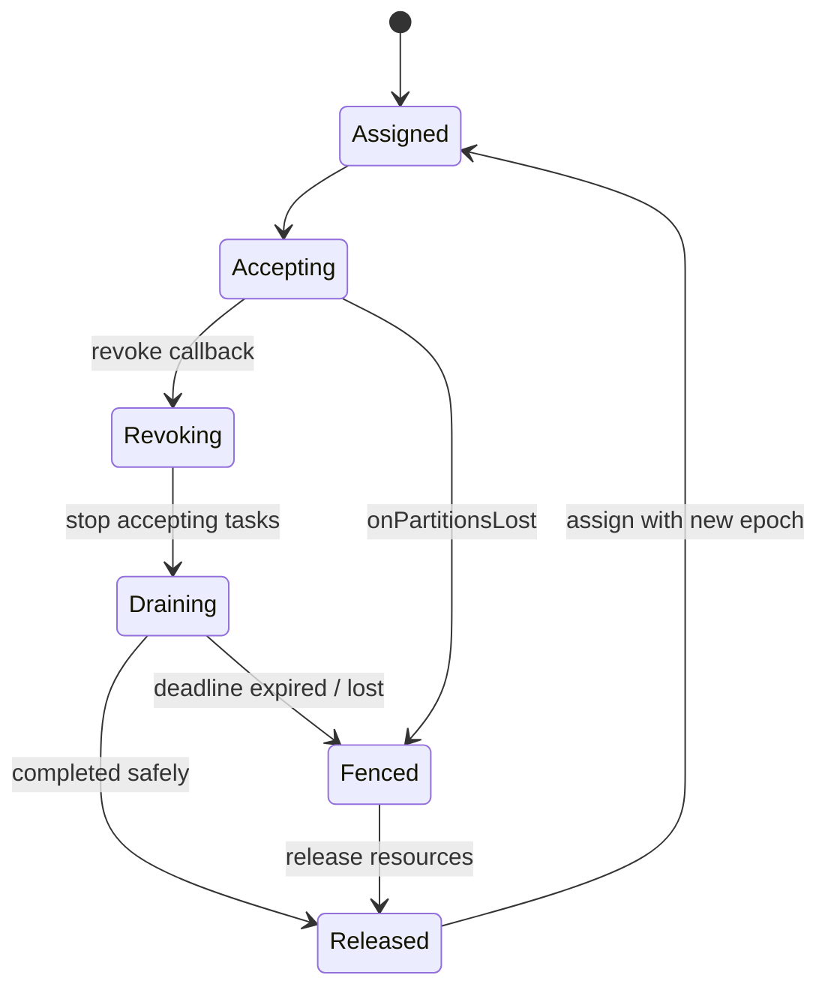

# Handling in-flight work on revoke in Spring Kafka

In a Kafka consumer group, **rebalance** is the process where Kafka adjusts partition ownership among consumers. When a partition is **revoked** (taken away from the current consumer), that consumer is no longer considered a valid owner to continue coordinating reading and processing that partition after the handoff point.

The hardest situation is not a completely idle listener, but **when the consumer still has in-flight work**: an unanswered HTTP request, an uncommitted database transaction, records still sitting in an internal task queue, or a `CompletableFuture` currently processing a record fetched from Kafka. If you simply close the consumer and abandon that work, the application can commit offsets too early, write duplicate data, violate per-partition ordering, or let an old worker keep writing after the partition has moved to a new consumer.

This lesson focuses on handling *in-flight* work when Kafka revokes partitions in Spring Kafka: recognizing callbacks, closing the intake gate, bounded waiting (*bounded drain*), controlled cancellation, protecting offsets, handling ownership loss, and designing idempotency/fencing for side effects outside Kafka.

**Key principle:** revoke does not mean running Java work is immediately cancelled, and the revoke callback is not a guarantee that all in-progress work can be safely stopped. The design must withstand both **not finishing draining in time** and **not receiving the callback before the consumer loses ownership**.

## 1. When does revoke occur?

Kafka distributes partitions of a consumer group across active members. Assignment can change when:

- A new instance joins or an instance leaves the group.
- A consumer no longer polls on time, loses heartbeat, or is removed from the group.
- A container restarts, the application rolling-deploys, or it scales.
- The topic changes partition count, subscriptions change, or metadata is updated.
- The consumer client/broker triggers a rebalance per the active protocol and assignor.

Example topic `orders.events` with four partitions:

```text
Before rebalance:
  Consumer A --> partitions 0, 1
  Consumer B --> partitions 2, 3

After rebalance:
  Consumer A --> partition 0
  Consumer B --> partitions 2, 3
  Consumer C --> partition 1
```

Partition 1 is revoked from Consumer A and can then be assigned to Consumer C. At that moment, if A is still processing a record from partition 1 on a background thread, A and C can both cause side effects on the same business entity.

Do not assume `client.id` suffixes, consumer order, or pod names are permanently tied to partitions. Assignment is dynamic state.

## 2. Why is in-flight work a major issue?

Consider record `orders.events-1@500` processed by Consumer A:

```text
T0  A polls record partition=1, offset=500
T1  A submits processing task to executor
T2  Listener returns (task still running)
T3  Consumer group rebalance: partition 1 revoked from A
T4  Partition 1 assigned to Consumer C
T5  C re-reads offset=500 (if offset was not committed)
T6  A's old task finishes and writes to database
T7  C's new task also finishes and writes to database
```

One event may be applied twice. If A already acked/committed the offset right at T2, the situation is even more dangerous: if the task fails after T3, C may start from offset 501 and **never reprocess offset 500** under the standard flow.

Three invariants must be protected:

1. **Do not acknowledge incomplete records:** committed offsets must reflect processed or successfully recovered progress.
2. **Do not let an old owner write unchecked:** tasks started before revoke must be blockable, stoppable, or executed idempotently/fenced.
3. **Do not lose recoverability:** unfinished records must be redeliverable or reside in durable storage with a recovery process.

"Drain everything before revoke" is a good aspiration but not always feasible. Therefore, the design must remain correct even when draining is interrupted.

## 3. How do revoke, lost, and assigned differ?

Rebalance callbacks reflect different states:

| Event | Operational meaning | Appropriate action |
|---|---|---|
| Assigned | Consumer is assigned a set of partitions | Create new context/epoch, initialize state, allow processing |
| Revoked | Consumer is about to yield some partitions in a normal rebalance | Stop accepting new work, short drain, finalize safe progress, hand over |
| Lost | Consumer already lost partition ownership, usually due to abnormal circumstances | Fence/cancel immediately; do not assume commit or seek authority remains |
| Shutdown | Container closes due to stop command or application exit | Stop intake, bounded completion, release resources |

In the Kafka client, `ConsumerRebalanceListener` has callbacks such as `onPartitionsRevoked`, `onPartitionsAssigned`, and `onPartitionsLost`. Spring Kafka has `ConsumerAwareRebalanceListener`, providing callbacks that additionally receive Kafka `Consumer` to integrate with the listener container.

**Crucial distinction:** the `onPartitionsLost` callback indicates ownership is already lost; do not treat it as a final offset commit opportunity like a normal revoke. If the application only handles `onPartitionsRevoked` while ignoring lost and restarts/crashes, the design still has gaps.

### 3.1. Eager and cooperative rebalance

With **eager rebalance**, a single rebalance may revoke the entire assignment before reassigning.

With **cooperative rebalance** (for example `CooperativeStickyAssignor`), only partitions needing transfer are revoked in each phase. A consumer may still retain ownership of other partitions.

Consequence: **only drain/cancel the exact partitions reported by the callback as revoked**. Stopping the entire service whenever one partition is revoked causes unnecessary disruption to partitions still owned.

With cooperative rebalancing, transferring assignments can span multiple rounds; do not assume a single callback always completes the entire partition reshuffle.

## 4. Spring Kafka callbacks

For a listener container, you can configure a rebalance listener via `ContainerProperties`:

```java
factory.getContainerProperties()
       .setConsumerRebalanceListener(rebalanceListener);
```

`ConsumerAwareRebalanceListener` has useful integration points:

- `onPartitionsRevokedBeforeCommit(...)`: called by Spring Kafka before the pending offsets commit phase on a normal revoke path.
- `onPartitionsRevokedAfterCommit(...)`: called after the container's corresponding commit phase on the revoke path.
- `onPartitionsAssigned(...)`: called when the container receives a new assignment.
- `onPartitionsLost(...)`: handles scenarios where ownership is already lost, with API/dispatch depending on version.

The purpose of *BeforeCommit* and *AfterCommit* callbacks is not to automatically guarantee async tasks have completed. If a listener returned while work was still running, the container **cannot know on its own** the real business status of that task.

### 4.1. Example callback registration

The example below illustrates a per-partition state gate. `PartitionWorkCoordinator` is an application abstraction, not a built-in Spring Kafka class.

```java
@Configuration
public class RebalanceConfiguration {

    @Bean
    public ConcurrentKafkaListenerContainerFactory<String, OrderEvent>
            ordersListenerFactory(
                    ConsumerFactory<String, OrderEvent> consumerFactory,
                    PartitionWorkCoordinator coordinator) {

        var factory =
                new ConcurrentKafkaListenerContainerFactory<String, OrderEvent>();

        factory.setConsumerFactory(consumerFactory);
        factory.setConcurrency(3);

        factory.getContainerProperties().setConsumerRebalanceListener(
                new ConsumerAwareRebalanceListener() {

                    @Override
                    public void onPartitionsAssigned(
                            Consumer<?, ?> consumer,
                            Collection<TopicPartition> partitions) {
                        coordinator.onAssigned(partitions);
                    }

                    @Override
                    public void onPartitionsRevokedBeforeCommit(
                            Consumer<?, ?> consumer,
                            Collection<TopicPartition> partitions) {
                        coordinator.stopAccepting(partitions);
                        coordinator.requestDrain(partitions);
                    }

                    @Override
                    public void onPartitionsRevokedAfterCommit(
                            Consumer<?, ?> consumer,
                            Collection<TopicPartition> partitions) {
                        coordinator.detach(partitions);
                    }

                    @Override
                    public void onPartitionsLost(
                            Consumer<?, ?> consumer,
                            Collection<TopicPartition> partitions) {
                        coordinator.markLostAndFence(partitions);
                    }
                }
        );

        return factory;
    }
}
```

The example demonstrates callback placement. `PartitionWorkCoordinator` must be implemented according to the application's completion, ownership, and commit policies; merely calling descriptively named methods **does not automatically produce safe processing guarantees**. Verify exact callback signatures and dispatch in your active Spring Kafka version.

**Do not place heavy I/O logic, long `Thread.sleep()`, or unbounded future waits inside callbacks.** These callbacks are part of the rebalance/poll progression; blocking too long can delay handoff and trigger liveness failures.

## 5. The truth about Kafka listener threads

A Kafka `Consumer` is not a thread-safe object. Operations such as `poll()`, `commitSync()`, `seek()`, and direct assignment manipulation must be performed in the appropriate thread context.

In a Spring Kafka **synchronous record listener**, the container typically calls the listener on the consumer thread. If the listener handles database/HTTP synchronously before returning, the consumer thread only continues the poll loop after the method finishes. In this model, no background task "escapes" the listener's lifetime unless code spawns one.

That also has limits:

- If the listener runs too long, the consumer risks exceeding `max.poll.interval.ms` and losing assignment.
- Revoke callbacks usually run when the consumer reaches the rebalance step in the poll loop, not as a guaranteed interrupt mid-Java-method.
- A consumer can lose ownership while code is still running because processing took too long.
- Exceptions from the listener must propagate to the error handler or container-managed transaction rather than being swallowed.

### 5.1. With asynchronous listeners

If a listener just submits a record to an `ExecutorService` and returns:

```java
@KafkaListener(topics = "orders.events")
public void onRecord(ConsumerRecord<String, OrderEvent> record) {
    executor.submit(() -> orderService.apply(record.value()));
    // Listener returns before the task finishes.
}
```

This code is **unsafe as a default pattern**. Depending on `AckMode` and container configuration, offsets may be acknowledged while tasks are still pending. When a task fails, `DefaultErrorHandler` also does not receive exceptions occurring on another thread unless the application routes failures back into the processing flow.

If async processing is required, design explicitly:

1. Per-partition stop-intake mechanism.
2. Per-record or per-partition state.
3. Acknowledgment mechanism **after** successful processing.
4. Rules to commit only for contiguously completed offset sequences.
5. Procedure to handle running tasks when partitions are lost/revoked.
6. Idempotency/fencing for external side effects.
7. Queue bounds, timeouts, and backpressure.

In many systems, **keeping listeners synchronous with appropriate concurrency** is simpler and more reliable than self-managing asynchronous queues.

## 6. Classifying in-flight work before deciding action

When a revoke occurs, "in-flight work" can be in several states:

| State | Can finalize/ack immediately? | Preferred handling |
|---|---|---|
| Not yet dispatched off consumer thread | No | Stop dispatching, let container handle redelivery |
| Sitting in queue, not started | No | Remove from queue or move to durable queue with checkpoint |
| Processing CPU work, no side effects yet | No | Cooperative cancellation or let finish if enough time |
| Calling HTTP/DB with uncertain outcome | No | Timeout/cancel, idempotency key, reconcile if outcome uncertain |
| DB transaction committed, offset not committed | Cannot treat Kafka as acked | Accept redelivery, DB must be idempotent |
| Business succeeded, validly acked/committed by container | Can treat as complete per policy | Release state, yet still tolerate manual replay |
| Published to DLT/recovery successfully | Per error handler commit policy | Monitor offsets and potential DLT duplicates |

Do not equate "task `Future.isDone()`" with "database committed successfully" or "Kafka offset acknowledged". A Future can complete due to failure, cancellation, or timeout.

## 7. Handling strategies when partitions are revoked

There are three main approaches, which can be combined depending on workload.

### 7.1. Bounded drain

**Drain** means stopping new work intake and waiting for running tasks to complete within a defined time window.

Suitable when:

- Most tasks finish quickly.
- Stopping mid-flight is expensive.
- Callbacks still have time budget and do not block rebalancing for long.
- The application can deterministically know which tasks completed.

Wait time must be bounded. If the deadline expires, remaining pending tasks must transition to an unacknowledged state with handling for when the old worker continues.

### 7.2. Cancel/cooperative cancellation

The application signals to tasks that the partition no longer belongs to the current instance.

For example, a task checks a `CancellationToken` between steps:

```text
before DB call        -> check token
after dependency call -> check token
before next write     -> check token
before publish        -> check token
```

Using `Future.cancel(true)` or interrupt is only a **request** to cancel. HTTP clients, JDBC drivers, or libraries may not stop immediately; a side effect already executed cannot be "undone" merely by interrupting a thread.

Therefore, cancellation must go together with timeouts and idempotency. For high-value side effects, true fencing at the target write system is needed.

### 7.3. Persist/hand off

Instead of keeping long processing on the consumer thread, you can persist processing intent into a durable store in a database:

```text
Kafka event
    |
    v
JDBC transaction:
  - Insert inbox/work item (unique event ID)
  - Commit
    |
    v
Container can now ack input
    |
    v
Worker processes work item from DB queue
```

In this model, "processed Kafka event" means **durably persisted processing intent**, not completed business side effects. Ensure worker processes, retries, and reconciliation match business contracts.

If per-partition ordering must be preserved, the durable queue must store sequence/offset and not execute work beyond the ordering policy.

## 8. A safe per-partition revoke protocol

For applications using queues or worker pools outside the listener, design a **state machine** per `TopicPartition`.



Meaning of states:

- **Assigned/Accepting:** instance currently has authority to accept records for the partition.
- **Revoking:** prevent dispatching new tasks and mark running tasks.
- **Draining:** attempt to complete work within the deadline.
- **Fenced:** old tasks are not allowed to produce new side effects under ownership policy.
- **Released:** old metadata/leases/resources discarded, awaiting new assignment.
- **Re-assigned:** create a new ownership context; never reuse tokens from the old assignment.

A typical implementation sequence:

1. Receive the list of revoked partitions.
2. For **each partition**, lock the work intake gate / mark `revoking`.
3. Stop dispatching new records to the corresponding partition queue.
4. Snapshot in-flight tasks and related offsets.
5. Send cancellation signals if tasks should stop.
6. Wait for completion within a **bounded deadline** if the model permits.
7. Determine the contiguously completed offset sequence; exclude pending records.
8. Let the container commit per its corresponding ack/transaction rules; do not commit incomplete offsets.
9. Mark lost/released and discard old ownership tokens.
10. When a new assignment arrives, create a new generation/epoch and allow processing from committed progress.

If the callback ends while tasks are still running, those tasks **must not keep writing unconditionally** as if the partition still belonged to the old consumer. They must be fenced/idempotent or allowed to finish under a durable model independent of partition ownership.

## 9. Example per-partition coordinator

A coordinator can store in-memory state to orchestrate intake and cancellation while issuing ownership tokens to tasks. This is an **implementation pattern**, not an automatic replacement for Kafka offset acknowledgment.

```java
public final class PartitionWorkCoordinator {

    private final ConcurrentMap<TopicPartition, PartitionState> states =
            new ConcurrentHashMap<>();

    public void onAssigned(Collection<TopicPartition> partitions) {
        for (TopicPartition partition : partitions) {
            states.compute(partition, (tp, previous) -> {
                long nextEpoch =
                        previous == null ? 1L : previous.epoch() + 1L;
                return new PartitionState(nextEpoch, true, false);
            });
        }
    }

    public void stopAccepting(Collection<TopicPartition> partitions) {
        for (TopicPartition partition : partitions) {
            states.computeIfPresent(partition, (tp, old) ->
                    new PartitionState(old.epoch(), false, old.lost())
            );
        }
    }

    public void markLostAndFence(Collection<TopicPartition> partitions) {
        for (TopicPartition partition : partitions) {
            states.computeIfPresent(partition, (tp, old) ->
                    new PartitionState(old.epoch(), false, true)
            );
        }
    }

    public boolean canStart(
            TopicPartition partition,
            long expectedEpoch) {
        PartitionState state = states.get(partition);
        return state != null
                && state.accepting()
                && !state.lost()
                && state.epoch() == expectedEpoch;
    }

    public void detach(Collection<TopicPartition> partitions) {
        for (TopicPartition partition : partitions) {
            states.computeIfPresent(partition, (tp, old) ->
                    new PartitionState(old.epoch(), false, true)
            );
        }
    }

    public void requestDrain(Collection<TopicPartition> partitions) {
        // Signal workers belonging to partitions.
        // Do not wait indefinitely in the rebalance callback.
    }

    private record PartitionState(
            long epoch,
            boolean accepting,
            boolean lost) {}
}
```

The snippet illustrates a state gate; Java `record` requires a compatible JDK. For systems on older Java, replace with a standard class.

**Important limitation:** an epoch incremented in a JVM map is **not** a distributed fencing token. After a restart, `states` is lost. `canStart()` helps workers cooperatively stop accepting work, but a race still exists between checking and committing a side effect. To block writes from old owners across multiple instances, enforce fencing at the receiving dependency/store.

Additionally, in-memory state may be replaced when a partition is reassigned. An old task must retain the `expectedEpoch` of the specific assignment that created it; it must never re-read the new epoch each time and assume itself valid.

### 9.1. Tracking tasks and deadlines

In a real implementation, keep a minimum tracking structure:

```text
TopicPartition -> assignment epoch
               -> accepting/revoking/lost
               -> queue size
               -> in-flight tasks
               -> offsets started/completed
               -> cancellation token
               -> drain deadline
               -> last contiguous completed offset
```

Bound the task count per partition to prevent an overloaded partition from consuming all memory or executor threads.

## 10. Offset commit: acknowledge only contiguously completed sequences

Kafka commits offsets per **partition**. If position `N` is committed, the consumer group will normally resume from the record at offset `N`; offsets smaller than `N` are treated as already passed per group progress.

Suppose a consumer receives three records from the same partition:

```text
offset 100 --> task A completed
offset 101 --> task B still running
offset 102 --> task C completed
```

**Do not commit offset 103** just because task C completed. Doing so can cause task B at offset 101 to be skipped after a crash.

Safe progress (if previously processed up to offset 99) is only:

```text
offset 100 completed  => max commit position 101
offset 101 pending    => cannot advance past position 101
offset 102 completed  => still cannot advance past position 101
```

Only after task B finishes can the commit position advance to 103, provided all relevant offsets have results deemed complete by policy.

| Record | State | Can advance commit position to 103? |
|---|---|---|
| 100 | Success | Not yet |
| 101 | Running | **No** |
| 102 | Success | **No** |
| 101 | Success/recovered later | Possible, depending on full progress |

This is why asynchronous processing + manual acknowledgment is much harder than synchronous listeners.

### 10.1. Manual acknowledgment does not automatically solve out-of-order

Spring Kafka has `AckMode`s like `MANUAL` and `MANUAL_IMMEDIATE`, plus `asyncAcks` support in some versions. However, do not infer that calling `acknowledge()` from a background thread **after revoke** is always safe.

Factors to understand:

- Order of acknowledgments per partition.
- Whether the container is holding unacked offsets from a poll.
- Whether commit deferral exists when acks are out of order.
- Whether the consumer still owns the partition or has lost it.
- Whether the ack callback is still within a valid container/generation.
- Restart, rebalance, and duplicate delivery conditions.

`asyncAcks` does not replace idempotency. It can help the container handle out-of-order acks under certain conditions, but also alters pause/resume behavior and can increase redelivery on errors.

### 10.2. Do not call consumer.commitSync from worker threads

Kafka `Consumer` is not thread-safe. Background tasks should not hold a `Consumer` reference and call `commitSync()`, `seek()`, or `poll()` themselves to "lock in offsets before losing the partition".

Letting the Spring Kafka container handle commits via `AckMode` or transaction policy is much lower risk. If you must manage commits yourself on the consumer thread, design a thread-safe communication flow so the container knows the exact completed offset sequence; never commit from arbitrary threads.

## 11. Simplest approach: synchronous and idempotent processing

For most workloads that do not need to process a single record for many minutes, a synchronous listener is usually easier to operate than a custom worker pool.

```java
@Component
public class OrderEventListener {

    private final OrderProjectionService projectionService;

    public OrderEventListener(OrderProjectionService projectionService) {
        this.projectionService = projectionService;
    }

    @KafkaListener(
        topics = "orders.events",
        groupId = "order-projection-service"
    )
    public void onOrder(ConsumerRecord<String, OrderEvent> record) {
        projectionService.applyIdempotently(
                record.key(),
                record.value()
        );
        // Only return after business logic has completed in the DB.
    }
}
```

The `applyIdempotently()` service should use a database transaction and unique event ID or version guard against duplicate processing, rather than relying solely on key-based computation. When the listener throws an exception, the container/error handler follows retry/recovery; there is no task detached from the listener call to fail silently later.

With `AckMode.RECORD`, the container can confirm record progress after the listener succeeds per container policy. If the DB commits but the offset has not committed when the pod stops, the record can be redelivered; therefore idempotency remains necessary.

Example configuration:

```yaml
spring:
  kafka:
    consumer:
      group-id: order-projection-service
      enable-auto-commit: false
      max-poll-records: 50
      properties:
        max.poll.interval.ms: 300000
    listener:
      concurrency: 3
      ack-mode: record
```

The configuration here is only an example. `max.poll.records`, concurrency, and `max.poll.interval.ms` must fit the processing time of **all records from one poll**, not just the average time of a single record.

## 12. When work truly must run asynchronously

Some systems use Kafka as a dispatcher for long-running tasks. In that case, choose one of two explicit design patterns.

### 12.1. Listener waits for completion before returning

The listener can dispatch computation to an executor yet **wait for the result** before returning:

```java
@KafkaListener(topics = "orders.events")
public void onRecord(ConsumerRecord<String, OrderEvent> record) {
    CompletableFuture<Void> task =
            CompletableFuture.runAsync(
                () -> orderService.applyIdempotently(record.value()),
                workerPool
            );

    task.orTimeout(30, TimeUnit.SECONDS).join();
}
```

This preserves the completion boundary inside the listener: if the task fails, `join()` throws an exception for the container/error handler to handle. However, the consumer thread is waiting and total poll interval time must be controlled.

`orTimeout()` marks the future timed out; it **does not guarantee** the actual task has stopped. External side effects must be idempotent and have timeouts at the HTTP/JDBC layer.

### 12.2. Listener only persists tasks to a durable store

A safer pattern for very long tasks:

```java
@KafkaListener(topics = "orders.events")
public void onRecord(ConsumerRecord<String, OrderEvent> record) {
    durableWorkService.enqueueIdempotently(
        record.topic(),
        record.partition(),
        record.offset(),
        record.key(),
        record.value()
    );
}
```

`enqueueIdempotently()` must **durably commit** a work item in the database before the listener returns. The container can ack the record afterward; separate workers complete the work based on the durable queue.

With this model, the task no longer depends directly on Kafka partition ownership after enqueuing. However, you must design claim leases, retries, ordering, and idempotency for the separate worker system.

By contrast, enqueuing into an in-memory `BlockingQueue` and returning has no durability across crashes and risks losing work.

## 13. "Draining inside the callback" has practical limits

A common idea is waiting for all tasks to finish inside `onPartitionsRevoked`. This is only safe when wait time is bounded and waiting does not block the exact process needed for tasks to finish.

Risks:

- Rebalances become slow and affect other consumers in the group.
- Callbacks run on the consumer thread; waiting for a task that needs the consumer thread to ack/commit can cause deadlock.
- Multiple HTTP/database calls take longer than the allowed timeout.
- Producer/DB side effects complete while Kafka offsets remain uncommitted.
- The consumer already lost ownership before the callback had a chance to run.
- Cooperative rebalance needs to transfer **some partitions**, not necessarily all.

Example pseudo-policy:

```text
on revoke(partitions):
    for each partition:
        block new tasks
        request cooperative cancellation
        deadline = now + short_grace_period

    wait only for work that can finish without consumer-thread progress

    if deadline reached:
        mark remaining tasks abandoned/fenced
        do not acknowledge unfinished offsets

    let container follow its configured offset/rebalance path
```

This is a principle, not a built-in API guaranteeing all async work finishes. Do not increase revoke wait time to many minutes just to avoid designing idempotency.

## 14. Fencing mechanisms for old workers

A tough problem: Consumer A is revoked, Consumer B receives the partition, yet A's task is still waiting on an HTTP response. Even if A sets `cancelled=true`, the task may have already passed the token check and be about to write to the database.

An `AtomicBoolean` in the JVM is only **cooperative cancellation**, not distributed fencing.

### 14.1. Per-partition epoch/lease

You can store a lease/epoch in a database or coordination store. Each time a new valid owner acquires the lease, the token increments monotonically.

```text
partition orders.events-1:
   epoch 11 --> Consumer A
   revoke / lose assignment
   epoch 12 --> Consumer B

Consumer A with epoch 11:
   DB write must be rejected when current lease is 12

Consumer B with epoch 12:
   DB write is permitted if business conditions hold
```

Fencing must be **enforced where the side effect is written**, for example via a transaction with a row lock and epoch condition, or via a downstream service accepting idempotency/fencing tokens. Merely comparing epochs on an application thread before sending a write command does not eliminate race conditions.

### 14.2. Conceptual SQL example

Suppose there is a partition ownership table:

```sql
CREATE TABLE partition_lease (
    topic           VARCHAR(255) NOT NULL,
    partition_id    INTEGER NOT NULL,
    owner_id        VARCHAR(255) NOT NULL,
    epoch           BIGINT NOT NULL,
    PRIMARY KEY(topic, partition_id)
);
```

When a new owner receives the partition, coordination code atomically increments the epoch in the database and receives the new epoch. On every business write, the transaction must verify the ownership token under locking/synchronization policies ensuring an old owner cannot commit after a new owner acquires authority.

Pseudocode:

```text
BEGIN DB TRANSACTION
  lock/validate partition_lease row
  if current_epoch != task.epoch:
       ROLLBACK; reject stale worker
  perform business update idempotently
COMMIT
```

This is a **design pattern that must be implemented and tested**, not a principle Kafka provides automatically for every external database.

### 14.3. Application epoch differs from Kafka group generation

Kafka has group generation info and consumer metadata, but you should not blindly use a `generationId` or Java counter as a distributed fencing token without accounting for restarts, ownership transfers, same-group multiple instances, and races between two resources.

The side-effect-writing system must guard itself: business event IDs, unique constraints, and/or lease epochs preserved across process restarts.

## 15. Kafka exactly-once does not erase old work

When a listener container uses Kafka transactions, produced Kafka records and consumed offsets can commit atomically within Kafka's transaction scope. If the transaction aborts, downstream `read_committed` consumers do not see aborted Kafka outputs.

However:

- The listener may have already processed records before aborting.
- Databases/APIs/emails outside the Kafka transaction may have already completed.
- Async tasks spawned outside the transaction lifecycle may still run after revoke.
- If code opens its own local `KafkaTemplate.executeInTransaction()` inside the listener, it does not automatically include the listener's consumer offset in that local transaction.

Therefore, you cannot use "Kafka EOS is enabled" as a reason to skip fencing and idempotency for external side effects.

### 15.1. Transactional listeners and rollback

In a transactional container, when a listener throws an exception, the Kafka transaction can abort and after-rollback processing handles seek/retry per configuration. With Spring Kafka, `DefaultAfterRollbackProcessor` relates to recovery in the transactional container path.

Do not treat `DefaultErrorHandler` for non-transactional listeners and after-rollback of transactional containers as mechanically interchangeable configurations; offset/recovery behavior must be checked against your exact version.

### 15.2. Revoke during an active transaction

If ownership changes before a transaction completes, respect the commit/abort outcome of the Kafka transaction and consumer group metadata. Do not try to force an old task to send outputs or commit offsets merely because it started while still assigned.

For Kafka-to-Kafka pipelines, let the container and transaction manager control producer/offset lifecycle; for external side effects, apply fencing/idempotency at the target dependency.

## 16. Rebalance callbacks do not replace shutdown handling

A normal shutdown may give the application time to stop intake and finish tasks, yet crashes, kill -9, node loss, or network drops offer no guarantee any Java callback will run.

Therefore:

- Design recovery based on **committed offsets** or a durable work store.
- Do not rely on a single in-memory `inFlight` variable to remember pending work.
- Set timeouts on external calls.
- Have a plan for tasks that committed external side effects but have not yet acked Kafka.
- Use an idempotent consumer/inbox if duplicate delivery can happen.

### 16.1. Container stop and graceful shutdown

Spring Kafka listener containers have configurations regarding shutdown timeout and waiting on consumer threads. In Spring Boot/container orchestration applications, coordinate:

1. Block accepting new requests/jobs when preparing to shut down.
2. Signal the listener container to stop in a controlled manner.
3. Allow in-flight synchronous processing to finish within the allowed time.
4. Ensure pod termination grace period is sufficient for normal stop operations.
5. If killed before the deadline, rely on redelivery and idempotency.

Do not set an extremely long shutdown time without considering rollout requirements and consumer group health. For async workers, stopping the container and stopping the executor are separate concerns that must coordinate ownership and cancellation.

## 17. Pause, resume, and backpressure

If a partition has too much in-flight work, **pausing intake of additional records** before queues overload can be helpful.

Spring Kafka containers have pause/resume or pausePartition/resumePartition APIs in supported versions. This lets the container safely coordinate pausing the consumer inside its poll loop, rather than background workers calling `Consumer.pause()` themselves.

However, pause does not mean relinquishing ownership:

- The partition can still belong to the consumer's assignment.
- The consumer still needs to poll to meet liveness requirements.
- Pause does not commit offsets.
- Pause does not cancel already dispatched tasks.
- Rebalances can still happen when membership changes.

On revoke/lost, do not "resume to finish processing" on a partition no longer owned by the consumer. Wait for a new assignment and establish state accordingly.

With `asyncAcks`, the container may auto-pause when acknowledgments from a poll are missing. Do not arbitrarily unpause to boost throughput and break offset management.

## 18. Revoke and per-partition processing order

Kafka guarantees record order within the same partition at the log layer. An application can break order itself if it runs multiple tasks in parallel for the same partition.

Example:

```text
orders.events-2
  offset 100: OrderCreated
  offset 101: OrderPaid
  offset 102: OrderCancelled
```

If the `OrderCancelled` task finishes before `OrderPaid`, the database can end up in the wrong final state. When a revoke occurs mid-sequence, the risk grows because the new consumer can re-read from the committed offset.

Suitable strategies:

- Process synchronously per partition if ordering is a primary requirement.
- Use an executor with **one sequential queue per partition**.
- Persist aggregate versions and reject stale updates.
- Track contiguous committed offsets instead of the latest completed task's offset.
- Before handing over a partition, confirm required state has been durably written.

Concurrency across multiple partitions is usually simpler than concurrency across multiple records within **a single partition**.

## 19. Observability and alerting

To know whether revokes are causing lost/duplicated work, combine metrics on rebalancing, in-flight tasks, and processing progress.

| Metric | Purpose |
|---|---|
| Rebalance count/rate | Frequency of ownership changes |
| Revoked partition count | Number of partitions needing handoff |
| Lost partition count | Abnormal ownership loss cases |
| In-flight tasks per partition | Work still running during revoke |
| Drain duration p95/p99 | Time spent waiting for work to complete |
| Drain timeout count | Times work could not complete before deadline |
| Cancellation requests vs completed | Whether cooperative cancellation is effective |
| Stale worker write rejected | Whether fencing is blocking old owners |
| Duplicate/idempotency hit count | How redelivery or replay affects business logic |
| Consumer lag per partition | Whether progress has stalled |
| Offset commit failures | Whether progress finalization fails |
| DLT/recovery outcomes | Where incomplete records go |
| Worker queue depth/oldest age | Whether backlog exists outside Kafka |
| `max.poll.interval.ms` breach | Whether consumers process too slowly |

Do not place record keys, offsets, event IDs, or task IDs into metric labels due to high cardinality. Use those IDs in controlled structured logs or traces.

### 19.1. Logging for each ownership transfer

Example structured log:

```json
{
  "event": "kafka_partitions_revoked",
  "service": "order-projection-service",
  "consumerInstance": "pod-a",
  "topic": "orders.events",
  "partitions": [1, 3],
  "inFlight": 7,
  "drainOutcome": "timeout",
  "drainElapsedMs": 1500
}
```

This is an application-generated log, not a default Spring Kafka structure. If an in-flight record still carries a business ID, store it in a separate trace/event log when needed for investigation.

### 19.2. Tracing per attempt

For a single event, a trace can have multiple attempts from different consumer instances:

```text
eventId=ORDER-42, partition=1, offset=500

Attempt 1: Consumer A
  - DB update started
  - partition revoked/lost
  - operation cancelled or fenced

Attempt 2: Consumer C
  - partition assigned
  - DB update idempotently
  - listener completed
  - offset committed
```

Do not treat two attempts as a failure by default. Reliability depends on business state and offsets not becoming corrupted.

## 20. Integration testing for rebalances with in-flight work

Callback unit tests are insufficient to prove that consumer group assignment transfers, offset commits, and lost ownership work correctly. Use real Kafka in integration tests, such as Testcontainers or EmbeddedKafka, along with time-controllable database/HTTP stubs.

### 20.1. Two consumers, one waiting task

1. Create a multi-partition topic, consumer group with instance A.
2. Have A read a partition 1 record and start a task blocked by a latch.
3. Add instance B to the group or alter membership to trigger a rebalance.
4. Observe which partitions are revoked and which remain assigned.
5. Confirm A stops accepting new work for the revoked partition.
6. Let drain finish within the deadline or intentionally let the deadline expire.
7. Confirm the pending record is not committed prematurely.
8. Let B receive the partition and process/recover records from the committed offset.
9. Confirm no business updates are lost; duplicates are blocked by idempotency.

### 20.2. Cooperative rebalance revoking only a subset

Configure a supported cooperative assignor and create a scenario transferring one partition between consumers. Confirm the coordinator only stops/drains revoked partitions; still-owned partitions continue accepting work per policy.

Do not write tests assuming every rebalance revokes all partitions.

### 20.3. Lost ownership with no time to drain

Simulate a stalled consumer or processing exceeding `max.poll.interval.ms` in a controlled test environment. When assignment moves to another consumer, confirm:

- The old worker does not write unchecked side effects.
- Offset commits from the old owner are not assumed valid.
- The new consumer processes based on committed offsets.
- Business state remains correct thanks to idempotency/fencing.

This test may depend on broker and runtime timing; use condition waits with timeouts and logs to distinguish "did not receive callback before losing authority" from "received callback yet task did not stop".

### 20.4. Out-of-order offsets

Send three consecutive records on the same partition. Keep offset 101's task unfinished while allowing tasks 100 and 102 to complete. Trigger a revoke.

Expectation: the system does not commit position 103 while offset 101 is incomplete. After redelivery and recovery, record 101 is not lost.

### 20.5. Rebalance when DB commits before ack

Inject a fault after DB transaction commit but before Kafka offset commit. Let the new consumer receive the record.

Expectation: the event is redelivered and the idempotent update does not create a second side effect. If the listener also publishes Kafka outputs, verify transaction/outbox behavior so outputs are not lost by faulty deduplication.

### 20.6. Crash and shutdown

Run two separate scenarios: graceful shutdown and abrupt process termination. Expect recovery mechanisms to stay correct without complete Java callbacks. Do not build tests that pass only because revoke callbacks arrived in a specific order.

## 21. Playbook when production is rebalancing continuously

If multiple partitions are continuously revoked/lost and in-flight tasks rise, investigate in order:

1. Check consumer group membership, rebalance rate, and pods currently rolling out/scaling.
2. Check `max.poll.interval.ms`, `max.poll.records`, listener processing latency, and dependency timeouts.
3. Check whether callbacks receive the expected revoked list or lost events.
4. Observe queue depth, pending task count, and drain deadline per partition.
5. Verify old workers after revoke are fenced or unable to produce erroneous side effects.
6. Inspect contiguously completed offsets and committed positions; look for signs of early acks.
7. Cross-check duplicate/idempotency hits and DB business state.
8. Check consumer lag, recovery/DLT, and aged records.
9. If using cooperative rebalancing, ensure only partitions needing handoff are drained.
10. If async work is too long, consider a durable queue or architectural change rather than raising all timeouts.

Changing `session.timeout.ms` or `max.poll.interval.ms` can reduce some slow-processing rebalances, but does not fix the architectural flaw of "listener acks before task completes". Raising timeouts only hides the failure window if ownership and offsets are not properly managed.

## 22. Common mistakes

**Implementing only onPartitionsRevoked without considering lost/crash.** Consumers do not always get a clean revoke chance. You must design for cases where the old owner loses authority abruptly.

**Waiting indefinitely for all tasks in a rebalance callback.** This can block the consumer thread, prolong rebalancing, and trigger further liveness incidents. Only drain with a bound and have recovery when the deadline expires.

**Calling Future.cancel(true) and trusting the task stopped.** Cancellation may not stop in-flight database or HTTP operations. Use timeouts, idempotency, and fencing.

**Listener dispatches async and returns immediately.** The container can ack/commit the record before the task finishes and misses exceptions from background workers.

**Committing the latest completed offset.** With parallel tasks, offset 102 completing does not prove offset 101 finished. Only lock in contiguous offset sequences.

**Background worker calling Kafka Consumer.commitSync() itself.** Kafka Consumer is not thread-safe. Let the consumer thread/container manage commits.

**Treating revoke like pause.** Pause only intentionally blocks fetching while still owning partitions; revoke transfers ownership.

**Stopping all partitions when cooperative rebalance revokes only one.** Causes unnecessary disruption and adds latency to unaffected workloads.

**Using Java epochs as distributed fencing.** In-memory counters do not block other instances or stale workers across restarts. Enforce ownership tokens at the external store.

**Believing Kafka transactions also roll back HTTP/database.** Kafka EOS does not undo side effects outside Kafka.

**Testing only that the callback was invoked.** Insufficient; you must test offsets, redelivery, duplicate side effects, and restarts.

**Acking records immediately after enqueuing to an in-memory queue.** If the process crashes, the queue vanishes and committed records can lose work. If you want to ack after enqueuing, enqueue durably.

## 23. Choosing a strategy by workload

| Workload | Commonly suitable approach |
|---|---|
| Fast record processing, short DB updates | Synchronous listener + idempotency |
| Moderate CPU work needing concurrency control | Per-partition concurrency; or worker pool with completion boundary |
| Tasks lasting many minutes/hours | Durable inbox/work queue then ack after durable persistence |
| Strict per-partition ordering required | One sequential stream per partition and contiguous commits |
| Unrollbackable external side effects | Idempotency keys, fencing/reconciliation |
| Kafka-to-Kafka consume/process/produce | Transactional listener container + `read_committed` |
| Cooperative rebalance with many partitions | Drain/cancel exact revoked set, keep remaining assignments |
| Pods frequently rolling-deployed | Bounded graceful shutdown + crash-safe recovery |

No single Spring Kafka callback or flag automatically guarantees every in-flight task is atomically handed over between two consumer instances. Safety comes from **clear ack boundaries, idempotency, and durable state storage**.

## 24. Practical implementation checklist

Before taking an async listener to production, clarify:

1. Can records be acked/committed before business logic completes?
2. When a revoke occurs, does the application know which tasks belong to which topic/partition?
3. Is there a stop-intake mechanism **only on revoked partitions**?
4. Is there a drain deadline and a handling path when the deadline expires?
5. Can cancelled tasks still write side effects?
6. Is there distributed fencing or idempotency at the target dependency?
7. Does the system track contiguously completed offsets instead of the highest completed offset?
8. Is the lost callback handled differently from a normal revoke?
9. When a process dies without callbacks, can records be redelivered / durably recovered?
10. Does the system protect per-partition ordering?
11. Is there a pause/backpressure mechanism when queues overload?
12. Are Kafka Consumer APIs confined to the right thread?
13. When using Kafka transactions, are consumed offsets and outputs in the same transaction?
14. Are there metrics for drain timeouts, lost ownership, stale worker writes, and duplicate processing?
15. Have tests simulated crashes, rebalances, and late-completing old workers?

### 24.1. Decisive question in code review

Suppose **the partition has already been received by Consumer B, yet an old task from Consumer A unexpectedly finishes**. Can the system deterministically answer whether the old task is allowed to commit to the database, send an HTTP request, or acknowledge the Kafka offset?

If you cannot answer with an **enforced** rule, the design still carries risk on revoke. A simple `if (!revoked)` branch in memory is not necessarily enough to eliminate races.

## 25. Version-specific references

When implementing, verify against the Spring Kafka and Kafka client versions you run:

- **Spring for Apache Kafka Reference — Rebalancing Listeners**: how to configure `ConsumerAwareRebalanceListener` and pre/post-commit callbacks.
- **Spring Kafka Javadoc**: `ConsumerAwareRebalanceListener`, `ContainerProperties`, `ConcurrentMessageListenerContainer`, `KafkaMessageListenerContainer`.
- **Apache Kafka Consumer API**: `ConsumerRebalanceListener`, `onPartitionsRevoked`, `onPartitionsAssigned`, `onPartitionsLost`.
- **Spring Kafka Reference — Committing Offsets**: `AckMode`, manual acknowledgments, and `asyncAcks`.
- **Spring Kafka Reference — Listener Container Lifecycle**: pause, resume, stop, and shutdown behavior.
- **Spring Kafka Reference — Transactions and Exactly Once Semantics**: consume–process–produce, rollback, and after-rollback processing.
- **Apache Kafka Consumer Configuration**: `max.poll.interval.ms`, group membership, assignors, and `session.timeout.ms`.

Callback names, dispatch timing, cooperative rebalance modes, `asyncAcks` capabilities, container pause methods, and how Spring Kafka handles offsets after revoke can vary by version. Check the Javadoc for your exact dependency before using callbacks to control commits or cancellation.

**Technical conclusion:** when partitions are revoked, what matters is not how to keep old work running at all costs, but **preventing incomplete tasks from being acked early, preventing old owners from writing erroneously after handoff, and preserving the ability to reprocess**. Synchronous, idempotent listeners are the simple default; async workloads require dedicated per-partition ownership, bounded drain, contiguous offset progress, and fencing or durable handoff mechanisms capable of surviving crashes.
