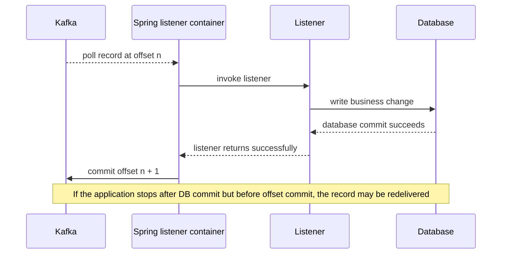
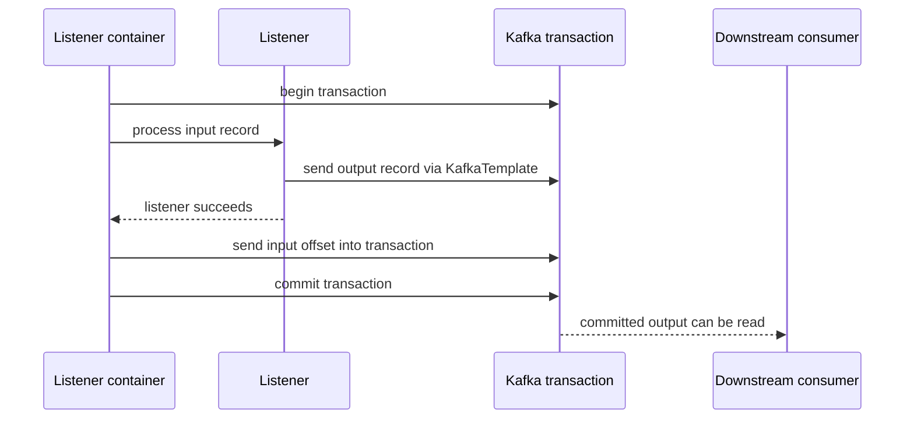

# Consumer Delivery Guarantees

In Spring Kafka, delivery guarantees describe what happens to a record when a consumer receives it, executes business logic, and persists reading progress. A consumer may process a record zero times, once, or multiple times. Therefore, the critical question is not only whether Kafka delivers the record to the consumer, but also **when the offset is committed relative to when business processing completes**.

Delivery guarantees are a property of the entire processing flow. Consumer configuration determines how reading progress is stored; the listener and error handler determine how errors are handled; transactions or idempotency mechanisms determine whether business effects can be duplicated or lost.

## 1. Three Delivery Guarantee Models

### At-most-once

The consumer commits the offset before applying the business effect. If the application stops after the offset is committed but before the business effect completes, Kafka considers that record consumed and will not redeliver it to the consumer group. The record may be lost from the business processing flow.

```text
Read record -> Commit offset -> Process business logic
                               ^
                               If the application stops here, the record is not reprocessed
```

This model avoids a record being processed twice due to a consumer restart, while accepting the possibility of data loss. Consider it only when missing some less critical events is preferable to duplicate processing, such as certain telemetry streams that can be reconstructed or aggregated from other sources.

### At-least-once

The consumer completes business processing before committing the offset. If the application stops after business logic completes but before Kafka records the new offset, the record will be read again after the consumer restarts or the partition is assigned to another consumer.

```text
Read record -> Process business logic -> Commit offset
                     ^                        ^
                     |                        |
                     +-- If stopped after processing but before commit,
                         the record may be redelivered
```

At-least-once avoids marking a record as completed before the listener finishes processing. In return, the listener may receive the same record multiple times. This is the common choice for consumers that must avoid losing events, provided business effects can be made idempotent.

### Exactly-once

Exactly-once means a committed result appears only once within the scope protected by the exactly-once mechanism. With Spring Kafka, Kafka transactions can coordinate writing output records and committing input record offsets within the same Kafka transaction.

If the transaction succeeds, output records and input offsets are committed together. If the transaction fails, both are aborted: the consumer can read the input record again, while downstream consumers using `read_committed` will not see output records from the aborted transaction.

Exactly-once in Kafka **does not mean the listener is invoked only once**. The listener can still rerun after a rollback or restart. This mechanism guarantees committed Kafka results remain consistent within the transaction scope; it does not automatically cover databases, HTTP APIs, emails, or systems outside Kafka.

## 2. Offsets Determine Where the Consumer Resumes Reading

Kafka tracks progress per consumer group and per partition. The committed offset is the next position the consumer group will read, not the last processed offset number. For example, after processing the record at offset `41`, the consumer typically commits `42`.

```text
Partition 2:  ... 40 | 41 | 42 | 43 | 44 ...
                    ^    ^
               record 41  committed offset = 42
                          next record to be read
```

When a consumer restarts with the same `group.id`, Kafka uses the committed offset to resume. If no valid offset exists yet, `auto.offset.reset` determines the starting position, such as `earliest` or `latest`. This property only decides the starting point when an offset is missing; it does not by itself produce at-most-once, at-least-once, or exactly-once.

Several scenarios illustrate the relationship between offsets and business logic:

| When the application stops | Offset committed? | Outcome when consumer restarts |
|---|---:|---|
| Before listener processes record | No | Record is read again |
| While listener is processing | No | Record is usually read again; partial effects must be handled safely |
| After database commit, before offset commit | No | Record is read again; database may receive a duplicate effect |
| After offset commit | Yes | Consumer continues from the next offset |

Kafka only manages consumer group offsets. Kafka does not know whether a SQL statement committed or whether an HTTP request succeeded. The gap between business commit and offset commit is a common source of duplicate processing in at-least-once systems.

## 3. How Does Spring Kafka Manage Offsets?

With `@KafkaListener`, the listener container calls the Kafka consumer to poll records, passes them to the listener, and manages offset commits. Starting with Spring Kafka 2.3, if the application does not configure `enable.auto.commit`, the framework sets it to `false` so the container manages commits. Declare it explicitly in configuration so the application's intent is clear and does not depend on inherited defaults.

```yaml
spring:
  kafka:
    consumer:
      group-id: inventory-service
      enable-auto-commit: false
    listener:
      ack-mode: record
```

`AckMode` determines how the container commits offsets:

| AckMode | Commit timing | Common usage |
|---|---|---|
| `RECORD` | After each record is successfully processed by the listener | Commit per record with a record listener |
| `BATCH` | After finishing all records from a single `poll()` | Improve commit efficiency in batch processing; this is the container default |
| `TIME` | After the batch is processed and the time interval elapses | Reduce commit frequency by time interval |
| `COUNT` | After the batch is processed and the record count threshold is met | Tune commit frequency by volume |
| `COUNT_TIME` | When either the count or time condition is met after batch processing | Combine both commit thresholds |
| `MANUAL` | Listener calls `acknowledge()`; container manages commits with batch-like semantics | Listener explicitly acknowledges after processing |
| `MANUAL_IMMEDIATE` | Commits immediately when `acknowledge()` is called on the consumer thread; if called from another thread, the request is queued for the container to process | Need immediate commit on acknowledgement and clear control over the calling thread |

`RECORD` is for record listeners; batch listeners need a mode aligned with processing the entire batch. With `BATCH`, an error on one record in a poll can affect the commit progress of the batch; exact behavior also depends on the error handler and how it handles failed records.

### Example Using RECORD

```java
@KafkaListener(topics = "inventory-events", groupId = "inventory-service")
public void handle(InventoryEvent event) {
    inventoryService.apply(event);
}
```

With a container using `AckMode.RECORD`, when `inventoryService.apply()` completes and the listener returns normally, the container can commit that record's offset. If the listener throws an exception, the container delegates the error to the error handler. The error handler decides whether to retry, recover, or stop processing; do not assume every exception automatically yields the same behavior.

A listener should return normally only when the work protected by the delivery guarantee is finished. If a listener launches an async task and returns immediately, the container may commit the offset while the task is still running. In that case, even `RECORD` will not protect unawaited async work.

## 4. Building an At-least-once Consumer

With at-least-once, the listener only signals success after the business effect has been durably persisted. If processing fails, the exception must propagate to the container so the error handler can perform retries or recovery.

```java
@KafkaListener(topics = "orders", groupId = "order-projection")
public void handle(OrderEvent event) {
    // The method returns only after the business change has committed.
    orderProjectionService.apply(event);
}
```

The example above fits `AckMode.RECORD` or another commit mode following the same principle: the offset advances only after the listener succeeds. If `apply()` writes to a database, the method should return after the database transaction commits. If it only enqueues a write to an internal queue and returns, the offset may be committed before the data is actually safe.

Typical timeline flow:



### Manual Acknowledgement

When the listener needs to decide the exact moment of acknowledgement, you can use `MANUAL` and accept `Acknowledgment` in the listener method:

```java
@KafkaListener(topics = "payments", groupId = "payment-service")
public void handle(PaymentEvent event, Acknowledgment acknowledgment) {
    paymentService.processAndCommit(event);
    acknowledgment.acknowledge();
}
```

The container must be configured with `ContainerProperties.AckMode.MANUAL` for this listener. `acknowledge()` is called only after `processAndCommit()` succeeds. With `MANUAL`, the container receives the acknowledgement and commits with manual mode semantics; if you need an immediate commit on the consumer thread, look into `MANUAL_IMMEDIATE` and ensure the call happens on the right thread. Never call acknowledge before business logic finishes if your goal is at-least-once.

## 5. Retries and Dead Letter Topic

At-least-once requires a clear error policy. When a listener throws an exception, the Spring Kafka error handler can retry the record, send it to a Dead Letter Topic (DLT), or apply another recovery action. If the application catches an exception, ignores it, and returns normally, the container may treat the record as successfully processed and commit the offset. Only catch exceptions when the application has genuinely handled or recorded the failure through an intentional workflow.

Example configuring `DefaultErrorHandler` with three retries and a DLT:

```java
@Bean
DefaultErrorHandler kafkaErrorHandler(KafkaTemplate<Object, Object> template) {
    DeadLetterPublishingRecoverer recoverer =
            new DeadLetterPublishingRecoverer(template);

    return new DefaultErrorHandler(
            recoverer,
            new FixedBackOff(1_000L, 3L)
    );
}

@Bean
ConcurrentKafkaListenerContainerFactory<String, OrderEvent>
kafkaListenerContainerFactory(
        ConsumerFactory<String, OrderEvent> consumerFactory,
        DefaultErrorHandler kafkaErrorHandler) {

    var factory = new ConcurrentKafkaListenerContainerFactory<String, OrderEvent>();
    factory.setConsumerFactory(consumerFactory);
    factory.setCommonErrorHandler(kafkaErrorHandler);
    factory.getContainerProperties().setAckMode(ContainerProperties.AckMode.RECORD);
    return factory;
}
```

This example uses the `DefaultErrorHandler` API from modern Spring Kafka versions (2.8 and above). Ensure the producer used to publish to the DLT has serializers compatible with both the original record and exception metadata. By the default resolver, records are typically sent to a topic suffixed with `.DLT` preserving the corresponding partition; the DLT topic must exist and have enough partitions to receive the record. You can customize the destination with `DeadLetterPublishingRecoverer` when your system's routing rules differ.

When recovery successfully publishes a record to the DLT and the error handler marks the record as recovered, the container can advance the offset past that record. If publishing to the DLT fails, the recovery failure must be treated as a real failure so the record is not silently skipped. Therefore, the DLT also needs monitoring, sufficient retention, and an investigation or replay procedure. Sending a record to the DLT is a business recovery decision; it does not mean the original business effect succeeded.

Retries can prolong holding a partition and affect processing order. For transient failures like timeouts or an unavailable downstream service, retries with backoff are usually appropriate. For data errors that retries cannot fix, a DLT isolates the record so other records can continue. Distinguish transient errors from permanent errors instead of retrying every exception indefinitely.

## 6. At-most-once and Record Loss Risk

At-most-once requires committing the offset before executing the business effect. With Spring Kafka, you can intentionally acknowledge early using `MANUAL_IMMEDIATE` on the consumer thread, but this behavior must be designed deliberately:

```java
@KafkaListener(topics = "metrics", groupId = "metrics-aggregator")
public void handle(MetricEvent event, Acknowledgment acknowledgment) {
    acknowledgment.acknowledge(); // acknowledge before running business logic
    metricsService.aggregate(event);
}
```

The container must use `AckMode.MANUAL_IMMEDIATE` if you want the call on the consumer thread to commit immediately. If the application stops after `acknowledge()` but before `aggregate()`, the record will not be read again given the committed offset. If `aggregate()` fails, offset-based retries also no longer protect this record.

Do not enable `enable.auto.commit=true` and assume the consumer is at-most-once by default. Auto commit can run independently of when the listener finishes; depending on the timing of poll, processing, and commit, the application may experience both record loss and duplicate processing. Container-managed acknowledgement ties commits more clearly to the listener processing lifecycle.

## 7. Exactly-once with Kafka Transactions

A consume-transform-produce flow can use a Kafka transaction to atomically commit output records and input record offsets. Spring Kafka supports transaction-aware listener containers. When a listener runs inside a Kafka transaction:

1. The container begins a Kafka transaction before invoking the listener.
2. The listener reads the input record and can send output records using a `KafkaTemplate` participating in the same transaction.
3. When the listener completes, the container sends the input offset into the transaction.
4. Kafka commits the transaction so output and offset take effect together; if processing fails, the transaction is aborted.



If the listener throws an exception before the transaction commits, the transaction's output is aborted and the input offset is not committed in that transaction. The input record can be read again. Downstream consumers must set `isolation.level=read_committed` to read only records from committed transactions; consumers using `read_uncommitted` may see records from incomplete or aborted transactions.

A Spring Boot configuration illustrating transactional producer and consumer settings:

```yaml
spring:
  kafka:
    producer:
      # Value must be unique across concurrently running instances.
      transaction-id-prefix: ${INSTANCE_ID:order-transformer-1}-
    consumer:
      properties:
        isolation.level: read_committed
```

When using this configuration, the producer factory must support transactions and the listener container must be configured to run in the corresponding transaction. The `KafkaTemplate` sending outputs must participate in the container's transaction; a non-transactional producer or a send outside the transaction breaks the atomicity guarantee. `transaction-id-prefix` must be unique across concurrent instances to avoid transactional ID conflicts. How the transaction manager and container are declared can vary by Spring Boot/Spring Kafka version and how the application configures its factories.

Kafka producer idempotence and Kafka transactions play related but distinct roles. An idempotent producer prevents send retries by the same producer from creating duplicate records due to network errors or ambiguous acknowledgements. Transactions extend that guarantee to combine multiple output records and input offsets in a single atomic commit. Neither eliminates duplicate business events generated independently upstream.

## 8. Exactly-once Does Not Automatically Cover Databases and External Services

Suppose a listener updates a database and then commits the Kafka offset. These two systems have separate transactions:

```text
Kafka delivers record
      |
      v
Database commits change
      |
      | Application stops here
      v
Kafka commits offset
```

If the application stops between the two steps, the database has already changed while the offset has not advanced. When the consumer restarts, the record is redelivered and the database may receive the same change again. A Kafka transaction cannot automatically roll back an already-committed database transaction.

### Idempotent Consumer and Inbox Pattern

A common approach is to give each event a stable `eventId` and store a processed marker in the same database transaction as the business change. The `event_id` column needs a unique constraint; recording the marker must be atomic so two concurrent runs cannot both pass the check.

```java
@Transactional
public void apply(OrderEvent event) {
    // insertIfAbsent must rely on a unique constraint and an atomic operation.
    boolean firstDelivery = processedEventRepository.insertIfAbsent(event.id());
    if (!firstDelivery) {
        return; // event was already applied in a previous transaction
    }

    orderRepository.apply(event);
}
```

If the database transaction rolls back, both the `eventId` marker and the business change roll back together; redelivery can try again. If the transaction commits, redelivery sees that `eventId` already exists and does not repeat the effect. Do not implement this with a `SELECT` followed by an `INSERT` without a unique constraint, because two consumers can both pass the check before either inserts.

### Outbox Pattern

When a database transaction both updates business data and needs to emit a Kafka event, writing directly to the database and then sending to Kafka creates a dual-write problem: one system can commit while the other fails. The outbox pattern solves this by writing the business change and an outbox row in the same database transaction. A separate publisher reads the outbox and sends to Kafka; the publisher may resend if it has not received confirmation, so consumers should still be idempotent.

Inbox is typically used on the consumer side to record applied events. Outbox is typically used on the producer side to ensure database changes and the intent to emit an event are persisted together. Combining both patterns builds a reliable flow between a database and Kafka without assuming a single automatic distributed transaction covers both.

For HTTP APIs, payments, or sending emails, use an idempotency key supported by the target service, a durable state table, or a workflow/saga capable of retries and compensation. Only commit the offset after the application has recorded the result durably enough to continue safely.

## 9. Polling, Rebalance, and Processing Order

A consumer group distributes partitions across consumer members. Kafka guarantees ordering within a partition; different partitions can be processed in parallel. Listener container `concurrency` creates multiple consumers, though the number of consumers that can actually receive useful partitions is bounded by the number of partitions assigned to the group.

If processing one record takes too long and the consumer does not call `poll()` within `max.poll.interval.ms`, Kafka may consider the consumer dead and trigger a rebalance. Partitions are reassigned to other consumers; uncommitted records can be read again. The old consumer must also handle partition revocation properly so it does not keep applying business effects after a partition has moved elsewhere.

Configuration and design aspects to consider:

- `max.poll.records` caps the maximum number of records returned in one poll. Lowering it can reduce uncommitted work in flight, while increasing the number of polls.
- `max.poll.interval.ms` must be large enough for the longest expected processing time of a poll batch, including retries and auxiliary steps.
- `concurrency` should match partition counts and the capacity of downstream databases/services.
- Parallel processing inside a listener must ensure the offset is acknowledged only after the corresponding work finishes. Never leave background tasks running after the listener has returned normally.
- Retry topics or routing records to another stream can alter observed ordering between events. If ordering per aggregate/key is a business requirement, design retries and partitioning around that requirement.

At-least-once combined with partition ordering is often sufficient for many projections or state-updating consumers. However, a long retry can delay subsequent records in the same partition; increasing concurrency does not make a single partition safe to process concurrently by default.

## 10. Distinguishing Frequently Confused Settings

| Setting or mechanism | Role | Does not automatically guarantee |
|---|---|---|
| `enable.auto.commit` | Kafka consumer commits offsets on a schedule | Listener finished business logic before commit |
| `AckMode.RECORD` / `BATCH` | Container determines commit timing from listener outcome | Database/HTTP effects are atomic with the offset |
| `Acknowledgment.acknowledge()` | Listener confirms record/batch under manual mode | Business effect cannot repeat if acknowledged too early |
| `auto.offset.reset` | Chooses starting read position when group has no valid offset | Delivery guarantee after listener starts processing |
| Producer idempotence | Prevents duplicates from send retries by the same producer | Consumer never reprocesses an event |
| Kafka transaction | Atomically commits Kafka outputs and offsets within a transaction | Database transactions or services outside Kafka |
| `isolation.level=read_committed` | Returns only records belonging to committed transactions | Exactly-once for side effects outside Kafka |

In particular, do not infer that `AckMode.RECORD` means exactly-once. It only clarifies when the container commits the offset after the listener returns normally. If the listener writes to a database and the application stops before the offset commits, the record can still be redelivered. To protect the database, you need idempotency or a database-appropriate transaction mechanism.

## 11. Observing Delivery Guarantees in Operations

Delivery guarantees must be observed through both Kafka state and business state. Useful signals include:

- Consumer group lag and lag growth/shrink rates per partition.
- Rebalance count, listener processing time, and `max.poll.interval.ms` breaches.
- Commit frequency, commit latency, and offset commit errors.
- Retry counts, recovered record counts, DLT growth rate, and DLT publish failures.
- Rate of duplicate events caught by unique constraints or inbox tables.
- Time from record receipt to business effect commit.

Logs for processing failures should include topic, partition, offset, key or event ID, consumer group, and failure cause. Do not log sensitive payloads merely for tracing. DLTs need alerts on abnormal growth and a controlled replay procedure; replay must preserve the original event ID so idempotency mechanisms continue recognizing previously applied events.

## 12. Choosing a Guarantee by Workload Type

| Consumer type | Recommended design direction | Reason |
|---|---|---|
| Reconstructible metrics or telemetry | Consider at-most-once if partial data loss is acceptable | Reduces duplicate-processing cost when data is not the sole source of truth |
| Consumer updating a database or order state | At-least-once with inbox/idempotency | Avoids dropping events while controlling duplicate effects |
| Consumer transforming topic A into topic B | Kafka transactions and downstream `read_committed` consumers when Kafka-internal exactly-once is needed | Outputs and input offsets commit atomically |
| Consumer calling payment/HTTP/email providers | At-least-once with idempotency keys or durable workflows | Kafka cannot commit atomically with external services |

For example, a consumer updating inventory quantities should use at-least-once so events are not skipped. Each event needs a stable ID; recording the ID and updating inventory must happen in the same database transaction. If the listener fails before commit, Kafka can redeliver. If the database committed but the offset did not, redelivery is detected as a duplicate and inventory is not deducted a second time.

Conversely, a consumer that only reads an input topic, normalizes data, and writes an output topic can use Kafka transactions. When the listener completes, Kafka commits the output and input offset together. Consumers reading the output topic need `read_committed` so they do not process results of aborted transactions.

Good design starts by identifying which effects need protection, which system is the source of truth, and what must happen if the application stops at each step. Only then should you choose `AckMode`, retries, DLT, transactions, and idempotency so actual behavior matches business requirements.
