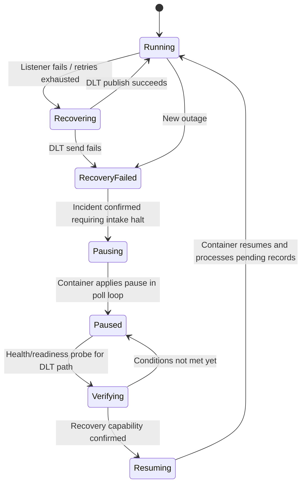

# Pausing When DLT Is Unavailable in Spring Kafka

When a Kafka listener cannot process a record, the system typically retries via `DefaultErrorHandler` and then uses `DeadLetterPublishingRecoverer` to send the failed record to a **dead-letter topic (DLT)**. This approach is truly safe only if the recovery step can write the failed record. If the DLT does not exist, the Kafka broker is unavailable, the producer is denied write permissions, or the DLT serializer fails, the original record **has not been recovered successfully**.

In the *Pause and Backpressure* chapter of the *Spring Kafka Reliability Operations* module, the operational requirement is to **pause intake when the recovery path is disrupted**, while keeping the consumer capable of maintaining group membership, avoiding incorrect offset confirmations, and providing a clear recovery path.

Core principle:

> **Pause is a measure to restrict accepting additional work, not a storage mechanism for failed data.** Only pause after ensuring a failed DLT publish is not treated as a successful recovery. Once the DLT recovers, resume so the system retries/recovers pending records; never skip offsets automatically.

This lesson explains prerequisites, Spring Kafka behavior when DLT publishing fails, pause/resume APIs, how to combine retries with DLT failure detection, rebalance limitations, and production testing scenarios.

## 1. The DLT is part of the reliable processing path

Suppose the `orders-worker` consumer reads the `orders.created` topic. The record at partition 2, offset 150 is invalid and cannot be processed by the listener.

Normal flow:

```text
orders.created-2@150
     |
     v
@KafkaListener
     |
     +-- Exception
             |
             v
      DefaultErrorHandler
             |
             +-- Retry per BackOff if applicable
             |
             +-- Retries exhausted / non-retryable error
                    |
                    v
       DeadLetterPublishingRecoverer
                    |
                    v
          orders.created.DLT
                    |
                    +-- Publish succeeds
                    |
                    v
       Recovery is considered complete
                    |
                    v
       Container handles offset progress
```

A record entering the DLT **is not yet a business success**. It is merely a recovery outcome that keeps the consumer from stalling permanently and preserves data for investigation or replay after fixing the root cause.

If the recoverer cannot send to the DLT, the design must answer:

1. Does the listener container still retain ownership of the unprocessed record?
2. Has the source offset been committed yet?
3. Is it retrying DLT publishing too aggressively and overloading the broker or dependency?
4. Is the system still pulling more records while having nowhere to store failures?
5. Who, or what condition, authorizes resuming?

Without answering these questions, adding an isolated `pause()` call is not enough to protect data.

## 2. DLT unavailability has multiple causes

Not every error in `DeadLetterPublishingRecoverer` proves a system-wide DLT outage.

| Cause category | Example | Typically appropriate handling |
|---|---|---|
| Temporary broker/network disruption | Connection/timeout, leader unavailable | Bound retries, consider pausing and checking recovery |
| Authorization | Producer lacks DLT write permissions | Pause/alert; fix ACLs before resuming |
| Invalid DLT topic/partition | Topic not created, resolver points to nonexistent partition | Fix topic or resolver; avoid infinite retries |
| Incompatible serializer/key/value | Raw `byte[]` while DLT producer accepts only domain objects | Fix serializer configuration; do not expect the broker to self-heal |
| Record too large | Exceeds `max.message.bytes` or producer limits | Handle payload separately / quarantine policy |
| Kafka producer fenced | `transactional.id` conflict | Fix producer lifecycle and transaction configuration |
| Misconfigured retry topic/DLT routing | Destination topic created with wrong name or partition count | Verify routing and provisioning |
| Broker quota/throttling | Produce latency spikes, timeouts | Adjust load, backoff, alert |

A serializer error affecting only one schema may not require pausing every consumer in the cluster. Conversely, a DLT broker unable to accept writes for any record may require multiple listeners to reduce intake.

**Classify the cause before choosing pause scope.** Pausing on every `Exception` in the listener will unnecessarily halt the service for routine business errors.

## 3. State diagram: from healthy to paused and back to resumed

A listener container can be modeled operationally:



This is an **application state machine**, not all states managed automatically by Spring Kafka.

- `RecoveryFailed`: the recoverer genuinely reported an error.
- `Pausing`: the application issued a pause request; the consumer may still finish records in the current poll.
- `Paused`: the container has applied pause on the consumer.
- `Verifying`: verifying the DLT environment before reopening.
- `Resuming`: continuing poll/delivery; failed records still need proper retry/recovery.

Never automatically transition to `Running` merely because a fixed time elapsed. If ACLs, topics, or serializers have not been fixed, resuming will simply reproduce the same error.

## 4. Protecting offsets is a prerequisite before pausing

Kafka consumer groups store committed offsets to know where to read next. If the record at offset 150 has not been processed successfully and the DLT has not received it either, **do not confirm progress past that record** just to lower lag.

Example:

```text
Partition 2:

offset 148: processed successfully
offset 149: processed successfully
offset 150: listener failed, DLT publish failed
offset 151: not processed yet
offset 152: not processed yet

Safe commit position in this scenario: at most 150.
Do not commit 151 or 153 just to skip record 150.
```

Only after the DLT publish of offset 150 is confirmed successful per policy can the container/error handler treat that record as recovered and advance commit position to 151 per the corresponding AckMode.

Distinguish three outcomes:

| Outcome | What does it mean? | Can the business record be considered finished? |
|---|---|---|
| Listener success | Business processing completed | Yes, per contract and commit policy |
| Recovery success | Failed record was stored/routed per recovery policy | No; it is only recovered |
| Recovery failed | Failed record has not been persisted | No; reprocessing capability must be preserved |

If the application uses manual acknowledgment, do not call `acknowledge()` while DLT publishing is failing. In a transactional listener, use a transaction-compatible rollback/recovery path rather than treating offset commit and DLT publishing as arbitrarily independent actions.

## 5. Why must DLT publish failures be detectable?

`KafkaTemplate.send()` is a send operation that can return a future before the broker confirms the outcome. If the recoverer only initiates the send without checking the result properly, late producer failures may not be interpreted as recovery failures where offset decisions happen.

In supporting Spring Kafka versions, `DeadLetterPublishingRecoverer` offers settings:

- `setFailIfSendResultIsError(true)`: instructs the recoverer to raise an error when the DLT send result fails.
- `setWaitForSendResultTimeout(Duration)`: caps how long to wait for the send result.
- Other options regarding destination partition verification, headers, and producer transactions depending on version.

Example:

```java
DeadLetterPublishingRecoverer recoverer =
        new DeadLetterPublishingRecoverer(dltKafkaTemplate);

recoverer.setFailIfSendResultIsError(true);
recoverer.setWaitForSendResultTimeout(
        Duration.ofSeconds(10)
);
```

The goal is **not marking recovery successful before obtaining the required DLT send outcome**. Choose the timeout based on Kafka producer settings like `delivery.timeout.ms`, `request.timeout.ms`, `max.block.ms`, broker environment, and listener SLOs.

Waiting too long directly on the consumer thread can affect liveness. Waiting too briefly can trigger false outage alarms when the broker is merely slow. Pick a deliberate limit and monitor actual latency.

### 5.1. Publishers can fail immediately or asynchronously

For instance, a producer lacking a compatible serializer may fail while preparing the record, whereas timeout or broker authorization errors may appear when the future completes.

Therefore, checking only direct exceptions thrown by `send()` is not enough to cover every failure path. Understand your deployed recoverer's publish-confirmation policy.

### 5.2. DLT send succeeds, then offset commit fails

Even after a DLT publish is confirmed, the consumer may crash or fail to commit the source offset before progress is saved. Upon restart, the source record may be reprocessed and dead-lettered again, causing **duplicate DLT entries**.

Thus, DLT consumers and replay tools must be idempotent, such as identifying records by original topic/partition/offset or a stable business event ID.

## 6. Configuring DefaultErrorHandler and recoverer

A Spring Boot example for a record listener, assuming the DLT producer can already serialize the required key/value types:

```java
@Configuration
public class KafkaFailureConfiguration {

    @Bean
    public CommonErrorHandler commonErrorHandler(
            KafkaTemplate<Object, Object> dltKafkaTemplate) {

        DeadLetterPublishingRecoverer recoverer =
                new DeadLetterPublishingRecoverer(dltKafkaTemplate);

        recoverer.setFailIfSendResultIsError(true);
        recoverer.setWaitForSendResultTimeout(
                Duration.ofSeconds(10)
        );

        DefaultErrorHandler handler =
                new DefaultErrorHandler(
                        recoverer,
                        new FixedBackOff(1_000L, 2L)
                );

        handler.addNotRetryableExceptions(
                InvalidOrderException.class
        );

        return handler;
    }
}
```

Meaning:

1. Listener fails; `DefaultErrorHandler` decides retry/recovery.
2. For retryable errors, `FixedBackOff(1000,2)` allows up to two retries after the initial attempt.
3. For `InvalidOrderException`, the handler can route immediately to the recoverer per classification.
4. The recoverer sends the record to the DLT (by default appending `.DLT` to the topic name and using the matching partition).
5. If DLT publishing cannot be confirmed per configuration, the recoverer signals an error instead of silently treating the record as handled.
6. The application can detect recovery failure and decide to limit intake or pause.

**This configuration alone does not contain pause logic.** It is the safeguard ensuring the handler knows whether recovery actually succeeded. The next sections decide when and where to pause.

### 6.1. Recovery failure vs. listener failure

A record may consistently fail business logic while the DLT remains healthy. In that scenario, the proper workflow is sending the record to the DLT and continuing to process other records.

Only when **the recoverer cannot complete its job** does a recovery-path issue arise. Do not lump both failure types into one counter and pause every time `@KafkaListener` throws an exception.

### 6.2. Retrying after a recovery failure

`DefaultErrorHandler` manages retry logic and backoff state; modern versions allow configuring `resetStateOnRecoveryFailure`.

When the recoverer fails, the error handler can reset retry/backoff state so subsequent deliveries follow the policy again. This preserves the ability to reprocess the record, yet can also cause the failing record to repeat, hitting the failing DLT every cycle.

**Pause or circuit breakers can dampen retry storms**, though they do not replace having the handler retain unrecovered records. If enabling pause, establish a resume path and retry policy once infrastructure recovers.

## 7. Three types of pause and their practical meaning

### 7.1. Direct Consumer.pause

The Kafka client has `KafkaConsumer.pause(Collection<TopicPartition>)`. It asks the consumer to temporarily stop fetching additional records from those partitions; assignments are not relinquished simply by pausing.

However, Kafka `Consumer` is not thread-safe. Never keep a `Consumer` reference in a background health-check thread and call `pause()`, `resume()`, or `commitSync()` on your own.

In Spring Kafka applications using listener containers, **prefer the container API** so the container coordinates pause/resume on the consumer thread.

### 7.2. Pausing the entire listener container

With a `MessageListenerContainer`:

```java
container.pause();
// ... after the DLT path has recovered
container.resume();
```

`pause()` is a **request** to pause. Spring Kafka applies the pause at an appropriate point in the poll loop; it does not necessarily stop a currently executing listener invocation immediately.

The container continues calling `poll()` while assigned partitions are paused to support consumer group liveness rather than stopping polling indefinitely. Exact mechanics depend on version/configuration.

### 7.3. Pausing a single partition

In supporting Spring Kafka versions:

```java
container.pausePartition(
        new TopicPartition("orders.created", 2)
);

// When conditions to continue are met:
container.resumePartition(
        new TopicPartition("orders.created", 2)
);
```

Per-partition pause helps if the failure affects only one DLT route or one partition. However, if the DLT producer, ACL, or broker is failing globally, pausing one partition may not be enough: other partitions can also hit failed records and attempt publishing to the DLT.

### 7.4. Pause is not stop

| Action | Assignment | Polling/liveness | Goal |
|---|---|---|---|
| Container `pause()` | Usually retains ownership while group is stable | Container maintains appropriate polling | Temporarily halt delivery/fetching |
| `pausePartition()` | Retains partition ownership while group is stable | Other partitions can keep advancing | Block one specific partition |
| Container `stop()` | Consumer closes/leaves group | Container stops | Stop service/listener |
| Rebalance revoke/lost | Ownership changes/lost | Depends on group lifecycle | Hand off partitions |

Do not use stop instead of pause when the requirement is keeping the listener in the group and resuming quickly. Still, pause **does not prevent** rebalances if the instance gets kicked out of the group or membership changes.

## 8. A pause request does not stop in-progress records

Suppose `max.poll.records=100`; the container just fetched a batch of records and is dispatching them to the listener. When a monitor detects a DLT outage and calls `pause()`, records from the current poll may still be processed by the container according to listener mode and configuration.

Timeline example:

```text
T0  poll() receives 100 records
T1  Listener processes first record
T2  Business error -> recoverer fails DLT publish
T3  Container pause requested
T4  Container finishes required steps of current poll
T5  Pause applied at appropriate poll cycle
T6  Consumer keeps polling for liveness, fetches no new batches
```

Spring Kafka offers the `pauseImmediate` option in supporting versions to change when pause applies (after the current record rather than waiting for all records in the poll), though you must check Javadocs and its impact on in-memory retained records before using it.

Therefore, **you cannot promise that right after calling `pause()` no more records will invoke the listener**. When strict intake closure is required, add bounded in-flight processing and idempotency.

## 9. A pause/resume control gate via KafkaListenerEndpointRegistry

With a listener carrying a stable ID:

```java
@KafkaListener(
    id = "orders-listener",
    topics = "orders.created",
    groupId = "orders-service"
)
public void consume(OrderCreated event) {
    orderService.apply(event);
}
```

The application can look up the listener container by ID via `KafkaListenerEndpointRegistry` and issue pause/resume requests.

```java
@Component
public class DltIntakeGate {

    private final KafkaListenerEndpointRegistry registry;
    private final AtomicBoolean pausedForDlt = new AtomicBoolean();

    public DltIntakeGate(KafkaListenerEndpointRegistry registry) {
        this.registry = registry;
    }

    public void requestPause() {
        if (!pausedForDlt.compareAndSet(false, true)) {
            return;
        }

        MessageListenerContainer container =
                registry.getListenerContainer("orders-listener");

        if (container == null) {
            pausedForDlt.set(false);
            throw new IllegalStateException(
                    "orders-listener container not found"
            );
        }

        container.pause();
    }

    public void resumeAfterVerifiedRecovery() {
        MessageListenerContainer container =
                registry.getListenerContainer("orders-listener");

        if (container == null) {
            throw new IllegalStateException(
                    "orders-listener container not found"
            );
        }

        // Call this method after verifying the DLT is actually writable.
        container.resume();
        pausedForDlt.set(false);
    }

    public boolean isPauseRequestedByGate() {
        return pausedForDlt.get();
    }
}
```

Required corresponding imports:

```java
import java.util.concurrent.atomic.AtomicBoolean;
import org.springframework.kafka.config.KafkaListenerEndpointRegistry;
import org.springframework.kafka.listener.MessageListenerContainer;
import org.springframework.stereotype.Component;
```

This is a simple **control gate**; it does not verify the DLT by itself. `resumeAfterVerifiedRecovery()` should only be called after health logic or an operator has verified recovery conditions.

An `AtomicBoolean` is JVM-local state; it does not replace reading the container's actual paused state. If an instance restarts, the gate resets. In multi-pod systems, service-wide pause decisions must be synchronized through metrics/alerts or an appropriate coordination mechanism.

### 9.1. Checking whether pause has been applied

Spring Kafka has pause-state APIs or events such as `isPauseRequested()`, `isConsumerPaused()`, `ConsumerPausedEvent`, and `ConsumerResumedEvent` in supporting versions.

This lets you distinguish:

- Pause has been **requested**.
- The consumer thread has **actually applied** the pause.
- A resume command has been issued.
- The consumer has returned to receiving records.

This distinction is critical when building alerts or assessing "did pausing actually block intake?"

## 10. Detecting recovery failure via RetryListener

`DefaultErrorHandler` supports `RetryListener` for events like failed delivery, successful recovery, and recovery failure. The `recoveryFailed` callback notifies the application that the recoverer threw an error.

Example combining the error handler with `DltIntakeGate`:

```java
@Bean
public CommonErrorHandler commonErrorHandler(
        KafkaTemplate<Object, Object> dltKafkaTemplate,
        DltIntakeGate gate) {

    DeadLetterPublishingRecoverer recoverer =
            new DeadLetterPublishingRecoverer(dltKafkaTemplate);

    recoverer.setFailIfSendResultIsError(true);
    recoverer.setWaitForSendResultTimeout(
            Duration.ofSeconds(10)
    );

    DefaultErrorHandler handler =
            new DefaultErrorHandler(
                    recoverer,
                    new FixedBackOff(1_000L, 2L)
            );

    handler.setRetryListeners(new RetryListener() {
        @Override
        public void recoveryFailed(
                ConsumerRecord<?, ?> record,
                Exception original,
                Exception failure) {

            if (isDltInfrastructureFailure(failure)) {
                gate.requestPause();
            }
        }
    });

    return handler;
}
```

`isDltInfrastructureFailure` is an **application-built classifier**; Spring Kafka does not automatically know which errors warrant pausing all partitions. You can start with Kafka producer exceptions such as timeouts, authorization, or topic metadata errors, and refine per policy.

Example helper inspecting the cause chain:

```java
private static boolean isDltInfrastructureFailure(
        Throwable error) {

    Throwable current = error;

    while (current != null) {
        if (current instanceof org.apache.kafka.common.errors.TimeoutException
                || current instanceof
                       org.apache.kafka.common.errors.TopicAuthorizationException
                || current instanceof
                       org.apache.kafka.common.errors.UnknownTopicOrPartitionException) {
            return true;
        }

        current = current.getCause();
    }

    return false;
}
```

This helper is illustrative. A `TimeoutException` can also arise from many causes, while a DLT outage can surface via other exceptions. In production, combine destination topic, producer metrics, recent errors, and DLT health conditions.

**Specifically:** the `recoveryFailed` callback runs inside the listener container's error-handling path. Perform only lightweight work and issue the pause request; do not run long health probes, make blocking REST calls, or wait on the entire cluster inside the callback.

### 10.1. Why not pause on every failedDelivery?

`failedDelivery` fires on listener failures, many of which recover cleanly via retry or DLT. If you pause on the first failed delivery, a single ordinary `InvalidOrderException` could halt the entire service.

Separate:

- **Listener processing failed:** data or business dependency failed.
- **Retry exhausted:** retry attempts ran out.
- **Recovery failed:** DLT/quarantine failed to persist the record.
- **Infrastructure outage confirmed:** enough signals to throttle intake or pause.

Only the final category is the typical trigger for prolonged pausing.

## 11. Pause scope: whole container or per partition?

Choose based on incident scope, not arbitrarily.

| Scenario | Suggested pause | Reason |
|---|---|---|
| A listener's DLT producer cannot write any topic | That listener's container | Stop taking more records that might need recovery |
| Only one DLT topic has ACL/topic metadata errors | Listeners/routes using that DLT | Avoid impacting unrelated listeners |
| Only one destination partition is missing or resolver is wrong | Corresponding source partition if supported | Limit blast radius, fix routing |
| Serializer error for one event type | Classify and quarantine specially or pause affected route | Do not assume all DLTs are in outage |
| Global Kafka cluster unavailable | Multiple listeners/producers, per operational coordination | Backpressure across multiple data paths |
| Normal business error, DLT is healthy | Do not pause | Handler already provides retry/recovery |

With a `ConcurrentMessageListenerContainer` whose concurrency exceeds 1, pausing the whole container can block all child consumers belonging to that listener. If per-topic/partition pause is needed, verify supported methods and actual assignments.

Never call `Consumer.pause()` directly across children from an arbitrary thread. Use container APIs to avoid violating Kafka client thread-safety rules.

## 12. Pause and backoff are not the same mechanism

**Backoff** governs wait intervals between retry attempts. **Pause** governs fetching/delivering new records on partitions or containers. They can work together, yet do not replace each other.

Example:

```text
Record offset 150 fails
      |
      v
DefaultErrorHandler retry/backoff
      |
      v
DeadLetterPublishingRecoverer sends to DLT
      |
      +-- Success --> continue processing
      |
      +-- Failure --> record recovery failure
                           |
                           v
                    Request intake pause
                           |
                           v
                  Wait for infrastructure recovery
                           |
                           v
                         Resume
                           |
                           v
                  Retry/recover record again
```

Merely setting `FixedBackOff(5000, Long.MAX_VALUE)` on the listener without classifying errors can make the application retry a malformed-schema payload infinitely even though the real problem is an unwritable DLT. Conversely, calling `pause()` with no recovery-continuation policy leaves the record sitting idle forever after infrastructure recovers.

### 12.1. ContainerPausingBackOffHandler

Spring Kafka includes `ContainerPausingBackOffHandler` in supporting versions to handle **long backoffs** by coordinating container pauses instead of making the consumer thread sleep for the entire wait interval.

This mechanism is helpful when retry delays exceed the allowed interval between polls. However, it is **not** an automatic DLT-outage detector. To pause on DLT failures, you still need logic to detect recoverer failures and decide when to resume.

Check exact constructors/APIs for your version and listener type before configuring.

### 12.2. Retry storms when resuming too early

If a listener resumes while the DLT is still failing:

1. The failed record is redelivered.
2. The listener fails as before.
3. The recoverer attempts DLT publish again and fails.
4. The control gate requests pause again.

Repeating this cycle generates excessive logs, metrics, Kafka producer attempts, and churn. Require cooldowns, bounded probes, hysteresis, and a stable recovery threshold before resuming.

## 13. The consumer must still poll while paused

A Kafka consumer must maintain polling/membership per the group protocol. If a listener thread blocks for a very long time, it can exceed `max.poll.interval.ms`, lose assignments, and trigger a rebalance.

Standard container pause avoids fetching additional records **while still letting the consumer thread keep polling** at appropriate points. However, if code blocks directly inside the listener, recoverer, or callback with an infinite timeout, a pause request cannot save missed polls.

Therefore:

- Bound the wait time for `KafkaTemplate` send results.
- Bound processing duration for the listener and dependency calls.
- Avoid long `Thread.sleep()` calls inside `RetryListener` callbacks.
- Never wait indefinitely on a DLT probe inside the consumer thread.
- Monitor rebalances, heartbeats, polls, and `max.poll.interval.ms`.
- Use container-supported backoff pausing for long delays.

### 13.1. Pause does not lock assignments forever

When group membership changes, partitions can still be revoked even while the container is paused. Uncommitted records will be re-read from committed offsets by the new owner once the group recovers.

If the application holds async work, a pause request does not cancel it automatically. Handle idempotency, in-flight tasks, and ownership/offset protection separately.

## 14. Resuming properly when the DLT recovers

Resume should not be triggered solely by a "Kafka broker reachable" flag. The broker may be reachable while the producer still lacks DLT write permissions, the target topic is missing partitions, or the serializer still fails.

A recovery policy can include:

1. **Identify the root failure** of the DLT: metadata, ACLs, networking, serializer, partitions, producer transactions.
2. **Remediate** the topic/configuration/ACLs or relevant dependency.
3. **Verify publishing capability** to the real destination using matching serializers and credentials, or execute a controlled check representative of the DLT write path.
4. **Confirm stability** over a time window or consecutive probes.
5. **Resume in a bounded manner**, avoiding reopening all instances simultaneously right as a cluster recovers.
6. Verify failed offsets are retried/recovered.
7. Monitor DLT ingress, recovery failure rates, consumer lag, and downstream health.
8. If failures recur, pause again and alert instead of oscillating intake open/closed.

Checking `AdminClient.describeTopics()` or broker metadata can spot a missing topic, yet **does not prove publishing works**. A producer can still fail on denied ACLs, serializer errors, or broker record rejections. If using canary records, choose a deliberate canary topic/process so you do not pollute the business DLT or trigger accidental replays.

### 14.1. Manual vs. automatic resume?

| Strategy | Advantages | Risks |
|---|---|---|
| Operator verifies then resumes | Controlled, easy to audit | Requires on-call effort |
| Health-check auto-resume | Fast recovery for brief outages | Prone to flapping if probes fail to reflect real publishing |
| Fixed-cooldown resume | Simple | Does not know whether outage actually ended |
| Circuit breaker + canary publish | Stronger verification signal | Must manage canary, cost, and security |

For DLT outages that risk data loss if misconfigured, prefer strong recovery-verification signals and a clear audit trail.

## 15. Never accidentally open a DLT-bypass path

Certain quick fixes temporarily lower lag while breaking correctness.

**Never use a recoverer that only logs and returns normally** if the contract requires persisting failed records in a DLT. A recoverer returning normally can lead the handler/container to treat recovery as complete and advance offsets.

**Never set `ackAfterHandle=true` and assume all cases are safe.** This setting governs records handled by the error handler without rethrowing; it does not replace confirming whether DLT publishing succeeded.

**Never call `Acknowledgment.acknowledge()` for an unprocessed or unrecovered record.** Early acks can destroy redelivery capability.

**Never use manual `seek()` to skip offsets** solely because a DLT outage creates backlog. If skipping records by business decision is required, persist them durably with auditing and a replay mechanism.

**Never catch exceptions inside the listener and return** if error-handler retry/recovery is still expected. The container will struggle to distinguish real failures from successes.

## 16. ACK modes and transactions

With non-transactional record listeners, `DefaultErrorHandler`, `DeadLetterPublishingRecoverer`, and the container normally coordinate offsets once the recoverer succeeds. Settings `ackAfterHandle` and `commitRecovered` carry distinct semantics, especially with `AckMode.MANUAL_IMMEDIATE`.

A baseline configuration example:

```yaml
spring:
  kafka:
    consumer:
      group-id: orders-service
      enable-auto-commit: false
      auto-offset-reset: earliest
      key-deserializer: org.apache.kafka.common.serialization.StringDeserializer
      value-deserializer: org.springframework.kafka.support.serializer.JsonDeserializer
      properties:
        spring.json.trusted.packages: com.example.events

    listener:
      ack-mode: record
      concurrency: 3
```

This is an example for a JSON-consuming listener with container-managed acknowledgments. `max.poll.records`, concurrency, retry policy, and serializers must be tuned to the workload.

### 16.1. When the listener container uses Kafka transactions

Transactional listener containers handle rollbacks and after-rollback processing differently from non-transactional paths. `DefaultAfterRollbackProcessor` can coordinate a recoverer after rollback, while adding offsets to a Kafka transaction must follow consume–process–produce semantics.

Do not blindly copy `DefaultErrorHandler` examples onto a transactional listener and conclude DLT publish + source offset are atomic. Design transaction boundaries, recovery, and pause/resume for your version and verify against a real broker.

### 16.2. DLT publish failure inside a transaction

If the recoverer participates in transactional recovery, producer fencing, transaction aborts, commit errors, or DLT send failures can prevent recovery from completing. Never assume a transaction committed simply because the send future completed cleanly.

For recovery paths requiring Kafka atomicity, verify how `DeadLetterPublishingRecoverer` and the after-rollback processor join the transaction, alongside offset policies. Pause is a load-reduction measure; it does not fix a broken transaction by itself.

## 17. Pause scope in multi-instance systems

A consumer group can span multiple pods:

```text
orders.created partitions: 0..5

pod-A: assigned 0, 1
pod-B: assigned 2, 3
pod-C: assigned 4, 5
```

If the DLT broker cannot write on any partition, pausing only pod-A after an error can allow pod-B and pod-C to keep processing, causing other failed records to keep failing.

There are three coordination levels:

1. **Local pause:** whichever instance sees a recovery failure pauses its own container. Simple, though response lags across instances.
2. **Service-level signal:** a shared health/gate condition instructs all instances of a consumer group to pause under the same policy. Requires preserving polling and coordinating resume.
3. **Route-level signal:** pause only listeners/partitions dependent on the failing DLT destination, keeping unaffected flows running.

A local `AtomicBoolean` gate inside each pod does not ensure the entire group paused. Group-wide coordination requires shared configuration, an operational control plane, or a shared health signal, while avoiding contention when multiple instances self-resume.

### 17.1. Pausing increases lag — that can be right

While the container is paused, consumer group lag may climb as upstream producers keep sending. That is not necessarily a new failure; it reflects **intentional backpressure** to protect data.

Dashboards must distinguish "lag growing because paused due to DLT outage" from "lag growing because consumers died or slowed down." Where event processing SLOs exist, estimate backlog and post-resume catch-up time.

### 17.2. Retention and backlog

Pausing does not keep records on the broker forever if the topic has a retention policy. If a consumer remains paused longer than retention, unprocessed records can be purged from the log before the consumer reads them again.

Therefore, during prolonged outages, monitor:

- Log retention of the source topic.
- Age of the oldest unprocessed record.
- Consumer group lag and upstream producer rate.
- Broker disk capacity and storage policies.
- Projected catch-up duration after resume.
- Options to divert input to another durable path if long-term retention is required.

Pause is a short/medium-term measure; it is not infinite storage.

## 18. Difference between fail closed and fail open

A key architectural decision: if the DLT is unavailable, should the service **halt intake** (*fail closed*) or keep processing healthy records (*fail open*)?

| Policy | Advantages | Risks |
|---|---|---|
| Fail closed / pause | Avoids piling up records that have nowhere to recover | Consumer lag rises, affects throughput and SLAs |
| Fail open while preserving failed records | Other flows/partitions can keep moving | Must be very careful about commit ordering and backpressure |
| Fallback to another quarantine store | Still preserves failed data | Must guarantee fallback is genuinely durable and replayable |
| Skip failed records to keep throughput | Lag can shrink quickly | Risks data loss; rarely an appropriate default |

In reliability engineering, fail closed is usually sensible when failed records cannot be durably persisted and subsequent records depend on ordering. If the service must preserve throughput for unaffected routes, use per-partition/listener pause or quarantine rather than opening an offset-skip path.

### 18.1. DLT fallback vs. silent recoverer

A fallback store, such as an independent quarantine topic or database table, helps only if the application confirms **durable persistence** before marking recovery complete.

Writing to a local log and acking the record is not equivalent to quarantine, because logs may lack retention, access controls, or replay tooling. If the fallback is a database, a transaction boundary emerges between Kafka offsets and database commits; proper idempotency and crash recovery are required.

## 19. Observing DLT incidents and pause state

A service dashboard should display **recovery and pause side by side**, rather than watching consumer lag alone.

| Metric/signal | Purpose |
|---|---|
| `listener_failure_rate` | Business failures prior to recovery |
| `recovery_failure_count` | Count of incomplete DLT/quarantine attempts |
| `dlt_publish_failure_rate` | DLT producer failure rate |
| `dlt_publish_latency_p95` | Whether publishing degraded prior to outage |
| `pause_requested` | Gate requested a pause |
| `consumer_paused` | Pause actually applied |
| `pause_duration_seconds` | How long the listener has been paused |
| `resume_attempt_count` | Number of reopen attempts |
| `resume_failure_count` | Number of times resume hit DLT errors again |
| `consumer_group_lag` | Backlog and catch-up demand |
| `oldest_unprocessed_event_age` | Risk of breaching retention/SLOs |
| `recovered_count` | Failed records successfully sent to DLT |
| `committed_offset_progress` | Whether consumer advances after recovery |
| `rebalance_count` | Whether pauses are disrupted by membership changes |

Metric names in the table are design suggestions, not a claim that Spring Kafka emits all of them out of the box. Combine Micrometer, Spring Kafka container events, Kafka client metrics, and application counters.

Never put record keys, offsets, event IDs, or raw exception messages into metric tags due to high cardinality. Those belong in controlled structured logs/traces.

### 19.1. Structured logs for pause events

```json
{
  "event": "kafka_listener_pause_requested",
  "service": "orders-service",
  "listenerId": "orders-listener",
  "reason": "dlt_publish_failure",
  "destinationTopic": "orders.created.DLT",
  "failureCategory": "producer_timeout",
  "sourceTopic": "orders.created",
  "sourcePartition": 2,
  "sourceOffset": 150
}
```

This is an illustrative application-generated format, not a mandatory default Spring Kafka log. For DLT errors, record both the exception class and trace ID in an appropriate place so operators can pinpoint root causes quickly.

### 19.2. Alerts need both rate and duration

A single producer error is not necessarily an outage. Conversely, a paused listener with zero new traffic can drop the failure rate to 0 even though the system remains halted.

Alert on a combination of:

- DLT publish failure counts within a window.
- Container paused state.
- Pause duration exceeding a threshold.
- Rising consumer lag / oldest pending age.
- Unrecovered DLT conditions.
- Repeated failed resume attempts.

Specifically, **never treat a zero failure rate while paused as proof the service is healthy again**.

## 20. Integration test: DLT unavailable then recovers

To prove pausing does not lose records, use a real Kafka broker in integration tests, such as Testcontainers or EmbeddedKafka. Unit tests mocking the recoverer do not prove producer send results, offset commits, and container pausing work properly.

### 20.1. Setup

1. Create topic `orders.created` with a known partition.
2. Create `orders.created.DLT` or provide a mechanism to deliberately block DLT writes.
3. Configure the listener with `DefaultErrorHandler` and `DeadLetterPublishingRecoverer`.
4. Enable reporting failure when the DLT send result fails.
5. Use a dedicated test consumer group with auto-commit disabled.
6. Attach the gate by listener ID and observe pause/resume states.
7. Send one permanently failing record followed by one or more valid records.

### 20.2. Injecting a controlled outage

Several approaches:

- Revoke DLT write permissions for the test principal.
- Point to an uncreated DLT topic with broker auto-create disabled.
- Configure a resolver targeting a nonexistent partition.
- Use a test serializer that intentionally throws an exception for a specific value.

Avoid simulating every failure type by shutting down the entire broker if the goal is testing **DLT producer unavailable while the source consumer still maintains group membership**.

### 20.3. Assertions during failure

| Scenario | Expected outcome |
|---|---|
| Listener fails | Error handler is invoked |
| Retries exhausted or non-retryable error | Recoverer is invoked |
| DLT publish fails | Recovery failure is observed |
| Gate recognizes matching outage | Pause is requested |
| Container applies pause | Paused state is observed |
| Failed record not yet recovered | Offsets are not committed past it per policy |
| Subsequent valid records | Not processed/committed against policy |
| Consumer stays alive | Polling/liveness continues while paused |
| Lag rises while paused | Reported as intentional backpressure |

With standard pause, records from the prior poll may already be in flight. Do not baselessly assert that zero listener callbacks occur after the exact line calling `pause()`; base assertions on actual pause semantics.

### 20.4. Recovery and resume

1. Restore DLT write permissions or fix the topic/partition/serializer.
2. Verify the producer can send along the real recovery path.
3. Command resume through the gate.
4. Wait for the failed record to be reprocessed/recovered per policy.
5. Confirm the record appears in the DLT with original topic/partition/offset headers.
6. Verify the consumer offset advances past the failed record after successful recovery.
7. Confirm subsequent valid records resume processing.
8. Measure catch-up duration and confirm DLT publish failures do not climb again.

Because producers/consumers can retry and crash, do not assume the DLT contains only one physical record in every scenario. Test idempotent duplicate/replay handling.

### 20.5. Crash or rebalance while paused

Add a new consumer instance or stop the paused instance. Partitions may be handed to another owner, because pause does not "lock" ownership permanently.

Verify unrecovered records are re-read from committed offsets with zero data loss. If the gate is local to a single pod, tests must also demonstrate the new owner does not accidentally bypass the shared outage policy.

## 21. Common implementation mistakes

**Calling `pause()` without checking DLT send results.** The recoverer may be treated as successful while async send failures went unhandled. Ensure the recovery path reports failures accurately first.

**Pausing on every listener exception.** Halts the service on normal business errors. Pause only when the recovery path or a critical dependency requires backpressure.

**Calling `KafkaConsumer.pause()` from arbitrary threads.** Kafka Consumer is not thread-safe. Use Spring Kafka's listener container API.

**Thinking pause takes effect instantly for all in-flight records.** Records from the prior poll may still be processing; understand pause semantics and `pauseImmediate` if supported by your version.

**Waiting indefinitely on DLT publish inside the consumer thread.** Can exceed `max.poll.interval.ms`, causing rebalances, repeated recovery, and prolonged downtime.

**Calling `acknowledge()` during a DLT outage.** Unprocessed/unrecovered records can be skipped after restart.

**Resuming solely because broker ping succeeds.** A reachable broker does not guarantee DLT write ACLs, partitions, serializers, or transactional producers are healthy.

**Having no resume path.** Containers may remain paused forever even after the DLT recovers, growing lag indefinitely.

**Auto-resuming continuously on a short timer.** Causes flapping and retry storms. Require cooldowns, meaningful recovery signals, and attempt limits.

**Pausing too broadly.** A serializer bug on one topic does not necessarily warrant shutting down all consumers. Scope to the right listener/partition.

**Monitoring only DLT error rate.** While paused, error rates drop to 0 because no attempts occur. Track pause duration, backlog, and oldest event age.

**Ignoring source topic retention.** Long pauses can cause unread records to expire before resume.

**Assuming Kafka transactions guarantee every recovery operation.** Transaction boundaries must be explicitly configured and verified; pause does not create atomicity.

## 22. Production runbook for a DLT outage

A practical runbook separates **stabilize first**, **fix root cause second**, and **controlled recovery third**.

### Phase A — Stabilize

1. Confirm recovery failures and affected destination topics.
2. Inspect DLT producer send errors, ACLs, serializers, topics/partitions, and broker latency.
3. Ensure failed records have not been acked/committed past.
4. Pause the appropriate listeners or partitions to avoid worsening the incident.
5. Record pause timestamp, cause, and owning operator.
6. Notify impacted stakeholders regarding SLOs/lag.

### Phase B — Remediate

1. Restore broker or network connectivity if an outage occurred.
2. Fix topic write permissions, partition counts, or destination resolvers.
3. If serializers failed, deploy compatible configuration and test raw bytes if needed.
4. Verify the publish path using a method representative of the real DLT.
5. Confirm producer errors remain zero over a stability window.
6. Assess retention, pending lag, and catch-up capacity.

### Phase C — Resume and monitor

1. Resume a small subset of listeners/instances if the outage was broad.
2. Confirm failed records recover, offsets advance, and subsequent records proceed.
3. Expand resume at a controlled pace to avoid sudden load spikes.
4. Monitor recovery failures, DLT ingress, consumer lag, and transaction/poll health.
5. Check for duplicate DLT entries and idempotent replay.
6. Close the incident once backlog returns to acceptable levels and the runbook is updated.

If failures persist after resuming, **never skip records just to lower lag**. Return to root-cause classification, preserve offsets, and choose proper recovery/quarantine.

## 23. Decision template for a system

Before enabling auto-pause on DLT outages, answer these questions:

1. Does the DLT producer report async send failures to the recoverer?
2. Under what circumstances could offsets of unrecovered records still be committed?
3. Which error classes should trigger pause: global infrastructure or specific payload bugs?
4. Should pause scope be a partition, a listener, or the whole consumer group?
5. What ensures the container keeps polling while paused?
6. Are publish timeouts compatible with `max.poll.interval.ms`?
7. Are any records already in flight before pause?
8. How will a new pod joining the group during an outage inherit the gate?
9. What condition proves the DLT has recovered enough to resume?
10. If auto-resume fails, are backoff/cooldown/hysteresis in place?
11. Do alerts exist for pause duration, lag, and retention risk?
12. Is DLT replay idempotent if records are published twice?
13. Are there integration tests for failed publish, resume, restart, and rebalance?
14. During prolonged pauses, is there a plan to preserve data before retention expires?

Document these answers in the service runbook and re-test whenever changing retry policies, broker topology, or Spring Kafka versions.

## 24. Version-specific references

When implementing, check exact versions of the following components:

- **Spring for Apache Kafka Reference — Pausing and Resuming Listener Containers:** container `pause()`, `resume()`, per-partition pause, and poll-loop notes.
- **Spring Kafka Reference — Handling Exceptions:** `DefaultErrorHandler`, `RetryListener`, retry/recovery failures, and backoff.
- **Spring Kafka Reference — Publishing Dead-letter Records:** `DeadLetterPublishingRecoverer`, DLT destinations, send-result error handling, and serializers.
- **Spring Kafka Javadoc:** `DeadLetterPublishingRecoverer`, `DefaultErrorHandler`, `RetryListener`, `MessageListenerContainer`, `KafkaListenerEndpointRegistry`.
- **Spring Kafka Reference — Container Events / Monitoring:** `ConsumerPausedEvent`, `ConsumerResumedEvent`, and pause states.
- **Spring Kafka Reference — Transactions and After-Rollback Processing:** recovery in transactional listener containers.
- **Apache Kafka Documentation — Consumer Groups / Producer Configurations:** consumer `pause`, `poll`, `max.poll.interval.ms`, producer timeouts, ACLs, and transaction coordinator.
- **Spring Boot Reference — Kafka:** `spring.kafka.consumer.*`, `spring.kafka.listener.*`, producer factories, and error handler beans.

APIs such as `pauseImmediate`, `pausePartition`, `setFailIfSendResultIsError`, `setWaitForSendResultTimeout`, and `ContainerPausingBackOffHandler` may differ in version availability, signatures, or defaults. Inspect your actual dependency Javadocs and run integration tests against a broker before deploying to production.

**Key takeaway:** when the DLT is unavailable, a reliable consumer must **detect unsuccessful recovery**, **never commit offsets past failing records**, **reduce intake via scoped pause/backpressure**, and **resume only after confirming the recovery path works again**. Properly used pausing does not erase errors; it preserves the system's opportunity to process records safely once infrastructure recovers.
