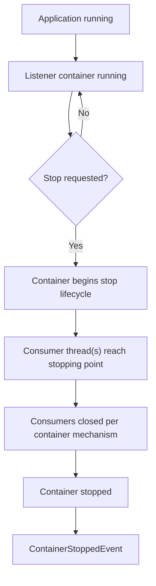

# ContainerStoppedEvent in Spring Kafka

`ContainerStoppedEvent` is a **Spring Application Event** published by Spring Kafka when a Kafka listener container has reached the stopped state. In the *Spring Kafka Reliability Operations* module, this event is especially useful for observing consumer lifecycle, recording logs and metrics, confirming that a stop request has completed, or triggering application-scoped resource cleanup steps.

Crucially, do not equate "container stopped" with "all business tasks completed," "all offsets committed," or "the application definitely shut down safely." `ContainerStoppedEvent` describes **the lifecycle state of the listener container**; data guarantees must come from how acknowledgment, transactions, retry/recovery, idempotency, and shutdown are designed.

This lesson explains when the event appears, how to register a listener with `@EventListener`, how to distinguish it from per-consumer events, how to use it in concurrency/rebalance environments, and situations where you should not depend solely on the event.

## 1. What is a Kafka listener container?

When declaring a `@KafkaListener` method, Spring Kafka uses a listener container to manage the consumer lifecycle on behalf of the application.

Example:

```java
@Component
public class OrderListener {

    @KafkaListener(
        id = "orders-listener",
        topics = "orders.events",
        groupId = "order-service"
    )
    public void onOrder(String payload) {
        // Process a record delivered to the listener.
    }
}
```

For this listener, the container is responsible for tasks such as:

- Creating and managing the Kafka `Consumer`.
- Polling assigned partitions.
- Invoking the listener and forwarding exceptions to the error-handling layer.
- Coordinating acknowledgment and offset commits.
- Executing pause/resume, start/stop, and rebalance callbacks.
- Coordinating Kafka transactions when configured.
- Publishing application events reflecting lifecycle transitions.

Common implementations are `KafkaMessageListenerContainer` and `ConcurrentMessageListenerContainer`. When `concurrency > 1`, a concurrent container can manage multiple child consumer containers.

`ContainerStoppedEvent` occurs at the **container lifecycle layer**, not at the business callback level for individual records.

## 2. Meaning of ContainerStoppedEvent

The event answers the question:

> "Has the listener container managed by Spring Kafka completed its stop process?"

It is not a notification that "a record just finished processing" or "the consumer just ran out of partitions." It is a lifecycle-level signal.

A conceptual sequence:



This is a high-level diagram and does not guarantee exact ordering of every callback between parent and child containers across all versions. With a concurrent container, understand that the parent container manages multiple child consumers and events can carry different source contexts depending on version, configuration, and stop path.

### 2.1. Why is the event name notable?

Spring Kafka has both `ConsumerStoppedEvent` and `ContainerStoppedEvent`. The two names sound similar, yet they do not say the same thing:

- **`ConsumerStoppedEvent`**: relates to the lifecycle of a consumer/container running a consumer thread. It typically contains useful information for understanding why the consumer stopped.
- **`ContainerStoppedEvent`**: relates to the listener container having stopped at the container level.

With `ConcurrentMessageListenerContainer`, the number of child consumers and the parent container are not necessarily one. Therefore, do not assume the count of `ConsumerStoppedEvent` equals the count of `ContainerStoppedEvent` for a single stop of the entire listener.

## 3. Situations that can lead to container stop

A listener container can stop for several reasons:

| Situation | Example | What to observe |
|---|---|---|
| Intentional stop | Operator calls stop on the listener container | Stop completion and shutdown duration |
| Application shutdown | Spring context closes when pod/service stops | Containers stopped, how pending work is handled |
| Dynamic lifecycle | Application turns off a listener for maintenance | Exact listener ID and no impact on other listeners |
| Fatal consumer failure | Error prevents consumer/container from continuing | Root cause, logs, and `ConsumerStoppedEvent` |
| Auth/authorization issue | Consumer can no longer access Kafka | Security error, retry/restart policy |
| Error-handler policy | Error component stops the listener by design | DLT/recovery, offsets, and alerts |
| Reconfiguration | Service stops/starts listener per environment | Before/after state, restart capability |

**Not every rebalance is a container stop.** A partition being revoked from a consumer and later reassigned is usually normal consumer group progression while the container keeps running. `onPartitionsRevoked` does not mean `ContainerStoppedEvent` occurred.

Similarly, calling `pause()` only temporarily pauses record delivery per the pause/resume mechanism; it does not mean the container stopped.

## 4. Distinguishing related application events

Spring Kafka publishes multiple lifecycle and operational events. Each answers a different group of questions:

| Event | Primary signal | What is it used for? |
|---|---|---|
| `ConsumerStartingEvent` | Consumer begins starting | Tracking startup |
| `ConsumerStartedEvent` | Consumer has started | Timing when consumer starts running |
| `ConsumerStoppingEvent` | Consumer is preparing to stop | Observing shutdown progress |
| `ConsumerStoppedEvent` | Consumer has stopped | Investigating consumer cause/lifecycle |
| `ContainerStoppedEvent` | Listener container has stopped | Tracking stop completion at container level |
| `ConsumerFailedToStartEvent` | Consumer failed to start within applicable limit | Detecting startup failures |
| `ListenerContainerIdleEvent` | Listener container idle per threshold | Observing lack of data, polling, or workload |
| `NonResponsiveConsumerEvent` | Consumer unresponsive per monitor criteria | Investigating stalled poll progress |
| `ConsumerPausedEvent` | Consumer was paused | Observing backpressure |
| `ConsumerResumedEvent` | Consumer was resumed | Observing intake recovery |

Event names, classes, and additional metadata can vary across versions. When writing monitoring, use events present in the actual dependency rather than hard-coding every event from a reference list.

### 4.1. ConsumerStoppedEvent can carry a reason

In supported Spring Kafka versions, `ConsumerStoppedEvent` includes stop-reason information—such as normal versus a specific error. If the goal is classifying **why** a consumer stopped, observe that event and corresponding exception logs.

`ContainerStoppedEvent` by itself is not sufficient to distinguish every normal stop from unintended stops. Combine it with:

- Stop/start commands issued by the application.
- Errors from the consumer or listener container.
- `ConsumerStoppedEvent` and reason if supported by version.
- Application lifecycle events and Spring context state.
- Metrics on consumer group, assigned partitions, and lag.

Do not infer that `ContainerStoppedEvent` is always an incident.

### 4.2. ContainerStoppedEvent differs from ApplicationReadyEvent

`ApplicationReadyEvent` states that Spring Boot has finished its corresponding startup stage. `ContainerStoppedEvent` states that a Kafka listener container has stopped.

Having the Spring context remain active after one listener container stops is completely valid: an application may temporarily disable one listener while continuing to run other listeners or serve HTTP APIs.

## 5. Receiving ContainerStoppedEvent with @EventListener

The simplest approach is creating a Spring bean with an `@EventListener` method.

```java
import org.slf4j.Logger;
import org.slf4j.LoggerFactory;
import org.springframework.context.event.EventListener;
import org.springframework.kafka.event.ContainerStoppedEvent;
import org.springframework.stereotype.Component;

@Component
public class KafkaContainerLifecycleObserver {

    private static final Logger log =
            LoggerFactory.getLogger(
                    KafkaContainerLifecycleObserver.class
            );

    @EventListener
    public void onContainerStopped(ContainerStoppedEvent event) {
        log.info(
            "Kafka listener container stopped: source={}, timestamp={}",
            event.getSource(),
            event.getTimestamp()
        );
    }
}
```

`event.getSource()` and `event.getTimestamp()` are basic properties of Spring's `ApplicationEvent`. The snippet does not depend on an ID inferred from thread names or consumer groups.

In an application with many listeners, the method above can receive events from multiple containers. Clearly identify which source belongs to the observed listener if operational logic applies to a specific listener.

**Note:** this event does not replace `@PreDestroy`, `SmartLifecycle`, or stop callbacks when the goal is guaranteeing that a resource must close per the application's own lifecycle. Relying solely on the event can miss crashes or certain abnormal shutdown paths.

### 5.1. Why not register a consumer callback here?

`ContainerStoppedEvent` is a Spring application event published through Spring's event publishing mechanism. You do not need—and should not—call `KafkaConsumer.poll()` yourself or register a Kafka `ConsumerRebalanceListener` just to know the container stopped.

Rebalance listeners handle partition ownership; application event listeners handle reacting to events published by the framework.

## 6. Identifying the exact listener container emitting the event

An application can declare multiple listeners:

```java
@KafkaListener(
    id = "orders-listener",
    topics = "orders.events"
)
public void consumeOrders(String payload) {
    // ...
}

@KafkaListener(
    id = "payments-listener",
    topics = "payments.events"
)
public void consumePayments(String payload) {
    // ...
}
```

If one listener is turned off for maintenance, you should not mark all listeners of the service as stopped just because an event arrived.

You can inspect the source and extract the listener ID when appropriate:

```java
@EventListener
public void onContainerStopped(ContainerStoppedEvent event) {

    Object source = event.getSource();

    if (source instanceof MessageListenerContainer container) {
        String listenerId = container.getListenerId();

        log.info(
            "Stopped listener container id={}",
            listenerId
        );
    }
    else {
        log.info(
            "Stopped Kafka container source={}",
            source
        );
    }
}
```

`MessageListenerContainer` belongs to `org.springframework.kafka.listener`. Verify the source type and how parent/child containers are represented in your version. If you need to match a logical listener ID, use `KafkaListenerEndpointRegistry` to locate the registered container and observe its relationship with child containers.

### 6.1. Do not use thread name as the sole identity

Thread names and consumer client IDs can change with concurrency, prefixes, versions, or restarts. They are useful for troubleshooting but should not be the sole key identifying a container.

Use the stable listener ID declared in `@KafkaListener` and the registry when appropriate. If you need to distinguish individual instances/pods, add the service instance ID to logs or tracing context.

## 7. KafkaListenerEndpointRegistry and stopping by listener ID

Containers created from `@KafkaListener` are normally managed by `KafkaListenerEndpointRegistry`. You can look up and stop a listener by ID:

```java
@Component
public class ListenerMaintenanceService {

    private final KafkaListenerEndpointRegistry registry;

    public ListenerMaintenanceService(
            KafkaListenerEndpointRegistry registry) {
        this.registry = registry;
    }

    public void stopOrdersListener() {
        MessageListenerContainer container =
                registry.getListenerContainer("orders-listener");

        if (container == null) {
            throw new IllegalStateException(
                    "orders-listener is not registered"
            );
        }

        container.stop();
    }
}
```

When stop executes and the container reaches the stopped state, Spring Kafka can publish `ContainerStoppedEvent`. However, `stop()` and event emission may be asynchronous depending on implementation and lifecycle.

Therefore, do not call `container.stop()` and immediately assert in the very next line of code that all child consumers have stopped. When completion confirmation is needed, use supported stop callback/lifecycle completion mechanisms or observe the appropriate event.

### 7.1. Stop completion callback

Spring Kafka listener containers implement Spring's lifecycle contract. In versions supporting completion callbacks, you can use the form:

```java
MessageListenerContainer container =
        registry.getListenerContainer("orders-listener");

if (container != null) {
    container.stop(() ->
        log.info("orders-listener stop completed")
    );
}
```

This callback suits the use case where **the exact code issuing stop wants to know when it finishes**. Conversely, `ContainerStoppedEvent` suits general observation without requiring every caller issuing stop to inject the same callback.

Do not use both to perform a non-idempotent action without deduplication, because a single stop can trigger both the callback and the event.

## 8. ContainerStoppedEvent in a concurrent listener container

When `concurrency=3`, a concurrent container can manage three child consumer containers:

```text
orders-listener (ConcurrentMessageListenerContainer)
    |
    +-- child consumer/container A
    +-- child consumer/container B
    +-- child consumer/container C
```

Each child has its own lifecycle; the parent container coordinates starting and stopping the set of children. Distinguish:

- **One child consumer stopped** does not necessarily mean all listener logic stopped.
- **Parent container stopped** is the appropriate signal for evaluating the whole listener group on that instance.
- **A partition revoked** does not mean a child consumer stopped.
- **Assignment changes** can occur while the container and its children remain running.

Do not write logic like "saw one ConsumerStoppedEvent so mark orders-listener stopped" in a concurrent environment.

### 8.1. Event count is not record count

If a container uses concurrency 3, a single stop can generate multiple lifecycle events at consumer and container levels. Those are not three business failures or three processing attempts of a record.

Metrics should use names accurately reflecting the subject, such as `kafka_container_stop_total` and `kafka_consumer_stop_total`. Do not add these event types into a single counter and infer service downtime frequency.

### 8.2. Recording parent and child per version

`source` details, container identity, and the emission order of events between parent/children must be verified in your actual Spring Kafka version, especially when the application relies on events to mark "all consumers stopped."

Some systems choose to track registry container `isRunning()` directly alongside events rather than depending entirely on child event counts.

## 9. Event publishing: synchronous and asynchronous

Spring application events are dispatched by `ApplicationEventMulticaster`. Under Spring's common default configuration, invoking event listeners is usually **synchronous** on the event-publishing thread, unless the application configured an async multicaster or appropriate async listeners.

This directly affects safety:

- Event handlers doing heavy I/O can prolong the stop process or block related operational threads.
- Event handlers throwing unhandled exceptions can affect the event-publishing flow depending on multicaster mechanics.
- If an async multicaster is used, handler completion may occur later than container stop.
- Do not rely on event handler ordering when async delivery is enabled.
- Kafka `Consumer` APIs are not thread-safe; an event handler running asynchronously must never call `seek()`, `commitSync()`, or `poll()` on an old consumer.

### 9.1. Lightweight handler pattern

A safe handler usually only logs, increments metrics, or updates lightweight observational state:

```java
@Component
public class KafkaStopMetrics {

    private final MeterRegistry meterRegistry;

    public KafkaStopMetrics(MeterRegistry meterRegistry) {
        this.meterRegistry = meterRegistry;
    }

    @EventListener
    public void whenStopped(ContainerStoppedEvent event) {
        meterRegistry.counter(
                "app.kafka.container.stopped",
                "source_type",
                event.getSource().getClass().getSimpleName()
        ).increment();
    }
}
```

The name `app.kafka.container.stopped` is a custom application metric. It is **not** a guarantee that Spring Kafka exports this metric automatically.

`source_type` in the example has lower cardinality than dynamic source identities. If you want to attach `listener_id`, normalize from a fixed list of stable listener IDs and avoid putting random client IDs or event IDs into metric labels.

### 9.2. If long-running cleanup is needed

Do not do:

```java
@EventListener
public void onStopped(ContainerStoppedEvent event) {
    remoteStorage.rebuildAllIndexes(); // Large job, can block stop path.
}
```

Instead, choose a separate mechanism with durable state and retries, or a `SmartLifecycle` bean managing the application's own resource if cleanup is a genuine shutdown requirement.

If cleanup is mandatory before the pod is considered safe to terminate, a fire-and-forget async event handler is also insufficient. You need a shutdown protocol with a time bound and an explicit completion confirmation point.

## 10. ContainerStoppedEvent is not an "all work finished" notification

With a synchronous listener:

```java
@KafkaListener(topics = "orders.events")
public void consume(OrderEvent event) {
    orderService.apply(event);
}
```

The container normally manages invoking the listener on the consumer thread. If `apply()` finishes synchronously before the method returns, the container can coordinate offsets/transactions according to the invocation outcome.

However, if the listener dispatches to a background executor:

```java
@KafkaListener(topics = "orders.events")
public void consume(OrderEvent event) {
    workerPool.submit(() -> orderService.apply(event));
    // Listener returns while task is still running.
}
```

The container does not automatically know when external Java tasks finish. When `ContainerStoppedEvent` appears, these tasks **may still be running** or may even be lost if the queue is purely in-memory and the process shuts down.

To track business completion, you need one of these designs:

- Have the listener wait for task completion and propagate exceptions properly.
- Use container-supported acknowledgment, confirming only after the task succeeds.
- Persist work items into a durable queue/inbox before acknowledging the Kafka offset.
- Design graceful shutdown for the executor alongside idempotency and crash recovery.
- Track in-flight tasks and bound drain time.

The container stopped event does not itself guarantee those tasks have completed.

## 11. Relation to offset commits and delivery semantics

A Kafka consumer group records committed offsets to determine where to resume after a restart or rebalance.

A simple sequence:

```text
Input partition 0:
  offset 100 --> listener processing
  offset 101 --> not yet processed

Stop requested
    |
    +-- If offset 100 processed/committed per policy:
    |      on restart can continue from 101
    |
    +-- If offset 100 not yet committed:
           on restart may re-read offset 100
```

`ContainerStoppedEvent` **does not mean "committed offset is now 101"**. Commits depend on `AckMode`, auto-commit settings, error handlers, transactions, and stop timing.

### 11.1. At-least-once can still create duplicates

If the service writes to the database successfully and then crashes or stops before the Kafka offset is committed, the record can be redelivered. This is a normal scenario of at-least-once processing.

Use event IDs, unique constraints, an inbox, or business idempotency. Do not use the stopped event to infer that records were processed "exactly once."

### 11.2. Kafka transactions do not protect every side effect

If the listener uses Kafka transactions for consume–process–produce, Kafka outputs and consumed offsets can be committed in the same transaction when configured properly. However, databases, HTTP calls, email, or filesystems do not automatically belong to that transaction.

During stop, if a Kafka transaction aborts after a DB side effect already committed, the record may be reprocessed. `ContainerStoppedEvent` does not alter this mechanic.

### 11.3. Do not commit offsets from an event handler

This is an anti-pattern to avoid:

```java
@EventListener
public void onStopped(ContainerStoppedEvent event) {
    // Do not try to find KafkaConsumer and call commitSync/seek here.
}
```

`KafkaConsumer` is not thread-safe, and when stopped, the consumer may already be closed or have lost assignments. Offset commits must flow through listener container/acknowledgment/transaction policies while the consumer is still valid.

## 12. Observing Spring Boot graceful shutdown

A Spring Boot application typically goes through:

```text
SIGTERM / ContextClosedEvent
          |
          v
Spring lifecycle requests stopping related beans
          |
          v
Kafka listener container stops
          |
          +-- consumer loop ends
          +-- consumer resources released
          |
          v
ContainerStoppedEvent
          |
          v
Application finishes remaining shutdown phases
```

The exact order among multiple `SmartLifecycle` beans, listeners, and resource cleanup depends on phases, configuration, and how stop is invoked. Do not infer that every bean has closed just because one Kafka container published an event.

### 12.1. Combining with readiness and liveness

**Readiness** indicates whether the instance should receive traffic/workload; **liveness** indicates whether the process is still alive.

When a listener is intentionally stopped for maintenance, you can record a "listener unavailable" metric/state without necessarily marking the entire application dead. A service with multiple listeners may remain healthy in its other capabilities.

For a business-**mandatory** listener, an abnormal container stop can fail readiness. However, do not rely on a single past event to determine long-term status: an event from a minute ago does not tell whether the listener was restarted afterward.

A health indicator should check current state—for example from `KafkaListenerEndpointRegistry`—and use events to supplement history/cause.

## 13. ContainerStoppedEvent vs. stopped/paused/idle states

Three state groups are often confused:

| State | Container still running? | Poll/assignment | Which signal to use? |
|---|---|---|---|
| Idle | Usually still running | Consumer may poll yet receives no records within threshold | `ListenerContainerIdleEvent` |
| Paused | Usually still running | Paused partitions may still be polled to maintain liveness | Pause/resume state/events |
| Stopping | Transitioning to stopped | Consumer is closing/exiting poll loop | `ConsumerStoppingEvent` and lifecycle state |
| Stopped | No longer running | Consumer closed per lifecycle | `ContainerStoppedEvent` |
| Rebalancing | Usually still running | Partition assignment changes | Rebalance callbacks |
| Failed/lost | Depends on error path | May no longer have an active consumer | Error logs, consumer stopped reason, registry state |

If the goal is *temporary backpressure*, use `pause()`/`resume()`, not `stop()`, if you do not want the consumer to leave the group and have to restart.

If the goal is shutting down for deployment, stop and events are more appropriate. For error paths needing automated restarts, combine with an explicit restart policy rather than using stop events as an infinite retry mechanism.

## 14. Do not use the event to auto-restart unconditionally

An easy reaction to imagine is:

```java
@EventListener
public void onStopped(ContainerStoppedEvent event) {
    // Should not always immediately start() the container here.
}
```

This can create a `stop → start → fail → stop` loop when the root error still exists (authorization, schema, missing topic, transaction fencing, etc.). It can also fight against an **intentional** stop by an operator or shutdown process.

If self-recovery is desired:

1. Identify the cause: normal, error, shutdown, or operator.
2. Distinguish listeners permitted to auto-restart from intentionally stopped listeners.
3. Apply cooldown/backoff, attempt limits, and alerts.
4. Check prerequisites: broker, ACLs, topic, serializer, dependencies.
5. Do not restart while the Spring context is closing.
6. Confirm the container is not currently running and has a valid lifecycle state to restart.
7. Track restart count, unavailable duration, and lag after returning.

Some failure cases require an operator to fix configuration before restarting. Immediately starting again can cause a retry storm.

## 15. Combining ContainerStoppedEvent with ConsumerStoppedEvent

The two events complement each other for diagnostics.

Conceptual observer example:

```java
@Component
public class KafkaLifecycleLogger {

    private static final Logger log =
            LoggerFactory.getLogger(KafkaLifecycleLogger.class);

    @EventListener
    public void onConsumerStopped(ConsumerStoppedEvent event) {
        log.warn(
            "Kafka consumer stopped: source={}, event={}",
            event.getSource(),
            event
        );
    }

    @EventListener
    public void onContainerStopped(ContainerStoppedEvent event) {
        log.info(
            "Kafka container stopped: source={}",
            event.getSource()
        );
    }
}
```

With Spring Kafka versions that have a reason API on `ConsumerStoppedEvent`, you can include the reason in logs, e.g. `event.getReason()` if the method exists in the actual dependency.

The consumer stopped event helps answer **why** it stopped; container stopped helps mark that the container-level lifecycle **has ended**. When callbacks involve concurrency, distinguish parent and child sources.

Do not assume the ordering of the two events is always identical across every assignor, stop path, and Spring Kafka version; observe and test on your actual dependency when automation depends on ordering.

## 16. Using the event as a metrics signal

A basic lifecycle dashboard can display:

| Metric/signal | Goal |
|---|---|
| Listener container running state | Whether the listener is currently running |
| Container stop count | How many times the listener container stopped in a time window |
| Consumer stop count/reason | Analyze why consumers stopped |
| Unexpected stop count | Separate incident stops from maintenance |
| Listener restart count | Detect restart loops |
| Stop completion latency | How long stopping the container took |
| Consumer group lag | Whether data queued up while the container was stopped |
| Assigned partition count | Verify assignment after start/rebalance |
| Rebalance rate | Whether consumer group instability exists |
| In-flight task count | Whether background work continues running after listener stop |
| Retry/DLT recovery failure | Whether the stop relates to downstream/recovery failures |

Do not use `ContainerStoppedEvent` directly to compute a "currently running" gauge without listening to start events or checking current state. If the process restarts, in-memory observer state is also lost.

### 16.1. Counters and gauges differ

- **Counter**: number of stop events that occurred.
- **Gauge**: current running/stopped state of the listener.
- **Timer**: duration from stop request to stop completion.
- **Log/trace**: detailed data for a single stop incident.

A counter incremented once on stop does not tell whether the container is currently stopped or has already restarted.

### 16.2. Avoiding high cardinality

Tag metrics with `service`, `listener_id` from a fixed set of values, classified `stop_reason`, and `environment`. Avoid attaching event IDs, record keys, raw exception messages, offsets, or random client IDs as labels.

Event counts can differ when concurrency changes; use two separate metrics for consumer events and container events.

## 17. Tying the event to a maintenance workflow

A practical use case: an operator wants to cleanly stop `orders-listener` to change configuration, then start it again.

A clear procedure:

1. Mark **maintenance requested** for the listener.
2. Stop accepting new business requests requiring this listener, if applicable.
3. Call stop on the container via the registry.
4. Wait for the stop completion callback or appropriate event, with a timeout.
5. Verify current state `isRunning() == false`.
6. Check background workers or the application's durable work queues.
7. Apply the necessary change.
8. Restart the container according to operational conditions.
9. Verify container running, consumer assignment, and lag recovery.
10. End maintenance mode.

Always enforce a timeout; an event failing to arrive must not leave the system waiting forever.

### 17.1. Do not conflate container lifecycle with transaction outcomes

When a listener stops, an in-flight record may not have been committed yet. Upon restart, it may be redelivered. The maintenance process must accept that or enforce a specific drain protocol.

Receiving `ContainerStoppedEvent` after stop does not prove that offset commits succeeded at the broker per business requirements. If progress confirmation is needed, measure committed offsets and test redelivery/idempotency separately.

## 18. Testing ApplicationEvent with Spring Boot

A reasonable integration test should initialize a real container from the Spring context and observe events, rather than merely calling the observer method directly with a synthetic `new ContainerStoppedEvent(...)`.

Example probe bean:

```java
@Component
public class ContainerStopProbe {

    private final BlockingQueue<ContainerStoppedEvent> events =
            new LinkedBlockingQueue<>();

    @EventListener
    public void onEvent(ContainerStoppedEvent event) {
        events.offer(event);
    }

    public ContainerStoppedEvent awaitStop(
            long timeout,
            TimeUnit unit) throws InterruptedException {
        return events.poll(timeout, unit);
    }
}
```

A test can do:

```java
@SpringBootTest
class KafkaContainerStopIT {

    @Autowired
    KafkaListenerEndpointRegistry registry;

    @Autowired
    ContainerStopProbe probe;

    @Test
    void emitsContainerStoppedEvent() throws Exception {

        MessageListenerContainer container =
                registry.getListenerContainer("orders-listener");

        assertNotNull(container);

        if (!container.isRunning()) {
            container.start();
        }

        container.stop();

        ContainerStoppedEvent event =
                probe.awaitStop(10, TimeUnit.SECONDS);

        assertNotNull(event);
        assertFalse(container.isRunning());
    }
}
```

This is a skeleton test example, assuming a listener bean with ID `orders-listener`, Spring Kafka, an appropriate test broker, and JUnit/Spring imports. In real tests, **filter events by the container under test**, because a Spring context with multiple listeners can emit different stop events.

Tests should also clear queues or isolate contexts per scenario so stale events are not picked up by mistake. Use timeouts to avoid hanging CI.

### 18.1. Scenarios worth testing

| Scenario | What to verify |
|---|---|
| Stop a specific listener | Event for the right container is received |
| Repeated stop when already stopped | Do not assume event counts when lifecycle did not change |
| Concurrent listener with multiple consumers | Distinguish container event from consumer events |
| Application context shutdown | Event is published during normal shutdown |
| Stop due to fatal consumer failure | Logs/reason reflect cause if container stops |
| Rebalance without stop | Do not mistake revoke for ContainerStoppedEvent |
| Pause/resume | Do not mistake pause for stop |
| Event handler throws error | Does not let shutdown path go out of control |
| Async event multicaster | Do not assume synchronous ordering/completion |
| Process crash/kill | Do not assume guaranteed event delivery |

### 18.2. Tests should not only mock events

A unit test calling directly:

```java
observer.onContainerStopped(event);
```

can prove the observer logs/increments counters, but **does not test** that Spring Kafka actually publishes the event at the right lifecycle moment. Integration tests are needed to verify event publishing, container stopping, and concurrency.

If requirements involve "all consumers closed," add checks on container state and lower-level consumer events per version rather than counting a single event.

## 19. When the event does not appear

If stop is requested yet the system does not observe `ContainerStoppedEvent`, investigate by layers:

1. Did the container actually stop, or is it only paused/idle?
2. Is `@KafkaListener` registered with the expected ID in the registry?
3. Is the observer bean within Spring component scan?
4. Is `@EventListener` managed and registered by Spring?
5. Is the observer receiving events in the same `ApplicationContext`?
6. Was `ApplicationEventMulticaster` replaced with custom async/filtering config?
7. Is the container stuck in a listener callback or shutdown thread?
8. Was the context killed abruptly before publishing the event?
9. Does the code use a custom container or stop path different from default listeners?
10. Do logs/metrics show the container stopped while the event handler failed?

Inspect `KafkaListenerEndpointRegistry`, `isRunning()`, container logs, `ConsumerStoppedEvent`, Spring context state, and thread dumps to diagnose.

Do not increase timeouts infinitely just waiting for an unseen event. If the requirement is "confirm stop completed" on a specific call path, stop callbacks and lifecycle state are usually more direct, controllable signals.

## 20. Crashes do not emit events like graceful shutdown

A critical limitation of any in-process lifecycle event is that **it is not durable**.

In incidents such as:

- `kill -9` or forced process termination.
- JVM crash or sudden host/pod death.
- Severe out-of-memory errors preventing shutdown logic from running.
- Power loss or sudden node eviction.
- Process losing any chance to run Spring lifecycle hooks.

The application may **never publish or process** `ContainerStoppedEvent`.

Therefore, the event must not be used as the single source of truth for:

- Confirming all Kafka offsets were committed.
- Confirming no critical jobs remain pending.
- Executing mandatory business compensation.
- Releasing distributed leases without TTL/fencing.
- Recording mandatory audits of every crash.
- Guaranteeing restart/recovery when a node disappears.

Crash recovery must rely on committed offsets, broker state, durable inbox/outbox, transactions, and idempotent handling.

## 21. Anti-patterns when using ContainerStoppedEvent

**Auto-restarting every time the event arrives.** Can fight intentional stops or create restart loops while the underlying error remains unfixed.

**Counting consumer stopped as container stopped.** Concurrent containers can have multiple child consumers; do not convert event counts mechanically.

**Assuming partition revocation publishes the event.** Rebalances can occur while listeners stay running. Use rebalance callbacks.

**Assuming pause causes container stopped.** Pause is temporary backpressure and usually preserves polling/assignments.

**Writing to a database or making long HTTP calls in the event listener.** Handlers can slow down the lifecycle path or fail because dependencies are shutting down.

**Committing offsets in the event handler.** The consumer may already be closed/have lost ownership, and `KafkaConsumer` is not thread-safe.

**Using the event to infer business processing succeeded.** Async tasks may still be running or fail after the listener returns.

**Using the event as the sole readiness signal.** The event is in the past; readiness must check current state and service requirements.

**Not filtering the event source.** A service has many listeners; one listener stopping should not be recorded as all stopping.

**Using unstable listener IDs as metric labels.** Dynamic IDs/client IDs can create unbounded time series; use normalized logical identities.

**Believing every crash produces ContainerStoppedEvent.** Sudden JVM/process deaths may never run event publishing.

**Relying on callback ordering when the event multicaster is async.** There is no basis guaranteeing all handlers complete in order as in the sync path.

## 22. Production adoption workflow

When using `ContainerStoppedEvent` as part of a Kafka operations strategy, adopt it in order:

1. Assign stable listener IDs to critical `@KafkaListener` endpoints.
2. Clearly separate intentional stops from abnormal stops as two distinct cases.
3. Write observers using `@EventListener(ContainerStoppedEvent.class)`.
4. Inspect source/container identity; avoid mixing parent/child events.
5. Supplement with `ConsumerStoppedEvent` if per-consumer reasons are needed.
6. Write lightweight logs and count/latency metrics without heavy I/O in handlers.
7. Use the registry/callbacks to inspect current state during maintenance workflows.
8. Design shutdown for in-flight tasks, DB/API calls, and offset policies independently of events.
9. Establish idempotency for records that may redeliver after restarts.
10. Test normal stop, concurrent stop, pause/rebalance, and crashes.
11. Define alerts for unexpected stops and restart loops, not for every valid stop.
12. Re-verify event lifecycle and callback ordering when upgrading Spring Kafka.

If the service runs multiple replicas, each replica observes container lifecycles **within its own Spring context**. A `ContainerStoppedEvent` on pod A does not mean all pods in the consumer group have stopped.

## 23. Version-specific references

Cross-check official documentation/APIs matching your running dependency:

- **Spring for Apache Kafka Reference — Application Events**: listener container events and consumer lifecycle.
- **Spring Kafka Javadoc — `ContainerStoppedEvent`**: actual class, constructor, and metadata.
- **Spring Kafka Javadoc — `ConsumerStoppedEvent`**: reason information and consumer state.
- **Spring Kafka Javadoc — `MessageListenerContainer` and `ConcurrentMessageListenerContainer`**: start/stop, callbacks, `isRunning()`, concurrency.
- **Spring Kafka Reference — Listener Container Lifecycle**: startup, shutdown, and pause/resume.
- **Spring Kafka Javadoc — `KafkaListenerEndpointRegistry`**: finding containers by listener ID.
- **Spring Framework Reference — Application Events**: `@EventListener`, `ApplicationEventMulticaster`, and asynchronous event listeners.
- **Spring Framework Reference — SmartLifecycle**: phase, shutdown, and callback completion.
- **Apache Kafka Documentation — Consumer Groups**: group membership, rebalance, and committed offsets.

Some versions differ in event publication timing, parent/child container representation, consumer stop reasons, or stop callback APIs. When using events for production control automation, check the exact version's Javadoc and verify with integration tests.

**Final principle:** `ContainerStoppedEvent` is a worthwhile signal for **observing that a container has stopped**, but it does not replace mechanisms for **safe record processing, offset commits, transactions, idempotency, and crash recovery**. Reliable systems use events to understand lifecycle transitions while relying on durable state and explicit processing boundaries to protect data.
