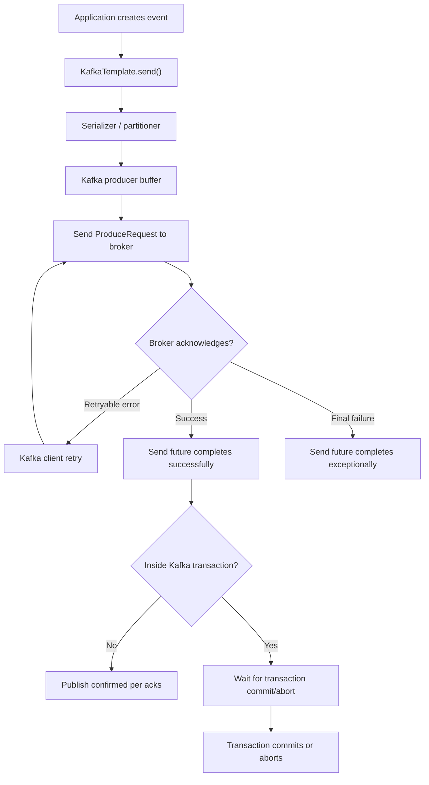
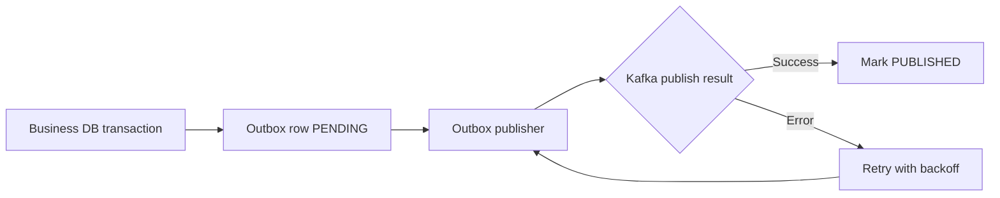

# Producer error rate in Spring Kafka: measurement, analysis, and alerting

In a Spring Kafka system, **producer error rate** signals how often sending records to Kafka is failing. This metric helps detect unstable brokers or networks, missing topics, invalid write permissions, broken serializers, aborted transactions, or overloaded producers.

However, there is no single calculation that fits every use of the phrase "producer error rate." Counting Kafka client errors, final `KafkaTemplate.send()` failures, Kafka transaction commit failures, and dead-letter topic (DLT) publish errors represents **four distinct boundaries**. Mixing them together or dividing by the wrong denominator can trigger false alarms or mask a loss of publishing capability.

In the *Spring Kafka Reliability Operations* module, the goal is designing measurement that answers: **How many logical sends succeeded or failed? How much did the Kafka client retry? Did transactions commit? Where did data go when the producer failed? When should intake be throttled or alerted?**

## 1. Producer error rate must be measured at the right boundary

Consider the stages a message passes through:



This diagram simplifies internal steps such as metadata lookups, batching, callbacks, transaction coordinators, and non-retryable failures. Still, it shows that failures can occur at multiple points.

For example, a single `send()` may undergo two internal retries before succeeding. At the application layer, that logical send **succeeded**; at the Kafka client layer, **retry rate rose**. Conversely, a `send()` can succeed in the producer callback yet belong to a **transaction that later aborts**, so `read_committed` consumers never see the record.

### 1.1. Three measurement levels

| Level | Observation unit | Question |
|---|---|---|
| Kafka producer client | Record sends, retries, requests, errors in Kafka client | How are the producer and brokers behaving? |
| Spring KafkaTemplate | Each logical `send()` and future outcome | How many records did the app ask to send, and how many failed terminally? |
| Business/transaction | Event, transaction, outbox item, offset | Did the result commit and satisfy the business contract? |

Name metrics distinctly for each level. Never combine a Kafka client `record-error-rate` with an application `send_failure` counter as if they were the same type of failure.

## 2. Defining error rate with a clear denominator

Suppose over a five-minute window a service completes 10,000 `KafkaTemplate.send()` calls:

- 9,900 calls have futures completing successfully.
- 100 calls have futures completing with errors.
- Some of the 9,900 successful calls were retried internally by the Kafka client beforehand.

Then:

```text
logical send error ratio
  = 100 / (9,900 + 100)
  = 1%

logical send failure rate
  = 100 / 300 seconds
  ≈ 0.333 errors/second
```

**Ratio** is the fraction/percentage of failed sends. **Rate** is typically errors per second. Saying "a 2% producer error rate" actually refers to an *error ratio*. Show units explicitly on dashboards.

For logical sends, define:

```text
send_error_ratio(W)
  = completed_send_failures(W)
    / completed_send_outcomes(W)

completed_send_outcomes(W)
  = completed_send_successes(W)
    + completed_send_failures(W)
```

Here `W` is the time window, e.g. 5 minutes. Still-pending sends **do not have an outcome yet** and must not be counted as successes.

### 2.1. Why not divide errors by incoming traffic?

A producer may emit multiple messages per input event, or a business operation may emit none. Dividing `producer_errors` by HTTP requests or consumed Kafka records yields a skewed ratio.

To measure **event publication success rate** at the business level, track business event IDs and publication state; that is a separate metric, not a raw per-producer-send metric.

### 2.2. Kafka client retries are not failed logical sends

Example:

```text
Logical send ORDER-42
  -> attempt to broker 1: retriable error
  -> attempt to broker 2: retriable error
  -> attempt to broker 3: broker ack succeeds

KafkaTemplate result: success
Kafka client retry activity: yes
Business event: not necessarily processed downstream yet
```

Counting every internal retry as a failed business event exaggerates the application error rate. Build a separate **retry rate** chart to spot rising risk before terminal errors appear.

## 3. Native Apache Kafka producer metrics

The Kafka client emits numerous metrics via its metrics/JMX system. Familiar names in the producer scope include:

| Kafka producer metric | Interpretation |
|---|---|
| `record-error-rate` | Rate of failed record sends per Kafka client metric semantics |
| `record-error-total` | Total record sends counted as errors by the Kafka client |
| `record-retry-rate` | Rate of records retried in the client |
| `record-retry-total` | Total record retries recorded by the Kafka client |
| `record-send-rate` | Rate of records sent per producer metric |
| `record-send-total` | Total records sent per producer metric |
| `request-rate` | Requests to brokers per second |
| `request-latency-avg` / `request-latency-max` | Request latency |
| `record-queue-time-avg` / `record-queue-time-max` | Time records wait in the producer buffer |
| `bufferpool-wait-time-total` | Total time spent waiting on the buffer pool |
| `outgoing-byte-rate` | Outgoing data rate |
| `produce-throttle-time-avg` / `produce-throttle-time-max` | Broker throttling signals when supported |

Exact metrics, units, and update rules must be checked against your client version. In particular, Kafka client `*-rate` metrics are pre-computed rates, whereas `*-total` metrics are cumulative totals; querying each in Prometheus differs.

### 3.1. What does record-error-rate measure?

`record-error-rate` reflects record sends that the Kafka producer recorded as errors per unit time. It is very helpful for seeing send-path failures, though it does not replace all application-layer measurements.

For example, a serializer can throw an exception before a record enters the producer send pipeline, or a local Kafka transaction can fail at commit. Monitor those failures at their respective boundaries instead of assuming a single Kafka client metric covers everything.

### 3.2. record-retry-rate provides early warning

Producers can recover via transient retries. When `record-retry-rate` rises while `record-error-rate` stays low, broker load, transient network issues, or throttling may be emerging.

That is the right moment to inspect:

- Request latency and broker response errors.
- Broker ISR/leader availability and cluster health.
- Network packet loss, DNS, TLS/authentication.
- Producer queue time and buffer pressure.
- `delivery.timeout.ms` and proximity to delivery deadlines.

If the error rate climbs after a period of rising retry rates, the producer is likely exhausting its retry/delivery budget before sends succeed.

### 3.3. Never mix producer metrics across scopes

The Kafka client exposes metrics at producer, topic, node, and request scopes. Similar names appear across multiple scopes.

When aggregating across multiple producer instances or topics, verify labels and units per series. Never add a per-client rate to a per-topic rate of that same client and treat them as two independent error sources.

## 4. Collecting Kafka producer metrics in Spring Kafka

A Spring Boot service can export metrics via Micrometer and observability systems, depending on dependencies and instrumentation settings.

Common observability paths:

1. **Kafka client metrics**: measure the Kafka producer client layer, including record sends/errors/retries and request latency.
2. **`KafkaTemplate` metrics/Observation**: measure send operations at the Spring Kafka layer.
3. **Application counters**: emitted by code with explicit outcome semantics.
4. **Broker-side metrics**: reflect how brokers handle requests, throughput, ISR, and throttling.

Spring Kafka supports binding Kafka client metrics to Micrometer in modern versions. To use specific metric names in Prometheus, inspect the live `/actuator/prometheus` endpoint: names translated from JMX/Micrometer to Prometheus vary by registry, binder, and naming conventions.

### 4.1. Common dependencies

In a Spring Boot application with Micrometer/Actuator, you typically need components like:

```text
spring-kafka
spring-boot-starter-actuator
micrometer-registry-prometheus  (if using Prometheus)
```

Merely adding dependencies does not guarantee every producer metric or `KafkaTemplate` observation is enabled. Check auto-configuration, `KafkaTemplate`, producer factories, and the active Kafka client binder.

### 4.2. Endpoints and access control

Example exposure configuration for a monitoring environment:

```yaml
management:
  endpoints:
    web:
      exposure:
        include: health,info,prometheus
```

This only exposes the endpoint; it **does not create** producer metrics on its own. Restrict monitoring endpoint access to internal networks or appropriate authentication/authorization.

Avoid exposing all Actuator endpoints publicly in production just to inspect producer error rates.

### 4.3. JMX and Micrometer can use different names

In JMX, Kafka producer metrics typically appear under `kafka.producer` object names with a corresponding `client-id`. A familiar form looks like:

```text
kafka.producer:type=producer-metrics,client-id=<producer-client-id>
    record-error-rate
    record-retry-rate
    record-send-rate
```

This illustrates common JMX structure, not a fixed Prometheus label set. When running multiple producers or clusters, client ID is vital for diagnosis, though you should avoid randomly generated client IDs that inflate cardinality excessively.

## 5. Measuring logical send outcomes on KafkaTemplate

In Spring Kafka 3.x, many `KafkaTemplate.send()` overloads return `CompletableFuture<SendResult<K,V>>`.

Example:

```java
CompletableFuture<SendResult<String, OrderEvent>> future =
        kafkaTemplate.send(
                "orders.confirmed",
                event.orderId(),
                event
        );
```

`send()` can throw immediately during send preparation, and the future can complete with an error later. Incrementing a counter only inside a synchronous `catch` misses async failures. Conversely, attaching only a future callback without handling synchronous exceptions misses immediate failures.

Measure **the final outcome of the send call per your contract**, while avoiding counting the same failure twice.

### 5.1. Example instrumenting with Micrometer

The following example creates a timer for logical send outcomes alongside counters for success or error. `OrderEvent`, `MeterRegistry`, and `KafkaTemplate` are service dependencies:

```java
@Service
public class InstrumentedOrderPublisher {

    private final KafkaTemplate<String, OrderEvent> kafkaTemplate;
    private final MeterRegistry registry;

    public InstrumentedOrderPublisher(
            KafkaTemplate<String, OrderEvent> kafkaTemplate,
            MeterRegistry registry) {
        this.kafkaTemplate = kafkaTemplate;
        this.registry = registry;
    }

    public CompletableFuture<SendResult<String, OrderEvent>> publish(
            OrderEvent event) {

        final String topic = "orders.confirmed";
        final long startedNanos = System.nanoTime();

        final CompletableFuture<SendResult<String, OrderEvent>> future;

        try {
            future = kafkaTemplate.send(
                    topic,
                    event.orderId(),
                    event
            );
        }
        catch (RuntimeException ex) {
            recordOutcome(
                    topic,
                    "error",
                    startedNanos
            );
            throw ex;
        }

        // Count exactly once when this future completes.
        future.whenComplete((result, failure) -> {
            String outcome = failure == null
                    ? "success"
                    : "error";

            recordOutcome(
                    topic,
                    outcome,
                    startedNanos
            );
        });

        return future;
    }

    private void recordOutcome(
            String topic,
            String outcome,
            long startedNanos) {

        registry.counter(
                "app.kafka.producer.send",
                "topic", topic,
                "outcome", outcome
        ).increment();

        registry.timer(
                "app.kafka.producer.send.duration",
                "topic", topic,
                "outcome", outcome
        ).record(
                System.nanoTime() - startedNanos,
                TimeUnit.NANOSECONDS
        );
    }
}
```

These metrics are application-defined:

- `app.kafka.producer.send`: counter of logical `KafkaTemplate.send()` outcomes.
- `app.kafka.producer.send.duration`: duration from send start until future completion or synchronous failure.
- `outcome=success`: future completed successfully.
- `outcome=error`: future completed exceptionally or call threw synchronously.

`System.nanoTime()` is suitable for intra-JVM durations because it is a monotonic clock.

This code does not block waiting for the future inside a listener or HTTP request; it only instruments outcomes. When a business operation must fail if publish fails, the caller must manage the future and transaction/error propagation per contract.

**Critical limitation:** `outcome=success` here means **send future success**, not that a Kafka transaction containing the record committed, not that downstream consumers processed the event, and not that an accompanying database transaction committed.

### 5.2. A subtle detail about metric recording timing

In the code above, `whenComplete` runs as a callback side effect to record metrics. The callback may execute on the thread completing the future. Keep callback logic lightweight and independent of thread-local JDBC transactions or Kafka consumer threads.

Never call slow HTTP APIs or run database queries in send completion callbacks. Do not throw exceptions from the callback trying to "report back" an error to a listener: an exception in a callback does not propagate back into a `@KafkaListener` method that has already returned.

### 5.3. Choosing ProducerListener over per-send callbacks

Spring Kafka also provides `ProducerListener<K,V>` for send success/failure callbacks. This is a centralized instrumentation point useful when multiple places share one `KafkaTemplate`.

Condensed example:

```java
public class CountingProducerListener
        implements ProducerListener<String, String> {

    private final MeterRegistry registry;

    public CountingProducerListener(MeterRegistry registry) {
        this.registry = registry;
    }

    @Override
    public void onSuccess(
            ProducerRecord<String, String> record,
            RecordMetadata metadata) {

        registry.counter(
            "app.kafka.producer.callback",
            "topic", record.topic(),
            "outcome", "success"
        ).increment();
    }

    @Override
    public void onError(
            ProducerRecord<String, String> record,
            RecordMetadata metadata,
            Exception exception) {

        registry.counter(
            "app.kafka.producer.callback",
            "topic", record.topic(),
            "outcome", "error"
        ).increment();
    }
}
```

Depending on version, `RecordMetadata` on the error path may lack useful values (or be null); never dereference it unconditionally.

Register `ProducerListener` on the exact `KafkaTemplate` used by the application. When multiple templates exist, check metric sources and guard against instrumenting the same send twice.

**Never add callback metrics and future metrics together as two independent send counts** when both observe the same `KafkaTemplate.send()`.

## 6. Calculating producer error ratio in Prometheus

Suppose the `app.kafka.producer.send` counter above is exported by the Micrometer Prometheus registry as:

```text
app_kafka_producer_send_total{topic="orders.confirmed",outcome="success"}
app_kafka_producer_send_total{topic="orders.confirmed",outcome="error"}
```

PromQL for the five-minute error ratio:

```promql
sum by (topic) (
  rate(app_kafka_producer_send_total{
    outcome="error"
  }[5m])
)
/
clamp_min(
  sum by (topic) (
    rate(app_kafka_producer_send_total{
      outcome=~"success|error"
    }[5m])
  ),
  0.000001
)
```

The result is a **ratio from 0 to 1**, not a percentage. Multiply by 100 for percentage displays if required by dashboards.

The denominator is guarded with `clamp_min` to prevent division by zero, though when traffic is absent, forcing the ratio to 0 can misleadingly make the producer appear healthy. Handle *no data/low traffic* states explicitly or gate alerts by volume.

### 6.1. Absolute error rate

```promql
sum by (topic) (
  rate(app_kafka_producer_send_total{
    outcome="error"
  }[5m])
)
```

Unit: logical send failures/second.

A 50% ratio over 2 sends has a vastly different impact than a 5% ratio over 100,000 sends. Always inspect both **ratio** and **failure count/rate** during incidents.

### 6.2. Error count over a window

```promql
sum by (topic) (
  increase(app_kafka_producer_send_total{
    outcome="error"
  }[15m])
)
```

This metric returns estimated errors over 15 minutes from counters. Values may be fractional due to Prometheus extrapolation in `increase()`, not because "half a message failed."

### 6.3. Adding service and cluster labels

With multiple services/clusters, metrics should carry bounded, meaningful labels like `service`, `cluster`, `topic`, `outcome`, then query `sum by (service, cluster, topic)`.

Never sum errors across two Kafka clusters while using a denominator from only one cluster. Aggregated ratios must share the exact same boundary and logical denominator.

## 7. Querying Kafka client metrics directly: what to verify

If your system exports Kafka client `record-error-total` and `record-send-total`, `rate()` can inspect error and send rates per `client-id` or topic.

*Hypothetical* series name after exporter normalization:

```promql
rate(kafka_producer_record_error_total[5m])
```

However, **there is no guarantee** every deployment uses the exact name `kafka_producer_record_error_total`. A JMX exporter and Micrometer `KafkaClientMetrics` can produce different names and labels. Before locking in dashboards, check `/actuator/prometheus` or query the live metrics endpoint.

Furthermore, computing a ratio from two Kafka client metrics requires verifying `record-send-total` denominator semantics: under some interpretations it counts records sent per client, not necessarily every logical `send()` called by the app. Do not treat `record-error-total/record-send-total` as the business send error ratio without confirming your Kafka client version's exact definitions.

A solid dashboard keeps both:

- **Kafka client errors/retries:** spot protocol/producer-level issues.
- **Application logical send outcomes:** measure what callers actually experience.

Both signal groups complement each other; do not force them to match identically.

## 8. Async sends make errors surface after the caller returns

An easy-to-lose-control example:

```java
@KafkaListener(topics = "orders.created")
public void onOrder(OrderCreated order) {

    kafkaTemplate.send(
        "orders.confirmed",
        order.orderId(),
        toJson(order)
    );

    // Listener returns immediately without waiting for send success.
}
```

If the container treats the listener as successful and commits the source offset, yet the producer send fails afterward, **input records can be acked while outputs were never published**. The producer error counter still rises, yet it is too late for the listener's error handler to roll back from an async callback alone.

This proves producer error rate is not merely a dashboard metric—it ties directly to pipeline correctness.

### 8.1. Awaiting results to propagate errors back to the listener

When a use case requires outputs to be confirmed before inputs count as done, a basic approach is awaiting the future:

```java
@KafkaListener(
    topics = "orders.created",
    groupId = "orders-service"
)
public void onOrder(OrderCreated order) {

    kafkaTemplate.send(
            "orders.confirmed",
            order.orderId(),
            toJson(order)
        )
        .orTimeout(10, TimeUnit.SECONDS)
        .join();
}
```

If the future fails, `join()` throws an unchecked exception so the listener container/error handler handles it per configuration. Use bounded timeouts to avoid hanging consumer threads forever.

However:

- Waiting on `send()` adds to listener latency.
- A caller-side timeout does not prove the broker definitely did not store the record.
- Consumer input offsets and Kafka outputs are **not automatically atomic** without configuring a transactional listener container.
- If the listener retries after an uncertain outcome, duplicate events can occur; use appropriate idempotency and transactions.

In Spring Kafka 2.x, `send()` can return `ListenableFuture` instead of `CompletableFuture`. The snippet above targets Spring Kafka 3.x.

### 8.2. Using transactional listener containers

For Kafka-to-Kafka consume–process–produce requiring EOS within Kafka, a transactional listener container manages the Kafka transaction, sends outputs, and adds input offsets to the same transaction.

Do not use a local `KafkaTemplate.executeInTransaction()` and assume outputs and input offsets share one transaction. A local template transaction does not automatically include the consumer's active offsets.

For Kafka transactions, send callback success remains distinct from **transaction commit success**. Dedicated metrics are needed at the commit/abort boundary.

## 9. Producer error rate with Kafka transactions

Suppose a local transaction sends two records:

```java
kafkaTemplate.executeInTransaction(operations -> {
    operations.send(
        "orders.confirmed",
        orderId,
        confirmedJson
    );
    operations.send(
        "billing.requested",
        orderId,
        billingJson
    );
    return null;
});
```

Both `send()` futures might succeed while the subsequent transaction commit fails or aborts because code throws an exception. Downstream `read_committed` consumers will not treat aborted records as published.

Add metrics for:

| Metric | Outcome | Meaning |
|---|---|---|
| `producer.send` | success/error | Outcome of individual send futures |
| `producer.transaction` | committed/failed | Outcome of the transaction completion call at caller |
| `producer.transaction.duration` | By outcome | Local Kafka transaction latency |
| `business.event.published` | completed/pending/unknown | Business state backed by transaction/outbox |

### 9.1. Instrumenting transactions at the right boundary

```java
public void publishInLocalTransaction(
        String orderId,
        String payload) {

    long startedNanos = System.nanoTime();
    String outcome = "committed";

    try {
        kafkaTemplate.executeInTransaction(operations -> {
            operations.send(
                "orders.confirmed",
                orderId,
                payload
            );
            return null;
        });
    }
    catch (RuntimeException ex) {
        outcome = "failed";
        throw ex;
    }
    finally {
        registry.counter(
            "app.kafka.producer.transaction",
            "outcome", outcome
        ).increment();

        registry.timer(
            "app.kafka.producer.transaction.duration",
            "outcome", outcome
        ).record(
            System.nanoTime() - startedNanos,
            TimeUnit.NANOSECONDS
        );
    }
}
```

Here `failed` means **the caller received an exception executing the local transaction**; do not automatically assume "broker definitely aborted." Some commit errors leave callers uncertain of outcome, requiring broker state, reconciliation, or idempotency before retrying business operations.

Never add transaction failure counts into send failure counts: one transaction can contain multiple records, so their denominators differ.

### 9.2. ProducerFencedException and transactional.id

With transactional producers, `ProducerFencedException` or fatal errors around producer epoch/transactional identity are severe signals. Two instances using conflicting transactional IDs can fence one producer.

Once a producer is fenced, do not keep trying to reuse it as if it hit a brief timeout. Handle producer factory lifecycle, manage `transaction-id-prefix` per instance, and ensure Kafka transactions are never falsely reported as succeeded.

Fencing metrics should be monitored and alerted separately, even when the overall send error ratio remains small.

## 10. Separating DLT producer error rate from business producers

A Spring Kafka service may simultaneously:

- Publish business outputs via `KafkaTemplate`.
- Publish failed records via `DeadLetterPublishingRecoverer` to a DLT.
- Publish to retry topics if using non-blocking retries.
- Emit metrics or audit events via another producer.

If there is only one "service-wide producer error rate" chart, a broken DLT producer can be drowned out by millions of successful business publishes.

Separate at least by **producer role**:

| Producer role | Example | Impact when failing |
|---|---|---|
| Business event | `orders.confirmed` | Missing or delayed business outputs |
| DLT/recovery | `orders.created.DLT` | Nowhere to store failed records |
| Retry republisher | `orders.retry-1000` | Cannot forward records into retry chain |
| Outbox publisher | `orders.confirmed` from outbox | Outbox backlog grows |
| Audit producer | `audit.events` | Depends on system audit requirements |

Even a small number of DLT producer failures can prevent consumers from recovering poison records, causing repeated loops or stalled partitions.

### 10.1. Never treat a failed DLT as recovery success

When using `DeadLetterPublishingRecoverer`, decide how strictly to wait for send results. In supported Spring Kafka versions:

```java
DeadLetterPublishingRecoverer recoverer =
        new DeadLetterPublishingRecoverer(dltKafkaTemplate);

recoverer.setFailIfSendResultIsError(true);
recoverer.setWaitForSendResultTimeout(
        Duration.ofSeconds(10)
);
```

The aim is for the recoverer to raise an error when DLT publishing fails per policy. Never equate calling `KafkaTemplate.send()` with durably persisting the record in the DLT.

When recovery fails, preserve redelivery/rehabilitation for the source record per error handler/transaction policy. **Never ack/commit past an unprocessed or unrecovered record**.

### 10.2. Pause/backpressure when the DLT producer is unhealthy

If the DLT is unavailable, consider pausing the relevant listener/container to prevent retry storms. However, pausing only reduces intake; it does not fix publishing errors or guarantee offsets.

Have a health/recovery mechanism to resume once ACLs, topics, serializers, or Kafka brokers are healthy again. Without a resume path, consumer lag keeps rising and source topics risk hitting retention limits.

## 11. Common producer error categories

To investigate error rates, group failures into actionable categories.

| Error category | Typical situation | Response |
|---|---|---|
| Serialization | Incompatible schema, converter failure | Fix payload/serializer; retrying the same data rarely helps |
| Topic/partition metadata | Missing topic, invalid partition | Fix provisioning/resolver/metadata |
| Authorization | Principal lacks write permission on topic | Fix ACLs; avoid retry storms |
| Authentication/TLS | Invalid or expired token/certificate/credentials | Fix security/connectivity |
| Network/timeout | Broker unreachable, packet loss, request timeout | Check network/brokers; bounded retries |
| Broker availability | Leader unavailable, insufficient ISR | Check brokers, replication, and health |
| Quota/throttling | Produce throttle time climbs | Adjust quotas/throughput |
| Buffer saturation | Producer buffer full, `max.block.ms` exceeded | Backpressure, batch tuning, slow emission |
| Record too large | Record exceeds producer/topic/broker limits | Fix payload contract, chunking by design |
| Transaction/fencing | Producer fenced, commit failure | Fix transactional ID/lifecycle; reconcile uncertain outcomes |
| Application shutdown | Template/factory closed while still publishing | Coordinate lifecycle, stop intake and drain |

Some Kafka exceptions are retriable per the Kafka client; others cannot self-heal with retries. Application policies should match error type, publish context, and event criticality.

### 11.1. SerializationException

If the producer fails to serialize a key/value, the Kafka broker may never receive any record. Increasing retries on the same schema-broken object rarely fixes the cause.

Record `error_category=serialization`, inspect schema evolution, serializer config, and DLT/quarantine options if data must be preserved.

Never dump full sensitive payloads into logs just to debug serializer failures.

### 11.2. TimeoutException

Timeouts can occur because brokers are overloaded, metadata fails to arrive in time, networks fail, buffer pools wait too long, or delivery deadlines expire.

Check:

- `request.timeout.ms`.
- `delivery.timeout.ms`.
- `max.block.ms`.
- Producer request latency and retry rate.
- Broker availability, ISR, and throttling.
- Send rate and producer buffer usage.

A caller-side timeout does not always prove the broker **did not store the record**. When retrying business requests, use a business idempotency key or stable event ID.

### 11.3. TopicAuthorizationException

If the producer lacks write ACLs on a topic, continuing to send at high speed only inflates error rates and log volume. This is usually a configuration/permission error requiring operator intervention.

If a topic is missing, check auto-create policy, partition count, and topic ownership. Do not rely on broker auto-create in production when precise DLT partitioning and retention are needed.

### 11.4. RecordTooLargeException

Records exceeding size limits fail even when brokers are completely healthy. Check `max.request.size`, topic `max.message.bytes`, broker limits, and schema/payload design.

Do not raise every limit to huge values by default, since memory, throughput, and consumer fetch behavior are also affected.

## 12. How Kafka producer configs affect error rate

Example producer configuration in Spring Boot:

```yaml
spring:
  kafka:
    bootstrap-servers: kafka.internal:9092
    producer:
      acks: all
      key-serializer: org.apache.kafka.common.serialization.StringSerializer
      value-serializer: org.springframework.kafka.support.serializer.JsonSerializer
      properties:
        enable.idempotence: true
        delivery.timeout.ms: 120000
        request.timeout.ms: 30000
        linger.ms: 10
        max.in.flight.requests.per.connection: 5
```

Values are examples, not mandatory settings for every workload.

### 12.1. acks

- `acks=0`: producer does not wait for broker acknowledgment; a successful future does not prove the broker stored the record. Error metrics fail to reflect broker-side data loss.
- `acks=1`: leader acknowledges per leader conditions; lacks the replication acknowledgment of `acks=all`.
- `acks=all`: leader waits for replication conditions per ISR settings; typically used when high durability is required.

**Never choose `acks=0` just to make dashboard error rates look lower.** Doing so weakens observability and publish durability.

### 12.2. enable.idempotence and retries

An idempotent producer prevents retry duplicates at the producer protocol level within supported bounds. Modern Kafka clients may enable idempotence by default when settings do not conflict, though you should check your version and effective settings.

Enabling idempotence requires compatible constraints such as `acks=all`, appropriate in-flight request limits, and retries not disabling the mechanism.

Kafka producer idempotence **does not eliminate duplicate business events** caused by an application calling `send()` twice with the same payload as two separate logical sends. Event IDs or business-layer idempotency remain necessary.

### 12.3. delivery.timeout.ms

This is a critical cap on how long the producer tries to send a record successfully, including associated waits/retries per Kafka client semantics.

Raising the timeout can reduce terminal errors during short outages, at the cost of **higher latency and more in-flight records**. If business SLOs are shorter than the timeout, events can become unacceptably stale even when futures eventually succeed.

Do not solve producer error rates merely by raising timeouts: find the root cause and evaluate SLOs.

### 12.4. max.block.ms and producer buffers

`send()` can block while fetching metadata or waiting for buffer memory. If not completed within `max.block.ms`, the producer fails before the record reaches a broker.

Watch buffer pool wait, queue time, memory, request latency, and enqueue rates. When downstream brokers slow down while the app keeps sending unboundedly, the producer buffer turns into a backpressure choke point.

### 12.5. linger.ms, batch.size, and throughput

Batching reduces network overhead while increasing how long records stay in buffers under some conditions. Bursty workloads benefit more from batching, whereas latency-sensitive workloads must weigh delay targets.

Tuning producer error rates requires watching throughput, p95/p99 send latency, queue time, and memory usage together. A setting that cuts errors while pushing event latency past SLOs is not a net improvement.

## 13. Backpressure when the producer cannot send

When error rates rise due to slow brokers, letting producers accept records at unbounded rates causes:

- Buffer memory filling up and `send()` blocking.
- Rising counts of in-flight futures.
- Thread pools or HTTP handlers held open too long.
- Rising GC and heap pressure.
- Retry storms making broker recovery harder.
- Kafka consumer pipelines committing offsets before output sends are confirmed if poorly designed.

Common mitigations:

1. Cap concurrent publishes/in-flight events at the application layer.
2. Bound queues and enforce explicit backpressure.
3. Inside a Kafka listener, pause/resume containers in a controlled way if downstream cannot keep up.
4. Never ack inputs when required outputs have not been published or durably stored.
5. When producers emit events from a database, store them in an outbox for safe retries without holding HTTP requests.
6. Use bounded retries/backoff and avoid overwhelming recovering brokers.
7. Alert on buffer pressure and oldest pending age.

### 13.1. Never call KafkaConsumer.pause() from a producer callback

Producer callbacks can run on the Kafka producer I/O thread. Kafka `Consumer` is not thread-safe and Spring Kafka containers manage their own poll loops.

To reduce intake, use `MessageListenerContainer.pause()`/`resume()` or an application control-plane mechanism. Never grab a `Consumer` inside `@KafkaListener` and stash it for an async callback to call `pause()` or `commitSync()`.

### 13.2. Some errors should not auto-pause the entire service

A serialization error on one specific event does not require halting every producer. Other topics may be completely healthy.

Classify outage scope: a topic, a route, a producer factory, a Kafka cluster, or the whole service. Pausing the wrong scope drops throughput unnecessarily.

## 14. Producer error rate in the transactional outbox

In the **transactional outbox** pattern, a business transaction writes database state and an outbox event in the same DB transaction. A separate publisher reads the outbox and sends to Kafka.



The outbox publisher's producer error rate matters, yet is insufficient to judge the whole workflow.

Example:

- Over 5 minutes there are 100 failed sends and 1,000 successful sends.
- The outbox publisher retries failed records.
- Some records were published yet the process crashed before marking `PUBLISHED`, so the next pass may publish duplicates.
- Some outbox rows stay pending for a long time even when recent producer error rate is 0 because the publisher stopped running.

Dashboards also need:

| Metric | Role |
|---|---|
| Outbox pending count | Events not yet confirmed complete |
| Oldest pending age | Longest-waiting event |
| Outbox publish attempt error ratio | Per-attempt failures |
| Unique outbox events completed | Business publication progress |
| Publish latency p95/p99 | Latency from DB enqueue to broker ack |
| Duplicate publish/reconciliation | Impact of retries after uncertain outcomes |

An outbox provides durable retries without delivering strict exactly-once publication by itself. Downstream needs idempotency by event ID.

## 15. Error rate does not equal event loss rate

A producer failure can lead to very different outcomes:

| Situation | Producer send outcome | Business data |
|---|---|---|
| Internal retry succeeds | Success | Kafka record confirmed per producer policy |
| Send fails yet event remains in durable outbox | Error | Event remains available for retry |
| Send fails, caller retains request and retries idempotently | Initial error | Recovery path exists |
| Send fails yet app swallows exception and acks input | Error | **Risk of lost output** |
| Transaction send succeeds then aborts | Send success, transaction failed/aborted | Output invisible to `read_committed` |
| Send times out, broker outcome uncertain | Caller error | May be missing or duplicated on retry |
| Producer reports success with `acks=0` | Client success | No guarantee broker persisted durably |
| Kafka published, downstream consumer fails | Producer success | Downstream business work incomplete |

Therefore:

- **Producer error rate** measures send-path health.
- **Event loss risk** depends on acknowledgments, retries, outbox, transactions, and offset handling.
- **Business completion rate** depends on downstream processing and domain outcomes.

Only by placing these metrics side by side can you assess end-to-end reliability.

## 16. Designing metric labels to avoid high cardinality

Use tags with a bounded and stable set of values.

| Tag | Example | Note |
|---|---|---|
| `service` | `orders-service` | Emitting service |
| `cluster` | `kafka-primary` | Distinguish clusters |
| `topic` | `orders.confirmed` | Managed finite topics |
| `producer_role` | `business`, `dlt`, `outbox` | Separate functions |
| `outcome` | `success`, `error` | Send result |
| `error_category` | `serialization`, `timeout`, `auth` | Group errors |
| `transaction_outcome` | `committed`, `failed` | Only for transaction metrics |
| `environment` | `prod`, `staging` | Deployment diagnosis |

Never place `orderId`, `eventId`, message keys, raw exception messages, Kafka offsets, dynamic transaction IDs, or randomly generated client IDs into metric tags.

Those values belong in structured logs/traces, whereas inflating series counts drives up Prometheus/backend costs and slows queries.

### 16.1. Grouping exceptions into categories

Example:

```text
TimeoutException             -> timeout
TopicAuthorizationException  -> authorization
SerializationException       -> serialization
RecordTooLargeException      -> size
ProducerFencedException      -> fencing
Other                        -> other
```

Using `other` does not mean discarding details. Log exception classes/causes in logs and traces for investigation while keeping bounded categories on metrics.

### 16.2. Never classify errors solely by exception.getMessage()

Exception messages can contain specific topics/partitions, broker names, payloads, or runtime state. Putting the full message in a label causes high cardinality and can leak sensitive information.

If you must classify by message when a library throws an untyped exception, normalize and test the rule; never copy the raw string into a tag.

## 17. Monitoring send latency alongside error rate

A producer usually **slows down before it fails**. Watching only error ratios hides early warning signals.

Measure:

- `send_duration` p50/p95/p99 for future completion.
- Kafka producer request latency.
- Record queue time.
- Buffer wait.
- Delivery timeout proximity.
- Retry rate and broker throttle time.
- Count of pending send futures.
- Age of unpublished events.

Example:

```text
10:00  P95 send latency: 40 ms   error ratio: 0.1%
10:05  P95 send latency: 300 ms  error ratio: 0.2%
10:10  P95 send latency: 2 s     error ratio: 0.5%
10:15  P95 send latency: 20 s    error ratio: 8%
```

When latency climbs first, the cause may be broker throughput, network, or buffer saturation. The spike in error ratio arrives when producers begin exhausting their retry budgets.

### 17.1. Pending futures create blind spots

Suppose a producer initiates 10,000 sends and 9,000 futures stay pending for a long time. Within a short window, only 1,000 futures succeed and the error ratio of **completed sends** remains 0%.

That does not mean the producer is healthy. Add **in-flight count, oldest pending duration, and send latency** so a "0 errors" dashboard cannot mask a stalled pipeline.

A `LongTaskTimer`, pending sends gauge, or app-tracked count of incomplete futures helps capture this, provided state is cleaned up on timeout/cancel/completion and memory stays bounded.

## 18. Alerting on ratio, volume, and durability

A producer error ratio alert should require at least two conditions:

1. Ratio breaches a threshold over a window.
2. Sufficient sample volume exists to draw a conclusion.

Illustrative rule example:

```promql
(
  sum by (service, topic) (
    rate(app_kafka_producer_send_total{
      outcome="error"
    }[5m])
  )
  /
  clamp_min(
    sum by (service, topic) (
      rate(app_kafka_producer_send_total{
        outcome=~"success|error"
      }[5m])
    ),
    0.000001
  )
) > 0.02
and on (service, topic)
(
  sum by (service, topic) (
    increase(app_kafka_producer_send_total{
      outcome=~"success|error"
    }[5m])
  ) > 100
)
```

The rule illustrates alerting when **error ratio > 2%** and **more than 100 completed sends occur in 5 minutes**. Tune thresholds to baselines, SLOs, topic criticality, and real traffic.

If a service has low traffic yet every event is critical (such as DLT or payments), a single error may already require alerting. Do not apply the volume gate above blindly to all producer roles.

### 18.1. Tiered alerting

| Situation | Suggested alert |
|---|---|
| Business producer error ratio rises | Warning on sustained rise; critical when SLO is impacted |
| DLT producer fails | Alert earlier because the recovery path is affected |
| Producer fencing | Critical or immediate deploy-correlated investigation |
| Authorization failure | Needs config/ACL fix; usually does not self-recover |
| Retry rate rises, final error low | Early warning paired with request latency |
| Send completions stop while input traffic continues | Stalled producer/pending-age alert |
| Outbox backlog ages | Publication SLA alert even if error ratio is 0 |
| Transaction aborts rise | Transaction-specific alert, separate from send errors |

A service emitting no traffic during expected active hours can also be an incident. Error ratios are undefined with zero sends; check expected throughput, outbox queues, and publication SLOs.

### 18.2. SLO burn rate

If business sets a target of 99.9% successful publishes over an SLO window, the error budget is 0.1% of completed sends under that definition.

Multi-window burn-rate alerts can catch both brief severe outages and slow-burning error rises. Still, a stronger publication SLO pairs **time until an event reaches published state** with **pending event age**, since a ratio of completed sends alone overlooks stuck records.

## 19. Recommended dashboard

A producer reliability dashboard can be organized into four rows:

### Row 1: Business health

- Event publication success ratio by topic/service.
- End-to-end publication latency from event creation to Kafka confirmation.
- Business events still pending/in recovery.
- Error budget/SLO violations.

### Row 2: KafkaTemplate outcomes

- Logical send error ratio.
- Logical send success/failure rate.
- Send completion latency p50/p95/p99.
- In-flight sends and oldest pending age.

### Row 3: Kafka client internals

- `record-error-rate`.
- `record-retry-rate`.
- `record-send-rate`.
- Request latency, queue time, buffer wait, throttle time.

### Row 4: Failure and recovery

- Error category breakdown.
- Transaction commits/aborts/fencing.
- DLT publish errors/recovery failures.
- Outbox backlog and retry attempts.
- Broker health, networking, quotas, and ISR.

Placing an error ratio chart beside retry rate and p95 latency tells a far clearer story than showing a single "producer errors" number.

## 20. Diagnosing from metric patterns

### 20.1. High retry rate with low error ratio

Likely: transient broker/network errors still succeeding on client retries.

Check request latency, throttle time, Kafka broker logs, and retry trends. If retry rates keep climbing, it can be an early indicator of an outage.

Do not jump to concluding events are lost while final sends are still confirmed.

### 20.2. High error ratio right after a deploy

Likely: serializer/schema changes, wrong topic names, wrong ACLs, or conflicting transactional ID prefixes.

Use release timestamps, exception classes, and producer roles to isolate. If errors are non-retryable, raising retries usually just adds load.

### 20.3. High send latency with near-zero errors

Likely: futures still pending, slow brokers, full producer buffers, or timeouts so long that failures have not surfaced yet.

Inspect queue time, in-flight count, oldest pending age, and request latency. Never judge the system healthy merely because no futures finished with errors in the last minute.

### 20.4. Low Kafka client errors with high transaction failures

Sends may be accepted by brokers while `commitTransaction` fails, transactions abort, or producers get fenced.

Send-only dashboards are insufficient. Watch transaction outcomes and downstream `read_committed` visibility.

### 20.5. High DLT error ratio while business producer is healthy

The recovery path is broken: consumers may be unable to dead-letter poison records. Check DLT topics, ACLs, resolvers, serializers, producer send-result checking, and offset policies.

Depending on impact, pausing/applying backpressure to listeners may be safer than continuing and dropping failed records.

### 20.6. Error ratio rises alongside broker throttling

If `produce-throttle-time` rises alongside request latency and error rate, inspect Kafka quotas, client traffic profiles, and cluster limits. Never simply raise producer timeouts if input throughput exceeds sustainable broker capacity.

## 21. Structured logging and tracing for send errors

Logs when a Kafka send fails should carry enough detail to pinpoint the issue without leaking payloads.

Example:

```json
{
  "event": "kafka_producer_send_failed",
  "service": "orders-service",
  "producerRole": "business",
  "topic": "orders.confirmed",
  "eventId": "example-event-42",
  "errorCategory": "timeout",
  "exceptionClass": "TimeoutException",
  "traceId": "example-trace-id",
  "publishAttempt": 1
}
```

Fields such as `eventId`, `traceId`, and `publishAttempt` are application-designed or provided by instrumentation, not all available out of the box from `KafkaTemplate`.

With tracing, distinguish:

- Application event-preparation span.
- Record publish span (if supported by instrumentation).
- Transaction commit span or separate metric.
- Downstream consumer processing span.

A successful send span does not prove downstream business actions completed. With transactional Kafka, the publish span can succeed before the transaction commits.

### 21.1. Never log full keys/values by default

Kafka payloads can contain customer info, payment data, credentials, or large blobs. On serializer errors, dumping the whole object into logs risks data exposure and performance degradation.

Prefer schema version, event type, message size, appropriate hashes/IDs, and exception category. When raw bytes must be preserved for investigation, use a quarantine/DLT path with proper ACLs and retention.

## 22. Integration tests: does producer error rate reflect real failures?

Unit tests calling `registry.counter().increment()` do not prove producer send errors are captured from real Kafka. Write integration tests using a real Kafka broker (Testcontainers or EmbeddedKafka), producer, and observability pipeline.

### 22.1. Success baseline

1. Create a test topic and producer factory with the right serializers.
2. Send several valid records.
3. Wait for futures to complete.
4. Confirm success counter increments by the number of logical sends.
5. Confirm error counter stays flat when no errors occur.
6. Verify send duration timer has samples and expected labels.
7. Verify Kafka producer client metrics export via registry/JMX as configured.

### 22.2. Serialization failure

Use a test serializer that intentionally throws on a specific payload:

```java
public final class FailingSerializer
        implements Serializer<String> {

    @Override
    public byte[] serialize(String topic, String value) {
        if ("INVALID".equals(value)) {
            throw new SerializationException(
                    "forced serialization failure"
            );
        }
        return value == null
                ? null
                : value.getBytes(StandardCharsets.UTF_8);
    }
}
```

Send `INVALID` and confirm instrumentation records one logical failure. Depending on the send path/version, the exception may throw synchronously or complete the future exceptionally; tests must cover both without double-counting.

### 22.3. Topic authorization failure

In a test cluster with ACLs, configure a producer principal lacking write permission on a topic. Send a record and await the outcome.

Verify:

- Producer reports the expected failure.
- Application send error counter increments.
- Error category classifies as `authorization`.
- No infinite retries occur for a permanent configuration fault.

Never test failure scenarios against production ACLs.

### 22.4. Broker unavailable or network timeout

Temporarily stop the test broker or block connections in an isolated environment. Verify final send failures and retry behavior against `delivery.timeout.ms`/configured timeouts.

Note: a single network disconnect does not guarantee an immediate final error because the Kafka client may retry. Tests must await completion outcomes rather than asserting immediate counter increments.

### 22.5. Producer buffering and backpressure

Use a test config with a small buffer, slow broker ingestion, and high send volume. Observe:

- In-flight sends rise.
- Buffer wait and queue time rise.
- Some sends block or time out.
- The application enforces intake limits.
- Memory does not grow without bound.

Keep heavy stress tests out of shared CI runs; isolate load/integration environments with clear deadlines.

### 22.6. Transaction commit failure

Create a transactional producer and simulate a failure or fencing in a controlled integration test.

Verify:

- Send success metric is not treated as transaction committed metric.
- Transaction outcome is recorded separately.
- `read_committed` consumer sees no records from aborted transactions.
- When callers/callbacks encounter uncertain outcomes, application retry paths remain idempotent.

### 22.7. DLT producer failure

Configure a `DeadLetterPublishingRecoverer` with send-result checking, then make the DLT unwritable.

Verify:

1. Failed listener records enter recovery.
2. The DLT producer reports an error.
3. Recovery failure is recorded.
4. Source records are not acked past before valid recovery.
5. If pausing containers, a resume path exists once the DLT recovers.
6. DLT duplicates can occur when publish succeeds yet source offset commit fails.

This is a critical test because even a tiny DLT producer error rate directly undermines the guarantee of never losing poison records.

## 23. Common misconceptions and metric mistakes

**Counting Kafka retries as failed business publications.** A logical send can retry and succeed. Track retry rates separately.

**Incrementing success counters right after calling `send()`.** `send()` is normally async; count success only when the send result completes appropriately.

**Assuming future success means the transaction committed.** In transactional producers, send and commit are distinct boundaries.

**Swallowing errors in `whenComplete` after the listener acked input.** Async callbacks do not automatically throw back into an already-returned listener. Pipelines need transactions or proper completion boundaries.

**Watching only ratio without volume.** One failure in one send is 100%, vastly different in impact from a million failed sends.

**Watching only failure rate without latency and pending counts.** When producers hang, fewer futures complete and failure counters may stay flat even while SLOs breach.

**Misusing Kafka client record metric denominators.** `record-error-rate` and `record-send-rate` do not necessarily match logical `KafkaTemplate.send()` call semantics.

**Lumping DLT producers with business producers.** DLT failures impair recovery and demand separate priority.

**Raising retries or timeouts for every error.** Serializer/ACL errors do not heal by waiting longer.

**Using `acks=0` to make visible errors drop.** Lower reported error rates can bring higher data loss risk.

**Assuming idempotent producers prevent all duplicate events.** Two distinct business sends can still create two valid records.

**Assuming Kafka transactions roll back databases/HTTP.** Kafka transactions protect only Kafka operations within their scope.

**Putting event IDs or exception messages in metric tags.** Cardinality climbs and data leaks easily.

**Relying on unverified Prometheus metric names.** Spring Kafka binders, Kafka versions, and exporters change names and labels; always inspect the live endpoint.

**Confusing stop/pause with producer recovery.** When listeners stop or pause, error counts can drop to 0 because requests stopped, not because the system recovered.

## 24. Runbook when producer error rate rises

An operational procedure can proceed in three phases.

### Phase A — Confirm blast radius

1. Identify affected service, Kafka cluster, producer role, and topics.
2. Check logical send error ratio, failure rate, and completed send counts.
3. Check p95/p99 send latency and pending future counts.
4. Check for transaction errors or DLT recovery failures.
5. Correlate consumer lag, outbox pending counts, and business publication SLOs.
6. Note incident start time and recent config/deploy changes.

### Phase B — Find root cause

1. Group exceptions: serialization, authorization, timeout, broker, fencing, record too large.
2. Inspect Kafka client record retry/error metrics and request latency.
3. Inspect broker leaders, ISR, partitions, quotas/throttling, and network.
4. Check topic existence, ACLs, certificates, and schema changes.
5. Check producer buffers and `max.block.ms`.
6. For transactions, check transactional ID prefixes/producer epochs/commit failures.
7. For DLT, check recoverer send-result checking and error-handler commit policies.

### Phase C — Stabilize and recover

1. Fix the root cause or restore brokers/ACLs/topics/serializers.
2. Apply bounded retries and appropriate backpressure to prevent retry storms.
3. If using a durable outbox, let the publisher catch up at a controlled rate.
4. If listeners paused due to producer outage, resume only when publish paths are truly healthy.
5. Verify send successes, transaction outcomes, and business publications recover.
6. Check for duplicate events and downstream idempotency.
7. Watch backlogs/oldest pending age until back within SLO.
8. Document root cause and update alerts/runbooks post-incident.

**Never use "producer error rate returned to 0" alone to close an incident.** If traffic stopped or queues stopped draining, error rates can read 0 while data remains stuck pending.

## 25. Pre-production design questions

Clarify explicitly:

1. Does "producer error rate" in this service mean Kafka client errors or logical send failures?
2. Is the denominator completed sends, attempted sends, or unique business events?
3. Is retry rate measured separately?
4. Are synchronous serializer errors and async send failures both visible?
5. Can send future successes sit inside uncommitted Kafka transactions?
6. Are there dedicated metrics for transaction commits/aborts/fencing?
7. Are DLT/retry/outbox producers separated from business producers?
8. If sends fail after a listener acks input, how are events recovered?
9. Are pending send counts and oldest pending age tracked?
10. Is there an alert when the producer stops sending entirely while workload still exists?
11. On timeouts with uncertain outcomes, are retry mechanisms idempotent?
12. Are metric labels stable and free of high cardinality?
13. Have Prometheus dashboards been verified against actual exported series names?
14. Are there integration tests for serializer, ACL, network, transaction, and DLT failures?
15. Do runbooks cover pause/backpressure, outbox recovery, and replay?

If these questions go unanswered, a chart showing "0% producer error rate" does not prove the publishing path is reliable.

## 26. Version-specific references

When configuring and verifying, consult documentation matching your exact Kafka clients, Spring Kafka, and Spring Boot versions:

- **Apache Kafka Documentation — Producer Configs:** `acks`, idempotence, retries, `delivery.timeout.ms`, `request.timeout.ms`, `max.block.ms`, batching.
- **Apache Kafka Documentation — Producer Metrics:** `record-error-rate`, `record-retry-rate`, `record-send-rate`, latency, queue time, and throttling.
- **Apache Kafka Javadoc — `KafkaProducer` and callbacks:** send results, exceptions, thread safety, and transaction lifecycles.
- **Spring for Apache Kafka Reference — KafkaTemplate:** send futures, `ProducerListener`, and error handling.
- **Spring Kafka Reference — Monitoring:** Kafka client metrics, Micrometer timers, and Observation.
- **Spring Kafka Reference — Transactions:** `KafkaTransactionManager`, local transactions, transactional listener containers, and `read_committed`.
- **Spring Kafka Reference — Publishing Dead-letter Records:** `DeadLetterPublishingRecoverer` and handling send-result failures.
- **Spring Boot Reference — Actuator / Kafka:** Kafka producer configuration, metrics exposure, and Prometheus registry.
- **Micrometer Documentation — Counters and Timers:** counter usage, histograms, tags, and cardinality limits.
- **Prometheus Documentation — PromQL:** `rate()`, `increase()`, `sum by`, `clamp_min()`, and alerting.

Details such as future types returned by `KafkaTemplate.send()`, Prometheus-exported metric names, producer defaults, and Kafka transaction APIs can evolve across versions. Check your actual code, Javadoc, and dependencies rather than treating example names and values as immutable.

**Conclusion:** `Producer error rate` is a core signal of Kafka publishing health, provided it is measured **at the right boundary and with the right denominator**. Separate Kafka client retries/errors from logical `KafkaTemplate` send outcomes, separate send success from transaction commit, separate business producers from DLT/outbox publishers, and pair error rates with send latency, pending age, backlogs, and idempotency. Then metrics not only detect outages early, they help protect data and recover safely.
