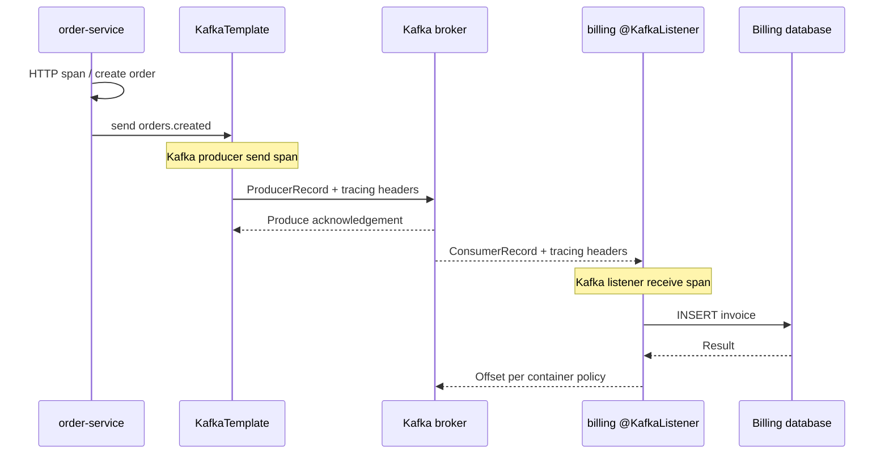
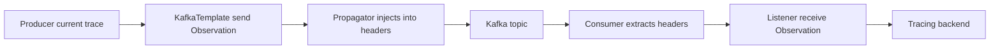

# Spans for send and receive in Spring Kafka

Kafka commonly connects multiple services via asynchronous messages. A request starting at an HTTP API can be published by a producer as a Kafka record, sit in a broker for some interval, and only then be processed by a consumer; that consumer may in turn emit a new record to another service. Looking only at each service's logs makes it hard for operators to determine **which operation was slow, whether the failure occurred on the sending or receiving side, and how many attempts a record went through**.

In the **Observability and Tracing** chapter of the *Spring Kafka Reliability Operations* module, **spans for send and receive** look at two critical connection points:

- **Send span** describes a producer operation sending a Kafka record, typically a `KafkaTemplate.send()` operation.
- **Receive/process span** describes a listener receiving and processing a Kafka record or batch, typically a `@KafkaListener` operation.

Spring Kafka versions supporting Micrometer Observation can create observations for `KafkaTemplate` and listener containers. When an `ObservationRegistry` is wired to a Micrometer Tracing bridge and exporter, those observations can emit spans into a distributed tracing system. Trace context travels via **Kafka record headers** to link operations occurring in two different JVMs.

Crucially: **a span describes execution, not business completion**. A successful send span does not prove the Kafka transaction committed. A receive span ending normally does not guarantee the consumer offset was committed. Retries, rebalances, DLTs, and side effects outside Kafka all require separate verification.

## 1. Foundational concepts

| Concept | Meaning |
|---|---|
| Trace | A chain of causally related operations |
| Span | A unit of work with a name, start/end timestamps, and metadata |
| Trace ID | Trace identifier used to correlate spans |
| Span ID | Identifier of a single span |
| Parent / span link | Relationship to another span, per instrumentation and semantics |
| Span kind | Role such as producer, consumer, client, or internal |
| Span attributes | Information describing operation, topic, outcome, exception, etc. |
| Observation | Micrometer abstraction for observing an operation |
| `ObservationRegistry` | Registry managing handlers for observations |
| Tracing bridge | Component connecting Micrometer Observation to a tracer |
| Propagator | Injects trace context into and extracts it from Kafka headers |
| Exporter | Sends span data to a collector/backend |

One observation can serve both metrics and tracing:

```text
KafkaTemplate / listener invocation
             |
             v
      Micrometer Observation
             |
             +-- Metrics handler --> timer / distribution
             |
             +-- Tracing handler --> producer / consumer span
                                             |
                                             v
                                     Tracing exporter
                                             |
                                             v
                                   Collector / trace backend
```

If you enable Observation without an appropriate tracing bridge/exporter, the application may produce metrics while **no spans appear in Jaeger, Tempo, Zipkin, or another backend**. Conversely, with a tracing bridge configured yet Observation disabled on `KafkaTemplate`/containers, you may see HTTP spans without Kafka send/receive spans.

### 1.1. One event does not equal one span

A record may be processed multiple times by a listener. Each attempt can be recorded as a separate listener observation/span. An event may also be republished to a retry topic, DLT, and then replayed, generating additional send and receive operations.

```text
Business event ID: order-event-42
    |
    +-- Producer send orders.created
    |
    +-- Receive attempt 1: database error
    +-- Receive attempt 2: database error
    +-- Receive attempt 3: success

=> Multiple spans may exist for the same event.
```

Never treat span counts as unique business event counts, especially when tracing is sampled.

## 2. Journey diagram: send → broker → receive

Example: `order-service` emits `orders.created`, then `billing-service` consumes it and saves an invoice.



In the trace backend, you might see a chain similar to:

```text
Trace: create-order
  HTTP POST /orders
    Kafka send orders.created

  Kafka receive orders.created
    DB INSERT invoice
    Kafka send invoices.created
```

Some instrumentation represents producer–consumer relationships as parent/child; some messaging models use span links. **Never build business logic around a rigid trace tree structure**. What matters is verifying that trace context crosses Kafka and operations correlate during investigations.

### 2.1. Does the broker create spans automatically?

The Kafka broker stores records and forwards headers, but does not by default emit application spans on `KafkaTemplate` traces. Send spans and receive spans are created by instrumentation at both application ends.

To observe broker internals, dedicated Kafka broker metrics/tracing instrumentation is required. Do not treat the gap between two spans as an automatic "broker span."

## 3. What boundary does the send span measure?

For `KafkaTemplate`, send observation observes a record send operation. It helps answer:

1. When did the producer start sending?
2. Did the send outcome succeed or fail?
3. What were the destination topic and producer operation?
4. How long did the send take?
5. Did send errors coincide with rising broker latency or client retries?

However, a send span **does not cover every stage of an event's lifecycle**. If an event sits for 5 minutes in a database outbox before the publisher calls `send()`, the send span does not automatically include those 5 minutes.

In particular, when sending inside a transaction:

```text
KafkaTemplate.send()
       |
       +-- Producer send completes successfully
       |
       +-- Kafka transaction remains open
               |
               +-- commit --> visible to read_committed
               |
               +-- abort  --> not visible to read_committed
```

A successful send span **does not mean the Kafka transaction committed**. If a workflow requires EOS, monitor transaction outcomes, consumed offsets, and producer send outcomes as separate signals.

### 3.1. Synchronous vs. asynchronous send failures

`KafkaTemplate.send()` can fail immediately during preparation—such as serialization or metadata lookup—or report an error later via a future/callback.

A producer `TimeoutException` may surface after multiple attempts/retries. A serializer exception happens before the broker ever receives the record. Both are send failures, yet remediation differs.

Never assume tracing replaces producer error metrics. Inspect send spans alongside `record-error-rate`, `record-retry-rate`, send latency, timeouts, and broker health.

## 4. What boundary does the receive span measure?

For a listener container, receive/process observation typically wraps **a single listener invocation** within the scope of that instrumentation.

It helps analyze:

- Which listener received the record?
- How long the listener spent executing business logic.
- Which exception was thrown inside the listener?
- Whether child database/HTTP spans exist?
- Whether the record was retried or routed to a DLT?

Yet a receive span does not measure how long the event sat in the Kafka topic before the listener was invoked.

```text
Event created at T0
  |
  +-- Producer sends at T1
  |
  +-- Broker holds record / backlog from T1 to T2
  |
  +-- Listener receives/processes from T2 to T3
  |
  +-- Offset commit / transaction outcome afterward
```

If a listener runs in 30 ms after the record waited two hours in backlog, the receive span may show 30 ms—**not** the two-hour end-to-end latency.

**A successful listener span also does not automatically mean the offset committed.** The container still runs acknowledgment, error handling, or transaction logic after the listener returns per configuration.

### 4.1. Receive does not mean KafkaConsumer.poll()

Spring Kafka listener observation and measuring the `KafkaConsumer.poll()` loop are not the same metric/span. If a consumer hangs and stops polling, combine client metrics, `NonResponsiveConsumerEvent`, `noPollThreshold`, consumer lag, and thread dumps.

Do not rely solely on receive spans: once a consumer stops polling altogether, no new listener invocations occur to emit spans.

### 4.2. Batch listeners

For batch listeners, the observation unit and context propagation can differ depending on Spring Kafka version and batch handling mode. Do not assume a batch of 200 records automatically creates exactly 200 receive spans.

When a batch contains records carrying different tracing contexts, verify which context the framework selects/extracts and which semantic conventions apply before assuming every record shares a single parent.

## 5. Required components for tracing

An application using Spring Kafka and Spring Boot may need:

| Component | Responsibility |
|---|---|
| `spring-kafka` | `KafkaTemplate`, listener containers, Observation integration |
| `micrometer-observation` | Observation API/registry |
| `micrometer-tracing` | Tracing abstraction |
| Tracing bridge | OpenTelemetry or Brave |
| Exporter/reporter | Ships spans to backend |
| Observation/tracing auto-configuration | Wires registry, tracer, exporter |
| Kafka record headers | Carries propagation metadata across processes |
| Collector/trace backend | Stores and queries trace data |

Depending on the Spring Boot version, an OpenTelemetry setup may use `spring-boot-starter-actuator`, `micrometer-tracing-bridge-otel`, and corresponding exporter dependencies. Verify exporter configuration for your Boot release rather than assuming every release uses identical property keys.

An application **can send messages normally without tracing**. Tracing is an additive observability layer; never let an exporter outage break Kafka business processing.

## 6. Enabling Observation for KafkaTemplate

Illustrative Java configuration for Spring Kafka 3.x:

```java
@Configuration
public class ObservedProducerConfiguration {

    @Bean
    public KafkaTemplate<String, String> observedKafkaTemplate(
            ProducerFactory<String, String> producerFactory,
            ObservationRegistry observationRegistry) {

        KafkaTemplate<String, String> template =
                new KafkaTemplate<>(producerFactory);

        template.setObservationRegistry(observationRegistry);
        template.setObservationEnabled(true);

        return template;
    }
}
```

Meaning:

- `ProducerFactory` manages Kafka producers per broker, serializer, and transaction configuration.
- `ObservationRegistry` holds matching handlers/tracing integration.
- `setObservationEnabled(true)` turns on observation creation when the template sends messages.

If Spring Boot already creates a default `KafkaTemplate`, defining a custom template bean can alter auto-configuration. Make sure **the template the application actually uses** has Observation enabled—not an unused bean of the same type that is never injected.

### 6.1. Publishing service

```java
@Service
public class OrderPublisher {

    private final KafkaTemplate<String, String> kafkaTemplate;

    public OrderPublisher(
            @Qualifier("observedKafkaTemplate")
            KafkaTemplate<String, String> kafkaTemplate) {
        this.kafkaTemplate = kafkaTemplate;
    }

    public CompletableFuture<SendResult<String, String>> publish(
            String orderId,
            String eventJson) {

        return kafkaTemplate.send(
            "orders.created",
            orderId,
            eventJson
        );
    }
}
```

Spring Kafka 3.x typically uses `CompletableFuture<SendResult<K,V>>`; older versions may use `ListenableFuture`. Check your version before copying examples.

Do not wrap every `KafkaTemplate.send()` call in your own custom `kafka.send` span when the template already has Observation enabled, unless there is a clear reason. Two instrumentation layers both creating send spans yield duplicate spans and cluttered timelines.

## 7. Enabling Observation for listener containers

For `@KafkaListener`, enable Observation on the right listener container factory.

```java
@Configuration
public class ObservedConsumerConfiguration {

    @Bean
    public ConcurrentKafkaListenerContainerFactory<String, String>
            kafkaListenerContainerFactory(
                    ConcurrentKafkaListenerContainerFactoryConfigurer configurer,
                    ConsumerFactory<String, String> consumerFactory) {

        var factory =
                new ConcurrentKafkaListenerContainerFactory<String, String>();

        // Apply Boot-managed configuration settings.
        configurer.configure(factory, consumerFactory);

        factory.getContainerProperties()
                .setObservationEnabled(true);

        return factory;
    }
}
```

Listener:

```java
@Component
public class BillingListener {

    private final BillingService service;

    public BillingListener(BillingService service) {
        this.service = service;
    }

    @KafkaListener(
        id = "billing-listener",
        topics = "orders.created",
        groupId = "billing-service"
    )
    public void onOrder(ConsumerRecord<String, String> record) {
        service.createInvoice(record.key(), record.value());
    }
}
```

Once the registry, instrumentation, and propagator are configured properly, Spring Kafka can create listener observations and extract tracing context from headers.

If the application has multiple container factories, enabling Observation on `kafkaListenerContainerFactory` does not automatically enable it on every factory. Check which `containerFactory` each listener specifies.

### 7.1. Is @Observed needed on @KafkaListener?

It is not required for default send/receive spans when Spring Kafka container Observation is active. `@Observed` or other span-creating annotations can be used on **business methods** if corresponding AOP/instrumentation is enabled, though placing them carelessly can generate extra or duplicate spans.

Enable listener observation on the container, then create custom business spans only when you need to measure a specific business segment.

## 8. Trace context travels through Kafka headers

A producer trace does not automatically transfer to a consumer simply because both services use Kafka. Context must be **injected** into Kafka record headers and **extracted** on the receiving side.



With **W3C Trace Context** propagation, you will commonly see `traceparent` and sometimes `tracestate` headers. A B3 ecosystem uses different header names. Actual header names depend on your tracing bridge and propagator configuration.

**Do not assume every deployment uses the same format.** If the producer injects W3C while the consumer extracts only B3, send and receive spans will fail to link even though Kafka messages process normally.

### 8.1. Header data is not payload

Kafka headers hold keys and byte values; the tracing framework handles encoding/decoding propagation context. The broker does not need to interpret that data.

Do not serialize full tracing context into your business event's JSON value when Kafka headers already handle it. Likewise, never parse header bytes inside a business deserializer to reconstruct trace context.

### 8.2. Producers in other languages

Upstreams written in Go, Python, JavaScript, Kafka Connect, or another Kafka client can still pass valid context if:

1. A trace context already exists in the upstream process.
2. The producer injects context using an agreed format.
3. Intermediate systems do not strip the required headers.
4. The Spring Kafka consumer extracts with a compatible propagator.

If a message lacks trace context, the consumer must still process the message per business rules. The receive span may become a root span; **missing a parent is not a deserialization error**.

## 9. Parent/child and span links in asynchronous systems

When observing synchronous HTTP requests, parent/child spans are straightforward. Messaging, by contrast, involves asynchrony, fan-out/fan-in, batching, and replays.

Example: one producer emits a message to three consumer groups:

```text
producer send orders.created
           |
           +-- inventory-service receive
           +-- billing-service receive
           +-- analytics-service receive
```

Those consumer groups may process at very different times. A trace backend may represent causal relationships via parent contexts or span links depending on conventions.

Never force all receive spans into a rigid parent/child tree, especially with batch processing or a consumer aggregating multiple messages. What matters is **being able to establish the right causal relationship**.

### 9.1. Span kind

Messaging spans typically carry `PRODUCER` and `CONSUMER` semantics, though operation names and mappings can evolve across OpenTelemetry semantic conventions and instrumentation versions.

When building dashboards or searching traces, verify what span names, kinds, and attributes your backend actually receives rather than assuming unchanging keys.

## 10. Trace ID is not an event ID

Kafka reliability involves at least three types of identifiers:

| Identifier | Primary purpose |
|---|---|
| Trace ID | Correlating operations during observability |
| Topic/partition/offset | Locating a physical record in the Kafka log |
| Business event ID | Deduplication, idempotency, replay, and reconciliation |

Example of an event traversing retry/DLT:

```text
eventId = order-event-42

Original:   orders.created-0@150
Retry:      orders.created-retry-1000-0@80
DLT:        orders.created.DLT-0@11
Replay:     orders.created-1@220
```

Topic/partition/offset change upon republishing. Trace IDs can also change across attempts and replays. **Business event IDs must remain stable whenever the domain contract requires deduplication**.

Never use Trace ID as the key for charging money, locking an inbox, or deduplicating events: trace sampling, propagation, batching/replays, and tracing configuration are not reliable sources of business identity.

## 11. Adding business spans inside a listener

Send/receive spans give the high-level view. To pinpoint which slice of business logic is slow, create a custom Observation:

```java
@Service
public class InvoiceService {

    private final ObservationRegistry observationRegistry;
    private final InvoiceRepository repository;

    public InvoiceService(
            ObservationRegistry observationRegistry,
            InvoiceRepository repository) {
        this.observationRegistry = observationRegistry;
        this.repository = repository;
    }

    public void persistInvoice(Invoice invoice) {
        Observation.createNotStarted(
                "billing.invoice.persist",
                observationRegistry
        ).observe(() -> {
            repository.save(invoice);
        });
    }
}
```

When executed inside an active listener tracing context on the same thread, the custom Observation can emit a child span tied to the receive operation.

Operation names should stay stable:

```text
billing.invoice.persist
orders.validate
inventory.reserve
payment.check_eligibility
```

Never concatenate `orderId`, `customerId`, or event IDs into span names. If correlation is needed, use attributes governed by privacy and sampling controls.

### 11.1. Never swallow exceptions just to keep a span green

If code inside a custom Observation throws an error, let the exception propagate to the responsible layer or handle it per designed policy. Never catch and return success solely to give the span a "success" status: the container could assume the record succeeded and commit the offset prematurely.

## 12. Listener retries: multiple receive spans for one record

A Kafka listener may be invoked repeatedly due to `DefaultErrorHandler`, backoff, redelivery after a crash, or rebalance.

```text
orders.created-0@150
   |
   +-- Attempt 1 --> receive span --> Database timeout
   +-- Attempt 2 --> receive span --> Database timeout
   +-- Attempt 3 --> receive span --> Success
```

More receive spans than original records does not automatically mean duplicate business events. It can reflect **attempts** under at-least-once processing.

To investigate retries, pair tracing with:

- Original topic, partition, and offset.
- Business event ID.
- Retry attempt counter/header where supported by the framework.
- Listener exception class/category.
- Backoff duration.
- Final outcome: success, recovered-to-DLT, or recovery-failed.

Never place offsets or event IDs into low-cardinality metric tags; if stored in tracing/logging, enforce privacy and cost controls.

### 12.1. Blocking retry

When retrying inline in the listener/error handler path, repeated listener invocations can appear as multiple observations/spans depending on Spring Kafka version and instrumentation policy.

If retry delays are long while each attempt's receive span is short, **end-to-end retry latency** can still be large. Measure separately from original event time to final outcome.

### 12.2. Non-blocking retry topics

With `@RetryableTopic`, a record can be published to retry topics for delayed processing:

```text
orders.created
   -> listener error
   -> send orders.created-retry-1000
   -> retry listener error
   -> send orders.created-retry-5000
   -> retry listener
   -> success or DLT
```

Each new send/receive can create its own observation if the corresponding infrastructure template and retry listener containers are enabled. Do not assume a custom `KafkaTemplate` used for business publishing automatically governs all retry-topic infrastructure.

When reading traces, clearly distinguish retry-topic sends from listener attempts; they are different operations, not necessarily duplicate instrumentation.

## 13. Dead-letter topics also have send spans

`DeadLetterPublishingRecoverer` uses Kafka operations to publish failing records to a DLT. If the publishing template has Observation enabled with a tracing bridge, the DLT send operation is recorded too.

However, distinguish:

```text
Listener business failure
     |
DefaultErrorHandler / AfterRollbackProcessor
     |
DeadLetterPublishingRecoverer
     |
DLT producer send span
     |
Kafka DLT send result
     |
Consumer offset handling per policy
```

A successful DLT send span does not prove **business success**, nor does it guarantee the source offset committed. If the DLT producer send succeeds yet offset commit fails, the record may be re-read and duplicated in the DLT.

If the DLT producer fails, the error handler/recoverer must report a recovery failure per durability requirements; tracing only helps analyze the cause.

### 13.1. Traces when replaying from a DLT

Replays hours or days later should be treated as a **new operation** with its own tracking. Start a fresh trace and link via event ID, original Kafka metadata, or span links depending on your tracing system.

Do not force all replays to reuse the original request's Trace ID, as that creates long-lived, hard-to-read traces.

## 14. Kafka transactions: send spans are not enough

In a transactional Kafka listener container, produced Kafka outputs and consumed offsets can be included in the same Kafka transaction when configured properly.

```text
Kafka transaction T1 begins
    |
    +-- Listener receive/process operation
    +-- KafkaTemplate.send output A    --> send span
    +-- KafkaTemplate.send output B    --> send span
    +-- Send consumed offsets to transaction
    |
    +-- Commit or abort T1
```

If T1 aborts, consumers with `isolation.level=read_committed` will not see outputs from the aborted transaction. Yet tracing can still record the **send attempts** that occurred.

Track separately:

| Signal | Boundary |
|---|---|
| Send span | One producer send operation |
| Receive span | One listener invocation |
| Transaction commit/abort metrics | Kafka transaction outcome |
| Consumer offset commit progress | Processed/committed position |
| Business completion | Final business state |

**Never count successful send spans as transaction commits.** A Kafka transaction can contain multiple sends and still abort at the end.

### 14.1. executeInTransaction does not automatically include consumer offsets

Calling `KafkaTemplate.executeInTransaction(...)` inside a `@KafkaListener` opens a separate local producer transaction. It does not automatically bind input offsets into that local transaction. When Kafka-to-Kafka EOS is required, configure a transactional listener container properly.

A trace showing two nicely linked spans does not prove the pipeline achieves exactly-once semantics. That is a property of Kafka transaction semantics, not tracing.

## 15. Async processing: context can be lost

Tracing context usually binds to the executing thread/scope. If a listener offloads work to an executor thread, context does not follow automatically.

Example:

```java
@KafkaListener(topics = "orders.created")
public void consume(OrderCreated event) {
    CompletableFuture.runAsync(() -> {
        kafkaTemplate.send(
            "orders.confirmed",
            event.orderId(),
            toJson(event)
        );
    });
}
```

This snippet carries **two independent risks**:

1. **Tracing:** the send span on the background thread can become a root span because receive context was not propagated.
2. **Reliability:** the listener can return and its offset can be acked/committed before the send completes; a subsequent send failure will not automatically route back to the error handler.

To preserve tracing context, use **Micrometer Context Propagation**, a context-aware executor/task decorator, or context capture/restore mechanisms supported by your framework/version.

Conceptual pattern:

```text
Listener thread:
  capture observation/tracing context
  submit decorated task

Worker thread:
  restore context inside scope
  execute business work
  KafkaTemplate.send()
  close scope / restore previous context
```

Note: exact capture/restore APIs depend on Micrometer/Spring version. Never stash trace context in a `ThreadLocal` and forget to clear it; thread pools reuse threads and can taint the next task with the wrong trace context.

**More importantly:** propagation does not fix early acknowledgment. For async work, acknowledge only after completion or use a durable inbox/work queue with idempotency.

## 16. Span attributes and cardinality

Micrometer Observation distinguishes **low-cardinality key values** from **high-cardinality key values**. Because Observation can drive both metrics and traces, proper classification is essential.

| Metadata | Use as metric tag? | In trace/log? |
|---|---|---|
| Service name | Yes | Yes |
| Topic from finite set | Yes | Yes |
| Logical listener ID | Yes | Yes |
| Operation/outcome | Yes | Yes |
| Normalized exception class | Possibly | Yes |
| Business event ID | **No** | Possibly, if permitted |
| Kafka offset | **No** | Possibly |
| Record key | **No** | Restricted due to PII |
| Raw payload | **No** | Usually no |
| Raw exception message | **No** | Restricted |
| Trace ID | **No** | Tracing metadata |

Values like offsets and event IDs change continuously and can generate massive numbers of time series if put into low-cardinality metric labels.

### 16.1. Observation conventions

Spring Kafka provides observation context/convention classes for `KafkaTemplate` and listener operations. Span names, default attributes, and extension APIs can vary across versions.

When writing a custom convention:

- Keep operation names stable.
- Do not break propagation mechanisms.
- Add only truly bounded low-cardinality keys.
- Never attach raw payloads or credentials.
- Verify actual metadata in the tracing backend.

Never build alerts on an attribute name you have not verified against your running dependency/version.

## 17. Baggage and security

**Baggage** is metadata that can propagate across processes alongside tracing context. Never put passwords, tokens, sessions, payment details, or personal data into baggage.

Kafka record headers can be read by other downstream consumers. Trace metadata is not an authentication/authorization token; never use `traceparent` or Trace ID to decide whether an event is authorized for processing.

If a topic accepts external input, treat propagation headers as untrusted input; let the tracing framework validate/extract per spec and enforce size/value limits.

The trace backend also needs access controls, retention, and masking rules like any sensitive observability system.

## 18. Sampling means traces can be incomplete

Tracing typically samples a fraction of requests/messages to control costs.

Example:

```text
Traffic: 100,000 Kafka sends/minute
Sampling: 10%

The backend may retain only part of the traces/spans.
Displayed span counts do not equal actual sent record counts.
```

With head sampling, the decision to keep a trace can happen before knowing whether a later operation fails. A rare failure may not be stored in the tracing backend.

Therefore:

- Never calculate producer error rates solely from sampled send spans.
- Never use receive span counts as absolute consumer throughput.
- An event without a trace does not prove a record was lost.
- Maintain producer/consumer metrics and structured logs with full coverage.
- Consider tail sampling at the collector if backend/cost budgets allow, without assuming it captures every error.

### 18.1. Tracing exporter outage

If the collector/backend becomes unavailable, the application must still uphold Kafka sends/receives per business contract. Exporters should have sensible timeout, batching, and drop policies.

Monitor telemetry exporter errors and dropped spans separately. Never let a telemetry failure cause consumers to commit wrong offsets or producers to change error-handling policies.

## 19. Send/receive latency vs. end-to-end latency

A Kafka system involves multiple intervals:

| Duration | Measured from what to what? |
|---|---|
| Producer send latency | Send start → producer result |
| Kafka broker/topic dwell | Record stored → consumer receives/reads |
| Listener processing latency | Listener start → attempt end |
| Offset commit latency | Commit request → broker response |
| Retry latency | First attempt failure → next attempt/final outcome |
| Transaction duration | Begin → commit/abort |
| End-to-end business latency | Event created → final business completion |

Send and receive spans **do not automatically sum to end-to-end business latency**, because queueing, broker dwell, retry delays, and downstream workflows sit outside those spans.

To measure end-to-end latency, use appropriate business timestamps or record timestamps, clock synchronization, and a clear definition of final completion.

Across two different JVMs, never treat raw wall-clock timestamp differences as exact without accounting for clock skew.

### 19.1. Consumer lag and span duration

A service showing short receive spans while lag keeps climbing may have an input rate exceeding processing capacity, insufficient partitions/concurrency, or paused containers. Conversely, long receive spans with low lag may indicate light traffic hitting a slow dependency.

Traces aid diagnostics; consumer lag and processing metrics still require independent monitoring.

## 20. Creating custom spans for business steps without duplicating send/receive

Segments worth instrumenting:

```text
orders.validate
inventory.reserve
billing.invoice.persist
outbox.claim_batch
outbox.publish
payment.authorize
```

An operation like `outbox.publish` can wrap reading the outbox, selecting records, and marking them published. `KafkaTemplate` send spans inside reveal each individual Kafka send.

This lets the trace explain:

```text
outbox.publish
  |
  +-- DB SELECT pending
  |
  +-- Kafka send orders.confirmed
  |
  +-- DB UPDATE outbox status
```

You still must guarantee outbox correctness: a successful Kafka send followed by a crash before marking published in the database can cause duplicate publishing. Traces do not create distributed transactions between Kafka and databases.

## 21. Complementary monitoring for send/receive spans

A reliability dashboard should place spans next to these metrics:

| Signal | Question |
|---|---|
| Producer send error ratio | Are publish failures occurring? |
| Producer retry rate | Are brokers/networks showing instability? |
| Producer send p95/p99 | Are send operations slow? |
| Consumer listener failure rate | Is business processing failing? |
| Listener processing duration | Where is the listener spending time? |
| Consumer group lag | How large is the backlog? |
| Non-responsive consumer events | Has the consumer stopped polling? |
| Retry attempt/latency | Is time being lost to retries? |
| DLT ingress/recovery failures | Are poison records safely isolated? |
| Transaction abort/fencing | Are Kafka EOS errors occurring? |
| Offset commit failures | Is consumer group progress being saved? |
| Trace export errors | Are there observability gaps? |
| Business event completion latency | Is the final SLO being met? |

A trace with send and receive spans helps drill down from aggregate dashboards to the cause of one attempt. It **does not replace** metrics checking overall pipeline health.

## 22. Log correlation by traceId/spanId

Logs can be enriched with `traceId` and `spanId` via MDC integration when the tracing bridge and logging are configured properly.

Structured log example:

```json
{
  "service": "billing-service",
  "listenerId": "billing-listener",
  "topic": "orders.created",
  "partition": 0,
  "offset": 150,
  "eventId": "order-event-42",
  "traceId": "example-trace-id",
  "spanId": "example-span-id",
  "outcome": "retry"
}
```

This is an illustrative format generated by an application/logging framework; not all fields come built in from Spring Kafka.

If a background worker's logs lack `traceId`, check context propagation before blaming the trace backend. If logs show `traceId` yet the backend has no spans, inspect sampling, exporter failures, and query time windows.

Never use `traceId` as a low-cardinality metric tag, and never log raw payloads or credentials.

## 23. Integration testing send and receive spans

To prove tracing truly crosses the broker, use a **real Kafka broker** in integration tests—such as Testcontainers or `EmbeddedKafka`—paired with a test tracer/span exporter or queryable tracing collector.

### 23.1. Setup

1. Create topic `orders.created`.
2. Configure an observation-enabled `KafkaTemplate`.
3. Configure an observation-enabled listener container.
4. Ensure `ObservationRegistry` has tracing handlers.
5. Choose a consistent propagation format.
6. Have a test exporter/tracer or temporary backend capture spans.
7. Send a valid record with a stable event ID.
8. Wait for the listener to confirm business completion using a latch/test state.

### 23.2. Success path

Expectations:

- Producer produces a send observation/span.
- Record carries trace context headers when the propagator is enabled.
- Consumer processes the record.
- A receive/listener observation/span exists.
- Both operations share causal linkage per tracing conventions.
- Kafka topic/operation attributes are meaningful.
- No raw record payloads or secrets leak into spans.

Avoid hardcoding a single span name if framework versions can change it. Assert producer/consumer relationships and span boundaries rather than depending on every default attribute.

### 23.3. Listener failure and retry

Make the listener throw an exception on the first attempt and succeed on the next.

Verify:

- Listener exception is observed.
- Retry attempts emit signals matching your handler/version mechanism.
- Kafka offsets are not committed prematurely in the error scenario.
- Final business outcomes and recovery metrics reconcile cleanly.
- Receive span counts are not treated as unique event counts.

### 23.4. DLT path

Make the listener fail repeatedly and recover to the DLT.

Verify:

- Listener failure telemetry is emitted.
- DLT recoverer sends the record via an instrumented template when expected.
- The DLT record retains source metadata needed for investigation.
- DLT publish failures are observed via error-handler metrics/logs.
- A successful DLT producer send span is never mistaken for business success.

### 23.5. Transaction abort

Send a record inside a Kafka transaction and explicitly abort it. Use a `read_committed` consumer to confirm the aborted transaction's record is not read.

You may still see a send span for the attempt that occurred, while **no receive operation occurs on the `read_committed` downstream consumer for the aborted record**. This proves send spans do not replace Kafka commit outcomes.

### 23.6. Missing propagation headers

Send a valid record from a producer without tracing.

The consumer must still process normally and may create a receive/root span. Never reject messages simply because they lack `traceparent` or B3 headers.

### 23.7. Async executor

Send a record and run business work on an executor. Compare spans before and after configuring context-aware task execution.

Also verify **ack/commit occurs only after processing** or durable enqueueing, because clean trace correlation does not guarantee an asynchronous workflow is safe.

### 23.8. Exporter failure

Make the tracing collector unavailable in the test environment.

Kafka producers/consumers must continue operating per business contract; telemetry export failures should emit separate signals. Never base test success on assuming every span must be durably written to the backend.

## 24. Runbook when traces break between send and receive

If a producer span exists but no consumer span appears, investigate in order:

1. Did the producer send future complete successfully?
2. If transactional, did the Kafka transaction commit?
3. Are the record's topic and partition right?
4. Does the consumer group have subscriptions, assignments, and progress?
5. Is consumer lag rising or is the listener paused/stopped?
6. Does the consumer listener factory have Observation enabled?
7. Are the consumer's tracing bridge/exporter working?
8. Do producer and consumer use the same propagation format?
9. Were record headers stripped in an intermediate pipeline?
10. Did sampling keep the span from being exported?
11. Is the event in a retry topic/DLT or replayed under a different trace?
12. Did an async task lose context across a thread switch?
13. Is the tracing backend experiencing ingestion delay or exporter drops?
14. Did the business event complete or recover according to actual state/offsets?

**Never conclude a record was lost solely because a span is missing.** Kafka offsets, DLT records, outbox state, and business event IDs are the recovery evidence to verify.

Conversely, if a consumer span exists without a producer span, the record may have come from Kafka Connect, a CLI tool, an uninstrumented producer, or a sampled trace. The receive span remains valuable.

## 25. Common implementation mistakes

**Adding only Micrometer Tracing dependencies without enabling `KafkaTemplate` Observation.** HTTP spans may appear while Kafka send spans do not.

**Enabling Observation on the producer but not on the listener container.** Not enough to produce receive/process spans.

**Enabling on the wrong `KafkaTemplate` or wrong container factory.** An unused bean will not generate spans for the real pipeline.

**Running two overlapping tracing bridges/exporters.** Can create duplicate spans, conflicts, or ambiguous telemetry sources.

**Creating a custom send span duplicating default instrumentation.** Clutters timelines with duplicate operations.

**Assuming a successful send span means the transaction committed.** Send and commit have different boundaries.

**Assuming a successful receive span means the consumer offset committed.** Commits/acknowledgments may happen after the listener returns.

**Counting sampled spans as absolute throughput.** Sampling yields incomplete counts.

**Using Trace ID as an event ID or idempotency key.** Not guaranteed stable across retries/replays.

**Failing to propagate context across async executors.** Worker spans can become roots or inherit the previous task's trace if scope cleanup fails.

**Assuming the broker automatically links traces across services.** Record headers and compatible propagators are required.

**Storing raw payloads, tokens, or PII in baggage/span attributes.** Security and privacy risk.

**Putting Kafka offsets or event IDs into metric labels.** Causes excessive cardinality.

**Treating a missing trace as a missing message.** Exporter/sampling issues can hide traces even when Kafka succeeded.

**Not measuring retry/DLT/transaction outcomes outside tracing.** Attempt traces do not tell the final state.

## 26. Production checklist

Before rolling send/receive tracing into production, confirm:

1. Spring Kafka version supports Observation for `KafkaTemplate`/listeners as expected.
2. The `KafkaTemplate` used by the application enables `observationEnabled`.
3. The actual listener container factory enables `observationEnabled`.
4. `ObservationRegistry` connects tracing handlers/bridges.
5. Exporter, collector, backend, and sampling match your version.
6. Producer and consumer agree on the propagation format.
7. Headers are not stripped or altered in ways that drop context.
8. Span names/attributes contain no sensitive data.
9. Custom business spans do not duplicate send/receive instrumentation.
10. Async processing includes context propagation and scope cleanup.
11. Retry/DLT/replay semantics are clear, never counting attempts as unique events.
12. Kafka transaction commits/aborts are measured separately from send spans.
13. Offset commit progress is measured separately from listener completion.
14. Producer error rates, consumer lag, DLT metrics, and SLOs do not depend on sampled spans.
15. Tests verify propagation across a Kafka broker.
16. Tests verify listener failures, DLT, transaction aborts, and missing trace headers.
17. Tracing exporter outages do not affect Kafka business correctness.
18. Runbooks cover investigating broken traces and verifying actual business state.

### 26.1. Three code review questions

**When does the send span end?** When the send operation returns its result per instrumentation—not by default when a Kafka transaction commits or downstream finishes processing.

**What does the receive span cover?** Typically one listener processing invocation—not automatically the entire broker dwell time, offset commit, and retries.

**How does trace context travel?** Kafka record headers via a propagator; not a shared thread-local across JVMs.

## 27. Version-specific references

When implementing, cross-check the exact dependencies you run:

- **Spring for Apache Kafka Reference — Micrometer Observation / Monitoring**: `KafkaTemplate` observations and listener container observations.
- **Spring Kafka Javadoc — `KafkaTemplate`**: `setObservationEnabled`, `setObservationRegistry`, and send APIs.
- **Spring Kafka Javadoc — `ContainerProperties`**: `setObservationEnabled` alongside lifecycle/acknowledgement settings.
- **Spring Kafka Reference — Transactions and Exactly Once Semantics**: producer sends, consumed offsets, and commit/abort boundaries.
- **Spring Kafka Reference — Error Handling / Non-blocking Retry / Dead-letter Publishing**: retry attempts, recovery, and DLT.
- **Spring Boot Reference — Observability and Tracing**: tracing bridge, sampling, exporters, resource attributes, and metrics configuration.
- **Micrometer Observation Reference**: `ObservationRegistry`, custom observations, handlers, and cardinality.
- **Micrometer Tracing / OpenTelemetry Documentation**: spans, W3C Trace Context, B3, baggage, and async context propagation.
- **OpenTelemetry Messaging Semantic Conventions**: producer/consumer span kinds, attributes, and parent/span links.
- **Apache Kafka Documentation — Record Headers and Transactions**: message metadata, propagation bytes, and transactional visibility.
- **Micrometer/Prometheus Documentation**: metrics for send latency, retries, DLT, and consumer health.

Span names, attribute keys, batch listener behaviors, and exporter properties can change across Spring Kafka/Micrometer/Spring Boot versions. Verify with integration tests and real traces before setting up rigid alerts or conventions.

**Conclusion:** Send and receive spans illuminate both ends of an asynchronous Kafka pipeline. Enabling Micrometer Observation on `KafkaTemplate` and listener containers, connecting a tracing bridge/exporter, and propagating context via Kafka record headers form the foundation. Yet tracing only delivers reliability value when interpreted alongside **send outcomes, Kafka transaction commits, consumer offsets, retries/DLT, consumer lag, and idempotency**. A green trace never replaces proof that business work finished and data was safely persisted.
