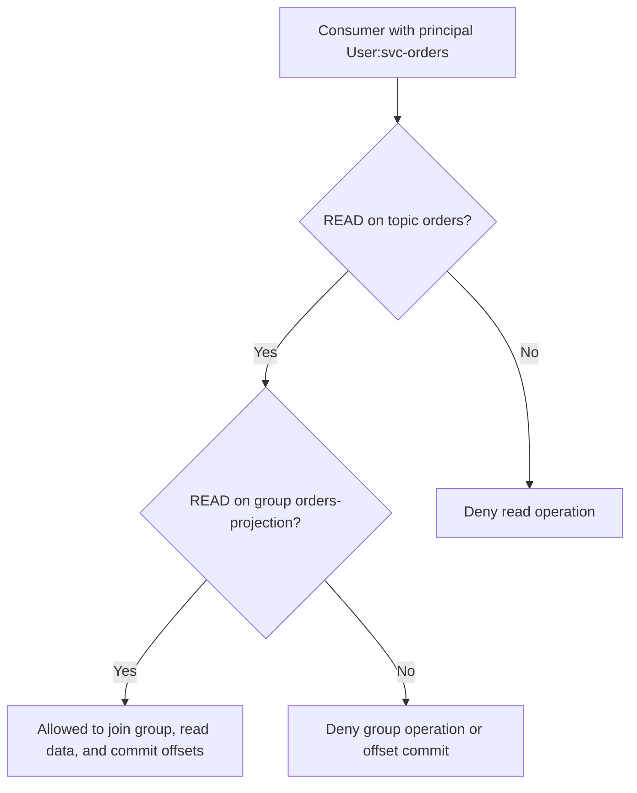

# Topic and Group Authorization

Kafka authorizes access at the resource level. An application permitted to read a topic is not necessarily permitted to join a consumer group; likewise, group permissions do not automatically grant permission to read topic data. When configuring ACLs, explicitly grant the exact permissions each processing flow uses.

## 1. Authentication and Authorization in Kafka

Kafka addresses two distinct questions:

- **Authentication:** who is the client? The broker establishes identity through configured security mechanisms such as SASL/SCRAM, SASL/OAUTHBEARER, or TLS client certificates.
- **Authorization:** which operations is that identity allowed to perform on which resources? The broker's authorizer checks ACLs before accepting an operation.

An ACL (Access Control List) describes a principal, operation, resource, and optionally host scope. For example, `User:svc-orders` is allowed `READ` on topic `orders` and `READ` on group `orders-projection`.

Examples in this lesson use Kafka CLI with `--bootstrap-server`. The account in `--command-config` must have ACL administration privileges. The principal in the ACL must match the principal the broker sees after authentication and identity mapping; the account name configured by the application is not necessarily the actual principal.

## 2. Two Resource Types to Distinguish

| Resource | Represents | Example Names | Common Permissions |
|---|---|---|---|
| `TOPIC` | Record stream written by producers and read by consumers | `orders`, `payments` | `READ`, `WRITE`, `DESCRIBE`, `CREATE`, `DELETE`, `ALTER` |
| `GROUP` | Consumer group coordinating partition assignment and offset management | `orders-projection` | `READ`, `DESCRIBE`, `DELETE` |

Topic names and group names are two independent namespaces. If a consumer reads topic `orders` using group `orders-projection`, the broker checks ACLs on both resources:



For standard consumers, the minimum permission set is usually:

- `READ` on each topic to consume.
- `READ` on the exact consumer group used by the application.

`READ` on the topic lets the consumer read records. `READ` on the group lets the client perform operations needed to join the consumer group and work with group offsets. Kafka treats `DESCRIBE` as implied by certain operational permissions such as `READ` and `WRITE`, so granting extra `DESCRIBE` is usually unnecessary for basic read/write flows.

If only `READ` on the topic is granted, the consumer may pass some topic-access steps yet still be denied when joining the group or committing offsets. If only `READ` on the group is granted, the consumer still cannot fetch data from the topic.

## 3. Granting Permissions for Consumers

Suppose service `orders-projection` uses principal `User:svc-orders`, reads topic `orders`, and runs with group ID `orders-projection-v1`.

First, create the read ACL on the topic:

```bash
bin/kafka-acls.sh \
  --bootstrap-server kafka-1.example.net:9093 \
  --command-config config/admin.properties \
  --add \
  --allow-principal 'User:svc-orders' \
  --operation Read \
  --topic orders \
  --resource-pattern-type literal
```

Next, grant read permission on the group:

```bash
bin/kafka-acls.sh \
  --bootstrap-server kafka-1.example.net:9093 \
  --command-config config/admin.properties \
  --add \
  --allow-principal 'User:svc-orders' \
  --operation Read \
  --group orders-projection-v1 \
  --resource-pattern-type literal
```

The two commands create two separate ACLs. When the application needs to read an additional topic `order-events`, grant permission on that topic as well; group permissions need no change if the group ID stays the same.

### Group ID in Spring Kafka

The group ACL must match the effective group ID at runtime. The group ID can come from default configuration:

```yaml
spring:
  kafka:
    consumer:
      group-id: orders-projection-v1
```

Or be set directly on the listener:

```java
@KafkaListener(
    topics = "orders",
    groupId = "orders-projection-v1"
)
public void handle(OrderEvent event) {
    // Process order event
}
```

If the listener specifies `groupId`, check that value along with related container and consumer configurations. Do not infer group IDs from class names, topic names, or application names. Changing the group ID during deployment can cause old ACLs to stop matching even when the topic remains unchanged.

## 4. Granting Permissions for Producers

Producers write records to topics and therefore need `WRITE` on the destination topic. For example, service `orders-api` writes to topic `orders`:

```bash
bin/kafka-acls.sh \
  --bootstrap-server kafka-1.example.net:9093 \
  --command-config config/admin.properties \
  --add \
  --allow-principal 'User:svc-orders-api' \
  --operation Write \
  --topic orders \
  --resource-pattern-type literal
```

`WRITE` permits writing records and implies the describe permission needed for that operation. Standard producers do not need `READ` permission on the topic. If an application both consumes and produces, grant permissions separately per role and resource.

For producers using transactions, also evaluate ACLs for the corresponding `TRANSACTIONAL_ID` resource; transaction operations typically require `WRITE` on the transactional ID. Idempotent or transactional producers may also need `CLUSTER`-level permissions depending on Kafka version and broker configuration. Identify the exact producer features enabled and check the permission matrix for your running version before granting extra permissions. Never grant `ALL` on the cluster just to fix a transaction error before identifying the root cause.

## 5. Literal, Prefixed, and ACL Scope

Kafka supports resource pattern types to define which resources an ACL applies to:

| Pattern Type | Meaning | Example |
|---|---|---|
| `literal` | Matches exact resource name | Topic `orders` matches only `orders` |
| `prefixed` | Matches names starting with the declared string | Prefix `orders.` matches `orders.created` and `orders.cancelled` |
| `match` | Used when listing to find ACLs that may match a resource | Useful when investigating effective permissions |

For example, if a service is allowed to read all topics with prefix `orders.`:

```bash
bin/kafka-acls.sh \
  --bootstrap-server kafka-1.example.net:9093 \
  --command-config config/admin.properties \
  --add \
  --allow-principal 'User:svc-orders' \
  --operation Read \
  --topic 'orders.' \
  --resource-pattern-type prefixed
```

A topic prefix ACL does not automatically apply to groups. If the service's groups also follow the `orders-` convention, create a separate prefixed ACL for the group resource:

```bash
bin/kafka-acls.sh \
  --bootstrap-server kafka-1.example.net:9093 \
  --command-config config/admin.properties \
  --add \
  --allow-principal 'User:svc-orders' \
  --operation Read \
  --group 'orders-' \
  --resource-pattern-type prefixed
```

Use prefixes only when resources under the prefix share the same trust boundary and owner. An overly broad prefix can grant read access to topics or groups created later that operations never intended to share. A literal resource name `*` acts as a wildcard in ACLs; avoid wildcards when the application only needs access to a bounded set of resources.

## 6. Inspecting Configured ACLs

List ACLs for a topic:

```bash
bin/kafka-acls.sh \
  --bootstrap-server kafka-1.example.net:9093 \
  --command-config config/admin.properties \
  --list \
  --topic orders \
  --resource-pattern-type match
```

List ACLs for a group:

```bash
bin/kafka-acls.sh \
  --bootstrap-server kafka-1.example.net:9093 \
  --command-config config/admin.properties \
  --list \
  --group orders-projection-v1 \
  --resource-pattern-type match
```

The `match` type finds literal, prefixed, and wildcard ACLs that may apply to the inspected resource. When reading output, verify principal, operation, permission type, host, and resource pattern. Seeing a single `ALLOW` line is not enough to conclude the application definitely has access, because a matching `DENY` ACL can also affect the outcome.

To verify in practice, run the consumer with the service's real credentials, right topic, and right group ID. Check metadata fetch, group join, record fetch, and offset commit steps. Listing ACLs with an admin account only shows configuration; testing with the application's principal confirms identity and permissions in the real operational flow.

## 7. ALLOW, DENY, and Default Permissions

Kafka ACLs support `ALLOW` and `DENY`. When evaluating an operation, if a matching `DENY` ACL exists, the operation is denied; if no matching `DENY` exists and a matching `ALLOW` exists, the operation is permitted. When no ACL permits the operation, the authorizer normally denies access. Superusers configured on the broker bypass ACL checks.

For example, a principal with `ALLOW READ` on topic `orders` that also matches `DENY READ` on that same topic will still be unable to read. Therefore, when investigating errors, look for both allow and deny ACLs, including prefixed or wildcard patterns that might match.

Never enable "allow everyone if no ACL found" mode as a quick fix for authorization errors. Default-deny ensures new resources do not accidentally become public before permissions are granted. Also inspect the superuser list and broker authorizer configuration, as they affect authorization outcomes.

## 8. Revoking Permissions Across Service Lifecycle Changes

When a service stops using a topic or group, revoke the exact ACLs granted. For example, removing `User:svc-orders` read permission on topic `orders`:

```bash
bin/kafka-acls.sh \
  --bootstrap-server kafka-1.example.net:9093 \
  --command-config config/admin.properties \
  --remove \
  --allow-principal 'User:svc-orders' \
  --operation Read \
  --topic orders \
  --resource-pattern-type literal
```

Revoke read permission on the group with a separate command:

```bash
bin/kafka-acls.sh \
  --bootstrap-server kafka-1.example.net:9093 \
  --command-config config/admin.properties \
  --remove \
  --allow-principal 'User:svc-orders' \
  --operation Read \
  --group orders-projection-v1 \
  --resource-pattern-type literal
```

Compare command output and re-list ACLs to confirm removal. For prefixed or wildcard ACLs, assess blast radius before deleting; one prefix ACL might still serve multiple active topics or groups.

## 9. Least-Privilege Permission Design Process

Before granting ACLs to an application, tabulate the resources and operations it needs:

| Application Role | Resource | Initial Permissions |
|---|---|---|
| Consumer | Each topic to read | `READ` |
| Consumer | Effective group ID | `READ` |
| Producer | Each topic to write | `WRITE` |
| Transactional producer | Transactional ID used | Check and grant `WRITE` per transaction config |
| Group operations tool | Group to inspect or administer | Grant `DESCRIBE`, `READ`, or specific admin permissions per actual operations |

Apply this process on every deployment:

1. Determine the actual principal from SASL or TLS and the broker's principal mapping rules.
2. List the exact topics, group IDs, and transactional IDs the application version will use.
3. Choose the smallest operations satisfying each action; avoid `ALL`, broad cluster rights, and unnecessary wildcards.
4. Create ACLs using an admin account, then verify per resource.
5. Start the application with the exact principal and verify both read/write operations and related group or transaction operations.
6. When changing group IDs, changing principals, or retiring a service, update and revoke corresponding ACLs; record changes in configuration management for auditing.

Use separate principals per service and per environment. If multiple applications share one principal, brokers cannot distinguish them during ACL evaluation; revoking permissions for one application could disrupt the others. Separating principals contains incidents and clarifies ownership of every permission.

## 10. Diagnosing Authorization Errors in Spring Kafka Applications

When a consumer or producer hits an authorization error, read the exception and identify the resource named in the error. Common scenarios:

| Symptom | Causes to Check |
|---|---|
| Consumer denied reading records | Missing `READ` on topic, different topic name than expected, or principal mismatch |
| Consumer denied joining group or committing offsets | Missing `READ` on group, or runtime group ID differs from ACL |
| Producer denied sending records | Missing `WRITE` on topic, or connecting with a different principal |
| Application connects, but Kafka operation is denied | Authentication succeeded, but authorizer found no matching ACL, or a `DENY` ACL matched |
| Error appears after deploying a new version | Topic, group ID, principal, transactional ID, or auth mechanism changed |

Inspect in order: principal received by broker; cluster address and listener the application connects to; topic name; effective group ID; topic ACLs; group ACLs; and then transaction or cluster ACLs if the application uses those features. Ensure `kafka-acls.sh` targets the right cluster and uses `--command-config` for an administrative account.

In Spring Kafka, settings like `spring.kafka.properties.security.protocol`, SASL, or TLS enable clients to authenticate and connect. Those properties do not create ACLs on the broker. Permission granting remains governed by Kafka's authorizer and ACL configuration. Never include passwords, JAAS secrets, or private keys in illustrative commands or logs when sharing investigation results.

## Operational Conclusion

Consumer authorization must consider both topic and group together: the topic governs data reading, while the group governs group participation and offset management. Producers need write permission on topics; transactional applications must additionally evaluate transactional IDs and related permissions per Kafka version. Using dedicated principals, exact resource names, narrowly scoped patterns, and testing with the application's actual identity keeps ACLs easy to operate, easy to audit, and free of excessive permissions.
