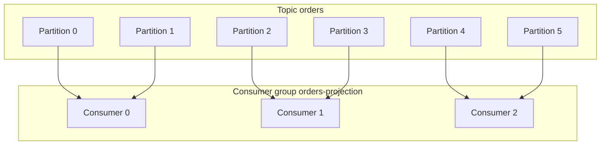

# Partition-Based Concurrency

In Kafka, a partition is the unit of data sharding and also the fundamental unit for assigning work to consumers within the same consumer group. To increase parallel processing threads, you must examine the topic's partition count alongside the actual number of consumers created by the Spring Kafka application. Increasing `concurrency` only spawns more consumers; it does not automatically create more partitions or allow a single partition to be processed simultaneously by multiple consumers in the same group.

## 1. Partitions Determine the Parallelism Ceiling

Kafka splits a topic into multiple partitions. Each partition is an independent ordered log where records are appended sequentially with monotonically increasing offsets. When consumers in the same group subscribe to a topic, Kafka assigns partitions across the consumers in that group.

The key rule is that **at any given time, a partition is assigned to at most one consumer within the same group**. One consumer can be assigned multiple partitions, but two consumers in the same group do not concurrently own the same partition.

For example, the `orders` topic has 6 partitions and the consumer group `orders-projection` has 3 consumers:



In this example, three consumers can process three partitions concurrently; each consumer is responsible for two partitions. If the group has 6 consumers, each consumer can receive one partition. If the group has 9 consumers, at most 6 consumers have partitions to process, while 3 consumers remain unassigned.

For a given topic and group, let:

- `P` be the number of partitions in the topic.
- `R` be the number of application replicas (instances/pods).
- `C` be the listener concurrency per instance.
- `N = R × C` be the total number of consumers created across instances in steady state.

The number of consumers that can actually receive partitions is bounded by:

\[
N_{active} \leq \min(P, R \times C)
\]

This is the upper bound for a single topic within the same group. The actual number of assigned consumers also depends on the assignment strategy, the number of topics the listener subscribes to, and instance health.

## 2. How Does `concurrency` Work in Spring Kafka?

Spring Kafka provides `ConcurrentMessageListenerContainer` to run multiple consumers for the same listener. Setting `concurrency = 4` causes the parent container to create and manage four child containers. Each child container uses its own Kafka consumer, joins the same group ID, and has its own processing thread.

Example configuration via `ConcurrentKafkaListenerContainerFactory`:

```java
@Bean
public ConcurrentKafkaListenerContainerFactory<String, OrderEvent>
        ordersKafkaListenerContainerFactory(
                ConsumerFactory<String, OrderEvent> consumerFactory) {

    ConcurrentKafkaListenerContainerFactory<String, OrderEvent> factory =
            new ConcurrentKafkaListenerContainerFactory<>();
    factory.setConsumerFactory(consumerFactory);
    factory.setConcurrency(4);
    return factory;
}
```

A listener using that factory:

```java
@KafkaListener(
    topics = "orders",
    groupId = "orders-projection",
    containerFactory = "ordersKafkaListenerContainerFactory"
)
public void handle(OrderEvent event) {
    orderProjectionService.apply(event);
}
```

In Spring Boot configuration, you can set default listener container concurrency using `spring.kafka.listener.concurrency`. If individual listeners need separate settings, use separate factories or the `concurrency` attribute on `@KafkaListener` in Spring Kafka versions that support it. Check your running library version before choosing a configuration approach.

Concurrency is the number of consumers per listener container per instance. If the same factory is used by three independent `@KafkaListener` methods, each listener creates its own container and each container can apply the factory's concurrency. Therefore, do not assume the application's total consumer count equals a single concurrency number when multiple listeners exist.

## 3. Calculating Concurrency from Partitions and Instances

Suppose topic `orders` has 12 partitions. The application runs 3 pods, each with concurrency set to 4:

\[
N = 3 \times 4 = 12
\]

The group has 12 consumers in total and the topic has 12 partitions. With a suitable assignment distribution, each consumer receives one partition. All 12 partitions can be processed in parallel.

If concurrency is reduced to 2:

\[
N = 3 \times 2 = 6
\]

There are only 6 consumers in the group. At most 6 partitions are processed simultaneously; each consumer may receive two partitions. The remaining partitions still belong to the group, waiting their turn on the corresponding consumer thread.

If concurrency is raised to 8:

\[
N = 3 \times 8 = 24
\]

The topic still has only 12 partitions. At most 12 consumers are assigned partitions; the remaining consumers sit idle. Raising concurrency from 4 to 8 does not increase the number of concurrently processed partitions in this example, yet it still increases consumers, broker connections, memory usage, and management overhead.

| Pods (`R`) | Concurrency per pod (`C`) | Total consumers (`R × C`) | Topic partitions | Max active consumers |
|---:|---:|---:|---:|---:|
| 3 | 2 | 6 | 12 | 6 |
| 3 | 4 | 12 | 12 | 12 |
| 3 | 8 | 24 | 12 | 12 |
| 2 | 4 | 8 | 12 | 8 |

The calculations above assume all pods use the same group ID, subscribe to the same topic, and are in steady state. If each pod uses a different group ID, each group independently reads the entire stream; in that case, this calculation cannot describe a single group.

## 4. Assignment Strategy Affects Partition Distribution

Kafka uses a partition assignment strategy to decide which consumer receives which partitions. Common strategies include `RangeAssignor`, `RoundRobinAssignor`, and `StickyAssignor`; newer Kafka versions also support cooperative sticky assignment. Client configuration and Kafka version determine which strategies are available.

For a single topic, standard strategies attempt to distribute partitions across consumers. When partition count is not evenly divisible by consumer count, some consumers receive more partitions than others.

When a listener subscribes to multiple topics, inspect the actual assignment. For example, suppose there are two topics with 3 partitions each and a group has 6 consumers. With `RangeAssignor`, per-topic partitioning can cause the first three consumers to receive partitions from both topics while the remaining three consumers stay idle. `RoundRobinAssignor` can interleave partitions across consumers and utilize more consumers in this situation.

Hence, summing partition counts across multiple topics does not automatically guarantee maximum active consumers. Inspect the assignment strategy and actual group assignments before concluding concurrency is fully utilized.

## 5. Ordering and Record Processing Within a Partition

Kafka preserves record order within each partition. When a consumer owns a partition, records from that partition are read in offset order. In Spring Kafka's standard synchronous listener model, listener invocations on a consumer execute sequentially on its consumer thread.

This leads to three consequences:

1. Increasing concurrency allows multiple partitions to be processed in parallel.
2. Increasing concurrency does not allow one partition to be processed concurrently by multiple consumers in the same group.
3. There is no global ordering across partitions. A record in partition 0 may be processed before or after a record in partition 1.

If a consumer is assigned multiple partitions, that consumer's listener still uses the same consumer thread to process them. A slow record from one partition can delay processing records from another partition assigned to the same consumer. Adding more consumers can reduce the number of partitions each consumer handles, provided partitions remain available to assign.

If business logic requires per-order or per-customer ordering, producers typically choose a stable message key such as `orderId` or `customerId` so records with the same key route to the same partition. That maintains per-key order within the corresponding partition. Never assume records with different keys have correlated ordering.

To process multiple records from the same partition in parallel, the application must intentionally design asynchronous processing or application-level work distribution. Doing so requires controlling completion order, retries, errors, and offset commits. Committing an offset past an unfinished record can cause the application to lose the ability to replay that record after a failure. That is a fundamentally different design from merely raising listener container `concurrency`.

## 6. Choosing Partition Count and Concurrency

Start from the level of parallelism the business workload requires, then choose an appropriate partition count and consumer count. For a critical topic, partition count sets the upper bound on how many consumers can process that topic concurrently within one group. Partition count must also be sufficient to support future scale-out plans.

A practical planning approach:

1. Measure required throughput, average processing time per record, and acceptable lag.
2. Determine current partition count and record distribution by key; check whether hot partitions exist.
3. Choose planned pod count and per-pod concurrency so total consumers align meaningfully with partition count.
4. Load test with key distributions close to reality, not just artificially uniform data.
5. Observe throughput, lag, CPU, heap, network, processing time, and rebalance duration before raising concurrency further.

For example, if a topic has 16 partitions and the service runs 4 pods, concurrency 4 per pod creates 16 consumers in the group. This is a reasonable starting point for testing maximum partition-level parallelism. If CPU or the downstream database already saturates at concurrency 2, increasing to 4 can slow the system down due to resource contention. If spare capacity remains yet lag stays high on one partition, the issue may be key skew or an unusually slow record rather than too few consumers.

Partition counts should not be increased arbitrarily. Many partitions increase metadata, log segments, leader/replica overhead, memory requirements, and rebalance work. Increasing a topic's partition count can also change key hashing for new records, meaning records with the same key written before and after the partition expansion may land in different partitions. If business logic relies on per-key ordering across time, evaluate this impact before expanding a topic.

## 7. Configuring Concurrency and Inspecting with Spring Kafka

Example concurrency configuration in Spring Boot:

```yaml
spring:
  kafka:
    consumer:
      group-id: orders-projection
    listener:
      concurrency: 4
```

If an application has multiple listeners, consider creating separate container factories so each listener group has concurrency matched to its partition count and downstream load. For example, a listener writing projections to a database may need different concurrency than a listener merely validating or forwarding events.

Do not confuse `concurrency` with `max.poll.records`. `concurrency` determines the number of consumers/child containers; `max.poll.records` limits how many records are returned in a single `poll()` call per consumer. Increasing `max.poll.records` can increase the processing batch size per poll, but creates neither additional consumers nor more concurrently processed partitions.

With a batch listener, a consumer can receive a batch of records from its assigned partitions. Consumer count is still bounded by partition count and group assignment. Batch size, batch processing time, and commit configuration must be weighed alongside concurrency to avoid exceeding `max.poll.interval.ms` during long processing.

## 8. Observing Consumer Groups and Partition Assignments

Before tuning concurrency, check the topic's partition count:

```bash
bin/kafka-topics.sh \
  --bootstrap-server kafka-1.example.net:9092 \
  --describe \
  --topic orders
```

Check consumer group status and lag:

```bash
bin/kafka-consumer-groups.sh \
  --bootstrap-server kafka-1.example.net:9092 \
  --describe \
  --group orders-projection
```

On supported CLI versions, you can inspect members and detailed assignments:

```bash
bin/kafka-consumer-groups.sh \
  --bootstrap-server kafka-1.example.net:9092 \
  --describe \
  --group orders-projection \
  --members \
  --verbose
```

If the cluster requires authentication, add `--command-config` pointing to the appropriate client configuration file. Never put secrets directly on the command line or in logs.

When reading the output, pay attention to:

- Partition and replica counts of the topic.
- Number of active members in the group.
- Which partitions are assigned to each member and whether any member has no assignment.
- `CURRENT-OFFSET`, `LOG-END-OFFSET`, and `LAG` for each partition.
- Whether lag rises evenly across all partitions or concentrates on a few partitions.

Inside the application, also monitor consumed record rate, listener processing time, rebalance count, processing errors, CPU, heap, and latency of databases or downstream services. Rising consumer count without rising throughput can indicate saturated downstream systems, skewed partition load, or consumer management overhead outweighing parallelism gains.

## 9. Rebalances When Changing Concurrency or Instance Count

Whenever consumers are added to or removed from a group, Kafka must reassign partitions. This is called a rebalance. Changing concurrency, scaling pod count, restarting the application, or altering subscriptions can all trigger rebalances.

During a rebalance, partitions may be revoked from old consumers and assigned to new ones. Depending on the assignment strategy and rebalance protocol, some or all consumption may pause temporarily. If frequent deployments cause continuous group rebalances, throughput can drop and lag can rise despite high configured consumer counts.

To minimize impact:

- Use proper readiness checks and rolling deployments to avoid starting or stopping too many consumers at once.
- Choose an appropriate assignment strategy; cooperative sticky assignment can reduce partition revocation scope when supported by the environment and configured consistently.
- Keep processing time per poll well within `max.poll.interval.ms`.
- Monitor rebalances and lag during scaling instead of watching only ready pod counts.
- Check `session.timeout.ms`, `heartbeat.interval.ms`, and related settings when members unexpectedly leave the group.

Do not keep raising concurrency to combat lag if the real cause is repeated rebalances or insufficient downstream capacity. First identify why consumers are losing group membership or falling behind the poll loop.

## 10. Common Scenarios

| Symptom | Possible Explanation | Remediation |
|---|---|---|
| Increased concurrency with unchanged throughput | New consumers receive no partitions or downstream is already saturated | Inspect partition assignments, CPU, database, and listener duration |
| Many consumers in idle state | Total consumers exceed assignable partitions or assignment strategy distributes unevenly | Compare member count to partitions; check strategy and subscriptions |
| One partition has high lag while others have almost none | Key skew, a hot key, or records in that partition take longer to process | Inspect key distribution and per-partition processing time |
| Lag spikes after scaling pods | Prolonged rebalance, slow startup, or overloaded downstream | Observe rebalances, startup duration, and downstream resources |
| Processing order changes when raising concurrency | Records from different partitions are processed in parallel | Clarify per-key ordering requirements and ensure consistent key routing |
| Application opens too many consumer connections | Concurrency multiplied by pods or listeners exceeds expectations | Sum consumers across all listeners and all instances |

A common configuration mistake is setting concurrency equal to CPU count without checking partition count. CPU cores can inform parallelism choices, yet Kafka can assign at most one consumer per partition within the same group. Moreover, listeners often wait on databases, HTTP services, or external systems; optimal thread count depends on the capacity of those systems too.

## 11. Operational Workflow for Adjusting Concurrency

When scaling up a listener's consumption capacity, follow this sequence:

1. Confirm the listener uses the intended group ID and topic subscription.
2. Retrieve current partition counts for each topic and inspect actual consumer group assignments.
3. Calculate expected total consumers by multiplying instance count by each listener container's concurrency.
4. Check whether partitions have balanced load by key; locate hot partitions before adding consumers.
5. Adjust concurrency incrementally, deploy in a controlled manner, and wait for the group to stabilize after rebalancing.
6. Compare before/after throughput and lag while observing CPU, heap, listener duration, and downstream load.
7. Keep the new configuration if throughput improves while latency, errors, and resources stay within operational bounds; otherwise revert to a suitable level and address the real bottleneck.

Concurrency should be managed as part of capacity planning. Partition count sets Kafka's parallelism limit, instance count and concurrency determine how many consumers are created, and the assignment strategy plus application processing capacity determine how much useful parallelism is achieved. When these three factors are balanced, Spring Kafka can leverage partitions effectively without spawning idle consumers or overloading downstream systems.
