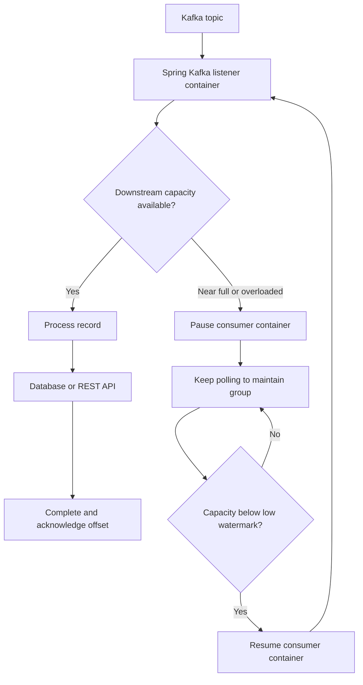

# Backpressure When Downstream Is Slow

In a Spring Kafka system, consumers typically read records from Kafka and then call a database, REST API, payment service, search engine, or another internal service. If the consumer reads faster than downstream can process, work piles up. The application can consume more memory, build ever-longer internal queues, hold connections too long, experience cascading timeouts, or trigger consumer group rebalances.

**Backpressure** is the mechanism of regulating work intake to match the actual processing capacity of downstream systems. When downstream nears capacity limits, the consumer slows down or pauses record intake; once resources recover, the consumer resumes consumption. Kafka inherently stores records durably, so consumers can leave backlogs in the topic for an appropriate window instead of pulling the entire backlog into application memory.

## 1. Why Does a Slow Downstream Destabilize Consumers?

Suppose a topic receives 2,000 records per second, while the database can only write 1,200 records per second steadily. If the consumer keeps polling and pushing data into an executor with an unbounded queue, the 800-record-per-second surplus accumulates inside the process. Over time, heap grows, garbage collection pauses lengthen, and database requests can slow down even further.

Common manifestations include:

- Consumer lag rises continuously even after adding more consumers.
- Executor queues, active task counts, or in-flight requests grow without bound.
- Database or HTTP client connection pools exhaust, increasing connection wait times.
- Listeners take longer, timeouts climb, and consumers fail to return to `poll()` fast enough.
- Continuous retries resend the same requests, piling extra load onto an already overloaded downstream.
- Heap and GC climb, eventually causing the consumer to OOM or be evicted as stalled.

The key distinction is between **backlog in Kafka** and **backlog in application memory**. Lag in Kafka is an observable signal bounded operationally by retention. Unbounded internal queues can destabilize a process before the system can react.

## 2. Viewing Backpressure as a Capacity Problem

Let:

- \(\lambda\): incoming record rate, in records/second.
- \(\mu\): combined processing capacity of consumer and downstream, in records/second.
- \(L\): number of pending records, estimable from consumer lag.

A system can remain stable long-term only when the arrival rate stays below processing capacity:

\[
\lambda < \mu
\]

If \(\lambda > \mu\), the backlog grows by roughly \(\lambda - \mu\) records per second. For example, if the source sends 2,000 records/second while downstream handles only 1,200 records/second, the backlog grows by roughly 800 records/second while those rates hold steady.

Once input drops below processing capacity, the time needed to drain the backlog can be estimated as:

\[
T_{drain} \approx \frac{L}{\mu - \lambda}
\]

This is an approximate model. Actual speed also depends on record size, load distribution across partitions, downstream latency, retries, consumer count, and resource limits. As long as input equals or exceeds processing capacity, the backlog cannot drain on its own.

With \(C\) parallel processing threads and an average processing time per record of \(S\) seconds, initial theoretical capacity can be estimated as:

\[
\mu \approx \frac{C}{S}
\]

Do not use averages alone to set production limits. Measure p95/p99, inspect connection wait times, downstream rate limits, and behavior when one partition runs hotter than others.

## 3. Layers of Backpressure Control

Backpressure can be implemented across multiple layers. A resilient system typically combines layers rather than relying on a single Kafka parameter.

| Layer | Mechanism | Goal |
|---|---|---|
| Kafka consumer | Lower records per poll, pause/resume container | Regulate record intake rate |
| Listener | Synchronous processing or capping in-flight tasks | Avoid accepting work beyond processing capacity |
| Executor | Bounded thread pool and queue | Keep memory and queued tasks within thresholds |
| Downstream client | Connection pools, timeouts, rate limits, bulkheads | Protect databases or APIs from overload |
| Retry | Exponential backoff, jitter, error classification, DLQ | Avoid retry storms and isolate bad records |
| Upstream system | Rate limiting or throttling record emission | Reduce input rate when possible |

Typical throttling flow:



The diagram illustrates the throttling concept. In real implementations, pause/resume conditions must rely on measurable signals such as queue depth, in-flight request count, connection pool utilization, or downstream overload signals.

## 4. Throttling Directly at the Kafka Consumer

### Limiting Records per Poll

`max.poll.records` caps the maximum number of records the Kafka client returns in a single `poll()` call. When downstream slows down, lowering this value can shrink how many records the listener must hold and process in one turn.

Example:

```yaml
spring:
  kafka:
    consumer:
      enable-auto-commit: false
      max-poll-records: 100
      properties:
        max.poll.interval.ms: 300000
    listener:
      ack-mode: record
      concurrency: 3
```

These are only illustrative starting values. Choose `max-poll-records` based on real processing time, payload size, and the time budget between polls. If each record can call downstream for several seconds, even 100 records can create an overly long processing cycle.

Lowering `max.poll.records` helps bound records per turn, yet does not by itself bound all memory used by the Kafka consumer. Fetch buffers are also affected by `fetch.max.bytes` and `max.partition.fetch.bytes`. Furthermore, if the listener hands records off to an internal queue and returns immediately, lowering records per poll only slows how fast the queue fills; the queue can still grow indefinitely without bounds and a pause mechanism.

### Pausing and Resuming the Listener Container

Spring Kafka provides pause/resume APIs on listener containers. This is useful when the application runs a capacity monitor outside the listener and needs to temporarily halt record intake.

Example declaring a listener with an ID and retrieving its container via `KafkaListenerEndpointRegistry`:

```java
@Component
public class OrderListener {

    @KafkaListener(
        id = "ordersListener",
        topics = "orders",
        groupId = "order-workers"
    )
    public void consume(OrderEvent event) {
        orderService.process(event);
    }

    private final OrderService orderService;

    public OrderListener(OrderService orderService) {
        this.orderService = orderService;
    }
}
```

A control component can request the container to pause or resume:

```java
@Component
public class KafkaIntakeController {

    private final KafkaListenerEndpointRegistry registry;

    public KafkaIntakeController(KafkaListenerEndpointRegistry registry) {
        this.registry = registry;
    }

    public void pauseOrders() {
        MessageListenerContainer container =
            registry.getListenerContainer("ordersListener");

        if (container != null) {
            container.pause();
        }
    }

    public void resumeOrders() {
        MessageListenerContainer container =
            registry.getListenerContainer("ordersListener");

        if (container != null) {
            container.resume();
        }
    }
}
```

The required imports belong to packages `org.springframework.kafka.config` and `org.springframework.kafka.listener`. `OrderService` is the application's business service.

When a container is paused, Spring Kafka executes the pause operation on the consumer on the thread owning the consumer. The container keeps calling `poll()` to keep the consumer group healthy, yet paused partitions deliver no new records to the listener. Thus, pausing a container reduces incoming work without deliberately letting the consumer drop out of the group simply by stopping polls.

`pause()` is a container control request; it does not cancel an in-progress listener invocation and does not abort an in-flight downstream request. If the listener is currently blocked on an HTTP call lacking a timeout, solve timeout or cancellation at the client layer. The pause/resume API also does not replace offset management and processing acknowledgment.

### Controlling via High and Low Watermarks

Do not rapidly pause and resume around a single threshold. Use two thresholds to introduce hysteresis:

- When queue depth or in-flight tasks exceed the high watermark, request a pause.
- Only resume once queue depth drops below the low watermark.
- Between the two thresholds, preserve the current state.

For example, if an internal queue holds 500 tasks, the system can start pausing at 400 and only resume once the queue drops below 150. These numbers must be determined from the application's processing times and memory budget.

Monitoring should track the current pause state to avoid issuing repeated commands. With multiple listener containers, control each container according to the specific downstream and resources it uses. With container concurrency, container-level pause typically affects child consumers belonging to that container; to throttle only one partition, use partition pause APIs appropriate for your Spring Kafka version and manage assignments carefully.

## 5. Limiting Work Inside the Application

### Prefer Synchronous Processing for Natural Backpressure

With a synchronous record listener, the container cannot finish the current processing cycle until the listener returns. When downstream slows down, the poll return cadence slows down in lockstep with processing speed. This provides natural, easy-to-reason-about backpressure.

Example:

```java
@KafkaListener(topics = "orders", groupId = "order-workers")
public void consume(OrderEvent event) {
    orderService.saveToDatabase(event);
}
```

For this to run stably, downstream calls must have sensible timeouts, connection pools must be bounded, and processing time must stay within the `max.poll.interval.ms` budget. If one record can wait forever, the consumer stalls and eventually gets evicted from the group.

### Use Bounded Executors When Parallel Processing Is Needed

A common mistake is receiving records and pushing them into `Executors.newFixedThreadPool()` with its default unbounded queue. Thread count stays fixed, yet the queue keeps growing, merely delaying memory exhaustion.

If work must be offloaded from the listener thread, use an executor that bounds both threads and queue capacity. Example:

```java
@Bean
public ThreadPoolTaskExecutor orderExecutor() {
    ThreadPoolTaskExecutor executor = new ThreadPoolTaskExecutor();
    executor.setCorePoolSize(8);
    executor.setMaxPoolSize(8);
    executor.setQueueCapacity(200);
    executor.setThreadNamePrefix("order-worker-");
    executor.setRejectedExecutionHandler(
        new ThreadPoolExecutor.AbortPolicy()
    );
    executor.initialize();
    return executor;
}
```

When the queue fills up, `AbortPolicy` rejects the submission. The application must treat this as an exhausted-capacity signal: request a container pause and leave the unacknowledged record to be reprocessed according to the appropriate offset strategy. Never catch and swallow `RejectedExecutionException` and still commit the offset, or the record will be lost from the application's processing pipeline.

The example above illustrates only executor resource bounds. It is not a complete asynchronous consumer. Moving work to other threads requires explicitly designing acknowledgment timing, per-partition ordering, shutdown behavior, and recovery for in-flight tasks.

### Do Not Commit Offsets Before Work Finishes

Suppose a listener submits a record to an executor and returns immediately. If the container commits the offset upon listener return, Kafka considers the record processed even though the background task has not written to the database yet. If the process stops at that moment, the committed record will not be redelivered, causing lost work.

With asynchronous processing, ensure:

1. Offsets are acknowledged only after the downstream operation reaches its business-defined success state.
2. When submission is rejected or a task fails, the record stays unacknowledged and goes through defined retries or error handling.
3. If parallel processing completes offsets out of order, configure an async acknowledgment mechanism suited to your Spring Kafka version, such as `asyncAcks` when using the corresponding supported feature.
4. Account for cases where one record finishes while an earlier record in the same partition is still in flight. Acknowledging a higher offset can forfeit redelivery of the lower offset if managed improperly.
5. Downstream operations should be idempotent because a record can be redelivered after crashes, timeouts, or rebalances.

Without an explicit requirement for asynchronous processing, synchronous listeners are usually simpler to operate and easier to keep semantically sound. Increasing parallelism only helps when downstream has spare capacity and business ordering permits it.

## 6. Protecting Downstream with Resource Limits

Kafka-side backpressure must pair with limits on the downstream client.

**Connection pool:** size connection limits to database or API capacity. If consumer threads exceed available connections, threads simply wait on connections and lengthen processing time.

**Timeouts:** configure connect timeouts, response timeouts, and overall operation deadlines. Timeouts stop one request from occupying a worker indefinitely. Overly short timeouts can trigger unnecessary retries, so base them on real latency and SLOs.

**Bulkheads:** cap concurrent requests per dependency. One slow API must not starve workers and connections meant for other dependencies.

**Rate limits:** cap requests per second according to downstream quotas. If downstream permits 500 requests/second, do not configure consumer concurrency that routinely exceeds the quota and relies on HTTP 429 for throttling.

**Circuit breakers:** when errors or timeouts cross a threshold, temporarily block calls to downstream for a period and allow controlled probing. Circuit breakers keep failing requests from burning workers, yet must pair with pausing or retries so records are still handled properly.

Distinguish temporary overload errors from unrecoverable business errors. HTTP 429 or 503 usually signals a need to slow down and retry with backoff; invalid data may belong in a dead-letter topic rather than blocking the partition indefinitely.

## 7. Retries and Backoff When Downstream Is Unavailable

Retries are not a substitute for backpressure. If downstream is overloaded and every consumer retries immediately, request volume can surge above the original rate. This is a retry storm.

A stable retry strategy typically includes:

- Classifying transient errors such as timeouts, connection resets, HTTP 429, or 503.
- Using exponential backoff with jitter so consumers do not retry in lockstep.
- Capping retry attempts or total retry duration.
- Honoring `Retry-After` if downstream provides it and application policy allows.
- After retries exhaust, forwarding unrecoverable records to a dead-letter topic with necessary error details.
- Ensuring retried records do not break business ordering if in-partition ordering is mandatory.

Spring Kafka provides error handlers and backoff mechanisms to coordinate retries. For long backoffs, consider `ContainerPausingBackOffHandler` in supported Spring Kafka versions. This mechanism pauses the container during the wait to avoid sleeping consumer threads for long periods and breaching poll limits. Verify the API against your running Spring Kafka version.

If downstream stays unavailable for a long period, pausing consumers or using retry topics with appropriate processing schedules is usually easier to control than holding many sleeping threads inside one process. When using retry topics, accept that global processing order may change and design around business requirements.

## 8. Distinguishing Pause, Lowering Concurrency, and Adding Consumers

These measures solve different scenarios:

| Measure | When Appropriate | Risk If Misused |
|---|---|---|
| Pause/resume | Downstream temporarily out of capacity or queue near full | Pausing too long raises lag; resuming too early repeats overload |
| Lower `max.poll.records` | Too many records per poll or poll processing takes too long | Increases poll overhead; does not fix unbounded internal queues |
| Lower concurrency | Downstream has low connection limits or quotas | Reduces throughput and raises lag if lowered too far |
| Raise concurrency | Unutilized partitions exist and downstream has spare capacity | Increases concurrent requests, potentially overloading downstream further |
| Add consumers to group | Topic has enough partitions and downstream can take more load | Consumers beyond partition count add no useful parallelism |

Never react to rising lag by always adding consumers. If downstream is already the bottleneck, raising concurrency can make the database even slower, forcing every consumer to hold records longer and lag to climb faster.

## 9. Offsets, Rebalances, and Record Redelivery

Backpressure slows consumer processing, so you must understand its impact on offsets and consumer groups.

### `max.poll.interval.ms`

Kafka requires consumers in a group to keep calling `poll()` within `max.poll.interval.ms`. With synchronous listeners, total time to process all records in a poll plus overhead must stay well below this limit with ample margin.

If one poll returns 100 records, each averaging 100 ms sequentially, business processing alone needs about 10 seconds. If a few requests take 20 seconds due to downstream timeouts, actual duration can be far higher. When designing, measure percentiles and worst cases rather than just multiplying average times.

Raising `max.poll.interval.ms` may be necessary for intentionally long processing, yet it does not make downstream faster and does not bound memory. Prefer shrinking poll sizes, setting dependency timeouts, or changing the processing model when needed.

### Commits and At-Least-Once Delivery

With `enable.auto.commit=false`, the Spring Kafka container manages commits per acknowledgment mode. For example, `AckMode.RECORD` commits after the listener successfully processes each record; `AckMode.BATCH` commits the poll's offsets after the batch completes. Manual acknowledgment lets the application decide when to confirm.

When downstream writes data successfully yet the application dies before committing, Kafka can redeliver the record. This is normal at-least-once behavior. The database should have idempotency keys, unique constraints, or appropriate upsert mechanisms so redelivery does not create duplicate business effects.

When downstream fails, do not commit the record as if it succeeded. Let the error handler execute retries, recovery, or DLQ routing per policy. Never use pause/resume as a substitute for offset acknowledgment.

## 10. Illustrative Configuration for a Consumer with Slow Downstream

An initial configuration can cap poll size, concurrency, and wait times:

```yaml
spring:
  kafka:
    consumer:
      enable-auto-commit: false
      max-poll-records: 100
      properties:
        max.poll.interval.ms: 300000
    listener:
      concurrency: 3
      ack-mode: record
```

Pair this configuration with service-side limits:

```text
Kafka listener concurrency:       3
Downstream max in-flight calls:    3 (or measured appropriate limit)
Database connection pool:         bounded to database capacity
HTTP response timeout:            per downstream SLO and latency
Executor queue:                   bounded, if offloading
Pause high watermark:             queue/capacity near full
Resume low watermark:             queue has drained sufficiently
```

The numbers above merely show how to tie limits together. Concurrency and max in-flight requests do not have to be equal; account for other workloads sharing the database or API. Above all, do not copy configurations straight into production without load testing.

## 11. Observing and Alerting on Backpressure

To know whether backpressure is working, observe both Kafka and downstream.

**Kafka and Spring Kafka side:**

- Consumer lag per partition and age of the oldest unprocessed record.
- Records consumed rate and offset commit rate.
- Listener execution time p50, p95, and p99.
- Rebalance counts, poll timeouts, or logs related to `max.poll.interval.ms`.
- Time the container spends paused and pause/resume counts.
- Retried record count, DLQ count, and commit latency.

**Application side:**

- Queue depth, in-flight task count, and executor rejection count.
- Busy thread count, thread wait time, and connection wait time.
- Heap usage, allocation rate, and GC pauses.
- Downstream requests per second, p95/p99 latency, timeouts, and error rates.
- Connection pool active/idle/pending counts and quota utilization.

An alert based solely on lag can mislead. Rising lag while downstream is intentionally paused is expected behavior. Combine lag with pause state, downstream speed, record age, and time remaining before hitting retention limits.

Specific metrics depend on Kafka client, Spring Kafka, and observability stack versions. Confirm the exact metric names exported in your live environment before building dashboards or alerts.

## 12. Handling Procedure When Downstream Slows Down

When an alert fires, follow this sequence:

1. Identify which downstream service is slow and inspect latency, error rate, quotas, connection pools, and service health.
2. Compare incoming record rate against successful processing rate to see whether the backlog is growing or shrinking.
3. Check internal queues, in-flight tasks, and heap. If queues near full, trigger pause or throttle intake at configured thresholds.
4. Check timeouts and retries. Curb retry storms, apply backoff with jitter, and classify errors destined for DLQ.
5. Keep consumer/concurrency counts within what downstream can sustain. Scale up only after confirming spare capacity.
6. Once downstream recovers, resume at the low watermark and monitor lag drain rate.
7. Confirm records are committed after proper processing, failed tasks have a recovery path, and record age has not exceeded retention.

Do not resume all consumers simultaneously after a long outage if downstream has tight quotas. Resume consumers in staggered groups or ramp concurrency gradually to avoid triggering a fresh traffic burst.

## 13. Testing Backpressure

Test with controlled downstream slowdowns before deploying throttling mechanisms:

- Raise API response latency severalfold above normal to see how listeners and lag react.
- Simulate HTTP 429, 503, timeouts, and connection resets.
- Exhaust the database connection pool temporarily.
- Drive input record rate above downstream capacity for a sustained interval.
- Verify executor queues stay bounded and heap does not grow uncontrollably.
- Confirm container pausing preserves consumer group membership and resuming does not trigger quota-breaching bursts.
- Stop the application while downstream tasks are running to test offsets, retries, and deduplication.
- Trigger rebalances during a large backlog and confirm uncommitted records redeliver safely.
- Recover downstream and measure backlog drain time, not just when error rates return to normal.

Pass criteria should tie to concrete SLOs: stable memory, bounded queues, zero lost records, error rate within bounds, no unexpected consumer rebalances, and backlog drained within acceptable time.

## 14. Common Mistakes

**Raising `max.poll.interval.ms` to cure every problem.** This only gives the consumer more time to process before being declared stalled. It does not bound queues, free connections, or improve downstream throughput.

**Using unbounded queues to absorb bursts.** Queues merely move backlog from Kafka into heap. When downstream fails to recover fast enough, the process can OOM.

**Submitting background tasks and committing immediately.** If the process stops before tasks finish, committed records can be lost from the processing pipeline.

**Raising concurrency while downstream is overloaded.** More consumers generate more concurrent requests and slow the dependency down further.

**Retrying immediately and infinitely.** Retry storms hinder downstream recovery and can monopolize all workers.

**Pausing too late.** Once a queue is already full, pausing only blocks new data; the application still must process or recover everything already accepted. Set the high watermark low enough to leave reaction time.

**Resuming on the first success signal.** A single successful request does not prove downstream has recovered. Use a low watermark and stability window to avoid pause/resume flapping.

## 15. Design Principles

A reliable backpressure implementation should uphold these principles:

- Bound all in-memory queues and all in-flight task counts.
- Regulate poll intake to capacity, using `max.poll.records` as one of the control knobs.
- Use listener container pause/resume when temporarily halting record intake while maintaining consumer group polling.
- Size timeouts, connection pools, rate limits, and bulkheads to downstream capacity.
- Acknowledge offsets only after processing reaches its defined success state.
- Design for idempotency because retries, crashes, and rebalances can cause record redelivery.
- Use bounded retries, backoff, and DLQs for unrecoverable errors.
- Raise concurrency only when both partitions and downstream have spare capacity.
- Monitor lag, record age, queue depth, listener latency, and downstream health together.

Backpressure lets Spring Kafka absorb load mismatches by leaving excess work in Kafka and throttling what enters the application. With bounded queues, sound offset management, and controlled downstream recovery, the system can weather slow downstream periods while preserving records and keeping consumer progress stable.
