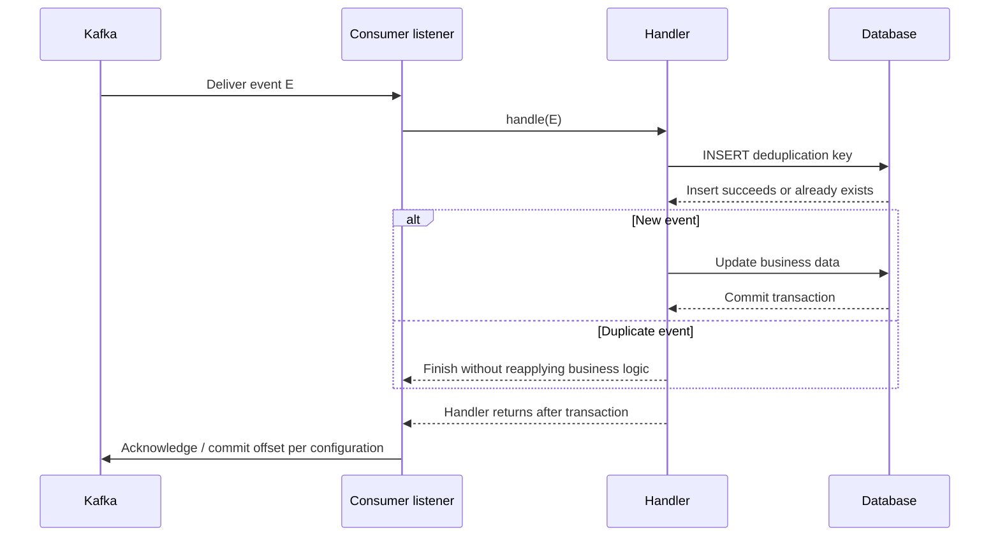

# Unique constraints in databases

In a Spring Kafka system, a message can be delivered to a consumer multiple times. The consumer may finish business processing and write data to the database, yet the process stops before Kafka records the processed offset. When the consumer restarts or the partition moves to another consumer, Kafka redelivers that message. Retries, rebalances, and error handling can also produce similar repeated deliveries.

If every message receipt executes business logic such as creating an order, recording a payment, or crediting a balance, data can be mutated multiple times. An effective protection is persisting a record of processed messages in the database and placing a `UNIQUE` constraint on the message's identifying key. The database becomes the final arbiter: even if multiple consumers attempt to record the same message concurrently, only one transaction can claim that unique key.

## 1. What does a unique constraint protect?

A `UNIQUE` constraint is a data integrity rule requiring that a column or combination of columns cannot appear more than once across rows in a table. Databases typically enforce this constraint using a unique index. Checking and writing the index occur inside the data write operation, so the database can handle concurrent transactions trying to insert the same key.

For example, the `consumed_event` table stores events received and processed by a logical consumer:

```sql
CREATE TABLE consumed_event (
    consumer_name VARCHAR(120) NOT NULL,
    event_id UUID NOT NULL,
    processed_at TIMESTAMPTZ NOT NULL DEFAULT CURRENT_TIMESTAMP,
    CONSTRAINT uq_consumed_event_consumer_event
        UNIQUE (consumer_name, event_id)
);
```

This constraint means an `event_id` can only be recorded once for the same `consumer_name`. The same event can still be processed by a different logical consumer, since those two consumers have separate business purposes and states.

Key columns should have `NOT NULL`. How `NULL` values are treated in unique constraints differs across database management systems; in many systems, multiple rows can hold `NULL` without violating `UNIQUE`. If an identifying key is left blank, the constraint may fail to protect the intended case.

A unique constraint differs from a `PRIMARY KEY` in modeling purpose. A table has only one primary key, whereas it can have multiple unique constraints representing independent uniqueness rules. Business tables often have their own primary key plus an extra unique constraint on the deduplication key.

## 2. Why do Kafka consumers need this mechanism?

Kafka is commonly configured for at-least-once delivery: messages are not lost in normal flows, yet a message can be redelivered if the consumer has not safely confirmed progress. A typical scenario:

1. Consumer receives an `order-created` event with `event_id = e-123`.
2. Consumer writes the order to the database and the transaction commits.
3. The process stops before the corresponding offset commits.
4. After restarting, Kafka redelivers event `e-123`.
5. Without a deduplication mechanism, the consumer may create another record or re-apply the business effect.

This is not necessarily a Kafka bug. Kafka only tracks consumer read progress; the database manages business state. The two systems have separate transactions and commit points. Relying solely on "messages usually arrive once" leaves the application vulnerable to crashes or retries.

A unique constraint turns message identification into an atomic write operation. The consumer does not rely on a prior read check to decide whether a message is new. It attempts to write the key; the database determines which transaction wins the right to create that key.

### Distinguishing three types of idempotency

- **Producer idempotency:** limits duplicate records from producer send retries within Kafka's supported protocol scope. It does not automatically prevent consumers from executing business logic twice.
- **Consumer idempotency:** the same event is delivered multiple times, yet the consumer applies the business effect only once. A unique constraint on an inbox or processed-events table is commonly used for this.
- **Business idempotency:** a business action is not executed repeatedly even if two different events represent the same business request. For example, two events with different IDs carrying the same payment request code. In that case, an extra unique key per business rule is required.

These three layers solve different problems. Enabling producer idempotence does not replace database protection at the consumer. Likewise, deduplicating by `event_id` does not replace a unique constraint on transaction reference if business rules allow only one transaction per request.

## 3. Choosing a unique key aligned with business meaning

The quality of deduplication depends on the chosen key. The key must identify the same event across all retries and must distinguish two genuinely different valid events.

### Using a stable event ID

Usually, the producer generates a unique `event_id` when creating the event. That ID must remain unchanged when resending the event due to timeouts or retries. The consumer uses this ID to recognize already-processed events.

Do not generate a new `event_id` on every producer retry. If each resend gets a new ID, the database views those deliveries as distinct events and the unique constraint cannot detect duplicates.

If the data source does not provide an event ID, construct a key from stable source identifiers, such as `source_system + source_record_id + event_version`. Key composition must accurately reflect the source's identification rules; never arbitrarily include the timestamp the consumer received the message or the retry count.

### Using a composite key per consumer

One event may be processed by multiple independent consumers for different purposes. For example, `order-created` both updates an order projection and triggers an analytics pipeline. Placing only `UNIQUE(event_id)` on a shared table could cause the first consumer to accidentally block the second consumer from processing the event.

A composite key `(consumer_name, event_id)` makes the deduplication scope explicit. `consumer_name` should be the stable name of the processing logic, such as `order-projection-v1`; do not use hostname, pod ID, thread ID, or ephemeral instance names. If a deployment accidentally renames the consumer, old events may be reprocessed.

When you intentionally need to rebuild a projection from scratch, you can use a new consumer name or processing namespace to establish a fresh deduplication scope. That is an operational decision requiring planning because it enables reprocessing historical data.

### Using a business key when needed

Suppose the system receives two distinct events with different `event_id` values, yet both request creating a payment for the same partner reference code. A unique constraint on event ID lets both events be recorded. If the business allows only one payment per request, the payment table needs an additional constraint such as:

```sql
ALTER TABLE payment
    ADD CONSTRAINT uq_payment_tenant_external_reference
    UNIQUE (tenant_id, external_payment_reference);
```

A composite key often needs `tenant_id` so two different customers can use the same reference code within their own scopes. For different operations on the same object, the key may also need operation type or business version, such as `(account_id, operation_type, request_id)`.

Do not include message receipt timestamp, Kafka offset, partition, pod name, or retry count in the deduplication key. Those values can change across deliveries of the same event. Furthermore, a Kafka offset is unique only within a topic-partition, not a stable business identifier when data is copied, moved across topics, or replayed through another stream.

## 4. Recording the event and updating business state in the same transaction

A common processing pattern consists of two steps inside the same database transaction:

1. Attempt to insert the `(consumer_name, event_id)` key into the `consumed_event` table.
2. Only if the insert succeeds, apply the business changes.

In PostgreSQL, `ON CONFLICT DO NOTHING` handles unique conflicts without failing the transaction:

```sql
INSERT INTO consumed_event (consumer_name, event_id)
VALUES ('order-projection-v1', '2b7f1a3e-2c5d-4e3a-9b11-6f5f5f7c1234')
ON CONFLICT (consumer_name, event_id) DO NOTHING;
```

PostgreSQL returns the number of inserted rows. If the result is `1`, the event was just claimed and the consumer can execute business logic. If the result is `0`, the key already existed and the event was previously recorded by this logical consumer; the consumer can finish the current delivery without reapplying the business effect.

Do not run `SELECT` to check first and then `INSERT`:

```text
Consumer A: SELECT -> event absent
Consumer B: SELECT -> event absent
Consumer A: INSERT -> succeeds
Consumer B: INSERT -> may create duplicate row without constraint
```

This is a check-then-act race condition. Both transactions can observe the "not yet present" state. A unique constraint paired with an atomic insert resolves the race at the only reliable arbiter: the database.

### Example with Spring JDBC and Spring transactions

The following example uses PostgreSQL, `JdbcTemplate`, and a `@Transactional` service:

```java
@Service
@RequiredArgsConstructor
public class OrderCreatedHandler {

    private static final String CONSUMER_NAME = "order-projection-v1";

    private final JdbcTemplate jdbcTemplate;
    private final OrderProjectionRepository orderProjectionRepository;

    @Transactional
    public void handle(OrderCreated event) {
        int inserted = jdbcTemplate.update("""
            INSERT INTO consumed_event (consumer_name, event_id)
            VALUES (?, ?)
            ON CONFLICT (consumer_name, event_id) DO NOTHING
            """,
            CONSUMER_NAME,
            event.eventId()
        );

        if (inserted == 0) {
            // Event was already processed previously by this logical consumer.
            return;
        }

        // Database changes must participate in the same transaction.
        orderProjectionRepository.apply(event);
    }
}
```

Listener calling the handler:

```java
@Component
@RequiredArgsConstructor
public class OrderCreatedListener {

    private final OrderCreatedHandler handler;

    @KafkaListener(
        topics = "orders.created",
        groupId = "order-projection-v1"
    )
    public void onMessage(OrderCreated event) {
        handler.handle(event);
    }
}
```

When `handle` returns normally, Spring ends the service transaction. If the database writes succeed, the transaction commits before the handler call returns to the listener. With proper acknowledgment configuration, the container commits the offset only after the listener succeeds. If using `AckMode.MANUAL`, call `ack.acknowledge()` after `handler.handle(event)` returns; never acknowledge the offset while the database transaction has not committed.

For both operations to be truly atomic, `JdbcTemplate` and the repository must share the same transaction manager and the same database transaction. If the repository writes through a different datasource or transaction manager, inserting the marker and updating business state could commit or roll back independently, breaking the guarantee.

Place the handler in a separate Spring bean so calls pass through the transaction proxy. If a method in the same class calls another `@Transactional` method directly, Spring's default proxy mechanism may not apply transactions as expected due to self-invocation.

### What happens on failure?

Suppose inserting `consumed_event` succeeds but updating the projection fails. If both operations share the same transaction, the transaction rollback deletes the newly inserted marker as well. When Kafka redelivers the event, the next attempt can insert the key and reprocess the business logic.

Conversely, if the marker committed in a separate transaction before the business update, a failure in the second step could leave a "processed" state even though business state was never updated. The next retry would be skipped and data would be missing. Therefore, never split these two steps into two independent transactions when the goal is ensuring both succeed or both fail together.

Spring rolls back transactions by default on `RuntimeException` and `Error`; checked exceptions do not automatically trigger rollback under default configuration. If the handler can throw a checked exception indicating a retryable error, configure `@Transactional(rollbackFor = Exception.class)` or convert the error to an exception type with appropriate rollback semantics. Never swallow an exception and return normally when business processing did not complete, as the transaction could commit the deduplication marker.

## 5. Coordinating with Kafka acknowledgment and retries

A database transaction and a Kafka offset commit are two distinct actions. The processing pattern must order them so messages are not acknowledged before database changes are durable:



If the database commits successfully but the offset commit fails, Kafka may redeliver the event. Redelivery hits the unique constraint, the insert creates no new row, and the consumer skips the business effect. This is the exact scenario deduplication is designed to handle.

If the offset commits before the database commits and then the database rolls back or the process stops, Kafka may not redeliver the event because it already treats the offset as complete. That creates a risk of losing business operations. Therefore, acknowledgment must follow the database commit outcome.

In Spring Kafka, actual ordering also depends on `AckMode`, listener/container transactions, and the configured transaction manager. Clearly verify who commits the offset, who commits the database, and the sequence between them. Kafka transactions or Kafka's exactly-once mode can protect Kafka-to-Kafka flows within supported configurations, but do not automatically turn an independent database transaction into a distributed transaction with Kafka.

When the handler throws an exception, let the error propagate to the error handler/container per the configured retry policy. If a retry succeeds, the database commits and the offset is acknowledged. Once retries are exhausted, a dead-letter topic can hold events needing investigation. Sending an event to a dead-letter topic also requires clear policy: is the failed event considered complete on the source topic, or is a controlled replay process required?

## 6. Handling duplicates per database engine

`ON CONFLICT ... DO NOTHING` is PostgreSQL syntax. Do not assume every database shares the same syntax or the same affected-row rules.

- **PostgreSQL:** `INSERT ... ON CONFLICT (key_columns) DO NOTHING` is the direct way to attempt insertion and ignore conflicts on the specified key. You can also use `ON CONFLICT ON CONSTRAINT constraint_name DO NOTHING` to name the constraint explicitly.
- **MySQL:** you can use `INSERT ... ON DUPLICATE KEY UPDATE` or an insert strategy matching your version and schema. Carefully examine update behavior and reported row counts; do not infer duplicates solely from row counts if your driver/database follows different rules.
- **SQL Server and others:** choose an insert/upsert approach suited to the engine, isolation level, and version. Verify concurrent behavior with integration tests against the exact target database engine.

Another approach is performing a normal `INSERT` and catching unique violations. However, exception-based handling requires understanding database transaction state. For example, in PostgreSQL, a normal SQL error puts the current transaction into an aborted state requiring rollback; catching the exception in Java and running more statements in the same transaction will not recover it. You must roll back the transaction or use savepoints/appropriate upsert mechanisms.

With JPA, calling `repository.save()` and catching `DataIntegrityViolationException` is not always a safe way to treat duplicates as a normal outcome. The error may surface only at flush or commit, and the transaction may already be marked rollback-only. Moreover, the exception could come from a different unique constraint, foreign key, `NOT NULL`, or check constraint. Never assume every `DataIntegrityViolationException` indicates a duplicate message.

If the transaction must continue after encountering a conflict, prefer an upsert/insert-ignore statement whose behavior is explicitly supported by the database. If you must catch unique violations, identify the exact constraint and design rollback/savepoint or transaction boundaries suited to the engine.

## 7. Distinguishing duplicates from events with the same ID but different content

A unique constraint only proves the key already exists. It does not automatically prove the new payload matches the previously processed payload. If a producer accidentally reuses `event_id` for two different payloads, `ON CONFLICT DO NOTHING` will skip the second event as a normal duplicate.

For systems requiring strict controls, you can store `event_type`, `schema_version`, or `payload_hash` in the inbox table. When an insert hits a conflict, read the existing record and compare the required identifying fields. If the same ID has a different event type or different payload hash, record it as a data error or producer contract violation; do not silently treat it as a retry.

Example extended structure:

```sql
CREATE TABLE consumed_event (
    consumer_name VARCHAR(120) NOT NULL,
    event_id UUID NOT NULL,
    event_type VARCHAR(160) NOT NULL,
    payload_hash VARCHAR(128) NOT NULL,
    processed_at TIMESTAMPTZ NOT NULL DEFAULT CURRENT_TIMESTAMP,
    CONSTRAINT uq_consumed_event_consumer_event
        UNIQUE (consumer_name, event_id)
);
```

The hash must be computed from a stable payload representation with clear canonicalization rules. If field order, numeric formatting, timestamps, or encoding vary, the same logical content can yield different hashes. Add hashing only when needed to detect ID reuse bugs; avoid adding this complexity if event IDs are already reliably governed.

## 8. When business logic produces side effects outside the database

A database transaction can only roll back changes participating in that transaction. It cannot automatically undo a sent email, an HTTP request already accepted by another system, or a call to a payment provider.

For example, a consumer inserts a deduplication marker, sends an email successfully, and then fails to update the database. The transaction rollback can remove the marker, causing Kafka to retry and send the email again. Placing HTTP calls inside a transaction also prolongs lock duration and does not provide cross-system atomicity.

A safer structure is writing the business change and an outbox record within the same database transaction. A separate publisher reads the outbox and dispatches messages or external requests. The publisher can still send duplicates if it crashes after sending before marking the outbox entry complete, so the receiving side needs an idempotency key or equivalent deduplication.

For external APIs supporting idempotency keys, pass a stable key tied to the business action, such as `payment_request_id`. Never generate a new key on each retry. For emails or services lacking idempotency support, accept and handle potential repeat sends per business design, or add a controllable orchestration layer.

## 9. Lifecycle of deduplication data

The `consumed_event` table grows with the number of processed events. Before setting a data deletion policy, determine the maximum window within which an old event could return from Kafka, retry topics, dead-letter topics, backups, or replay procedures.

If markers are purged earlier than the replay window, old events could be reprocessed as new events. Therefore, retention should cover source retention and every supported retry/replay window. For financial operations or irreversible effects, you may need long-term key retention or a business ledger with its own unique constraint, even if the inbox table is pruned.

As the table grows, monitor index size, insert latency, query times, and cleanup cost. Time-based table partitioning can simplify retention management, but you must check database limits on unique constraints. For instance, PostgreSQL requires unique constraints on partitioned tables to include the partition key columns where applicable; adding a timestamp column to the key can alter global uniqueness semantics. Do not partition solely because a table is large without verifying how the deduplication invariant is preserved.

When adding a unique constraint to a table with existing data, check for and resolve duplicate rows first. A migration creating the constraint will fail if existing data violates it. On large tables, creating unique indexes online/concurrently and executing migrations depend on the database; choose a procedure that minimizes table locks and downtime.

## 10. Observability and operations

Unique constraints keep the system correct under contention, yet operations still need to know how often duplicates occur and whether anomalies exist.

Metrics worth tracking:

- Number of new events recorded and successfully processed.
- Number of inserts skipped due to existing keys, per logical consumer.
- Number of events with matching IDs but mismatched payloads or event types.
- Retry counts, dead-letter topic counts, and event age at processing time.
- Database error rate, transaction duration, and consumer processing latency.

Duplicates can be a normal consequence of at-least-once delivery. A sharp spike may indicate frequent consumer crashes after database commits, offset commit issues, overly broad retry policies, or producers re-emitting events repeatedly. Duplicate metrics should be interpreted alongside retries and processing errors rather than assuming every duplicate is an incident.

Logs should include `event_id`, `consumer_name`, topic, partition, and offset for tracing. Topic/partition/offset help investigate message location, though they do not replace event ID in idempotency keys. Avoid logging full sensitive payloads solely to debug duplicates.

## 11. Common design mistakes

| Practice | Risk | Remedy |
|---|---|---|
| `SELECT` check then `INSERT` | Two consumers can both see the key as absent | Use atomic insert/upsert and a unique constraint |
| Deduplicating solely by Kafka offset | Offset is meaningful only within a topic-partition and changes on cross-stream replay | Use a stable event ID; keep offsets for tracing |
| Generating a new event ID on each retry | Each delivery looks like a brand-new event | Generate ID once at source and preserve across retries |
| Committing marker in a separate transaction | Business failure can leave marker behind, causing retries to skip | Write marker and business changes in the same transaction |
| Acknowledging before database commit | Message can be lost from processing even if database rolls back | Acknowledge after the transaction succeeds |
| Catching all integrity errors as duplicates | Can mask data errors, foreign keys, or other constraints | Distinguish the exact constraint or use intentional upsert |
| Using pod name as consumer key | Every scale/deploy creates a new dedupe scope | Use a stable logical handler name |
| Deleting markers too early | Replaying old events can re-execute business logic | Set retention to cover retry and replay windows |
| Calling API/email before committing database | External side effects do not roll back with the database | Use outbox and idempotency keys on the receiving side |

## 12. Required behavior verification

When building or modifying an idempotency mechanism, these scenarios verify that the unique constraint upholds the right invariant:

1. **Same event delivered twice sequentially:** the deduplication table holds only one row and the business effect occurs only once.
2. **Two consumers process the same event concurrently:** the unique constraint allows only one transaction to insert the key; the other receives a duplicate outcome and does not reapply business logic.
3. **Failure after marker insert before business completion:** the transaction rolls back the marker too; retries can process the event successfully.
4. **Database commit succeeds but offset is uncommitted:** on redelivery, the consumer detects the duplicate and does not repeat the business effect.
5. **Same event ID with different payload:** the system detects or flags a contract violation instead of silently treating the two payloads as identical.
6. **Two tenants with the same reference code:** a composite key containing tenant ID lets both valid records exist independently.

Run integration tests against the same database engine and a version close to production. H2 or mocked repositories may not accurately reproduce upsert syntax, unique index rules, concurrent locks, and transaction behavior of PostgreSQL/MySQL/SQL Server. In particular, concurrent consumer tests must generate real contention rather than calling the same method sequentially in a single test.

## 13. Practical design rules

When using a unique constraint as the idempotency barrier for Spring Kafka consumers, explicitly define the stable event ID, consumer scope, and business keys to protect. Create unique constraints on key columns with `NOT NULL`, then use an atomic insert/upsert operation so the database arbitrates duplicates. Record the marker and update business state in the same transaction; acknowledge the Kafka offset only after that transaction completes. For side effects outside the database, use an outbox and idempotency keys at the receiving system.

A unique constraint does not make Kafka deliver every message only once. It makes protected database effects resilient to redelivery and concurrent processing. That is the practical foundation for building idempotent consumers in a distributed system with retries and failures.
