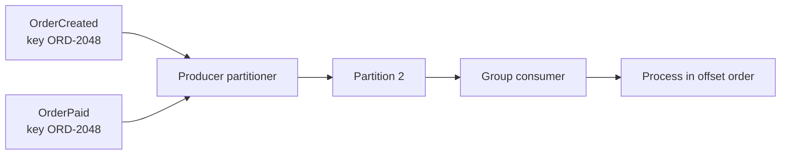

# Business key and message key

In an event-driven system, a single order can emit multiple events such as `OrderCreated`, `OrderPaid`, and `OrderShipped`. The system needs to know which order those events belong to, how processing order should be preserved, and how an event can be redelivered without creating a business effect twice. These requirements involve three commonly confused concepts: **business key**, **Kafka message key**, and **idempotency key**.

A business key identifies an object or concept within the business domain. A message key is the key of a Kafka record, sent by the producer to Kafka for routing and organizing data. An idempotency key identifies a logical emission so a consumer or service can detect repeated processing. A single value can serve multiple roles, yet the three concepts are not synonymous and must be chosen by intended purpose.

## 1. Distinguishing the three types of keys

Suppose an order-processing system. Order `ORD-2048` emits two events: order creation and payment confirmation.

| Concept | Question answered | Example | Meaning scope |
|---|---|---|---|
| Business key | Which business object does this event belong to? | `orderId = ORD-2048` | Stable identifier of the order in the business domain |
| Message key | Which key does Kafka use to route records and group data? | Record key `ORD-2048` | Key of a record within a topic |
| Event ID / idempotency key | Which logical emission is this, and was it processed already? | `eventId = evt-7f91` | Unique identifier of a logical event or request |

Example of two records:

```json
{
  "key": "ORD-2048",
  "value": {
    "eventId": "evt-7f91",
    "eventType": "OrderCreated",
    "orderId": "ORD-2048",
    "occurredAt": "2026-11-16T00:10:00Z"
  }
}
```

```json
{
  "key": "ORD-2048",
  "value": {
    "eventId": "evt-a203",
    "eventType": "OrderPaid",
    "orderId": "ORD-2048",
    "occurredAt": "2026-11-16T00:12:00Z"
  }
}
```

The two records share the same business key and message key because both describe one order. They have different `eventId` values because they are two distinct logical events. If a consumer receives record `evt-a203` again, the event ID identifies it as a redelivery of that same event.

## 2. Business keys in the business domain

A business key is the identifier components across the system use to refer to the same business object. Examples:

- `orderId` identifies an order.
- `accountId` identifies an account.
- `customerId` identifies a customer.
- `shipmentId` identifies a shipment.
- A pair of `tenantId` and `orderId` identifies an order in a multi-tenant system when `orderId` is unique only per tenant.

A business key should have these characteristics:

1. **Stable:** does not change when display name, address, or object status changes.
2. **Explicit uniqueness scope:** clear whether the key is globally unique or unique only within a tenant, store, or object type.
3. **Consistently reusable:** producers, consumers, and storage systems understand the exact same representation.
4. **Independent of mutable attributes:** emails, phone numbers, names, or addresses are usually poor long-term identifiers.

Not every value that looks like an identifier makes a good business key. For instance, an email can change or be reassigned; customer names can collide; sequential order numbers might be unique only per store. In multi-tenant systems, using `orderId` alone can cause collisions when two tenants both generate `1001`.

When a key is unique only within a tenant, define a composite business key combining `tenantId` and `orderId`. The representation must be unambiguous. If concatenating strings with a delimiter, ensure that delimiter cannot appear inside components or apply escaping rules. In schema-backed systems, model composite keys with a stable structured schema and serialize consistently.

## 3. How does a message key affect partitioning?

A Kafka record has a key and a value. The key can be a string, number, bytes, or another type depending on the serializer. When a producer sends a keyed record, the partitioner uses the serialized key bytes to determine the target partition. With the default Java producer partitioner, identical key bytes typically route to the same partition as long as partition count and partitioner configuration remain unchanged.



If `OrderCreated` and `OrderPaid` share the same key, they typically land in the same partition. Kafka preserves record order within that partition by offset order. This lets consumers process changes for the same order in the sequence written to the partition.

Message keys are therefore commonly chosen from the business key of the aggregate requiring ordering. Examples:

- `orders` topic: use `orderId` if per-order event ordering is needed.
- `accounts` topic: use `accountId` if balance changes per account must be serialized.
- `shipments` topic: use `shipmentId` if each shipment's state must be processed in order.

Kafka guarantees ordering only within a single partition. Two records in two different partitions have no global order. Sharing a message key also never makes multiple consumers in the same group process the same partition concurrently; at any moment, a partition is assigned to at most one consumer in the group.

## 4. Choosing message keys by aggregate and ordering requirements

A helpful rule is picking keys by the business unit the system updates sequentially. If `OrderCreated`, `OrderPaid`, and `OrderCancelled` all mutate one order's state, `orderId` is usually the right message key.

However, overly broad keys create hot spots. If every event for every customer uses a single key `customer-events`, all records funnel into one partition. If a key is too granular, such as a unique `eventId` per record, events for the same order scatter across partitions and lose relative ordering.

| Key choice | Likely result | When appropriate |
|---|---|---|
| `orderId` | Events for one order share a partition | Per-order ordering is required |
| `accountId` | Changes for one account share a partition | Per-account changes must be serialized |
| `customerId` | All customer events group by customer | Customer-level ordering is needed and load distributes evenly |
| `eventId` | Each event usually has a distinct key | No per-aggregate ordering needed; spread records evenly, accepting loss of business order |
| A shared constant | Nearly all records land in one partition | Only small streams needing one total order; severely caps throughput |

Choose key granularity per business invariant. If two independent orders can be processed in parallel, `orderId` allows better parallelism than keying every order under `customerId`. If business rules require updating all of a customer's orders in strict sequence, `customerId` can be an intentional choice, accepting the corresponding load concentration.

## 5. Message keys are not a deduplication mechanism

Kafka does not automatically ensure each key appears only once. A producer can send hundreds of records with the same key; that is normal behavior. Keys primarily handle routing, in-partition ordering, and features like log compaction.

Therefore, never use `orderId` as proof an event was already processed. One order can have many valid events, and the same event can be redelivered multiple times. Consumers need a separate identifier for each logical emission, typically an `eventId` generated at the producer or an `idempotencyKey` supplied for an incoming request.

Example:

| Write | Business key | Message key | Event ID | Meaning |
|---|---|---|---|---|
| 1 | `ORD-2048` | `ORD-2048` | `evt-7f91` | Order creation event |
| 2 | `ORD-2048` | `ORD-2048` | `evt-a203` | Payment succeeded event |
| 3 | `ORD-2048` | `ORD-2048` | `evt-a203` | Redelivery of the same payment event |

Writes 2 and 3 share the same event ID, allowing the consumer to recognize the redelivery. Comparing only message key `ORD-2048` would confuse the payment event with the creation event because both belong to the same order.

## 6. Sending keyed records with Spring Kafka

Spring Kafka lets you pass the key directly when sending via `KafkaTemplate`:

```java
public record OrderEvent(
        String eventId,
        String eventType,
        String orderId,
        Instant occurredAt) {
}

public void publish(OrderEvent event) {
    kafkaTemplate.send(
        "orders",
        event.orderId(),
        event
    );
}
```

In this example, `event.orderId()` is the Kafka message key. `event.eventId()` lives in the payload and identifies the event for idempotency. The producer must configure a key serializer compatible with the key type, such as `StringSerializer` when using `String`.

You can also construct `ProducerRecord` explicitly:

```java
ProducerRecord<String, OrderEvent> record =
        new ProducerRecord<>(
            "orders",
            event.orderId(),
            event
        );

kafkaTemplate.send(record);
```

If passing event ID via headers, you can add a header such as `event-id`, though you should standardize a single authoritative source and ensure headers survive forwarding hops. Placing event ID in the payload helps keep event data self-describing when archived or sent to other systems. Extra headers can carry transport metadata.

A consumer can inspect both key and payload:

```java
@KafkaListener(topics = "orders", groupId = "orders-projection")
public void handle(ConsumerRecord<String, OrderEvent> record) {
    String messageKey = record.key();
    OrderEvent event = record.value();

    if (!messageKey.equals(event.orderId())) {
        throw new IllegalStateException("Message key does not match orderId");
    }

    orderProjectionService.apply(event);
}
```

Checking the key against the business identifier in the payload catches producer bugs or inconsistent data. In production systems, explicitly define behavior for null keys, null payloads, or mismatches; never silently mutate the wrong aggregate.

## 7. Consumer idempotency using event ID

A Kafka consumer can receive a record again after application restarts, rebalances, error handling, or uncommitted offsets. This is normal behavior in redeliverable delivery models. If the business operation is non-idempotent, reprocessing can double-charge, double-increment, or create duplicate records.

A common approach stores processed event IDs in the same database and transaction as the business change. An inbox table can enforce a unique constraint on `event_id`:

```sql
CREATE TABLE processed_events (
    event_id VARCHAR(100) PRIMARY KEY,
    processed_at TIMESTAMP NOT NULL
);
```

Conceptual flow:

```text
Receive record
    |
    v
Start database transaction
    |
    v
Insert eventId into processed_events
    |
    +-- On unique constraint violation --> Event already processed, exit safely
    |
    v
Apply business changes
    |
    v
Commit database transaction
    |
    v
Commit Kafka offset per listener config
```

Example service:

```java
@Transactional
public void applyOnce(OrderEvent event) {
    processedEventRepository.insert(event.eventId());
    orderRepository.markPaid(event.orderId());
}
```

`insert` must be backed by a real unique constraint in the database. If the event ID already exists, the repository detects the conflict and returns an already-processed outcome. Do not execute the business operation first and record the event ID afterward, as the two operations might not commit together.

The database transaction must cover both the processed marker and the business update. If the database commits yet the Kafka offset does not, the record can be redelivered; next time the unique constraint detects the processed event and the consumer completes without repeating the business effect. If the database transaction rolls back, both the event ID marker and business changes roll back so the record can be retried.

Offset commit details depend on acknowledgment mode and listener container configuration. The design must ensure offsets advance past a record only after database operations finish per the desired policy. With batch or asynchronous processing, take extra care not to commit offsets for unfinished records.

## 8. Event ID, command idempotency key, and business key

All three identifiers can appear within the same flow:

- **Business key:** `orderId` identifies the order entity.
- **Command idempotency key:** client-supplied token when submitting a payment or order creation request, letting the API recognize retries of the same request after a timeout.
- **Event ID:** system-generated ID for the emitted event, letting consumers recognize redeliveries of that event.

For example, a client sends an order creation request with `Idempotency-Key: req-93ab`. The service creates order `ORD-2048` and emits event `evt-7f91`. If the client resends the same `req-93ab` request, the API returns the already-created result instead of creating a new order. If Kafka redelivers event `evt-7f91`, consumers use the event ID to avoid applying business changes a second time.

Do not assume an event ID should be regenerated on application-layer retries. If the same logical event is republished after a timeout, the ID must stay stable so consumers recognize it as the same event. If a producer creates a new event with a new ID for the same logical request, event-ID-based deduplication will not catch that duplication.

## 9. Producer idempotence and Kafka transactions

Kafka producers support idempotence to handle duplicates arising when a producer retries sending a record due to network errors or delayed acknowledgments. The producer uses a producer ID and sequence numbers so the broker detects repeated sends within the scope of the producer session and target partition.

Spring Boot configuration example:

```yaml
spring:
  kafka:
    producer:
      properties:
        enable.idempotence: true
```

In modern Kafka clients, idempotence is often enabled by default when related settings are compatible. Verify your actual client version and runtime configuration rather than relying on defaults from another version.

Producer idempotence does not replace event IDs or consumer deduplication. It does not automatically remove two separate `send()` calls issued by the application, does not recognize two business events with identical payloads, and does not make database writes idempotent.

Kafka transactions can combine reading records, writing records to another topic, and committing offsets within a single Kafka transaction. This helps Kafka-to-Kafka pipelines that need output records and input offsets committed atomically. Consumers reading transactional data typically need `isolation.level=read_committed` to avoid seeing records from aborted transactions.

Kafka transactions do not automatically cover external database transactions. If a consumer updates PostgreSQL and then publishes a Kafka record, merely enabling Kafka transactions does not make the PostgreSQL commit and Kafka commit one atomic distributed transaction. For database-and-Kafka flows, consider transactional outbox on the producer or inbox/idempotent consumers on the receiving side.

## 10. Business keys and log compaction

Topics with cleanup policy `compact` retain the latest value per key during log compaction. Accordingly, the message key in a compacted topic usually represents the entity whose latest state the system wants to retain.

Example `account-state` topic keyed by `accountId`:

| Key | Value | Meaning |
|---|---|---|
| `ACC-10` | `{"balance": 100}` | Account state at one point in time |
| `ACC-20` | `{"balance": 250}` | Another account's state |
| `ACC-10` | `{"balance": 125}` | Newer state for `ACC-10` |

After compaction, Kafka can discard older records for `ACC-10` and retain the latest record. Therefore, the key must be stable and accurately represent the entity to compact. Using `eventId` as the key in a state topic gives every event a unique key, preventing compaction from collapsing an account's history into its latest state.

A tombstone is a record with a key and a `null` value, used to mark deletion of that key in a compacted topic. For example, a record with key `ACC-10` and null value signifies that account's state was deleted. Tombstones must use the exact key used by prior state records.

Compaction is not a general deduplication mechanism and does not guarantee only one record remains immediately. Compaction runs in the background; consumers can still read multiple versions of the same key before compaction finishes. If you need a complete history of every event, configure retention and topics accordingly instead of treating a compacted topic as an immutable event log.

## 11. Changing partition counts and key serialization

With the default partitioner, the partition is computed from the key bytes and current partition count. Increasing a topic's partition count can change key-to-partition mapping. Older records for an `orderId` may sit on an old partition while newer records for the same `orderId` land on a different partition.

This affects per-business-key ordering assumptions. Kafka still preserves order within each partition, but provides no ordering across two partitions. If an application depends strictly on per-aggregate ordering, plan partition count changes carefully, potentially using topic migration strategies or controlled cutover procedures.

Key serialization is also part of routing. The same business key serialized into different byte arrays by two producers produces different key bytes and routes to different partitions. For instance, one producer uses `StringSerializer` for `ORD-2048`, while another producer JSON-serializes the same value. The byte representations differ.

When designing keys across multiple producers:

- Standardize data types, serializers, and encodings.
- Normalize casing, whitespace, and formatting before serializing.
- Never arbitrarily alter key structure or key schemas already in use.
- For composite keys, use unambiguous encoding and versioning if schema evolution is needed.
- Test partition mapping across all producers sharing a topic.

## 12. Load distribution and protecting sensitive data

Keys directly affect load distribution. If one business key generates massive record volume, the partition holding that key can become a hot partition. Adding consumers does not split a single partition across multiple consumers in the same group. Measure key distribution, per-partition throughput, and processing latency to determine whether partitioning needs redesigning.

Avoid putting personal data or secrets into message keys unnecessarily. Keys can appear in logs, admin tools, metrics, and observability systems. Using stable internal IDs is usually safer and easier to operate than emails, phone numbers, account numbers, or direct personal identifiers.

If you must partition by a sensitive identifier, consider using a stable pseudonymous ID generated appropriately. Simple hashing of a small-domain value does not always protect data because it can be reversed via dictionary lookup. Whichever method is chosen, all producers must produce the exact same key representation for the same object.

## 13. Observing and inspecting keys in operations

When investigating ordering bugs, load skew, or deduplication issues, inspect the key, event ID, partition, and offset of records. You can use the Kafka console consumer to print keys:

```bash
bin/kafka-console-consumer.sh \
  --bootstrap-server kafka-1.example.net:9092 \
  --topic orders \
  --from-beginning \
  --property print.key=true \
  --property key.separator=" | "
```

For large topics or sensitive data, bound read ranges and avoid dumping full payloads into shared logs. In applications, record diagnostic metadata such as topic, partition, offset, appropriately masked message key, and event ID.

Signs to monitor:

| Symptom | Possible cause | Investigation direction |
|---|---|---|
| One partition has unusually high throughput or lag | A few hot keys or skewed key distribution | Profile record counts and load per partition; inspect key distribution |
| Events for the same aggregate appear across multiple partitions | Producers used different keys, different serializers, or partition count changed | Compare key bytes, serializers, partitioners, and topic change history |
| Consumer applies business logic twice | Missing stable event ID or non-atomic deduplication | Inspect event IDs, unique constraints, and database transactions |
| Distinct events are skipped as duplicates | Business key used as deduplication key | Use a dedicated event ID per logical event |
| Compacted topic retains unexpected data | Key does not match entity to compact or tombstone used wrong key | Inspect keys across versions and cleanup policy |

## 14. Process for choosing and using keys

When designing a topic or event contract, follow this sequence:

1. Identify the aggregate or business object the event describes.
2. Choose a stable business key and clarify its uniqueness scope, including tenant if needed.
3. Define ordering invariants: whether ordering is required per order, account, customer, or not at all per aggregate.
4. Choose the message key matching the unit requiring ordering and verify load distribution.
5. Define a unique event ID per logical event that stays stable across retries.
6. Standardize key serializer, encoding, and schema across all producers.
7. Design idempotent consumers using event ID and persisting markers in the same transaction as business effects.
8. Evaluate impacts of partition counts, compaction, hot keys, and sensitive data.
9. Observe partitions, offsets, lag, key distribution, and duplicate counts in live runtime environments.

Business keys help services understand which object an event belongs to. Message keys help Kafka route records, preserve order within partitions, and group state during compaction. Event IDs or idempotency keys identify a single logical emission for safe retry handling. Separating these three roles allows a system to maintain required ordering, distribute load sensibly, and avoid repeating business effects when Kafka redelivers records.
