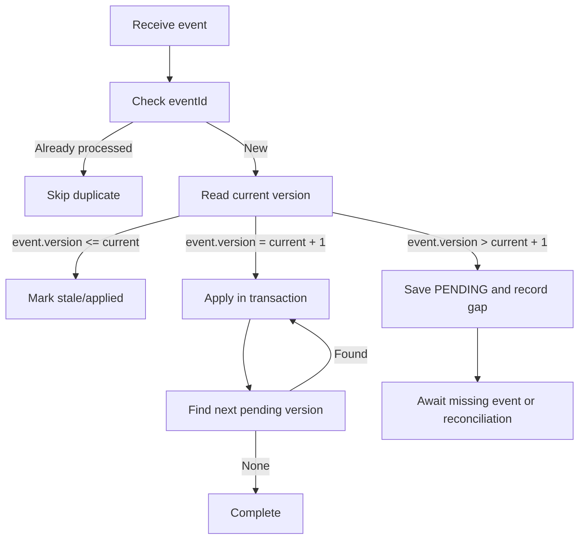

# Out-of-order events in Spring Kafka

In an event-driven system, an **out-of-order event** occurs when a consumer receives or completes processing events for the same business entity in an order different from the order in which they occurred. For example, an order emits `OrderCreated(version=1)` followed by `PaymentCaptured(version=2)`, yet the consumer applies version 2 before version 1.

The issue is not limited to record order inside Kafka. A consumer may read records in the right order yet process them asynchronously so completion order inverts. Retry topics, dead-letter topics (DLT), multiple partitions, multiple producers, or database updates can also produce similar states.

Within **Spring Kafka Reliability Operations**, three questions must be distinguished:

1. In what order did Kafka store the records?
2. In what order did the consumer receive and finish processing them?
3. Does that order preserve the aggregate's business invariants?

Kafka supports ordering within a single partition. The application must design keys, versions, idempotent processing, and recovery mechanisms to ensure correctness at the business level.

## 1. Identifying out-of-order events

Suppose an order aggregate emits a sequence of events:

| Aggregate version | Event | Meaning |
|---:|---|---|
| 1 | `OrderCreated` | Order is created |
| 2 | `PaymentAuthorized` | Payment is confirmed |
| 3 | `OrderConfirmed` | Order is confirmed |
| 4 | `OrderShipped` | Order is handed to carrier |

The valid business order is 1 → 2 → 3 → 4. If the consumer applies version 3 while current state is still at version 1, it may confirm the order before knowing the payment outcome. If the consumer applies version 2 twice, it may record a duplicate payment. These two scenarios are related yet distinct:

- **Out-of-order:** a newer event is applied before an older event.
- **Duplicate:** the same event is delivered or processed multiple times.
- **Late/stale event:** an older event arrives after state has already advanced to a newer version.

A reliable system must handle all three. Idempotency solves repetition; version or sequence numbers solve misordering; business policy decides whether old events can be ignored or missing events must be awaited.

### Kafka order and business order

Kafka assigns monotonically increasing offsets **within each partition**. Consumers read a partition's records in offset order. There is no global offset order across partitions.

Example:

```text
Topic: orders.events

Partition 0: offset 10 -> Order A, version 1
             offset 11 -> Order A, version 2
             offset 12 -> Order B, version 1

Partition 1: offset  7 -> Order C, version 1
             offset  8 -> Order A, version 3
```

Here, `Order A` can be split across two partitions. Kafka cannot guarantee versions 1, 2, and 3 of Order A are observed in the same sequence. When ordering is required for an aggregate, all events for that aggregate must go to the same partition and producers must emit them in the intended order.

Even when records sit in the same partition, the application can still break ordering after reading them. For instance, the listener receives version 1 before version 2, yet dispatches both tasks to a thread pool; version 2's task finishes before version 1's. Kafka preserved storage order, while the application lost completion order.

## 2. Common causes

### 2.1. Same aggregate sent to multiple partitions

If the producer does not use aggregate ID as the message key, Kafka may distribute events for the same order across multiple partitions. Consumers process those partitions independently.

For aggregate-scoped event topics, pick a stable key such as `orderId`, `accountId`, or `shipmentId`. With the default partitioner, identical keys normally map to the same partition under unchanged topic partition configuration.

However, a key only establishes order within a partition. It does not reorder events if multiple producers emit out of order, and increasing partition count can change which partition a key maps to on future sends. When changing partition counts on topics with strict ordering needs, plan a migration and test active keys.

### 2.2. Producers emitting events concurrently

Multiple threads or instances can emit events for one aggregate simultaneously. If two independent threads create versions 10 and 11, the version 11 record may be sent before version 10. The broker merely records the arrival order to the partition; it does not know the intended business sequence.

The solution is establishing order at the source:

- Only one authority issues versions for an aggregate.
- Issue sequence/version in the same transaction that updates the aggregate.
- Serialize publishing per aggregate key if an aggregate can be emitted from multiple threads.
- Use a transactional outbox to write business changes and publish records in the same database transaction; the relay must preserve per-aggregate order.

Do not use machine timestamps as the sole ordering key. Clocks across machines can drift, and two events can share the same timestamp. Timestamps are useful for time observation, while authoritative sequence/version numbers are the reliable basis for aggregate ordering.

### 2.3. Retries and error handling

Retries can cause an older event to complete after newer events.

With **blocking retry**, the consumer pauses progress on the current partition to retry the failed record. This keeps later records in the partition waiting behind it, making it better suited when order is mandatory. In exchange, a long-failing record can raise lag across the entire partition.

With **non-blocking retry**, such as Spring Kafka's `@RetryableTopic`, the failed record moves to a retry topic and subsequent records on the main topic continue processing. When the failed record returns after a delay, newer records may already have been applied. This is intentional behavior of the retry-topic model and can invert ordering.

DLTs also require a clear policy. Routing a failed record to a DLT and advancing past it means the main stream skipped a link. If later events depend on the skipped event, the consumer must detect the version gap and wait, recover, or request reconciliation. A DLT preserves failure information; the DLT itself does not restore business order.

### 2.4. Asynchronous consumer processing

A listener may read records sequentially yet offload work to an executor, reactive pipeline, or non-awaited callback. When multiple tasks run concurrently, completion time no longer follows offset order.

Order-unsafe example:

```java
@KafkaListener(topics = "orders.events")
public void listen(OrderEvent event) {
    executor.submit(() -> orderService.apply(event));
}
```

The listener returns immediately after submitting the task. The container can proceed to the next record and commit offsets before the earlier task finishes. A process failure can then lose offset-acknowledged work, while tasks can finish out of order.

When order matters, process synchronously inside the listener or use a per-key serialization mechanism and acknowledge records only after the corresponding work finishes safely. A shared executor does not automatically guarantee FIFO order per aggregate.

### 2.5. Rebalances and multiple consumers

Within a consumer group, a partition is assigned to only one consumer member at a time. Increasing `@KafkaListener` `concurrency` typically creates multiple consumers to process distinct partitions in parallel; it never splits a single partition across multiple consumers in the same group simultaneously.

Nonetheless, rebalances, unfinished async tasks, and improper offset commits can still cause duplicates or alter completion order at the application layer. Consumers must tolerate reprocessing records and protect state updates with idempotency/versioning.

## 3. Preserving order on the producer side

### 3.1. Use aggregate ID as the key

Structured event example:

```java
public record OrderEvent(
        String eventId,
        String orderId,
        long version,
        String eventType,
        Instant occurredAt
) {
}
```

Send `orderId` as the key:

```java
@Service
public class OrderEventPublisher {

    private final KafkaTemplate<String, OrderEvent> kafkaTemplate;

    public OrderEventPublisher(
            KafkaTemplate<String, OrderEvent> kafkaTemplate) {
        this.kafkaTemplate = kafkaTemplate;
    }

    public CompletableFuture<SendResult<String, OrderEvent>> publish(
            OrderEvent event) {
        return kafkaTemplate.send(
                "orders.events",
                event.orderId(),
                event
        );
    }
}
```

Events for the same order are sent with the same key. With the default partitioner, they land in the same partition as long as partition configuration does not change in a way that remaps keys.

Do not pick a shared constant key like `"orders"` for all orders if you want parallel processing. A shared key funnels all events into one partition and creates a bottleneck. The key should reflect the unit requiring ordering.

### 3.2. Enable producer idempotence

Example Spring Boot configuration with Spring Kafka 3.x:

```yaml
spring:
  kafka:
    producer:
      acks: all
      properties:
        enable.idempotence: true
        max.in.flight.requests.per.connection: 5
```

Producer idempotence lets Kafka eliminate duplicate records caused by producer retries within the producer idempotence mechanism. `acks=all` requires acknowledgment from participating ISR replicas per broker configuration. These settings improve send reliability, yet do **not** issue business versions, serialize independent producers, or guarantee consumers apply events in order.

Modern Kafka enables idempotence by default in many configurations when no conflicting properties are set. Declaring it explicitly makes operational intent readable and auditable. Verify your Kafka client version and effective runtime settings when changing related properties.

### 3.3. Issue versions at the authoritative source

Each aggregate should have a monotonically increasing version. Versions must be issued alongside aggregate state transitions, typically in the same database transaction.

Example:

| Operation | Previous version | New version | Emitted event |
|---|---:|---:|---|
| Create order | 0 | 1 | `OrderCreated(1)` |
| Authorize payment | 1 | 2 | `PaymentAuthorized(2)` |
| Confirm order | 2 | 3 | `OrderConfirmed(3)` |

If two transactions update the same aggregate concurrently, optimistic locking or appropriate locking is needed to avoid issuing duplicate versions. A JPA `@Version` field helps detect write conflicts, though the application must still design consistent event creation and publishing.

### 3.4. Use transactional outbox when updating DB and publishing to Kafka

A common bug is updating the database successfully yet failing to send to Kafka, or sending to Kafka successfully and then rolling back the database transaction. Two systems do not form one atomic transaction merely because code calls both a repository and `KafkaTemplate`.

Transactional outbox closes this gap by writing business state and an outbox row in the same database transaction. A relay reads the outbox and publishes to Kafka. The relay must preserve per-aggregate order—for example, fetching rows by `aggregate_id` and `aggregate_version` and publishing the next version only after the prior version is acknowledged.

Outbox does not automatically guarantee order if multiple relays pick up rows for the same aggregate without appropriate locking or claim mechanisms. Design work partitioning, per-aggregate locking, or corresponding serialization.

## 4. Protecting order on the consumer side

Consumer design should rely on versions and event IDs rather than assuming every record always arrives in order.

### 4.1. Distinguish event ID and aggregate version

An event typically needs at minimum:

| Field | Purpose |
|---|---|
| `eventId` | Uniquely identifies a single event emission; used to prevent duplicate processing |
| `aggregateId` | Identifies the entity requiring ordering |
| `version` | Identifies the event's position in the aggregate's change sequence |
| `eventType` | Identifies the change type |
| `occurredAt` | Business occurrence timestamp, useful for auditing and observability |

`eventId` and `version` do not replace each other. A resent event keeps the same `eventId`; two consecutive valid events have two different `eventId`s and different versions.

### 4.2. Version-based processing rules

Suppose the aggregate's current state is at version 7. Upon receiving an event:

- If event version `<= 7`, the event is stale or already applied. It can be skipped after confirming it is duplicate/stale per policy.
- If event version `= 8`, this is the next event; it can be applied.
- If event version `> 8`, at least one prior event is missing. Do not apply immediately if the current event is a delta depending on prior state.

For example, order state at version 7 receives version 9. The consumer does not yet know whether version 8 was `PaymentAuthorized`, `PaymentCancelled`, or another transition. Applying version 9 early could produce invalid state. The consumer should buffer the event and await version 8, or request recovery from the authoritative source.

Not every event requires blocking when versions arrive out of order. If an event is a self-contained full snapshot where a newer version completely replaces older snapshots, you can apply the highest-version snapshot and ignore older snapshots. That rule is valid only when the event contract guarantees snapshots represent full state; never apply it arbitrarily to delta events like crediting money, decrementing inventory, or state transitions.

### 4.3. Combining inbox/idempotency with state updates

An inbox table can store received or applied event IDs. Place a unique constraint on `event_id` so two deliveries of the same event do not trigger two executions. Update inbox and aggregate state in the same database transaction.

Conceptual processing flow:

```java
@Transactional
public ApplyResult apply(OrderEvent event) {
    if (inboxRepository.existsByEventId(event.eventId())) {
        return ApplyResult.DUPLICATE;
    }

    OrderState state = orderRepository.findByIdForUpdate(event.orderId())
            .orElseGet(() -> OrderState.empty(event.orderId()));

    if (event.version() <= state.version()) {
        inboxRepository.save(InboxEntry.applied(event.eventId()));
        return ApplyResult.STALE;
    }

    if (event.version() > state.version() + 1) {
        throw new MissingPreviousEventException(
                event.orderId(),
                state.version() + 1,
                event.version()
        );
    }

    state.apply(event);
    orderRepository.save(state);
    inboxRepository.save(InboxEntry.applied(event.eventId()));

    return ApplyResult.APPLIED;
}
```

This illustrates business rules; repositories, state types, and error handling must be implemented per your real application. `findByIdForUpdate` represents row locking or an equivalent synchronization mechanism so two consumer threads cannot concurrently apply updates to the same aggregate. A unique constraint is still necessary because checking `exists` alone is vulnerable to race conditions.

If the database transaction commits successfully yet the consumer dies before committing the Kafka offset, Kafka may redeliver the event. The inbox recognizes the processed `eventId` and prevents repeated effects. This is why idempotency remains necessary even when producer idempotence is enabled or consumers use Kafka transactions.

Do not mark an event applied before business state is successfully persisted. If early-arriving events are stored in a staging area, clearly distinguish `RECEIVED/PENDING` from `APPLIED`; a waiting event must not be treated as business-complete.

### 4.4. Choosing how to handle missing versions

Three common approaches:

**Wait and retry with limits.** The consumer throws an exception when a version is missing so the record retries. This is simple and fits low-latency streams, though blocking retries can hold up a partition and increase lag. Bound retry counts and wait durations, and alert when gaps remain unfilled.

**Store in a pending table and process once contiguous.** The consumer saves the event to the database with a suitable unique key, commits the save, and acknowledges the Kafka record. A worker or subsequent transaction checks for the next contiguous version and applies sequentially. When version 8 arrives, the system applies version 8 and drains pending versions 9 and 10 if present. This avoids blocking the partition for one delayed event, yet requires pending recovery logic, concurrency protection, and stuck-event monitoring.

**Reconcile or fetch state from the source.** If an event was lost, routed to a DLT, or cannot recover within SLA, the consumer can request replay from the event store, read the latest snapshot, or run reconciliation. Skip a gap only when business rules permit and an explicit decision handles the missing state.

Pending flow example:



When using a pending table, saving the event and checking versions must be appropriately atomic. Prevent two workers from picking up the same pending event simultaneously. Use row locks, leased claims, or per-aggregate worker partitioning. If pending events are stored in the database, a recovery job must scan and resume pending events after restarts.

## 5. Choosing retries and listener configuration in Spring Kafka

### 5.1. Consumer processing sequentially in the listener

Synchronous listener example:

```java
@Component
public class OrderEventListener {

    private final OrderEventService orderEventService;

    public OrderEventListener(OrderEventService orderEventService) {
        this.orderEventService = orderEventService;
    }

    @KafkaListener(
            topics = "orders.events",
            groupId = "orders-projection",
            concurrency = "3"
    )
    public void listen(OrderEvent event) {
        orderEventService.apply(event);
    }
}
```

Each consumer processes records from its assigned partitions in poll order. `concurrency = "3"` allows up to three consumers running in parallel inside the listener container (depending on partition count and assignment). This works well when a topic has multiple independent partitions. If an aggregate always uses the same key and partition, its events stay in the same partition stream.

A synchronous listener preserves order only when processing completes before the listener moves to the next record. If `apply` merely spawns a background task and returns, completion order can still invert.

### 5.2. Disable auto-commit and pick the right acknowledgment point

Illustrative configuration:

```yaml
spring:
  kafka:
    consumer:
      enable-auto-commit: false
    listener:
      ack-mode: record
```

With a record listener, `AckMode.RECORD` commits offsets after the listener successfully processes a record per container mechanics. Inspect your transaction manager, error handler, and actual app configuration because commit behavior can vary by listener model.

Committing an offset only records the consumer group's read progress. It does not automatically make database changes and Kafka into an atomic transaction. When a listener updates a database, use inbox/idempotency to handle crashes between database commit and Kafka offset commit.

If the listener uses a Kafka transaction to read and write Kafka, Spring Kafka can combine sending outputs and offsets into a single Kafka transaction. This supports exactly-once processing within Kafka read-process-write scope. It does not automatically cover side effects in external databases or HTTP services.

### 5.3. Blocking retries with DefaultErrorHandler

When subsequent records in a partition must wait on the current record, use blocking retries. Spring Kafka configuration example:

```java
@Bean
DefaultErrorHandler kafkaErrorHandler(
        KafkaTemplate<Object, Object> template) {

    DeadLetterPublishingRecoverer recoverer =
            new DeadLetterPublishingRecoverer(template);

    return new DefaultErrorHandler(
            recoverer,
            new FixedBackOff(1_000L, 2L)
    );
}
```

This example retries with a one-second interval for a finite number of attempts, then routes unrecoverable records to a DLT via the recoverer. Retry counts, retryable exception types, DLT destination, and post-DLT handling must follow business rules. Once a record moves to the DLT and the partition resumes, the consumer must still detect version gaps if later records depend on the failed record.

Blocking retries fit when ordering is critical and failures are likely transient. Never retry a permanent data error infinitely because it can stall the entire partition.

### 5.4. Non-blocking retries with @RetryableTopic

Example:

```java
@RetryableTopic(
        attempts = "4",
        backoff = @Backoff(delay = 1_000, multiplier = 2.0),
        dltTopicSuffix = ".dlt"
)
@KafkaListener(
        topics = "orders.events",
        groupId = "orders-projection"
)
public void listen(OrderEvent event) {
    orderEventService.apply(event);
}

@DltHandler
public void handleDlt(OrderEvent event) {
    dltService.recordFailure(event);
}
```

`@RetryableTopic` creates retry topics so failed records are retried after delays. This is helpful to avoid blocking the main partition while waiting to retry. In return, later records can be processed ahead of the retrying record. For aggregates needing strict order, combine this with version/pending handling and reconciliation, or choose blocking retries if appropriate.

Retry topic names, attempt counts, backoff, retryable exceptions, and DLT handlers must align with topic configs and your Spring Kafka version. The example above illustrates common usage; it does not replace checking APIs for your exact project version.

### 5.5. Watch out when using batch listeners

A batch listener receives multiple records in a single call. If a batch spans multiple partitions, or code processes batch items in parallel, completion order may no longer match offset order. When per-aggregate ordering is needed, group and serialize by key/version, and handle commits and errors at record granularity per listener container semantics.

## 6. Choosing a strategy by event type

No single out-of-order policy fits every event. Determine whether events carry deltas or snapshots, and whether intermediate versions may be skipped.

| Event type | Example | When receiving a newer version with missing prior versions |
|---|---|---|
| State-dependent delta | `BalanceDebited`, `InventoryReserved` | Wait, buffer pending, or recover missing events; never apply blindly |
| State transition | `OrderPaid`, `OrderCancelled` | Validate state machine and version; allow only valid transitions |
| Full snapshot | `CustomerProfileSnapshot` | May apply latest snapshot if contract confirms it completely replaces older snapshots |
| Independent notification | `EmailRequested` | May process independently if no business dependency exists; still needs idempotency |

Account balance example:

- Version 10: credit 100.
- Version 11: debit 30.

If version 11 applies first, intermediate balance is wrong; if the consumer skips version 10 as stale, the final balance is also wrong. Because these are deltas, preserve the sequence or rebuild state from the authoritative source.

Conversely, if each event is a full balance snapshot at versions 10 and 11, snapshot version 11 can supersede version 10. That holds only when the snapshot contains all required state and no per-event side effect must run.

## 7. Testing out-of-order scenarios

Testing should do more than verify the listener receives messages. It must verify final state and side effects stay accurate across duplicates, gaps, retries, and crashes.

A helpful test suite:

1. Send version 1 then version 2; verify both apply in order.
2. Send version 2 before version 1; verify version 2 is held pending or retried per policy.
3. Send the same `eventId` twice; verify the side effect happens once.
4. Send version 2 twice with different `eventId`s; verify version checks still block reapplying an already-passed change.
5. Make the listener fail transiently on version 1; verify retry behavior does not let version 2 break invariants.
6. Have the listener commit the database then simulate a failure before offset commit; verify redelivery is caught by the inbox.
7. Stop the consumer while pending events exist and restart; verify recovery resumes processing.
8. Test multiple partitions and multiple consumers; verify all events for the same aggregate share key/partition per design.
9. Test DLT; verify gap-handling procedures when an event cannot recover.

Use Embedded Kafka or Kafka Testcontainers for integration tests with a real broker. For version and idempotency checks, include unit tests for service/domain logic and integration tests for database transactions, unique constraints, listener containers, and retry configurations.

## 8. Observability and operations

Out-of-order events may not crash the consumer. They often manifest as anomalous business state or long-lived pending events. Monitoring consumer lag alone is therefore insufficient.

Emit structured logs with `eventId`, `aggregateId`, `version`, `partition`, `offset`, `consumerGroup`, `retryAttempt`, and processing outcome. Avoid logging full payloads if payloads contain sensitive data.

Useful metrics:

- Count of events detected as stale or duplicate.
- Count of version gaps detected.
- Count of pending events and age of oldest pending event.
- Retry counts, DLT record counts, and age of records in DLT.
- Consumer lag per partition and record processing duration.
- Reconciliation success/failure counts.

Set alerts by business severity. A gap lasting a few seconds may be normal latency; a gap exceeding SLA or steadily climbing pending counts can signal lost producer events, jammed retry topics, or out-of-order outbox relays.

When investigating an aggregate, correlate logs by `aggregateId` and sort by `version`. Cross-reference versions with offsets/partitions to distinguish producer-source bugs, partitioning errors, retry effects, and parallel-processing bugs. Never sort solely by timestamp unless clocks across services are tightly synchronized.

## 9. Design checklist

Before shipping an event flow to production, answer these questions:

- Which business unit needs ordering: aggregate, account, order, or another grouping?
- Does the message key accurately represent that unit?
- Which authority issues versions, and do they increment monotonically within a transaction?
- Is the event a delta or a snapshot? Are intermediate versions allowed to be skipped?
- Does the consumer process synchronously, or is there async work behind the listener?
- How are duplicates recognized via `eventId` and which unique constraint enforces it?
- Are version gaps retried, stored pending, or reconciled?
- Can non-blocking retries let later records overtake earlier records?
- When routing a record to a DLT, who decides to recover or skip the gap?
- How are database commits and Kafka offset commits protected if the process dies between them?
- Do metrics and alerts exist for pending/gap/DLT conditions?
- How do partition increases or partitioner changes affect active keys?

## 10. Principles to apply

To preserve correctness and idempotency in Spring Kafka, combine multiple layers of protection:

1. **At the producer:** use aggregate ID as the key, issue versions at the authoritative source, serialize publishes per aggregate where needed, and consider transactional outbox.
2. **At Kafka:** enable producer idempotence and appropriate durability settings; remember ordering is guaranteed only within one partition.
3. **At the consumer:** avoid uncontrolled async processing, use `eventId` to guard against duplicates, and validate aggregate version before applying changes.
4. **At retry/DLT:** choose blocking or non-blocking based on ordering requirements; explicitly design recovery for missing events.
5. **At the database:** write inbox, aggregate state, and pending events transactionally; use locking or optimistic concurrency to prevent invalid concurrent updates.
6. **In operations:** monitor gaps, pending queues, retries, and DLTs to catch anomalies before they become business discrepancies.

Kafka provides record ordering within partitions. Correctness of the business sequence is the responsibility of producer design, consumer design, and recovery mechanisms. When events have stable aggregate keys, clear versions, durable idempotency, and transparent gap-handling policies, the system can tolerate duplicates, retries, rebalances, and late arrivals while maintaining consistent state.


