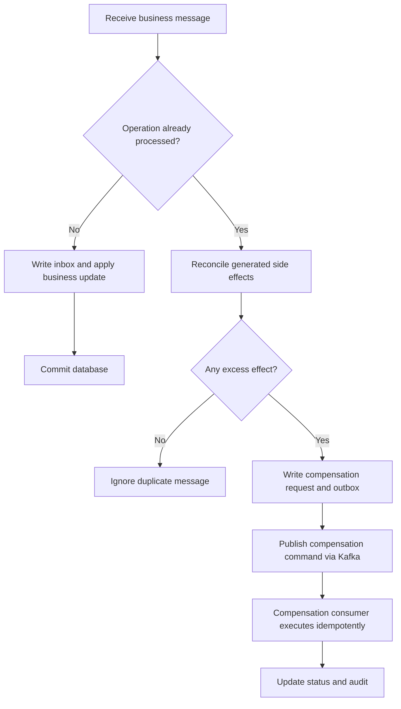

# Compensating actions on repeated processing

In a Spring Kafka system, a message can be delivered to a consumer multiple times. Receiving a message again does not necessarily mean the producer sent a new business operation: the consumer may have performed partial work and hit an error, failed to commit the offset in time, or experienced a rebalance. If every receipt generates a new business effect, the system can double-charge, create duplicate orders, over-reserve inventory, or send duplicate notifications.

Idempotency is the first line of defense: processing the same logical request multiple times still produces a single business outcome. However, cases arise where effects already happened multiple times before the system detected an error, or where effects executed in an external service. In those cases, the system needs a **compensating action** to restore business state to an acceptable condition. Compensating actions must be tracked, safely retryable, and produce no further duplicate effects.

## 1. Why can a consumer process a message multiple times?

Kafka stores messages in partitions and consumer groups track read progress via offsets. An offset shows how far the consumer has read; it does not automatically prove that all external side effects of a message succeeded.

Under the common at-least-once approach, the consumer confirms progress only after successful processing. This prioritizes avoiding lost messages, yet creates a window where repeated processing can occur:

1. Consumer receives message at offset `42`.
2. Consumer writes data or calls an external service.
3. Process stops before offset `42` is committed.
4. Consumer restarts or the partition is assigned to another consumer.
5. Message at offset `42` is redelivered and processing starts again.

Other situations can also cause message redelivery:

- Listener throws an exception after executing partial business effects.
- Consumer loses connection or shuts down mid-processing.
- Consumer group rebalances and partition ownership shifts.
- Retry configurations or message replays pass the same event through the consumer again.
- An upstream application re-emits the same business operation under a new message.

A final distinction is vital: two messages with identical payloads are not necessarily the same business operation. For instance, a customer intentionally placing two separate orders for the same item and amount represents two valid orders. Conversely, a payment request resent due to a timeout may still represent one logical payment.

### Distinguishing protection mechanisms

| Mechanism | Protection scope | Limits to remember |
|---|---|---|
| Producer idempotence | Limits duplicate records from producer retries within Kafka producer protocol | Does not prevent consumers from executing a side effect multiple times |
| Consumer idempotency | Ensures one logical operation creates one effect within controlled scope | Needs a stable identifying key and durable storage of processed state |
| Kafka transactions / exactly-once processing in Kafka | Can coordinate Kafka reads and writes in one Kafka transaction | Does not automatically cover database, payment gateway, email, or HTTP service transactions |
| Compensating action | Corrects business consequences that already occurred | Is a new business operation requiring its own idempotency, retries, and tracking |

Never treat producer `enable.idempotence` or Kafka transactions as proof that every downstream system receives only one effect. Protection scope must be verified for every participating resource.

## 2. Prioritize preventing duplicate effects with idempotency

An idempotent operation yields the same observable result whether executed once or many times. For example, setting an order status to `PAID` can be designed idempotently; adding 100,000 VND to a balance on each message receipt cannot.

### Choosing an idempotency key

The key must represent **a single business intent**, stay stable across retries, and be generated where a new request can be distinguished from a resend. Common choices:

- `eventId`: suitable when all replays preserve the same event ID.
- `businessOperationId` or `commandId`: suitable when the same business action may be repackaged into a new message with a different `eventId`.
- Composite key such as `(consumerName, tenantId, operationId)`: suitable when an ID's uniqueness is scoped per consumer or tenant.

Do not rely solely on a payload hash as the key. Two valid requests can have identical payloads, while the same request might vary in non-semantic metadata fields.

The key must propagate end-to-end across processing steps. When calling a payment service, for example, pass the same idempotency key on every retry of that payment request. Never generate a new UUID on each retry, or the receiving service will treat every retry as a new request.

### Using an inbox table to record processed messages

For effects inside the same database, a common pattern records received message markers in an inbox (or `processed_event`) table. A unique constraint prevents two transactions from recording the same event twice.

PostgreSQL schema example:

```sql
CREATE TABLE consumed_event (
    consumer_name  VARCHAR(100) NOT NULL,
    event_id       VARCHAR(200) NOT NULL,
    processed_at   TIMESTAMPTZ NOT NULL DEFAULT CURRENT_TIMESTAMP,
    PRIMARY KEY (consumer_name, event_id)
);
```

A repository can mark new events with an insert statement that does not error when the key already exists:

```java
public interface ConsumedEventRepository extends Repository<ConsumedEvent, Long> {

    @Modifying
    @Query(value = """
        INSERT INTO consumed_event (consumer_name, event_id)
        VALUES (:consumerName, :eventId)
        ON CONFLICT (consumer_name, event_id) DO NOTHING
        """, nativeQuery = true)
    int insertIfAbsent(
        @Param("consumerName") String consumerName,
        @Param("eventId") String eventId
    );
}
```

The listener performs the marker insert and business update within the same database transaction:

```java
@Component
public class OrderPlacedListener {

    private final ConsumedEventRepository consumedEvents;
    private final AccountService accountService;

    public OrderPlacedListener(
            ConsumedEventRepository consumedEvents,
            AccountService accountService) {
        this.consumedEvents = consumedEvents;
        this.accountService = accountService;
    }

    @KafkaListener(topics = "order-placed", groupId = "billing")
    @Transactional
    public void onMessage(OrderPlaced event) {
        int inserted = consumedEvents.insertIfAbsent("billing", event.eventId());

        if (inserted == 0) {
            // This event was already processed by the billing consumer.
            return;
        }

        // Must participate in the same database transaction as the inbox insert.
        accountService.debit(event.accountId(), event.amount());
    }
}
```

This pattern yields two critical outcomes:

- If the business update fails, the transaction rolls back the inbox row too. Redelivery can try processing from scratch.
- If the database commits successfully yet the application stops before committing the Kafka offset, redelivery hits the existing key and skips the business effect.

The core requirement is that the inbox insert and business update genuinely share **the same database transaction**. If `AccountService` calls a remote service or uses a different transaction manager, this transaction boundary no longer guarantees atomicity for that effect.

The SQL example uses PostgreSQL `ON CONFLICT` syntax. For other databases, use the insert-if-absent mechanism or unique constraint handling suited to your database engine. Do not catch all exceptions and treat them as duplicate messages; only violations of the exact idempotency key count as already processed.

### Coordinating database commits and Kafka offsets

For listeners running database transactions, ensure offsets are acknowledged only after the listener succeeds and the database transaction commits. Then a crash window after database commit before offset commit can trigger redelivery, while the inbox blocks repeated side effects.

If using manual acknowledgment, acknowledge only after the database transaction commits. If using Kafka transactions or synchronizing transaction managers between Kafka and the database, clearly understand commit ordering and each resource's rollback capabilities; configuring two transaction managers does not automatically create an atomic distributed transaction.

The inbox table must retain keys longer than the system's permitted message replay window. Purging markers too early lets replayed old messages trigger side effects again. For financial operations or audit data, retention policies usually follow business and legal requirements rather than ordinary retry durations alone.

## 3. When is a compensating action needed?

Compensation is needed when an unwanted effect has actually occurred and simply skipping the duplicate message cannot undo the consequence. Examples:

| Scenario | Consequence | Handling direction |
|---|---|---|
| Message redelivered, inbox unrecorded due to prior transaction rollback | No committed side effect yet | Reprocess normally |
| Message redelivered after database commit | Database side effect exists once | Inbox blocks subsequent run; usually no compensation needed |
| Consumer called payment gateway twice with two different request keys | Customer charged twice | Identify excess charge and create a refund for that exact charge |
| Consumer sent email twice | Recipient received duplicate email | Log incident; if business permits, send a correction notice, though sent email cannot be recalled |
| Consumer reserved inventory multiple times | Inventory or quota over-reserved | Release excess reservations |
| Multi-service workflow completed several steps then failed | State inconsistent across services | Run workflow/Saga compensation steps or perform forward recovery |

Not every duplicate message requires compensation. If idempotency already prevented the second effect, issuing a refund or release creates a brand-new error. Before compensating, verify which effects occurred, in which systems, and how many succeeded.

## 4. Designing safe compensating actions

### Verify it is the same business operation

First, cross-check `eventId`, `businessOperationId`, aggregate ID, and side-effect records. Messages with the same `eventId` are usually redeliveries of the same event. Two messages with different `eventId`s yet the same `businessOperationId` may be two emissions of the same intent. Conversely, two distinct operation IDs must usually be treated as two separate operations until proven otherwise.

Never infer duplication solely from amount, payload similarity, or close timestamps. Rely on business keys and actual records in the system that executed the side effect.

### Compensate only the excess difference

Compensation must reverse **the excess effect**. If a valid 500,000 VND payment was debited twice, compensation normally refunds the extra 500,000 VND debit—not both debits. If three reservations were created for a request needing one, release the two extra reservations.

Link the compensation to the specific side-effect record, such as `chargeId` or `reservationId`. This prevents accidentally refunding a different valid transaction of the same amount.

### Persist compensation requests durably

Do not call refund or release directly inside a duplicate-handling branch and hope the call succeeds. Persist the compensation request in the database with status and a unique key. A simple data model might include:

| Field | Meaning |
|---|---|
| `compensationId` | Unique ID of the compensating task |
| `compensationKey` | Stable idempotency key of the compensating task |
| `originalOperationId` | Original business operation needing adjustment |
| `affectedEffectId` | Specific side effect to compensate, e.g., excess charge |
| `type` | Compensation type such as `REFUND`, `RELEASE_RESERVATION`, or `CREDIT_BACK` |
| `status` | Current processing state |
| `attemptCount` | Attempt count |
| `createdAt`, `updatedAt` | Creation and update timestamps |
| `lastError` | Latest error for investigation and handling |

States can include `PENDING`, `IN_PROGRESS`, `SUCCEEDED`, `RETRYABLE_FAILED`, and `MANUAL_REVIEW`. All state transitions must be controlled so multiple workers cannot execute the same compensation simultaneously.

### Make the compensating action itself idempotent

A compensating action can also be delivered multiple times. Therefore, it needs its own key that stays stable across all retries. For example, when refunding an excess charge, the key can be `refund:<chargeId>`. Each excess charge gets a dedicated refund key; every retry for that charge reuses that key.

Example writing a refund request to both compensation and outbox tables in the same transaction:

```java
@Service
public class DuplicateChargeCompensator {

    private final CompensationRepository compensations;
    private final OutboxRepository outbox;

    public DuplicateChargeCompensator(
            CompensationRepository compensations,
            OutboxRepository outbox) {
        this.compensations = compensations;
        this.outbox = outbox;
    }

    @Transactional
    public void requestRefund(Charge duplicateCharge) {
        String key = "refund:" + duplicateCharge.id();

        boolean created = compensations.insertIfAbsent(
            key,
            duplicateCharge.operationId(),
            duplicateCharge.id(),
            "REFUND"
        );

        if (!created) {
            return; // Compensation request for this charge has already been created.
        }

        outbox.save(OutboxMessage.refundRequested(
            key,
            duplicateCharge.id(),
            duplicateCharge.amount()
        ));
    }
}
```

`insertIfAbsent` here must rely on a unique constraint on `compensationKey`, not a read-then-insert check, because two consumers can run concurrently. The outbox row is written in the same transaction as the compensation request so you never end up with a `PENDING` status without its outbound command, or an outbound command without its tracked status.

An outbox publisher may emit the same command multiple times if it crashes after publishing before marking the outbox sent. Hence, the compensation consumer and target service must remain idempotent. If the payment provider supports idempotency keys, pass `compensationKey` to the provider. If not, store the external transaction ID, query transaction status before retrying any ambiguous request, and route unverifiable cases to a manual review queue.

### Do not assume every effect is fully reversible

Some effects can be compensated fairly directly:

- A debit can be compensated with a credit or refund.
- A reservation can be compensated with a reservation release.
- A quota increase can be compensated with a quota decrease.

Some effects cannot be undone cleanly:

- A sent email or push notification cannot be recalled.
- Shipped goods require a return workflow.
- A downloaded report may require issuing a corrected version.
- Legal or manual actions may require authorized human intervention.

In these cases, compensation is a new business action aimed at restoring consistency or mitigating impact. Never describe it as a database rollback.

## 5. Organizing a compensation flow with Spring Kafka

A compensation flow can be structured as follows:



In real systems, the `Operation already processed?` branch must combine the inbox with side-effect state. If the inbox says the message was processed yet an external service was called multiple times, merely skipping the current message will not fix the excess effect. Reconciliation must pinpoint which exact side effect needs compensation.

You can use a dedicated topic like `payment-compensation` or `reservation-compensation` to separate compensating commands from the main business stream. Topic naming and partition count should match the data model, business ordering, and system load. If per-aggregate ordering is required, pick an appropriate message key, usually aggregate ID or operation ID.

A consumer processing compensating commands should have these traits:

1. Check `compensationKey` and current status before executing.
2. Transition to `IN_PROGRESS` exclusively, e.g., via conditional update or appropriate locking.
3. Call the target service with the exact same idempotency key on all retries.
4. Record `SUCCEEDED` once the compensation effect is confirmed complete.
5. On transient failures, retry with bounds and backoff; on unknown outcomes or errors needing intervention, transition to a reconciliation-pending state.

Never hold a database transaction open across a long HTTP call. Instead, persist status and command first, call the external service in a retryable step, and update the outcome in a separate transaction. Design specifically for the case where the external service succeeded yet the consumer lost connectivity before receiving the response.

## 6. Retries, Dead Letter Topics, and reconciliation

Retries address transient faults such as brief timeouts or overloaded downstream services. Retries do not automatically undo side effects executed before an exception occurred. If a listener already debited an account before throwing, retrying without an inbox or idempotency key can debit again.

A Dead Letter Topic (DLT) holds messages that fail beyond configured retry policies. The DLT is a place for isolation and investigation; it does not automatically undo prior successful steps. When replaying messages from a DLT, the system must still enforce idempotency and inspect current business state.

For compensating actions, classify errors carefully:

- **Transient errors:** timeouts, rate limits, or network faults eligible for bounded retries with backoff.
- **Data/business errors:** charge already refunded, reservation missing, or amount mismatch; reconcile state before deciding next steps.
- **Unknown outcomes:** request was sent yet client timed out before learning whether the provider executed it. Query by idempotency key or transaction ID before resending.
- **Errors needing intervention:** provider permanently declined, missing reconciliation data, or unresolvable state; transition to `MANUAL_REVIEW` and alert.

A periodic reconciliation process can locate compensation requests stuck too long, reconcile internal state against the provider, safely replay commands, or populate a manual-handling queue. Reconciliation must use the exact same idempotency key as the main flow so it never triggers a second compensation effect.

## 7. Tracking and auditing

A compensating action must answer: which original operation caused the incident, which side effect occurred, why compensation was needed, who or what initiated it, how many attempts ran, and what the final outcome was.

Include these identifying fields in structured logs and traces:

- `eventId` and `businessOperationId` of the original message.
- `aggregateId`, tenant, or relevant business scope.
- Kafka topic, partition, and offset to trace message delivery.
- `compensationId`, `compensationKey`, and external service transaction ID.
- Before/after status, attempt count, and normalized error code.

Useful metrics include blocked duplicate message counts, new compensation request counts, compensation success/failure counts, age of oldest `PENDING` task, `MANUAL_REVIEW` counts, and DLT message counts. Avoid putting payment details or sensitive personal data into logs unless necessary.

## 8. Scenarios to test

| Scenario | Expected outcome |
|---|---|
| Valid event delivered once | Operation executes once and inbox marker is persisted |
| Same `eventId` redelivered | No additional side effect created |
| Same `businessOperationId` arrives with a different `eventId` | Consumer recognizes the same business intent if specified by event contract |
| Database commits yet app stops before offset commit | Redelivery blocked by inbox; no lost operation and no duplicate side effect |
| Two consumers receive same operation concurrently | Unique constraint allows only one consumer to record the new operation |
| Outbox publisher emits compensation command twice | Compensation consumer or target service executes only one compensation |
| Provider refunded yet response timed out | Retry uses same key or queries status; no second refund |
| Two valid operations share identical payload but have different operation IDs | Both are processed |
| Compensating action fails repeatedly | Status and error persisted; alerted or routed to manual handling per policy |

Fault-injection tests should simulate process crashes at critical boundaries: after side effect, after database commit, after command publish, and before persisting completion state. These are the points most likely to expose repeated-processing bugs.

## 9. Design checklist

- [ ] Stable identifier exists for a logical operation, distinguishing retries from new requests.
- [ ] Inbox/dedup record and internal business update commit in the same database transaction.
- [ ] Offset is acknowledged only after durable processing succeeds.
- [ ] External service side effects use stable idempotency keys or have reconciliation for indeterminate outcomes.
- [ ] Compensating actions bind to specific side effects and adjust only the excess portion.
- [ ] Compensation requests have unique keys, durable state, and an audit trail.
- [ ] Outbox/inbox are used when moving commands recoverably between database and Kafka.
- [ ] Compensation consumers have bounded retries, backoff, DLT, or a manual-review queue.
- [ ] Inbox retention lasts long enough for the real-world replay window.
- [ ] Metrics and alerts exist for stuck or failed compensating actions.
- [ ] Crashes, redeliveries, concurrency, and timeouts with unknown outcomes have been tested.

## Conclusion

In Spring Kafka, repeated processing is an expected scenario when consumers can receive messages again after retries, crashes, or rebalances. Idempotency prevents the same operation from generating extra side effects. When excess effects have already happened, a compensating action must target the exact portion needing adjustment, be durably persisted with its own idempotency key, and be tracked until completion or manual escalation. Combining inbox, database transactions, outbox, external-service idempotency keys, and reconciliation lets systems recover cleanly without introducing new errors from compensation itself.
