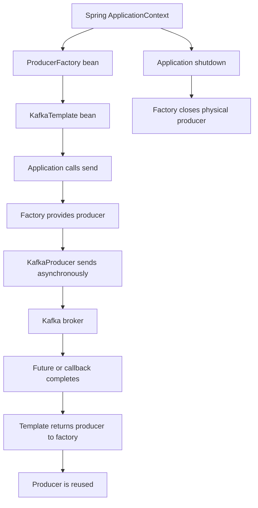
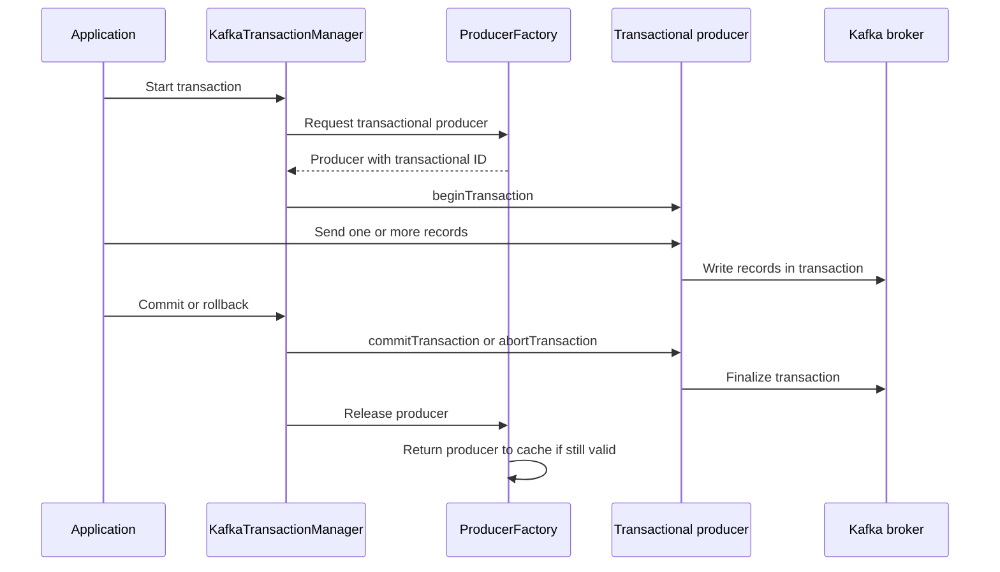

# ProducerFactory and Producer Lifecycle

In Spring Kafka, `ProducerFactory` is the component that creates and manages the Kafka producers an application uses to send messages. `KafkaTemplate` receives a `ProducerFactory` and uses it for send operations. This structure allows the application to reuse producers, centralize serializers and configuration, and control opening, returning, refreshing, and closing Kafka connection resources.

Understanding the producer lifecycle properly is crucial for reliable operations. A Kafka producer creates network connections, a metadata cache, send buffers, and background I/O threads; creating a new producer for every message wastes resources and reduces throughput. Conversely, holding onto a producer or closing it at the wrong time can leak resources, drop pending sends, or cause transactional producers to be fenced.

In a typical Spring Kafka application, Spring should manage a shared `ProducerFactory` and a shared `KafkaTemplate`. `DefaultKafkaProducerFactory` is the standard implementation, providing producer reuse and transaction integration. The sections below describe how the factory creates producers, how the template uses them, and what must be controlled throughout the application lifecycle.

## 1. Role of ProducerFactory in Messaging Architecture

`ProducerFactory<K, V>` is the abstraction that creates `Producer<K, V>`. It decouples creating and managing the Kafka client from business code. `DefaultKafkaProducerFactory` is the implementation based on Kafka client properties; applications can also use another implementation for testing or custom integration purposes.

Each component has a distinct responsibility:

| Component | Responsibility |
|---|---|
| `ProducerFactory` | Creates producers from configuration, manages shared or cached producers, and releases them according to the factory lifecycle. |
| `DefaultKafkaProducerFactory` | Spring Kafka's default factory implementation, supporting shared producers, thread-bound producers, and transactional producers. |
| `KafkaProducer` | Kafka client that performs serialization, fetches metadata, batches records, sends requests, and receives broker acknowledgements. |
| `KafkaTemplate` | Application-level API for sending messages, handling callbacks/futures, and borrowing/returning producers through the factory. |
| `ProducerListener` | Receives send success or failure notifications from `KafkaTemplate` for recording results and observability. |

A factory is not a producer itself. A factory can provide a shared producer or separate producers depending on the mode. `KafkaTemplate` should also not be instantiated per send; register it as a shared bean so configuration and resources are managed consistently.

A typical send flow can be visualized as follows:



Key point to remember: calling `send()` once does not mean creating a new Kafka producer. In default mode, multiple sends and multiple threads can use the same physical producer through the factory's management mechanism.

## 2. Lifecycle from Startup to Shutdown

### Bean Initialization and Lazy Producer Creation

When Spring starts up, the container creates the `ProducerFactory` and `KafkaTemplate` beans according to configuration. With `DefaultKafkaProducerFactory`, the physical producer is typically created lazily: the factory creates the producer when a component first calls `createProducer()`, such as when `KafkaTemplate` sends a message. Thus, successful application startup does not guarantee the broker can accept messages; connectivity or configuration errors may only surface on the first send.

When creating a producer, the Kafka client reads bootstrap servers, serializers, acknowledgements, retries, security, and other properties. The producer initializes metadata and connects to the cluster as needed. If configuration is wrong, brokers are unreachable, or a serializer cannot be initialized, errors can appear either when creating the producer or during sending.

### Providing the Producer and Asynchronous Sending

When the application calls `KafkaTemplate.send()`, the template requests a producer from the factory, constructs a `ProducerRecord`, and invokes the Kafka client's send API. The Kafka producer typically sends asynchronously: messages are placed in a buffer, batched, and transmitted via a background I/O thread. The send outcome is returned through a future/callback when metadata or an exception arrives.

In Spring Kafka 3.x, `KafkaTemplate.send()` returns `CompletableFuture<SendResult<K, V>>`. Older Spring Kafka versions used `ListenableFuture`. Handle the future/callback to observe errors that occur after `send()` returns control; do not merely catch exceptions on the `send()` line and assume all send errors have been handled.

Once the operation completes, `KafkaTemplate` releases the producer back to the factory. For shared or cached producers, this release returns usage control to the factory instead of closing the physical socket and I/O threads after every message.

### Application Shutdown

When the Spring ApplicationContext closes, factory beans are destroyed according to Spring's lifecycle. `DefaultKafkaProducerFactory` closes the producers it manages and releases Kafka client resources. By registering the factory as a bean, applications usually do not need to call `destroy()` manually in business code.

Before shutting down, the system should stop accepting new work, allow pending sends time to complete within the configured shutdown window, and only then close the factory. If the process terminates abruptly, loses network, or is killed before futures complete, the application may not know whether the broker recorded the message. When retrying at the business layer, keep `eventId` stable and design idempotent consumers to handle resends.

## 3. How DefaultKafkaProducerFactory Manages Producers

### Shared Producer for Standard Sending

By default, `DefaultKafkaProducerFactory` uses a single shared producer for non-transactional operations. Kafka `Producer` is thread-safe, so multiple threads can call send concurrently on the same producer. This avoids the overhead of creating multiple Kafka clients, reduces connection counts, and makes effective use of batching.

Do not create `new KafkaProducer<>(...)` for each request or each message. A producer maintains its own buffers, background I/O threads, and metadata; creating them repeatedly increases connections, memory, thread count, and initialization latency. In Spring applications, use a container-injected `KafkaTemplate` to reuse the factory and producer.

When `KafkaTemplate` finishes an operation and calls close on the producer wrapper provided by the factory, the factory manages the release. With a shared producer, closing at the wrapper level does not immediately close the physical producer; the factory retains the producer for subsequent sends. This is why business code must never manually close the internal producer or hold onto a producer across multiple request lifecycles.

### Thread-Bound Producer

`DefaultKafkaProducerFactory` has a `producerPerThread` option. When enabled, the factory provides a producer bound to the calling thread instead of a single shared producer. This mode should only be used when there is a specific technical reason; Kafka producers are inherently thread-safe, so per-thread producers usually increase client count, connections, buffers, and resources without automatically increasing throughput.

A thread-bound producer has its own lifecycle. When using this mode, the application must call `closeThreadBoundProducer()` on the owning thread when that thread terminates or when the producer is no longer needed. Closing the factory does not replace releasing producers bound to individual threads. This is especially important with thread pools: threads can outlive requests, meaning thread-bound producers can continue holding resources.

Do not enable `producerPerThread` merely because an application has many threads. Measure latency, throughput, physical producer count, connection count, and resource usage before choosing this mode. For most standard send workloads, a shared producer is the simpler and more efficient choice.

### Transactional Producers and Caching

When `transactionIdPrefix` is configured, `DefaultKafkaProducerFactory` can create transactional producers. Transactional producers are managed by transactional ID and can be returned to a cache after a transaction finishes instead of creating a new one for each transaction. The factory manages suffixes to generate distinct transactional IDs within the factory scope.

Each transactional producer requires a unique transactional ID in the cluster at any given time. If multiple application instances share the same prefix and assign identical suffixes, they can generate duplicate transactional IDs and fence each other. Therefore, the prefix must distinguish between running instances, for example by incorporating the application name and instance/pod ID.

Transactional caching reduces producer initialization overhead, but cache limits must fit concurrent transaction counts and producer usage patterns. A producer held too long can run into issues if the broker has expired its transactional ID per cluster configuration. In Spring Kafka versions that support `maxAge` on the factory, you can set a max age lower than the broker's `transactional.id.expiration.ms` so the factory refreshes the producer before the broker expires the ID. Check exact properties and behavior for the Spring Kafka version in use.

## 4. Configuring ProducerFactory and KafkaTemplate

### Configuring via Spring Boot

If no custom `ProducerFactory` is declared, Spring Boot can auto-configure the factory and `KafkaTemplate` from `spring.kafka.*` properties. This is a concise approach for applications that do not need custom producer lifecycle control:

```yaml
spring:
  kafka:
    bootstrap-servers: ${KAFKA_BOOTSTRAP_SERVERS}
    producer:
      key-serializer: org.apache.kafka.common.serialization.StringSerializer
      value-serializer: org.springframework.kafka.support.serializer.JsonSerializer
      acks: all
      properties:
        "enable.idempotence": true
        "delivery.timeout.ms": 120000
        "request.timeout.ms": 30000
```

Spring Boot uses these properties to auto-configure the producer factory. The application injects `KafkaTemplate` into services:

```java
@Service
public class OrderEventPublisher {

    private final KafkaTemplate<String, OrderEvent> kafkaTemplate;

    public OrderEventPublisher(
            KafkaTemplate<String, OrderEvent> kafkaTemplate) {
        this.kafkaTemplate = kafkaTemplate;
    }

    public CompletableFuture<SendResult<String, OrderEvent>> publish(
            OrderEvent event) {
        return kafkaTemplate.send("orders.events", event.orderId(), event);
    }
}
```

The example uses Spring Kafka 3.x's future API. For older versions, the return type and callback registration must be adjusted to match the corresponding API. `OrderEvent` is the application's domain type; the serializer must be compatible with the actual payload type.

### Declaring a Custom Factory

When direct control over `DefaultKafkaProducerFactory` is needed, beans can be declared as follows:

```java
@Configuration
public class KafkaProducerConfiguration {

    @Bean
    ProducerFactory<String, OrderEvent> producerFactory(
            @Value("${spring.kafka.bootstrap-servers}") String bootstrapServers) {

        Map<String, Object> properties = new HashMap<>();
        properties.put(
                ProducerConfig.BOOTSTRAP_SERVERS_CONFIG, bootstrapServers);
        properties.put(
                ProducerConfig.KEY_SERIALIZER_CLASS_CONFIG, StringSerializer.class);
        properties.put(
                ProducerConfig.VALUE_SERIALIZER_CLASS_CONFIG, JsonSerializer.class);
        properties.put(ProducerConfig.ACKS_CONFIG, "all");
        properties.put(ProducerConfig.ENABLE_IDEMPOTENCE_CONFIG, true);

        return new DefaultKafkaProducerFactory<>(properties);
    }

    @Bean
    KafkaTemplate<String, OrderEvent> kafkaTemplate(
            ProducerFactory<String, OrderEvent> producerFactory) {
        return new KafkaTemplate<>(producerFactory);
    }
}
```

This is a minimal example demonstrating the relationship between factory and template. Production configurations must also include TLS/SASL, truststore/keystore, appropriate serializers/deserializers, timeouts, retries, client ID, and environment-specific operational properties. When declaring a custom factory, ensure all required properties are placed into the map; do not assume a custom factory automatically inherits every property Spring Boot would apply to the default factory.

When an application declares its own `ProducerFactory` bean, Spring Boot's corresponding auto-configuration may back off based on bean conditions. Avoid accidentally creating two factories with different configurations and injecting the wrong factory into `KafkaTemplate`, the transaction manager, or listener containers.

## 5. How KafkaTemplate Manages Borrowing and Returning Producers

`KafkaTemplate` is the class applications should use in most message-sending scenarios. It performs several important tasks:

- Acquires a producer from `ProducerFactory` when needed for sending.
- Builds a `ProducerRecord` from the supplied topic, key, value, partition, and headers.
- Invokes the Kafka producer and translates the result into a future/callback.
- Releases the producer back to the factory when the operation finishes.
- Supports transactions, callbacks, and Spring Kafka observability hooks.

Because the template manages acquiring and returning producers, business code should not call `close()` on the producer the template is using. Do not retain a reference to the producer for use after the callback completes. If low-level Kafka client operations are required, consider `KafkaTemplate.execute(...)`; the template's callback supplies a producer scoped to the operation and the template manages releasing it.

Example accessing a producer-level API without manually managing its lifecycle:

```java
Integer partitionCount = kafkaTemplate.execute(producer ->
        producer.partitionsFor("orders.events").size());
```

This operation uses a producer provided by the template and released by the template after the callback. Do not call `producer.close()` inside the callback as it can disrupt the factory-managed producer or corrupt the caching mechanism.

### Handling Send Results

Asynchronous sending keeps business threads from waiting on the broker for every message. However, the application must still observe both success and failure outcomes. Attach callbacks/futures to log, update metrics, or route errors to an appropriate handling mechanism.

```java
CompletableFuture<SendResult<String, OrderEvent>> future =
        kafkaTemplate.send("orders.events", event.orderId(), event);

future.whenComplete((result, exception) -> {
    if (exception != null) {
        // Record send failure along with eventId and correlationId.
        publishMetrics.recordFailure(event.eventId(), exception);
        return;
    }

    RecordMetadata metadata = result.getRecordMetadata();
    publishMetrics.recordSuccess(
            event.eventId(), metadata.topic(), metadata.partition(), metadata.offset());
});
```

This snippet illustrates Spring Kafka 3.x. In real systems, callbacks should be brief and avoid long blocking work because callbacks run on the send-completion thread. If calling slow services or running complex logic is required, offload work to a bounded executor with a backpressure policy. Never ignore exceptions in the future if the application must guarantee publish failures are detected.

Producer acknowledgement indicates the write result according to the `acks` configuration; it does not prove a consumer has completed business processing. Returned metadata can be used to trace topic, partition, and offset, and should be combined with `eventId` to correlate across the system.

## 6. Producer Lifecycle When Using Kafka Transactions

Transactional producers have a stricter lifecycle than standard producers. The factory must be configured with a transaction ID prefix to create producers capable of opening transactions. In Spring Kafka, `KafkaTransactionManager` or a listener container can manage transactions and coordinate with `KafkaTemplate`.

Example configuring the prefix via Spring Boot:

```yaml
spring:
  kafka:
    producer:
      transaction-id-prefix: ${INSTANCE_ID:local}-orders-
```

`INSTANCE_ID` must differ across active instances. The default value `local` is only suitable when you are certain no multiple instances share the transactional ID in the same cluster. For multi-replica deployments, supply a unique instance ID via the deployment platform.

A transaction manager can be declared once the factory is configured for transactions:

```java
@Bean
KafkaTransactionManager<String, OrderEvent> kafkaTransactionManager(
        ProducerFactory<String, OrderEvent> producerFactory) {
    return new KafkaTransactionManager<>(producerFactory);
}
```

High-level lifecycle of a transaction:



After commit or abort, the producer can be returned to the cache for reuse. The same transactional ID must not be used concurrently by multiple active producers. If the broker sees a newly initialized producer with a transactional ID already used by another producer, the older producer may be fenced. Fencing is a protection mechanism for transaction correctness; treat it as a signal of identity conflict or producer lifecycle mismatch rather than retrying blindly.

Kafka transactions can guarantee atomicity across Kafka operations included in the transaction, such as writing multiple records and committing offsets in the same transaction. They do not automatically create distributed transactions spanning databases or HTTP APIs. When coordinating a database and Kafka, consider transactional outbox or an appropriate idempotent design.

## 7. Configuration Changes and Refreshing Producers

Physical producers read configuration when created. If the application modifies the factory's configuration map, existing producers do not automatically pick up the new values. This commonly happens when rotating certificates, changing credentials, updating bootstrap servers, or changing serializers.

`DefaultKafkaProducerFactory` provides operations to update configuration and reset producers. `updateConfigs(...)` can update settings used for subsequently created producers; `removeConfig(...)` removes a property from factory configuration. `reset()` closes producers managed by the factory and clears the cache so the next request creates a new producer using the current configuration.

Before resetting, coordinate with active send flows. Resetting while many sends are pending can interrupt operations or trigger producer-closed errors. In production systems, follow a staged rotation procedure: update secrets/config, pause or throttle new work if needed, wait for critical sends to finish, reset the factory, verify the new producer, and monitor send outcomes.

If using `producerPerThread`, handle thread-bound producers separately using the lifecycle API of your version; do not assume resetting the shared producer cache releases all thread-bound producers. Call `closeThreadBoundProducer()` from the owning thread when its lifecycle needs to end.

Do not use reset as a cure-all for Kafka errors. If brokers are down, credentials are invalid, or DNS fails to resolve, repeatedly creating new producers only increases system pressure. First determine whether the error stems from configuration, network, broker, serializer, or producer lifecycle.

## 8. Safe Shutdown and Resource Release

A Kafka producer holds resources such as sockets, buffers, metadata, and I/O threads. If a producer is not closed properly, the application can leak threads, connections, and memory; if closed too early, messages still in the buffer may not finish sending.

Operational principles:

- Let Spring manage `ProducerFactory` as a singleton bean so the factory's lifecycle callbacks run when the ApplicationContext closes.
- Use a shared `KafkaTemplate` rather than creating new templates/factories per request.
- Do not call `destroy()` or close physical producers from business code while the application is still running.
- Track pending futures and allow them to complete within the configured shutdown window.
- For producers obtained directly from `ProducerFactory`, always return the producer to the factory via `close()` in a `finally` block after operations finish.
- With `producerPerThread`, release the thread-bound producer on the corresponding thread.
- When using transactions, complete commit/abort before the producer is returned to the cache or the factory is closed.

If code genuinely needs to acquire a producer directly, the minimal structure must guarantee returning the producer across all branches:

```java
Producer<String, OrderEvent> producer = producerFactory.createProducer();
try {
    producer.send(new ProducerRecord<>(
            "orders.events", event.orderId(), event));
} finally {
    producer.close();
}
```

In this example, calling `close()` on a producer supplied by `DefaultKafkaProducerFactory` executes the factory's release rules; depending on the producer type, it may return the producer to the cache instead of closing it physically. This snippet only illustrates resource ownership. For normal business code, `KafkaTemplate` remains the better choice because it manages producers and asynchronous outcomes consistently.

The shutdown timeout should align with `delivery.timeout.ms`, application wait times, and the service stop procedure. You cannot guarantee every message is sent successfully merely by increasing timeouts; inspect future states, broker acknowledgements, and post-restart retry behavior.

## 9. Monitoring Producer Health and Lifecycle

Operating ProducerFactory requires observing both the number of producers created and send outcomes. Useful signals include:

| Scope | Signal | Meaning |
|---|---|---|
| Producer creation | Producer creation count, initialization errors, initialization time | Detects the factory continuously recreating producers or unready configuration/brokers. |
| Cache and lifecycle | Active producers, returned producers, closed producers, transactional cache | Detects producer leaks, misconfigured caches, or unreleased producers. |
| Message sending | Send rate, request latency, retries, errors, timeouts, and record size | Detects slow producers, overloaded brokers, or serialization errors. |
| Broker acknowledgement | Error rate by exception type, returned metadata, and acknowledgement time | Distinguishes send errors from consumers not yet processing messages. |
| Client resources | Socket count, I/O threads, buffer memory, network throughput | Detects creating too many producers or resource exhaustion. |
| Transactions | Transaction commits/aborts, fencing, timeouts, and producer age | Detects transactional ID conflicts or expired transactional producers. |

`ProducerFactory` supports listeners to observe when producers are created or removed; specific versions and configurations may also provide post-processors to wrap producers. `KafkaTemplate` has `ProducerListener` to receive send results. The Kafka client also exposes metrics via the metrics/JMX mechanism integrated into the monitoring platform.

Logs should include `eventId`, topic, business key if appropriate, send time, outcome, partition, offset, and exception class. Avoid logging full payloads if they contain sensitive data. For shared producers, do not place personal identifiers or secrets in producer names or transactional IDs.

Signs that warrant investigation:

- Producers created continuously: check whether code creates factories/templates per request, performs unnecessary periodic resets, or fails to release producers.
- Producer count grows with thread count: check `producerPerThread` and `closeThreadBoundProducer()` calls.
- Increasing send timeouts: check broker request latency, network, metadata, buffer pressure, and `delivery.timeout.ms`.
- Transactional producer fenced: check prefixes, instance IDs, overlapping rollouts, and number of producers sharing a transactional ID.
- Slow application shutdown: check incomplete sends, unfinished transactions, and producer close duration.

## 10. Scenario-Based Runbook

### Application Starts Up but the First Send Fails

1. Inspect the full exception from `KafkaTemplate.send()` and the future/callback.
2. Check bootstrap servers, DNS, network, TLS/SASL, and ACLs.
3. Check serializers, payload types, schemas, and producer configuration.
4. Confirm brokers are available and the topic exists per system policy.
5. Distinguish producer-creation errors from errors occurring after the producer sends a request.

### Producer or Thread Count Grows Abnormally

1. Check whether the application creates `ProducerFactory` or `KafkaTemplate` inside a request/service method.
2. Check whether `producerPerThread` is enabled and whether thread pools are growing.
3. If acquiring producers directly from the factory, verify every branch calls `close()`.
4. If using per-thread producers, call `closeThreadBoundProducer()` from the owning thread at lifecycle end.
5. Monitor socket count, I/O threads, and producer count after fixing.

### Message Send Times Out or Callback Reports an Error

1. Record `eventId`, topic, key, timestamp, and exception.
2. Inspect producer metrics, request latency, retries, and buffer memory.
3. Inspect broker health, ISR, quotas, ACLs, and network.
4. Determine whether the broker might have recorded the message before the timeout; do not resend with a new event ID.
5. Use consumer idempotency to safely handle cases where the producer resends the same event.

### Transactional Producer Gets Fenced

1. Read the fencing exception and identify the involved transactional ID.
2. Compare `transactionIdPrefix` across instances and verify instance IDs are unique.
3. Check whether two processes are running with the same transactional ID due to a rollout or deployment configuration.
4. Restore unique identifiers, stop the old producer according to procedure, and let the factory create a new producer.
5. Monitor transaction commits/aborts and fencing errors after restart.

### Rotating Kafka Certificates or Credentials

1. Verify the new secret has been provisioned and application config can read it.
2. Determine whether existing physical producers need to be recreated to pick up the new configuration.
3. Choose a timing for updating/resetting the factory so pending sends are handled safely.
4. Reset producers using the appropriate API for your Spring Kafka version; handle thread-bound producers separately if present.
5. Send a test message, verify broker acknowledgement, and monitor authentication errors.

### Application Shuts Down with Sends Still in Flight

1. Stop accepting new work or halt the event-generating flow according to application procedure.
2. Wait for critical futures to complete within the allowed shutdown time.
3. Conclude open transactions with commit or abort according to business logic.
4. Let Spring close the factory and managed producers.
5. When the process restarts, reconcile event IDs and business state to safely handle messages with uncertain send outcomes.

## 11. ProducerFactory Lifecycle Control Table

| Stage | Verification point | Operational evidence |
|---|---|---|
| Initialization | Factory is a managed bean; bootstrap, serializer, security, and acks settings are complete | Bean configuration, effective producer properties, and startup logs |
| Producer creation | Producers created on demand; not recreated per message | Producer count, creation count, and initialization duration |
| Sending | Template uses factory; futures/callbacks are handled | Send results, latency, retries, exceptions, and metadata |
| Reuse | Producers returned to factory after operations; per-thread mode has cleanup | Producer/cache metrics, thread count, and socket count |
| Transactions | Prefix unique per instance; transaction completes before producer returns to cache | Transaction ID, commits/aborts, fencing, and timeouts |
| Reconfiguration | Old producers refreshed in a controlled manner after config changes | Config update timestamp, reset event, and test send results |
| Shutdown | Pending sends/transactions handled; factory releases resources | Shutdown logs, pending futures, producer closes, and thread count |

ProducerFactory is the central control point of the producer lifecycle in Spring Kafka. When the factory is managed as a shared bean, `KafkaTemplate` handles borrowing and returning producers, transactions have distinct identifiers, and shutdown is executed in an orderly manner, the application avoids redundant client creation, connection leaks, and hard-to-trace lifecycle bugs. Metrics covering producers, send outcomes, and transactions enable operations teams to pinpoint the exact failing stage and recover the publish pipeline in a controlled way.
