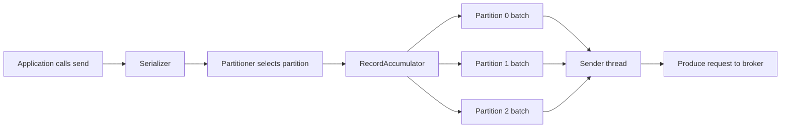
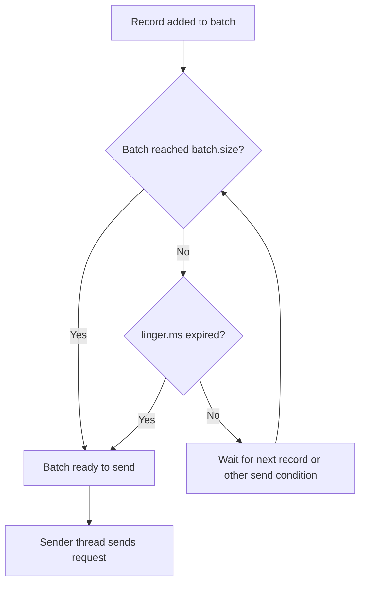

# `linger.ms` and `batch.size`

In a Kafka producer, `linger.ms` and `batch.size` work together to group multiple records into a batch before sending a request to the broker. `batch.size` specifies the target capacity of a batch in bytes; `linger.ms` specifies how long the producer can wait for an unfilled batch to receive additional records. These two properties directly affect latency, throughput, request count, and compression efficiency.

In Spring Kafka, these settings are configured for the Kafka producer used by `KafkaTemplate`. They help tune send efficiency in a durable producer system, though by themselves they do not determine whether records survive broker failures durably. Data durability still depends on `acks`, replication, `min.insync.replicas`, retries, idempotence, and how the application handles send outcomes.

## 1. How Does the Producer Group Records into Batches?

When the application calls `KafkaTemplate.send()` or `KafkaProducer.send()`, the producer serializes key/value, determines the target partition, and adds the record to a buffer. The Kafka client maintains separate batches per partition. A sender thread picks up ready batches and transmits them in produce requests to brokers.



Batching happens per partition. Two records in the same topic belonging to different partitions do not share the same batch. Therefore, the total record rate over a period is not enough to predict whether batches will fill; per-partition record rate is the direct factor.

For example, a producer sends 10,000 records per second to a topic with 20 partitions. Evenly distributed, each partition receives an average of roughly 500 records per second. With low per-partition traffic, batches may hit the wait deadline before filling, even though total topic throughput is quite high.

## 2. `batch.size`: Target Capacity of a Batch

`batch.size` is the size in bytes that the producer uses as the target capacity for each per-partition batch. The traditional Kafka client default is 16 KiB (16,384 bytes), though applications should check documentation for the exact running client version rather than relying on a fixed default.

For example, when configuring `batch.size=65536`, the producer allocates batches targeting around 64 KiB per partition. When a batch reaches that size, it is ready to send without waiting for `linger.ms` to expire.

`batch.size` is measured in bytes, not record count. The number of records in a batch varies with key, value, header sizes, and record overhead. If each record averages 1 KiB, a 64 KiB batch can hold roughly a few dozen records; the exact count depends on encoded sizes and metadata.

A single record larger than `batch.size` can still be sent in a batch exceeding that target, provided related request/record size limits allow it. `batch.size` does not replace `max.request.size` on the producer or `message.max.bytes`/`max.message.bytes` on the broker and topic. These limits must be compatible so large records can traverse the entire pipeline.

### What Does Increasing `batch.size` Do?

- Batches can hold more data before being sent.
- With sufficient per-partition traffic, the producer can issue fewer requests for the same volume of data.
- Compression is usually more effective when more records share a batch, giving the codec more data to compress together.
- Memory allocated to batches can increase, especially when the producer writes to many partitions simultaneously.

Increasing `batch.size` does not mean the producer always waits until a batch is full. If a batch is unfilled when `linger.ms` expires, the batch is still sent at lower utilization. Under low traffic, increasing `batch.size` alone rarely improves batching noticeably.

## 3. `linger.ms`: Wait Time to Accumulate More Records

`linger.ms` is how long the producer can wait for an unfilled batch to receive additional records before sending. The unit is milliseconds. Once a batch is full, the producer can send immediately without waiting out this duration.

Example with `linger.ms=5`:

```text
Time t0: first record arrives for partition 3, batch starts accumulating
Time t1: next record arrives, added to the same batch
Time t2: another record added to the batch
Time t0 + 5 ms: even an unfilled batch may be sent
```

This duration is a batching wait threshold, not a precise send schedule. Exact send timing also depends on the sender thread, producer load, buffer state, brokers, and other send conditions. If the batch fills before the wait expires, the producer may send sooner.

`linger.ms` helps especially at low or moderate traffic. Without linger, unfilled batches are typically immediately eligible to send and have little chance to accumulate extra records. A brief wait can raise average batch size, cut request count, and improve compression efficiency. In return, records may wait longer before being sent, increasing producer-side latency.

The default value depends on the Kafka client version. Older clients typically defaulted to `0`; Kafka 4.0 changed the default to `5 ms`. When upgrading the client, re-check effective settings because default changes can alter latency and batching even when application config stays unchanged.

## 4. How the Two Properties Work Together

`batch.size` and `linger.ms` address two distinct conditions:

| Property | Question it answers | When condition is met |
|---|---|---|
| `batch.size` | Up to what target size can a batch accumulate? | Batch is large enough and ready to send |
| `linger.ms` | How much longer can an unfilled batch wait? | Wait time expires, batch can be sent |

You can picture the producer sending a batch when the batch is full or when the wait time expires. This is a practical mental model for their interaction; buffer pressure, request readiness, and sender state can also trigger earlier sends.



Two illustrative scenarios:

**High traffic on one partition:** records arrive rapidly and the batch reaches `batch.size` before `linger.ms` expires. The batch is sent when full; raising `linger.ms` may have little effect on wait times for already-full batches.

**Low traffic on one partition:** the batch is still unfilled after a few milliseconds. Once `linger.ms` expires, the producer sends the existing batch. Raising `linger.ms` may gather more records if they arrive during the wait window, yet it also makes the first record in the batch wait longer.

### Example Estimating Accumulated Records

Suppose a partition receives 2,000 records per second, average record size is about 1 KiB, and `linger.ms=5`. In 5 ms, expected arriving records are roughly:

\[
2,000 \times \frac{5}{1,000} = 10 \text{ records}
\]

That is roughly 10 KiB of data before overhead. With `batch.size=64 KiB`, the batch may still be unfilled when linger expires and be sent smaller than 64 KiB. If the rate rises to 20,000 records per second on that partition, the same window could receive roughly 100 records, or around 100 KiB assuming 1 KiB/record; the batch may hit target capacity before linger expires.

This is only an average estimate. Traffic often arrives in bursts, record sizes vary, and partition distribution is not perfectly uniform. Use producer metrics to confirm actual batch sizes.

## 5. Configuration in Spring Boot and Spring Kafka

Spring Boot maps `spring.kafka.producer.batch-size` to the `batch.size` producer property. `linger.ms` can be passed via the `spring.kafka.producer.properties` map.

Configuration example in `application.yml`:

```yaml
spring:
  kafka:
    producer:
      # Target batch capacity per partition: 64 KiB.
      batch-size: 65536
      # Additional Kafka producer properties.
      properties:
        "[linger.ms]": 5
```

Or in `application.properties`:

```properties
spring.kafka.producer.batch-size=65536
spring.kafka.producer.properties[linger.ms]=5
```

The value `65536` is in bytes; the value `5` for `linger.ms` is in milliseconds. Bracket notation in YAML/properties preserves dotted keys when Spring Boot binds map properties.

If creating `ProducerFactory` manually, Kafka client constants can be set directly:

```java
Map<String, Object> props = new HashMap<>();
props.put(ProducerConfig.BOOTSTRAP_SERVERS_CONFIG, "localhost:9092");
props.put(ProducerConfig.BATCH_SIZE_CONFIG, 64 * 1024);
props.put(ProducerConfig.LINGER_MS_CONFIG, 5);

ProducerFactory<String, OrderEvent> producerFactory =
        new DefaultKafkaProducerFactory<>(props);
KafkaTemplate<String, OrderEvent> kafkaTemplate =
        new KafkaTemplate<>(producerFactory);
```

The Java example only shows where to place the two properties; real applications must add serializers, bootstrap servers, security, and environment-appropriate producer settings. Avoid configuring the same property in multiple places without checking precedence, as manual config can prevent Spring Boot properties from taking effect.

## 6. Impact on Latency and Throughput

Tuning aims to balance individual record wait time against batch transmission efficiency.

| Change | Common trend | Trade-off to watch |
|---|---|---|
| Increase `linger.ms` | Larger average batches, fewer requests as records continue arriving | Producer-side latency increases, especially at low traffic |
| Decrease `linger.ms` | Records sent sooner when batches are unfilled | Smaller batches, more requests, potentially worse compression |
| Increase `batch.size` | Can hold more bytes per batch | Buffer/memory may grow; little benefit if linger always expires while batches are small |
| Decrease `batch.size` | Batches hit send threshold sooner | More batches and requests under high load |

Increasing batching can improve throughput because the producer sends fewer requests for the same data volume and cuts per-record overhead. However, when brokers or the network are already the bottleneck, larger batches do not guarantee higher throughput. If the application only sends one record every few seconds, a large `linger.ms` mostly adds latency without forming meaningful batches.

Latency must be viewed stage by stage: time a record sits in the producer buffer, request transmission time, broker processing time, and acknowledgement wait time. `linger.ms` mainly affects producer accumulation time; it does not cap total send duration or broker response time.

## 7. Memory and Backpressure

The producer uses `buffer.memory` to manage total buffer space allocated for pending records. `batch.size` is the target capacity per partition batch, whereas `buffer.memory` is the producer's overall buffer budget. Do not mistake `buffer.memory` for a single large batch.

When a producer sends to many partitions, many batches can exist simultaneously. Raising `batch.size` increases the target size of each batch; active partition count, send rate, and broker acknowledgement speed determine how many batches actually stay in memory. Thus, raising batch size in an application with many partitions and multiple producer instances can increase memory consumption noticeably.

If brokers slow down or disconnect, records can accumulate in the buffer. When buffer space runs short, `send()` may block up to `max.block.ms` and throw an error if memory cannot be allocated. Monitor available buffer bytes, threads waiting on buffers, and send call blocking duration. Increasing `buffer.memory` can absorb short traffic bursts, yet cannot solve a producer continuously generating data faster than brokers can ingest.

`linger.ms` is not a backpressure tool either. Setting higher linger does not make brokers process faster; it only changes how the producer groups data before sending. When a backlog forms, inspect broker throughput, network, request latency, retries, and buffers before increasing linger or batch size.

## 8. Compression and Batch Size

Kafka applies compression to batches. When a batch holds many records, the codec usually has more contiguous data to exploit recurring patterns, yielding a better compression ratio. Common codecs include `gzip`, `snappy`, `lz4`, and `zstd`, depending on client and broker versions.

For example, a producer sends JSON events with many repeated field names. If records are grouped into a sufficiently large batch, repetitions compress more effectively than sending many tiny batches. Actual gains depend on the data; pre-compressed or encrypted payloads rarely compress further.

Compression can be configured in Spring Boot alongside batching:

```yaml
spring:
  kafka:
    producer:
      batch-size: 65536
      compression-type: zstd
      properties:
        "[linger.ms]": 5
```

Compression reduces bytes over the wire and can reduce I/O load, yet consumes CPU to compress on the producer and decompress on the broker/consumer along the respective paths. Do not look only at compression ratio; measure CPU, network throughput, request latency, and batch sizes under real load.

## 9. Relationship to `acks`, Retries, and Idempotence

`linger.ms` and `batch.size` are batching properties. They do not determine how many replicas the broker must acknowledge, how the producer retries, or whether retries create duplicates.

A durable producer configuration typically evaluates these properties separately:

```yaml
spring:
  kafka:
    producer:
      acks: all
      batch-size: 65536
      properties:
        "[linger.ms]": 5
        "[enable.idempotence]": true
```

`acks=all` requires the broker to wait for acknowledgements across the current in-sync replica set. To guard against data loss when replicas drop, configure appropriate replication factor and `min.insync.replicas`. An idempotent producer prevents duplicates from retries within the same producer session via Kafka's sequence number mechanism. Those properties protect durability and retry semantics; batch size and linger primarily optimize transmission efficiency.

When idempotence is enabled, the Kafka client enforces compatibility constraints on `acks`, retries, and in-flight requests (`max.in.flight.requests.per.connection`). Let the client manage compatible settings or consult version-specific documentation before overriding. Do not disable idempotence solely to alter throughput without measuring and understanding the consequences.

When using producer transactions, batching still occurs inside the producer while transactions define commit/abort boundaries for records. `linger.ms` does not change transaction atomicity. Upon commit, transactional output records become visible according to consumer isolation level; upon abort, `read_committed` consumers do not return them.

## 10. How Partitioning Affects Batching

Batches are accumulated per partition, so key distribution strategy directly affects batch sizes.

- If records spread evenly across many partitions, each partition receives fewer records in the same window. Batches may stay small when linger expires.
- If all records share the same key and always map to one partition, that partition's batch fills fast, though the partition may become a hotspot.
- If keys are skewed, some partitions produce large batches while others frequently send small batches.
- Increasing partition count can raise consumer parallelism, yet also spreads producer traffic across more separate batches.

Do not change keys or partition counts just to make batches fuller if doing so breaks per-aggregate ordering or alters data distribution semantics. Batching must be tuned within the bounds of the partitioning model and business ordering requirements.

## 11. Operations That Can Inadvertently Negate Batching Benefits

### Calling `flush()` After Every Record

`KafkaTemplate.flush()` requests sending buffered records and waits for sending to finish per producer semantics. If the application flushes after each record, the producer gets little chance to accumulate batches; benefits of `linger.ms` and `batch.size` drop sharply.

```java
// Avoid doing this on the normal send path:
kafkaTemplate.send("orders", event);
kafkaTemplate.flush();
```

Only flush at genuinely necessary boundaries, such as before closing a producer during a controlled shutdown. In Spring applications, letting the container/lifecycle manage closing the producer is usually better than manually flushing after every send.

### Waiting Synchronously After Every Send

Calling `get()` on the future returned by `send()` right after each record forces the application thread to wait for acknowledgement before sending the next record. This can reduce concurrent records in the producer buffer and restrict batching. If business rules allow, sending asynchronously and handling callbacks/futures on completion helps the producer maintain better throughput.

### Creating Too Many Producer Instances

Each producer owns its own accumulator and buffers. Splitting traffic across many producer instances gives each accumulator fewer records, forming smaller batches and increasing total memory. Reuse `KafkaTemplate`/`ProducerFactory` following proper Spring patterns instead of creating a new producer per record.

## 12. Observing Metrics to Select Values

Do not choose `linger.ms` and `batch.size` from a single aggregate throughput figure. Measure latency, actual batch sizes, requests, compression, buffers, and retries together. Metric names can vary by Kafka client version or collection stack; commonly useful producer metrics include:

| Metric | What to observe |
|---|---|
| `batch-size-avg` | Average batch size; shows whether the producer is utilizing batch capacity |
| `batch-size-max` | Largest observed batch; helps compare against `batch.size` |
| `record-queue-time-avg` | Time records sit in the producer queue/buffer before sending |
| `request-latency-avg` | Time for producer requests to receive responses; separates batching waits from broker/network waits |
| `record-send-rate` | Record transmission rate |
| `record-retry-rate` | Retry frequency; unusual spikes can indicate unstable brokers or network |
| `buffer-available-bytes` | Remaining free buffer space |
| `waiting-threads` | Number of threads waiting for buffer space |
| `compression-rate-avg` | Average compression efficiency per client metrics |

To evaluate fairly, compare identical workloads under identical broker conditions. Record throughput, p50/p95/p99 end-to-end latency, request rate, average batch size, CPU, network, and retries. A larger batch is not necessarily better if p99 latency breaches SLO or compression CPU climbs excessively.

## 13. Practical Tuning Workflow

### Step 1: Define Objectives

State the producer's primary goal: low latency for interactive events, high throughput for ingestion streams, or a balance between the two. Set p95/p99 latency bounds and minimum throughput targets before testing settings.

### Step 2: Measure Current Configuration

Collect metrics per producer and per partition if possible. Determine whether average batches are small or large, whether the producer often waits on buffers, whether request latency is high, and whether compression is effective. If batches already regularly hit target size, raising `batch.size` may yield no benefit.

### Step 3: Vary One Parameter at a Time

Keep `batch.size` fixed and test incrementally higher `linger.ms` values. Then hold `linger.ms` in a suitable range and test changing `batch.size`. Varying one parameter at a time isolates the cause of differences. Do not reuse the same test config for workloads with vastly different key distributions or partition counts.

### Step 4: Run Representative Load

Test load should mirror production payload sizes, partition counts, key distribution, producer instance counts, traffic bursts, and send error rates. Run long enough to observe both steady state and ramp-up phases; a short test may only measure initial caches or buffers.

### Step 5: Verify Resource Limits and Durability

Ensure buffers do not routinely run dry, the producer has few blocked threads, brokers are not overloaded, and CPU retains sufficient headroom. Also verify `acks`, idempotence, replication, and broker disconnect behavior. Never trade away durability requirements for attractive batching numbers.

### Step 6: Roll Out with Observability

Apply first to a subset of producers or a canary environment. Monitor latency, throughput, retries, buffers, and send errors after rollout. If SLOs degrade, roll back to the previously measured stable configuration and investigate the cause.

## 14. Starting Points for Experimentation

The values below are merely starting points for benchmarking, not universal optimal configurations:

| Workload profile | `linger.ms` to test | `batch.size` to test | Priority |
|---|---:|---:|---|
| Interactive events, low-latency priority | 0–2 ms | 16–32 KiB | Keep producer queue latency low |
| Steady traffic, balanced | 2–5 ms | 32–64 KiB | Compare throughput and p95/p99 |
| High-throughput ingestion, short waits acceptable | 5–20 ms | 64–128 KiB | Increase average batch size and compression efficiency |

Values must be adjusted for record size, per-partition rate, partition count, brokers, network, and application latency bounds. If a producer sends few records and each partition sees low activity, raising `linger.ms` may only make records wait longer. If the producer already forms batches near the limit, raising `batch.size` may likewise add no gain.

## 15. Diagnosing Common Scenarios

| Symptom | Possible cause | Investigation direction |
|---|---|---|
| Small average batches despite large `batch.size` | Low per-partition traffic or linger too short | Check `batch-size-avg`, partition distribution, and `record-queue-time-avg`; try raising linger within latency limits |
| Latency rises after increasing linger | Records wait longer before sender transmits batch | Compare queue time and end-to-end latency; reduce linger if SLO is impacted |
| Batches stay small despite high topic throughput | Traffic spread across many partitions or producer instances | Check per-partition throughput and accumulator count |
| Producer frequently waits on buffers | Slow broker/network, rising retries, or producer sending faster than buffer drains | Check `buffer-available-bytes`, `waiting-threads`, request latency, retries, and broker health |
| Poor compression ratio | Small batches, incompressible payloads, or pre-compressed data | Inspect actual batch size and payload characteristics before changing codecs |
| Throughput does not rise with larger batches | Bottleneck lies in broker, network, serialization, CPU, or downstream | Measure stage by stage and inspect resources before raising batch size further |

When investigating send incidents, separate batching issues from delivery issues. `linger.ms` and `batch.size` affect when records are sent, whereas `NotEnoughReplicas`, timeouts, authorization, or serialization errors must be addressed at their respective root causes. Do not raise linger to cure replica errors or raise batch size to cure authentication errors.

## 16. Configuration Example for Two Producers

### Producer Emitting Order Status Events

Suppose a service emits events whenever an order status changes. Event volume is modest, and the application must keep latency low so downstream services update promptly. Start by testing a very small `linger.ms` and moderate `batch.size`. If metrics show batches regularly hold just one record, do not crank linger high solely to fill batches; waiting cost may outweigh request savings.

### Telemetry Ingestion Producer

Suppose a service continuously ingests telemetry at high rates per partition. Test a few milliseconds of linger and larger batches to cut request counts and improve compression. Monitor compression CPU, network, broker throughput, and p99 latency. If keys skew unevenly, some partitions may fill batches rapidly while others still send small batches.

These two cases share the same Kafka producer API yet have different goals. There is no single optimal `linger.ms`/`batch.size` pair for every topic; choices must rest on actual workloads and application SLOs.

## 17. Operational Principles

- Treat `batch.size` as the target byte capacity for each partition's batch.
- Treat `linger.ms` as an intentional maximum wait for unfilled batches to gather extra records; full batches can still go out early.
- Evaluate per-partition traffic rather than looking solely at total topic throughput.
- Measure queue time, batch size, request latency, compression, buffers, and retries together.
- Avoid flushing or waiting synchronously after every record if you want effective producer batching.
- Reuse producers instead of creating one per send.
- Maintain proper `acks`, idempotence, replication, and transaction settings; batching does not replace these mechanisms.
- Test with representative workloads, roll out with observability, and re-verify after upgrading Kafka client versions since defaults can change.

Choosing these two properties is a balancing act between send timing and data per request. When batches are large enough to reduce overhead while producer queue latency stays within SLO, the configuration has reached an appropriate balance for the running workload.
