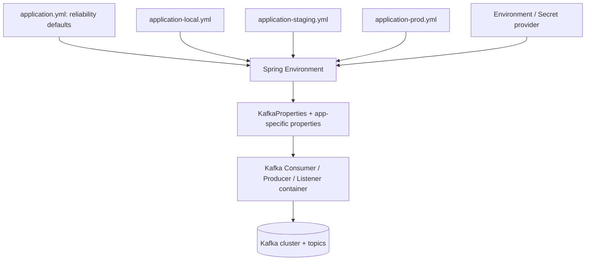
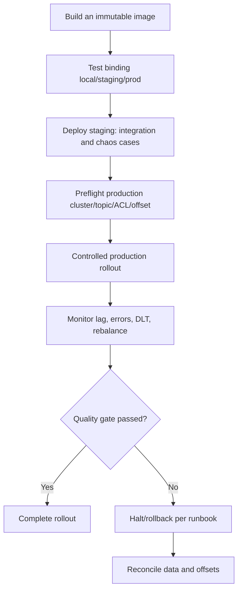

# Environment-Based Profiles in Spring Kafka

A Spring Kafka application can use **the exact same build** to run on a laptop, in integration environments, in staging, and in production. However, the Kafka cluster, topics, consumer groups, authentication, thread counts, retry policies, and observability levels differ across these environments. If the application has only a single config file or requires source edits on every deployment, accidentally pointing a consumer at the production cluster or reusing a consumer group becomes a real operational hazard.

**Spring Profiles** help separate configuration per environment while keeping the deployed artifact unchanged. This is not just a way to swap `bootstrap-servers`; for a high-reliability Kafka system, profiles must also ensure **data isolation**, **least-privilege permissions**, **clear error-handling policies**, and **no unintended changes to offset semantics during rollouts**.

This lesson belongs to **Spring Kafka Reliability Operations → Deployment and Configuration**, covering how to organize `local`, `staging`, and `prod` profiles, how Spring Boot loads and overrides properties, how to configure reliability-related settings, protect secrets, test profiles, and execute deploy/rollback procedures. Examples target **Spring Boot 3.x / Spring Kafka 3.x / compatible Kafka clients**; always verify against your exact versions in real deployments.

## 1. What Problem Do Profiles Solve?

Suppose the `order-events-worker` service reads an orders topic, writes to a database, and routes unrecoverable records to a DLT (dead-letter topic).

| Component | Local | Staging | Production |
|---|---|---|---|
| Kafka cluster | Local Docker broker | Test cluster | Production cluster |
| Input topic | `orders.local.v1` | `orders.staging.v1` | `orders.v1` |
| Consumer group | `orders-worker-local-*` | `orders-worker-staging` | `orders-worker-prod` |
| Security | May use PLAINTEXT in an isolated environment | SASL/TLS per cluster | SASL/TLS or production identity |
| Concurrency per instance | 1 | 2 | Based on partitions and throughput |
| Offset when uncommitted | May use `earliest` for test data | Clear bootstrap rule | Typically configured to prevent unintended replay |
| Retry/DLT | Simple config, easy to simulate faults | Mirrors production for testing | Bounded retries and monitored DLT |
| Logs/metrics | Detailed for debugging | Sufficient for rehearsals | Alerted, protecting sensitive data |

**The goal is not for every value to differ.** Principles protecting correctness such as `enable-auto-commit=false`, idempotent processing, timeouts, and error classification should remain consistent. Environments differ primarily in **resource addresses, identities, limits, and operational requirements**.

### Three Concepts to Distinguish

- **Profile:** the name of the active Spring configuration set, such as `prod`.
- **Deployment environment:** where it actually runs — Kubernetes namespace, cluster, cloud account, VPC. A profile string **does not self-verify** that the app is in the right environment.
- **Kafka resource identity:** cluster, topic, group, principal/ACL. These are the values that decide where the consumer reads data and what it is permitted to do.

Therefore, `SPRING_PROFILES_ACTIVE=prod` is only a configuration choice, **not a security boundary**. If configs or credentials are wrong, the app can still connect to another cluster. Additional guardrails are needed in broker ACLs, networking, and the deployment pipeline.

## 2. How Does Spring Boot Load Profiles?

Spring Boot supports `application.yml`, `application-{profile}.yml` files, and other configuration sources. A common layout is:

```text
src/main/resources/
├── application.yml
├── application-local.yml
├── application-staging.yml
└── application-prod.yml
```

When no profile is active, `application.yml` provides shared values; when `prod` is active, values from `application-prod.yml` can override shared values for the same properties. Environment variables, command-line args, and other config sources can also override according to **Spring Boot's precedence order**.

Examples:

```bash
# Bash/Linux/macOS: run locally.
SPRING_PROFILES_ACTIVE=local java -jar order-events-worker.jar

# Run staging.
java -jar order-events-worker.jar --spring.profiles.active=staging

# Production: profile set by the deployment platform.
java -jar order-events-worker.jar --spring.profiles.active=prod
```

On Windows PowerShell:

```powershell
$env:SPRING_PROFILES_ACTIVE = "local"
java -jar order-events-worker.jar
```

Spring reads the active profile via `spring.profiles.active`. Never hardcode `spring.profiles.active: prod` in `application.yml` and run that artifact on a laptop: one accidental invocation could select a dangerous profile. Generally, let the **deployment manifest/launcher** choose the environment.

### 2.1. Profile-Specific Files vs. Profile-Activated Documents

Both approaches are valid:

1. Separate files like `application-prod.yml`.
2. Multiple YAML documents in one file, each with `spring.config.activate.on-profile`.

Example of the second approach:

```yaml
# application.yml
app:
  kafka:
    retry:
      retries: 2
---
spring:
  config:
    activate:
      on-profile: local
  kafka:
    listener:
      concurrency: 1
---
spring:
  config:
    activate:
      on-profile: prod
  kafka:
    listener:
      concurrency: 3
```

There is no reason to mix both styles for the same property unnecessarily. In this lesson we use **separate files** to make diffs easier to review and values easier to trace per environment.

**Note:** Do not place `spring.profiles.active` inside a YAML document that is itself activated by `spring.config.activate.on-profile` or a profile-specific document; Spring Boot does not support that declaration. Activate profiles from a **profile-independent** config source, the environment, or the launcher.

### 2.2. Override Precedence and Value Provenance

Example prod file:

```yaml
spring:
  kafka:
    bootstrap-servers: "${KAFKA_BOOTSTRAP_SERVERS}"
```

The app requires `KAFKA_BOOTSTRAP_SERVERS` at startup. If an operator passes a command-line arg:

```bash
java -jar app.jar --spring.profiles.active=prod \
  --spring.kafka.bootstrap-servers=broker-override:9093
```

The command-line value can take precedence over the file value, even though the file is named `application-prod.yml`. Spring Boot also supports other higher-precedence config sources such as external config data, system properties, and environment variables. When debugging a wrong property, determine its **effective value and origin** rather than reading only one YAML file.

Never dump the full `Environment`/`KafkaProperties` to logs: they may contain SASL JAAS strings, tokens, or sensitive configuration.

## 3. Recommended Configuration Structure

We separate two groups:

- **Shared configuration:** consumer/producer semantics, offset/ack behavior, base retry policy, application name, and health settings.
- **Profile configuration:** brokers, group, topics, ACL/security, concurrency, resource-adjusted timeouts, and environment naming.

Diagram:



Do not interpret the diagram above as strict precedence order: Spring Boot has specific **property source precedence rules**. Here the goal is to distinguish sources from consumers of config.

### 3.1. Common: `application.yml`

Example common config:

```yaml
spring:
  application:
    name: order-events-worker

  kafka:
    consumer:
      enable-auto-commit: false
      # Explicitly overridden in local/staging/prod to define
      # behavior when a group has no committed offset yet.
      auto-offset-reset: none
      key-deserializer: org.apache.kafka.common.serialization.StringDeserializer
      value-deserializer: org.apache.kafka.common.serialization.StringDeserializer
      properties:
        "[isolation.level]": "read_committed"

    producer:
      acks: all
      key-serializer: org.apache.kafka.common.serialization.StringSerializer
      value-serializer: org.apache.kafka.common.serialization.StringSerializer
      properties:
        "[enable.idempotence]": "true"

    listener:
      ack-mode: record
      missing-topics-fatal: true

app:
  kafka:
    retry:
      backoff-ms: 1000
      retries: 2

management:
  endpoints:
    web:
      exposure:
        include: health, info, prometheus
```

Decisions made here:

1. **`enable-auto-commit=false`:** lets the Spring Kafka listener container manage offsets according to the ack mode. Never let the Kafka client commit periodically regardless of whether business processing finished.
2. **`ack-mode=record`:** for a record listener, the container manages offset commits after the listener processes each record successfully according to Spring Kafka semantics. This usually yields **at-least-once** delivery when a crash occurs between DB commit and offset commit.
3. **`auto-offset-reset=none`:** if a group has no valid offset, the consumer fails rather than silently jumping to the beginning or end; an offset bootstrap procedure is required. This is a conservative choice for sensitive environments, not a mandatory default for every system.
4. **`isolation.level=read_committed`:** prevents consumers from seeing records from aborted Kafka transactions; it does not make an external DB transaction atomic with offset commits.
5. **`acks=all` and `enable.idempotence=true`:** helps the producer reduce duplicate writes caused by producer-layer retries and enforces cluster-configured acknowledgments. It does not turn every application into end-to-end exactly-once.
6. **`missing-topics-fatal=true`:** prevents the listener from silently waiting on a misconfigured or unprovisioned topic in this example. Ensure topics are provisioned before deployment.
7. **Application-defined retry policy under `app.kafka.retry`:** this is **not a property Spring Kafka uses automatically**; an error handler bean must read and apply it, illustrated later.

`management.endpoints.web.exposure.include` exposes only selected Actuator endpoints if the corresponding dependencies/endpoints are enabled. Production must restrict monitoring access and never expose `env` or `configprops` to unauthorized users.

### 3.2. `local` Configuration

File `application-local.yml`:

```yaml
spring:
  kafka:
    bootstrap-servers: "${KAFKA_BOOTSTRAP_SERVERS:localhost:9092}"
    consumer:
      group-id: "orders-worker-local-${USER:developer}"
      auto-offset-reset: earliest
    listener:
      concurrency: 1

app:
  kafka:
    topics:
      orders: orders.local.v1
      orders-dlt: orders.local.v1.DLT
```

Explanation:

- `localhost:9092` works when local Kafka runs in Docker and advertises a listener reachable from the host. If the app runs **inside a container**, `localhost` refers to that container itself, not the broker; use the proper service DNS/network.
- Local may use `earliest` to inspect existing data when the group has no offset yet. This **does not mean every startup replays from the beginning**: once the group has a committed offset, Kafka resumes from it; the reset policy mainly applies when no valid offset exists.
- Appending the username to the local group only reduces accidental group sharing between two developers hitting a shared dev cluster. In CI or multi-host setups, use a test-run-scoped group ID for true isolation and clean up expired groups/topics.
- Never put production Kafka credentials into the local profile. If local requires authentication, use a test principal restricted to local topics.

### 3.3. `staging` Configuration

File `application-staging.yml`:

```yaml
spring:
  kafka:
    bootstrap-servers: "${KAFKA_BOOTSTRAP_SERVERS}"
    client-id: "orders-worker-staging-${HOSTNAME:unknown}"

    consumer:
      group-id: orders-worker-staging
      auto-offset-reset: none

    listener:
      concurrency: 2

    properties:
      "[security.protocol]": SASL_SSL
      "[sasl.mechanism]": SCRAM-SHA-512
      "[sasl.jaas.config]": "${KAFKA_SASL_JAAS_CONFIG}"

app:
  kafka:
    topics:
      orders: orders.staging.v1
      orders-dlt: orders.staging.v1.DLT
```

In staging, placeholders without defaults require proper values at deploy time. **This is an illustrative `SASL_SSL`/SCRAM configuration**; not every cluster uses the same mechanism. A cluster may use SSL client certs, SASL/OAUTHBEARER, or a custom identity provider. You must use the configuration supplied by cluster operators and verify TLS/certificates—never disable hostname verification just to "make it connect."

Simply writing `"${KAFKA_SASL_JAAS_CONFIG}"` in YAML **does not automatically secure the secret**. Environment variables or secret mounts must still be protected; never commit real JAAS values to the repository or print them to logs.

### 3.4. `prod` Configuration

File `application-prod.yml`:

```yaml
spring:
  kafka:
    bootstrap-servers: "${KAFKA_BOOTSTRAP_SERVERS}"
    client-id: "orders-worker-prod-${HOSTNAME:unknown}"

    consumer:
      group-id: orders-worker-prod
      auto-offset-reset: none

    listener:
      concurrency: 3

    properties:
      "[security.protocol]": SASL_SSL
      "[sasl.mechanism]": SCRAM-SHA-512
      "[sasl.jaas.config]": "${KAFKA_SASL_JAAS_CONFIG}"

app:
  kafka:
    topics:
      orders: orders.v1
      orders-dlt: orders.v1.DLT
```

The main differences between staging and prod in this example are **deployment-injected cluster/secrets**, consumer group, topics, and concurrency. Never point staging at the prod cluster simply by changing the group ID: reading a production topic with a new group can **consume the entire history** or cause unintended business side effects.

**Important:** No default makes `prod` inherently safe. If `KAFKA_BOOTSTRAP_SERVERS` accidentally points to staging or ACLs are mis-scoped, the service can run against the wrong environment. The deployment system must verify cluster identity, principal, and topic allowlist before allowing listeners to start.

## 4. Active Profiles and Profile Groups

In a large application, properties may be grouped into concerns such as `observability`, `secure-kafka`, and `prod`. Spring Boot supports `spring.profiles.group` so one profile activates member profiles.

Example in a **profile-independent document**:

```yaml
spring:
  profiles:
    group:
      prod:
        - production-observability
        - strict-security
```

When `prod` is enabled, both member profiles are also activated. However, profile groups are optional. For three straightforward environments, `application-{profile}.yml` files are usually easier to follow.

**Risk:** If multiple active profiles define `spring.kafka.consumer.group-id` or `bootstrap-servers`, override ordering can produce unexpected values. Avoid activating `local,prod` simultaneously and avoid treating mutually exclusive environment profiles as stackable "features." Consider a startup guard ensuring **exactly one environment profile**.

### 4.1. Profiles Are Not Feature Flags

Profiles fit **deployment configuration sets**. Runtime toggles—such as enabling a consumer for a tenant, disabling publishing, or switching a flow to dry-run—may require dedicated feature flags or operational controls. Do not toggle profiles to continuously alter business behavior at runtime: switching profiles typically requires a process restart, and changing Kafka groups/offsets has major consequences.

## 5. Binding Configuration for Application Code

The `spring.kafka.*` group is bound by Spring Boot into `KafkaProperties` and default factories/containers when auto-configuration is active. The `app.kafka.*` group consists of **application-defined** properties that must be explicitly bound or read.

### 5.1. Creating Typed Configuration Properties

Java 17 example:

```java
package com.example.orders.config;

import org.springframework.boot.context.properties.ConfigurationProperties;
import org.springframework.validation.annotation.Validated;
import jakarta.validation.Valid;
import jakarta.validation.constraints.Min;
import jakarta.validation.constraints.NotBlank;

@Validated
@ConfigurationProperties(prefix = "app.kafka")
public record AppKafkaProperties(
        @Valid Topics topics,
        @Valid Retry retry) {

    public record Topics(
            @NotBlank String orders,
            @NotBlank String ordersDlt) {
    }

    public record Retry(
            @Min(0) long backoffMs,
            @Min(0) long retries) {
    }
}
```

In Spring Boot 3, a single-constructor record binds via constructor binding. `orders-dlt` in YAML maps via relaxed binding to `ordersDlt`. Jakarta Validation annotations require `spring-boot-starter-validation` (or a compatible validator) for validation to run fully.

Registration:

```java
package com.example.orders.config;

import org.springframework.boot.context.properties.EnableConfigurationProperties;
import org.springframework.context.annotation.Configuration;

@Configuration
@EnableConfigurationProperties(AppKafkaProperties.class)
public class KafkaAppConfiguration {
}
```

Services can inject `AppKafkaProperties` to obtain topic names and retry budgets without hardcoding them everywhere. Sensitive values **must not** be logged at startup. Property validations like `@NotBlank` catch missing config but cannot verify whether a topic belongs to the right cluster; that requires separate operational checks.

### 5.2. Listener Example Without Hardcoded Topics

```java
package com.example.orders.consumer;

import org.springframework.kafka.annotation.KafkaListener;
import org.springframework.stereotype.Component;

@Component
public class OrdersListener {

    private final OrderEventHandler handler;

    public OrdersListener(OrderEventHandler handler) {
        this.handler = handler;
    }

    @KafkaListener(
            id = "orders-listener",
            idIsGroup = false,
            topics = "${app.kafka.topics.orders}")
    public void onMessage(String payload) {
        handler.handle(payload);
    }
}
```

`OrderEventHandler` is an application-defined business service. In `@KafkaListener`, `idIsGroup=false` prevents the listener ID from becoming the consumer group ID; the group comes from `spring.kafka.consumer.group-id` in container configuration. Specifying `groupId` directly on the annotation can override the consumer factory's group and unintentionally split groups.

With `ack-mode=record` and `enable-auto-commit=false`, the container manages offset commits after the handler returns normally. If the handler throws an exception, the error path depends on the error handler/container; **never assume offsets are committed regardless of errors**.

### 5.3. Notes on Placeholders in Annotations

In `@KafkaListener`, `"${app.kafka.topics.orders}"` references a property resolved by Spring when creating the listener. This is Spring placeholder syntax, distinct from SpEL expressions `#{...}`. Using placeholders lets each profile select a different topic without editing Java annotations.

In Java/Kotlin, placeholders resolve at application context initialization time, not as a mechanism that dynamically switches topics at runtime when a ConfigMap file is edited. When changing topic/group names in production, deploy/restart containers according to plan.

## 6. Configuring Error Handlers and Dead-Letter Topics per Environment

Reliability-focused applications must handle both transient and unrecoverable errors. One Spring Kafka option for record listeners is `DefaultErrorHandler` paired with `DeadLetterPublishingRecoverer`.

Suppose each profile has its topics:

```text
local:   orders.local.v1      → orders.local.v1.DLT
staging: orders.staging.v1    → orders.staging.v1.DLT
prod:    orders.v1            → orders.v1.DLT
```

Example:

```java
package com.example.orders.config;

import org.apache.kafka.common.TopicPartition;
import org.springframework.context.annotation.Bean;
import org.springframework.context.annotation.Configuration;
import org.springframework.kafka.core.KafkaTemplate;
import org.springframework.kafka.listener.DefaultErrorHandler;
import org.springframework.kafka.listener.DeadLetterPublishingRecoverer;
import org.springframework.util.backoff.FixedBackOff;

@Configuration
public class KafkaFailureConfiguration {

    @Bean
    DefaultErrorHandler errorHandler(
            KafkaTemplate<Object, Object> template,
            AppKafkaProperties settings) {

        String dlt = settings.topics().ordersDlt();

        DeadLetterPublishingRecoverer recoverer =
                new DeadLetterPublishingRecoverer(
                        template,
                        (record, exception) ->
                                new TopicPartition(dlt, record.partition()));

        FixedBackOff backOff = new FixedBackOff(
                settings.retry().backoffMs(),
                settings.retry().retries());

        return new DefaultErrorHandler(recoverer, backOff);
    }
}
```

The example uses Spring Kafka 3.x with `StringSerializer` for key/value as in the common configuration. In real systems, if the consumer uses a JSON deserializer or `ErrorHandlingDeserializer`, the DLT producer serializer must support the payload types sent by the recoverer; do not assume every failed payload is a `String`.

Key points to understand:

- `FixedBackOff(1000L, 2L)` means two retry attempts after the initial processing attempt when applicable; this is **not three JobExecutions**.
- Once retries are exhausted and recovery succeeds, the recoverer sends the record to the configured DLT.
- Offset commits after recovery depend on ack mode, container, and error handler; verify that DLT publishing is acknowledged by the broker and that the listener/container honors the expected contract—do not rely solely on a "sent to DLT" log.
- The example targets the **same partition number** on the DLT. The DLT must have **at least** as many partitions as the input topic, or else route to a valid partition; otherwise DLT publishing can fail.
- The producer principal needs WRITE permission on the DLT, while the consumer group needs READ permission on the source topic and permission on the group.
- Each profile must use a **separate DLT** or strict isolation so staging records never land in the production DLT.

### 6.1. Permanent vs. Transient Errors

Do not retry every exception indefinitely. Schema-invalid JSON or disallowed business validation failures can be marked **non-retryable**:

```java
DefaultErrorHandler handler =
        new DefaultErrorHandler(recoverer, backOff);
handler.addNotRetryableExceptions(
        InvalidOrderEventException.class);
return handler;
```

`InvalidOrderEventException` is an application-defined exception. Classify errors by business contract: permanent data errors do not heal after a few seconds, whereas deadlocks or database timeouts may benefit from backoff. Never treat the DLT as a "trash bin" where important records sit forever; maintain dashboards, ownership, retention, and a controlled replay procedure.

### 6.2. Do Not Arbitrarily Diverge Retry Policies Between Staging and Prod

Staging exists to surface production behavior before rollout. If staging retries 0 times while prod retries 30 times, staging tests miss retry storms and backlog delays in prod. Keep the **same error-handling principles** and adjust limits only with documented SLA or quota justification in configuration docs.

In Spring Kafka, distinguish **container error handler retries**, **non-blocking retry topics** (such as `@RetryableTopic`), **Kafka client producer retries**, and service/HTTP client retries. Enabling all of them without a combined retry budget multiplies downstream calls; profiles must reflect a coordinated retry design.

## 7. Consumer Groups: Profiles Must Not Alter Offset Semantics

In Kafka, committed offsets are tracked per **consumer group + topic + partition**. Changing the consumer group ID changes the consumption identity.

Example:

```text
orders-worker-prod has committed offset 6000 on orders.v1 partition 0.

A new deployment accidentally sets group-id=orders-worker-prod-v2.

Kafka treats this as a new group:
  If auto-offset-reset=earliest → may replay history.
  If auto-offset-reset=latest   → may skip existing backlog.
  If auto-offset-reset=none     → may error due to no committed offset.
```

Therefore:

1. **Keep the group ID stable across deployments of the same workload.**
2. Use a different group only when **intentionally** creating an independent consumer (such as an audit consumer), never merely to tag a release version.
3. Never share groups between staging and prod; even on a shared broker with separate topics, keep ACLs/identities isolated.
4. When changing a group or partition count, plan offset bootstrapping, throughput, and potential replay data.
5. With multiple instances in the same group, Kafka distributes partitions across consumers; each instance does not independently read the whole topic.

### 7.1. Concurrency and Partition Count

In Spring Kafka, `spring.kafka.listener.concurrency` determines the number of consumer threads/child containers **per instance** for a concurrent listener. Effective consumer count is approximately:

```text
total consumers ≈ application replicas × listener concurrency
```

Suppose a topic has 6 partitions:

| Deployment | Replicas | Concurrency/instance | Total consumers | Typical outcome |
|---|---:|---:|---:|---|
| Local | 1 | 1 | 1 | One consumer reads up to 6 partitions |
| Staging | 1 | 2 | 2 | 6 partitions can be split across 2 consumers |
| Prod A | 2 | 3 | 6 | Can utilize all 6 partitions |
| Prod B | 4 | 3 | 12 | Many consumers receive **no assignment** |

This is an idealized example; actual behavior depends on listener count, group subscription, and partition assignment strategy. Increasing concurrency beyond partition count **does not proportionally increase throughput**. Conversely, extra threads can increase DB connections, HTTP requests, and downstream lock contention.

When sizing the prod profile, calculate **both replicas and concurrency**, not just the YAML number. Monitor consumer lag, processing duration, CPU, DB pools, and rebalances after scaling.

### 7.2. Rebalances During Rolling Deployments

When a pod stops and a new pod joins the same group, Kafka may reassign partitions. Under slow handlers, rebalances or exceeding `max.poll.interval.ms` can cause redelivery; if the DB committed before the offset committed, records can be reprocessed.

Thus, a prod profile rollout needs:

- Graceful shutdown so listeners stop accepting new work and finish in-flight processing within bounds.
- Timeouts and batch workloads sized to avoid routinely exceeding `max.poll.interval.ms`.
- Idempotency in the business database or downstream API.
- Monitoring of rebalance counts/consumer lag, not just `Ready` pod counts.
- Liveness/readiness probes and autoscaling policies that do not cause continuous rebalance loops.

Never mask stuck handlers by setting `session.timeout.ms` or `max.poll.interval.ms` arbitrarily high; investigate the true bottleneck and failover impact.

## 8. Profiles and Producer Reliability

Producer configuration must also be controlled during deployment. A baseline configuration for producers emitting critical records:

```yaml
spring:
  kafka:
    producer:
      acks: all
      properties:
        "[enable.idempotence]": "true"
        "[delivery.timeout.ms]": "120000"
        "[request.timeout.ms]": "30000"
```

These are example values that should be evaluated against broker/cluster/network characteristics and SLAs. `enable.idempotence=true` requires related properties such as acknowledgments, retries, and max in-flight requests to satisfy Kafka client constraints; let the driver/client validate or fail on conflicting configs rather than assuming one flag suffices.

An **idempotent producer** reduces duplicates during Kafka client send retries within producer semantics; it **does not** prevent downstream consumers from reprocessing, nor does it roll back an external HTTP POST outside Kafka.

### 8.1. Should Kafka Transactions Be Configured per Profile?

If the application uses **Kafka transactions**, Spring Kafka provides `spring.kafka.producer.transaction-id-prefix`. Keep in mind:

- Transactional IDs must be allocated so active producers **do not collide** unintentionally.
- The transaction ID prefix must be designed **per application instance** and aligned with the rolling deployment strategy.
- Transaction timeouts, fencing, and producer recovery must be tested.
- Consumers participating in Kafka transactions may require `isolation.level=read_committed`.
- Kafka exactly-once semantics in a Kafka→process→Kafka pipeline **do not automatically cover** an external database or HTTP API outside Kafka.

Example for an environment specifically using Kafka transactions:

```yaml
spring:
  kafka:
    producer:
      transaction-id-prefix: "orders-tx-${POD_UID}"
```

Here `POD_UID` is an example instance identifier supplied by deployment and must be genuinely unique/stable per operational design. **Do not copy this setting into environments where the app does not use Kafka transactions.** Every prefix change affects transactional producer identity and fencing and must be designed deliberately rather than edited casually.

### 8.2. Practical Delivery Semantics

For a consumer writing to a database:

```text
Kafka record offset 100
  → listener processes
  → database COMMIT succeeds
  → process crashes before Kafka offset COMMIT
  → record offset 100 is read again after restart
```

`enable-auto-commit=false` and `ack-mode=record` **do not eliminate** this window. For critical data processing, the writer should use unique business keys, version-checked upserts, or transactional deduplication in the database. For external APIs, use idempotency keys/outbox patterns and reconciliation.

This is why the production profile should strengthen observability and downstream protection rather than merely increasing `acks` or concurrency.

## 9. Never Store Secrets in Git or Profile YAML

A classic mistake:

```yaml
# DO NOT DO THIS: real credentials would end up in the repository and artifact.
spring:
  kafka:
    properties:
      "[sasl.jaas.config]": "org.apache.kafka.common.security.scram.ScramLoginModule required username='real-user' password='real-password';"
```

As a result, secrets leak into Git history, CI logs, build artifacts, and config copies. Instead:

1. Keep **non-sensitive** settings such as protocol, mechanism, topics, and groups in profile files.
2. Obtain credentials from a **secret manager / Kubernetes Secret / workload identity** provided by the platform.
3. Grant only the permissions needed for each environment's principal.
4. Maintain rotation, auditing, and revocation procedures in case of exposure.
5. Never log raw property maps, connection configs, Authorization headers, or JAAS strings.

### 9.1. Kubernetes: ConfigMap and Secret

An illustrative way to inject environment settings (abbreviated):

```yaml
apiVersion: apps/v1
kind: Deployment
metadata:
  name: order-events-worker
spec:
  replicas: 2
  selector:
    matchLabels:
      app: order-events-worker
  template:
    metadata:
      labels:
        app: order-events-worker
    spec:
      containers:
        - name: worker
          image: registry.example.invalid/order-events-worker:1.4.2
          env:
            - name: SPRING_PROFILES_ACTIVE
              value: "prod"
            - name: KAFKA_BOOTSTRAP_SERVERS
              valueFrom:
                configMapKeyRef:
                  name: order-worker-config
                  key: kafka-bootstrap-servers
            - name: KAFKA_SASL_JAAS_CONFIG
              valueFrom:
                secretKeyRef:
                  name: order-worker-credentials
                  key: sasl-jaas-config
```

The `order-worker-config` and `order-worker-credentials` objects must be provisioned through platform workflows. **A default Kubernetes Secret is not a complete secret manager**: encryption at rest, RBAC, pod/env read permissions, auditing, and rotation syncing all require configuration. Secrets injected as environment variables typically do not update inside running processes; rotation may require a pod rollout or an appropriate provider refresh mechanism.

In strict environments, workload identity/certificates or secret volumes/sidecars may be more appropriate; follow the Kafka security contract. Do not allow every developer with Deployment read access to read Secrets.

### 9.2. Different Profiles Do Not Mean Different Permissions

If staging and prod share the **same Kafka principal** with read/write access to all topics, separate profile names will not prevent staging from writing to `orders.v1`. You need:

- Distinct principals/ACLs, or at minimum strictly separated policies.
- Network segmentation/VPC/firewalls and dedicated broker listeners.
- Disciplined topic namespaces and naming conventions.
- Scoped READ, WRITE, DESCRIBE, and GROUP permissions per workload.
- Deployment-time permission checks and periodic policy audits.

Producer permissions to send to the DLT must be accounted for separately: a consumer can read the main topic successfully yet fail when publishing to the DLT due to a missing WRITE ACL. When that happens, failing records can stall or retry endlessly, inflating lag.

## 10. Safely Selecting Environments in Containers/Kubernetes

A sound deployment pipeline uses **one immutable artifact**:

```text
Build artifact:
  order-events-worker:1.4.2
       │
       ├─ local   + application-local.yml   + local resources
       ├─ staging + application-staging.yml + staging resources
       └─ prod    + application-prod.yml    + prod resources
```

Never compile a separate source variant just to change a broker URL. Code divergence between staging and prod undermines the value of staging testing.

However, **configuration drift** can still occur even with the same artifact:

- Staging topic has 1 partition, prod has 12 partitions.
- Staging uses PLAINTEXT while prod uses SASL_SSL, leaving certs/ACLs untested.
- Staging retries minimally while prod retries heavily, prolonging incidents.
- Staging lacks DLT/monitoring while prod has a DLT lacking write permissions.
- Prod concurrency mismatches replica counts or DB connection pools.

Maintain a **config inventory** and parity review for reliability-impacting settings, rather than only checking that YAML parses.

### 10.1. "Fail Fast" on Invalid Profiles

A startup guard can block accidentally activating multiple environment profiles or running with the default profile:

```java
package com.example.orders.config;

import java.util.Arrays;
import java.util.Set;
import org.springframework.boot.ApplicationArguments;
import org.springframework.boot.ApplicationRunner;
import org.springframework.core.env.Environment;
import org.springframework.stereotype.Component;

@Component
public class EnvironmentProfileGuard implements ApplicationRunner {

    private static final Set<String> ENV_PROFILES =
            Set.of("local", "staging", "prod");

    private final Environment environment;

    public EnvironmentProfileGuard(Environment environment) {
        this.environment = environment;
    }

    @Override
    public void run(ApplicationArguments arguments) {
        long environments = Arrays.stream(
                        environment.getActiveProfiles())
                .filter(ENV_PROFILES::contains)
                .count();

        if (environments != 1) {
            throw new IllegalStateException(
                    "Exactly one environment profile must be active");
        }
    }
}
```

This is an application-level check. Understand that `ApplicationRunner` executes **after the application context is created**; depending on configuration, Kafka listener containers may already have started before the runner runs. If you must guarantee **no consumer connects to the wrong cluster**, validate profiles/config **before Kafka listeners auto-start**—for example during config/initialization or by setting `spring.kafka.listener.auto-startup=false` and starting containers only after validation succeeds. Relying solely on a runner is insufficient for safety-critical deployments.

In production, guards should pair with CI/CD or admission-policy preflights executed **before pods start**, not just runtime profile name checks.

### 10.2. Do Not Auto-Create Production Topics Uncontrolled

Kafka topics carry partitions, replication factors, retention, cleanup policies, and ACLs. They are typically **infrastructure managed by platform/provisioning**. Never let a production consumer accidentally create a misspelled topic and keep running on an empty topic.

With `missing-topics-fatal=true`, listeners catch some missing-topic cases; additionally, use Kafka `AdminClient`/preflight checks to verify:

- Source topic and DLT exist on the right cluster.
- Partition counts support concurrency and DLT mapping.
- Replication/retention/cleanup match SLAs, especially DLT retention.
- The principal holds the required ACLs.
- Cluster metadata matches the expected environment.

Never grant topic CREATE permissions to every producer/consumer merely for deployment convenience.

## 11. Testing Profiles: Do Not Just Assert One Property

Test each profile at three levels:

1. **Property binding:** configuration loads properly; group, topic, listener concurrency, and security protocol hold expected values.
2. **Kafka integration:** the app actually connects to a test broker and handles records, retry/DLT, and offset commits per contract.
3. **Deploy preflight:** cluster identity, DNS/TLS, ACLs, topic partitions, secrets, and health endpoints match the environment.

### 11.1. Testing Local Configuration

Example with JUnit 5:

```java
import static org.assertj.core.api.Assertions.assertThat;

import org.junit.jupiter.api.Test;
import org.springframework.beans.factory.annotation.Autowired;
import org.springframework.boot.test.context.SpringBootTest;
import org.springframework.boot.autoconfigure.kafka.KafkaProperties;
import org.springframework.test.context.ActiveProfiles;

@SpringBootTest(properties = {
        "spring.kafka.listener.auto-startup=false"
})
@ActiveProfiles("local")
class LocalProfileConfigurationTest {

    @Autowired
    KafkaProperties kafka;

    @Autowired
    AppKafkaProperties appKafka;

    @Test
    void usesLocalResources() {
        assertThat(kafka.getConsumer().getGroupId())
                .startsWith("orders-worker-local-");
        assertThat(kafka.getListener().getConcurrency())
                .isEqualTo(1);
        assertThat(appKafka.topics().orders())
                .isEqualTo("orders.local.v1");
        assertThat(appKafka.topics().ordersDlt())
                .isEqualTo("orders.local.v1.DLT");
    }
}
```

This test only verifies binding, not that a local broker is running. `@SpringBootTest` also instantiates application beans; setting `auto-startup=false` suppresses automatic listener connections in test properties. If the system includes `KafkaAdmin` or custom startup connections, configure tests appropriately to avoid depending on a live broker.

### 11.2. Testing Prod Configuration with Synthetic Secrets

In CI, never use production credentials. Supply synthetic placeholder values:

```java
@SpringBootTest(properties = {
        "spring.kafka.listener.auto-startup=false",
        "KAFKA_BOOTSTRAP_SERVERS=kafka-test.invalid:9093",
        "KAFKA_SASL_JAAS_CONFIG=" +
            "org.apache.kafka.common.security.scram.ScramLoginModule " +
            "required username='test' password='test';"
})
@ActiveProfiles("prod")
class ProdProfileConfigurationTest {

    @Autowired KafkaProperties kafka;
    @Autowired AppKafkaProperties appKafka;

    @Test
    void usesProductionTopicAndGroup() {
        assertThat(kafka.getConsumer().getGroupId())
                .isEqualTo("orders-worker-prod");
        assertThat(appKafka.topics().orders())
                .isEqualTo("orders.v1");
        assertThat(kafka.getBootstrapServers())
                .contains("kafka-test.invalid:9093");
    }
}
```

This extends the previous test (requiring corresponding imports/test framework). Test credentials are **synthetic**; never load real secrets into CI logs. Binding tests do not prove that a principal has permissions or that certificates are valid on a prod broker.

### 11.3. Embedded Kafka or Testcontainers

To test real Kafka interactions, you can use:

- **`@EmbeddedKafka`:** suitable for in-JVM unit/integration tests, though it differs from production clusters, TLS/ACLs, and broker configs.
- **Testcontainers Kafka:** runs an isolated broker in a container to test consumer groups, DLT, and retry/rebalances; does not by default replicate production networking/security.
- **Staging cluster:** required for smoke-testing real TLS, ACLs, topic provisioning, partition assignment, offset policies, and alerting.

A reliability integration test suite should cover these cases:

| Case | Expectation |
|---|---|
| Valid record | Consumer processes, DB commits, offset advances per contract |
| Handler throws transient error | Bounded retries with backoff, then succeeds |
| Permanently invalid record | DLT receives record as configured; alert/counter increments |
| DLT lacks WRITE ACL | Recovery failure signals clearly; record is not silently lost |
| Crash after DB commit before offset commit | Record may replay; writer is idempotent |
| New group ID without offset | `auto-offset-reset` behaves per policy |
| Changing replicas/concurrency | No data loss; rebalances/lag stay within bounds |
| Missing bootstrap/secret | Deployment fails instead of falling back to a wrong default |

Do not hardcode rigid millisecond latencies in shared CI to prove reliability; assert observable behavior, final states, actual data/offsets, and reasonable timeout budgets.

## 12. Preflight Before Production Deployment

A checklist should be executed by the pipeline or an appropriately authorized operator—never by printing secrets to the screen:

| Check | Pass Criteria |
|---|---|
| Artifact | Image tag/digest tested in staging |
| Profile | Strictly `prod`, without `local/staging` enabled alongside |
| Broker | DNS/TLS resolves to the right cluster ID/environment |
| Identity | Service-specific principal, least privilege |
| Secret | Provided via secret provider, valid, not in Git/logs |
| Main topic | Exists, proper partitions, retention, and cleanup policy |
| DLT | Exists, valid mapping, sufficient partitions, and WRITE ACL |
| Consumer group | Stable group ID; clear offset bootstrap/replay plan |
| Concurrency | Replicas × concurrency fits partition count and downstream |
| Ack/commit | `enable-auto-commit=false`; proper ack mode |
| Retry | Error classification, backoff, and finite budget |
| Idempotency | DB/API tolerates replayed records |
| Metrics | Consumer lag, failures, retries, DLT, rebalances, and health |
| Rollout | Rollback plan ready; no accidental group ID change |

For **effective** values overridden across multiple sources, generate a config audit containing only allowlisted fields (topics, group, concurrency, protocol, retry budget), **excluding secrets/JAAS**. Compare it against the approved manifest before deployment to reduce configuration drift.

## 13. Rollout and Rollback Procedure

A typical safe deployment flow:



### 13.1. Rolling Deployment

When deploying a new version under the same group:

- Kafka reassigns partitions as consumers leave and join the group.
- Committed offsets continue to be used by the group, **provided the group ID and subscription do not change**.
- Some records may be reprocessed after crashes/rebalances; idempotency is required.
- For new message schemas, verify producer/consumer backward/forward compatibility.
- If partition counts change, evaluate ordering, key distribution, and throughput.

Avoid simultaneously changing replicas, concurrency, retry limits, serializers, and consumer group IDs in a single rollout; when something fails, isolating the cause becomes difficult.

### 13.2. Canary and Shadow Consumers

Canary deploys introduce new code to a slice of production. With Kafka, distinguish:

- **Canary in the same group:** receives a **subset of partitions**, sharing real workload with the old version; suitable when both versions are compatible and side effects are controlled.
- **Shadow consumer in a separate group:** can read the same data independently, but **must not produce real side effects** unless using dry-run/isolated sinks; the new group has its own offset bootstrap rule.
- **Canary on a separate topic:** requires corresponding data pipelines and contracts; do not assume real production traffic is already represented.

Never spin up a shadow consumer with the same business writer assuming it "only observes": if the handler still writes to the database or calls APIs, it can trigger business actions twice.

### 13.3. Image Rollback Is Not Offset Rollback

Rolling back an application image or config **does not automatically rewind committed offsets**. For instance, if the new version already committed offset 10,000, rolling back to the old code still resumes from offset 10,000 if the group remains unchanged.

If the new code misprocessed 500 records before rollback, you need **data reconciliation and a replay plan**, potentially via controlled group/offset resets or a dedicated backfill job. Rewinding offsets is not a default rollout step and carries the risk of replaying all side effects.

**Never run `kafka-consumer-groups --reset-offsets` on production on a hunch.** Properly stop the consumer group, confirm target topics/partitions/offsets, obtain data-owner approval, and monitor outcomes afterward.

## 14. How Monitoring Differs by Profile

The local profile prioritizes ease of debugging; prod prioritizes SLOs, alerting, and protecting sensitive data. Common signals:

| Metric/signal | Local | Staging | Production |
|---|---|---|---|
| Consumer lag per group/topic | Manual observation | Smoke/soak tests | Baseline dashboards and alerts |
| Record processing p50/p95/p99 | Debug | Pre-deploy comparison | SLO/latency alerts |
| Retry attempts | Clear logs | Failure injection | Retry rate and budget |
| DLT publish rate/backlog | Functional test | Verify mapping/ACL | Alerts with owner and replay runbook |
| Rebalance events | When testing scale | Soak tests | Monitored during deploys/autoscale |
| Producer failures | Callback logs | Broker outage tests | Publish failure and delivery timeout alerts |
| Broker/network/TLS | Can be minimal | Real connectivity | Health, cert expiry, authentication |
| Sensitive payload logging | Synthetic data only | Redacted | Redacted and tightly access-controlled |

However, no single `consumer_lag` metric is provided identically by Spring Boot across all setups. Choose an appropriate observability stack: Kafka client metrics via Micrometer/JMX, Kafka exporters, broker tooling, and consumer group lag dashboards. Metric names vary by registry/version; inspect actual endpoints before writing alert expressions.

### 14.1. Lag-Only Alerts Can Mislead

Increasing consumer lag may stem from:

- A sudden burst of producer traffic.
- Slow downstream DB/API dependencies.
- Too few Kafka partitions relative to concurrency.
- Continuous consumer rebalances.
- A permanent error stalling one partition.
- Long retries delaying subsequent polls/processing.
- A wrong group ID causing the consumer to start at a different position.

Inspect **lag + throughput + retry/DLT + processing latency + group health**, rather than blindly adding threads whenever lag rises.

### 14.2. Do Not Leak Secrets Through Actuator

Actuator helps inspect configuration and health, but endpoints like `env` or `configprops` risk exposing or confirming sensitive details if misconfigured, even with partial masking. Production should lock down endpoints, network access, RBAC, and auditing. Never use `log.debug("KafkaProperties={}", ...)` to inspect environments.

## 15. Troubleshooting by Profile

| Symptom | Common Cause | How to Investigate |
|---|---|---|
| Local cannot connect to `localhost:9092` | App in container, broker advertises wrong host | Check DNS/network and advertised listeners |
| Staging SASL error | Wrong secret/username/mechanism/ACL | Check principal, secret rotation, broker auth logs |
| Prod reads local topic | Wrong property/profile override | Check active profiles and effective topic source |
| Consumer receives no records | No offset, `auto-offset-reset=none`, missing assignment | Inspect group describe, partition assignment, bootstrap policy |
| New deploy replays history | Group ID changed or offsets were reset | Compare old/new group and committed offsets |
| Consumer stops on missing topic | `missing-topics-fatal=true` and provisioning incomplete | Check topic/cluster naming; do not disable the guard |
| DLT cannot be written | Missing WRITE ACL or insufficient DLT partitions | Inspect recoverer failure and broker authorization |
| Retry loop drives lag up | Large retry budget, permanent error, dependency outage | Review error classification, backoff, and DLT policy |
| Prod runs many idle consumers | Replicas × concurrency exceeds partition count | Recalculate capacity and assignments |
| Continuous rebalances on rollout | Pod restarts, poll interval, overload | Check readiness/liveness, processing time, group metrics |
| Code rolled back but records not reprocessed | Offsets already committed by new version | Create a data reconciliation/replay plan |
| Prod receives staging credentials | Wrong secret binding/deployment | Check namespace, secret ref, identity, and ACLs |
| Prod property has no effect | Overridden by CLI/env/config data | Trace property precedence without dumping secrets |

### Case Study: Group ID Changed per Release

A team configured:

```yaml
spring:
  kafka:
    consumer:
      group-id: "orders-worker-prod-${APP_VERSION}"
```

Every deployment created a new group. With `auto-offset-reset=earliest`, the consumer could replay all retained messages; if the writer sent emails or processed payments, side effects risked duplication. With `latest`, backlogged records could be skipped. **Solution:** keep group IDs stable per **consumption function**, not per release; change groups only intentionally with an offset migration/replay plan.

### Case Study: Right DLT Topic, Too Few Partitions

Source `orders.v1` had 12 partitions. The error handler routed to `orders.v1.DLT` using the same partition, but the DLT had been created with only 3 partitions. Failed records from partition 9 could not publish to partition 9 of the DLT. Without alerting, processing stalled on that partition.

**Solution:** provision the DLT with sufficient partitions, or design a resolver targeting valid partitions (weighing ordering/traceability trade-offs), and test producer permissions and failure paths before deployment.

### Case Study: Right Profile, Wrong Cluster

`SPRING_PROFILES_ACTIVE=prod`, yet `KAFKA_BOOTSTRAP_SERVERS` came from a staging ConfigMap. The property test asserting `group-id=orders-worker-prod` still passed, yet the live service ran against the staging cluster.

**Solution:** anchor cluster identity in a verified provisioning workflow; enforce admission/CI/CD policies checking namespace, secrets, bootstrap refs, and ACLs; run canary/smoke checks verifying broker metadata and topic allowlists before opening consumers.

## 16. Practice: Deploying One Artifact Across Three Profiles

An independent exercise you can follow step-by-step:

1. Create a Spring Boot app with `spring-kafka`, `spring-boot-starter-actuator`, validation, and test dependencies.
2. Write `application.yml` with ack/commit semantics, producer idempotence, and default retry budget.
3. Create `application-local.yml`, `application-staging.yml`, and `application-prod.yml` following the examples above.
4. Use `@KafkaListener` reading the topic from `app.kafka.topics.orders` and let the profile configure the group.
5. Add a `DefaultErrorHandler` routing unrecoverable records to the profile's DLT.
6. Local: start Kafka via Docker/Testcontainers; send one valid message and one triggering a permanent error; observe outputs and the DLT.
7. Staging: use dummy/test credentials, verify TLS, ACLs, topic partitions, retry/backoff, and consumer lag.
8. Production preflight: check active profile, broker identity, stable group, topics, DLT, concurrency/replicas, and secrets.
9. Simulate a rolling deployment; observe group rebalances, lag, and outputs; keep the group ID unchanged.
10. Simulate an image rollback; verify offsets do not automatically rewind and plan replay if data was mishandled.

### Expected Results

| Action | Local | Staging | Production |
|---|---|---|---|
| Startup without profile declared | Guard blocks or approved default applies | Does not run accidentally | Does not run accidentally |
| Send message to topic | Only local consumer processes | Only staging consumer processes | Only prod consumer processes |
| Handler throws transient error | Bounded retries | Bounded retries | Bounded retries |
| Handler throws permanent error | Local DLT | Staging DLT | Prod DLT and alert |
| App version changes | Group unchanged | Group unchanged | Group unchanged |
| Invalid broker credentials | Clear error | Startup/connection fails, no fallback | Fail closed, no alternate secret used |
| Crash after DB commit before offset commit | Idempotent output | Idempotent output | Idempotent output |

You do not need to split profiles into three divergent code branches to achieve this. The less environment-specific branching lives in Java, the more accurately staging reflects production.

## 17. Pre-Release Configuration Review Checklist

- [ ] Exactly one environment profile is active: `local`, `staging`, or `prod`.
- [ ] Broker addresses are injected from deployment targeting the right cluster and verified by preflight.
- [ ] Input topic, DLT, and consumer group **are distinct across environment boundaries**.
- [ ] Production group ID remains stable across all releases of the same workload.
- [ ] No secrets are hardcoded in profile files or Git.
- [ ] TLS/SASL/certificates and ACLs are tested in an equivalent environment.
- [ ] `enable-auto-commit=false` and ack mode are designed consistently.
- [ ] `auto-offset-reset` policy is defined for new groups/expired offsets.
- [ ] Producer idempotence and delivery timeout satisfy the contract.
- [ ] Retry/error handler is registered, classifies errors, and enforces a finite budget.
- [ ] DLT has sufficient partitions, write permissions, retention, and backlog ownership.
- [ ] Replicas × concurrency aligns with partition count and downstream resources.
- [ ] Handler/DB/API are idempotent under replayed records.
- [ ] Config tests exist per profile alongside retry/DLT/offset integration tests.
- [ ] Rollout/rollback does not accidentally change group or topic.
- [ ] Consumer lag, rebalances, errors, retries, and DLT have metrics/alerts.
- [ ] Logs/Actuator never leak JAAS strings, tokens, request headers, or sensitive payloads.
- [ ] Runbooks exist for changing groups, resetting offsets, replaying DLT, and auth failures.

## 18. Summary

**Environment-based profiles** in Spring Kafka are part of **reliability and operational safety** design, not just a way to swap `localhost:9092` for a production broker. `application-{profile}.yml` files let a single artifact receive each environment's Kafka endpoints, groups, topics, security, and limits, while shared configuration keeps retry, offset, acknowledgment, and producer semantics consistent.

A well-operated system also requires guardrails beyond profiles: **verified cluster identity/ACLs**, properly provisioned topics/DLTs, secret management, stable group IDs, idempotent writers, failure/replay testing, and rollout/rollback workflows with data reconciliation. When these controls are in place, a single build can move from local to production without silently altering Kafka consumption and recovery behavior.
