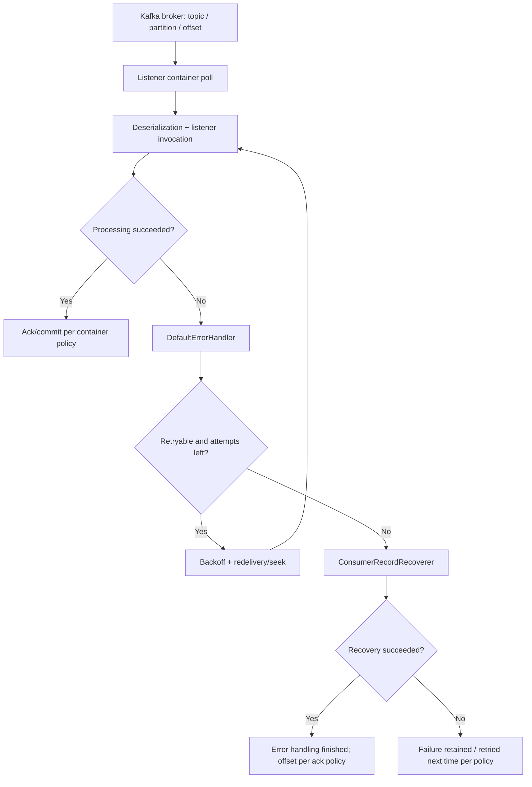

# DefaultErrorHandler Changes in Spring Kafka: Upgrades and Compatibility

When upgrading Spring Kafka, one of the changes most likely to impact consumer reliability is **migrating from legacy error handlers to `DefaultErrorHandler`** or modifying the configuration of an existing handler. A syntactically equivalent configuration can still alter retry counts, processing order, offset commits, DLT (dead-letter topic) behavior, and how long a consumer is blocked.

For example: an order-event processing service receives a record that triggers a transient database error. In the older version, the record was sought so it could be re-read; in the newer version, the handler may use a mechanism that retains records for redelivery to the listener without performing an actual broker seek in some configurations. If the team simultaneously changes `ack-mode`, retry count, and DLT publishing during the upgrade, a small mistake can lead to **dropped unprocessed records, unexpected replays, or growing backlog**.

This lesson belongs to **Spring Kafka Reliability Operations → Upgrades and Compatibility**, guiding you on understanding `DefaultErrorHandler`, migrating from legacy handlers, managing version-specific behaviors, testing failure paths, and rolling out safely. Examples focus on **Spring Kafka 2.8+ and 3.x**, commonly paired with Spring Boot 3.x on the 3.x branch. Exact APIs, property names, and default behaviors must be verified against the **actual Spring Kafka version** being upgraded; do not copy defaults from documentation for another version.

> **Principle:** Upgrading an error handler is changing *delivery semantics*. You must prove with integration tests that a successful record, a retryable record, a permanent-invalid record, and a DLT publish failure all produce offsets and business data matching the contract.

## 1. Where Does DefaultErrorHandler Sit?

In Spring Kafka, `@KafkaListener` typically runs inside a listener container. The container polls Kafka records, dispatches them to the listener, and manages acknowledgment/offsets according to configuration. When the listener or data conversion hits an error passed by the container to its handler, a **`CommonErrorHandler`** can decide to:

- Retry processing the record/batch according to a retry and backoff policy.
- Seek or retain records for redelivery according to mechanisms supported in the running version.
- Forward unprocessable records to a recoverer, commonly `DeadLetterPublishingRecoverer`.
- Rethrow errors for further container handling instead of treating the record as recovered.
- Influence whether the container may commit offsets after a successful recovery.

`DefaultErrorHandler` is the standard implementation of the `CommonErrorHandler` interface for **record listeners** and also supports **batch listener** error handling via corresponding mechanisms.



High-level diagram, **not a promise that every retry immediately re-polls the broker**. Starting with versions supporting `seekAfterError=false`, Spring Kafka can retain remaining records for redelivery to the listener without performing an actual seek, while still performing the polls required for the consumer. For batch listeners, behavior also depends on how the exception identifies the failing record.

### Classes to Distinguish

| Component | Responsibility |
|---|---|
| `DefaultErrorHandler` | Coordinates retry/backoff and recovery when the container handles exceptions |
| `CommonErrorHandler` | Common contract for integrating an error handler with the listener container |
| `DeadLetterPublishingRecoverer` | Sends failed records to the DLT via a Kafka producer |
| `BackOff` | Defines delay and number of retries |
| `RetryListener` | Observes retry/recovery attempts |
| `ErrorHandlingDeserializer` | Turns deserialization errors into information the container can handle |
| `AfterRollbackProcessor` | Handles records after rollback when the listener container uses Kafka transactions |
| `@RetryableTopic` | Non-blocking retry model via retry topics, distinct from container-level retries |

**Do not confuse Kafka client producer retries with listener retries.** Kafka producer `retries` handle Kafka send failures at the client layer; they do not decide whether a listener is re-invoked for a business exception.

## 2. Upgrade Timeline and Impact

Some key milestones:

| Version Line | What to Know When Upgrading |
|---|---|
| **Before Spring Kafka 2.8** | `SeekToCurrentErrorHandler` common for record listeners and separate handlers for batch/container; error handler APIs were more fragmented |
| **From 2.8** | Introduced `CommonErrorHandler` and `DefaultErrorHandler` to unify record/batch handling; uses `setCommonErrorHandler(...)` API |
| **From 2.9** | Added options such as `setSeekAfterError(false)` to retain/resubmit records instead of performing an actual seek in supported cases |
| **Spring Kafka 3.x** | Continues building on CommonErrorHandler; many legacy APIs removed along the upgrade path; ecosystem moves to Spring Framework 6 / Java 17 |

This is a **conceptual transition map**. Do not assume all 3.x methods exist in 2.8.x; nor assume defaults like backoff, fatal exception lists, or retry-state reset behave identically across all patch versions.

### 2.1. Why Swapping the Class Name Is Not Enough

Code can switch from `SeekToCurrentErrorHandler` to `DefaultErrorHandler` and still be wrong if:

1. The wrong constructor is used, changing retry counts from expectations.
2. `setErrorHandler(...)` is replaced, yet registration on the container factory is missed.
3. The recoverer is not reconfigured, causing records to be logged and "recovered" by default instead of sent to the DLT.
4. Consumer `ack-mode` or auto-commit is changed at the same time, affecting offsets.
5. A batch listener is used, yet only record listeners are tested.
6. A deserialization error happens before the listener, so business error handler logic does not see the payload as the team expected.
7. The container uses Kafka transactions, so failures must be evaluated under a different rollback and after-rollback processing path.

An upgrade must inspect the **entire record path from poll → listener → transaction → retry/recover → commit**, not just a class name diff.

## 3. Basic Migration from SeekToCurrentErrorHandler

### 3.1. Legacy Configuration Style

In older Spring Kafka projects, you may see configuration like:

```java
// LEGACY SYNTAX ILLUSTRATION - do not use in new Kafka 3.x projects.
SeekToCurrentErrorHandler handler =
        new SeekToCurrentErrorHandler(
                recoverer,
                new FixedBackOff(1_000L, 2L));

factory.setErrorHandler(handler);
```

Legacy classes/imports depend on older versions. Do not use this code as a runnable 3.x example. Its purpose is only to identify config lines needing migration.

### 3.2. CommonErrorHandler Configuration Style

With Spring Kafka 2.8+:

```java
import org.springframework.kafka.listener.CommonErrorHandler;
import org.springframework.kafka.listener.DefaultErrorHandler;
import org.springframework.util.backoff.FixedBackOff;

CommonErrorHandler handler = new DefaultErrorHandler(
        recoverer,
        new FixedBackOff(1_000L, 2L));

factory.setCommonErrorHandler(handler);
```

Meaning of `new FixedBackOff(1_000L, 2L)` in the standard retry path:

- Wait roughly 1 second between attempts.
- Allow up to **2 retries** after the initial processing attempt.
- A record can be tried up to **3 listener invocations** if every attempt fails, before going to the recoverer.

This is a basic example, excluding errors in the recoverer itself or other retries/transactions. When migrating from a legacy constructor taking `maxFailures` or custom retry logic, **never transfer a number without comparing listener invocation counts**: failure/retry counting can differ.

### 3.3. Migration Mapping Table

| Old Configuration / Habit | Migration Path | What to Test |
|---|---|---|
| `SeekToCurrentErrorHandler` | `DefaultErrorHandler` | Attempt count, seek/redelivery, recovery |
| `factory.setErrorHandler(...)` | `factory.setCommonErrorHandler(...)` | Which factory `@KafkaListener` actually uses |
| Default logging recoverer | `DeadLetterPublishingRecoverer` if DLT is needed | Record goes to the right DLT, not just logged |
| Hard-coded retry count | `FixedBackOff` or appropriate policy | Attempt count and total duration |
| Legacy error classification | `addNotRetryableExceptions(...)` / classifier | Permanent errors do not retry |
| Listener-level callback logging | `RetryListener`/Micrometer | Retry and recovery counters |
| Old batch error handling | `DefaultErrorHandler` with batch handling | With/without `BatchListenerFailedException` |
| Error handler for transactional listener | Check `AfterRollbackProcessor` | Rollback, resend, transaction semantics |

Do not apply this mapping mechanically to `@RetryableTopic` or transactional listeners: those two cases have distinct mechanisms that must be reviewed separately.

## 4. A Complete DefaultErrorHandler Configuration

Suppose the application receives order JSON already deserialized as a String in this example, writes to a database, and routes unprocessable errors to `orders.v1.DLT`.

### 4.1. Base Dependencies

Gradle example for Spring Boot 3.x:

```groovy
dependencies {
    implementation 'org.springframework.boot:spring-boot-starter'
    implementation 'org.springframework.kafka:spring-kafka'
    implementation 'org.springframework.boot:spring-boot-starter-actuator'

    testImplementation 'org.springframework.boot:spring-boot-starter-test'
    testImplementation 'org.springframework.kafka:spring-kafka-test'
}
```

The Spring Boot BOM manages Spring Kafka and compatible libraries. Do not arbitrarily pin Spring Kafka 2.x into a Spring Boot 3.x application running Framework 6/Java 17. If a version override is required, check the compatibility matrix for that exact version pair and test end-to-end.

### 4.2. Kafka Configuration

```yaml
spring:
  kafka:
    bootstrap-servers: "${KAFKA_BOOTSTRAP_SERVERS:localhost:9092}"

    consumer:
      group-id: orders-worker
      enable-auto-commit: false
      auto-offset-reset: earliest
      key-deserializer: org.apache.kafka.common.serialization.StringDeserializer
      value-deserializer: org.apache.kafka.common.serialization.StringDeserializer

    producer:
      acks: all
      key-serializer: org.apache.kafka.common.serialization.StringSerializer
      value-serializer: org.apache.kafka.common.serialization.StringSerializer
      properties:
        "[enable.idempotence]": "true"

    listener:
      ack-mode: record

app:
  kafka:
    order-topic: orders.v1
    order-dlt: orders.v1.DLT
    retry:
      interval-ms: 1000
      max-retries: 2
```

Here `app.kafka.*` are application-read properties, **not automatically consumed by Spring Kafka**. In production, pass bootstrap servers/credentials via deployment config or a secret manager rather than hard-coding sensitive values. `auto-offset-reset=earliest` helps tests on a new group see existing data; in production choose the offset reset policy per contract instead of copying lab defaults.

### 4.3. DefaultErrorHandler Bean with DLT

```java
import org.apache.kafka.common.TopicPartition;
import org.springframework.beans.factory.annotation.Value;
import org.springframework.context.annotation.Bean;
import org.springframework.context.annotation.Configuration;
import org.springframework.kafka.core.KafkaTemplate;
import org.springframework.kafka.listener.DefaultErrorHandler;
import org.springframework.kafka.listener.DeadLetterPublishingRecoverer;
import org.springframework.util.backoff.FixedBackOff;

@Configuration
public class OrderKafkaErrorConfiguration {

    @Bean
    DefaultErrorHandler orderErrorHandler(
            KafkaTemplate<Object, Object> kafkaTemplate,
            @Value("${app.kafka.order-dlt}") String dltTopic,
            @Value("${app.kafka.retry.interval-ms}") long intervalMs,
            @Value("${app.kafka.retry.max-retries}") long maxRetries) {

        DeadLetterPublishingRecoverer recoverer =
                new DeadLetterPublishingRecoverer(
                        kafkaTemplate,
                        (record, ex) -> new TopicPartition(
                                dltTopic, record.partition()));

        DefaultErrorHandler handler = new DefaultErrorHandler(
                recoverer,
                new FixedBackOff(intervalMs, maxRetries));

        handler.addNotRetryableExceptions(
                InvalidOrderEventException.class);

        handler.setRetryListeners(
                (record, exception, deliveryAttempt) -> {
                    // Record low-cardinality counters/metrics.
                    // Do not log payload if it contains sensitive data.
                });

        return handler;
    }
}
```

`InvalidOrderEventException` is a business exception the application must define. `KafkaTemplate<Object,Object>` is only an illustrative dependency type; in a real project ensure the **actual producer factory/serializer supports the key/value types sent to the DLT**. If consuming and forwarding only strings, a String template can be used; if using `ErrorHandlingDeserializer`, the DLT may need to send raw byte arrays of failed payloads and use a serializer that handles multiple types.

**Important note on DLT partitions:** the resolver uses `record.partition()`, so **the DLT must have corresponding partitions**. If the source topic has 12 partitions while the DLT has only 3, publishing errors from partition 9 will fail. You can change the resolver so the Kafka producer picks a partition using a suitable rule, provided you understand the impact on ordering and lookup.

### 4.4. Wiring the Handler to the Container Factory

Spring Boot can auto-detect a `CommonErrorHandler` bean in supported configurations, yet if the application declares multiple custom listener factories, explicitly attach the handler to **the factory the listener actually uses**.

```java
import org.springframework.context.annotation.Bean;
import org.springframework.kafka.config.ConcurrentKafkaListenerContainerFactory;
import org.springframework.kafka.core.ConsumerFactory;
import org.springframework.kafka.listener.CommonErrorHandler;

@Bean
ConcurrentKafkaListenerContainerFactory<String, String>
        orderKafkaListenerContainerFactory(
                ConsumerFactory<String, String> consumerFactory,
                CommonErrorHandler errorHandler) {

    var factory =
            new ConcurrentKafkaListenerContainerFactory<String, String>();
    factory.setConsumerFactory(consumerFactory);
    factory.setCommonErrorHandler(errorHandler);
    return factory;
}
```

If using a custom factory instead of Boot's auto-configured factory, check **all settings Boot previously applied**: converters, container properties, concurrency, ack mode, observation, record interceptors, transactions, and customizers. Another option is using Spring Boot's `ConcurrentKafkaListenerContainerFactoryConfigurer` to retain auto-configured settings and then override the error handler.

Annotation example:

```java
@KafkaListener(
        id = "orders-listener",
        idIsGroup = false,
        topics = "${app.kafka.order-topic}",
        containerFactory = "orderKafkaListenerContainerFactory")
public void onOrder(String jsonPayload) {
    orderService.process(jsonPayload);
}
```

`orderService` is a hypothetical business service. `idIsGroup=false` prevents the listener ID from replacing the group ID. Do not let some listeners use the new factory while others silently keep an old factory with a different error handler.

## 5. Retry Counts and Backoff: The Most Common Migration Bug

The terms **attempts**, **retries**, and **failures** are often used inconsistently:

```text
First listener invocation → FAILED
Retry #1 after 1000 ms    → FAILED
Retry #2 after 1000 ms    → FAILED
Recoverer                 → DLT (or other handling)
```

In the `FixedBackOff(1000L, 2L)` example, there are two additional attempts after the initial call. Do not configure `max-retries=3` just because product specs say "at most three processing tries" when the team actually wants **three total attempts**.

| Backoff Configuration | Retries After Initial Call (Standard Model) | Maximum Listener Attempts |
|---|---:|---:|
| `FixedBackOff(0L, 0L)` | 0 | 1 |
| `FixedBackOff(1000L, 1L)` | 1 | 2 |
| `FixedBackOff(1000L, 2L)` | 2 | 3 |
| `FixedBackOff(2000L, 4L)` | 4 | 5 |

These numbers apply only to the standard retry path, **excluding**: Kafka client producer retries, HTTP client retries inside the handler, failures when publishing to the DLT, transaction rollbacks, or retry state resets due to exception type changes. When certainty is required, test **listener invocation counts** on the exact version.

### 5.1. DefaultErrorHandler Defaults Are Not a Business Contract

If you only write:

```java
DefaultErrorHandler handler = new DefaultErrorHandler();
```

Spring Kafka uses that version's default recoverer/backoff. In common branches, defaults may include a number of zero-delay retries and logging recovery; **do not rely on default retry counts** for critical systems. Always configure explicit retry budgets, recoverers, and non-retryable exception types to prevent behavior changes when upgrading libraries.

### 5.2. Nested Total Retry Budgets

If a listener calls an HTTP client that also retries, total requests can multiply rapidly:

```text
DefaultErrorHandler: 1 initial + 2 retries = 3 listener calls
HTTP client: up to 4 requests per listener call

Worst case: 3 × 4 = 12 HTTP requests / event
```

This happens when retry layers are independent and exhaust their quotas. If the API returns 503 or 429, hot retries can prolong an outage. Decide **who owns retries**, bound wait times, cap per-operation timeouts, and align the time budget with SLAs/`max.poll.interval.ms`.

### 5.3. Exponential Backoff

For temporarily overloaded dependencies, an exponential backoff policy can be used:

```java
import org.springframework.retry.backoff.ExponentialBackOffPolicy;

ExponentialBackOffPolicy backOff =
        new ExponentialBackOffPolicy();
backOff.setInitialInterval(500L);
backOff.setMultiplier(2.0);
backOff.setMaxInterval(5_000L);

DefaultErrorHandler handler =
        new DefaultErrorHandler(recoverer, backOff);
```

`ExponentialBackOffPolicy` is a Spring Retry component, whereas `DefaultErrorHandler` accepts a `BackOff` per the contract supported in that version. **For any specific setup, verify the matching `BackOff` type**: `ExponentialBackOffPolicy` typically implements Spring Retry's `BackOffPolicy`, not `org.springframework.util.backoff.BackOff`. To avoid picking the wrong API, use Spring Framework's `ExponentialBackOff`:

```java
import org.springframework.util.backoff.ExponentialBackOff;

ExponentialBackOff backOff = new ExponentialBackOff();
backOff.setInitialInterval(500L);
backOff.setMultiplier(2.0);
backOff.setMaxInterval(5_000L);
backOff.setMaxAttempts(3);

DefaultErrorHandler handler =
        new DefaultErrorHandler(recoverer, backOff);
```

This example follows the `org.springframework.util.backoff.BackOff` API; in a real project choose one configuration snippet **verified as compatible** and drop the other illustrative branch. With multiple workers, jitter may be needed to avoid synchronized retries; choose a jitter-capable approach supported by your library/version.

## 6. Retryable vs. Not-Retryable Exceptions

Not every error has a chance of recovering when re-invoking the same record:

| Error Type | Typical Reasonable Policy | Reason |
|---|---|---|
| Kafka listener hits transient DB deadlock | Retry with backoff | Transaction may succeed once the lock clears |
| HTTP 503/429 from dependency | Bounded retry, watch quotas | Downstream service may recover |
| Malformed JSON or invalid field | Do not retry, DLT/quarantine | Payload will not fix itself in 1 second |
| Unsupported event version | Do not hot-retry; DLT/alert | Requires producer/consumer/schema fix |
| Already-processed business duplicate | Depends on idempotency contract | May be a valid duplicate or conflicting data |
| Code bug / NullPointerException | Do not retry blindly | Requires a code fix, not infrastructure retries |
| Auth 401 due to expired token | Refresh credentials per contract | Distinguish transient auth from wrong permissions |
| DLT publish failure | Do not mark record recovered | Avoid dropping failed records |

`DefaultErrorHandler` has a version-specific default list of fatal/not-retryable exceptions, particularly certain conversion/deserialization/argument-resolution errors. When migrating, do not guess this list from another patch version; explicitly list **business exceptions** that must not retry.

For example:

```java
handler.addNotRetryableExceptions(
        InvalidOrderEventException.class,
        UnsupportedSchemaVersionException.class);
```

Both exceptions are custom application classes. If an exception wraps a transient error in a deep `cause`, verify how classification handles wrapped exceptions/cause chains. Do not assume an arbitrary exception wrapper unwraps as desired.

### 6.1. Difference Between Recovering and Swallowing

Once the handler exhausts retries and the recoverer **returns normally**, the handler may treat the error as handled so the container proceeds. That is safe only if "recovery succeeded" truly means **the record was persisted in the next responsible store**, such as a DLT or durable quarantine.

If the recoverer merely logs:

```java
(record, exception) -> log.error(
        "Failed order offset={}", record.offset(), exception);
```

the record risks being skipped from the main stream with **no storage for replay**, even though the log is clear. For critical transactions, provide a DLT or durable recovery store with ownership and alerts, not just a logging recoverer.

## 7. DefaultErrorHandler and DLT

`DeadLetterPublishingRecoverer` is commonly used when a record cannot be processed within retry limits. It publishes to an error topic alongside metadata for investigation.

```text
orders.v1 partition=2 offset=418
  listener → permanent exception
  DefaultErrorHandler → DeadLetterPublishingRecoverer
  orders.v1.DLT partition=2, payload + error headers
  monitoring alert → replay/quarantine runbook
```

In many Spring Kafka configurations, the DLT record gets added headers describing the original topic/partition/offset, exception type/message, and other metadata. The exact header list/format depends on version, custom recoverer logic, and payload, so test DLT consumers with real events.

### 7.1. DLT Must Be a Monitored Branch

A minimal reliability flow:

1. DLT topic created prior to deployment in the right cluster/environment.
2. Valid partition mapping.
3. Producer has WRITE permission and an appropriate serializer.
4. Recovery publish failures **are not swallowed**.
5. Metrics/alerts exist for DLT arrivals and backlog.
6. An owner handles permanent records with a defined replay procedure.
7. During replay, preserve business idempotency keys to avoid duplicate side effects.

Do not reset offsets or replay an entire DLT in production before identifying the root cause and downstream impact.

### 7.2. Publishing to the DLT Can Also Fail

Scenarios:

- DLT does not exist or the resolver picks an invalid partition.
- Producer lacks WRITE ACL.
- Kafka cluster is unavailable or requests time out.
- Serializer does not support the payload (especially deserialization failures with raw bytes).
- Delivery result is not actually confirmed.

When the recoverer throws an exception, the error handler/container should not treat the record as successfully recovered. State/backoff behavior after recoverer failure depends on version; in branches with `setResetStateOnRecoveryFailure(...)`, backoff reset can be adjusted, but must be verified by integration tests.

Do not treat an accepted `kafkaTemplate.send(...)` call as proof the record exists on the DLT if publishing is asynchronous and does not await/check results per policy. Choose recoverer behavior aligned with desired delivery guarantees and alert when publishing fails.

### 7.3. A DLT Is Not an Infinite Retry Mechanism

A record landing in the DLT typically needs:

- Error classification and a decision to fix data or code.
- Inspection of original topic, partition, offset, and event ID.
- Verification of whether any side effects already occurred before the exception.
- Controlled replay into the appropriate topic or a backfill tool.
- Audit trail: when the record was replayed, who approved it, and the outcome.

If retries are handled via `@RetryableTopic` and retry topics, distinguish the **non-blocking retry pipeline** from the container's `DefaultErrorHandler`. Do not accidentally enable both so each retry-topic delivery gets retried multiple times inside the container as well.

## 8. Ack Mode, Offset Commit, and Recovery

This is the most sensitive area during an upgrade. A recovered record does not mean all offset configurations behave identically.

### 8.1. States to Distinguish

```text
1. Kafka broker delivers record to consumer.
2. Listener receives record.
3. Business side effect (DB/API) may already be committed.
4. Error handler retries/recovers.
5. Container marks processing complete per ack policy.
6. Consumer group committed offset advances.
```

If a crash occurs after a DB commit but **before the offset is committed**, the record may be redelivered when the consumer restarts. `DefaultErrorHandler` does not automatically turn JDBC and Kafka offsets into an atomic transaction.

### 8.2. Auto Commit and Ack Mode

Illustrative configuration for a record listener:

```yaml
spring:
  kafka:
    consumer:
      enable-auto-commit: false
    listener:
      ack-mode: record
```

With `enable-auto-commit=false`, the container controls offset commits per ack mode instead of the client committing periodically independent of processing logic. `ack-mode=record` fits sequential record-listener illustrations; choosing the right mode in production depends on throughput and transaction contracts.

Do not change `enable-auto-commit` or `ack-mode` at the same time as migrating the handler without testing. If the project uses `BATCH`, `MANUAL`, or `MANUAL_IMMEDIATE`, write dedicated scenarios for each mode.

### 8.3. `ackAfterHandle`

`DefaultErrorHandler` provides settings like `setAckAfterHandle(boolean)` to control whether the container commits offsets after the handler **returns normally** on the corresponding path. It does not completely replace ack-mode and should not be assumed to mean "commit immediately every time" for all configurations.

For instance, some systems want recovery to DLT treated as complete to avoid getting stuck on a permanent record; in others, merely logging and committing the offset would lose replayability.

**Do not set `setAckAfterHandle(false)` just to feel safer.** If the handler keeps hitting the same poison pill and the offset does not advance, the partition can stall. The decision must derive from the DLT/offset contract and committed offsets on the broker must be observed.

### 8.4. `commitRecovered` with MANUAL_IMMEDIATE

For certain manual acknowledgment paths, `DefaultErrorHandler` supports `setCommitRecovered(true)`, typically with conditions tied to `AckMode.MANUAL_IMMEDIATE`.

```java
DefaultErrorHandler handler =
        new DefaultErrorHandler(recoverer, new FixedBackOff(1000L, 2L));

handler.setCommitRecovered(true);
```

This is **not** a mandatory setting for every listener. If the application uses `MANUAL_IMMEDIATE`, verify when the recovered record's offset is committed, how preceding/following records in the same poll batch are handled, and whether the recoverer actually succeeded.

Do not infer that `setCommitRecovered(true)` makes sending a record to the DLT and committing the offset **one atomic transaction**; these remain two operations with separate conditions unless a properly designed transaction mechanism is used.

## 9. Seek After Error: Version 2.9+ and Consequences

Spring Kafka versions supporting `setSeekAfterError(false)` allow the error handler to **retain unprocessed records and resubmit them** inside the container, instead of always performing a broker seek to re-read from the offset.

```java
// Use only if the running Spring Kafka version supports this API.
DefaultErrorHandler handler =
        new DefaultErrorHandler(recoverer, new FixedBackOff(1000L, 2L));

handler.setSeekAfterError(false);
```

### Conceptual Comparison

| Mechanism | Idea | What to Test |
|---|---|---|
| Seek-based | Consumer is sought back to the offset needing reprocessing | Poll/assignment, offsets, redelivery order |
| Retain-and-resubmit | Container retains records to resend to listener while still polling as needed | Buffering, pausing/poll, redelivery, memory |

Do not equate "no seek" with "no poll" or "offset already committed." Retain mode still interacts with the Kafka consumer to satisfy liveness and rebalance semantics.

When upgrading 2.8 → 2.9/3.x, change this mechanism only with clear justification and tests:

- Failed records are retried the exact number of attempts.
- Subsequent records on the same partition are not processed out of order.
- Rebalances/crashes during backoff do not drop records.
- Consumer lag, `max.poll.interval`, memory, and thread usage stay within bounds.
- DLT recovery and post-recovery offsets match expectations.

## 10. Record Listeners and Batch Listeners Are Not the Same

With a **record listener**, an exception typically maps directly to a single `ConsumerRecord`. The error handler can retry/recover that record and proceed per container policy.

With a **batch listener**, one invocation receives **multiple records**. When an exception occurs, the framework needs to know **which record** failed if it is to handle a single item accurately. `BatchListenerFailedException` supplies the failing record/index in supported cases.

### 10.1. Batch Listener Example

```java
import java.util.List;
import org.apache.kafka.clients.consumer.ConsumerRecord;
import org.springframework.kafka.annotation.KafkaListener;
import org.springframework.kafka.listener.BatchListenerFailedException;

@KafkaListener(
        topics = "orders.v1",
        containerFactory = "batchKafkaListenerContainerFactory")
public void onOrders(List<ConsumerRecord<String, String>> records) {
    for (int index = 0; index < records.size(); index++) {
        ConsumerRecord<String, String> record = records.get(index);
        try {
            processOrder(record.value());
        } catch (PermanentOrderException ex) {
            throw new BatchListenerFailedException(
                    "Invalid order in batch",
                    ex,
                    index);
        }
    }
}
```

`PermanentOrderException` and `processOrder` are illustrative domain elements. The batch listener container factory must enable batch mode and integrate the appropriate `CommonErrorHandler`.

### 10.2. Behavior When Identifying the Failing Record

When `BatchListenerFailedException` indicates the failing index/record, `DefaultErrorHandler` can apply recovery to the relevant portion while handling previously succeeded records and remaining records according to the version/ack-mode semantics.

If a batch listener throws an exception **without identifying the failing record**, the handler may fall back to retrying **the entire batch**. This easily triggers mass replays. Therefore:

- Do not assume any exception from a batch listener means "retry only one item."
- If record-level isolation is needed, process record-by-record or throw `BatchListenerFailedException` with the exact index.
- When the same batch has partially committed DB writes, idempotency is mandatory.
- Test batch listeners with failures at the start, middle, and end of a batch.
- Do not treat batch listeners as equivalent to record listeners when upgrading handlers.

## 11. Transactional Listeners and AfterRollbackProcessor

If the listener container uses **Kafka transactions**, the failure path is not just the regular `CommonErrorHandler`. With transactions, exceptions can trigger a rollback and delegate handling to an **`AfterRollbackProcessor`**; Spring Kafka provides `DefaultAfterRollbackProcessor` to coordinate post-rollback seek/recovery per contract.

```text
Kafka consumer + container transaction
  listener processes
    ├─ succeeds → commit Kafka transaction
    └─ exception → rollback transaction
                  → AfterRollbackProcessor handles redelivery/recovery
```

Therefore:

1. Check whether the listener factory configures a transaction manager/Kafka transaction.
2. If yes, do not assume replacing `SeekToCurrentErrorHandler` with `DefaultErrorHandler` is the right migration step for every failure.
3. Review how `DefaultAfterRollbackProcessor` works and the API matching your version.
4. Test transaction rollback, offsets, consumer rebalance, and DLT publishing.
5. Document whether the flow requires Kafka→Kafka exactly-once semantics or only at-least-once with a DB/API.

**Kafka transactions do not automatically cover a JDBC transaction or external HTTP request.** If the handler transfers money via an API and the Kafka transaction then aborts, the API call may still have succeeded. Business idempotency and reconciliation are required.

## 12. Deserialization Errors: DefaultErrorHandler Cannot Fix Every Case Alone

A JSON deserialization error can occur **before the listener receives a valid record**. If the client deserializer throws directly before the container has a record to hand to the error handler, configuring `DefaultErrorHandler` for business exceptions is not enough.

Spring Kafka provides `ErrorHandlingDeserializer` to store deserialization error details in headers so the container can handle them properly.

Example:

```yaml
spring:
  kafka:
    consumer:
      key-deserializer: org.apache.kafka.common.serialization.StringDeserializer
      value-deserializer: org.springframework.kafka.support.serializer.ErrorHandlingDeserializer
      properties:
        "[spring.deserializer.value.delegate.class]": org.springframework.kafka.support.serializer.JsonDeserializer
        "[spring.json.trusted.packages]": "com.example.orders.events"
        "[spring.json.value.default.type]": "com.example.orders.events.OrderEvent"
```

This is a configuration pattern so a JSON consumer can handle deserialization errors via Spring Kafka's supported path. **Class names and payload types must exist in the application**; for Schema Registry/Avro/Protobuf, the delegate deserializer and DLT serializer must be designed specifically.

### 12.1. DLT Producer Must Support Raw Bytes on Deserialization Errors

When `ErrorHandlingDeserializer` encounters a malformed payload, the data passed to the recoverer/DLT can be **raw bytes**, whereas normal payloads are DTOs or Strings. If the DLT `KafkaTemplate` only has `JsonSerializer<OrderEvent>` or only `StringSerializer`, publishing the failed record can fail.

Build a producer factory/serializer supporting the actual runtime types, using type-aware serializer config or multiple templates as permitted by your API version. Do not test the DLT only with `throw new IllegalArgumentException()` inside the listener, because that test does not cover the **deserialization failure path**.

### 12.2. Do Not Log Entire Failed Payloads

Failed events can contain personal data, Authorization headers, or sensitive content. When sending to the DLT, enforce retention, ACLs, and log/trace protection. For investigation, topic, partition, offset, event ID/correlation ID, and exception type usually suffice; raw payloads should be accessed only in appropriately authorized systems.

## 13. Interaction with @RetryableTopic

`@RetryableTopic` is a **non-blocking retries** mechanism using retry topics and a DLT with a different topology from direct container retries:

```text
Blocking retry with DefaultErrorHandler:
  orders.v1 → listener failed → backoff / redelivery in same pipeline
                                → DLT if retries exhausted

Non-blocking retry topics:
  orders.v1 → retry topic 1 → retry topic 2 → DLT
```

If the team uses `@RetryableTopic` or `RetryTopicConfiguration`, verify:

- How many retry attempts and which DLT does the **retry-topic framework** use?
- How does the container-level `DefaultErrorHandler` still apply to each listener/retry topic?
- Are nested retries multiplying invocation counts?
- Are there constraints with Kafka transactions or listener modes?
- With non-blocking retries, does per-partition/per-key ordering still meet business requirements?

**Do not treat `@RetryableTopic` as a renamed option for `DefaultErrorHandler`.** It changes the **topology and timing** of the event flow and requires its own migration plan and tests.

## 14. Managing Retry State and Changing Exception Types

In some Spring Kafka branches, `DefaultErrorHandler` supports resetting retry state when **the exception type changes** or when **the recoverer fails**. For example:

```text
Attempt 1: database timeout
Attempt 2: JSON conversion error
Attempt 3: ...
```

If the exception type switches from transient to permanent, continuing to share the old retry counter may no longer make sense. However, resetting retry state can also extend total attempts. When upgrading:

1. Check the default of `resetStateOnExceptionChange` in the target version.
2. Decide whether to change behavior or keep compatibility with the old version.
3. Test exception sequence A → B, not only A → A.
4. Test recoverer/DLT publish failure followed by Kafka recovery.
5. Bound total recovery time and alert when records are stuck.

Example method used only on versions supporting it:

```java
handler.setResetStateOnExceptionChange(true);
```

Do not copy a method from a 3.x example to Spring Kafka 2.8.x without verifying the API. A default change in a patch/version can significantly affect retry volume, so testing the behavioral contract matters more than trying to "keep the code identical."

## 15. Step-by-Step Migration Rollout

### Step 1 — Capture a Pre-Upgrade Baseline

Record:

- Spring Boot, Spring Kafka, Kafka client, and Java versions.
- Current error handler class and where it is registered.
- Record listener vs. batch listener; whether transactions are used.
- Retry attempts, backoff, fatal exception classification.
- DLT topic naming, partitions, ACLs, and serializer.
- Ack mode, `enable-auto-commit`, transaction config.
- Output data, idempotency, and consumer group/offsets.
- Metrics for retries, errors, DLT, consumer lag, and rebalances.

Without a baseline, migrations tend to be judged solely on "the application starts up," missing failure-path behavior.

### Step 2 — Migrate the Handler While Keeping Policy Unchanged

Switch to `DefaultErrorHandler` and `setCommonErrorHandler(...)` while keeping exception groups, backoff, DLT, ack/commit, and consumer group configs unchanged. Do not change group ID/topics at the same time as migrating the handler; a new group can change read positions and make test results incomparable.

### Step 3 — Codify the Behavioral Contract as Tests

For each case, specify clear expectations:

```text
Case A: good event
  listener calls = 1
  DLT records = 0
  business DB records = 1

Case B: transient event, fail twice then succeed
  listener calls = 3
  DLT records = 0
  business DB records = 1

Case C: permanent invalid event
  listener calls = 1 if notRetryable config applies
  DLT records = 1
  business DB records = 0

Case D: retry exhausted
  listener calls per retry budget
  DLT records = 1 if recovery succeeds

Case E: DLT publish fails
  record is not treated as fully recovered
  log/metric alert and handling path exist
```

The numbers in these cases are **test expectations for the illustrative configuration**, not defaults across all versions.

### Step 4 — Test Against a Real Test Broker and Datasource

Unit tests verifying Java methods alone cannot prove broker offsets and DLT behavior. Use `@EmbeddedKafka` or Kafka Testcontainers, a test datasource, and real producer/consumer instances to verify:

- Retry attempts/delays.
- DLT topic + partition + headers.
- Consumer committed offsets before/after recovery.
- No duplicate DB outputs.
- Rebalances/crashes do not lose records.
- `ErrorHandlingDeserializer` path.

### Step 5 — Roll Out Across Environments

Deploy dev → staging → production with the **same tested artifact**. In staging, simulate broker timeouts, denied DLT ACLs, poison pills, and rebalances. Production should use canary/rolling rollout, monitoring retry throughput, DLT rate, consumer lag, and replayed record counts.

### Step 6 — Prepare Rollback

Rolling back the application **does not roll back committed Kafka offsets**. If the new version already recovered and committed the offset of a failed record, reverting to the old image will not automatically re-read that record. A rollback plan must therefore identify:

- Which records were processed or sent to the DLT by the new version.
- Where the group offsets currently stand.
- Whether a subset needs replaying and whether idempotency holds.
- Whether DLT headers/serializers remain compatible between old and new versions.
- When to isolate groups/topics to prevent double processing.

Do not run offset reset commands on production without stopping consumers, identifying partitions/ranges, and obtaining data owner approval.

## 16. Suggested Integration Test with EmbeddedKafka

A useful test verifies **a poison pill is sent to the DLT exactly once** after retries are exhausted.

### 16.1. Test Fixtures

Example using topics:

```text
orders.test.v1       partitions=2
orders.test.v1.DLT   partitions=2

DefaultErrorHandler:
  FixedBackOff(100ms, 2L)
  DLT recoverer

Listener:
  payload "ok"  → persists successfully
  payload "bad" → throws InvalidOrderEventException
```

A test listener:

```java
import java.util.concurrent.atomic.AtomicInteger;
import org.springframework.kafka.annotation.KafkaListener;
import org.springframework.stereotype.Component;

@Component
public class TestOrdersListener {

    private final AtomicInteger failedCalls = new AtomicInteger();

    @KafkaListener(
            topics = "orders.test.v1",
            groupId = "orders-test-consumer")
    public void onOrder(String payload) {
        if ("bad".equals(payload)) {
            failedCalls.incrementAndGet();
            throw new InvalidOrderEventException("Synthetic invalid order");
        }
        // Test sink records successful result.
    }

    public int failedCalls() {
        return failedCalls.get();
    }
}
```

If the test configures `InvalidOrderEventException` as **not retryable**, `failedCalls` will be expected to equal **1**, not 3. To test retry exhaustion, use a separate *retryable* exception such as `TransientOrderException` thrown consistently, then assert ~3 listener calls with `FixedBackOff(100,2)`.

### 16.2. Integration Test Skeleton

```java
import static org.assertj.core.api.Assertions.assertThat;

import java.time.Duration;
import java.util.UUID;

import org.apache.kafka.clients.consumer.Consumer;
import org.apache.kafka.common.serialization.StringDeserializer;
import org.junit.jupiter.api.Test;
import org.springframework.beans.factory.annotation.Autowired;
import org.springframework.boot.test.context.SpringBootTest;
import org.springframework.kafka.core.DefaultKafkaConsumerFactory;
import org.springframework.kafka.core.KafkaTemplate;
import org.springframework.kafka.test.EmbeddedKafkaBroker;
import org.springframework.kafka.test.context.EmbeddedKafka;
import org.springframework.kafka.test.utils.KafkaTestUtils;

@SpringBootTest
@EmbeddedKafka(
        partitions = 2,
        topics = {"orders.test.v1", "orders.test.v1.DLT"},
        bootstrapServersProperty = "spring.kafka.bootstrap-servers")
class ErrorHandlerIntegrationTest {

    @Autowired
    KafkaTemplate<String, String> template;

    @Autowired
    EmbeddedKafkaBroker broker;

    @Test
    void invalidEventGoesToDlt() throws Exception {
        String group = "dlt-inspector-" + UUID.randomUUID();
        var props = KafkaTestUtils.consumerProps(group, "false", broker);
        props.put("auto.offset.reset", "earliest");

        try (Consumer<String, String> dltConsumer =
                     new DefaultKafkaConsumerFactory<>(
                             props,
                             new StringDeserializer(),
                             new StringDeserializer())
                             .createConsumer()) {

            broker.consumeFromAnEmbeddedTopic(
                    dltConsumer, "orders.test.v1.DLT");

            template.send("orders.test.v1", "id-1", "bad").get();

            var recovered = KafkaTestUtils.getSingleRecord(
                    dltConsumer,
                    "orders.test.v1.DLT",
                    Duration.ofSeconds(15));

            assertThat(recovered.value()).isEqualTo("bad");
            assertThat(recovered.topic())
                    .isEqualTo("orders.test.v1.DLT");
        }
    }
}
```

This is an illustrative skeleton. A real test must **wire the `DefaultErrorHandler` bean to the listener container**, use the fixture's topic names/serializers, include the `spring-kafka-test` dependency, and ensure auto-configured producer/consumer point at the embedded broker. For a Spring Kafka version that does not support a specific `KafkaTestUtils.getSingleRecord` overload, use that version's signature for equivalent assertions. Do not rely on a test that ran once on a laptop; add bounded timeouts and isolate consumer groups/test data to avoid flakiness.

### 16.3. Offsets and Delivery Attempts Also Need Testing

Asserting that the DLT received a record is **not enough**. After successful recovery:

1. Produce a valid event immediately after the poison pill into **the same partition**.
2. Assert the consumer proceeds to process the valid event.
3. Use `AdminClient`/consumer group metadata to confirm the committed offset advances per policy.
4. Crash/restart the listener between retry and recovery; verify the record can still be reprocessed without loss.
5. Check that business output is idempotent upon replay.

If you only assert the DLT after 15 seconds without checking offsets, an `ackAfterHandle` change could cause the poison pill to loop endlessly and block the partition even though the DLT received a record.

## 17. Test Matrix for Upgrades

| Test Case | What to Assert | Risk if Missing |
|---|---|---|
| Good record | Listener runs once, output correct | Basic configuration regression |
| Single transient error | Retries then succeeds, no DLT | Retries not triggered |
| Retry exhaustion | Exact attempt budget, DLT once | Too many retries or premature DLT routing |
| Not-retryable business exception | No hot retry, quarantine/DLT | Poison pill drives up lag |
| DLT topic missing partition | Failure detected and record not lost | Recoverer fails silently |
| DLT missing WRITE ACL | Alert raised, offset not mishandled | Unrecoverable event loss |
| Consumer group restart | No missing/duplicate output | Offset/ack change |
| Crash after DB commit before offset commit | Safe replay, DB dedup | Duplicate side effects |
| Deserializer error | `ErrorHandlingDeserializer` + DLT payload/headers | Pre-listener error causes poll loop |
| Batch listener fails mid-batch | Exact index; other records handled per contract | Replay or skip entire batch |
| Batch listener without failing index | Fallback behavior understood | Unpredictable replay volume |
| Transactional listener | `AfterRollbackProcessor`/Kafka transaction correct | Misusing `DefaultErrorHandler` |
| Exception changes type across retries | Retry budget matches expectation | State reset prolongs retries |
| DLT publish fails then recovers | Recovery retried properly, no data loss | Skipping record when DLT never received it |
| Seek-based vs. retained records | Ordering/lag/rebalance accurate | Regression when changing `seekAfterError` |
| Production rollout/rollback | Group/offsets do not change unexpectedly | Replay or lost backlog |

## 18. Observing DefaultErrorHandler in Production

Do not measure only `consumer lag`. Add low-cardinality metrics:

| Metric/Signal | Meaning |
|---|---|
| Listener failure count by exception class | Distinguish data vs. infrastructure errors |
| Retry delivery attempts | Determine whether retry budget is heavily consumed |
| Retry/backoff duration | Measure partition slowdown caused by errors |
| DLT publish success/failure | Verify recovery actually completed |
| DLT backlog/retention | Whether failed records have an owner and timely handling |
| Consumer committed offsets | Verify offsets advance properly after recovered records |
| Group rebalance count | Check whether retries/rollout trigger assignment churn |
| Record processing latency p95/p99 | Detect throughput regressions |
| DB/API idempotency duplicate count | Track replays and side effects |

`RetryListener` helps record exceptions and attempt counts. Micrometer meters can be attached, but avoid tagging by `record.key()`, offset, event ID, exception message, or payload because that causes very high cardinality and can leak data.

### 18.1. What Should Operational Logs Contain?

```text
service=orders-worker
group=orders-worker-prod
topic=orders.v1
partition=2
offset=418
exceptionClass=TransientDatabaseException
deliveryAttempt=3
action=retry_exhausted
dltTopic=orders.v1.DLT
```

Never log Kafka SASL JAAS, tokens, passwords, or sensitive payloads. For correlation, use non-sensitive event IDs and trace IDs; do not confuse payloads with safe-to-log metadata.

## 19. Common Migration Issues and Resolutions

| Post-Upgrade Symptom | Possible Cause | Action Required |
|---|---|---|
| Code fails to compile on `setErrorHandler(...)` | Container factory API moved to `CommonErrorHandler` | Use `setCommonErrorHandler(...)` |
| Handler bean exists yet listener uses default retries | Listener uses a different factory | Check `containerFactory` of each listener |
| Permanent errors invoked multiple times | Not-retryable/classifier not configured | Add exception rule and test attempts |
| Transient errors go straight to DLT | Wrong fatal classification or policy | Check exception type/cause and backoff |
| Attempt count increased after upgrade | Confusing retries with total attempts; state reset | Assert listener invocation count |
| DLT does not receive records | Recoverer unattached, wrong producer/ACL/serializer | Test publishing and recovery failure |
| DLT receives record yet partition stays stuck | Ack/commit policy does not advance offset | Check `ackAfterHandle`, ack mode, broker offsets |
| DLT publish fails and record loops endlessly | Recoverer failure and backoff reset | Fix DLT/ACL and test recovery path |
| Bad JSON bypasses handler | Error occurs in deserializer before listener | Configure `ErrorHandlingDeserializer` properly |
| Batch listener retries entire batch | Exception does not specify record/index | Use `BatchListenerFailedException` or adjust strategy |
| Transaction rollback path differs from expected | Uses Kafka transactions and `AfterRollbackProcessor` | Review transactional error processing |
| Consumer lag climbs due to retries | Blocking retries stall partition for long periods | Tune budget, handle poison pills/DLT |
| Duplicate DB writes after retry | DB committed before Kafka offset commit | Unique keys / idempotent writer |
| Rollback image does not re-read records | Offsets already advanced on new version | Establish replay/reconciliation plan |

## 20. Design Exercise: Upgrading an Order Consumer

A consumer uses an older Spring Kafka version with this policy:

```text
Group: orders-worker-prod
Topic: orders.v1 (8 partitions)
Listener: record mode
DB deadlock error: retry 2 times, 1-second delay
Business invalid error: no retry, route to DLT
DLT: orders.v1.DLT (8 partitions)
Consumer ack: RECORD, auto-commit=false
Writer: DB upsert keyed by (eventId, orderId)
```

Migration tasks:

1. Replace the legacy handler with `DefaultErrorHandler`/`CommonErrorHandler`.
2. Preserve `FixedBackOff(1000L, 2L)` or an equivalent policy based on **listener invocation count**.
3. Attach `DeadLetterPublishingRecoverer` pointing to the DLT with matching partitions.
4. Classify business invalid exceptions as not-retryable.
5. Verify the listener factory and `ack-mode` remain unchanged.
6. Test single DB deadlock then success, invalid event going to DLT, and DLT publish failure.
7. Test crash after DB commit before offset commit, ensuring upsert creates no duplicates.
8. Roll out to staging with failure scenarios, canary in production, and monitor DLT/lag.

### What a Good Result Must Prove

```text
Event A (valid):
  listener 1 time → DB commit → offset advances

Event B (deadlock attempt 1, succeeds attempt 2):
  listener 2 times → single DB record → no DLT

Event C (invalid):
  listener 1 time → one DLT record → offset per recovery policy

Event D (persistent deadlock):
  listener calls per retry budget → one DLT record

Event E (DLT missing WRITE ACL):
  recovery failure detected → not treated as completed
```

If tests only prove Spring beans start up, that is not enough. **Behavioral compatibility** means the application preserves its retry, offset, DLT, and side-effect contract after swapping libraries.

## 21. Pre-Merge Upgrade Checklist

- [ ] Recorded Spring Boot, Spring Kafka, Kafka client, and Java versions before/after.
- [ ] Identified record vs. batch listeners and whether Kafka transactions are used.
- [ ] Every listener uses the intended container factory and `CommonErrorHandler`.
- [ ] Retry/backoff is explicit rather than relying on library defaults.
- [ ] Max retries are not confused with total attempts.
- [ ] Not-retryable/fatal exceptions are listed per business contract.
- [ ] DLT topic, partitions, serializer, ACLs, and retention are verified.
- [ ] Recoverer publish failures are observed; logging is not treated as durable recovery.
- [ ] `enable-auto-commit`, `ack-mode`, and `commitRecovered` are explicitly evaluated.
- [ ] Decided whether to use `seekAfterError=false` per supported version.
- [ ] For batch listeners, tested `BatchListenerFailedException` and fallback behavior.
- [ ] For transactional listeners, checked `AfterRollbackProcessor`.
- [ ] For deserialization errors, configured/tested `ErrorHandlingDeserializer` properly.
- [ ] Reviewed interaction with `@RetryableTopic` and nested retries.
- [ ] Integration tests verify attempt counts, DLT, offsets, and business output.
- [ ] Tested crash/replay and DB/API idempotency.
- [ ] Group ID, topic subscriptions, and partition counts do not change unintentionally.
- [ ] Dashboards/alerts cover retries, DLT, lag, rebalances, and publish failures.
- [ ] Plan exists for canary, rollback, data reconciliation, and replay when needed.

## 22. Summary

**`DefaultErrorHandler`** is the primary error-handling mechanism under the `CommonErrorHandler` contract in modern Spring Kafka. When upgrading from older handlers, what matters is not merely renaming `SeekToCurrentErrorHandler` to `DefaultErrorHandler` or updating the container factory setter, but **preserving—or intentionally changing—delivery behavior**: how many retries, how long to wait, which records are permanent failures, when to publish to the DLT, when offsets advance, and what happens when recovery itself fails.

Reliable systems require **explicit policies, durable and monitored DLTs, idempotent writers, failure/replay tests on real Kafka, verification of transactional/batch/deserialization paths, and rollouts that can roll back safely**. Only when these properties are verified is a `DefaultErrorHandler` change a truly compatible upgrade rather than a syntactic change that risks corrupting data.
