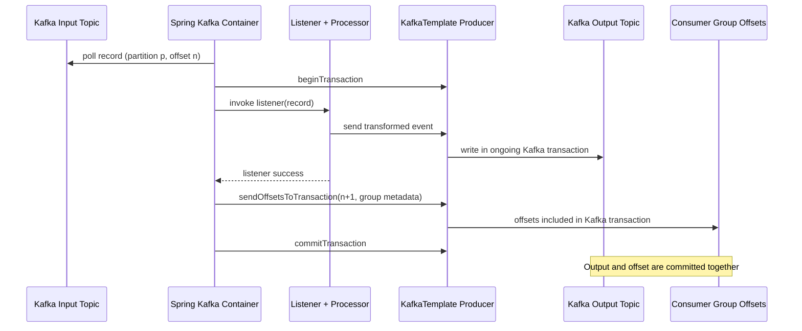
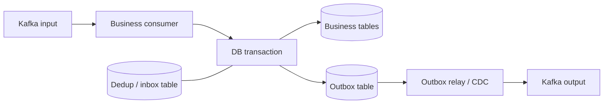

# Adding Transactions for Read-Process-Write in Spring Kafka

When implementing a **read → process → write** pipeline with Kafka, a critical question arises: if a service reads a record, sends the result, and crashes before committing the offset, will that record be processed twice? Conversely, if the offset is committed before the output actually exists in the target topic, will data be lost?

**Kafka transactions** solve an important part of this problem: in a **read from Kafka → process → write back to Kafka** flow, the output records and corresponding consumer offsets can be included in **a single Kafka transaction**. If the transaction aborts, uncommitted outputs will not be visible to consumers configured with `isolation.level=read_committed`, and the input offset will not be committed as a successful result.

This lesson belongs to **Spring Kafka Reliability Operations → Operations Practice** and guides you through building, fault-injecting, observing, and operating a transactional pipeline. Examples use Spring Boot 3.x, Spring Kafka 3.x, Java 17, and a Kafka broker supporting transactions. Beyond Kafka → Kafka, the lesson also clearly distinguishes **Kafka → database/API → Kafka**, where Kafka transactions **do not cover** side effects outside Kafka.

> **Core takeaway:** "Exactly once" in Kafka read-process-write is a **scoped guarantee**, not a promise that every piece of business logic or every external system is invoked strictly once. A consumer can still **re-execute** code; what Kafka transactions protect is **consistent visibility of written Kafka outputs and committed offsets** under the proper conditions.

## 1. Practice Objectives and Expected Outcomes

In this lab, we build the `orders-rpw-worker` application:

1. A consumer reads orders from the `orders.input.v1` topic.
2. A processor normalizes the payload and produces a result event.
3. `KafkaTemplate` sends the event to `orders.processed.v1`.
4. The listener container includes the **source record's offset** in the Kafka transaction alongside the output messages.
5. On successful processing, the Kafka transaction commits; `read_committed` consumers see the output and the group offset advances.
6. When an error occurs after calling send but before the listener finishes, the transaction aborts; the failing attempt's output does not become committed data and the source record can be redelivered.

Illustrative scenario using a record with key `ORDER-42`:

| Processing Attempt | Read Input | Write Output in Transaction | Transaction Outcome | `read_committed` Consumer Sees |
|---|---|---|---|---|
| Attempt 1 | `ORDER-42` | `send` called | **ABORT** due to simulated error | Does not see Attempt 1 output |
| Attempt 2 | `ORDER-42` redelivered | Resends output | **COMMIT** | One committed output |
| Group offset | Can remain unchanged after abort | Next offset included in successful transaction | Committed with transaction | Can resume after the processed record |

The number of attempts and redelivery timing are governed by the container and after-rollback policy, not an automatic Kafka rule of "always retry exactly twice."

## 2. What Problem Do Transactions Solve Exactly?

### 2.1. Without Kafka Transactions

A typical pipeline:

```text
Poll input record offset 100
  → transform
  → produce output message
  → output successfully written by broker
  → JVM crashes before committing consumer offset 101

After restart:
  consumer group still has committed offset 100
  → reads record offset 100 again
  → produces output again
```

If the output topic or downstream consumer lacks deduplication, two identical output events may appear.

The reverse direction is also dangerous: if the input offset is committed **before** the output is confirmed, a crash can mark the input as consumed even though no output exists.

### 2.2. With Kafka Transactions



When the listener throws an exception, the transaction can abort; records written by the Kafka producer inside an uncommitted transaction are hidden from `read_committed` consumers, and the group offset in that transaction is not committed.

**Do not interpret the diagram as "Kafka reads each record strictly once."** The listener may execute multiple times for the same record upon aborts, restarts, or rebalances. The guarantee is that committed Kafka outputs and associated offsets are managed transactionally within Kafka's scope and the chosen configuration.

### 2.3. Guarantee Matrix

| Scenario | What Do Kafka Transactions Help With? | What Remains Your Responsibility? |
|---|---|---|
| Kafka input → Kafka output | Binds output and consumed offsets into one Kafka transaction | Producer/consumer config, transaction ID, timeouts, exception paths |
| Kafka input → JDBC database | Does not automatically create a shared transaction | Database idempotency, outbox/inbox, or reconciliation |
| Kafka input → HTTP API | Does not roll back HTTP calls | Idempotency keys, status queries, compensation |
| Kafka input → sending emails | Cannot "recall" an email already sent | Outbox design, deduplication, replay-safe business logic |
| Kafka input → Kafka + database | Separate Kafka and DB transactions | Handling the failure window between the two commits |
| Kafka output → non-`read_committed` consumer | Aborted outputs can still be observed depending on isolation level | Setting the proper isolation level for consumers needing committed-only data |

## 3. Core Components to Know

| Component | Role |
|---|---|
| `KafkaTransactionManager` | Coordinates Kafka producer transactions in Spring |
| `DefaultKafkaProducerFactory` | Creates/provides transactional producers with `transactional.id` |
| `KafkaTemplate` | Sends records participating in the active transaction |
| `KafkaMessageListenerContainer` / concurrent container | Opens transactions during listener processing and manages offsets |
| `sendOffsetsToTransaction` | Enlists consumed offsets into the Kafka transaction |
| `transaction-id-prefix` | Base prefix for assigning transactional IDs to producers |
| `enable.idempotence` | Supports producer idempotence, required for transactional behavior |
| `isolation.level=read_committed` | Prevents consumers from exposing data from aborted transactions |
| `AfterRollbackProcessor` | Coordinates redelivery/recovery after a Kafka transaction rollback |
| `DeadLetterPublishingRecoverer` | Routes failing records to a DLT per recovery policy |

In modern Spring Kafka, when a listener container is configured with `KafkaTransactionManager`, the container can **automatically include offsets in the producer transaction** when the listener completes normally. Therefore, standard examples do not need to call `sendOffsetsToTransaction(...)` manually from the business listener.

**Do not call `kafkaTemplate.executeInTransaction(...)` inside a listener that already has a container-managed transaction just to "turn on transactions again."** Let the template join the active transaction; unintended nested transactions make semantics unpredictable. `executeInTransaction(...)` is meant for cases where the application actively sends messages **outside** a container-managed transaction.

## 4. Prerequisites Before Starting the Lab

You need:

- JDK 17+.
- A Spring Boot 3.x project with the `spring-kafka` dependency.
- A transaction-capable Kafka broker with two input/output topics and produce/consume permissions.
- Local environment: Docker Compose, Testcontainers, or a test broker.
- Permissions to inspect topic metadata, consumer group offsets, and application logs.

### 4.1. Single-Node Local Kafka Broker

Kafka transactions require an internal transaction-state topic. For a single local broker, broker settings must allow compatible replication and minimum ISR:

```properties
# ONLY FOR SINGLE-BROKER LAB
transaction.state.log.replication.factor=1
transaction.state.log.min.isr=1
```

In multi-broker production clusters, never blindly copy these values of 1. The transaction-state log and business topics require replication, availability, and `min.insync.replicas` matching real SLOs. If the broker cannot initialize the transaction coordinator, producers can fail on `initTransactions()` even though non-transactional sends work.

### 4.2. Creating Topics

Shell example when Kafka CLI is available:

```bash
kafka-topics.sh --bootstrap-server localhost:9092 \
  --create --if-not-exists \
  --topic orders.input.v1 --partitions 2 --replication-factor 1

kafka-topics.sh --bootstrap-server localhost:9092 \
  --create --if-not-exists \
  --topic orders.processed.v1 --partitions 2 --replication-factor 1

kafka-topics.sh --bootstrap-server localhost:9092 \
  --describe --topic orders.input.v1
```

In three-broker or production environments, set an appropriate replication factor and provision topics via managed IaC/provisioning. Consumers and producers should not be allowed to auto-create topics simply because a name was mistyped.

## 5. Project Structure

```text
kafka-rpw-transaction-lab/
├── settings.gradle
├── build.gradle
└── src/
    ├── main/
    │   ├── java/com/example/rpw/
    │   │   ├── RpwApplication.java
    │   │   ├── OrderProcessingListener.java
    │   │   └── LabFailureGate.java
    │   └── resources/
    │       └── application.yml
    └── test/
        └── java/com/example/rpw/
            └── KafkaRpwTransactionIntegrationTest.java
```

The lab uses String payloads to keep transaction behavior easy to trace, omitting databases or a schema registry from the main path. Using String does not mean real systems should skip schema validation; production systems can use Avro/Protobuf/JSON schemas with version governance.

### 5.1. Gradle

`settings.gradle`:

```groovy
rootProject.name = 'kafka-rpw-transaction-lab'
```

`build.gradle`:

```groovy
plugins {
    id 'java'
    id 'org.springframework.boot' version '3.3.5'
    id 'io.spring.dependency-management' version '1.1.6'
}

group = 'com.example'
version = '0.0.1-SNAPSHOT'

java {
    toolchain {
        languageVersion = JavaLanguageVersion.of(17)
    }
}

repositories {
    mavenCentral()
}

dependencies {
    implementation 'org.springframework.boot:spring-boot-starter'
    implementation 'org.springframework.kafka:spring-kafka'
    implementation 'org.springframework.boot:spring-boot-starter-actuator'

    testImplementation 'org.springframework.boot:spring-boot-starter-test'
    testImplementation 'org.springframework.kafka:spring-kafka-test'
}

tasks.named('test') {
    useJUnitPlatform()
}
```

These versions are **examples from the Spring Boot 3.x family**, not to be taken as "latest." In real projects, choose an organization-approved dependency set and rely on Spring Boot's BOM to prevent mismatches across Spring Kafka, Spring Framework, the Kafka client, and Java.

## 6. Enabling Kafka Transactions via application.yml

`src/main/resources/application.yml`:

```yaml
spring:
  application:
    name: kafka-rpw-worker

  kafka:
    bootstrap-servers: "${KAFKA_BOOTSTRAP_SERVERS:localhost:9092}"

    consumer:
      group-id: orders-rpw-worker
      enable-auto-commit: false
      auto-offset-reset: earliest
      key-deserializer: org.apache.kafka.common.serialization.StringDeserializer
      value-deserializer: org.apache.kafka.common.serialization.StringDeserializer
      properties:
        "[isolation.level]": "read_committed"

    producer:
      key-serializer: org.apache.kafka.common.serialization.StringSerializer
      value-serializer: org.apache.kafka.common.serialization.StringSerializer
      acks: all
      transaction-id-prefix: "orders-rpw-${HOSTNAME:local}-"
      properties:
        "[enable.idempotence]": "true"
        "[delivery.timeout.ms]": "120000"

    listener:
      ack-mode: record
      concurrency: 1

app:
  topics:
    input: orders.input.v1
    output: orders.processed.v1
```

### 6.1. Effect of Each Property

**`spring.kafka.producer.transaction-id-prefix`** is the primary trigger for Spring Boot to auto-configure a transactional producer factory and `KafkaTransactionManager` when compatible auto-configuration applies. Spring Boot also typically attaches the transaction manager to its auto-configured listener container factory. If you declare a custom container factory, verify that it **actually uses the Kafka transaction manager**; setting the property alone while a listener points to a different factory is insufficient.

**`enable-auto-commit=false`** prevents the Kafka consumer from committing offsets periodically regardless of whether the business listener has completed. Offsets must be handled by the container as part of the Kafka transaction.

**`read_committed`** is essential for consumers that must not see outputs from aborted transactions. In a read-process-write chain, configuring `read_committed` on the input consumer also avoids reading uncommitted or aborted upstream transactions.

**`acks=all`** requires broker acknowledgment per in-sync replica policy, suitable for durable producers. Kafka transactional producers also impose constraints on idempotence, retries, and max in-flight requests; use compatible versions and settings.

**`ack-mode=record`** lets the listener container operate in record mode under the matching acknowledgment policy. When a transaction is active, the container is responsible for sending offsets into the transaction. Do not manually call `Acknowledgment.acknowledge()` in this example unless there is a specific reason to use manual mode.

**`auto-offset-reset=earliest`** only reads from the start when the group has no valid committed offset. It does not cause a group with existing offsets to replay history on every restart. In production, choose `earliest`, `latest`, or `none` according to your bootstrap policy rather than copying lab settings verbatim.

### 6.2. Transaction ID Prefix Must Be Designed per Instance

A transactional Kafka producer requires a `transactional.id`. Spring Kafka's producer factory can create multiple producers with IDs derived from a prefix.

With two pods:

```text
Pod A: orders-rpw-orders-worker-6c9f-a-
Pod B: orders-rpw-orders-worker-6c9f-b-
```

Each pod must have a prefix that is **unique among concurrently active instances**. If two processes use the same transactional ID, Kafka may fence the older producer, causing `ProducerFencedException` or transaction failures.

In Kubernetes, `HOSTNAME` is typically the pod name; verify its actual value, lifecycle, and rollout behavior. You can inject a stable pod identity or instance ID provided by the deployment. Never share a static prefix across all replicas without understanding how the producer factory allocates IDs and the risk of collisions.

**Fencing is useful for eliminating zombie producers**, yet unintended fencing caused by duplicate IDs disrupts the pipeline. When changing prefixes across deployments, understand the impact on running older producers, transactional ID expiration, and broker policies.

### 6.3. Checking Whether Boot Wired the Manager to the Container

In Spring Boot 3.x, configuring `transaction-id-prefix` enables auto-configuration of the transactional producer and Kafka transaction manager. However, if using a custom factory:

```java
@Bean
ConcurrentKafkaListenerContainerFactory<String, String> customFactory(
        ConsumerFactory<String, String> consumerFactory,
        KafkaTransactionManager<String, String> kafkaTxManager) {

    var factory =
            new ConcurrentKafkaListenerContainerFactory<String, String>();
    factory.setConsumerFactory(consumerFactory);
    factory.getContainerProperties()
            .setKafkaAwareTransactionManager(kafkaTxManager);
    return factory;
}
```

This pattern targets Spring Kafka 3.x where `setKafkaAwareTransactionManager` is available. Method and interface names can vary across version branches, so verify custom factory code against your target version. If using the Boot-managed `kafkaListenerContainerFactory`, you generally **do not need to build a custom factory** just to enable transactions; a custom factory can also drop customizers, ack settings, or observation configurations set by Boot.

Operationally, confirm via logs or tracing that the Kafka producer initializes transactions and write an integration test proving **abort hides outputs**. Checking only that a `KafkaTransactionManager` bean exists is not enough.

## 7. Read-Process-Write Implementation

### 7.1. Spring Boot Application

`src/main/java/com/example/rpw/RpwApplication.java`:

```java
package com.example.rpw;

import org.springframework.boot.SpringApplication;
import org.springframework.boot.autoconfigure.SpringBootApplication;

@SpringBootApplication
public class RpwApplication {

    public static void main(String[] args) {
        SpringApplication.run(RpwApplication.class, args);
    }
}
```

### 7.2. Listener Reading and Writing Kafka in a Transaction

`src/main/java/com/example/rpw/OrderProcessingListener.java`:

```java
package com.example.rpw;

import java.util.Locale;

import org.apache.kafka.clients.consumer.ConsumerRecord;
import org.springframework.beans.factory.ObjectProvider;
import org.springframework.beans.factory.annotation.Value;
import org.springframework.kafka.annotation.KafkaListener;
import org.springframework.kafka.core.KafkaTemplate;
import org.springframework.stereotype.Component;

@Component
public class OrderProcessingListener {

    private final KafkaTemplate<String, String> template;
    private final ObjectProvider<LabFailureGate> failureGate;
    private final String outputTopic;

    public OrderProcessingListener(
            KafkaTemplate<String, String> template,
            ObjectProvider<LabFailureGate> failureGate,
            @Value("${app.topics.output}") String outputTopic) {
        this.template = template;
        this.failureGate = failureGate;
        this.outputTopic = outputTopic;
    }

    @KafkaListener(
            id = "orders-rpw-listener",
            idIsGroup = false,
            topics = "${app.topics.input}")
    public void onOrder(ConsumerRecord<String, String> record) {
        String orderId = record.key();
        if (orderId == null || orderId.isBlank()) {
            throw new IllegalArgumentException(
                    "Missing business order key");
        }

        // Pure transformation: same input produces same output.
        String normalized = record.value()
                .strip()
                .toUpperCase(Locale.ROOT);
        String output = "PROCESSED:" + normalized;

        // KafkaTemplate participates in the transaction opened by the listener container.
        // Do not commit offsets manually or open a separate transaction.
        template.send(outputTopic, orderId, output);

        // This bean exists only when the "lab" profile is active.
        // Failing after send aborts this attempt's Kafka transaction.
        LabFailureGate gate = failureGate.getIfAvailable();
        if (gate != null && gate.shouldFailOnce(orderId)) {
            throw new IllegalStateException(
                    "LAB: fail after Kafka send, before commit");
        }
    }
}
```

Explanation:

1. The listener container polls the record and opens a Kafka transaction before invoking the listener when the transaction manager is wired properly.
2. `OrderProcessingListener` performs a **pure transformation** on the String.
3. `KafkaTemplate.send(...)` sends the event to the output topic using a producer participating in the container's transaction.
4. Listener returns normally → the container can enlist offsets into the Kafka transaction and commit.
5. Listener throws an exception → the transaction aborts; no offset is committed in that transaction.

**`KafkaTemplate.send(...)` is typically asynchronous** and in Spring Kafka 3.x returns a future. It does not imply network confirmation succeeded on that line. When the container commits the transaction, the Kafka producer must complete pending sends properly; a send failure can fail the commit. In the lab, we intentionally throw **after calling send**, without assuming whether the broker received the record before the exception—if the record was written in the aborted transaction, `read_committed` consumers still will not see it; if it was not sent yet, there is likewise no committed output.

If you require sending and awaiting the ACK inside the listener:

```java
template.send(outputTopic, orderId, output)
        .get(5, java.util.concurrent.TimeUnit.SECONDS);
```

This makes send status easier to observe in small tests, though it can reduce throughput by blocking on each message. It still **does not replace Kafka transaction commit**. In production, you can send asynchronously in batches and let the transaction/producer handle send outcomes with clear timeouts and monitoring.

### 7.3. Lab-Only Fault Injection

`src/main/java/com/example/rpw/LabFailureGate.java`:

```java
package com.example.rpw;

import java.util.concurrent.atomic.AtomicInteger;
import java.util.concurrent.atomic.AtomicReference;

import org.springframework.context.annotation.Profile;
import org.springframework.stereotype.Component;

@Component
@Profile("lab")
public class LabFailureGate {

    private final AtomicReference<String> failKey =
            new AtomicReference<>();

    private final AtomicInteger seenAttempts =
            new AtomicInteger();

    public void arm(String key) {
        seenAttempts.set(0);
        failKey.set(key);
    }

    public boolean shouldFailOnce(String key) {
        if (!key.equals(failKey.get())) {
            return false;
        }

        seenAttempts.incrementAndGet();
        return failKey.compareAndSet(key, null);
    }

    public int seenAttempts() {
        return seenAttempts.get();
    }
}
```

This bean is created only when the `lab` profile is active; there is no HTTP endpoint to trigger failures remotely in production. `failKey` and the counter exist for testing, not persistence. If the JVM is killed, in-memory flags are lost; production recovery must rely on Kafka transactions, offsets, and business idempotency rather than such flags.

For record `ORDER-42`, the first attempt throws an exception. Under the configured rollback/redelivery policy, the subsequent attempt reprocesses the same record without throwing. Tests should wait for retry/recovery with a bounded timeout and compare actual outputs.

## 8. Transaction Boundaries on the Listener Container

Normally, transactions are orchestrated by the Kafka listener container. One listener invocation processes a record with a Kafka producer transaction bound to the thread/container:

```text
Kafka poll
  ↓
Container begins Kafka transaction
  ↓
Listener transforms record
  ↓
KafkaTemplate.send(output)
  ↓
Listener returns successfully
  ↓
Container sends consumed offsets into transaction
  ↓
Commit Kafka transaction
```

Failure path:

```text
Kafka poll
  ↓
Container begins Kafka transaction
  ↓
Listener sends output record
  ↓
Exception escapes listener
  ↓
Abort Kafka transaction
  ↓
After-rollback processing / redelivery
  ↓
Input record may be delivered again
```

Do not try to use `@Transactional` with a JDBC `PlatformTransactionManager` to "wrap" these Kafka operations without specifying explicitly which manager is used. In applications with multiple transaction managers, declare dependencies explicitly and reason carefully about **two distinct transactions**.

### 8.1. Kafka EOS V2

Modern Spring Kafka versions use Kafka transactions with broker/client support to coordinate producer writes and consumed offsets. When reading older documentation mentioning terms like EOSMode V1/ALPHA/BETA, check the exact version; Spring Kafka 3.x centers on **EOS V2**. Do not copy configurations from older versions merely because they mention "exactly once."

In practice, transactional consume-transform-produce means:

- An input record may still **invoke the listener multiple times**.
- Aborted Kafka outputs are invisible to `read_committed` consumers.
- Offsets are committed in the same Kafka transaction as the corresponding output.
- Group IDs, transaction IDs, and consumer assignments must remain stable.
- Do not open a second transaction to commit offsets on another thread.

### 8.2. Consumer Isolation Level

A consumer with `isolation.level=read_committed` only delivers committed messages and skips records from aborted transactions. This differs from **`read_uncommitted`**, which can read records even from aborted transactions.

Example:

```text
Output log:
  Offset 10: TX-A writes "PROCESSED:ORDER-42" (ABORTED)
  Offset 11: TX-B writes "PROCESSED:ORDER-42" (COMMITTED)

Consumer read_uncommitted:
  may see records from both TX-A and TX-B

Consumer read_committed:
  sees only the record from TX-B
```

This illustrates isolation semantics; offsets are assigned to records and transaction control markers in the actual Kafka log, so an aborted record still occupies log positions. **Do not assume outputs will have contiguous offsets** just because a `read_committed` consumer only sees committed records.

### 8.3. Watching Out for Open Transactions

A Kafka `read_committed` consumer is bounded by the **Last Stable Offset (LSO)**, which tracks the earliest still-open transaction. A transaction kept open for too long can block consumers from receiving later records in the partition even though those records are already in the log.

Therefore, never let a Kafka transaction span multi-minute HTTP waits or unbounded business computation. Transaction duration, producer transaction timeout, `max.poll.interval.ms`, and downstream SLAs must be designed consistently.

## 9. Testing Transactions with a Real Kafka Broker in Test Environments

To prove transactional guarantees, tests must interact with a Kafka broker running an active transaction coordinator. Mocking `KafkaTemplate` only proves a method was called; **it does not prove aborted outputs are hidden or offsets commit properly**.

You can use **Spring Kafka EmbeddedKafka** or **Testcontainers Kafka**. The example below uses a single-node embedded broker with lab-compatible transaction-state replication and min ISR settings.

### 9.1. Creating the Test Application Context

`src/test/java/com/example/rpw/KafkaRpwTransactionIntegrationTest.java`:

```java
package com.example.rpw;

import static org.assertj.core.api.Assertions.assertThat;

import java.time.Duration;
import java.util.Map;
import java.util.UUID;

import org.apache.kafka.clients.consumer.Consumer;
import org.apache.kafka.clients.consumer.ConsumerConfig;
import org.apache.kafka.common.serialization.StringDeserializer;
import org.junit.jupiter.api.Test;
import org.springframework.beans.factory.annotation.Autowired;
import org.springframework.boot.test.context.SpringBootTest;
import org.springframework.kafka.core.DefaultKafkaConsumerFactory;
import org.springframework.kafka.core.KafkaTemplate;
import org.springframework.kafka.test.EmbeddedKafkaBroker;
import org.springframework.kafka.test.context.EmbeddedKafka;
import org.springframework.kafka.test.utils.KafkaTestUtils;
import org.springframework.test.context.ActiveProfiles;

@SpringBootTest(properties = {
        "app.topics.input=orders.input.lab",
        "app.topics.output=orders.processed.lab",
        "spring.kafka.consumer.group-id=orders-rpw-test",
        "spring.kafka.consumer.auto-offset-reset=earliest",
        "spring.kafka.consumer.properties[isolation.level]=read_committed",
        "spring.kafka.producer.transaction-id-prefix=orders-rpw-test-"
})
@ActiveProfiles("lab")
@EmbeddedKafka(
        partitions = 2,
        topics = {"orders.input.lab", "orders.processed.lab"},
        bootstrapServersProperty = "spring.kafka.bootstrap-servers",
        brokerProperties = {
                "transaction.state.log.replication.factor=1",
                "transaction.state.log.min.isr=1"
        })
class KafkaRpwTransactionIntegrationTest {

    @Autowired KafkaTemplate<String, String> kafkaTemplate;
    @Autowired EmbeddedKafkaBroker embeddedKafka;
    @Autowired LabFailureGate failureGate;

    @Test
    void abortedAttemptIsHiddenAndRedeliveryCommitsOneOutput()
            throws Exception {

        String key = "ORDER-" + UUID.randomUUID();
        failureGate.arm(key);

        Map<String, Object> props = KafkaTestUtils.consumerProps(
                "output-inspector-" + UUID.randomUUID(),
                "false",
                embeddedKafka);
        props.put(
                ConsumerConfig.ISOLATION_LEVEL_CONFIG,
                "read_committed");
        props.put(
                ConsumerConfig.AUTO_OFFSET_RESET_CONFIG,
                "earliest");

        try (Consumer<String, String> observer =
                     new DefaultKafkaConsumerFactory<>(
                             props,
                             new StringDeserializer(),
                             new StringDeserializer())
                             .createConsumer()) {

            embeddedKafka.consumeFromAnEmbeddedTopic(
                    observer, "orders.processed.lab");

            // The app's KafkaTemplate is transactional. When sending from
            // a test thread outside the listener, open a separate transaction.
            kafkaTemplate.executeInTransaction(ops -> {
                ops.send("orders.input.lab", key, "  new-order  ");
                return null;
            });

            var output = KafkaTestUtils.getSingleRecord(
                    observer,
                    "orders.processed.lab",
                    Duration.ofSeconds(30));

            assertThat(output.key()).isEqualTo(key);
            assertThat(output.value())
                    .isEqualTo("PROCESSED:NEW-ORDER");
        }
    }
}
```

This is an deployable integration test skeleton for compatible versions. Using fixed topic and consumer group names for the listener alongside a random input key helps the test identify its records. To avoid interference between concurrent tests, use isolated application contexts/brokers or distinct test topics and groups.

**What the test above directly verifies:** a `read_committed` observer receives the committed output with the expected key and payload. To assert rigorously that the first attempt **aborted** and the input was reprocessed by the listener, add the instrumentation and test checks below. Seeing one output in a single `getSingleRecord` call is not enough on its own to prove the failure path.

### 9.2. Adding Assertions for Retry and Abort

With `LabFailureGate` above, `seenAttempts()` increments only while the key is armed. After the first throw, the key is cleared, so the next processing attempt **does not increment** the counter as currently coded. To count all deliveries, a simple approach is adding a `ConcurrentHashMap<String, AtomicInteger>` in a listener test probe and incrementing it at the start of `onOrder(...)`.

Example test-only probe:

```java
@Component
@Profile("lab")
public class DeliveryProbe {
    private final ConcurrentHashMap<String, AtomicInteger> counts =
            new ConcurrentHashMap<>();

    public void seen(String key) {
        counts.computeIfAbsent(
                key, ignored -> new AtomicInteger()).incrementAndGet();
    }

    public int count(String key) {
        var counter = counts.get(key);
        return counter == null ? 0 : counter.get();
    }
}
```

In the listener, inject `ObjectProvider<DeliveryProbe>` and call `probe.seen(orderId)` before processing when the `lab` profile is active. After the output commits, wait until `count(key) >= 2` using Awaitility or a polling helper with a finite timeout.

A **thorough** test should assert:

- The listener receives the record the first time and throws an exception.
- The first producer transaction is aborted according to metrics, logs, or instrumentation.
- The listener receives the same input again (or in another execution after restart) and succeeds.
- A `read_committed` consumer receives **only one committed output** for that key.
- The consumer group offset on the input partition advances after the final commit.
- No DLT record exists if the subsequent retry succeeds.

To prove only one output exists, after receiving the first record, continue polling for a bounded window filtering by the test key; **do not call `getSingleRecord` once and assume no second record exists on the topic**.

### 9.3. Checking Committed Offsets

A CLI check while a job is running:

```bash
kafka-consumer-groups.sh \
  --bootstrap-server localhost:9092 \
  --group orders-rpw-test \
  --describe
```

Identify the topic partition containing your test key, the first record's offset, and the group's committed offset. If the record is at offset `n`, after successful processing the group's committed offset for that partition is typically **`n + 1`**, because the committed offset represents the **next position to read**, not the last processed record's offset.

Do not conclude the group offset advanced purely from a listener "processed successfully" log. Read group committed offsets from the broker or `AdminClient` after the Kafka transaction commits. In tests with multiple partitions or records, match the exact partition.

### 9.4. Why Do Tests Need a Transaction-Capable Broker?

A fake producer can return `CompletableFuture.completedFuture(...)` and make unit tests pass, yet it cannot simulate:

- The transaction coordinator and `initTransactions()`.
- Abort markers and `read_committed` isolation.
- Transactional ID fencing across producer instances.
- `sendOffsetsToTransaction` and group offsets.
- Timeouts during transaction commit.
- Rebalances and redeliveries after crashes.

Because these behaviors directly determine reliability, integration tests against a real Kafka broker (even in a container) are mandatory before claiming transactional guarantees.

## 10. Injecting Realistic Faults at Every Stage

| Fault Injection Point | Expectation with Kafka → Kafka Transaction | Evidence to Collect |
|---|---|---|
| Before calling send | Transaction aborts; no output | Output count and offset |
| After calling send, before listener returns | Transaction aborts; failed attempt's output invisible to `read_committed` | Transaction abort, redelivery |
| Send future fails | Transaction does not commit successfully | Producer errors, offset does not advance wrongly |
| During transaction commit | Commit may fail/be uncertain; verify via broker | Transaction state, outputs/offsets, restarts |
| JVM killed while transaction open | Broker aborts/fences per timeout/lifecycle; record may replay | Group offsets, consumer lag, producer logs |
| Producer transactional ID fenced | Old producer cannot continue writing with that identity | Fenced errors and lifecycle |
| Rebalance mid-processing | Assignment may change, record redelivered | Lag, rebalance logs, output dedup |
| Output topic lacks WRITE permission | Transaction/send fails; output/offset not committed | ACL errors, alerts |
| `read_uncommitted` consumer | May see records from aborted transactions | Compare observer isolation modes |

### 10.1. Failure Before Commit

This is the baseline case. The listener throws an exception and the container rolls back the Kafka transaction. Never write code like:

```java
try {
    kafkaTemplate.send(topic, key, payload);
    dangerousOperation();
} catch (Exception ex) {
    log.warn("Ignoring failure", ex);
}
```

If the exception is swallowed, the listener **returns normally**, and the container may treat processing as successful and commit the Kafka transaction and offset even though `dangerousOperation()` failed. Significant exceptions must either **propagate out of the listener** or be translated into an explicitly controlled business outcome.

### 10.2. Failure During Transaction Commit

An error during commit can create an **ambiguous client outcome**: the connection may drop while the broker is finalizing the commit. Never assume "commit threw an error, therefore it definitely rolled back." Design recovery around the Kafka transaction coordinator, fencing, committed offsets, and `read_committed` consumers.

If the application also triggers side effects outside Kafka, ambiguous commit outcomes are even riskier: you may need to reconcile both Kafka and downstream systems.

### 10.3. When a Producer Is Fenced

Kafka uses `transactional.id` together with the producer epoch to prevent "zombie" producers from continuing to write after their identity has been reassigned. When encountering `ProducerFencedException`, do not retry with the same producer as if it were a transient network glitch.

Procedure:

1. Identify the transactional ID/prefix and which instance is using it.
2. Check whether two pods accidentally share the same prefix or identity.
3. Inspect rolling restarts, producer caches, broker timeouts, and transaction expiration.
4. Let the framework replace/close the producer through the supported recovery path.
5. Monitor consumer lag and redeliveries; do not manually commit offsets via another consumer to "skip the error."

Do not log usernames, passwords, or JAAS configurations while investigating fencing; the transactional ID and pod identity are usually sufficient to isolate the issue.

## 11. Error Handlers for Transactional Listeners

For non-transactional listener containers, `DefaultErrorHandler` is commonly used to handle exceptions. When **Kafka transactions** are enabled, rollback is an integral part of recovery.

In Spring Kafka, **`DefaultAfterRollbackProcessor`** handles records after a transaction rolls back. It can seek for redelivery, track failures/backoff, and invoke a recovery path once retries are exhausted, depending on configuration and version.

```text
Transactional listener:
  exception
  → abort Kafka transaction
  → AfterRollbackProcessor
  → seek/redelivery or recovery according to policy
```

### 11.1. Distinguishing the Mechanisms

| Mechanism | Typical Role |
|---|---|
| `DefaultErrorHandler` | Listener/container error handling, especially common on non-transactional paths |
| `DefaultAfterRollbackProcessor` | Handles records/batches after a **Kafka transaction rollback** |
| `DeadLetterPublishingRecoverer` | Recovers to a DLT, usable by the appropriate recovery mechanism |
| `@RetryableTopic` | Non-blocking retry topology via retry topics; requires checking compatibility with transactions |

Do not assume adding a `DefaultErrorHandler` bean alone gives a transactional listener the right retry/DLT policy. Listener containers may handle Kafka transaction failures via distinct processors, and error handler settings must not "swallow" exceptions in a way that lets the transaction commit anyway.

### 11.2. Long Retries Inside a Kafka Transaction

Excessively long blocking backoff holds the container thread on the error path, increasing lag and interacting with poll intervals and heartbeats. When quick recovery is unlikely, consider failing/recovering, separating retry topics, or operating a DLT with a runbook.

If the application requires strict per-key or per-partition ordering, non-blocking retry topics can alter the relative processing timing across records; do not treat them as strictly equivalent to blocking redelivery.

### 11.3. DLT in a Transactional Context

When a permanently invalid record must go to a DLT and the input offset must advance, design the timing of **sending to the DLT, confirming the publish, and committing the offset**. With transactional recovery, a **new Kafka transaction** may be needed after rollback to publish to the DLT and commit offsets, depending on the capabilities and configuration of `DefaultAfterRollbackProcessor` in your version.

Never simply write:

```java
catch (Exception ex) {
    kafkaTemplate.send(dlt, record.value());
    return; // Treat as recovered
}
```

because this can cause the container to commit the primary transaction even though business processing failed, or fail to handle DLT publish errors. The DLT needs proper serializers, partitions, ACLs, retry/failure metrics, and clear ownership.

**In the primary lab, no DLT is configured** so that abort and single-redelivery behavior is easy to demonstrate. When adding a DLT, test it separately with expected offsets and committed DLT records.

## 12. Do Not Confuse Kafka Transactions with Database Transactions

Many applications follow this pattern:

```text
Kafka order event
  → read customer details from PostgreSQL
  → update order_status in PostgreSQL
  → publish order_processed event to Kafka
```

Here there are **two independent storage systems**:

1. A Kafka transaction manages Kafka outputs and Kafka input offsets.
2. A database transaction manages INSERT/UPDATE statements in PostgreSQL.

When both are used in one processing step, there is normally **no single atomic distributed transaction** spanning Kafka and the database.

### 12.1. Failure Window When DB Commits Before Kafka

```text
1. Consume event E
2. Begin DB transaction
3. UPDATE order_status = PROCESSED
4. DB COMMIT succeeds
5. Kafka output/offset transaction COMMIT fails

Kafka may redeliver E after restart.
DB has already recorded E's business side effect.
```

If the handler is not idempotent, reprocessing may increment balances, send duplicate emails, or create duplicate orders.

### 12.2. Failure Window When Kafka Commits Before DB

```text
1. Consume event E
2. Produce Kafka output and commit consumed offset
3. DB UPDATE/COMMIT fails

Input offset may have advanced.
DB does not yet have the intended change.
```

This is why **commit order alone does not create atomicity**. Choosing DB-first or Kafka-first only changes **which side can succeed first** if the other side fails.

### 12.3. `@Transactional` Does Not Merge Two Systems into One

A method annotated with `@Transactional` (JDBC) inside a transactional Kafka listener may open synchronized or chained transactions as supported by Spring, yet it does not provide distributed two-phase commit across both resources.

Never write in operational documentation that "both DB and Kafka will roll back together" unless a mechanism genuinely guarantees it. Spring Kafka supports transaction synchronization and configurable commit ordering for some patterns, but a failure window still exists between the two commits.

## 13. Safe Pattern for Kafka → DB: Idempotent Consumer / Inbox

If the goal is purely **Kafka input → JDBC DB** without producing Kafka outputs, you can process inside a DB transaction and use a business ID / event ID to deduplicate.

Example schema:

```sql
CREATE TABLE processed_event (
    event_id VARCHAR(100) PRIMARY KEY,
    processed_at TIMESTAMP NOT NULL
);

CREATE TABLE order_projection (
    order_id VARCHAR(100) PRIMARY KEY,
    status VARCHAR(30) NOT NULL
);
```

Inside one DB transaction:

```text
Consume Kafka event eventId=E-123
  Begin DB transaction
    INSERT processed_event(E-123) if not present
    UPDATE order_projection(...) per business logic
  Commit DB transaction

Container commits Kafka offset afterward
```

If a crash happens after DB commit but before offset commit, the event is read again. On the second pass, `event_id=E-123` already exists and **the business side effect is not applied a second time**.

**Must be atomic inside the database:** inserting the deduplication key and updating business tables must occur **in the same DB transaction**. If `processed_event` is written first and the business update fails in a separate transaction, a retry might skip the record as "already processed" even though the data is wrong.

When a duplicate key appears, distinguish among:

- Valid replay of the same event/version.
- An event ID accidentally reused with a different payload.
- A race between two consumers/transactions.

For sensitive data, consider storing a payload hash/version to detect conflicts rather than silently swallowing every unique violation.

## 14. Pattern for Kafka → DB → Kafka: Transactional Outbox

When an application must both update a database and emit Kafka events, the **transactional outbox** is usually the easiest design to reason about for correctness.



Inside **a single DB transaction**:

1. Check whether the event ID has already been processed.
2. Update business tables.
3. Insert an outbox row containing the event to publish.
4. Mark the input event as processed.
5. Commit the DB transaction.

Then a relay (poller or CDC such as Debezium) publishes the outbox row to Kafka:

```sql
CREATE TABLE outbox_event (
    event_id VARCHAR(100) PRIMARY KEY,
    aggregate_id VARCHAR(100) NOT NULL,
    event_type VARCHAR(100) NOT NULL,
    payload CLOB NOT NULL,
    created_at TIMESTAMP NOT NULL,
    published_at TIMESTAMP NULL
);
```

### 14.1. What Does the Outbox Solve and Not Solve?

**Solves:** the business DB update and the intent to emit an event are persisted in **one DB commit**. There is no state where "the DB committed, yet the decision to publish the event was never recorded."

**Does not automatically guarantee exactly-once publishing:** the relay can publish to Kafka successfully and crash before setting `published_at`. After restarting, it can publish the same outbox event again. Therefore, messages need a **stable event ID**, and downstream consumers must enforce deduplication/idempotency.

If using CDC, you must manage snapshots, schemas, connector offsets, topic partitioning, and ordering. An outbox is an architectural choice, not a Kafka transaction configuration flag.

### 14.2. When Is an Outbox Unnecessary?

For a **pure Kafka → Kafka** pipeline that does not update a DB or external API and whose transformations are replayable, Kafka transactions can be an appropriate choice with fewer moving parts.

For pipelines where a DB is the source of truth and events must remain consistent with business transactions, an outbox is usually worth considering. The decision depends on latency, throughput, number of systems, and business requirements.

## 15. Idempotency for External Non-Kafka Side Effects

Systems involving HTTP APIs, email, billing, or object storage must recognize that Kafka transactions **do not roll back** those external side effects.

### 15.1. API Timeout After Commit

```text
Kafka event ORDER-42
  → HTTP POST /capture-payment (server committed)
  → response timeout
  → listener throws
  → Kafka transaction aborts
  → ORDER-42 is redelivered
  → HTTP POST /capture-payment again
```

If the API does not support idempotency, a customer could be charged twice even though Kafka transactions behaved **completely correctly**.

Mitigations:

- Send a stable idempotency key, such as `payment:ORDER-42`.
- Query downstream status after an ambiguous timeout.
- Maintain a deduplication store on the receiving side or use orchestration.
- Use an outbox/command log and reconciliation for high-assurance operations.
- Never blindly auto-retry a side-effecting API indefinitely.

### 15.2. Handling File / Object Storage

If a listener writes an object to cloud storage and the Kafka transaction then aborts, the object **may still exist**. Use immutable object keys tied to the event ID, checksums/versions, and publish a completion marker or manifest only once data is genuinely finalized.

Do not let downstream consumers treat the appearance of a temporary file as proof that the whole pipeline committed.

## 16. Timeouts and Throughput in Transactional Read-Process-Write

Kafka transactions incur overhead compared to non-transactional messaging:

- Initializing transactional producers and the transaction coordinator.
- Beginning, committing, and aborting transactions.
- Writing transaction markers and offsets.
- Coordinating with the group coordinator.
- Concurrent transaction count, producer caching, and network round-trips.
- Open transaction duration affecting the Last Stable Offset and consumer lag.

Parameters to review:

| Parameter/Limit | Operational Meaning |
|---|---|
| `transaction.timeout.ms` | How long a transaction may stay open before the broker times it out |
| `transaction.max.timeout.ms` on broker | Maximum timeout a client is allowed to request |
| `max.poll.interval.ms` | Processing window between polls before the consumer is considered unresponsive |
| `delivery.timeout.ms` | Producer delivery time budget |
| `request.timeout.ms` | Client-to-broker request timeout |
| `spring.kafka.listener.concurrency` | Concurrent listener consumers per application instance |
| Replicas × concurrency | Total parallelism and number of transactional producers created |
| Topic partitions | Practical upper bound on parallel consumption |
| Broker/producer metrics | Transaction commit/abort latency and throughput |

For example, a listener that reads a record and makes a 90-second HTTP call can keep a Kafka transaction open too long, building backlogs and colliding with poll or transaction timeouts. Consider:

1. Separating long CPU work outside the transaction boundary where logic allows.
2. Never holding a Kafka transaction open across user interactions or slow HTTP waits.
3. Aligning timeouts and retry/backoff with end-to-end pipeline SLAs.
4. Measuring actual commit and abort times, not only handler execution duration.
5. Scaling concurrency to match partitions, Kafka producer capacity, and downstream limits.

**Never increase transaction timeouts indefinitely** to mask a stalled handler. Identify the bottleneck and define sensible work boundaries.

## 17. Production Monitoring

| Group | Signal | Why It Matters |
|---|---|---|
| Producer transaction | Commit/abort counts, latency, errors | Detects spikes in transaction rollbacks |
| Producer | Send failures, delivery timeouts, buffer waits | Separates broker issues from business errors |
| Consumer | Lag, committed offsets, poll intervals | Spots stalled sources or non-advancing offsets |
| Group | Rebalance count, assigned partitions | Shows whether crashes/restarts/scaling cause replays |
| Listener | Processing duration, exception classes | Isolates failure causes |
| DLT/recovery | Recovery successes/failures, backlog | Prevents permanent record loss |
| Business data | Distinct event IDs, duplicate counts | Verifies accurate side effects |
| Runtime | CPU, heap, GC, threads | Separates I/O bottlenecks from application saturation |
| Security | Authentication errors, ACL denials | Identifies missing READ/WRITE/transaction permissions |

Structured log example:

```text
service=orders-rpw-worker
group=orders-rpw-worker
topic=orders.input.v1
partition=1
offset=1287
businessKey=ORDER-42
transactionOutcome=ABORT
exceptionClass=IllegalStateException
attempt=1
```

**Only log `transactionOutcome=COMMIT` when an actual commit confirmation signal exists** (such as container/producer instrumentation); do not infer it merely from the listener method returning. On listener exceptions, avoid logging raw sensitive payloads or credentials. Never put high-cardinality event IDs, offsets, or transactional IDs into metric tags.

### 17.1. Consumer Lag Does Not Tell the Whole Story

A group whose committed offset advances slowly may be suffering from:

- Repeated transaction aborts.
- Output topic/ACL issues or producer transaction coordinator failures.
- Slow handler CPU, DB, or API calls.
- Long-lived open transactions blocking `read_committed` consumers at the LSO.
- Continuous rebalances, fenced producers, or pod crash loops.
- A retry policy stalling a partition on a poison pill.

When diagnosing lag, correlate transaction logs, listener exceptions, broker health, and output throughput. **Increasing concurrency** will not help if transactional producers are getting fenced or the output broker is degraded.

## 18. Deployment Operations with `transactional.id`

### 18.1. Per-Environment Rules

| Environment | Transactional ID Prefix | Caution |
|---|---|---|
| Local | `orders-rpw-local-{developer}-{instance}-` | Do not share arbitrarily across two processes |
| CI/Test | `orders-rpw-test-{test-run-id}-` | Prevent parallel tests from fencing one another |
| Staging | `orders-rpw-staging-{pod-id}-` | Isolated ACLs and cluster |
| Production | `orders-rpw-prod-{pod-id}-` | Unique across concurrent instances; audited |

The Kafka client may generate multiple transactional IDs with suffixes derived from the prefix. Check exact names according to your producer factory/version; what matters is **zero collisions across concurrent processes**.

### 18.2. Rolling Restarts

During a rolling deployment:

1. New pods join the group and initialize transactional producers.
2. Old pods may still be executing transactions and holding partitions.
3. Container shutdown needs sufficient grace time to finish or abort in-flight transactions.
4. Kafka rebalances partitions; uncommitted records may be redelivered.
5. Zombie producers are fenced by the broker when transactional identities are reused per Kafka's protocol.

Do not rely on "graceful shutdown always completes" to skip idempotency: nodes can lose power or containers can be killed unexpectedly.

### 18.3. Signs of Misconfiguration

| Symptom | Likely Cause | What to Check |
|---|---|---|
| Frequent `ProducerFencedException` during scaling | Colliding transactional IDs/prefixes | Pod identity, prefix, producer cache |
| `TimeoutException` during `initTransactions` | Transaction coordinator/broker not ready | Broker internal topics, ACLs, network |
| `read_committed` consumer sees no output | Transaction uncommitted or aborted | Producer transaction metrics, LSO, errors |
| Input offset advances despite missing output | Listener/container not truly transactional | Factory wiring, auto-commit, logs |
| Duplicates visible on `read_uncommitted` | Aborted records still reside in log | Switch committed-only observers to `read_committed` |
| Transactions abort frequently | Handler exceptions, timeouts, rebalances | Root cause, transaction duration |
| Only one pod fails during rollout | Different prefix/credentials or fenced producer | Effective config, broker ACLs, pod lifecycle |
| Kafka → DB writes duplicates despite EOS enabled | DB is outside Kafka transactions | Dedup/inbox, outbox, and commit order |

## 19. Runbook: Transaction Commit Failures

When alerted for "Kafka transaction commit failed":

### Step 1 — Determine Scope

Gather:

- Deployment/pod ID, service version, active profile.
- Topic, partition, offset, consumer group.
- Transactional ID (never credentials), producer instance.
- Exception root cause: fenced, timeout, authorization, rebalance.
- Timestamps of commit attempts, abort attempts, and last successful offset.
- Output topic, DB, and API side effects linked to the business key.

### Step 2 — Check Whether Consumer and Producer Are Still Healthy

Inspect pods/threads, the broker transaction coordinator, group assignment, and consumer lag. If metadata/logs show offsets stopped advancing, **do not manually reset offsets** before reconciling data.

### Step 3 — Inspect Committed Outputs

Use a `read_committed` consumer in a **separate observer group** to search for the event ID/key, or query an index/event store rather than scanning the entire topic. In a pure Kafka → Kafka flow, aborted outputs do not count as committed. If DB/API side effects exist, reconcile them **separately**.

### Step 4 — Fix the Root Cause

- Fencing: fix transactional ID collisions or lifecycle bugs.
- Timeouts: check broker/transaction coordinator health, transaction duration, and network paths.
- ACLs: grant proper topic, group, and transactional ID permissions per policy.
- Poison pill: follow rollback/retry/DLT contract.
- Rebalance loop: resolve pod restarts, poll intervals, and concurrency.

### Step 5 — Recover and Verify

Once the broker and application stabilize, let the container/producer recover via the designed mechanism. Verify consumed offsets, output counts/keys, DLT/backlog, and transaction metrics. Declare recovery complete only when **committed outputs match processed inputs** and no incorrect side effects occurred.

**Never use offset reset commands in production as a default fix for transaction failures.** Rewinding offsets can replay business actions and requires explicit data ownership and a rollback plan.

## 20. Extended Practice Exercises

### Exercise A — Compare `read_committed` and `read_uncommitted`

Inject an error after send so the first transaction aborts and the next commits. Create two observer groups:

- Consumer A with `isolation.level=read_committed`.
- Consumer B with `isolation.level=read_uncommitted`.

Compare observed records by key. Expect B **may** see both the aborted and committed records; A sees only the committed output. Note that Kafka log offsets need not appear contiguous to A.

### Exercise B — Controlled Disablement of Container Transactions

In an **isolated test context**, disable transactional producers/container transactions and run the same failure scenario. Observe duplicate outputs when the producer sends successfully, the consumer offset is uncommitted, and the record is redelivered.

Never alter production configuration to "see the difference" while consuming live traffic. Use a dedicated test Kafka broker, group, and topics to avoid business impact.

### Exercise C — Vary Transaction Duration

Simulate controlled short processor sleeps, extending time before commit, and measure latency and `read_committed` output lag. Do not create overly long transactions on a shared broker; test only with small timeouts and isolated resources.

### Exercise D — Add a DLT

Configure transactional after-rollback recovery for a permanent error type. Test that the record is sent to the DLT once **under the chosen semantics**, the DLT producer has proper ACLs, the output topic receives no business event for invalid records, and the input offset advances per recovery contract.

### Exercise E — Add a Database

Create `processed_event(event_id primary key)` and a business table in H2/PostgreSQL tests. Inject a crash after DB commit but before Kafka transaction commit. Verify that without deduplication, DB side effects can run twice; add inbox/idempotency to enforce single business application.

### Exercise F — Kafka → DB → Kafka via Outbox

Execute a DB transaction writing a business row + outbox row; have a relay publish to Kafka. Inject a failure after Kafka send before marking the outbox row published. Verify the relay can resend while downstream deduplicates by stable event ID, and no business row lacks an outbox entry.

## 21. Production Readiness Checklist

| Question | Passing Sign |
|---|---|
| Is the workload truly Kafka → Kafka? | Any external non-Kafka side effects are explicitly identified |
| Is the transaction manager wired to the listener container? | Integration tests verify abort and commit |
| Does `KafkaTemplate` join the existing transaction? | No unintended second transaction opened |
| Is the transactional ID prefix unique per instance? | No collisions across replicas or rolling deploys |
| Does the broker support the transaction coordinator? | Init/commit/abort tests succeed |
| Are consumer offsets included in the transaction? | Group offsets verified after success and abort |
| Is `enable-auto-commit=false` set? | Container controls offsets |
| Do downstream consumers needing committed-only set `read_committed`? | No aborted outputs observed |
| Are transaction and poll timeouts reasonable? | Tested with failures and slow handlers within bounds |
| Is the retry/`AfterRollbackProcessor` policy clear? | Prevents poison pills and retry storms |
| If a DLT is used, is it durable and transaction/recovery-safe? | Publish failure and offset behavior tested |
| Have producer fencing and pod restarts been tested? | Recovery path understood without arbitrary offset resets |
| Are DB/API writers idempotent? | Replays do not duplicate business side effects |
| Are transaction commit/abort/error metrics collected? | Abnormal rollback spikes detected |
| Are consumer lag, group, and producer errors monitored? | Alerts and runbooks exist |
| Are deployment guards set for topics/groups/clusters/ACLs? | No accidental cross-environment connections |
| Is there a data-driven rollback/replay plan? | Code rollback is not mistaken for offset rollback |

## 22. Misconceptions to Avoid

**"Setting `transaction-id-prefix` alone gives end-to-end application exactly-once."** False. You must verify the listener container uses the transaction manager, outputs are sent inside that transaction, offsets are enlisted, and downstream consumers use the right isolation level.

**"The listener processes each record strictly once."** False. During failures, aborts, or restarts, business code can still be invoked multiple times. Kafka EOS protects committed Kafka outputs, not absolute once-only code execution.

**"Once `KafkaTemplate.send(...)` returns, the output definitely exists."** False. Asynchronous sends can fail, and transactions can abort or remain uncommitted. `read_committed` consumers only observe committed outputs.

**"Using JDBC `@Transactional` makes Kafka + DB commit atomically."** False. These are separate transactions and resources; a failure window exists between the two commits without an appropriate distributed pattern.

**"Increasing the transaction timeout cures lag."** Not necessarily. A high timeout delays aborting stalled open transactions, forcing `read_committed` consumers to wait on the LSO and holding resources longer.

**"Publishing once to a DLT proves the offset committed."** Not by default. The recovery path must be verified for DLT acknowledgment, Kafka transactions, and consumed offsets.

**"Rolling back the container image rolls back Kafka offsets."** False. Broker-committed offsets do not revert automatically with application versions; replay requires data decisions and idempotency.

## 23. Conclusion

For **Kafka → process → Kafka** pipelines, transactions are essential for tying **output records and consumed offsets into a single commit/abort unit**. Spring Kafka supports this model through `KafkaTransactionManager`, transactional producer factories, `KafkaTemplate`, and properly configured listener containers. When a fault is injected after send but before commit, uncommitted outputs remain invisible to `read_committed` consumers, the record can be reprocessed, and a subsequent successful attempt produces committed Kafka results.

To operate safely, make sure **transaction scope, transactional ID uniqueness, error/recovery paths, consumer isolation, broker timeouts, observability, and real-Kafka tests** are all explicit. Whenever a workflow also writes to a database, calls HTTP endpoints, or creates external side effects, add **idempotency, inbox/outbox, or reconciliation** instead of claiming exactly-once guarantees beyond Kafka's boundary. A good design is one that can **prove what committed, what aborted, and how the system recovers if a process dies at the worst possible moment**.
