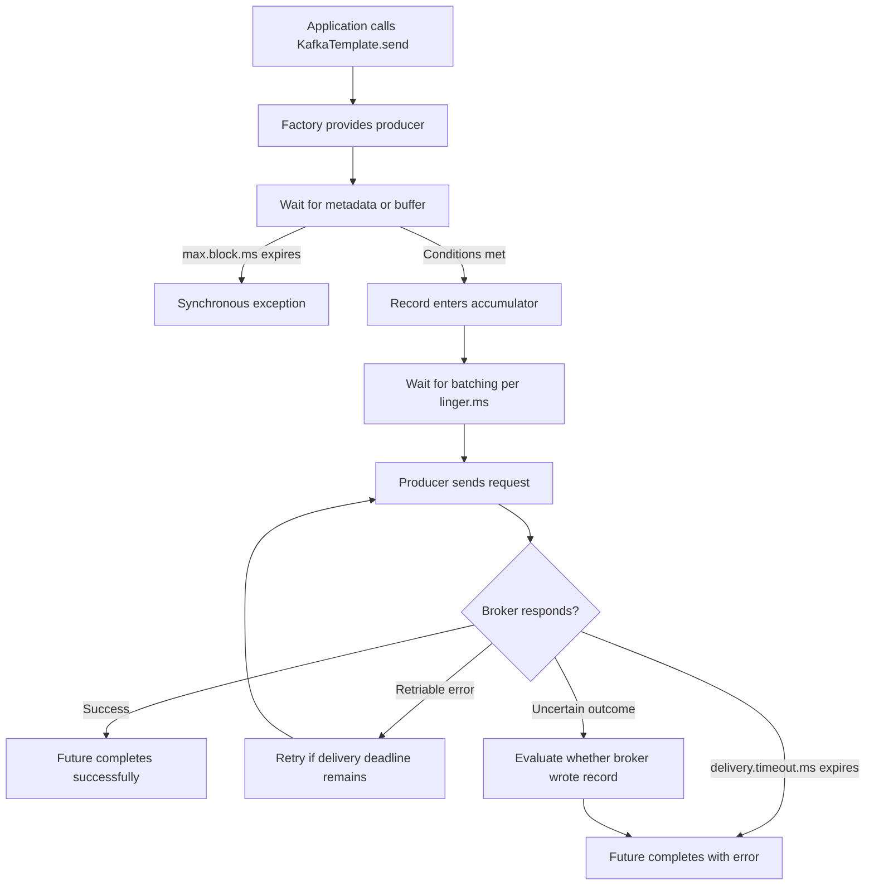

# Handling send timeouts

In Spring Kafka, a `send timeout` occurs when the producer fails to complete sending a message within the expected timeframe. The error can surface immediately during the `KafkaTemplate.send()` call, asynchronously through the future after the method returns, or only become visible when application code waits on the future with its own deadline. These three cases have different causes and handling approaches.

The most important thing when handling a timeout is determining how far the message got. A timeout does not always prove the broker did not write the message. If the broker wrote the record but the acknowledgement was lost on the way back, the producer can time out even though the data was already stored. Immediately re-sending as a new event can create duplicate business side effects.

Within the scope of Spring Kafka producer operations, you need to control timeouts at the Kafka client, how `KafkaTemplate` returns results, application deadlines, retry policies, and duplicate protection at the consumer. The sections below explain how to distinguish timeout layers, gather evidence, and safely recover the publish flow.

## 1. Distinguishing timeout layers

The Kafka producer has multiple time boundaries. Do not change all of them at once when you see an exception containing `TimeoutException`.

| Property or deadline | Scope | Meaning |
|---|---|---|
| `max.block.ms` | Synchronous `send()` call and certain APIs requiring metadata/buffer | Limits how long the caller blocks while the producer waits for metadata or record buffer allocation. If it expires before `send()` returns a future, the method may throw an exception directly. |
| `request.timeout.ms` | A single request sent to a broker | Limits how long the producer waits for a response to one request. A request timeout may cause the producer to retry if the error is retriable and delivery time remains. |
| `delivery.timeout.ms` | The entire delivery lifecycle of a record | Limits total time from when a record is ready to send until it succeeds or fails, including batch waiting, requests, and retries. When it expires, the record's future may complete with a timeout error. |
| `linger.ms` | Batching before sending | How long the producer may wait to accumulate more records into a batch. This is not a final send deadline, though it counts toward record delivery time. |
| Application wait deadline | Code calling `Future.get(timeout, unit)` or a custom timeout mechanism | Only limits how long application code waits for the result. It does not automatically cancel sending in the Kafka client. |
| `transaction.timeout.ms` | Kafka transaction | Limits how long a transaction is allowed to stay open per broker/client config. A transaction can be aborted even if an individual record send already received an acknowledgement. |

### `max.block.ms`: timeout before receiving a future

`KafkaProducer.send()` is an asynchronous API once the record is accepted into the send pipeline. However, the initial call can still block when the producer needs topic/partition metadata or needs to wait for buffer space to hold the record. `max.block.ms` bounds the wait time during these steps.

If metadata cannot be fetched because brokers are unreachable, topic metadata is unavailable, DNS/network fails, or the cluster is unresponsive, `send()` can exhaust `max.block.ms` and throw an exception directly. Similarly, when the buffer is full because the producer sends faster than the broker can accept, the thread calling `send()` may wait for buffer space and eventually time out.

In this case, the code may not have received a `CompletableFuture` yet to register a callback. Therefore, you must catch exceptions directly around the `KafkaTemplate.send()` call.

### `request.timeout.ms`: timeout of a single exchange

After the record enters the buffer and the producer sends a request to the broker, the client waits for a response. `request.timeout.ms` limits the wait time for a response to that request. If the request times out due to a slow network, overloaded broker, or lost response, the producer may retry according to its configuration and the error type.

Request timeout is not the total deadline for the record. One record may go through multiple requests/retries before succeeding or exhausting `delivery.timeout.ms`.

### `delivery.timeout.ms`: final deadline for the record

`delivery.timeout.ms` caps the total time the producer tries to deliver a record. This duration covers batch wait time, request attempts, and retries. When the deadline expires, the producer completes the future with an error; the application must record the outcome and decide the next step.

Kafka requires `delivery.timeout.ms` to be no less than the sum of `request.timeout.ms` and `linger.ms`. If configuration violates this constraint, the producer may reject the configuration at initialization.

### Application wait deadline is not a send timeout

For example:

```java
SendResult<String, OrderEvent> result =
        kafkaTemplate.send("orders.events", event.orderId(), event)
                .get(2, TimeUnit.SECONDS);
```

If `get()` throws `java.util.concurrent.TimeoutException` after two seconds, it only means the current thread waited two seconds without seeing a result. The future may still be in flight and the Kafka producer may still deliver the message successfully afterward. Do not treat this local wait timeout as proof that the message failed and immediately re-send it.

Cancelling or timing out a future at the application layer also does not guarantee recalling a record already buffered or a request already sent to the broker. If a business deadline is needed, manage wait state and send state separately while keeping the event identifier stable.

## 2. Send flow and where timeouts can occur

The typical send flow can be described as follows:



The diagram highlights two distinct handling points: synchronous exceptions occur before the call returns a future; record delivery errors are typically reported via the future afterward. A timeout caused by code waiting on the future can occur outside this Kafka flow.

## 3. Reading errors from Spring Kafka properly

### Catching both synchronous and asynchronous errors

In Spring Kafka 3.x, `KafkaTemplate.send()` returns `CompletableFuture<SendResult<K, V>>`. There are two places to observe:

- `try/catch` around the `send()` call to catch errors occurring before a future is returned, such as configuration, serialization, or metadata/buffer wait errors.
- `whenComplete()` or an equivalent callback to catch send results after the future is created, including request errors, exhausted retries, and delivery timeouts.

Example:

```java
public void publish(OrderEvent event) {
    try {
        CompletableFuture<SendResult<String, OrderEvent>> future =
                kafkaTemplate.send("orders.events", event.orderId(), event);

        future.whenComplete((result, exception) -> {
            if (exception != null) {
                publishMetrics.recordFailure(event.eventId(), exception);
                log.error("Kafka publish failed; eventId={}",
                        event.eventId(), exception);
                return;
            }

            RecordMetadata metadata = result.getRecordMetadata();
            publishMetrics.recordSuccess(
                    event.eventId(), metadata.topic(),
                    metadata.partition(), metadata.offset());
        });
    }
    catch (RuntimeException exception) {
        publishMetrics.recordFailure(event.eventId(), exception);
        log.error("Kafka send could not be started; eventId={}",
                event.eventId(), exception);
        throw exception;
    }
}
```

This example illustrates Spring Kafka 3.x; older versions may use `ListenableFuture`. `publishMetrics` and `log` represent the application's observability components. Callbacks should be brief, avoiding blocking operations or calling slow services on the send-completion thread. If further processing is needed, offload work to a bounded executor with backpressure.

### Do not look only at the exception name

`TimeoutException` can appear at multiple layers. When investigating, capture:

- Full exception class and nested `cause`.
- Whether the exception occurred directly in `send()` or in the future.
- Topic, partition if known, key, and `eventId`.
- Send start time, timeout time, and active deadlines.
- Producer client ID, application instance, and broker endpoint if present in logs.
- Retry count and record metadata if acknowledged by the broker.

For asynchronous errors, Spring Kafka may provide `KafkaProducerException` along with the failed `ProducerRecord`. Use this information to identify the specific message rather than logging just a single line saying "send timeout". Do not log sensitive payloads.

### Future.get(timeout) vs. future completing with error

Distinguish the following scenarios:

| Observation | Interpretation | Action |
|---|---|---|
| `send()` throws an exception before returning a future | The producer could not issue a future for that call; possibly due to metadata, buffer, serializer, or config | Inspect stack trace and producer metrics; classify the error before retrying. |
| Future completes exceptionally with delivery timeout | The producer accepted the record into the send pipeline but did not complete within the deadline | Check request/retry/broker/network; treat business outcome as uncertain if the acknowledgement could have been lost. |
| `future.get(2, SECONDS)` throws `TimeoutException` | Application code stopped waiting after two seconds; the future may still be incomplete | Keep a reference to the future or callback to receive the final outcome; do not automatically re-send just because the wait elapsed. |
| Future completes successfully | The broker acknowledged according to the configured `acks` | Record metadata; consumers may still not have processed the message yet. |
| Transaction send succeeds but transaction not committed | The record was sent inside a transaction but is not yet visible to `read_committed` consumers | Wait for commit/abort result; do not treat an individual send callback as transaction completion. |

## 4. Common causes and how to recognize them

### Broker unavailability or cluster resource exhaustion

Stopped brokers, leaderless partitions, controller incidents, or overloaded brokers can prevent the producer from fetching metadata or receiving timely responses. Check broker status, partition leaders, offline partitions, under-replicated partitions, request latency, CPU, disk, and network.

If the producer uses `acks=all`, ISR or `min.insync.replicas` issues can cause brokers to reject writes. This is typically a configuration/redundancy issue rather than a simple timeout requiring a larger deadline. Check replication factor, ISR, and `min.insync.replicas` before changing policies.

### Network, DNS, and TLS/SASL

Packet loss, elevated latency, unstable routes, slow DNS resolution, or firewall-closed connections can delay requests or responses. TLS handshakes, expired certificates, wrong SASL credentials, and mismatched ACLs usually produce clear connection/authentication errors, though they can also trigger retries and timeouts in other steps.

Verify directly from the application's runtime environment: bootstrap DNS and broker advertised listeners, connection reachability, certificate expiration, truststore/keystore config, SASL mechanism, and topic write permissions. A broker may return an advertised listener hostname that the application cannot resolve even though the initial bootstrap server was reachable.

### Producer buffer pressure

The producer buffers records before sending. If publish rate exceeds the broker's ingestion rate for a sustained period, the buffer can fill up. Threads calling `send()` then wait for buffer allocation and may exhaust `max.block.ms`.

Common causes include slow brokers, saturated network, oversized records, an abnormal surge in producers, batches not draining fast enough, or the application emitting messages too quickly. Check `buffer.memory`, `bufferpool-wait-time`, `buffer-available-bytes`, request latency, batch size, and physical producer count. Increasing `buffer.memory` only prolongs how long a backlog can be absorbed; if send rate persistently exceeds processing rate, the buffer will still fill eventually.

### Slow or invalid topic/partition metadata

Uncreated topics, wrong topic names, leaderless partitions, or stalled broker metadata updates can leave the producer waiting for metadata. Verify topic existence, partition assignment, leader availability, ACLs, and broker logs. Do not auto-create topics in production if infrastructure policy requires centralized topic management.

### Serialization and partitioner

Serializers or partitioners run on the thread calling `send()`. Some errors here occur before the future is returned and are not fixed by increasing `delivery.timeout.ms`. Check payload types, schemas, serializers, custom partitioners, and their execution time. Avoid I/O or heavy business logic inside serializers/partitioners.

### Oversized messages or improper batching

Records exceeding `max.request.size`, `message.max.bytes`, or corresponding replica/fetch limits may be rejected by the broker. Increasing timeouts will not bypass size limits. Check serialized record size, compression, producer/broker/topic limits, and payload policies. For large payloads, consider storing the object in object storage and publishing a controlled reference.

## 5. Producer timeout and retry configuration

Spring Boot configuration example:

```yaml
spring:
  kafka:
    producer:
      acks: all
      properties:
        "enable.idempotence": true
        "max.in.flight.requests.per.connection": 5
        "max.block.ms": 10000
        "request.timeout.ms": 30000
        "delivery.timeout.ms": 120000
        "linger.ms": 5
        "retry.backoff.ms": 500
```

The values above are only starting points to illustrate relationships between properties; tune them based on SLA, actual latency, record size, publish rate, and cluster policy. `delivery.timeout.ms` must be greater than or equal to `request.timeout.ms + linger.ms`. Do not set timeouts too low such that the producer gives up on requests that could still succeed, nor too high such that the application holds pending state longer than the business accepts.

### Choosing timeouts according to SLA

Determine upfront:

1. How long can the application tolerate waiting before reporting an undetermined publish status?
2. What are the network and broker p95/p99 request latencies under normal conditions and peak load?
3. How long does a broker/partition typically take to recover during common incidents?
4. Does the system have an outbox or durable queue to hold events during a Kafka outage?
5. Can consumers handle duplicates by `eventId`?

`request.timeout.ms` should be large enough relative to normal request latency plus acceptable variance. `delivery.timeout.ms` should cover batch wait time and expected retry attempts, while staying within the time the application can keep an event pending. `max.block.ms` should suffice for metadata/buffer under normal operations; if it expires frequently, investigate the cause rather than just raising the value.

### Kafka client-side retries

The Kafka producer automatically retries errors considered recoverable. Retries are bounded by the record delivery deadline and client policy. When idempotence is enabled, the producer coordinates sequence numbers to eliminate duplicates from internal retries within the producer session.

Do not lower internal retries too much just to fail faster if the workload needs to survive brief disruptions. Likewise, do not retry infinitely across multiple layers. Once the Kafka client has retried up to `delivery.timeout.ms`, the application needs a bounded, observable next decision.

## 6. Application-level retries after timeout

Application-level retries differ from Kafka producer internal retries. A new `KafkaTemplate.send()` call is a new send from the application's perspective, potentially producing a new record even if the content is identical to the previous attempt. Therefore, classify errors and protect business state before implementing retries.

### Classifying errors before retrying

| Error category | Examples | Handling approach |
|---|---|---|
| Transient errors | Brief network disconnect, broker leader election in progress, recoverable request timeout | Bounded retry with exponential backoff and jitter after evaluating the previous send outcome. |
| Buffer/metadata pressure | `max.block.ms` expired, producer buffer exhausted | Reduce publish rate, inspect broker/network and backpressure; immediate retries at the same rate can worsen the condition. |
| Auth/permission errors | Invalid credentials, TLS trust failure, missing ACL | Stop aggressive retries; alert and fix configuration or permissions. |
| Data errors | Serialization failure, invalid schema, record exceeds size limit | Do not retry the same payload; fix data or route to an appropriate error-handling flow. |
| Configuration errors | Wrong topic, incompatible serializer, buggy partitioner | Fix configuration/code before re-sending. |
| Uncertain outcome | Timeout after the request may have reached the broker but the response was lost | Reuse the same `eventId`, verify state if possible, and ensure consumer idempotency before retrying. |

### Backoff, jitter, and retry limits

When many instances hit timeouts simultaneously, synchronized retries can create a new load spike on a recovering broker. Exponential backoff gradually increases the interval between attempts; jitter adds random variance so instances do not stay synchronized. Configure maximum retry attempts, maximum duration, and rate limits.

Do not run blocking retry loops on the Kafka producer's callback thread. If application-level retries are needed, place events onto a bounded executor/queue or persist them to a durable outbox, then process according to a retry schedule. When the queue is full, apply backpressure or an explicit rejection policy; never create an unbounded in-memory queue.

### Preserving event identity

If publishing the same event multiple times, keep the same `eventId` and correlation ID. Consumers should store `eventId` with a unique constraint or use an equivalent idempotency mechanism in the same transaction as the business effect. That way, if the broker accepted the first send while the producer missed the acknowledgement, a subsequent retry still does not duplicate business impact.

Kafka's idempotent producer prevents duplicates from internal producer retries; it does not replace business-layer idempotency when the application calls `send()` again after a timeout or after a process restart.

### Transactional outbox for critical publishing

If the application updates a database and then publishes an event, there is a gap between database commit and Kafka acknowledgement. For critical events, a transactional outbox writes business changes and the outbox record in the same database transaction. A separate publisher reads the outbox, sends to Kafka, and marks the published status upon receiving the result. On an ambiguous timeout, the publisher can re-send with the same event ID; consumers still need idempotency.

An outbox turns unsent events into durable data that can be retried after Kafka recovers. Monitor outbox record age, pending count, publish rate, and retry count to detect backlogs.

## 7. Handling timeouts in flows with Kafka transactions

When using Kafka transactions, distinguish a single record's acknowledgement from the transaction outcome. A record's send future may complete successfully while the transaction is still open. Records are not visible to consumers using `isolation.level=read_committed` until the transaction commits.

If a transaction times out or fails to commit, it may be aborted. Never mark a business event as completed based solely on a record send future; wait for the transaction commit outcome. When errors occur inside a transaction, perform rollback/abort via the transaction manager and handle exceptions according to application policy.

Transaction timeouts may relate to:

- Transactions kept open too long due to business logic or external service calls inside the transaction.
- Slow broker/network preventing commit/abort from finishing.
- Transaction ID collisions causing producer fencing.
- `transaction.timeout.ms` configured incompatibly with processing duration.

Keep transactions short, avoid long external API calls inside transactions, and monitor commit/abort latency. Do not raise `transaction.timeout.ms` endlessly to mask hung transactions.

## 8. Observing and alerting on send timeouts

For rapid diagnosis, combine producer, broker, network, and business state metrics.

| Layer | Metrics/logs to monitor | Signals |
|---|---|---|
| Kafka producer | `record-error-rate`, `record-retry-rate`, `request-latency-avg/max`, `bufferpool-wait-time`, `buffer-available-bytes`, `record-queue-time-avg` | Rising retries, slow requests, exhausted buffer, or records sitting long in the queue. |
| Spring Kafka | `KafkaTemplate` future outcomes, exception class, topic, event ID, send duration | Distinguish synchronous vs. asynchronous errors, identify specific messages. |
| Broker | Request handler idle, request queue time, produce request latency, ISR, offline/under-replicated partitions, disk/network | Broker overload, leaderless partitions, or degraded replication. |
| Network/security | Connections, reconnects, DNS, TLS handshake, SASL and ACL errors | Network path or authentication failures. |
| Application | Pending events, retry count, outbox age, publish success/error rate | Determine impact on SLAs and event backlog. |

Metric names and exposure methods depend on the Kafka client version, broker, and monitoring stack. Client metrics can be collected via JMX or appropriate Micrometer integration. Do not alert solely on total exception count; split by exception class, topic, producer instance, and error rate.

Alerts should focus on:

- Send failure or delivery timeout rate exceeding thresholds over a time window.
- Sustained increase in `bufferpool-wait-time` or available buffer dropping near 0.
- Request latency p95/p99 rising above baseline.
- Continuously increasing retry rate even as publish throughput drops.
- Outbox pending count or oldest event age breaching SLA.
- Brokers showing offline partitions, ISR shrinks, or under-replicated partitions.

Logs should contain `eventId`, topic, appropriate key, producer client ID, start/end timestamps, timeout type, retry count, and exception chain. Avoid logging secrets or full payloads. Trace context should propagate via Kafka headers to link the originating request with the publish and consumer.

## 9. Runbook when a send timeout occurs

### Step 1: Identify which layer timed out

1. Check whether the exception occurred directly at `KafkaTemplate.send()` or inside the future.
2. If code uses `Future.get(timeout)`, determine whether it is a local wait deadline or an actual future failure.
3. Record `max.block.ms`, `request.timeout.ms`, `delivery.timeout.ms`, `linger.ms`, and application deadlines at the time of the error.
4. Capture topic, `eventId`, producer instance, exception class, timestamp, and retry count.

### Step 2: Check Kafka cluster health

1. Verify bootstrap servers and advertised listeners are reachable from the application pod/VM.
2. Check brokers, controller, partition leaders, offline partitions, and under-replicated partitions.
3. Check ISR and `min.insync.replicas` if the producer uses `acks=all`.
4. Correlate broker produce request latency, request queue, disk, CPU, and network.
5. Check DNS, firewalls, TLS/SASL, and ACLs if connection or auth errors are present.

### Step 3: Check producer client and application

1. Read `bufferpool-wait-time`, `buffer-available-bytes`, retry rate, and request latency.
2. Check physical producer count, threads, connections, and whether factories/templates are created per request.
3. Check record size, serializer, partitioner, and schema.
4. Compare publish rate against broker ingestion rate; check whether queues/outboxes are growing.
5. Determine whether callbacks or blocking future waits are stalling thread pools.

### Step 4: Assess whether the send outcome is certain

1. If `send()` failed before returning a future due to metadata/buffer, handle per that error and do not assume the record was enqueued.
2. If the future failed after requests or delivery deadline expiry, treat the broker outcome as potentially uncertain if the acknowledgement could have been lost.
3. If only the application's `Future.get()` deadline expired, continue observing the existing future/callback; do not re-send immediately.
4. If a transaction is open, check the commit/abort outcome before marking the event complete.
5. Cross-check `eventId` against outbox state or consumer idempotency if available.

### Step 5: Controlled recovery

1. Fix the root cause such as broker overload, network, ACLs, topic metadata, or serializer.
2. If backlog grew, throttle publish rate or apply backpressure; avoid synchronized bursts of retries.
3. Apply bounded retries with exponential backoff and jitter for transient errors.
4. Preserve `eventId` and rely on consumer-side idempotency to prevent duplicate side effects.
5. Monitor send success rate, request latency, retries, buffer wait, and event age until they return to baseline.

## 10. Quick symptom lookup table

| Symptom | First possibility to check | Resolution |
|---|---|---|
| `send()` blocks long then throws `TimeoutException` | Metadata unavailable or producer buffer cannot be allocated within `max.block.ms` | Check broker metadata, topic/leader, network, and buffer pressure. |
| Future fails after an interval near `delivery.timeout.ms` | Requests/retries did not finish within total deadline | Check request latency, broker health, retries, and response path. |
| `Future.get(2s)` times out while callback has not run yet | Local wait deadline is shorter than record delivery time | Do not re-send immediately; continue observing the future and decide per SLA. |
| `bufferpool-wait-time` rises, available buffer is low | Producer sends faster than broker accepts or records/batches are too large | Slow down publish rate, check broker/network, record size, and producer count. |
| `NotEnoughReplicas` or ISR errors | ISR is below `min.insync.replicas` | Restore replicas and evaluate durability policy before altering configs. |
| Serialization error right at send | Invalid payload/schema/serializer or slow serialization code | Fix data/schema/serializer; longer timeouts will not solve the cause. |
| Timeout where broker wrote record but client missed response | Response path disrupted or uncertain request outcome | Preserve event ID, deduplicate at consumer, and check business state. |
| Transaction commit timeout or fencing | Long transaction, slow broker, or transactional ID collision | Check transaction lifecycle, prefix/instance ID, and abort/commit outcome. |

## 11. Pre-production producer checklist

| Checkpoint | Question to answer | Evidence to have |
|---|---|---|
| Timeouts | Were `max.block.ms`, `request.timeout.ms`, and `delivery.timeout.ms` chosen per SLA? | Effective config, p95/p99 latency, and business deadlines. |
| Future | Are both synchronous and asynchronous errors handled? | Logged exception chains, callback/future outcomes, and metrics. |
| Retries | Do Kafka client and application have a clear total retry/time budget? | Retry policy, backoff, jitter, and retry counts. |
| Idempotency | Can uncertain-outcome timeouts be safely re-sent? | Stable event ID, inbox/deduplication, or outbox. |
| Backpressure | Does the producer bound queues and rate when brokers slow down? | Queue depth, buffer metrics, and throttling mechanism. |
| Broker | Do replication, ISR, leaders, and broker resources meet the workload? | Topic config, ISR, broker metrics, and alerts. |
| Observability | Can you trace from event ID to exception, partition, and send outcome? | Structured logs, trace headers, and dashboards. |
| Transactions | Is send acknowledgement distinguished from transaction commit? | Transaction outcomes, commit/abort metrics, and fencing logs. |

A send timeout should be treated as a signal about deadlines and delivery status. By distinguishing synchronous timeouts, request timeouts, delivery timeouts, and application wait deadlines, operations teams can pinpoint the true bottleneck. Combining producer/broker observability, bounded retries, backpressure, and stable event identifiers enables safe publish recovery while controlling the risk of message loss or duplicate processing.
