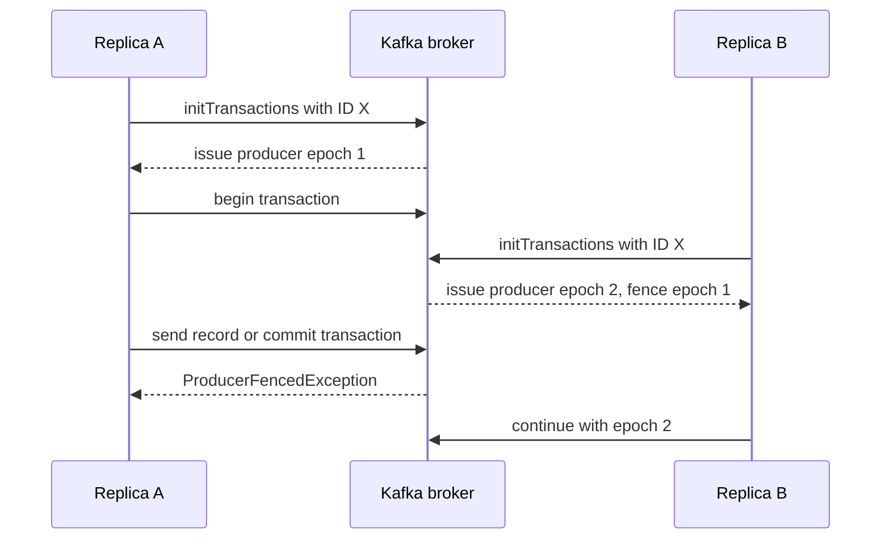

# Setting unique transactionIdPrefix per instance

When using Kafka transactions in Spring Kafka, each transactional producer needs a distinct `transactional.id` on the same Kafka cluster. Spring Kafka provides the `transactionIdPrefix` property to generate these IDs. The prefix must be unique across simultaneously active application instances and must be derived from the running instance's identity.

This is a critical operational setting when deploying transactional consumers or producers with multiple replicas. If two instances share a prefix, producers can receive the same `transactional.id`. Kafka will fence the older producer when another producer initializes a transaction with the same ID. Typical consequences are aborted transactions, listeners throwing `ProducerFencedException` or `InvalidProducerEpochException`, and disrupted processing flows.

## 1. What is `transactionIdPrefix` used for?

In Kafka, `transactional.id` identifies a transactional producer across sessions. The producer uses this ID to initialize transactions, recover transaction state, and tell the broker which producer currently owns write authority for that ID. When a new producer initializes with the same `transactional.id`, Kafka bumps the producer epoch and fences the old producer. This prevents an old producer from continuing to write transactions after a new producer has taken over the same identity.

Spring Kafka configures the prefix on `DefaultKafkaProducerFactory`. The factory constructs the actual `transactional.id` by appending a factory-managed suffix to the prefix. The suffix distinguishes transactional producers created by the same factory; the prefix distinguishes one factory or application instance from other instances.

For example, suppose two replicas run the `order-service` service:

| Application instance | `transactionIdPrefix` | An ID generated by the factory |
|---|---|---|
| Replica 0 | `prod-order-service-orders-0-` | `prod-order-service-orders-0-0` |
| Replica 1 | `prod-order-service-orders-1-` | `prod-order-service-orders-1-0` |

Because the two prefixes differ, the IDs generated by the two factories never collide. The suffix `0` in the example merely illustrates one producer created by each factory; a factory can create additional producers with different suffixes as needed.

If both replicas use `prod-order-service-`, each factory may start from the same suffix. They could both try to use `prod-order-service-0`. The producer initialized later can fence the producer already using that ID. This is an identity conflict at the Kafka level, not an error caused by input records or transaction content.

## 2. Scope where uniqueness must be guaranteed

The prefix must be unique across all transactional producers connecting to the same Kafka cluster. Service names or application names are usually identical across replicas, so using only the service name is insufficient.

A practical prefix typically combines:

- Deployment environment, such as `dev`, `staging`, or `prod`.
- Application or workload name, such as `order-service`.
- Namespace, tenant, or deployment group if multiple environments share one Kafka cluster.
- Instance-specific ID, such as Pod name, StatefulSet ordinal, hostname, or platform-assigned instance ID.

The rule can be expressed as:

```text
transactionIdPrefix = environment
                    + application
                    + namespace
                    + instanceId
                    + separator
```

Examples:

```text
prod-order-service-commerce-orders-0-
prod-order-service-commerce-orders-1-
```

You do not need to include every component if one component already guarantees uniqueness within the Kafka cluster. However, when multiple namespaces or environments share a cluster, adding deployment metadata avoids naming collisions and helps operators identify producers more easily.

Uniqueness must be evaluated across all transactional producers connected to the same cluster, not just within one process. If an application manually creates multiple independent `DefaultKafkaProducerFactory` beans, those factories also need prefixes that do not generate overlapping ID ranges.

## 3. Configuring via Spring Boot

Spring Boot provides the `spring.kafka.producer.transaction-id-prefix` property. When set, the Boot-configured producer factory can create transactional producers.

```yaml
spring:
  application:
    name: order-service
  kafka:
    producer:
      transaction-id-prefix: ${APP_ENV}-${spring.application.name}-${POD_NAMESPACE}-${POD_NAME}-
```

Placeholders must be populated with distinct values per instance. For example, `POD_NAME` and `POD_NAMESPACE` can be injected into containers via the Kubernetes Downward API. When running locally, assign a unique `POD_NAME` or `INSTANCE_ID` to each process if multiple processes connect to the same Kafka cluster.

Another option is having the deployment platform pre-assemble the entire prefix and pass it via an environment variable:

```yaml
spring:
  kafka:
    producer:
      transaction-id-prefix: ${KAFKA_TRANSACTION_ID_PREFIX}
```

Each instance then receives a distinct `KAFKA_TRANSACTION_ID_PREFIX` value. This draws a clean boundary between application configuration and platform-assigned instance identity. Avoid placing a fixed value inside a ConfigMap shared by all replicas.

### Kubernetes Downward API example

In Kubernetes, Pod names are unique within a namespace at any given time. You can inject Pod name and namespace into environment variables:

```yaml
spec:
  template:
    spec:
      containers:
        - name: order-service
          env:
            - name: APP_ENV
              value: prod
            - name: POD_NAME
              valueFrom:
                fieldRef:
                  fieldPath: metadata.name
            - name: POD_NAMESPACE
              valueFrom:
                fieldRef:
                  fieldPath: metadata.namespace
```

Combined with the Spring Boot configuration above, each Pod gets its own prefix, such as:

```text
prod-order-service-commerce-order-service-0-
prod-order-service-commerce-order-service-1-
```

For a StatefulSet, Pod names carry stable ordinals like `order-service-0` or `order-service-1`. This is helpful when the same logical instance should continue using its transaction identity after a Pod restart. With a Deployment, Pod names are newly generated when replicas are replaced; simultaneously running Pods still have distinct IDs, though identity changes across replacements.

Do not set generic defaults like `local-` or `order-service-` for multi-replica environments. If `POD_NAME` or `INSTANCE_ID` is missing, a production application should fail fast at startup rather than silently falling back to a prefix that risks collision.

## 4. Choosing an instance ID: unique and intentional

The instance ID must distinguish all instances that can run concurrently against the same Kafka cluster. Suitable ID sources depend on deployment style:

| Environment | Common ID source | Notes |
|---|---|---|
| Kubernetes StatefulSet | Pod name or ordinal | Can preserve stable identity across restarts of the same ordinal |
| Kubernetes Deployment | Pod name | Existing Pods have unique names; replacement Pods may get new names |
| VM or fixed host | Hostname or machine instance ID | Ensure hostname is not shared by multiple transactional processes |
| Orchestrated container platform | Platform-assigned task ID or instance ID | Do not use a shared service name across all tasks |
| Multi-process local runs | Per-process or per-developer ID | Avoid processes on different machines sharing the same value |

Consider two properties when choosing an ID:

1. **No collisions across concurrent instances.** This is mandatory to avoid unintended producer fencing.
2. **Stability across restarts of the same logical instance when fencing is desired.** If an old producer might still be alive when a new instance starts, reusing that logical instance's transaction identity lets Kafka fence the old producer. Generating a completely new UUID on every startup prevents the new producer from using the same `transactional.id` to fence the old producer.

Thus, a fresh random ID on every startup avoids collisions among running processes, yet is not always the best operational choice. For workloads with stable identities like StatefulSet ordinals or fixed VMs, consider stable IDs per logical instance. For ephemeral workloads, use unique per-Pod/task IDs and rely on orchestration to terminate old instances cleanly.

Never share a static ID across two active replicas. For example, every Pod receiving `INSTANCE_ID=orders` from a static environment variable will produce identical prefixes as soon as replica count scales above one.

## 5. Why do duplicate prefixes cause `ProducerFencedException`?

Kafka uses `transactional.id` to manage producer epochs. When a producer initializes transactions with an ID, the broker establishes the current epoch for that ID. If another producer initializes with the same ID, the new epoch supersedes the old epoch. Subsequent operations from the old producer are rejected because it has been fenced.

The failure sequence can unfold as follows:



This behavior protects transaction correctness. Kafka does not allow two producers to simultaneously own one `transactional.id` and write transactions as two independent actors. When prefixes collide, one instance can repeatedly invalidate the other instance's producer, leading to recurring errors or unpredictable outages.

Operational symptoms may include:

- `ProducerFencedException` when sending records, committing, or executing transaction operations.
- `InvalidProducerEpochException` or producer epoch errors.
- Aborted transactions forcing listener containers to reprocess records per retry policy.
- Errors surfacing during scale-up, rolling updates, or simultaneous startup of multiple instances.
- One replica running normally while another logs errors continuously, then flipping roles when the other producer re-initializes.

Do not treat the symptom by merely increasing retries or timeouts. If the cause is two instances sharing an ID, retries can keep repeating every time the other producer reclaims ownership of the ID. Fix the prefix source so instances have distinct identities.

## 6. Prefix is not `client.id` or `group.id`

The following properties serve different purposes:

| Property | Purpose | Can it replace `transactionIdPrefix`? |
|---|---|---|
| Spring Kafka `transactionIdPrefix` | Generates `transactional.id` range for the factory's transactional producers | This is the property to configure for this problem |
| Kafka `transactional.id` | Actual identity of a transactional producer | Built from the prefix and factory-managed suffix |
| `client.id` | Identifies client in logs, metrics, and quotas | No; two producers with different `client.id` can still collide on `transactional.id` |
| Consumer `group.id` | Identifies consumer group and shared offset progress | No; multiple consumer groups can still have colliding producer transaction IDs |
| `group.instance.id` | Static member identity of a consumer group | No; this is a consumer group membership mechanism |

Setting a unique `client.id` helps observability, but does not solve fencing caused by duplicate `transactional.id` values. Likewise, whether replicas share or split `group.id` does not govern uniqueness of transactional producers.

When using Spring Kafka, configure `spring.kafka.producer.transaction-id-prefix` or set the prefix on `DefaultKafkaProducerFactory`. Do not manually set a single static `transactional.id` inside producer properties and expect the factory to differentiate instances. The factory needs authority to generate transactional IDs from its prefix and suffix.

## 7. A unique prefix is necessary, not sufficient to enable all transactions

Setting `transactionIdPrefix` enables a producer factory to create transactional producers. It does not mean every `KafkaTemplate.send()` call or every `@KafkaListener` automatically runs inside a transaction the way the application expects.

The application must still wire the appropriate transaction flow:

- For producers, send operations must participate in a Spring Kafka-managed transaction or run inside `KafkaTemplate.executeInTransaction(...)`.
- For consume-transform-produce listeners, the listener container must be configured with a transaction manager or the corresponding transaction mechanism for your Spring Kafka version.
- The producer writing output must join the same transaction as input offsets if atomic commit of output and offsets is the goal.
- Downstream consumers need `isolation.level=read_committed` if they should only read records from committed transactions.

Example prefix configuration in Spring Boot:

```yaml
spring:
  kafka:
    producer:
      transaction-id-prefix: ${KAFKA_TRANSACTION_ID_PREFIX}
    consumer:
      properties:
        isolation.level: read_committed
```

The `isolation.level` property configures consumers reading transactional data. It neither creates a producer prefix nor resolves ID collisions. Both sides must be configured properly for their separate roles.

If the application constructs `DefaultKafkaProducerFactory` manually, set the prefix on that factory and ensure each transactional factory connecting to the same cluster uses a disjoint ID range. With Spring Boot, prefer standard properties so custom configs do not accidentally override the auto-configured factory.

## 8. Safe deployment workflow

Before deploying or scaling replicas, clearly determine the instance ID source and inspect the actual values injected into each instance.

1. Choose components identifying environment, application, and instance. Ensure instance IDs differ across all replicas running concurrently on the same Kafka cluster.
2. Inject the instance ID via the deployment platform. On Kubernetes, use the Downward API for Pod name and namespace rather than a static string for the whole Deployment.
3. Construct `transaction-id-prefix` from those components. Keep a trailing separator on the prefix so generated IDs remain readable.
4. Log the effective prefix at application startup. The prefix is not a secret, though avoid logging credentials or sensitive configs alongside it.
5. Inspect rendered manifests or configs for multiple replicas. Confirm each replica gets a distinct value and no shared fallback kicks in if an env var is missing.
6. Test-deploy with multiple replicas and watch transaction logs. Verify no unexpected fencing appears during scaling or rolling updates.

Example startup log:

```text
Kafka transactional producer prefix: prod-order-service-commerce-order-service-0-
```

In practice, you can log this from a configuration bean or right after binding `KafkaProperties`. There is no need to instantiate a producer solely to print the ID; the goal is observing the prefix value resolved by the application before creating transactional producers.

## 9. Diagnosing producer fencing

When `ProducerFencedException` occurs, start by identifying the failing producer's `transactional.id` and comparing prefixes across instances connected to the same cluster.

| Check | Question to answer | Action |
|---|---|---|
| Per-instance prefix | Are two Pods/processes logging the same prefix? | Fix the source supplying `INSTANCE_ID`, `POD_NAME`, or config variables |
| Replicas during rolling update | Are old and new instances sharing an identity? | Determine whether this is intentional takeover fencing or an unintended collision between two replicas |
| Shared ConfigMap/Secret | Was the prefix set statically for the entire Deployment? | Move the instance ID portion to per-Pod metadata |
| Multiple producer factories | Is an independent factory generating the same ID range? | Assign distinct prefixes per factory or consolidate into one factory |
| Local and production on same cluster | Is a local process using a production prefix? | Separate environment namespaces or assign dedicated local IDs |
| Instance restart | Is a new instance taking over an old producer's identity? | Inspect old process lifecycle and confirm whether fencing was intended |

Key handling principles:

- Do not disable transactions just to hide fencing errors if the business flow relies on transactions for atomic outputs and offsets.
- Do not switch to a new random prefix on every retry while the application is running; that breaks the ability to identify and take over an old producer under the same transactional identity.
- Do not raise `transaction.timeout.ms` hoping it will fix two instances sharing an ID. Timeouts and identity solve two separate problems.
- After fixing configuration, redeploy in a way that guarantees each replica receives its proper prefix; monitor fencing errors and transaction status after rollout.

## 10. Comparing wrong and right configuration examples

### Wrong: all replicas share the service name

```yaml
spring:
  application:
    name: order-service
  kafka:
    producer:
      transaction-id-prefix: ${spring.application.name}-
```

With three replicas, all three receive the prefix `order-service-`. Each factory can generate the same initial suffix and produce colliding `transactional.id` values.

### Right: include a distinct instance ID

```yaml
spring:
  application:
    name: order-service
  kafka:
    producer:
      transaction-id-prefix: ${APP_ENV}-${spring.application.name}-${POD_NAMESPACE}-${POD_NAME}-
```

Suppose three Pods are named `order-service-0`, `order-service-1`, and `order-service-2`. The prefix resolves to three distinct values:

```text
prod-order-service-commerce-order-service-0-
prod-order-service-commerce-order-service-1-
prod-order-service-commerce-order-service-2-
```

The factory then appends its own suffix for each producer it creates. Thus, IDs created within one factory are distinguished by suffix, while IDs across instances are distinguished by prefix.

## 11. Operations checklist

- [ ] All transactional producers connecting to the same Kafka cluster have disjoint `transactional.id` ranges.
- [ ] The prefix includes a unique instance ID, not just application name or Deployment name.
- [ ] The instance ID source is provided by the platform and never falls back to a shared default in production.
- [ ] When restart fencing is needed, the same logical instance can reuse a stable identity after restarting.
- [ ] Multiple independent producer factories do not generate overlapping ID ranges.
- [ ] `client.id`, `group.id`, and `group.instance.id` are not mistaken as substitutes for transactional IDs.
- [ ] Listener containers, producers, and `KafkaTemplate` are configured to participate in transactions per business requirements.
- [ ] Startup logs allow verifying each instance's effective prefix.
- [ ] Scale-out and rolling updates have been observed to catch unexpected fencing.

Setting a unique `transactionIdPrefix` per instance lets Spring Kafka create transactional producers with distinct identities on the Kafka cluster. The rule to maintain across the deployment lifecycle is that each logical instance has a clear identity, concurrent active instances never share an identity, and reusing an identity across restarts is an intentional design choice so Kafka can fence an old producer when necessary.
