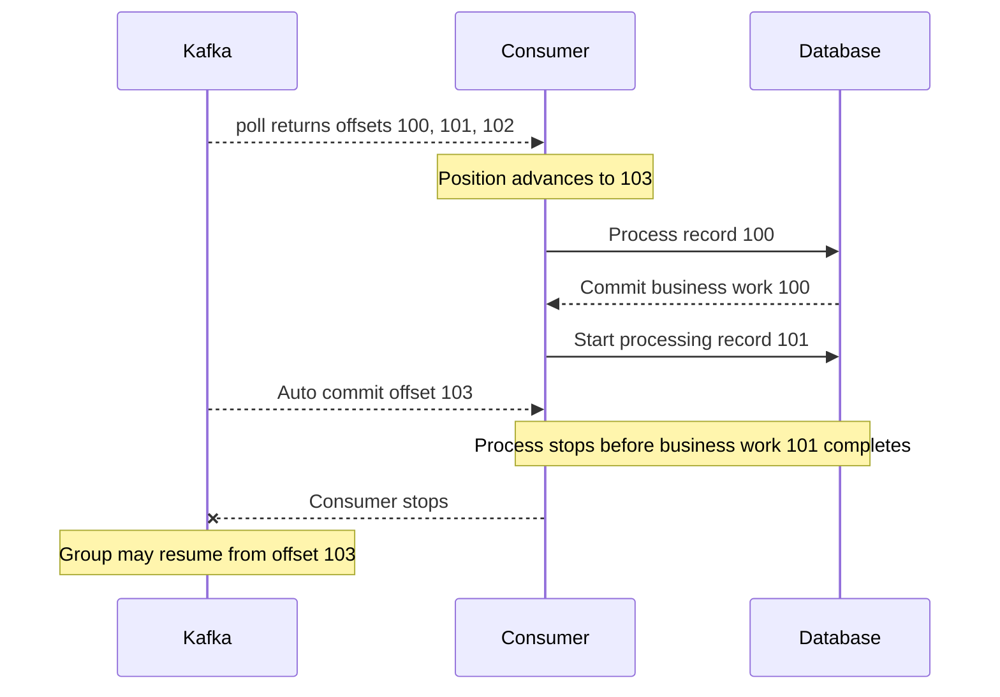

# enable.auto.commit

`enable.auto.commit` is the Kafka consumer property that determines whether the client commits offsets automatically on a schedule or leaves commit timing under application/container control. This is a critical configuration for durable consumers because offsets tell Kafka where the consumer group will resume reading after a restart or rebalance.

When auto commit is enabled, the Kafka client periodically records the consumer's current read position. The client does not know whether business logic inside the listener has finished; it only knows how far the consumer has advanced across `poll()` calls. Consequently, commit timing may not match when the application finishes processing each record. If offsets commit before business side effects are durably stored, messages can be skipped after a failure. If business work finishes without committing offsets, messages can be redelivered and cause duplicate processing.

In Spring Kafka, starting from version 2.3, `enable.auto.commit` defaults to `false` if the application does not configure it explicitly. With auto commit disabled, the listener container manages offsets according to an `AckMode` such as `RECORD`, `BATCH`, or `MANUAL`. This is usually the right choice for production applications that must tie commits to processing outcomes.

## 1. How Do Offsets and Auto Commit Work?

Each partition has a monotonically increasing sequence of offsets. When a consumer calls `poll()`, Kafka returns records and advances the consumer position to the next offset to read. The committed offset is the next position the consumer group will read upon restart, not the offset of the last processed record.

For example, a consumer receives records at offsets `100`, `101`, and `102`. Committing offset `103` tells Kafka the group has confirmed progress past record `102`; the next read begins at `103`.

```text
Partition 0:
  offset:           100   101   102   103   104
  record:            A     B     C     D     E
  poll returns:     [ A     B     C ]
  position:                           103
  committed offset:                   103
```

`enable.auto.commit=true` tells the Kafka client to automatically commit the consumer position periodically. The interval is controlled by `auto.commit.interval.ms`, which defaults to 5000 ms in the Kafka consumer. When the client commits, it writes the next offset for each managed partition.

Crucially, the consumer client receives no dedicated signal indicating a database transaction or external business operation succeeded. It only knows the consumer's position and state. Auto commit is therefore not a business acknowledgment mechanism.

### Related Properties

| Property | Role | Relationship to `enable.auto.commit` |
|---|---|---|
| `enable.auto.commit` | Enables/disables automatic offset commits by the Kafka client | Chooses between client auto commits and application/container management. |
| `auto.commit.interval.ms` | Auto-commit interval | Effective only when auto commit is enabled. |
| `auto.offset.reset` | Chooses starting position when the group lacks a valid offset | Does not enable/disable commits and does not rewind committed offsets. |
| `group.id` | Identifies the consumer group | Offsets are stored per group and partition. |
| `max.poll.records` | Caps records returned in one poll | Affects batch size and distance between position and business progress. |
| `max.poll.interval.ms` | Limits time between polls | Taking too long can mark the consumer inactive and trigger a rebalance. |

## 2. Enabling Auto Commit: Convenience and Risks

The Kafka consumer client defaults to `enable.auto.commit=true` if an application uses raw Kafka client defaults directly. In Spring Kafka 2.3 and later, the framework sets this property to `false` when not explicitly configured. If an application builds its own `ConsumerFactory`, passes custom properties, or uses the Kafka client directly, verify the effective configuration rather than assuming Kafka or Spring Boot defaults.

Example configuration enabling auto commit:

```yaml
spring:
  kafka:
    consumer:
      group-id: orders-service
      enable-auto-commit: true
      properties:
        "auto.commit.interval.ms": 5000
```

When enabled, the Kafka client manages the commit schedule itself. The application cannot rely on listener return to request per-record commits via the Spring container's `AckMode`. The listener container's `AckMode` no longer governs commits when the Kafka client is auto-committing.

### Window for Losing Processing

Suppose a poll returns multiple records. The consumer position has already advanced past the returned records, while the listener is still executing business side effects. If auto commit records the position after a record whose business work has not yet finished and the process stops abruptly, the group may restart at the new offset and skip that record.



This is the risk window of auto commit: the offset reflects poll progress, while business work may only be partially complete. Exact behavior depends on poll cycles, processing duration, and consumer execution; never design around an assumption that auto commit always waits for listeners to finish.

### Window for Duplicate Processing

If business work finishes before the offset is auto-committed, the process may crash prior to the next commit. When the consumer group restarts, Kafka redelivers records from the previously committed offset. The listener executes the business side effect again.

For example, the database created an order from event `order-created-42`, but the consumer stopped before the new offset was saved. After restart, the same event may be read again. Without idempotency, the service could create duplicate orders or send notifications twice.

Thus, auto commit can produce either undesirable outcome depending on failure timing:

- Commit precedes business side effect: messages can be skipped, resembling at-most-once behavior.
- Business side effect precedes commit: messages can be redelivered, causing duplicate processing, resembling at-least-once behavior.

Auto commit does not provide business-level exactly-once. It creates no atomic transaction across Kafka offsets and databases, file systems, HTTP APIs, or external systems.

## 3. Why Does Spring Kafka Usually Disable Auto Commit?

Spring Kafka uses listener containers to manage consumer lifecycles and coordinate offset commits. When `enable.auto.commit=false`, the container knows which records or batches the listener has processed and can commit according to the configured `AckMode`.

Starting with Spring Kafka 2.3, the framework sets `enable.auto.commit=false` when the application does not declare it. This aligns the listener container's default behavior with outcome-driven commits. If `enable.auto.commit=true` is explicitly configured, the Kafka client commits on its own and the container does not use `AckMode` to decide commit timing.

Example consumer configuration for a record listener:

```yaml
spring:
  kafka:
    consumer:
      group-id: orders-service
      enable-auto-commit: false
      auto-offset-reset: earliest
    listener:
      ack-mode: record
      concurrency: 3
```

In this example:

- `enable-auto-commit: false` hands commit control to the listener container.
- `ack-mode: record` instructs the container to commit after the listener successfully processes each record.
- `auto-offset-reset: earliest` applies only when the group lacks a valid offset; it does not reset committed offsets.
- `concurrency: 3` creates up to three consumer workers inside the container; how many actually receive partitions depends on partitions assigned to the group.

### AckMode and Commit Timing

When auto commit is disabled, Spring Kafka uses `ContainerProperties.AckMode` to decide when commits occur. Common modes:

| AckMode | Behavior |
|---|---|
| `RECORD` | For record listeners, the container commits after the listener successfully processes each record. |
| `BATCH` | The container commits after processing all records returned in a single poll. This is the listener container's default mode. |
| `TIME` | Commits once the configured interval has elapsed and associated records have been processed per container rules. |
| `COUNT` | Commits once processed records reach the configured threshold. |
| `COUNT_TIME` | Combines time and record count conditions. |
| `MANUAL` | The listener calls `Acknowledgment.acknowledge()`; the container manages committing acknowledgments per manual mode rules. |
| `MANUAL_IMMEDIATE` | Requests an immediate commit when `acknowledge()` is called on the consumer thread; if called from another thread, acknowledgments are handled via the container's queue mechanism. |

`RECORD` is straightforward for per-message business processing because commits follow each record's listener outcome. `BATCH` reduces commit count but can replay part of a batch if an error occurs before the batch is confirmed. Choose a mode based on duplicate tolerance, commit overhead, and how the listener handles errors.

### Record Listener Example

```java
@KafkaListener(topics = "orders.events")
public void onOrderEvent(OrderEvent event) {
    orderService.processIdempotently(event);
}
```

With `enable-auto-commit=false` and `AckMode.RECORD`, the container processes the record and commits its offset based on the listener result. If `processIdempotently()` throws an exception, committing that record depends on the configured error handler and retry/recovery policy. Never catch and swallow exceptions when business work failed, as the container may assume the listener succeeded and proceed to commit.

## 4. Manual Acknowledgment When Finer Control Is Needed

Some applications need to explicitly decide when to acknowledge after database operations or other business steps. In that case, use `AckMode.MANUAL` or `MANUAL_IMMEDIATE` with auto commit disabled.

```yaml
spring:
  kafka:
    consumer:
      enable-auto-commit: false
    listener:
      ack-mode: manual
```

The listener can accept an `Acknowledgment`:

```java
@KafkaListener(topics = "orders.events")
public void onOrderEvent(
        OrderEvent event,
        Acknowledgment acknowledgment) {

    // Method returns only after the database transaction completes.
    orderService.processIdempotently(event);

    // Acknowledge after business work has been durably persisted.
    acknowledgment.acknowledge();
}
```

`MANUAL` transfers the decision of when to acknowledge to the listener, while the container still coordinates commits per manual mode semantics. `MANUAL_IMMEDIATE` can commit immediately when acknowledged on the consumer thread. Never call acknowledge inside a `finally` block, as that can still confirm the record even when business processing failed.

For asynchronous processing, never acknowledge immediately upon submitting work to an executor. Wait until work completes with a durable outcome before acknowledging. When processing concurrently, design per-partition completion ordering, in-flight bounds, shutdown behavior, and container offset management carefully. Out-of-order acknowledgments can advance offsets past unfinished records.

## 5. Combining Offset Commits with Databases and External Systems

Disabling auto commit and committing after listener success gives better control over offset timing, but does not automatically create an atomic transaction between Kafka and a database.

A common scenario:

1. Consumer receives an event from Kafka.
2. Application updates the database and commits the database transaction.
3. Process stops before the container commits the offset.
4. After restart, Kafka redelivers the event.

This is at-least-once behavior. To avoid duplicate effects, the consumer can use an inbox/deduplication table. Store `eventId` with a unique constraint inside the same database transaction as the business update. If the event is redelivered, the application detects `eventId` was already processed and skips repeating the effect.

Service logic example:

```java
@Transactional
public void processIdempotently(OrderEvent event) {
    boolean firstDelivery = inboxRepository.insertIfAbsent(event.eventId());
    if (!firstDelivery) {
        return;
    }

    orderRepository.apply(event);
}
```

`insertIfAbsent` must rely on a unique constraint or an equivalent atomic database operation. Checking first and inserting second as two separate steps does not prevent race conditions under concurrent consumers or retries. Inbox insertion and business updates must share the same database transaction to avoid recording a marker while the business update fails.

If the consumer calls external APIs, use idempotency keys on the target API or persist the request to an outbox inside the database transaction. A Kafka offset commit cannot roll back an already-succeeded HTTP request.

### Kafka Transactions

Kafka transactions can combine writing output records to Kafka and committing input record offsets in the same Kafka transaction, commonly used for consume-transform-produce pipelines. Downstream consumers use `isolation.level=read_committed` to read only records from committed transactions.

Kafka transactions do not automatically encompass databases or HTTP services. When combining a Kafka transaction manager with database transactions, understand commit ordering and failure windows between the two resources. When updating a database and publishing events, the transactional outbox is usually the clearest way to ensure events are saved alongside business changes.

## 6. Distinguishing enable.auto.commit from auto.offset.reset

These two properties are often confused because both involve offsets, yet their purposes are completely different:

| Property | Question Answered | Example |
|---|---|---|
| `enable.auto.commit` | Who commits offsets and when? | Kafka client auto-commits periodically vs. listener container commits after processing. |
| `auto.offset.reset` | If a group lacks a valid offset, where should reading start? | `earliest` reads from earliest retained offset; `latest` starts from new data per client rules. |

Setting `auto.offset.reset=earliest` does not mean the consumer always reads from the beginning. If the group already has a valid committed offset, the consumer resumes from that offset. Similarly, setting `enable.auto.commit=false` does not reset or clear existing committed offsets; it only disables client auto-commits.

To rewind data, run a dedicated offset reset procedure for the exact consumer group, topic, and partitions. Never treat `auto.offset.reset` as a rewind tool for a group that already has offsets.

## 7. Behavior on Errors, Retries, and Rebalances

With auto commit disabled, the listener container retains control over offsets while the error handler retries records. If a listener throws an exception, the container can retry in place, seek the partition back, or route the record to a DLT depending on configuration. Only when the record is successfully recovered per policy does the container decide to commit the appropriate offset.

With auto commit enabled, the client can commit the position on its own schedule. If an error handler catches an error and continues without adjusting the consumer position appropriately, commits can advance past the failing record. This makes retries and DLTs unpredictable because commits are no longer tied to container processing decisions.

Rebalances must also be considered. When a member leaves the group or a partition moves to another member, the new consumer resumes from the committed offset. If offsets were auto-committed too far ahead of business progress, the new member may skip unfinished records. If offsets were not committed even though business work completed, the new member may receive the records again and produce duplicates.

`max.poll.records` and `max.poll.interval.ms` influence batch size and processing duration. If a listener takes too long between polls, the consumer can exceed `max.poll.interval.ms`, leave the group, and trigger a rebalance. Raising `max.poll.interval.ms` is no substitute for proper offset management; measure actual processing duration and tune batch size and concurrency accordingly.

## 8. When Can Auto Commit Be Used?

Auto commit can suit simple consumers, such as reading data for transient display or rebuildable metrics where skipping a few records or re-reading records causes negligible impact. Even then, understand how the data is used and how the system tolerates errors.

Do not choose auto commit just to write less commit code. For business workflows such as payments, order creation, inventory deduction, sending emails, issuing invoices, or critical state updates, commit timing must align with business outcomes. Disable auto commit and use listener container acknowledgments with idempotency.

If a consumer merely logs or forwards data to another system, determine whether logging/forwarding is a durable outcome. If forwarding fails after the offset committed, data can be lost. If forwarding succeeds before the offset commits, records can be reprocessed. The destination needs idempotency or appropriate transactional guarantees.

## 9. Reference Configurations for Consumer Patterns

### Record Listener with Per-Record Commit

```yaml
spring:
  kafka:
    consumer:
      group-id: order-service
      enable-auto-commit: false
      auto-offset-reset: earliest
    listener:
      ack-mode: record
```

This is a clear choice for listeners processing one record synchronously at a time. The container commits after the listener finishes each record. If the listener fails, the error handler governs retry/recovery and affects the offset.

### Batch Listener with Per-Batch Commit

```yaml
spring:
  kafka:
    consumer:
      group-id: analytics-service
      enable-auto-commit: false
      max-poll-records: 200
    listener:
      type: batch
      ack-mode: batch
```

A batch listener receives the list of records from one poll. The container commits after the batch is processed per the configured mode. Ensure partial batch failures are handled explicitly; if one record fails, do not mark the entire batch complete while remaining records were not properly processed.

### Manual Acknowledgment

```yaml
spring:
  kafka:
    consumer:
      group-id: settlement-service
      enable-auto-commit: false
    listener:
      ack-mode: manual
```

The listener acknowledges only after business operations complete. Carefully control the thread calling `acknowledge()`, record ordering, and asynchronous task lifecycles.

### Direct Kafka Client Configuration

If creating `KafkaConsumer` directly instead of using a Spring listener container, disable auto commit via properties:

```java
Properties properties = new Properties();
properties.put(ConsumerConfig.BOOTSTRAP_SERVERS_CONFIG, bootstrapServers);
properties.put(ConsumerConfig.GROUP_ID_CONFIG, "orders-service");
properties.put(ConsumerConfig.ENABLE_AUTO_COMMIT_CONFIG, false);
properties.put(ConsumerConfig.AUTO_OFFSET_RESET_CONFIG, "earliest");

KafkaConsumer<String, OrderEvent> consumer =
        new KafkaConsumer<>(properties, keyDeserializer, valueDeserializer);
```

When using the Kafka client directly, the application must manage polling, processing, committing, rebalancing, and closing the consumer. Example synchronous commit after successful processing:

```java
while (running) {
    ConsumerRecords<String, OrderEvent> records =
            consumer.poll(Duration.ofMillis(500));

    for (ConsumerRecord<String, OrderEvent> record : records) {
        orderService.processIdempotently(record.value());
    }

    consumer.commitSync();
}
```

This is an illustrative model for sequential processing. If a record throws an exception, the loop does not reach `commitSync()`; after restart, uncommitted records can be redelivered. For concurrent processing or multiple partitions, track offsets per partition and only commit contiguous completed positions; never commit past unprocessed records. Kafka consumers are not thread-safe, so operations like poll, commit, and seek must respect the client's thread ownership rules.

## 10. Runbook When Offsets Advance Unexpectedly

### Messages Skipped After Consumer Restart

1. Identify the group ID, topic, partition, and current offset.
2. Compare the committed offset against the last offset completed by business logic.
3. Check `enable.auto.commit` and `auto.commit.interval.ms` in effective configuration.
4. Check whether the listener caught and swallowed exceptions or returned early after spawning async work.
5. Determine the recovery policy: controlled offset reset, replay from DLT/outbox, or business compensation.
6. After fixing, disable auto commit if commits must align with listener outcomes and verify the error handler.

### Messages Processed Repeatedly

1. Record `eventId`, topic, partition, offset, and processing timestamps of repeated runs.
2. Compare offset commit timing against business transaction completion timing.
3. Check whether the listener restarted, rebalanced, or lost connectivity before committing.
4. Add inbox/deduplication or idempotency keys at the target system.
5. Verify retries and replays do not cause duplicate business effects.

### Offset Committed Past a Failing Record

1. Check whether `enable.auto.commit` is enabled.
2. Check how the error handler is configured to retry, recover, or skip failing records.
3. Check whether the listener catches exceptions without rethrowing on business failure.
4. Disable auto commit and use an appropriate `AckMode` so the container controls commits.
5. Verify retry/DLT behavior and confirm offsets after each failure case.

### Consumer Lag Grows After Disabling Auto Commit

1. Verify whether the container is committing per the configured `AckMode`.
2. Check whether the listener processes too slowly, batches are too large, or the error handler spends too long retrying.
3. Correlate commit latency, processing latency, rebalances, and polled record counts.
4. Tune `max.poll.records`, concurrency, and downstream capacity based on measurements.
5. Confirm committed offsets advance steadily after successful listener processing.

## 11. Control Checklist for enable.auto.commit

| Stage | Operational Question | Evidence to Monitor |
|---|---|---|
| Configuration | Is auto commit intentionally enabled or disabled? | Effective consumer properties and Spring Kafka version. |
| Poll | How far does consumer position advance on each poll? | Records returned, partition assignment, and position. |
| Processing | Did the listener complete business side effects before committing? | Processing outcome, database transactions, and event IDs. |
| Commit | Are offsets committed by the Kafka client or listener container? | `enable.auto.commit`, AckMode, committed offsets, and commit latency. |
| Errors | Do retries/recovery keep offsets at the right position? | Exceptions, retry count, DLT, and seek behavior. |
| Rebalance | Could new members re-read or skip any records? | Group events, committed offsets, partition assignment, and lag. |
| Non-Kafka effects | Are duplicates prevented on redelivery? | Inbox, unique constraints, idempotency keys, or outbox. |

For business-processing consumers, disabling `enable.auto.commit` and letting the Spring Kafka listener container commit based on listener outcomes typically provides clearer progress control. Whether using `RECORD`, `BATCH`, or manual acknowledgment, the application still needs idempotency because a process can stop after business work finishes and before the offset commits. Understanding the distinction between consumer position, committed offset, and business outcome allows operations teams to investigate lost or duplicate messages using concrete evidence.
