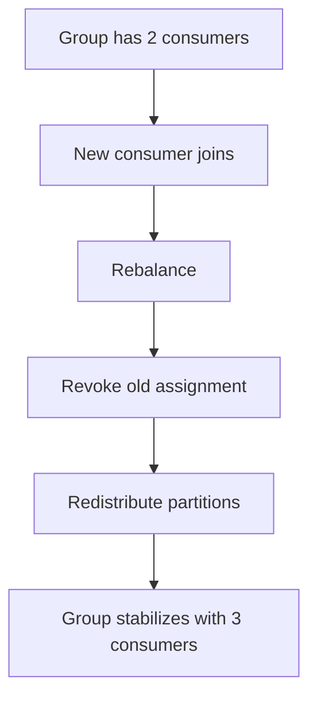

# Only One Consumer per Partition Within a Group

In Kafka, a partition at any given point in time is assigned to at most one consumer member of the same consumer group. This rule enables the group to share load while preserving read ordering within each partition. A single consumer can receive multiple partitions, but two consumers belonging to the same group do not simultaneously own the same partition in a stable assignment.

The scope of the rule is critical: it applies **within a single consumer group**. If two applications use two different `group.id` values, both groups can read the same partition. This is how Kafka supports multiple independent subscribers receiving the same event stream.

## 1. Partition Assignment Rule

Kafka distributes a topic's partitions among members participating in the same consumer group. Each partition has one owner in the group's assignment. A member can be assigned one or more partitions depending on the partition count, member count, subscriptions, and partition assignor.

For example, topic `orders` has six partitions and the `order-projection` group has three consumer members:

```text
Topic orders
  P0   P1   P2   P3   P4   P5
   |    |    |    |    |    |
   v    v    v    v    v    v
Consumer group: order-projection

  Consumer A: P0, P1
  Consumer B: P2, P3
  Consumer C: P4, P5
```

This is an illustrative assignment when partitions divide evenly across members. The partition assignor decides the actual distribution; do not rely on the P0, P1 order or a fixed mapping if the application does not actively control assignment.

If a group has six partitions but only two members, each member may receive three partitions. If the group has six members, each member may receive one partition. If the group has eight members, at least two members will not be assigned any partition of this topic.

| Topic partition count | Consumer members in group | Members able to process this topic concurrently |
|---:|---:|---:|
| 1 | 1 | 1 |
| 1 | 4 | 1; the remaining 3 members have no partition for this topic |
| 3 | 2 | 2; one member may receive two partitions |
| 6 | 3 | Up to 3 |
| 6 | 6 | Up to 6 |
| 6 | 9 | Up to 6; 3 members have no partition for this topic |

For a group subscribed to a single topic, the number of consumers that can actually process the topic concurrently cannot exceed the topic's partition count. When a group subscribes to multiple topics, consider the total number of subscribed partitions and per-topic assignments; one member can receive partitions from multiple topics.

## 2. A Partition Cannot Be Split Between Two Members of the Same Group

Suppose partition `P0` contains records at offsets 100, 101, 102, and 103. If `P0` is assigned to Consumer A in group `order-projection`, Consumer B in the same group will not be assigned `P0` in that assignment.

```text
orders-P0: 100 -> 101 -> 102 -> 103 -> 104 -> ...
             |
             +---- Consumer A (group order-projection)

Consumer B (same group): not assigned orders-P0
```

This allows Kafka to preserve record ordering within a partition for a consumer group. A consumer can process multiple partitions in parallel, but Kafka does not split a single partition into multiple independent consumer-member streams within the same group.

This rule does not mean a consumer only processes one partition. On the contrary, when the partition count exceeds the member count, a member typically receives multiple partitions. For example, a single consumer in a group can read all six partitions of a topic.

## 3. `group.id` Defines the Load-Sharing Scope

Consumers with the same `group.id` join the same group and split the partitions among themselves. Consumers with different `group.id` values form independent groups; each group has its own assignments and committed offsets.

For example, a topic with three partitions and two subscriber groups:

```text
                         Topic: order-events
                         P0     P1     P2
                          |      |      |
             +------------+------+------+------------+
             |                                      |
             v                                      v
     Group: order-projection                Group: fraud-detection
       Consumer A                              Consumer X
       Consumer B                              Consumer Y
       (A and B share P0-P2)                   (X and Y share P0-P2)
```

Each partition has only one owner within each group. Thus, `P0` can be read by Consumer A of group `order-projection` concurrently with Consumer X of group `fraud-detection`. The two groups do not compete for partition ownership with each other and can read the same records independently.

This is the distinction between two goals:

- **Scaling out a single workload:** run multiple consumers with the same `group.id` to split partitions and increase parallel processing capacity.
- **Broadcasting events to multiple applications:** each application uses its own `group.id` so each group receives the full event stream.

Do not create a new `group.id` for each replica if the goal is to share load across replicas. Doing so turns each replica into an independent subscriber, and every replica may read the entire topic.

## 4. Configuring Consumer Groups in Spring Kafka

Spring Kafka uses `group.id` to register consumers into a group. It can be declared via Spring Boot:

```yaml
spring:
  kafka:
    consumer:
      group-id: order-projection
      enable-auto-commit: false
```

Or specify the group ID directly on the listener:

```java
@KafkaListener(
        topics = "order-events",
        groupId = "order-projection"
)
public void handle(OrderEvent event) {
    orderProjectionService.apply(event);
}
```

Listeners that need to share load must join the same group. If `groupId` is set on the annotation, it defines the group for that listener. If not explicitly set, the listener can inherit the group ID from the consumer factory or Spring Boot configuration.

### Increasing consumer count with `concurrency`

With Spring Kafka, `ConcurrentMessageListenerContainer` can create multiple child containers. Each child container manages its own Kafka consumer. These consumers join the same group if they share the same group ID.

Concurrency can be configured via Spring Boot:

```yaml
spring:
  kafka:
    consumer:
      group-id: order-projection
    listener:
      concurrency: 3
```

Or by configuring the listener container factory:

```java
@Bean
ConcurrentKafkaListenerContainerFactory<String, OrderEvent>
orderListenerContainerFactory(
        ConsumerFactory<String, OrderEvent> consumerFactory) {

    var factory = new ConcurrentKafkaListenerContainerFactory<String, OrderEvent>();
    factory.setConsumerFactory(consumerFactory);
    factory.setConcurrency(3);
    return factory;
}
```

When a listener uses this factory, a concurrency of three creates up to three consumer members for the listener container. Kafka distributes the partitions subscribed by the group across those members. `concurrency` does not create additional partitions and cannot make a single partition be processed by three consumer members simultaneously.

For a topic with one partition, `concurrency: 3` still allows only one child consumer to receive that partition. The other two child consumers have no partition from this topic to process. For a topic with six partitions, all three child consumers can stay active, and each consumer can receive two partitions if the assignment is split evenly.

## 5. How Does a Consumer Receive Multiple Partitions?

A Kafka consumer member can be assigned multiple partitions. When a member receives multiple partitions, it polls those partitions and the listener container dispatches records to the listener according to the container's mechanism.

For example, a group with one member and a topic with four partitions:

```text
Topic orders
  P0   P1   P2   P3
   \    |    |   /
    \   |    |  /
     v  v    v v
       Consumer A
       (group order-projection)
```

Consumer A can read records from all four partitions. Ordering is guaranteed within each partition; there is no guaranteed global order across records belonging to different partitions. For example, record offset 20 of P2 may be delivered to the listener before or after record offset 45 of P0.

When a partition has multiple records, the consumer reads in offset order for that partition. If business logic requires ordering per order or aggregate, the producer typically needs a stable key so events with the same key are written to the same partition. Kafka only guarantees ordering within that partition; increasing the partition count or changing keys can affect how events are distributed.

## 6. What Happens When Consumers Exceed Partitions?

Suppose topic `payments` has two partitions, but the application configures six consumers in the same group:

```text
payments: P0, P1

Group payment-service:
  Consumer A -> P0
  Consumer B -> P1
  Consumer C -> no partition
  Consumer D -> no partition
  Consumer E -> no partition
  Consumer F -> no partition
```

Only two consumers can process this topic at a stable point in time. The remaining consumers remain group members but are not assigned any partitions of the topic. Increasing the number of Pods or increasing `concurrency` beyond the partition count does not proportionally increase throughput for a single topic.

Unassigned consumers may still be useful if the group subscribes to other topics that have unassigned partitions. However, if only `payments` is subscribed, the surplus consumers process no records from this topic.

When capacity planning for scaling, compare the partition count against actual concurrency. If the partition count is the bottleneck, consider increasing partitions or changing the processing design. Increasing partitions affects key distribution, so it should not be treated as a configuration change with zero impact on data.

## 7. When Should You Increase the Partition Count?

The partition count is the partition-level parallelism limit of a topic within a consumer group. If a topic has one partition, the group has only one consumer member receiving that partition. To have multiple consumer members process the topic concurrently, the topic needs multiple partitions.

For example, an order system needs up to four consumers processing concurrently:

```text
orders: 4 partitions

Group order-projection:
  Consumer A -> P0
  Consumer B -> P1
  Consumer C -> P2
  Consumer D -> P3
```

Increasing partitions has several consequences that must be evaluated:

- Kafka may trigger a rebalance to redistribute partitions across consumer members.
- For producers using keys, the key-to-partition mapping can change when the partition count changes. New events for the same key may be written to a different partition than older events.
- Kafka only guarantees ordering within a partition. If the same aggregate is routed to a different partition after adding partitions, the application must evaluate the impact on ordering between old and new events.
- Each partition incurs resource and operational overhead on brokers, such as log segments, file handles, metadata, and replication work.
- The partition count must fit throughput, record size, broker count, replication factor, and downstream processing capacity.

Therefore, design the partition count based on target throughput, required parallelism, and ordering requirements. Do not increase partitions solely to match a larger concurrency number.

## 8. Partition Assignment and Rebalancing

When a consumer joins a group, leaves a group, or the group changes subscriptions, Kafka may perform a rebalance. During this process, old assignments are revoked and new assignments are created to distribute partitions among the current members.

Situations that commonly trigger a rebalance include:

- A new consumer starts and joins the group.
- A consumer stops, fails, or loses connectivity.
- A consumer fails to poll for longer than `max.poll.interval.ms`.
- The group's subscriptions change.
- The partition count of a subscribed topic changes.
- A consumer is considered inactive according to the heartbeat and session timeout mechanism.

For example, when a group scales from two to three consumers:



After a rebalance, a partition may be assigned to a different consumer member. The old consumer must complete or stop work related to the revoked partition according to the container lifecycle. Committed offsets determine where the group resumes reading; uncommitted records may be re-read by the new owner.

Rebalances can temporarily increase latency because consumers must rejoin the group and receive new assignments. If the application continuously scales, restarts, or exceeds `max.poll.interval.ms`, the group may rebalance frequently and throughput will drop.

### Range, RoundRobin, Sticky, and CooperativeSticky

The partition assignor decides how partitions are distributed among members. Common strategies include:

| Assignor | General characteristics | When to consider |
|---|---|---|
| Range | Distributes per topic, typically grouping contiguous partitions to a member | Simple configuration; with multiple topics can produce uneven overall distribution |
| RoundRobin | Distributes partitions across topics sequentially to members | Can produce more balanced assignments when subscriptions are compatible |
| Sticky | Attempts to keep partitions on previous members when possible while balancing the assignment | Minimizes unnecessary owner changes when membership changes |
| CooperativeSticky | Combines sticky stability with cooperative rebalancing, allowing incremental revocation | Reduces group-wide stop-the-world pauses when application and configuration support it |

Exact assignor names and availability depend on the Kafka client version and deployment configuration. Do not assume all consumers use the same strategy if the application runs heterogeneous client types or differing subscriptions. When changing assignors, roll out compatibly across members and observe the rebalance process.

## 9. Keeping Processing Safe When a Partition Changes Owners

Because a partition can move to another member after a rebalance, consumers must properly handle the moment a partition is revoked or lost. Spring Kafka manages the consumer and listener container lifecycle, yet the application must still prevent asynchronous work from continuing to apply business side effects after the listener has returned and offsets have been committed.

With standard synchronous processing, the listener finishes work before the container acknowledges offsets according to `AckMode`. If the listener launches a background task and returns immediately, the container may consider the record processed while the task is still running. When the partition is assigned to another consumer, the old task may continue running concurrently with the new owner's reprocessing.

Unsafe example:

```java
@KafkaListener(topics = "orders", groupId = "order-projection")
public void handle(OrderEvent event) {
    executor.submit(() -> orderService.apply(event));
    // Listener returns before the business task completes.
}
```

In this example, the listener returns immediately after submitting. The container can commit the offset before `orderService.apply()` completes. If the application stops or the partition is reassigned, the business effect may be lost or duplicated.

A simpler approach is synchronous processing inside the listener:

```java
@KafkaListener(topics = "orders", groupId = "order-projection")
public void handle(OrderEvent event) {
    orderService.apply(event); // returns only after business processing completes
}
```

If asynchronous parallel processing is required, you must explicitly design completion tracking, offset ordering, partition pause/resume, and acknowledgment. Never acknowledge offsets past records whose work has not completed. For business logic writing to databases or calling external services, idempotency remains necessary to tolerate redelivered records.

## 10. Optimizing Concurrency in Spring Kafka

`concurrency` should be based on the partition count, record processing duration, and the capacity of backing systems. Increasing concurrency can improve throughput when the topic has enough partitions and downstream still has headroom. If there are few partitions, additional consumers will not increase per-topic parallelism.

Key considerations:

- **Partition count:** concurrency greater than a topic's partition count does not give that topic more active consumer members.
- **Processing duration:** slow listeners may require tuning `max.poll.interval.ms`, though raising timeouts is no substitute for handling rebalances properly.
- **Downstream capacity:** many concurrent consumers can overload databases or HTTP services.
- **Ordering:** different partitions are processed in parallel; if business logic requires global ordering, revisit partitioning and the processing model.
- **Process resources:** each child container has its own consumer, consuming network connections, buffers, and corresponding resources.
- **Replica count:** total concurrency across all replicas determines the potential number of consumer members in the group. For example, three Pods with concurrency two each can create six members.

Example of three replicas running with concurrency two:

```text
Pod A: consumer A1, consumer A2
Pod B: consumer B1, consumer B2
Pod C: consumer C1, consumer C2

Total: up to 6 consumer members in the same group
```

If the topic has four partitions, at most four members can receive partitions of that topic in a stable assignment. The remaining two members receive no partitions of this topic. Calculate concurrency at the whole-deployment level, not just by looking at `spring.kafka.listener.concurrency` on a single Pod.

## 11. Static Membership and Reducing Unnecessary Rebalances

Kafka supports static membership via `group.instance.id`. A member with a static identity can preserve its identity across short restarts; this can reduce unnecessary rebalances when instances restart within configured limits.

Within a group, `group.instance.id` must be unique for every active static member. If two consumers simultaneously use the same static ID, Kafka may fence/remove one member from the group or raise errors related to duplicate member identity. Generate IDs from a stable instance identity, such as a StatefulSet ordinal, and ensure different replicas receive distinct values.

Static membership does not change the rule that a partition has only one owner within a group. It only affects how Kafka identifies members and manages membership when a member leaves or returns. Nor does it replace a producer's `transactional.id`; the two ID types serve different mechanisms.

Enable static membership only when instance lifecycles and IDs are clearly managed. For workloads whose Pod names change continuously, evaluate whether static identity is genuinely stable and beneficial.

## 12. Observing Assignments and Consumer Groups

When you need to confirm which consumer owns which partition, inspect the actual assignment rather than looking only at replica counts or concurrency settings.

Kafka provides the `kafka-consumer-groups` command to inspect group state:

```bash
kafka-consumer-groups.sh \
  --bootstrap-server kafka-1:9092 \
  --describe \
  --group order-projection
```

The output typically shows topic, partition, current offset, log end offset, lag, and consumer/member or host details depending on the Kafka version. Use this output to verify:

- Whether every partition of the topic has an assignment in the group.
- Which consumer member owns each partition.
- Whether any member has no partitions assigned.
- Whether lag is concentrated on a single partition or member.
- Whether assignments are shifting continuously due to rebalances.

In Spring Kafka, you can observe listener container lifecycle logs, partition assigned/revoked events, and consumer metrics. When detailed assignment tracking is needed, the application can register listeners or event handlers appropriate for the Spring Kafka version to record assigned and revoked partitions.

Useful operational metrics include:

- Consumer group lag per partition.
- Consumer member count and assigned partition count.
- Rebalance frequency and duration.
- Listener processing time per partition or event type.
- Poll count, records per poll, and intervals between polls.
- Offset commit errors and retry counts.

If one partition shows steadily rising lag while others remain stable, the cause may be skewed key distribution, slow-processing records, or uneven downstream behavior. Adding consumer members will not necessarily fix a hot partition because that partition still has only one owner in the group.

## 13. Common Misconceptions

| Misconception | Correct understanding |
|---|---|
| Each consumer can only read one partition | A consumer can receive multiple partitions |
| Increasing consumers always increases throughput | Surplus consumers beyond the partition count will not receive additional partitions of that topic |
| A partition has only one consumer across the entire cluster | The rule applies per group; multiple independent groups can read the same partition |
| Increasing `concurrency` creates more partitions | `concurrency` only creates more consumer members in the group |
| Two consumers in the same group can split one partition | A partition is assigned to at most one member in a stable assignment |
| Different group IDs can be used per replica to scale | Different group IDs create independent subscribers; each group reads all subscribed partitions |
| Rebalances do not affect processing | Rebalances can revoke and reassign partitions, causing uncommitted records to be re-read |
| One owner per partition guarantees topic-wide ordering | Kafka guarantees ordering within each partition; there is no global order across multiple partitions |

## 14. Examples of Choosing Topology by Goal

### One application needing to scale order processing

Topic `order-events` has eight partitions. Run four service replicas, each with concurrency two. All eight consumer members use the same `group.id=order-projection`. Kafka can distribute the eight partitions across the eight members; each member processes one partition if the assignment is balanced.

### Two independent applications needing the same order events

Services `order-projection` and `fraud-detection` use two different group IDs. Each group has its own consumer members and independently splits the eight partitions internally. Both services receive all required events, independent of each other's progress.

### Topic with only one partition needing higher throughput

Increasing replicas from one to ten creates no additional partition-level parallelism. Determine whether partitions can be added while preserving ordering requirements. If all events require global ordering, a single partition may be a deliberate design choice and the parallelism limit is a consequence of that requirement. If only per-key ordering is needed, multiple partitions and a stable key can be used for parallelism across aggregates.

## 15. Implementation Guide

When designing a consumer group, follow this sequence:

1. Identify which services are independent subscribers. Each independent subscriber needs its own group ID.
2. Identify which replicas share load for the same workload. Those replicas must share a group ID.
3. Choose the partition count based on throughput and required parallelism while preserving per-key ordering requirements.
4. Set concurrency based on the total partitions assignable to the group and downstream capacity.
5. Deploy in a test environment and inspect actual assignments, checking for idle members and uneven partition distribution.
6. Monitor lag, rebalances, and processing times to tune partition counts or concurrency.
7. Ensure the listener finishes work before offsets are acknowledged; use idempotency to tolerate records redelivered after failures or rebalances.

The rule that a partition has only one consumer member within the same group is the foundation for how Kafka shares load and preserves partition ordering. When scaling a consumer, coordinate `group.id`, partition count, and concurrency properly; when multiple independent subscribers are needed, use a separate group for each subscriber. This structure makes it predictable which member processes which records, where parallelism limits lie, and how rebalances affect the application.
