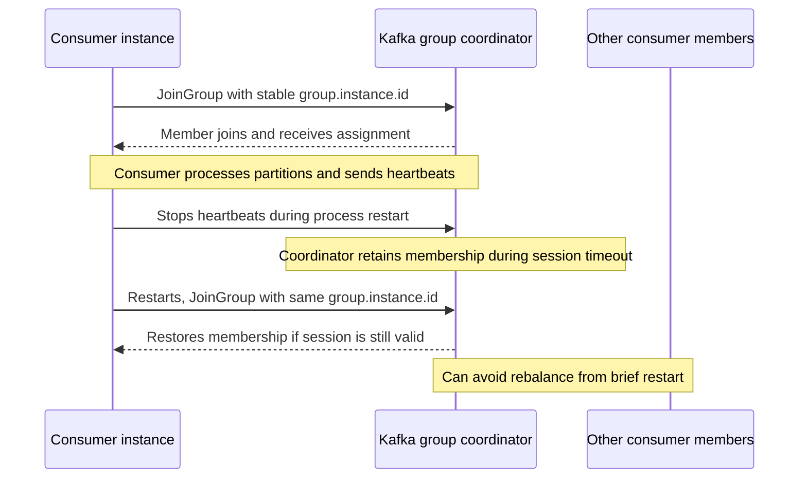

# Static Membership

Static membership is a mechanism that lets Kafka recognize a consumer instance by a persistent identifier across restarts. Instead of treating each startup as a brand-new member, a consumer can use `group.instance.id` to tell the group coordinator that it is the same instance that participated previously.

In a typical consumer group, a member usually receives an identifier assigned by the coordinator for its current session. When the process stops, misses heartbeats, or leaves the group, the coordinator may initiate a rebalance to redistribute partitions. With static membership, `group.instance.id` represents the instance's stable identity. If the instance restarts and rejoins while its session is still valid, Kafka can preserve its membership and avoid triggering a rebalance solely for that brief restart.

Static membership is useful for consumers running as stable instances, such as StatefulSets, VMs with fixed identities, or services with explicitly managed replicas. It helps cut down rebalances during short restarts or rolling deployments. However, this mechanism changes how Kafka detects a lost member: partitions may continue being held for the member while waiting out the session timeout. Consequently, misconfiguration can slow down failover or cause identity conflicts.

## 1. What Is Static Membership?

A Kafka consumer group distributes partitions across consumer members. Each member processes assigned partitions and maintains heartbeats with the group coordinator to prove it is alive.

With dynamic membership, a member usually joins with an identity managed by Kafka for the current session. When the member leaves the group or is detected as disconnected, the coordinator updates membership and may run a rebalance. When a new process starts, it is generally treated as a new join.

Static membership adds the `group.instance.id` property to identify a stable consumer instance. When configured:

- The consumer becomes a static member of the group.
- Instance identity stays stable across restarts.
- The coordinator can hold the membership slot for up to `session.timeout.ms` when the member temporarily stops sending heartbeats.
- If the same instance restarts and rejoins before the session expires, it can resume membership without causing a rebalance from that restart alone.
- If the session expires or the group changes in another way, the coordinator can still perform a rebalance.

Static membership was introduced in Kafka 2.3 via KIP-345. Both client and broker must support this feature; verify your Kafka client, broker, and Spring Kafka versions before enabling it in production.

## 2. Distinguishing Identifiers in a Consumer Group

The following properties serve different purposes and cannot replace one another:

| Property | Scope | Meaning |
|---|---|---|
| `group.id` | Consumer group | Name of the consumer group sharing offsets and coordinating partition assignments. |
| `group.instance.id` | One static member in the group | Stable identifier of an instance across restarts. |
| `member.id` | One group join session | Member identifier in the group protocol; managed by Kafka. |
| `client.id` | Kafka client | Label for logs, metrics, quotas, or client diagnostics. |
| `group.protocol` | Group protocol mechanism | Selects the consumer group coordination protocol supported by client/broker; not an instance identifier. |

`group.instance.id` must be unique among active consumer instances within the same `group.id`. Two different groups can have static members using the same ID string, yet within a single group two processes must never concurrently represent the same ID.

For example, a service with group ID `orders-service` and three instances can use:

| Instance | `group.id` | `group.instance.id` |
|---|---|---|
| Consumer 0 | `orders-service` | `orders-consumer-0` |
| Consumer 1 | `orders-service` | `orders-consumer-1` |
| Consumer 2 | `orders-service` | `orders-consumer-2` |

When instance `orders-consumer-1` restarts, it must reuse that exact ID. If it restarts with a new ID every time, Kafka treats it as a different static member and the benefit of preserving membership across restarts is lost.

Do not use a shared value such as `orders-consumer` for all pods. That creates conflicts because multiple processes claim the same static identity. Likewise, do not generate a random UUID on every startup if the goal is preserving identity across restarts.

## 3. How Does the Coordinator Handle Restarts?

With dynamic membership, a member leaving the group normally causes the coordinator to update group membership and initiate a rebalance. With static membership, Kafka can keep the member in the group until `session.timeout.ms` expires, even when the process has stopped or called close. This provides a window for the same instance to restart and resume under its old static ID.



If the instance returns before the session expires and no other group change forces a rebalance, the coordinator can recognize the static member without redistributing all partitions. If the instance does not return before the session timeout expires, the coordinator removes the member from the group and performs a rebalance so partitions can be assigned to other members.

Static membership does not guarantee partitions always stay on the exact same consumer in all situations. Rebalances can still occur when member count changes, subscriptions change, topic/partition counts change, sessions expire, or the assignor or group protocol requires redistribution.

### Benefits and costs of the wait window

While the coordinator holds membership for a static member that stopped heartbeating, partitions may still be considered owned by that member. Other members are not necessarily permitted to take over those partitions immediately. This reduces rebalances during short restarts, yet it can temporarily stall part of the workload if the instance does not return.

Thus, static membership trades part of rebalance cost for a wait window to let the member recover. For systems needing fast failover, an overly long `session.timeout.ms` can increase outage duration. For systems with frequent short restarts that are sensitive to rebalances, a suitable wait window can eliminate unnecessary partition movement.

## 4. Configuring group.instance.id in Spring Kafka

Spring Boot lets you pass Kafka client properties via `spring.kafka.consumer.properties`. Example configuration for a consumer instance:

```yaml
spring:
  kafka:
    consumer:
      group-id: orders-service
      properties:
        "[group.instance.id]": orders-consumer-0
        "[session.timeout.ms]": 45000
        "[heartbeat.interval.ms]": 3000
    listener:
      concurrency: 1
```

The `session.timeout.ms` and `heartbeat.interval.ms` values are examples only. Actual values must stay within broker limits and fit your restart time, network latency, and acceptable failure detection time. `heartbeat.interval.ms` must be lower than `session.timeout.ms`; standard practice sets the heartbeat interval to no more than roughly one-third of the session timeout.

If constructing `ConsumerFactory` in Java, add the properties directly:

```java
Map<String, Object> consumerProperties = new HashMap<>();
consumerProperties.put(ConsumerConfig.BOOTSTRAP_SERVERS_CONFIG, bootstrapServers);
consumerProperties.put(ConsumerConfig.GROUP_ID_CONFIG, "orders-service");
consumerProperties.put(
        ConsumerConfig.GROUP_INSTANCE_ID_CONFIG, "orders-consumer-0");
consumerProperties.put(ConsumerConfig.SESSION_TIMEOUT_MS_CONFIG, 45_000);
consumerProperties.put(ConsumerConfig.HEARTBEAT_INTERVAL_MS_CONFIG, 3_000);

ConsumerFactory<String, OrderEvent> consumerFactory =
        new DefaultKafkaConsumerFactory<>(consumerProperties);
```

In this example, the ID `orders-consumer-0` must come from deployment configuration or a stable identity source. Do not hard-code the exact same value into every replica of a multi-instance service.

### Using ConcurrentMessageListenerContainer

When Spring Kafka uses `ConcurrentMessageListenerContainer`, one parent container can spawn multiple child consumers per `concurrency`. Each child consumer is a separate member of the group and needs its own `group.instance.id`. Spring Kafka versions that support static membership for concurrent containers append a child-consumer index suffix to the base `group.instance.id` to produce unique IDs. Verify your running version's behavior and inspect logs/effective consumer properties after deployment.

For example, a base ID may be expanded into child IDs by container index. Even when the framework supports suffixing, the base ID must remain unique across application instances. If two pods share the same base ID, their corresponding child IDs will still collide.

With `concurrency: 1`, there is only one child consumer in the container and identity management is simpler. If increasing concurrency, calculate total static members across all replicas, inspect the actual ID of each child consumer, and ensure no two members collide within the same group.

## 5. Choosing Stable Static IDs by Deployment Environment

A static member identity must survive restarts of the same logical instance. How IDs are provisioned depends on the deployment platform:

| Environment | Suitable ID generation | Considerations |
|---|---|---|
| Kubernetes StatefulSet | Workload name plus ordinal, e.g., `orders-consumer-0` | Pod ordinal stays stable across pod recreations in the same StatefulSet. |
| Fixed VMs | Node name or stably managed instance ID | Avoid hostnames that can change when machines are recreated. |
| Bare metal | Node identifier managed by deployment tooling | Ensure one ID is never issued to two processes simultaneously. |
| Kubernetes Deployment with ephemeral pods | Use only if a mechanism issues and retains stable identities | Pod names usually change on recreation; new random IDs defeat static membership. |
| Autoscaling with continuously changing replicas | Weigh benefits carefully against dynamic membership | Must allocate/revoke IDs safely and avoid collisions during scaling or instance replacement. |

With a three-replica StatefulSet, base IDs can follow the ordinal sequentially. When pod `orders-consumer-1` is recreated on another node, it still uses the same static ID. When scaling from three to four replicas, the new instance must receive an unused ID in the group.

Never use `group.id` as `group.instance.id` for all members. `group.id` identifies the group; `group.instance.id` identifies a specific member inside the group. The two values serve two different identity levels.

### Rolling deployments

Static membership can reduce rebalances when each instance restarts faster than `session.timeout.ms`. A rolling deployment procedure should:

1. Keep the static ID unchanged for the logical instance being replaced.
2. Run only one process with a given static ID at any moment.
3. Let the listener stop accepting new work and finish in-flight processing per shutdown policy.
4. Restart the instance within the chosen session timeout if membership preservation is desired.
5. Monitor group membership, assignments, and consumer lag during the rollout.
6. Confirm there are no `FencedInstanceIdException` errors or partitions stalled due to a member not returning.

If a deployment starts the new process before the old process stops completely and both share the same static ID, Kafka may fence one of them. Configure rollouts to avoid two concurrent owners of the same identity.

## 6. Tuning session.timeout.ms and heartbeat.interval.ms

`session.timeout.ms` is how long the coordinator waits for heartbeats before marking a member lost. For a static member, this interval is also how long membership is retained when the member temporarily stops heartbeating. It is a key parameter balancing tolerance for brief restarts against detection speed for real failures.

`heartbeat.interval.ms` sets how often the consumer sends heartbeats. Heartbeats must be frequent enough to confirm liveness while avoiding excessive sensitivity to minor network jitter. Common practice sets heartbeat interval lower than session timeout and typically no higher than about one-third of `session.timeout.ms`.

Brokers constrain session timeout values via settings like `group.min.session.timeout.ms` and `group.max.session.timeout.ms`. Consumers sending out-of-range values may be rejected when joining the group. Check broker settings and platform policies before changing values.

### Choosing session timeout based on restart duration

Measure the time from when the old process stops heartbeating until the new process is ready to join the group. This duration may include:

- Stopping listeners and finishing in-flight records.
- JVM shutdown or container termination time.
- Scheduler time to create a new pod/VM.
- Loading configuration, initializing Spring `ApplicationContext`, and connecting to Kafka.
- DNS, TLS/SASL handshake, and metadata readiness.

To preserve membership across restarts, session timeout must exceed typical expected downtime with margin for variance. Yet the longer the session timeout, the longer the group waits to release partitions to other members when an instance genuinely dies.

For example, if a normal restart takes around 20 seconds, a 45-second session timeout provides buffer. If the process crashes permanently, the group may have to wait nearly the full session window before rebalancing. Numbers must come from measurements and broker limits; do not copy example configs mechanically.

### Relationship with max.poll.interval.ms

`max.poll.interval.ms` limits the interval between `poll()` calls. It reflects application progress fetching records and processing batches. `session.timeout.ms` reflects how long the coordinator waits for heartbeats.

With dynamic members, exceeding `max.poll.interval.ms` can cause the consumer to leave the group and trigger partition redistribution. With static members, when `max.poll.interval.ms` is exceeded, the client stops heartbeating; the coordinator waits until `session.timeout.ms` expires before evicting the member and redistributing partitions. Consequently, static membership can extend how long partitions remain held if a listener hangs or processes too slowly.

Do not raise `max.poll.interval.ms` or `session.timeout.ms` merely to hide slow listeners. Measure batch processing times, lower `max.poll.records`, optimize downstream calls, or design controlled asynchronous processing. Ensure consumers keep polling on cadence and committing offsets after business work completes.

## 7. Static Membership and Rebalance Strategies

Static membership and partition assignors solve two related but distinct problems:

- Static membership keeps member identities stable and can avoid rebalances when the same instance returns within the session timeout.
- The partition assignor decides how partitions are distributed across members when the group performs an assignment.

`RangeAssignor`, `RoundRobinAssignor`, and `CooperativeStickyAssignor` are different assignment strategies. `CooperativeStickyAssignor` supports cooperative rebalancing, reducing how many partitions must be revoked and moved in a single rebalance. It can complement static membership, yet it does not replace `group.instance.id` and does not eliminate all rebalances.

Rebalances can still occur when:

- A static member does not return before `session.timeout.ms` expires.
- Replica count scales up or down.
- Topic subscriptions or pattern subscriptions change.
- A topic's partition count changes.
- A member is fenced due to a duplicate `group.instance.id`.
- The group protocol or assignment strategy requires redistribution.
- The coordinator/broker experiences an issue or group metadata changes.

Do not expect static membership to freeze assignments regardless of infrastructure changes. Inspect actual partition assignments after every deployment or scaling event.

## 8. How Does Static Membership Affect Offsets and Delivery Guarantees?

Static membership changes only how members are identified and how group membership is managed. It does not change offset semantics, commit mechanics, producer acknowledgments, or listener delivery guarantees.

The following still require explicit design:

- `enable.auto.commit` determines whether the Kafka client periodically auto-commits offsets.
- Spring Kafka `AckMode` determines whether the listener container commits per record, batch, or manual acknowledgment when auto-commit is off.
- Idempotency remains necessary because a consumer can reprocess records if business work completed before offsets were committed.
- Kafka transactions still require separate configuration when combining consume-transform-produce and offset commits in one Kafka transaction.
- Retries and DLTs remain governed by error handlers/retry topic policies.

For example, a static member restarting within session timeout may keep its membership and avoid a rebalance, yet if the process stopped after committing to the database and before committing the Kafka offset, records can still be redelivered. Static membership does not prevent business duplicates. Consumers still need `eventId`, an inbox table, or idempotency keys at the target system.

## 9. Monitoring Static Membership in Production

To tell whether static membership is helping or slowing down failover, monitor both group state and application state.

| Scope | Signals to monitor | Meaning |
|---|---|---|
| Group membership | `group.id`, `group.instance.id`, member ID, member count, and join/sync state | Confirms identities are unique and members join the right group. |
| Rebalances | Rebalance count, rebalance duration, partitions revoked/assigned | Evaluates whether static membership reduces restart rebalances. |
| Heartbeat/session | Heartbeat failures, session timeouts, member absence duration | Detects dead members, flaky networking, or overly long/short session timeouts. |
| Poll/listener | Poll interval, processing duration, `max.poll.interval.ms` violations | Detects consumers missing poll cadence or hung listeners. |
| Partition/lag | Assignment per member, per-partition lag, record age | Detects held partitions not being processed or imbalanced consumers. |
| Identity errors | `FencedInstanceIdException` and join-group errors | Detects duplicate IDs or two processes sharing an identity. |
| Deployments | Restart duration, rollout overlap, replica counts, and per-instance IDs | Correlates group errors with deployment schedules or autoscaling. |

Application logs should include `group.id`, `group.instance.id`, `client.id`, application instance, start/stop timestamps, partition assignments, and rebalance reasons. Never log credentials or secrets. If Spring Kafka uses concurrency, log the effective ID of each child consumer to catch suffixing or configuration collisions.

Alert on rebalance spikes, `FencedInstanceIdException`, prolonged member absence, rising lag on held partitions, and failover durations exceeding SLAs. A brief rebalance during a rollout can be normal; evaluate against baselines and actual impact.

## 10. Scenario Runbooks

### Rolling restarts still trigger frequent rebalances

1. Verify whether consumers configure `group.instance.id` and whether client/broker support static membership.
2. Check whether the ID stays identical across restarts of the same logical instance.
3. Measure the gap from when the old process stops heartbeating until the new process joins the group.
4. Compare that duration against `session.timeout.ms` and check if sessions expire before instances return.
5. Check whether subscriptions, partition counts, assignors, or other members changed simultaneously.
6. Adjust rollout pacing or session timeout based on measurements; monitor rebalances and lag afterward.

### `FencedInstanceIdException` appears

1. Record `group.id`, `group.instance.id`, client ID, pod/VM, and exception timestamp.
2. Locate all running processes using the same `group.instance.id` in the group.
3. Check rollout overlap, autoscaling, replica restarts, and identity generation logic.
4. Stop the stale process or misconfigured process per deployment procedure.
5. Assign a unique ID per logical instance and restart the consumer.
6. Verify each member joins the group with a distinct static ID and fencing errors cease.

### Partitions are held too long when a consumer is inactive

1. Verify whether the member is a static member and which `group.instance.id` owns the partitions.
2. Check the last heartbeat, `session.timeout.ms`, and when the member stopped.
3. Determine whether the process is restarting slowly, hung, or isolated on the network.
4. If the instance cannot return, wait out the session timeout per policy or execute stop/recovery via group admin procedures.
5. After partitions are reassigned, check lag and verify the new consumer resumes from committed offsets.

### Consumer is hung but not yet replaced

1. Check processing times between polls and `max.poll.interval.ms`.
2. Inspect thread dumps, downstream latency, and blocking calls.
3. Check whether the static member is waiting out `session.timeout.ms` before the coordinator evicts it.
4. Fix the hung listener, shrink batch size, or move long work into a controlled workflow.
5. Monitor partition assignments and failover time after the consumer recovers.

### Scaling replicas creates duplicate IDs

1. List all replicas and their effective `group.instance.id` values.
2. Identify which ID is claimed by multiple processes in the same group.
3. Verify whether the template/StatefulSet/Deployment uses a stable ordinal or instance ID.
4. Provision a distinct ID for new replicas before adding them to the group.
5. Re-check child consumer IDs if listener containers use concurrency greater than one.

## 11. Static Membership Rollout Procedure

Do not turn on static membership across the board without validating identities and restart behavior. A controlled rollout follows these steps:

1. Confirm Kafka broker, Kafka client, and Spring Kafka versions support static membership.
2. Identify logical consumer instances and a stable ID source across restarts.
3. Enumerate IDs for all replicas and child consumers; verify group-wide uniqueness.
4. Measure actual restart durations and pick `session.timeout.ms` within broker limits.
5. Check `heartbeat.interval.ms`, `max.poll.interval.ms`, shutdown timeout, and listener processing time.
6. Test in staging: restart a member within session timeout, restart longer than session timeout, abruptly kill a process, and test duplicate ID handling.
7. Monitor rebalances, partition assignments, lag, and exceptions in each test.
8. Roll out in small batches, verify stability, and then expand.

In testing, validate both sides: do short restarts avoid rebalances, and when a member truly dies, are partitions released within acceptable SLA limits? Testing only short restarts can hide the risk of delayed failover from an overly long session timeout.

## 12. Static Membership Verification Matrix

| Phase | Operational question | Evidence to retain |
|---|---|---|
| Identity | Does every instance in the group have a unique, stable `group.instance.id`? | Replica/ordinal-to-static-ID mapping. |
| Configuration | Do Kafka client, broker, and Spring Kafka support the feature? | Versions, effective consumer properties, and broker session limits. |
| Restart | Does the instance return before session timeout expires? | Restart durations, heartbeat timelines, and join events. |
| Failover | If an instance truly dies, are partitions reassigned within SLA? | Session expiry, rebalance duration, and lag. |
| Concurrency | Do child consumers get distinct IDs when containers spawn multiple children? | Effective `group.instance.id` of each consumer. |
| Scale/rollout | Do no two processes hold the same static ID at once? | Deployment overlap, replica list, and fencing exceptions. |
| Poll/process | Does the listener poll on cadence and finish within `max.poll.interval.ms`? | Poll intervals, processing durations, and thread health. |
| Delivery | Are offset commits and idempotency managed independently of membership? | Committed offsets, event IDs, and business outcomes. |

Static membership fits consumers with stable identities where brief restarts frequently cause costly rebalances. Effectiveness depends on issuing unique IDs, preserving them across restarts, and choosing an appropriate session timeout. During rollout, monitor both rebalance reduction and failover latency together; fewer rebalances help only if the group still recovers from truly lost members within an acceptable timeframe.
